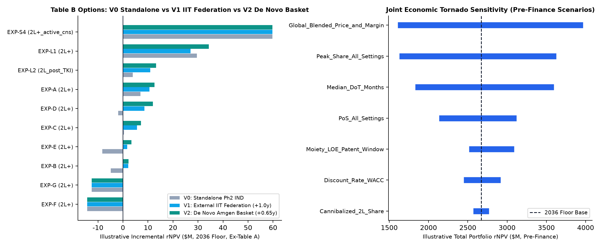
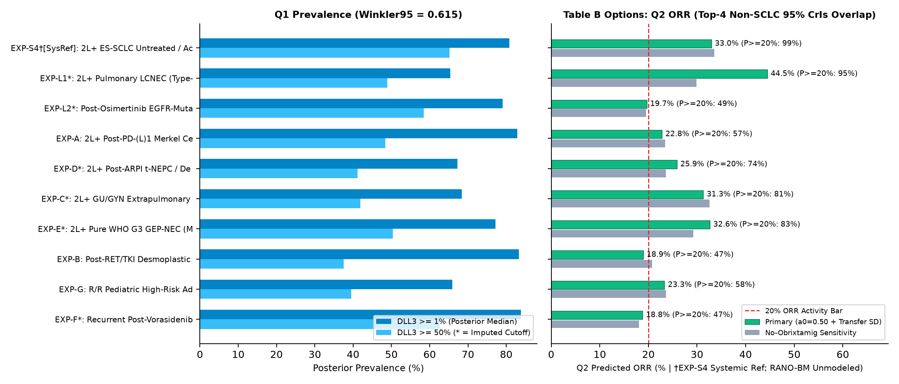
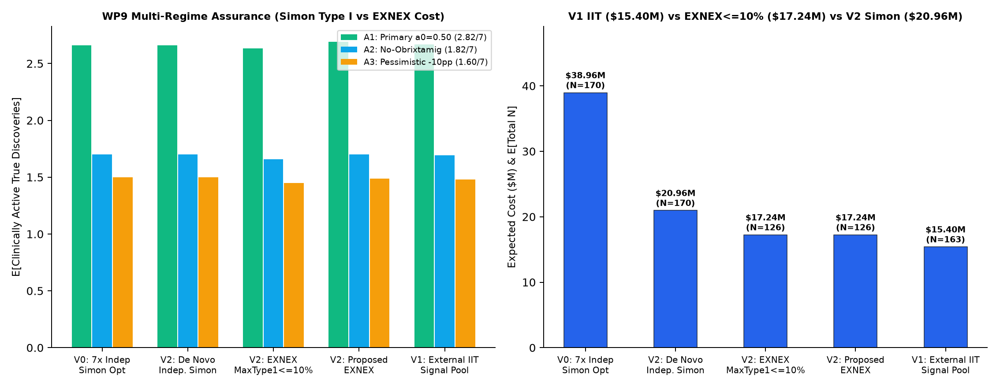

# Biostatistics, Clinical Development & Portfolio Presentation Playbook: AMG 757 (`Tarlatamab` / `IMDELLTRA`) `v4.3.2`

**Companion Editable Widescreen Slide Deck (`18` Slides, Zero-Drift Artifact-Driven)**:
- `AMG757_Biostatistics_Evidence_Model_v4_3_EN.pptx` (built programmatically from `results_v4/` via `build_amg757_biostat_pptx.py` and locked against drift by `tests/test_doc16_zero_drift.py`)
- **Live Interactive Backup During Q&A**: `AMG757_Tarlatamab_V4_Evidence_Studio.html`

---

## 1. Executive Thesis & Audience Strategy (`30-Minute Slot = 20 Min Talk + 10 Min Q&A`)

1. **Core Strategic Message (State in the First 60 Seconds)**:
   - Nearly all committed expansion value for `IMDELLTRA` sits inside **`Table A` (`$2,610.8M` under the shared `2036-05-16` `PHS Act §351(k)(7)` biologic floor; `$3,306.6M` under `2039` patent protection)** across **`12` active/committed SCLC expansion/lifecycle studies** (`5` Phase 3 + `7` combination/subcutaneous, including `2` partner-sponsored studies) plus `7` historical baseline studies (`= 19` registry entries).
   - Among new incremental options (**`Table B`**), **`#1 EXP-S4` (`ES-SCLC` Active Brain Mets, `NCT07402343`, `N=35`, `+$59.7M`, `TRIG-06` 3-zone clinical gate `>=12/35` Go / `8..11/35` subgroup review [`-$21.71M` vs binary `-$34.01M`] / `<8/35` halt)** and **`#2 EXP-L1` (`Pulmonary LCNEC`, `IFCT NCT06937905`, `+$27.1M` `V1` / `+$34.3M` `V2`, gated on an `N=15` futility check)** carry the actionable upside.
   - Because `NCT06788938` is a single-center UCLA study (`N=29`, `ACTIVE_NOT_RECRUITING`) rather than an Amgen master basket, standalone INDs across the `7` rare extra-pulmonary cohorts (`EXP-A..G`) lose **`-$34.6M` (`Route V0`)** — making **stage-gated signal federation across `11` open academic IITs (`N=517`, `Route V1 = +$1.8M` base / `-$4.3M` at `0.75` supply attrition; `EVSI = +$12.94M` [`$12.35M` exact `2036` LOE])** before funding **`Route V2` (`$20.96M` `Shared_Protocol_Independent_Simon` or `$17.24M` `EXNEX<=10%`)** the disciplined path.

---

## 2. Slide-by-Slide Speaker Script (`Slides 1–18`)

| Slide | Deck Title (`AMG757_Biostatistics_Evidence_Model_v4_3_EN.pptx`) | Target Time | Key Visual / Artifact Anchor & Verbatim Speaker Talking Points |
| :---: | :--- | :---: | :--- |
| **1** | **Title & Executive Headline (`Canonical v4.3.2`)** | `0:00–1:00` | Frame the three pillars of credibility: `260` machine-verified provenance rows + `120` enriched `DLL3` trials, zero composite ML weights in `Table B`, and `100%` artifact-compiled numbers (`$2,610.8M` `Table A` vs `V0/V1/V2` `Table B`). |
| **2** | **`01 · Registry Reality & Audit Evolution (v3.2 -> v4.3.2)`** | `1:00–2:15` | Lead candidly with our registry audit: `NCT06788938` is a `29`-patient UCLA study (`ACTIVE_NOT_RECRUITING`), and Amgen currently sponsors `0` active non-SCLC trials beyond completed `DeLLpro-300`. Explain why `v4.3.2` replaces fictional basket enrollment with realistic `Route V1` (federating `11` open IITs) vs `Route V2` (de novo Amgen master basket). |
| **3** | **`02 · WP1 Provenance Store & Enriched 120-Trial CT.gov Snapshot`** | `2:15–3:15` | Show the `260`-row split: `208` verbatim value-in-excerpt `verified` (`SHA-256` locked), `25` dual-reviewed `verified_source_only`, and `27` bounded `analyst_estimate`, plus `120/120` `DLL3` trials enriched offline (`Rojo SC16 >=25%`, `TAHOE SP347 >=75%`, `DeLLphi-305` OS HR `0.42 [0.32–0.54]`). |
| **4** | **`03 · Primary Human Biopsies, TME & 60k-Cell Clinical SCLC Atlas`** | `3:15–4:15` | Highlight `2,215` primary patient biopsies (explaining why `t-NEPC` `DeLLpro-300` monotherapy yielded `22.2%` ORR due to cold `TME = 0.358`, motivating `+ AMG 509` in `NCT07111507`) and `60,026` clinical SCLC single cells (disqualifying `CD99`/`BSG` T-cell fratricide). |
| **5** | **`04 · Q1 Hierarchical Multinomial Surface DLL3 Prevalence`** | `4:15–5:30` | `4`-chain `NumPyro NUTS` across `27` human IHC studies (`max_rhat < 1.01`, `0` divergences) harmonizes `SP347` vs `SC16/E3J5R/Abcam` cutoffs with **`100.0%` study-level `95%` LOSO coverage** (`Winkler95 = 0.615`), flagging `ge50_imputed_flag = True` wherever `>=50%` is imputed. |
| **6** | **`05 · Q2 Cross-Agent Power Prior (a0=0.50), 4-Way CrI Overlap & Scope`** | `5:30–7:00` | Modality-pure `15`-cohort `DLL3` TCE `EXNEX` (`0` ADCs, `100%` LOCO coverage, `Winkler95 = 0.510`). Emphasize two biostatistical guardrails: (1) under `a_0 = 0.50`, `LCNEC` (`44.5% [17.0%, 81.3%]`), `GEP-NEC` (`32.7%`), `GU/GYN` (`31.3%`), and `t-NEPC` (`25.9%`) **statistically overlap (`95% CrI`)**; (2) `EXP-S4` (`33.0%† [23.3%, 42.0%]`) is tagged **Systemic SCLC Reference Only†**, never intracranial `RANO-BM`. |
| **7** | **`06 · WP2 Leak-Free PE1 Discovery Back-Test & Sealed P5 Spec`** | `7:00–8:15` | On `PE1_new_indication` (`32` antigens, `178` post-cutoff events on pairs with `0` prior trials), frozen pre-cutoff `P5` (`(16, 8) tanh lbfgs alpha=8.0 max_iter=300`, sealed in `FREEZE-2026-P5-SPEC`) achieves `AUPRC = 0.378` vs `P1 = 0.307` (**Holm `p = 0.0042`**), while `M5 (0.501) - P5 (0.378) = +0.123` directly quantifies post-`T` trial hotspot leakage. |
| **8** | **`07 · Pre-Registered WP2.5 Gate & Continued Q5 Retirement`** | `8:15–9:15` | Because `M4_kg_plus_omics` (`0.444`) did not beat `M5_omics_only` (`0.501`) and within-NE (`10` events) has `80%`-power `MDE = +0.441 AUROC`, `wp25_passed = False` stands: **`Q5` contributes `0` columns to `Table B`**. |
| **9** | **`08 · Table A: 12 Active/Committed SCLC + 7 Historical Baseline = 19 Studies`** | `9:15–10:30` | Walk through `EXP-S1` (`$2,145.6M`: `DeLLphi-305` + `DeLLphi-312`), `EXP-S2` (`$23.4M`: `+ZL-1310 NCT07531095`, `DeLLphi-311`, `+YL201 NCT06898957`, `DeLLphi-310 SC`), and `EXP-S3` (`$441.8M`: `DeLLphi-306` + `PrECOG NCT07637513`) = **`$2,610.8M` (`2036` floor) / `$3,306.6M` (`2039` patent)** net of `-$469.3M` `2L` cannibalization (`2` of `12` active studies partner-sponsored). |
| **10** | **`09 · Table B: 10 Incremental Options Across V0 / V1 / V2`** | `10:30–12:00` | Walk down `#1 EXP-S4` (`NCT07402343`, `N=35`, `+$59.7M`), `#2 EXP-L1` (`IFCT NCT06937905`, `+$29.6M` `V0` / `+$27.1M` `V1` / `+$34.3M` `V2`), `#3 EXP-L2` (`NCT06830694`, `+$10.9M` `V1`), `#4 EXP-A` (`MCC`, `+$10.6M` `V1`), `#5 EXP-D` (`t-NEPC`, `-$1.9M` `V0 -> +$8.6M` `V1`), `#6 EXP-C` (`GU/GYN`, `+$5.6M` `V1`), `#7 EXP-E` (`GEP-NEC`, `-$8.3M` `V0 -> +$1.7M` `V1`), `#8 EXP-B` (`MTC`, `+$2.2M` `V1`), `#9 EXP-G` (`-$12.5M` direct), `#10 EXP-F` (`-$14.3M`). |
| **11** | **`10 · Dollar Portfolio Waterfall, V1 Supply Sensitivity & Bayesian EVSI`** | `12:00–13:15` | Contrast rare non-SCLC (`EXP-A..G`): `V0 = -$34.6M` vs `V1 (0.90 base) = +$1.8M` vs `V1 (0.75 supply attrition) = -$4.3M` vs `V2 = +$10.6M`. Highlight **`EVSI = +$12.94M` [`$12.35M` exact `2036` LOE]** from gating `V2` cohorts on open IIT readouts (`+$3.48M` on `LCNEC N=15` futility check). |
| **12** | **`11 · Pediatric Statutory Precision: EXP-G Neuroblastoma`** | `13:15–14:15` | Separate three statutes cleanly: `FD&C Act §529 PRV = $0.0M` (approved moiety bar), mandatory `PREA / RACE §505B = 0.0y` compliance obligation, and voluntary `BPCA §351(m)` Written Request `= +0.5y` franchise exclusivity (`+$184.8M` base tail, netting `+$172.3M` on `EXP-G`). |
| **13** | **`12 · WP9 Cohort-Specific Designs & Type I vs Cost Trade-Off`** | `14:15–15:30` | Show why `Naive_Exchangeable_BHM` (`33.43%` worst-cohort Type I) is unacceptable, and compare `Shared_Protocol_Independent_Simon` (`Max N=217`, `$20.96M`, `<=4.99%` Type I; `FixedN20 = $16.66M`), `EXNEX<=10%` (`Max N=140`, `$17.24M`, `<=8.25%` Type I), and `Federated_IIT_Signal_Pool_V1` (`N=163`, `$15.40M`). |
| **14** | **`13 · WP9 Multi-Regime Bayesian Assurance Sensitivity (A1 / A2 / A3)`** | `15:30–16:30` | Show expected discoveries across `A1 = 2.82/7`, `A2 = 1.82/7` (`No-Obrixtamig`), and `A3 = 1.60/7` (`LOCO-0`): `EXNEX` beats `Simon` on FWER-adjusted power **only when `>=3/7` cohorts are truly active**, so under conservative priors (`1–2` active) `Independent Simon` is safer for registration. |
| **15** | **`14 · Q4 Unbiased Combination Audit & Mechanistic Regimens`** | `16:30–17:15` | Disclose `Q4 recall@50 = 0.000` across `N = 983` (`AUROC = 0.611`) and `N = 1,628` (`AUROC = 0.732`) pre-2023 drugs, positioning `+ZL-1310` (`NCT07531095`), `+YL201` (`NCT06898957`), and `+AMG 509` (`NCT07111507`) on clinical/mechanistic biology rather than black-box recall claims. |
| **16** | **`15 · Appendix B (Q6): 3-Track Escape Biophysics & Ion Guard`** | `17:15–18:15` | Show `<=14 nm` `AlphaFold` `CD45`-exclusion gate (`DLL3 = 11.78 nm`) + `Ion Guard` demoting `KCNB2` (`0.0467`) and `SCN3A` (`0.0371`), leaving **`DLL3 + IGSF9` (`0.4745`, `13.4 nm`, `1.18%` TIL)** as `#1` unmasked dual-`CD3` `OR`-gate candidate. |
| **17** | **`16 · 41-Record Append-Only Ledger, Separated Scorecards & Bitcoin .ots`** | `18:15–19:15` | Show `2026_11.jsonl` (`10` rows, block `#975,929`), `2026_11b.jsonl` (`13` rows, block `#975,963`), and `2026_11c.jsonl` (`18` rows, blocks `#976,004` & `#976,009`; `41` total records, `3/3 BITCOIN_POW_VERIFIED`), with **`5` `q2_empirical_model` forecasts** strictly separated from **`4` `analyst_prior` forecasts** (`FCST-17..20`). |
| **18** | **`17 · Study Team Governance, Maintenance SOP & v4.3.2 Studio`** | `19:15–20:00` | Close with the `4` concrete portfolio recommendations (`EXP-S4`, `EXP-L1` `N=15` gate, `Route V1` IIT signal federation before `V2`, and `BPCA` Written Request evaluation) and quarterly `make watch-trials && make verify-fast && make bundle-audit` governance cadence. |

---

## 3. Red-Team Defense Matrix (Biostatistics, Clinical Ops, Regulatory & Finance)

| Stakeholder Challenge | Crisp Quantitative Answer (`v4.3.2`) |
| :--- | :--- |
| **Biostatistics:** *"Does `EXNEX` always beat `Independent Simon` in the basket?"* | **No — and Slide 13–14 shows the exact crossover.** `EXNEX` (`$17.24M`, `<=8.25%` mixed-null Type I) only beats `Simon` on FWER-adjusted power when **`>=3 of 7`** cohorts are active (`A1 = 2.82/7` is right at the boundary; `A2 = 1.82/7` and `A3 = 1.60/7` favor `Shared_Protocol_Independent_Simon` at `$20.96M` with `<=4.99%` Type I). Also note `~$4.3M` of `EXNEX`'s cost edge comes from `N=20` cap (`FixedN20 Simon = $16.66M`), not borrowing alone. |
| **Biostatistics:** *"How sensitive is `LCNEC` (`#2`) to cross-agent `obrixtamig` borrowing?"* | Highly sensitive because tarlatamab has `0` direct LCNEC trials (`DAREON-5` is `7/10` on `obrixtamig`): `Q2` median shifts `50.3%` (`a_0=1.0`) -> **`44.5% [17.0%, 81.3%]` (`a_0=0.50`)** -> `29.9%` (`No-Obrix`) -> `28.3%` (`LOCO-0`). That is why we mandate a `15`-patient futility gate (`<=2/15` stop; `EVSI = +$3.48M`). |
| **Neuro-Oncology:** *"Why is `EXP-S4` (`33.0%†`) marked with a dagger?"* | `Q2` models systemic `RECIST` ORR; untreated brain metastases in `NCT07402343` (`N=35`) use intracranial `RANO-BM`. We tag `33.0%†` as a systemic SCLC reference, coupling `EXP-S4` `rNPV` (`+$59.7M`) via conservative `0.85×` intracranial translation (`28.1%`) and tracking `NCT07402343` under `FCST-2026-17` (`analyst_prior`, `>=12/35` trigger). |
| **Clinical Ops:** *"Why did two earlier academic IITs (`GETNE`, `NCI`) withdraw, and how does `Route V1` handle that?"* | Drug-supply/contracting attrition is real in rare-tumor IITs. We modeled an explicit **`0.75` drug-supply attrition sensitivity** alongside `0.90` baseline (`V1` rare non-SCLC shifts `+$1.8M -> -$4.3M`, still saving `>$30M` vs standalone `V0 = -$34.6M`). |
| **Regulatory / Finance:** *"Can pediatric neuroblastoma (`EXP-G`) earn a `$100M+` Rare Pediatric PRV?"* | **No (`$0.0M`).** Under `FD&C Act §529(a)(4)(A)`, any moiety already approved (`2024-05-16` adult SCLC BLA) is statutorily ineligible, and mandatory `PREA/RACE §505B` grants `0.0y`. Only a **voluntary `BPCA §351(m)` Written Request** grants `+0.5y` franchise exclusivity (`+$184.8M` base, netting `+$172.3M`). |
| **ML / Data Science:** *"Why keep the KG platform in the repo if `Q5` was retired from `Table B`?"* | Pre-registered falsifiability: `PE1` caught `+0.123` hotspot leakage and proved `M4 (0.444) < M5 (0.501)`, so retiring `Q5` protects clinical governance while preserving `OptimusKG` where it adds verified value (`AMG 691 v2.0` autoimmune combinations & `60k`-cell/`AlphaFold` `Ion Guard` screening). |
