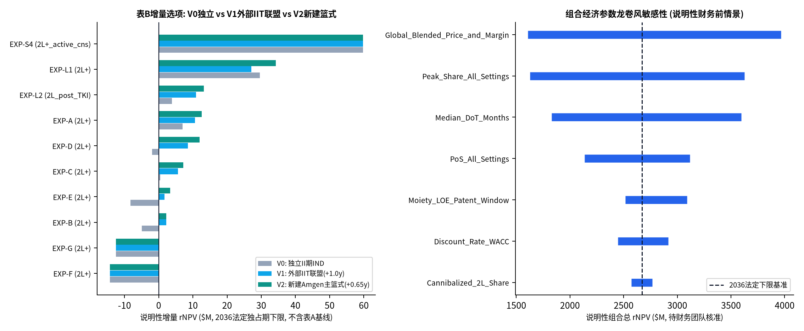
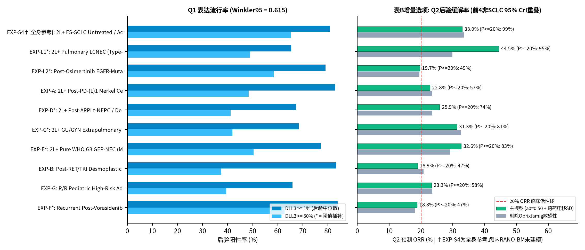
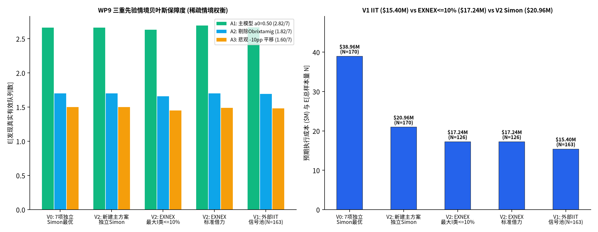

# 生物统计、临床开发与投资组合汇报演讲剧本：AMG 757 (`Tarlatamab` / `IMDELLTRA` 塔拉妥单抗) `v4.3.2`

**配套可编辑宽屏演示文稿（共 `18` 页，100% 由权威结果表零漂移编译生成）**：
- `AMG757_Biostatistics_Evidence_Model_v4_3_ZH.pptx`（由 `build_amg757_biostat_pptx.py` 直接读取 `results_v4/` 生成，并受 `tests/test_doc16_zero_drift.py` 自动防漂移校验）
- **现场问答交互后盾**：`AMG757_Tarlatamab_V4_Evidence_Studio.html`（支持一键中英切换）

---

## 1. 核心汇报主旨与时间分配策略（`30 分钟标准场 = 20 分钟主讲 + 10 分钟答辩`）

1. **开场前 60 秒直击核心结论**：
   - 塔拉妥单抗几乎全部确定性拓展价值均集中在 **`表 A`（在共享 `2036-05-16` `PHS Act §351(k)(7)` 生物制品独占期下限下为 `$2,610.8M`，`2039` 专利情景下为 `$3,306.6M`）**，涵盖 **`12` 项在研/已承诺 SCLC 拓展与生命周期研究**（`5` 项 3 期 + `7` 项联用/皮下制剂，含 `2` 项合作伙伴申办研究）及 `7` 项历史/已完成基线研究（共 `19` 项注册记录）。
   - 在新增增量期权（**`表 B`**）中，真正具备独立商业价值的抓手是 **`#1 EXP-S4`（`ES-SCLC` 活动性脑转移，`NCT07402343`, `N=35`, `+$59.7M`；`TRIG-06` 三区间门控 `>=12/35` 拓展 / `8..11/35` 亚组复核［`-$21.71M` vs 二元放弃 `-$34.01M`］/ `<8/35` 终止）** 与 **`#2 EXP-L1`（肺 `LCNEC`, `IFCT NCT06937905`, `V1 +$27.1M` / `V2 +$34.3M`，配套 `N=15` 期中无效止损门控）**。
   - 鉴于 `NCT06788938` 实为 UCLA 单中心 `29` 例已停止入组的学术试验而非安进主方案篮子，`7` 个罕见肺外队列 (`EXP-A..G`) 若独立开 IND (`路径 V0`) 将净亏 **`-$34.6M`**；最稳健的资本配置路径是先通过 **`路径 V1`（联合全球 `11` 项开放外部学术 IIT，`N=517`，基准 `+$1.8M` / `0.75` 供药中断敏感性 `-$4.3M`，`EVSI = +$12.94M`［精确 `2036` 独占期截断为 `$12.35M`］）** 做低成本信号筛选，待跨过预设响应阈值后再启动 **`路径 V2`（`$20.96M` `Shared_Protocol_Independent_Simon` 或 `$17.24M` `EXNEX<=10%`）**。

---

## 2. 18 页幻灯片逐页演讲时间轴与标准解说词 (`Slides 1–18`)

| 页码 | 幻灯片标题 (`AMG757_Biostatistics_Evidence_Model_v4_3_ZH.pptx`) | 建议用时 | 核心图表锚点与逐页现场标准解说要点 |
| :---: | :--- | :---: | :--- |
| **1** | **封面与核心治理提要 (`权威 v4.3.2 封版`)** | `0:00–1:00` | 开宗明义亮出三大公信力支柱：`260` 条离线逐字核验溯源记录 + `120` 项富集 `DLL3` 注册试验、表 B 零黑盒机器学习列、全套幻灯片与文档 `100%` 由结果文件自动编译（表 A `$2,610.8M` vs 表 B `V0/V1/V2`）。 |
| **2** | **`01 · 注册试验全景核验与方法学重构`** | `1:00–2:15` | 坦诚汇报注册库纠偏：`NCT06788938` 实为 UCLA 单中心 `29` 例已停入组研究 (`ACTIVE_NOT_RECRUITING`)，除已完成的 `DeLLpro-300` 外安进目前有 `0` 项非 SCLC 临床试验。因此 `v4.3.2` 彻底改用客观存在的 `路径 V1`（`11` 项开放 IIT 信号联邦）与 `路径 V2`（新建安进主方案篮子）。 |
| **3** | **`02 · WP1 溯源证据库与 120 项注册方案富集`** | `2:15–3:15` | 展示 `260` 条证据构成：`208` 条原文数值精确匹配 `verified`（`SHA-256` 锁定）、`25` 条双人复核图表 `verified_source_only`、`27` 条带区间 `analyst_estimate`，以及 `120/120` 项离线富集 `DLL3` 试验（含 `DeLLphi-305` OS HR `0.42 [0.32–0.54]` 等精确溯源）。 |
| **4** | **`03 · 原发患者活检、微环境与临床单细胞底座`** | `3:15–4:15` | `2,215` 例原发人类肿瘤活检揭示为何 `t-NEPC` 单药 `DeLLpro-300` 仅获 `22.2%` ORR（冷微环境 `TME = 0.358`，驱动 `NCT07111507` 联用 `AMG 509`）；`60,026` 个临床 SCLC 单细胞排除了 `CD99`/`BSG` T 细胞自残风险。 |
| **5** | **`04 · Q1 表面 DLL3 多项分层流行率模型`** | `4:15–5:30` | `4` 链 `NumPyro NUTS` 横跨 `27` 个人类 IHC 队列（`max_rhat < 1.01`，`0` 发散），统一 `SP347` 与 `SC16/E3J5R/Abcam` 阈值偏移，实现 **`100.0%` 研究级留一法 (`LOSO`) `95%` 覆盖率** (`Winkler95 = 0.615`)，显式标记 `ge50_imputed_flag`。 |
| **6** | **`05 · Q2 跨药幂先验 (a0=0.50)、前4瘤种 CrI 重叠与适用边界`** | `5:30–7:00` | 纯 `15` 队列 `DLL3` TCE `EXNEX`（`0` 个 ADC，`100%` LOCO 覆盖率，`Winkler95 = 0.510`）。重点强调两项统计纪律：(1) 在 `a_0 = 0.50` 下，`LCNEC` (`44.5% [17.0%, 81.3%]`)、`GEP-NEC` (`32.7%`)、`GU/GYN` (`31.3%`) 与 `t-NEPC` (`25.9%`) 的 **`95% CrI` 统计重叠（近似并列）**；(2) `EXP-S4` (`33.0%† [23.3%, 42.0%]`) 明确标为**全身 SCLC 参考值†**，绝不冒充颅内 `RANO-BM`。 |
| **7** | **`06 · WP2 无泄漏 PE1 全新适应症回测与 P5 封印规格`** | `7:00–8:15` | 在 `32` 抗原零前序试验主终点 `PE1_new_indication`（`178` 次 2 期+ 新拓展事件）上，预注册密封模型 `P5`（`(16, 8) tanh lbfgs alpha=8.0 max_iter=300`，`FREEZE-2026-P5-SPEC`）取得 `AUPRC = 0.378` vs 单基因 `P1 = 0.307`（**Holm `p = 0.0042`**），同时 `M5 (0.501) - P5 (0.378) = +0.123` 直接测出跨期热点泄漏量。 |
| **8** | **`07 · 预注册 WP2.5 门控与继续退役 Q5`** | `8:15–9:15` | 因 `M4_kg_plus_omics` (`0.444`) 未能击败纯组学 `M5` (`0.501`)，且谱系内回测（`10` 个事件）`80%` 把握度最小可检出效应量高达 `MDE = +0.441 AUROC`，严格执行 `wp25_passed = False`：**表 B 含 `0` 个 `Q5` 列**。 |
| **9** | **`08 · 表 A：12 项在研/已承诺 SCLC + 7 项历史基线 = 19 项研究`** | `9:15–10:30` | 逐项展示 `EXP-S1`（`$2,145.6M`：`DeLLphi-305` + `DeLLphi-312`）、`EXP-S2`（`$23.4M`：`+ZL-1310 NCT07531095`、`DeLLphi-311`、`+YL201 NCT06898957`、`DeLLphi-310 SC`）与 `EXP-S3`（`$441.8M`：`DeLLphi-306` + `PrECOG NCT07637513`），扣除 `-$469.3M` 二线蚕食后合计 **`$2,610.8M`（`2036` 下限）/ `$3,306.6M`（`2039` 专利）**（注：`12` 项在研中含 `2` 项外部伙伴申办）。 |
| **10** | **`09 · 表 B：10 项增量期权跨 V0 / V1 / V2 决策总表`** | `10:30–12:00` | 梳理 `#1 EXP-S4` (`NCT07402343`, `N=35`, `+$59.7M`)、`#2 EXP-L1` (`IFCT NCT06937905`, `V0 +$29.6M` / `V1 +$27.1M` / `V2 +$34.3M`)、`#3 EXP-L2` (`NCT06830694`, `V1 +$10.9M`)、`#4 EXP-A` (`MCC`, `V1 +$10.6M`)、`#5 EXP-D` (`t-NEPC`, `V0 -$1.9M -> V1 +$8.6M`)、`#6 EXP-C` (`GU/GYN`, `V1 +$5.6M`)、`#7 EXP-E` (`GEP-NEC`, `V0 -$8.3M -> V1 +$1.7M`)、`#8 EXP-B` (`MTC`, `V1 +$2.2M`)、`#9 EXP-G` (`-$12.5M`)、`#10 EXP-F` (`-$14.3M`)。 |
| **11** | **`10 · 美元组合瀑布图、V1 断药敏感性与贝叶斯 EVSI`** | `12:00–13:15` | 对比罕见非 SCLC (`EXP-A..G`)：`V0 = -$34.6M` vs `V1 (0.90 基准) = +$1.8M` vs `V1 (0.75 断药折损) = -$4.3M` vs `V2 = +$10.6M`，突出先看开放 IIT 信号再投注册篮子带来的 **`EVSI = +$12.94M`［精确 `2036` 独占期截断为 `$12.35M`］**（其中 `LCNEC N=15` 无效门控贡献 `+$3.48M`）。 |
| **12** | **`11 · 美国儿科三大法条精确解耦：EXP-G 神经母细胞瘤`** | `13:15–14:15` | 清晰拆解三部法条：`FD&C Act §529 PRV = $0.0M`（已获批活性成分不可再获审评券）、强制 `PREA / RACE §505B = 0.0` 年合规成本、唯有自愿 **`BPCA §351(m)` 书面要求**可获 `+0.5 年` 全产品线独占期延展（基准 `+$184.8M`，使 `EXP-G` 净赚 `+$172.3M`）。 |
| **13** | **`12 · WP9 异质基线篮式设计与 I 类错误 vs 成本权衡`** | `14:15–15:30` | 展示天真可交换 BHM (`33.43%` 最差单队列 I 类错误) 为何不可接受，对比 `Shared_Protocol_Independent_Simon` (`Max N=217`, `$20.96M`, `<=4.99%` I 类错误；固定 `N=20` 为 `$16.66M`)、`EXNEX<=10%` (`Max N=140`, `$17.24M`, `<=8.25%`) 与 `Federated_IIT_Signal_Pool_V1` (`N=163`, `$15.40M`)。 |
| **14** | **`13 · WP9 三重先验把握度敏感性 (A1 / A2 / A3)`** | `15:30–16:30` | 横跨 `A1 = 2.82/7`、`A2 = 1.82/7`（剔除 `obrixtamig`）与 `A3 = 1.60/7` (`LOCO-0`) 证明：`EXNEX` **仅当 `>=3/7` 个队列真实有效时**在 FWER 校准把握度上胜过 Simon；在保守先验 (`1–2` 个有效) 下，独立 Simon 更为稳健。 |
| **15** | **`14 · Q4 全候选池无偏联用审计与机制方案`** | `16:30–17:15` | 坦诚披露 `Q4` 在 `N = 983` (`AUROC = 0.611`) 与 `N = 1,628` (`AUROC = 0.732`) 2023 前药物池上的 `recall@50 = 0.000`，说明 `+ZL-1310` (`NCT07531095`)、`+YL201` (`NCT06898957`) 与 `+AMG 509` (`NCT07111507`) 均建立在明确临床与靶点共表达证据上。 |
| **16** | **`15 · 附录 B (Q6)：三赛道逃逸生物物理与离子通道安全护栏`** | `17:15–18:15` | 展示 `AlphaFold <=14 nm` `CD45` 排斥门控 (`DLL3 = 11.78 nm`) 与 `Ion Guard` 降权 `KCNB2` (`0.0467`) / `SCN3A` (`0.0371`)，确立 **`DLL3 + IGSF9` (`0.4745`, `13.4 nm`, `1.18%` TIL)** 为非掩蔽双靶三抗洁净首选。 |
| **17** | **`16 · 41 条只追加账本、分离计分卡与比特币 .ots 证明`** | `18:15–19:15` | 展示原封保留的 `2026_11.jsonl`（`10` 条，区块 `#975,929`）、`2026_11b.jsonl`（`13` 条，区块 `#975,963`）与 `2026_11c.jsonl`（`18` 条，区块 `#976,004` 与 `#976,009`；共 `41` 条记录，`3/3 BITCOIN_POW_VERIFIED`），将 **`5` 项 `q2_empirical_model`** 与 **`4` 项 `analyst_prior`** 严格分表评分。 |
| **18** | **`17 · 研究团队四大行动决议、季度运维 SOP 与 v4.3.2 工作台`** | `19:15–20:00` | 总结四大行动决议（推进 `EXP-S4`、`EXP-L1` `N=15` 门控、先 `V1` IIT 信号联邦再 `V2` 注册篮子、评估自愿 `BPCA` 书面要求）以及每季度 `make watch-trials && make verify-fast && make bundle-audit` 零漂移复核机制。 |

---

## 3. 红队尖锐质询攻防速查矩阵（生物统计、临床运营、法规与财务）

| 评审专家高频质询 | 定量标准答辩口径 (`v4.3.2`) |
| :--- | :--- |
| **生物统计部：** *“`EXNEX` 在篮式试验中是否无条件优于 `Independent Simon`？”* | **绝非无条件优于——第 13–14 页精确给出了交叉边界。** `EXNEX`（`$17.24M`，混合零假设单队列 I 类错误 `<=8.25%`）仅当 **`>=3/7` 个队列真实有效**时在 FWER 校准把握度上胜出；而在保守先验 `A2 = 1.82/7` 与 `A3 = 1.60/7` 下，`Shared_Protocol_Independent_Simon`（`$20.96M`，`<=4.99%` I 类错误）更安全。且 `EXNEX` 省下的成本中约 `$4.3M` 来自 `N=20` 截断上限（固定 `N=20` Simon 为 `$16.66M`），而非单纯源于贝叶斯借力。 |
| **生物统计部：** *`#2 LCNEC` 对跨药借力 `obrixtamig` 有多敏感？* | 高度敏感，因为塔拉妥单抗目前有 `0` 项直接 LCNEC 试验（依赖 `obrixtamig` `DAREON-5` 的 `7/10` 样本）：中位 ORR 从 `50.3%` (`a_0=1.0`) 降至 **`44.5% [17.0%, 81.3%]` (`a_0=0.50`)**、剔除 `obrixtamig` 后为 `29.9%`、`LOCO-0` 为 `28.3%`。因此我们强制设立 `N=15` 期中无效门控（`<=2/15` 停；`EVSI = +$3.48M`）。 |
| **神经肿瘤组：** *为什么 `EXP-S4` (`33.0%†`) 带有剑号标记？* | `Q2` 拟合的是全身 `RECIST` 客观缓解率，而马斯特里赫特 `NCT07402343` (`N=35`) 采用颅内 `RANO-BM` 标准。我们将 `33.0%†` 严格标为全身 SCLC 参考值，在估值中按保守 `0.85×` 颅内折算 (`28.1%`) 耦合 `+$59.7M` `rNPV`，并将颅内读出单独列入 `FCST-2026-17` (`analyst_prior`, `>=12/35` 触发)。 |
| **临床运营部：** *此前西班牙 `GETNE` 与 `NCI` IIT 撤回，如何防范 `V1` 断药风险？* | 我们专门建立了 **`0.75` 供药中断折损敏感性情景**（与 `0.90` 基准并列披露）：即便发生 `25%` 外部 IIT 中断，罕见非 SCLC `V1` 净现值为 `-$4.3M`，相比盲目独立开 7 个 IND (`V0 = -$34.6M`) 依然规避逾 `$30M` 资本损耗。 |
| **注册/财务部：** *儿科神经母细胞瘤 (`EXP-G`) 能否拿一张过亿美元的罕见儿科 `PRV`？* | **不能 (`$0.0M`)。** 根据 `FD&C Act §529(a)(4)(A)`，已于 `2024-05-16` 获批成人 SCLC 的活性成分不再具备罕见儿科审评券资格，且强制 `PREA/RACE §505B` 无独占期奖励 (`0.0y`)；唯一正回报路径是主动完成 **`BPCA §351(m)` 书面要求**获取 `+0.5 年` 全管线独占期延展 (`+$184.8M`，净 `+$172.3M`)。 |
| **数据科学组：** *既然表 B 退役了 `Q5`，保留 `OptimusKG` 平台的意义何在？* | 这正是科学可证伪性的体现：`PE1` 盲测抓出了 `+0.123` 跨期热点泄漏并证明 `M4 (0.444) < M5 (0.501)`，故在 `DLL3` 适应症主表诚实退役 `Q5`；同时保留 `OptimusKG` 在经实证检验确有增益的场景（如 `AMG 691 v2.0` 自免双靶联用与附录 B `Ion Guard` 蛋白安全筛选）。 |
