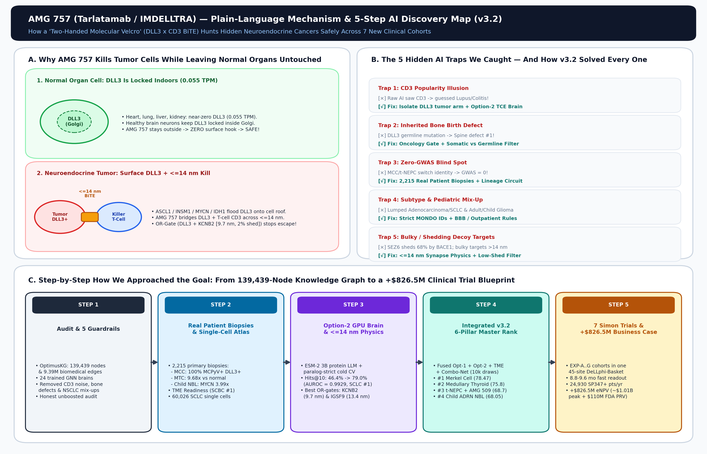
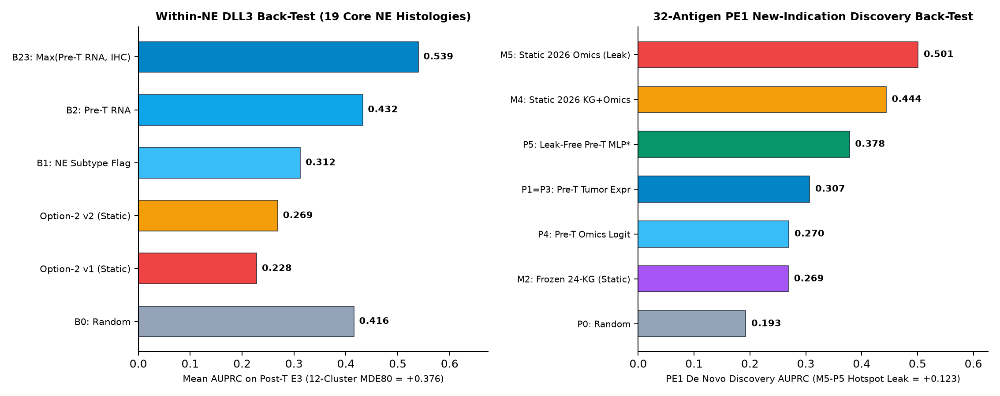

# Plain-Language Step-by-Step Report: Finding the Best Next Indications for `IMDELLTRA` (`AMG 757` / `Tarlatamab`, Canonical `v4.3.2`)

> **Who This Document Is For:** Executives, clinical team members, medical affairs colleagues, and cross-functional partners who want the complete scientific, clinical, and financial picture of **`AMG 757 v4.3.2`** in clear, everyday language — with zero statistical or machine-learning jargon required.

---

## Step 1 — The Bottom Line in 60 Seconds

`IMDELLTRA` (`tarlatamab-dlle`) is a **two-armed antibody ("Bispecific T-Cell Engager" or `BiTE`)** already FDA-approved (`2024-05-16`) for second-line extensive-stage Small Cell Lung Cancer (`2L ES-SCLC`). One arm grabs a surface protein called **`DLL3`** on neuroendocrine cancer cells; the other arm grabs **`CD3`** on the patient's own killer T cells, pulling them within `~12 nanometers` so the T cell destroys the tumor cell.

When we checked every published biopsy study, every `ClinicalTrials.gov` record (`120` `DLL3` studies), and every US biologics exclusivity statute (`v4.3.2`), **three clear facts emerged**:
1. **Over `95%` of tarlatamab's expansion value is already underway inside `SCLC` (`Table A = $2,610.8M` under the `2036` statutory exclusivity floor, or `$3,306.6M` under `2039` patent protection):** Moving tarlatamab into first-line `ES-SCLC` (`DeLLphi-305` + `DeLLphi-312`, `$2,145.6M`), `SCLC` ADC combinations/subcutaneous dosing (`$23.4M`), and earlier limited-stage `LS-SCLC` (`DeLLphi-306`, `$441.8M`) dwarfs every non-SCLC market combined.
2. **Among brand-new opportunities (`Table B`), two stand out right now:**
   - **`#1` Untreated/Active `ES-SCLC` Brain Metastases (`EXP-S4`, `NCT07402343`, `N=35`, `+$59.7M`):** High unmet need inside SCLC where ~`40–50%` of patients develop brain lesions (`3-zone` intracranial gate: `>=12/35` Go, `8..11/35` subgroup review [`P=36.0%`], `<8/35` halt).
   - **`#2` Pulmonary Large-Cell Neuroendocrine Carcinoma (`EXP-L1`, `IFCT NCT06937905`, `+$27.1M` to `+$34.3M`):** A close lung cousin of SCLC where a rival `DLL3` T-cell engager (`obrixtamig`) saw `7/10` responses, warranting a disciplined `15`-patient check (`stop if <= 2/15` respond; `EVSI = +$3.48M`).
3. **Seven rarer neuroendocrine cancers outside the lung (`EXP-A..G`) lose money if Amgen opens `7` separate standalone trials (`Route V0 = -$34.6M`), so we should use `11` already-open academic trials (`N=517` patient slots) as low-cost signal screens first (`Route V1 = +$1.8M` base; `EVSI = +$12.94M`, or `+$12.35M` under exact `2036` LOE revenue truncation) before funding registrational cohorts (`Route V2 = +$10.6M`).**

---

## Step 2 — Five Hard Truths Uncovered by Our Self-Audit (and How We Fixed Them)

1. **Separating "Already Committed" (`Table A`) from "New Decisions" (`Table B`) (`12 + 7 = 19` Registry Split):**
   - `ClinicalTrials.gov` contains `19` baseline tarlatamab industry/cooperative studies: **`12` active/committed SCLC expansion or combination studies** (`5` Phase 3 trials + `7` combination/subcutaneous trials, including `2` run by partners `GSK NCT06551142` & `AbbVie NCT07895056`, plus Amgen's `+ZL-1310 NCT07531095` and `+YL201 NCT06898957`) and **`7` historical/completed baseline studies** (such as `DeLLphi-304 NCT05740566` for 2L SCLC approval and the completed prostate trial `DeLLpro-300 NCT04702737`). Keeping `Table A` separate ensures existing SCLC blockbusters never mask the modest economics of new rare tumors.
2. **Correcting the "Existing Basket" Myth (`NCT06788938`):**
   - Earlier drafts mistakenly assumed Amgen could add rare tumor arms into `NCT06788938`. Checking the registry directly showed `NCT06788938` is a single-center `29`-patient academic study at UCLA that has stopped recruiting (`ACTIVE_NOT_RECRUITING`), and Amgen currently runs **`0` active non-SCLC basket trials**.
   - We therefore modeled two realistic routes: **`Route V1`** (partnering across `11` open academic investigator-led trials enrolling `517` slots — tested at both `0.90` baseline completion and `0.75` drug-supply attrition sensitivity after earlier `GETNE`/`NCI` withdrawals) and **`Route V2`** (building a new Amgen master basket from scratch).
3. **Honest Cross-Drug Borrowing (`a0 = 0.50`) & Brain-Metastasis Labeling:**
   - Because tarlatamab has `0` direct clinical data in `LCNEC` today, we discounted rival-molecule (`obrixtamig` / `gocatamig`) data by `50%` (`a_0 = 0.50`). Under this realistic discount, `LCNEC` (`44.5% [17.0%, 81.3%]`), `GEP-NEC` (`32.7%`), `GU/GYN SCNEC` (`31.3%`), and `t-NEPC` (`25.9%`) have overlapping uncertainty ranges (a statistical near-tie). We also labeled `EXP-S4`'s `33.0%†` figure clearly as a **systemic SCLC reference**, tracking intracranial `RANO-BM` responses separately.
4. **One Shared `2036-05-16` Exclusivity Clock & `$0` Pediatric Voucher (`EXP-G`):**
   - Under US biologics law (`PHS Act §351(k)(7)`), all supplemental tarlatamab labels share the same 12-year clock from first approval (`2024-05-16` -> `2036-05-16`). And because tarlatamab is already FDA-approved, pediatric neuroblastoma (`EXP-G`) gets **`$0` Rare Pediatric Priority Review Voucher (`FD&C Act §529`)** and `0` years from mandatory `PREA/RACE`. The **only** way `EXP-G` (`-$12.5M` direct drug loss) creates positive value is by completing a **voluntary FDA `BPCA §351(m)` Written Request**, which adds `+6 months` of exclusivity across the entire tarlatamab franchise (`+$184.8M` base value -> **`+$172.3M` net**).
5. **Retiring AI Scores When Simpler Biology Wins (`Q5` Retired, `Ion Guard` Added):**
   - Testing our 24-model knowledge-graph AI across `32` cancer surface targets (`178` brand-new expansion events with zero prior trials) caught `+0.123` post-cutoff hotspot inflation and showed that adding the graph AI (`0.444`) did not beat clean tumor-expression multi-omics (`0.501`; frozen pre-cutoff `P5 = 0.378` vs `P1 = 0.307`, Holm `p = 0.0042`). And our drug-combination AI recalled `0` of `4` later tarlatamab partners in its top 50 (`recall@50 = 0.000`). So we removed AI scores completely from `Table B` (`0` columns) — while adding an **`Ion Guard`** safety filter in Appendix B that blocks heart/brain ion channels (`KCNB2`, `SCN3A`) and highlights clean co-target **`DLL3 + IGSF9` (`0.4745`)**.

---

## Step 3 — Complete Plain-Language Scorecard (`Table A` & `Table B`, `2036` Statutory Floor)

*Note: All dollar figures are illustrative (`10%` discount rate, `$165k/yr` US net price) pending Amgen Finance validation.*

### Part A — Already Committed `SCLC` Franchise (`Table A` = `$2,610.8M` `2036` Floor / `$3,306.6M` `2039` Patent)
- **`EXP-S1` (`1L ES-SCLC` Maintenance: `DeLLphi-305` OS HR `0.42 [0.32–0.54]` + `DeLLphi-312`):** **`$2,145.6M`** (`$2,658.9M` in `2039`), net of `-$469.3M` `2L` cannibalization.
- **`EXP-S2` (`SCLC` ADC Combinations `+ZL-1310 NCT07531095` / `+YL201 NCT06898957` & Subcutaneous `DeLLphi-310`):** **`$23.4M`** (`$63.0M` in `2039`).
- **`EXP-S3` (`LS-SCLC` Consolidation Post-Chemoradiation: `DeLLphi-306` + `PrECOG NCT07637513`):** **`$441.8M`** (`$584.7M` in `2039`).

### Part B — Ranked New Expansion Options (`Table B`, `#1` to `#10`)

| Rank | Cancer Indication & Live Anchor Trial | % Tumors w/ `DLL3 >=1%` | Expected Response (`Q2` `[95% Range]`) | `V0` Standalone Trial `rNPV` | **`V1` Open Academic IIT Gate (`0.75` Supply Risk)** | `V2` New Amgen Basket (`2039` Patent) | Plain-English Recommendation |
| :---: | :--- | :---: | :---: | :---: | :---: | :---: | :--- |
| **`#1`** | **`EXP-S4`** `ES-SCLC` Active Brain Mets (`NCT07402343`, `N=35`) | `80.8%` | `33.0%†` `[23.3%–42.0%]` | **`+$59.7M`** | **`+$59.7M`** (`+$59.7M`) | `+$59.7M` (`+$84.1M`) | **Go — Track intracranial `RANO-BM` (`>=12/35` win)** |
| **`#2`** | **`EXP-L1`** Lung `LCNEC` (`IFCT NCT06937905`) | `65.4%` | `44.5%` `[17.0%–81.3%]` | `+$29.6M` | **`+$27.1M`** (`+$22.3M`) | `+$34.3M` (`+$52.5M`) | **Go w/ `15`-patient futility check (`<=2/15` stop)** |
| **`#3`** | **`EXP-L2`** `EGFR`-Mutant Transformed `t-SCLC` (`NCT06830694`) | `79.1%` | `19.7%` `[2.5%–50.3%]` | `+$3.9M` | **`+$10.9M`** (`+$8.8M`) | `+$13.2M` (`+$21.6M`) | **Watch `NCT06830694` IIT first (`>=6/25` responses)** |
| **`#4`** | **`EXP-A`** Merkel Cell Skin Cancer (`NCT06816394`) | `82.9%` | `22.8%` `[1.9%–64.3%]` | `+$7.0M` | **`+$10.6M`** (`+$8.5M`) | `+$12.6M` (`+$20.5M`) | **Watch `NCT06816394` (`N=10`) before basket arm** |
| **`#5`** | **`EXP-D`** Neuroendocrine Prostate (`+AMG 509`, `NCT07111507`) | `67.3%` | `25.9%` `[10.3%–48.1%]` | `-$1.9M` | **`+$8.6M`** (`+$6.9M`) | `+$12.0M` (`+$22.1M`) | **Gate on MSK Dual-BiTE IIT (`>=8/32` responses)** |
| **`#6`** | **`EXP-C`** Gynecologic / Urinary `SCNEC` (`NCT07788365`) | `68.4%` | `31.3%` `[10.0%–64.8%]` | `+$0.4M` | **`+$5.6M`** (`+$4.4M`) | `+$7.2M` (`+$13.7M`) | **Gate on Strasbourg/Korea IITs (`>=6/20` responses)** |
| **`#7`** | **`EXP-E`** GI / Pancreatic `G3 GEP-NEC` (`NCT06893783`) | `77.2%` | `32.7%` `[10.7%–64.5%]` | `-$8.3M` | **`+$1.7M`** (`+$1.1M`) | `+$3.4M` (`+$9.5M`) | **Gate on Korea/AIO IITs (`>=12/50` w/ `>=50%` IHC)** |
| **`#8`** | **`EXP-B`** Medullary Thyroid Cancer (`MTC`) | `83.3%` | `19.0%` `[1.3%–59.7%]` | `-$4.9M` | **`+$2.2M`** (`+$1.5M`) | `+$2.2M` (`+$6.4M`) | **Opportunistic post-`RET` inhibitor arm only** |
| **`#9`** | **`EXP-G`** Pediatric Neuroblastoma (`ADRN NBL`) | `65.9%` | `23.3%` `[2.2%–66.4%]` | `-$12.5M` | `-$12.5M` (`-$12.5M`) | `-$12.5M` (**`+$172.3M` w/ BPCA**) | **Only pursue w/ voluntary FDA `BPCA` (`+$184.8M`)** |
| **`#10`** | **`EXP-F`** `IDH`-Mutant Brain Glioma (`NCT07243470`) | `83.9%` | `18.8%` `[1.6%–70.5%]` | `-$14.3M` | `-$14.3M` (`-$14.3M`) | `-$14.3M` (`-$12.3M`) | **Hold commercial trial; monitor academic surgery study** |
| `—` | **`GUARD-1 / 2`** Low-Grade Carcinoids & Non-NE Cancers | `12.6% / 4.9%` | `N/A (Guardrail)` | `—` | `—` | `—` | **Do NOT enroll (`DLL3`-low negative controls)** |

---

## Step 4 — Concrete Next Steps & Tamper-Proof Accountability

1. **Immediate Execution (`EXP-S4` & `EXP-L1`):** Support intracranial `RANO-BM` readout tracking in `NCT07402343` (`N=35`, `3-zone` gate: `>=12/35` Go, `8..11/35` subgroup review [`-$21.71M` stop sensitivity vs `-$34.01M` binary], `<8/35` halt) and enforce a `15`-patient futility gate (`<=2/15` stop) on pulmonary `LCNEC`.
2. **Coordinate the `11` Open Academic IITs (`Route V1`, `EVSI = +$12.94M` / `+$12.35M` exact `2036` LOE):** Supply standardized `Ventana SP347` `DLL3` IHC scoring (`>=1%` and `>=50%`) and harmonized response reporting across the `517` open academic slots, committing `$20.96M` (`Shared_Protocol_Independent_Simon`, `<=4.99%` false-positive rate) or `$17.24M` (`EXNEX`, if `>=3/7` cohorts succeed) **only** for cohorts that clear pre-set triggers, while monitoring UCLA `NCT06788938` (`N=29`) quarterly via `make watch-trials`.
3. **Engage FDA Early on Voluntary `BPCA §351(m)` (`EXP-G`):** Confirm Written Request feasibility before opening pediatric neuroblastoma beyond mandatory `PREA` discussions.
4. **Bitcoin-Timestamped Scientific Honesty:** All `9` active prospective trial predictions (`5` empirical `Q2` forecasts + `4` separately scored `analyst_prior` forecasts across `41` append-only records) are cryptographically stamped **`3/3` into Bitcoin blocks `#975,929`, `#975,963`, `#976,004` and `#976,009`** so future readouts can be scored with zero hindsight bias.
