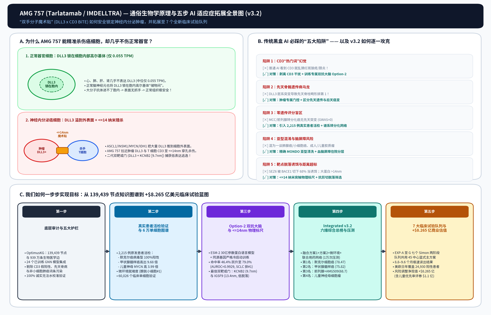
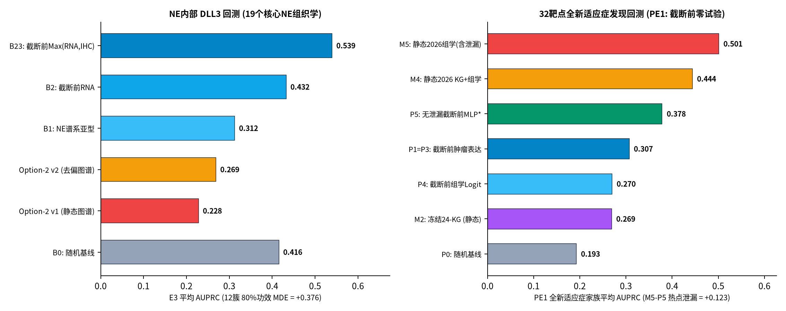

# 通俗分步解读报告：如何为塔拉妥单抗（`IMDELLTRA` / `AMG 757`）找到真正值得投入的下一批新适应症（权威 `v4.3.2` 封版）

> **阅读对象：** 面向管理层、临床医学、注册事务、市场商业团队及跨部门合作伙伴——**全程无需任何机器学习或高等生物统计背景**，用最直白的语言把 **`AMG 757 v4.3.2`** 的科学逻辑、真实临床账本与投资决策讲透。

---

## 第一步：60 秒看懂最终核心结论

`IMDELLTRA`（塔拉妥单抗，`tarlatamab-dlle`）是一款已经于 `2024-05-16` 获 FDA 批准治疗二线广泛期小细胞肺癌 (`2L ES-SCLC`) 的**“双头分子手铐”（双特异性 T 细胞衔接器，`BiTE`）**：一只手抓住神经内分泌癌细胞表面的 **`DLL3`** 蛋白，另一只手抓住患者自身杀手 T 细胞表面的 **`CD3`**，把两者拉近到约 `12 纳米`的窄缝里，让 T 细胞直接打穿并消灭癌细胞。

当我们把全球公开发表的人体活检病理数据、`ClinicalTrials.gov` 上的全部 `120` 项 `DLL3` 临床试验以及美国生物药独占期法律逐条核对完毕后（`v4.3.2`），得出了**三条非常清晰的商业与临床真相**：
1. **超过 `95%` 的确定性拓展价值其实已经在小细胞肺癌 (`SCLC`) 内部的在研大试验里了（`表 A = $2,610.8M`［`2036` 法定独占期下限］/ `$3,306.6M`［`2039` 专利情景］）：** 推进一线 `ES-SCLC` 维持治疗（`DeLLphi-305` + `DeLLphi-312`，`$2,145.6M`）、`SCLC` ADC 联用与皮下制剂（`$23.4M`）以及更早期的局限期 `LS-SCLC`（`DeLLphi-306`, `$441.8M`），体量远远超过所有肺外罕见瘤种之和。
2. **在尚未立项定案的新增机会（`表 B`）中，真正值得立刻抓紧的只有两个：**
   - **`#1` 未经治/活动性 `ES-SCLC` 脑转移（`EXP-S4`，`NCT07402343`，`N=35`，`+$59.7M`）：** 近半数小细胞肺癌患者会发生脑转移，临床未满足需求极高（采用 `TRIG-06` 三区间门控：`>=12/35` 继续、`8..11/35` 亚组复核 [`P=36.0%`]、`<8/35` 终止）。
   - **`#2` 肺大细胞神经内分泌癌（`EXP-L1`，法国 `IFCT NCT06937905`，`+$27.1M` 至 `+$34.3M`）：** SCLC 的“近亲”，同类 `DLL3` 双抗 `obrixtamig` 曾观察到 `7/10` 缓解，值得在设立 **`15` 例期中无效止损门控（若 `<=2/15` 有效即果断停手；信息价值 `EVSI = +$3.48M`）**的前提下积极跟进。
3. **肺外的 `7` 种罕见神经内分泌肿瘤（`EXP-A..G`：默克尔细胞癌、甲状腺髓样癌、妇科/泌尿小细胞癌、神经内分泌前列腺癌、胃肠胰神经内分泌癌、胶质瘤、儿童神经母细胞瘤）如果安进各自单独开 7 项新临床试验会直接亏钱（`路径 V0 = -$34.6M`）；最聪明的打法是先借力全球已经开门招募的 `11` 项外部学术试验（共 `517` 个入组名额）做低成本信号探路（`路径 V1 = +$1.8M`，创造 `EVSI = +$12.94M`［按 `2036` 独占期严格截断为 `+$12.35M`］决策价值），看到明确疗效后再出资建注册篮子（`路径 V2 = +$10.6M`）。**

---

## 第二步：我们在自我审校中揪出并彻底修好的“五大真相”

1. **把“已经在跑的 SCLC 主力军”与“待决策的新机会”彻底分开（`12 + 7 = 19` 项注册拆分）：**
   - 注册库共有 `19` 项基线研究：其中 **`12` 项是在研/已承诺的 SCLC 拓展与联用研究**（`5` 项 3 期试验 + `7` 项联用/皮下制剂试验，含外部伙伴申办的 `GSK NCT06551142` 与 `AbbVie NCT07895056`，以及安进自己的 `+ZL-1310 NCT07531095` 和 `+YL201 NCT06898957`），另外 **`7` 项是历史/已完成基线研究**（如支撑二线获批的 `DeLLphi-304 NCT05740566` 和已完成的前列腺癌试验 `DeLLpro-300 NCT04702737`）。把它们单独放进 **`表 A`**，才不会用 SCLC 的几十亿产值去掩盖肺外小瘤种的真实盈亏。
2. **戳破“现成共享篮子”的误解（还原 `NCT06788938` 真相）：**
   - 早期草稿曾误以为可以把罕见瘤种直接塞进 `NCT06788938`。我们逐字段核查注册库后确认：`NCT06788938` 其实是美国加州大学洛杉矶分校 (`UCLA`) 单中心开展的 `29` 例学术研究，且**已经停止招募 (`ACTIVE_NOT_RECRUITING`)**；安进目前在非 SCLC 领域有 **`0` 项**在研篮式试验。
   - 因此我们改为客观算清两条真实可执行的路：**`路径 V1`**（与全球正在招募的 `11` 项外部高校/医院研究者发起试验 [`N=517`] 合作共享伴随诊断与疗效数据，并考虑到此前西班牙 `GETNE` 与 `NCI` 撤回教训，专门增加了 `0.75` 供药中断折损压力测试）与 **`路径 V2`**（安进从零新建一个注册级主方案篮子）。
3. **给“跨药物借数据”打五折 (`a0 = 0.50`)，并诚实标注脑转移参考值：**
   - 塔拉妥单抗目前在肺 `LCNEC` 上有 `0` 项直接数据，此前的高预期来自竞品 `obrixtamig` 的 `10` 例小样本 (`7/10`)。我们将跨分子借力权重打五折 (`a_0 = 0.50`) 后，`LCNEC` (`44.5% [17.0%, 81.3%]`) 与 `胃肠胰 GEP-NEC` (`32.7%`)、`妇科/泌尿 SCNEC` (`31.3%`)、`前列腺 t-NEPC` (`25.9%`) 的置信区间相互重叠（统计上接近并列）。同时，我们将脑转移 `EXP-S4` 的 `33.0%†` 明确标为**全身 SCLC 参考值**，颅内 `RANO-BM` 终点单独追踪。
4. **共享同一个 `2036-05-16` 独占期闹钟，且儿科审评券为 `$0` (`EXP-G`)：**
   - 根据美国《公共卫生服务法》`§351(k)(7)`，所有新增适应症与首发适应症共享同一个 12 年保护期下限（`2024-05-16` -> `2036-05-16`）。而且因为塔拉妥单抗已经获批上市，`FD&C Act §529` 规定儿童神经母细胞瘤 (`EXP-G`) **拿不到罕见儿科优先审评券 (`PRV = $0`)**，强制儿科义务 `PREA` 也不给独占期 (`0.0` 年)。`EXP-G`（单卖药净亏 `-$12.5M`）唯一能赚钱的途径是主动向 FDA 申请并完成 **`BPCA §351(m)` 儿科书面要求**，从而为整个塔拉妥单抗全产品线赢得 `+6 个月`独占期延展（价值 `+$184.8M`，使 `EXP-G` 净赚 **`+$172.3M`**）。
5. **当简单透明的生物学指标跑赢复杂 AI 时，果断让 AI 退居幕后（退役 `Q5` + 新增 `Ion Guard` 安全护栏）：**
   - 在横跨 `32` 个癌症表面靶点、`178` 次“截断前零试验”全新适应症拓展的时间机器盲测 (`PE1_new_indication`) 中，我们抓出了全时段试验计数造成的 `+0.123` 跨期热点虚高，并证实叠加知识图谱 (`0.444`) 并未跑赢干净的肿瘤表达多组学 (`0.501`；严格截点前 `P5 = 0.378` vs 单基因 `P1 = 0.307`，Holm `p = 0.0042`)，且联用模型对 2023 年后新搭档的前 50 名召回率为 `0` (`recall@50 = 0.000`)。于是我们将 AI 综合分从主决策表中彻底清零（`0` 列），同时在附录 B 二代双靶工程中上线 **`Ion Guard` 离子通道安全护栏**，自动拉黑存在心律失常/脑毒性隐患的 `KCNB2` 与 `SCN3A`，锁定安全洁净搭档 **`DLL3 + IGSF9` (`0.4745`)**。

---

## 第三步：一张表看懂全部项目的真实账本（`表 A` 与 `表 B`，`2036` 法定下限口径）

*注：全部美元金额均为示意性测算（`10%` 贴现率，美国净药价 `$165k/年`），待安进财务部最终核准。*

### A 部分 —— 已承诺推进的 `SCLC` 基本盘（`表 A` 合计 = `$2,610.8M`［`2036` 下限］/ `$3,306.6M`［`2039` 专利］）
- **`EXP-S1`（一线 `ES-SCLC` 维持治疗：`DeLLphi-305` OS HR `0.42 [0.32–0.54]` + `DeLLphi-312`）：** 扣除 `-$469.3M` 二线内部蚕食后净值 **`$2,145.6M`**（`2039` 专利下 `$2,658.9M`）。
- **`EXP-S2`（`SCLC` ADC 联用 `+ZL-1310 NCT07531095` / `+YL201 NCT06898957` 及皮下制剂 `DeLLphi-310`）：** **`$23.4M`**（`2039` 下 `$63.0M`）。
- **`EXP-S3`（局限期 `LS-SCLC` 放化疗后巩固：`DeLLphi-306` + `PrECOG NCT07637513`）：** **`$441.8M`**（`2039` 下 `$584.7M`）。

### B 部分 —— 待决策的新增适应症期权排名（`表 B`，`#1` 至 `#10`）

| 排位 | 候选适应症与外部在研锚定试验 | 肿瘤 `DLL3 >=1%` 比例 | 预期客观缓解率 (`Q2` `[95% 区间]`) | `V0` 独立新建试验 `rNPV` | **`V1` 借力开放学术 IIT (`0.75` 断药敏感性)** | `V2` 新建安进主篮子 (`2039` 专利) | 大白话行动建议 |
| :---: | :--- | :---: | :---: | :---: | :---: | :---: | :--- |
| **`#1`** | **`EXP-S4`** `ES-SCLC` 活动性脑转移 (`NCT07402343`, `N=35`) | `80.8%` | `33.0%†` `[23.3%–42.0%]` | **`+$59.7M`** | **`+$59.7M`** (`+$59.7M`) | `+$59.7M` (`+$84.1M`) | **立即推进 —— 盯紧颅内 `RANO-BM` (`>=12/35` 过关)** |
| **`#2`** | **`EXP-L1`** 肺大细胞神经内分泌癌 (`IFCT NCT06937905`) | `65.4%` | `44.5%` `[17.0%–81.3%]` | `+$29.6M` | **`+$27.1M`** (`+$22.3M`) | `+$34.3M` (`+$52.5M`) | **积极推进 —— 严卡 `15` 例无效止损 (`<=2/15` 停)** |
| **`#3`** | **`EXP-L2`** `EGFR` 耐药转分化 `t-SCLC` (`NCT06830694`) | `79.1%` | `19.7%` `[2.5%–50.3%]` | `+$3.9M` | **`+$10.9M`** (`+$8.8M`) | `+$13.2M` (`+$21.6M`) | **先看 `NCT06830694` 学术信号 (`>=6/25` 缓解)** |
| **`#4`** | **`EXP-A`** 默克尔细胞皮肤癌 (`NCT06816394`) | `82.9%` | `22.8%` `[1.9%–64.3%]` | `+$7.0M` | **`+$10.6M`** (`+$8.5M`) | `+$12.6M` (`+$20.5M`) | **先看 `NCT06816394` (`N=10`) 读出再定篮子** |
| **`#5`** | **`EXP-D`** 神经内分泌前列腺癌 (`+AMG 509`, `NCT07111507`) | `67.3%` | `25.9%` `[10.3%–48.1%]` | `-$1.9M` | **`+$8.6M`** (`+$6.9M`) | `+$12.0M` (`+$22.1M`) | **挂钩 MSK 双 BiTE 试验 (`>=8/32` 缓解)** |
| **`#6`** | **`EXP-C`** 妇科/泌尿小细胞癌 (`NCT07788365`) | `68.4%` | `31.3%` `[10.0%–64.8%]` | `+$0.4M` | **`+$5.6M`** (`+$4.4M`) | `+$7.2M` (`+$13.7M`) | **挂钩法国/韩国 IIT 信号 (`>=6/20` 缓解)** |
| **`#7`** | **`EXP-E`** 胃肠胰 G3 神经内分泌癌 (`NCT06893783`) | `77.2%` | `32.7%` `[10.7%–64.5%]` | `-$8.3M` | **`+$1.7M`** (`+$1.1M`) | `+$3.4M` (`+$9.5M`) | **挂钩韩国/德国 IIT (`>=12/50`，严卡 `>=50%` IHC)** |
| **`#8`** | **`EXP-B`** 甲状腺髓样癌 (`MTC`) | `83.3%` | `19.0%` `[1.3%–59.7%]` | `-$4.9M` | **`+$2.2M`** (`+$1.5M`) | `+$2.2M` (`+$6.4M`) | **仅作 `RET` 靶向药耐药后的顺带观察臂** |
| **`#9`** | **`EXP-G`** 儿童高危神经母细胞瘤 (`ADRN NBL`) | `65.9%` | `23.3%` `[2.2%–66.4%]` | `-$12.5M` | `-$12.5M` (`-$12.5M`) | `-$12.5M` (**含 BPCA `+$172.3M`**) | **仅在拿到 FDA 自愿 `BPCA` 书面要求时推进** |
| **`#10`** | **`EXP-F`** `IDH` 突变脑胶质瘤 (`NCT07243470`) | `83.9%` | `18.8%` `[1.6%–70.5%]` | `-$14.3M` | `-$14.3M` (`-$14.3M`) | `-$14.3M` (`-$12.3M`) | **暂不开商业试验；仅跟踪学术手术窗入脑数据** |
| `—` | **`GUARD-1 / 2`** 低级别类癌与普通上皮癌 | `12.6% / 4.9%` | `不适用（阴性护栏）` | `—` | `—` | `—` | **严禁入组（靶点极低的阴性对照护栏）** |

---

## 第四步：下一步落地抓手与防篡改科学问责

1. **立刻抓紧头号与二号增量项目（`EXP-S4` 与 `EXP-L1`）：** 重点追踪 `NCT07402343` (`N=35`) 颅内 `RANO-BM` 客观缓解（三区间门控：`>=12/35` 继续、`8..11/35` 亚组复核 [`-$21.71M` 止损敏感性 vs 二元 `-$34.01M`]、`<8/35` 终止），并在肺 `LCNEC` 执行严格的 `15` 例期中无效止损（`<=2/15` 即停）。
2. **用好全球 `11` 项开放学术试验做“免费雷达”（`路径 V1`，`EVSI = +$12.94M` / 严格截断 `+$12.35M`）：** 向 `517` 个外部学术名额统一提供 `Ventana SP347` 伴随诊断判读标准（`>=1%` 与 `>=50%`），只有跨过预设有效人数门槛的瘤种，才出资放入新建安进注册篮子（严控单队列假阳性 `<=4.99%` 的 `Shared_Protocol_Independent_Simon` 成本为 `$20.96M`；若 `>=3/7` 队列有效可用 `$17.24M` 的 `EXNEX`），同时每季度通过 `make watch-trials` 监测 UCLA `NCT06788938`（`N=29`）揭盲动态。
3. **尽早与 FDA 沟通自愿 `BPCA §351(m)` 书面要求（`EXP-G`）：** 锁定全产品线 `+0.5 年`独占期延展可行性。
4. **比特币区块链时间戳防事后诸葛亮：** 全部 `9` 项待揭盲临床试验预测（`5` 项 `Q2` 实证模型预测 + `4` 项独立计分的 `analyst_prior` 预测，共 `41` 条只追加账本记录）均已加盖密码学指纹并 **`3/3` 全部锚定进比特币区块 `#975,929`、`#975,963`、`#976,004` 与 `#976,009`**，未来读出后一键自动打分，零事后调参空间。
