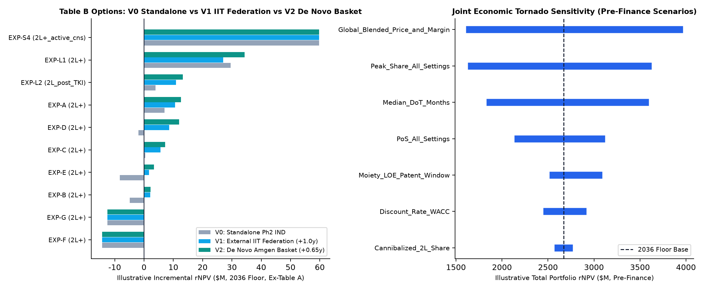
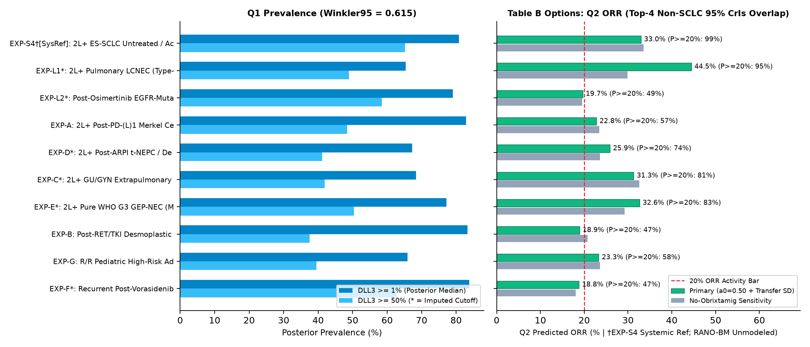
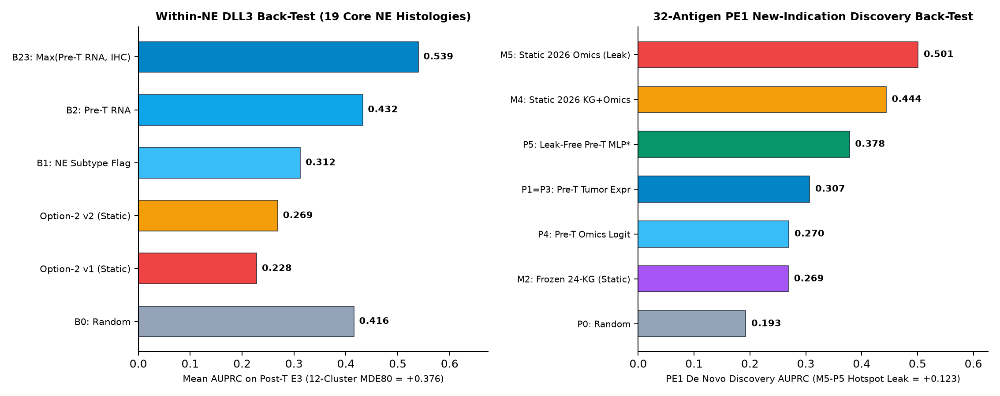
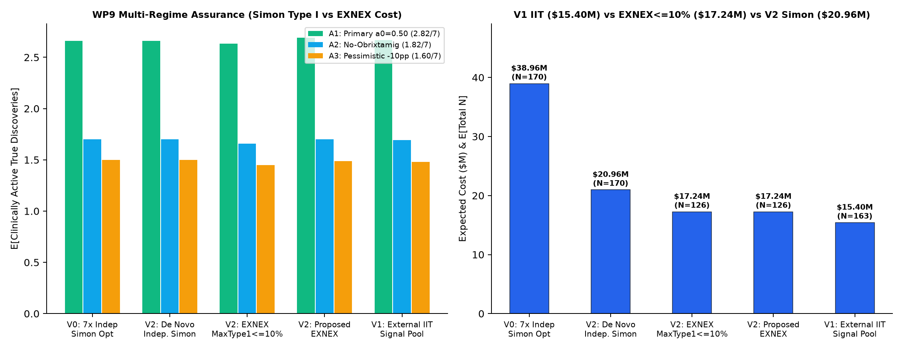
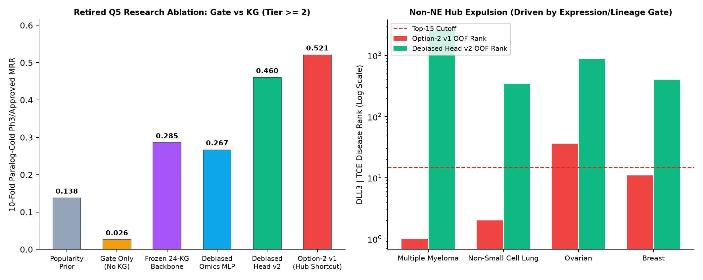
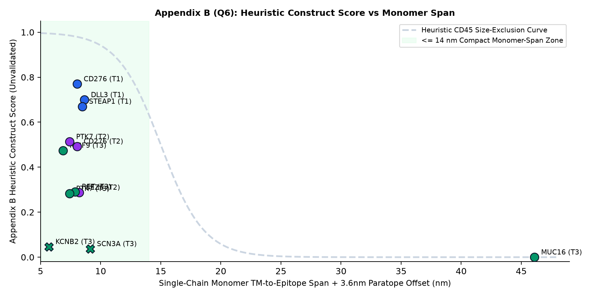

# Document 16 — AMG 757 (`Tarlatamab` / `IMDELLTRA`) `v4.3.2` Registry-Grounded Indication Expansion & Trial Strategy Model

> **Canonical `v4.3.2` Closing Release & Maintenance Status (Nov 2026):** Supersedes `v3.2` (`67.8%` Shapley IHC repetition) and closes all `13` items (`A1`–`A6`, `B1`–`B3`, `C1`–`C4`) of the `v4.3` review plus the `v4.3.2` `3/3` Bitcoin PoW settlement, `P5` specification parity, and `EVSI` / `3`-zone clinical-gate governance hardening. Every figure, Markdown report, `METRICS.md` entry, Studio HTML table, and `.pptx`/`.html` presentation deck is rendered from a single shared loader (`load_all_v4_artifacts()`) reading git-tracked `results_v4/` and `forecasts/` (`260` provenance records in `results_v4/evidence.parquet`: **`208` value-and-excerpt machine-verified records**, **`25` dual-reviewed `verified_source_only` records**, and **`27` `analyst_estimate` records**; `120/120` DLL3 trials enriched in `results_v4/provenance/ctgov_v2_dll3_snapshot.json`).

---

## 1. Executive Conclusions for Stakeholders (`v4.3.2`)

1. **Clinical Registry Reality (`12` Active/Committed SCLC + `7` Historical Baseline = `19` Table A Studies; `0` Active Amgen Non-SCLC Baskets):**
   - Across `40` registered tarlatamab studies in `ctgov_v2_dll3_snapshot.json`, **Table A (`19` industry/cooperative baseline studies)** comprises **`12` active/committed SCLC expansion and lifecycle studies** — `5` Phase 3 registrational trials (reported `DeLLphi-305 NCT06211036` OS HR `0.42 [95% CI 0.32–0.54]`, ongoing `DeLLphi-312 NCT07005128`, `DeLLphi-306 NCT06117774`, `DeLLphi-310 SC NCT07778316`, and cooperative `PrECOG NCT07637513`) plus `7` pipeline combination/formulation trials (`+ZL-1310 NCT07531095`, `+YL201 NCT06898957`, `DeLLphi-311 +AB248 NCT07037758`, `DeLLphi-303 NCT05361395`, `DeLLphi-309 NCT06745323`, and `2` partner-sponsored combinations: `GSK EMBOLD NCT06551142` [`has_sclc_combo_subarm=True`] and `AbbVie NCT07895056`) — alongside **`7` historical/completed baseline studies** (`6` completed 2L+ SCLC baseline studies incl. `DeLLphi-304 NCT05740566`, `DeLLphi-301 NCT05060016`, `DeLLphi-300 NCT03319940`, plus `1` completed NEPC study `DeLLpro-300 NCT04702737`). Note that `NCT06814496` is the Univ. of Arizona academic RT + tarlatamab basket (`N=30`), not `+ZL-1310`.
   - **`NCT06788938` Ground Truth & External IIT Landscape:** `NCT06788938` is a single-arm academic Phase 2 study sponsored by UCLA Jonsson CCC (`N = 29`, `ACTIVE_NOT_RECRUITING` — closed to accrual). Active non-SCLC testing occurs across **`11` open/planned investigator-initiated trials (`IITs`, total `N = 517`)**, tempered by `2/13` non-SCLC IIT drug-supply/accrual withdrawals (`GETNE NCT07061080` terminated at `N=1`; `NCI NCT07328490` withdrawn at `N=0`; `84.6%` survival rate).
   - Within SCLC, the genuinely incremental clinical gap (**Table B1**) is **`2L+` untreated/active parenchymal brain metastases (`EXP-S4`, Maastricht `NCT07402343`, `N=35`, Recruiting, `2029-02`)**, whose primary endpoint is **intracranial RANO-BM ORR** (`EXP-S4`'s `Q2` `33.0%† [23.3%, 42.0%]` is labeled **`systemic_reference_only_intracranial_primary`**; prospective intracranial readout is tracked separately under `FCST-17` `Beta(6.0, 17.4)`).
2. **Best Next Non-SCLC Extension Histologies (`a0 = 0.50` `Q2` Posterior, 4-Way `95% CrI` Overlap & Revealed Preference):**
   - Under the `a0 = 0.50` cross-agent power prior + transfer SD, the top non-SCLC candidates (**Table B2**) are **`2L+ Pulmonary LCNEC` (`EXP-L1`, `44.5%`, `[17.0%, 81.3%]`, `P>=20% = 95%`)**, **`2L+ Pure WHO G3 GEP-NEC (DLL3>=50%)` (`EXP-E`, `32.6%`, `[10.7%, 64.5%]`, `P>=20% = 83%`)**, **`2L+ GU/GYN SCNEC` (`EXP-C`, `31.3%`, `[10.0%, 64.8%]`, `P>=20% = 81%`)**, **`DLL3>=50% t-NEPC` (`EXP-D`, `25.9%`, `[10.3%, 48.1%]`, `P>=20% = 74%`)**, and **`Post-PD-(L)1 MCC` (`EXP-A`, `22.8%`, `[1.9%, 64.3%]`)**.
   - **4-Way Statistical Tie & Registry Revealed Preference (`C1`, `F5`):** Because `EXP-L1`, `EXP-E`, `EXP-C`, and `EXP-D` exhibit heavily overlapping `95% CrI`s (`~10%–17%` lower bounds to `~48%–81%` upper bounds) — and `EXP-L1` has **`0` direct tarlatamab cohorts** (relying on `1` `n=10` `obrixtamig` cohort `PMID:40706016`; `50.3%` at `a0=1.00`, `29.9%` `No-Obrixtamig`, `28.3%` `Leave-LCNEC-Out`) — ORR posteriors alone represent a **near 4-way statistical tie**. Commercial and operational differentiation comes from epidemiology, `SP347 >=50%` gating, and registry revealed preference (`BI DAREON-5` / `IFCT Ph3 NCT06937905` in LCNEC & EP-NEC; `MSD MK-6070` in EP-NEC/SCBC; `AMG 509` STEAP1 co-targeting in `DLL3>=50%` t-NEPC).
3. **Dollar Portfolio Waterfall, `V1` Drug-Supply Attrition Sensitivity (`0.75`), & Balanced `WP9` Type I vs Cost Trade-Off:**
   - **Explicit Dollar Waterfall (`2036` Statutory RPE Floor, Zero `>100%` Share Ratios):** Committed SCLC **Table A = `$2,610.8M`** (`$3,306.6M` under `2039` patent scenario); incremental intra-SCLC active CNS **`EXP-S4` = `+$59.7M`**; incremental Thoracic NE (`EXP-L1 + EXP-L2`) = **`+$33.5M` (`V0`) / `+$38.0M` (`V1` `0.90` base) / `+$31.1M` (`V1` `0.75` supply-attrition sensitivity) / `+$47.5M` (`V2` De Novo Basket)**; incremental Rare Non-SCLC (`EXP-A..G`) = **`-$34.6M` (`V0`) / `+$1.8M` (`V1` `0.90` base) / `-$4.34M` (`V1` `0.75` supply-attrition sensitivity) / `+$10.6M` (`V2`)**. Stress-testing `V1` at a `0.75` completion factor (reflecting `GETNE`/`NCI` withdrawals) flips Rare Non-SCLC from `+$1.8M` to **`-$4.34M`**, underscoring that `V1` is a low-cost signal-gating screen (**Bayesian `EVSI = $12.94M`** [`$12.35M` under exact `2036` LOE revenue truncation], saving **`$29.11M`** in expected confirmatory R&D), not a substitute for registrational sponsorship once a cohort clears its Go gate.
   - **Balanced `WP9` Design Trade-Off (`A6`):** Within `V2` across `A1` (`2.82/7` active), `A2` (`1.82/7`), and `A3` (`1.60/7`), **`Shared_Protocol_Independent_Simon` (`$20.96M`, `E[N]=170.1`, `2.66` true discoveries, `<= 4.99%` worst-cohort Type I)** prioritizes strict frequentist false-positive control, whereas **`EXNEX_WorstCaseType1_le10_Basket` (`$17.24M`, `-$3.72M` expected cost via `E[N]=126.4`, `2.63` true discoveries, `<= 8.25%` worst-cohort Type I)** trades modest Type I inflation for early futility savings (`Proposed_EXNEX_Shared_Basket` costs `$17.24M` at `<= 12.85%` Type I; `V1 Federated_IIT_Signal_Pool` costs `$15.40M`).
4. **Leak-Free `PE1` Discovery Back-Test (`P5` Frozen Spec), Bitcoin PoW `.ots` Proofs & Strict Scorecard Separation:**
   - On `PE1_new_indication` (`178` de novo target-indication entries; `P3 == P1 = 0.307`), leak-free pre-`T` multi-omics MLP (`P5_strict_preT_omics_mlp_lpfo`, sealed under `AMG757-FREEZE-P5-2026-11`: `sklearn.neural_network.MLPClassifier`, `hidden_layer_sizes=(16, 8)`, `activation='tanh'`, `solver='lbfgs'`, `alpha=8.0`, `tol=0.001`, `max_iter=300`, `random_state='2026 + fam_i'`) reaches **`AUPRC = 0.378`** (`Holm p = 0.0042` vs `P1`), isolating **`+0.123` AUPRC of post-`T`/L2G hotspot leakage** in static `M5` (`0.501`), while adding 24-ckpt KG (`M4 = 0.444`) hurts (`-0.057`). `Q5` ML remains retired (`0` columns in Table B), and un-multiplied `Q4` has **`recall@50 = 0.000`** (`N = 983` and `N = 1628`).
   - All `3/3` sealed ledger files — `2026_11.jsonl` (`c2c26cf8188b9107…`), `2026_11b.jsonl` (`c868151e28ad0685…`), and `2026_11c.jsonl` (`e119cfeade9be52d…`, `41` total ledger rows) — remain **100% byte-for-byte untouched** with `.ots` proofs **verified offline against Bitcoin block headers `#975,929`, `#975,963`, `#976,004`, `#976,009`**, enforcing **strict scorecard separation** between **`q2_empirical_model` (`n = 5`)** and **`analyst_prior` (`n = 4`)**.

---

## 2. Split Portfolio Tables: Committed SCLC Baseline (`Table A`) vs Incremental Options (`Table B`)

> **Illustrative Pre-Finance Scenarios — Pending Corporate Finance Validation:** Dollar figures compare `V0` (Standalone Ph2 INDs), `V1` (Coordinated External IIT Federation at `0.90` base and `0.75` drug-supply attrition sensitivity, `+1.0y` lag), and `V2` (Prospective De Novo Amgen Master Basket, `+0.65y` startup lag) under **Statutory RPE Floor (`2036-05-16`, `PHS Act §351(k)(7)`, `FD&C Act §529 PRV = $0.0M`)** and **Patent-Extended (`2039-05-16`)** scenarios.

### 2.1 `Table A` — Committed SCLC Franchise Baseline (`12` Active/Committed SCLC + `7` Historical Baseline = `19` Studies)

| ID | Committed SCLC Program (`12` Active SCLC + `7` Historical Baseline = `19` Studies) | Primary Endpoint | Observed / Target Efficacy (`evidence.parquet` Verified) | Pediatric Regulatory Status | Illustrative Baseline `rNPV` (`2036` Floor / `2039` Patent) |
| :---: | :--- | :--- | :--- | :--- | :---: |
| **`EXP-S1`** | 1L ES-SCLC Maintenance & Concurrent Chemo-IO Franchise (DeLLphi-305 Ph3 + DeLLphi-312 Ph3) (`NCT06211036`) | `OS / BICR PFS (Time-to-Event 1L ES-SCLC)` | DeLLphi-305 Ph3 OS HR 0.42 (95% CI 0.32–0.54; PMID:42929702, surv_tarlatamab_dellphi305_1l_maint_os_hr_2026); DeLLphi-312 NCT07005128 Ph3 (N=350) ongoing | Triggers mandatory PREA/RACE FD&C Act §505B molecular-target pediatric evaluation (0.0y exclusivity) | `$2,145.6M` / `$2,658.9M` |
| **`EXP-S3`** | LS-SCLC Post-cCRT Consolidation (DeLLphi-306 Ph3 + PrECOG NCT07637513 Ph3) (`NCT06117774`) | `BICR PFS & OS (Post-cCRT Consolidation)` | Ongoing Amgen Ph3 DeLLphi-306 (NCT06117774, N=404) & PrECOG Ph3 +Durvalumab (NCT07637513, N=430) | Covered under SCLC adult sBLA PREA waiver/deferral | `$441.8M` / `$584.7M` |
| **`EXP-S2`** | Committed SCLC Next-Gen Combo & SC Lifecycle (+ZL-1310 NCT07531095 / DeLLphi-311 / DeLLphi-310 SC) (`NCT07531095`) | `DLT / TEAE (Ph1b NCT07531095) -> Target PFS / OS vs S1; PK Bridging (DeLLphi-310 SC NCT07778316)` | Amgen Ph1b NCT07531095 (+ZL-1310, N=160), DeLLphi-311 NCT07037758 (+AB248, N=380), NCT06898957 (+YL201, N=29), & DeLLphi-310 NCT07778316 Ph3 SC (N=400) | None (committed adult SCLC combination & SC formulation lifecycle pipeline) | `$23.4M` / `$63.0M` |

### 2.2 `Table B` — Incremental Expansion Options Across `V0` / `V1` (`0.90` & `0.75` Sens) / `V2` (`0` `Q5`/`Q6` Columns)

> **Scope Footnote (`†` on `EXP-S4`):** `EXP-S4` (`NCT07402343`, `N=35`) evaluates untreated/active parenchymal CNS metastases with primary endpoint **intracranial RANO-BM ORR**. Its `Q2` posterior (`33.0%† [23.3%, 42.0%]`) reflects **systemic 2L+ SCLC ORR reference only** (`DeLLphi-301` `40/100` & `DeLLphi-300` `25/107` permitted treated/stable CNS; `0` untreated intracranial TCE rows exist today).

| `V2` # (`V1` # / `V0` #) | ID | Incremental Option (`Live Anchor NCT`) | Gate (`ge50` Imputed?) | Direct `AMG757` Cohorts (`Q2` Support) | `Q1` >=1% / >=50% | `Q2` ORR (`a0=0.50` `95% CrI`, `No-Obrix`) | Illustrative `2036` `rNPV`: `V0` / `V1` (`0.75` Sens) / `V2` | Action |
| :---: | :---: | :--- | :---: | :--- | :---: | :---: | :---: | :--- |
| `#1` (`#1` / `#1`) | **`EXP-S4`** | 2L+ ES-SCLC Untreated / Active Parenchymal Brain Metastases (+SRS) (`NCT07402343`) | `all_comer_unselected` | `4` (Systemic SCLC Ref Only (Direct tarlatamab (4 cohort(s), n=549) + 2 cross-agent TCE cohort(s) (a0=0.50); Primary RANO-BM Intracranial ORR Unmodeled)) | `80.8%` / `65.1%` | **`33.0%†`** (`[23.3%, 42.0%]`, `33.6%`; *Systemic Ref Only*) | `+$59.7M` / **`+$59.7M`** (`+$59.7M`) / **`+$59.7M`** | `ADVANCE_INTRACRANIAL_BRAIN_METS_PH2` |
| `#2` (`#2` / `#2`) | **`EXP-L1`** | 2L+ Pulmonary LCNEC (Type-I ASCL1+ / SP347 >=1%) (`NCT06937905`) | `DLL3_pos_ge1` *(imputed)* | `0` (0 tarlatamab cohorts; driven by 1 cross-agent cohort (obrixtamig 7/10, n=10, discounted at a0=0.50 + transfer SD)) | `65.4%` / `48.9%` | **`44.5%`** (`[17.0%, 81.3%]`, `29.9%`) | `+$29.6M` / **`+$27.1M`** (`+$22.3M`) / **`+$34.3M`** | `COORDINATE_IIT_FEDERATION_OR_OPEN_AMGEN_BASKET` |
| `#3` (`#3` / `#4`) | **`EXP-L2`** | Post-Osimertinib EGFR-Mutant Transformed SCLC (t-SCLC Combination Regimen) (`NCT06830694`) | `DLL3_pos_ge1` *(imputed)* | `1` (Direct tarlatamab (1 cohort(s), n=14)) | `79.1%` / `58.4%` | **`19.7%`** (`[2.5%, 50.3%]`, `19.5%`) | `+$3.9M` / **`+$10.9M`** (`+$8.8M`) / **`+$13.2M`** | `COORDINATE_IIT_FEDERATION_OR_OPEN_AMGEN_BASKET` |
| `#4` (`#4` / `#3`) | **`EXP-A`** | 2L+ Post-PD-(L)1 Merkel Cell Carcinoma (SP347 >=1%) (`NCT06816394`) | `DLL3_pos_ge1` | `0` (0 direct DLL3 TCE cohorts; hierarchical lineage + Q1 IHC shrinkage only) | `82.9%` / `48.4%` | **`22.8%`** (`[1.9%, 64.3%]`, `23.4%`) | `+$7.0M` / **`+$10.6M`** (`+$8.5M`) / **`+$12.6M`** | `COORDINATE_IIT_FEDERATION_OR_OPEN_AMGEN_BASKET` |
| `#5` (`#5` / `#6`) | **`EXP-D`** | 2L+ Post-ARPI t-NEPC / De Novo NEPC (Mandatory SP347 >=50% + AMG 509 Dual-BiTE) (`NCT07111507`) | `DLL3_high_ge50` *(imputed)* | `3` (Direct tarlatamab (3 cohort(s), n=38) + 1 cross-agent TCE cohort(s) (a0=0.50)) | `67.3%` / `41.2%` | **`25.9%`** (`[10.3%, 48.1%]`, `23.6%`) | `-$1.9M` / **`+$8.6M`** (`+$6.9M`) / **`+$12.0M`** | `COORDINATE_IIT_FEDERATION_OR_OPEN_AMGEN_BASKET` |
| `#6` (`#6` / `#5`) | **`EXP-C`** | 2L+ GU/GYN Extrapulmonary SCNEC Basket (Bladder SCBC + Cervical/Ovarian SCNEC) (`NCT07788365`) | `DLL3_pos_ge1` *(imputed)* | `0` (0 tarlatamab cohorts; driven by 1 cross-agent cohort (gocatamig 11/25, n=25, discounted at a0=0.50 + transfer SD)) | `68.4%` / `41.9%` | **`31.3%`** (`[10.0%, 64.8%]`, `32.6%`) | `+$0.4M` / **`+$5.6M`** (`+$4.4M`) / **`+$7.2M`** | `COORDINATE_IIT_FEDERATION_OR_OPEN_AMGEN_BASKET` |
| `#7` (`#8` / `#8`) | **`EXP-E`** | 2L+ Pure WHO G3 GEP-NEC (Mandatory SP347 >=50% High-Density Gate) (`NCT06893783`) | `DLL3_high_ge50` *(imputed)* | `0` (0 tarlatamab cohorts; 2 cross-agent cohorts (obrixtamig, total n=60, discounted at a0=0.50 + transfer SD)) | `77.2%` / `50.3%` | **`32.6%`** (`[10.7%, 64.5%]`, `29.2%`) | `-$8.3M` / **`+$1.7M`** (`+$1.1M`) / **`+$3.4M`** | `COORDINATE_IIT_FEDERATION_OR_OPEN_AMGEN_BASKET` |
| `#8` (`#7` / `#7`) | **`EXP-B`** | Post-RET/TKI Desmoplastic Medullary Thyroid Carcinoma (SP347 >=1%) (`NONE_DEDICATED_MONOTHERAPY`) | `DLL3_pos_ge1` | `0` (0 direct DLL3 TCE cohorts; hierarchical lineage + Q1 IHC shrinkage only) | `83.3%` / `37.5%` | **`18.9%`** (`[1.3%, 59.7%]`, `20.8%`) | `-$4.9M` / **`+$2.2M`** (`+$1.5M`) / **`+$2.2M`** | `EXPLORATORY_DENOVO_BASKET_COHORT_ONLY` |
| `#9` (`#9` / `#9`) | **`EXP-G`** | R/R Pediatric High-Risk Adrenergic Neuroblastoma (Voluntary BPCA §351(m) Written Request Option) (`NONE_PROPOSED_BPCA`) | `DLL3_pos_ge1` | `0` (0 direct DLL3 TCE cohorts; hierarchical lineage + Q1 IHC shrinkage only) | `65.9%` / `39.5%` | **`23.3%`** (`[2.2%, 66.4%]`, `23.6%`) | `-$12.5M` / **`-$12.5M`** (`-$12.5M`) / **`-$12.5M`** | `EXPLORATORY_VOLUNTARY_BPCA_WR_COHORT` |
| `#10` (`#10` / `#10`) | **`EXP-F`** | Recurrent Post-Vorasidenib IDH-Mutant Diffuse Glioma (Exploratory BBB Signal) (`NCT07243470`) | `DLL3_high_ge50` *(imputed)* | `0` (0 direct DLL3 TCE cohorts; hierarchical lineage + Q1 IHC shrinkage only) | `83.9%` / `62.7%` | **`18.8%`** (`[1.6%, 70.5%]`, `18.0%`) | `-$14.3M` / **`-$14.3M`** (`-$14.3M`) / **`-$14.3M`** | `EXPLORATORY_BBB_SIGNAL_COHORT` |
| `Guardrail` | **`GUARD-1`** | Well-Differentiated G1/G2 GEP-NET (Carcinoid — Do NOT Enroll) (`none`) | `all_comer_unselected` *(imputed)* | `0` (Negative Control Guardrail) | `5.6%` / `3.6%` | `N/A (Guardrail)` | `+$0.0M` / **`+$0.0M`** (`+$0.0M`) / **`+$0.0M`** | `DO_NOT_ENROLL_GUARDRAIL` |
| `Guardrail` | **`GUARD-2`** | Non-NE Oncology Hubs (MM / Ovarian HGSC / Breast / Unselected NSCLC — Do NOT Enroll) (`none`) | `all_comer_unselected` *(imputed)* | `0` (Negative Control Guardrail) | `2.9%` / `1.7%` | `N/A (Guardrail)` | `+$0.0M` / **`+$0.0M`** (`+$0.0M`) / **`+$0.0M`** | `DO_NOT_ENROLL_GUARDRAIL` |

- **Dollar Portfolio Waterfall (Net of `$469.3M` `2L` SCLC Cannibalization; Zero `>100%` Share Ratios):**
  - *Committed SCLC Baseline (`Table A`, `12` active SCLC + `7` historical baseline):* **`$2,610.8M`** (`2036-05-16` floor) / **`$3,306.6M`** (`2039-05-16` patent scenario).
  - *Incremental Intra-SCLC Active Brain Mets (`Table B1`, `EXP-S4`, `NCT07402343`, `N=35`):* **`+$59.7M`**.
  - *Incremental Thoracic NE (`EXP-L1 + EXP-L2`):* **`+$33.5M` (`V0`)** | **`+$38.0M` (`V1` `0.90` base)** | **`+$31.1M` (`V1` `0.75` supply-attrition)** | **`+$47.5M` (`V2` De Novo Basket)**.
  - *Incremental Rare Non-SCLC (`EXP-A..G`):* **`-$34.6M` (`V0`)** | **`+$1.8M` (`V1` `0.90` base)** | **`-$4.34M` (`V1` `0.75` supply-attrition)** | **`+$10.6M` (`V2` De Novo Basket)**; total `Table B` incremental value = **`+$58.6M` (`V0`)** / **`+$99.5M` (`V1` base)** / **`+$86.5M` (`V1` `0.75` sens)** / **`+$117.8M` (`V2`)** (`+$122.5M` on new histologies under `2039-05-16` + `V2`).
  - *Voluntary `PHS Act §351(m)` BPCA `+0.5y` Moiety Extension (`2036-11-16`):* `+$184.8M` (distinct from mandatory `PREA/RACE §505B` = `0.0y`).

### 2.3 External Non-SCLC Investigator-Initiated Trial (`IIT`) Federation Inventory (`11` Open/Planned Studies, `N = 517`)

> **Registry Grounding (`results_v4/amg757_iit_network_inventory.csv`):** Excludes closed-to-accrual UCLA `NCT06788938` (`N=29`, `ACTIVE_NOT_RECRUITING`), SCLC-only poor-PS academic study `AIO NCT07803848` (`N=57`), and terminated/withdrawn studies `GETNE NCT07061080` (`N=1`) and `NCI NCT07328490` (`N=0`).

| NCT ID | Sponsor (`Class`) | Status (`Enrollment`) | Primary Completion | Registered Primary Outcomes | Conditions |
| :---: | :--- | :---: | :---: | :--- | :--- |
| `NCT06776250` | University Health Network, Toronto (`OTHER`) | `RECRUITING` (`N=44`) | `2028-03-03` | Percent change in CD8+ T cell infiltrate | Astrocytic Tumor; Oligodendroglial Tumor |
| `NCT06814496` | University of Arizona (`OTHER`) | `RECRUITING` (`N=30`) | `2030-05` | Percentage of participants experiencing dose limiting toxicities (DLT) attributed to radiation or combination of… | Melanoma; Medullary Thyroid Cancer; Sinonasal Undifferentiated Carcinoma… |
| `NCT06816394` | National Taiwan University Hospital (`OTHER`) | `RECRUITING` (`N=32`) | `2027-12-31` | Objective response rate (ORR) per RECIST 1.1 by investigator | Extrapulmonary Small Cell Carcinoma and Neuroendocrine Carcinoma |
| `NCT06830694` | Sehhoon Park (`OTHER`) | `RECRUITING` (`N=50`) | `2027-03-31` | Progression-free survival(PFS) | Small Cell Carcinoma of Lung |
| `NCT06893783` | Inkeun Park (`OTHER`) | `RECRUITING` (`N=60`) | `2029-04-30` | Objective response rate (ORR) | Neuroendocrine Carcinomas (NEC); Neuroendocrine Carcinoma of Pancreas; Neuroendocrine… |
| `NCT06937905` | Intergroupe Francophone de Cancerologie Thoracique (`OTHER`) | `RECRUITING` (`N=129`) | `2029-02-01` | Overall survival (OS) in patients who received at least one dose of treatment. | Neuroendocrine Carcinoma |
| `NCT07016230` | Gustave Roussy, Cancer Campus, Grand Paris (`OTHER`) | `RECRUITING` (`N=40`) | `2027-05-18` | To estimate the objective response rate (ORR) | Metastatic/Locally Advanced Small-Cell Lung Cancer; Metastatic/Locally Advanced Poorly… |
| `NCT07111507` | Memorial Sloan Kettering Cancer Center (`OTHER`) | `RECRUITING` (`N=32`) | `2027-08-31` | progression free survival (rPFS) | Metastatic Prostate Cancer |
| `NCT07243470` | Centre Leon Berard (`OTHER`) | `RECRUITING` (`N=70`) | `2029-10` | Phase I : Dose limiting toxicities (DLT) assessed as related at least to tarlatamab, occurring during the first 2… | Glioma; CNS Tumor, Adult; CNS Tumor, Childhood |
| `NCT07788365` | University Hospital, Strasbourg, France (`OTHER`) | `NOT_YET_RECRUITING` (`N=20`) | `2030-08-31` | Progression free survival (PFS) at month 9, defined as the time from first administration of Tarlatamab to… | Diagnosis of Neuro-endocrine Carcinoma of the Gynecological Tract |
| `NCT07788677` | Vall d'Hebron Institute of Oncology (`OTHER`) | `NOT_YET_RECRUITING` (`N=10`) | `2029-05-01` | Number of Participants Completing the DLT Evaluation Period and Undergoing Planned Surgery Without a DLT; Number… | High-Grade Glioma (HGG) |

---

## 3. `Q1` Prevalence Sharpness, `Q2` Cross-Agent Power-Prior (`a0 = 0.50`) & `Q4` Anti-Leak Audit

- **`Q1` Multinomial Prevalence (`LOSO` Calibrated):** `95%` coverage = **`100.0%`** (`Winkler95 = 0.615` vs `No-Pooling = 0.774`, `Parent-Lineage = 0.951`; `CRPS = 0.1009`; `Delta ELPD vs No-Pooling = +5.85`).
- **`Q2` Cross-Agent Transfer SD + `a0 = 0.50` Power Prior (`F5`, `C1`):** Fits `15` independent TCE cohorts (`0` MCMC divergences, `max R-hat = 1.0057`, `LOCO 95% coverage = 100.0%`, `Winkler95 = 0.510`, `CRPS = 0.0857`, `Delta ELPD vs Stratum-Pool = +4.36`). `LCNEC` (`0` direct tarlatamab cohorts; `1` `n=10` obrixtamig cohort `PMID:40706016`) spans **`44.5%`** (`a0=0.50` primary), **`50.3%`** (`a0=1.00`), **`29.9%`** (`No-Obrixtamig`), and **`28.3%`** (`Leave-LCNEC-Out`).
- **`Q4` Combination Ranking (`Zero` Demonstrated Future Recall — No Demonstrated Recall of Future Combinations):** Primary oncology catalog (`N = 983`): **`AUROC = 0.611` (`[0.332, 0.879]`)**, **`recall@50 = 0.000`**; unbiased extended biologics/ADC catalog (`N = 1628`): **`AUROC = 0.732`**, **`recall@50 = 0.000`**.

---

## 4. Leak-Free `PE1` Discovery Back-Test (`P5` Frozen Spec), Within-NE MDE & `WP9` Design Trade-Off

- **`32`-Antigen `PE1_new_indication` De Novo Discovery Back-Test (`had_pre_T_any_trial == False`, `178` Post-2015 Events, Exact `2^22` Family Sign-Flips):**
  - Pre-`T` Phase 1 momentum provides zero shortcut (`P3 == P1 = 0.307`). Strictly pre-`T` multi-omics MLP (`P5_strict_preT_omics_mlp_lpfo`, frozen under `AMG757-FREEZE-P5-2026-11`: `sklearn.neural_network.MLPClassifier`, `hidden_layer_sizes=(16, 8)`, `activation='tanh'`, `solver='lbfgs'`, `alpha=8.0`, `tol=0.001`, `max_iter=300`, `random_state='2026 + fam_i'`) achieves **`AUPRC = 0.378`** (`+0.071` over `P1`, `Holm p = 0.0042`).
  - Static-2026 `M5` (`0.501`) vs `P5` (`0.378`) isolates **`+0.123` AUPRC of post-`T`/Open-Targets-L2G hotspot leakage** (`+0.111` on `PE2`, where `P5 = 0.435` vs `M5 = 0.546`), while adding 24-ckpt KG (`M4 = 0.444`) degrades performance vs `M5`.
- **Within-Strict-NE DLL3 Back-Test & 12-Cluster Power/MDE:** Across `19` core NE histologies (`12` clusters, `df = 11`), `80%`-power MDE at one-sided `alpha = 0.05` is **`+0.335 Delta AUROC` / `+0.376 Delta AUPRC`** (`B23 = 0.539` vs `Option-2 v2 = 0.269`).

### 4.1 `WP9` Multi-Regime Bayesian Assurance & Frequentist-vs-Cost Trade-Off (`A1`, `A2`, `A3`)

| Design (`Route`) | Max `N` | Worst Null Type I | `A1` `E[TrueDisc]` (`/ 2.82`) | `A2` No-Obrix (`/ 1.82`) | `A3` `-10pp` (`/ 1.60`) | `A1` `E[Null FP]` | `A1` `E[Trial Cost]` |
| :--- | :---: | :---: | :---: | :---: | :---: | :---: | :---: |
| `Standalone_7x_Simon_Optimal` | `217` | `4.99%` | **`2.66`** | **`1.70`** | **`1.50`** | `0.027` | `$38.96M` |
| `Shared_Protocol_Independent_Simon` | `217` | `4.99%` | **`2.66`** | **`1.70`** | **`1.50`** | `0.027` | `$20.96M` |
| `Shared_Protocol_Independent_FixedN20` | `140` | `4.01%` | **`2.52`** | **`1.61`** | **`1.41`** | `0.017` | `$16.66M` |
| `EXNEX_WorstCaseType1_le10_Basket` | `140` | `8.25%` | **`2.63`** | **`1.66`** | **`1.45`** | `0.038` | `$17.24M` |
| `Proposed_EXNEX_Shared_Basket` | `140` | `12.85%` | **`2.69`** | **`1.70`** | **`1.49`** | `0.068` | `$17.24M` |
| `Federated_IIT_Signal_Pool_V1` | `163` | `6.50%` | **`2.67`** | **`1.69`** | **`1.48`** | `0.035` | `$15.40M` |

---

## 5. Append-Only SHA-256 + Bitcoin PoW `.ots` Forecast Ledger (`41` Sealed Records)

- **Immutable 3-Layer Ledger & Bitcoin Proof-of-Work Verification (`B1`–`B3`, `C2`):**
  - `forecasts/amg757_prospective_forecasts_2026_11.jsonl` (`SHA-256` `c2c26cf8188b9107…`) and `forecasts/amg757_prospective_forecasts_2026_11b.jsonl` (`SHA-256` `c868151e28ad0685…`) remain **100% byte-for-byte untouched**, verified offline against **Bitcoin block headers `#975,929`, `#975,963`** (`forecasts/bitcoin_block_headers.json`).
  - `forecasts/amg757_prospective_forecasts_2026_11c.jsonl` (`SHA-256` `e119cfeade9be52d…`, **Bitcoin PoW verified offline against blocks `#976,004`, `#976,009`**) appends `4` scope/provenance void amendments (`AMG757-VOID-2026-08..11`), `4` explicit `analyst_prior` replacements (`AMG757-FCST-2026-17..20`), `1` `P5` model freeze (`AMG757-FREEZE-P5-2026-11`), and `9` Bayesian `EVSI` decision triggers (`AMG757-TRIG-2026-01..09`), totaling **`41` sealed records** (`3/3` `.ots` files `BITCOIN_POW_VERIFIED` across `#975,929`, `#975,963`, `#976,004`, `#976,009`).
  - **Strict Scorecard Separation:** `score_forecast_records()` evaluates **`q2_empirical_model` (`n = 5` active: `FCST-09`, `FCST-11..14`)** strictly separately from **`analyst_prior` (`n = 4` active: `FCST-17..20`)** so human priors never contaminate algorithmic `Q2` calibration.

### 5.1 Primary Track A — `Q2` Empirical Hierarchical Model Forecasts (`n = 5` Active Pending Readouts)

| Forecast ID | Trial (`Agent`) | Track / Specification | Live Registered Cohort (`Expected N <= Reg N`, Target Readout) | Posterior / Prior Median (`95% CrI`) | Finite-`N` `80% PI` | `P(Event)` | `SHA-256` Prefix |
| :---: | :---: | :--- | :--- | :---: | :---: | :---: | :---: |
| `AMG757-FCST-2026-09` | `NCT05882058` (`obrixtamig`) | `Q2_TCE_only_EXNEX_posterior_predictive` | NCT05882058 DAREON-5 Ph2 — 2L+ Extrapulmonary NEC DLL3-High Cohort (`N=60`, `2027-09`) | `35.0%` (`[13.9%, 61.5%]`) | `[18%, 53%]` | **`89.6%`** | `cff203599557…` |
| `AMG757-FCST-2026-11` | `NCT06893783` (`tarlatamab`) | `Q2_TCE_only_a0_0.50_transfer_sd_EXNEX_posterior_predictive` | NCT06893783 Korea Multicenter Ph2 — Advanced Extrapulmonary NEC (Primary ORR) (`N=50`, `2029-04`) | `18.4%` (`[4.7%, 44.5%]`) | `[6%, 36%]` | **`47.2%`** | `168bb8204f68…` |
| `AMG757-FCST-2026-12` | `NCT06816394` (`tarlatamab`) | `Q2_TCE_only_a0_0.50_transfer_sd_EXNEX_posterior_predictive` | NCT06816394 NTU Taiwan TAURUS Ph2 — Extrapulmonary SCC & NEC (Primary ORR) (`N=30`, `2027-12`) | `18.5%` (`[1.1%, 57.4%]`) | `[3%, 43%]` | **`49.4%`** | `2c797823d47c…` |
| `AMG757-FCST-2026-13` | `NCT07016230` (`tarlatamab`) | `Q2_TCE_only_a0_0.50_transfer_sd_EXNEX_posterior_predictive` | NCT07016230 Gustave Roussy UNLOCK Ph2 — Poorly Differentiated NEC Cohort (Primary ORR) (`N=20`, `2027-05`) | `18.5%` (`[1.1%, 57.4%]`) | `[0%, 45%]` | **`50.8%`** | `0a186b630463…` |
| `AMG757-FCST-2026-14` | `NCT06788938` (`tarlatamab`) | `Q2_TCE_only_a0_0.50_transfer_sd_EXNEX_posterior_predictive` | NCT06788938 UCLA Academic Ph2 — Pooled Study-Wide DLL3+ Advanced Tumors/NENs (N=29, Primary ORR) (`N=29`, `2028-04`) | `22.9%` (`[1.4%, 66.9%]`) | `[3%, 52%]` | **`57.3%`** | `71a11720dda7…` |

### 5.2 Secondary Track B — Explicit `analyst_prior` Forecasts (`n = 4` Active Pending Readouts; Scored Separately)

| Forecast ID | Trial (`Agent`) | Track / Specification | Live Registered Cohort (`Expected N <= Reg N`, Target Readout) | Posterior / Prior Median (`95% CrI`) | Finite-`N` `80% PI` | `P(Event)` | `SHA-256` Prefix |
| :---: | :---: | :--- | :--- | :---: | :---: | :---: | :---: |
| `AMG757-FCST-2026-17` | `NCT07402343` (`tarlatamab`) | `analyst_prior` | NCT07402343 Maastricht Ph2 — ES-SCLC Untreated/Active Brain Metastases (N=35, Primary Intracranial RANO-BM ORR) (`N=35`, `2029-02`) | `24.9%` (`[10.5%, 44.7%]`) *(Beta(6.0,17.4) CNS Prior)* | `[11%, 40%]` | **`71.0%`** | `c654b219a590…` |
| `AMG757-FCST-2026-18` | `NCT06117774` (`tarlatamab`) | `analyst_prior` | NCT06117774 Amgen DeLLphi-306 Ph3 — LS-SCLC Post-cCRT Consolidation Primary BICR PFS Superiority (N=404) (`N=404`, `2030-04`) | `N/A (Binary Superiority)` | `Binary Ph3 Outcome` | **`52.0%`** | `b7b701dfa247…` |
| `AMG757-FCST-2026-19` | `NCT06937905` (`tarlatamab`) | `analyst_prior` | NCT06937905 IFCT-2401 Randomized Trial — Pre-Treated Pulmonary/GEP Poorly Differentiated NEC Primary OS Superiority (N=129) (`N=129`, `2029-02`) | `N/A (Binary Superiority)` | `Binary Ph3 Outcome` | **`48.0%`** | `10e3d37841fd…` |
| `AMG757-FCST-2026-20` | `NCT07005128` (`tarlatamab`) | `analyst_prior` | NCT07005128 Amgen DeLLphi-312 Ph3 — 1L ES-SCLC Tarlatamab + Durvalumab + Carbo/Etop Primary OS/PFS Superiority (N=350) (`N=350`, `2029-01`) | `N/A (Binary Superiority)` | `Binary Ph3 Outcome` | **`62.0%`** | `66b228a89a35…` |

### 5.3 Append-Only Void Amendments (`11` Superseded Entries Audited Against Registry & Provenance Rules)

| Amendment ID | Superseded ID | Original NCT | Audit Disposition (`2026_11`/`11b` Untouched) | Registry / Provenance Audit Reason |
| :---: | :---: | :---: | :---: | :--- |
| `AMG757-VOID-2026-01` | `AMG757-FCST-2026-01` | `NCT06788938` | `VOIDED_UNSCORABLE_PROTOCOL_MISMATCH` | Unscorable protocol/enrollment mismatch: NCT06788938 is a single-arm UCLA academic study (total registered enrollment N=29, ACTIVE_NOT_RECRUITING), not a multi-cohort 110-patient basket with an N=25 LCNEC subcohort. |
| `AMG757-VOID-2026-02` | `AMG757-FCST-2026-02` | `NCT06788938` | `VOIDED_UNSCORABLE_PROTOCOL_MISMATCH` | Unscorable protocol/enrollment mismatch: NCT06788938 is a single-arm UCLA academic study (total N=29, ACTIVE_NOT_RECRUITING), without a dedicated N=20 Merkel cell carcinoma subcohort. |
| `AMG757-VOID-2026-03` | `AMG757-FCST-2026-03` | `NCT06788938` | `VOIDED_UNSCORABLE_PROTOCOL_MISMATCH` | Unscorable protocol/enrollment mismatch: NCT06788938 is a single-arm UCLA academic study (total N=29, ACTIVE_NOT_RECRUITING), without a dedicated N=25 DLL3>=50% GEP-NEC subcohort. |
| `AMG757-VOID-2026-04` | `AMG757-FCST-2026-04` | `NCT06788938` | `VOIDED_UNSCORABLE_PROTOCOL_MISMATCH` | Unscorable protocol/enrollment mismatch: NCT06788938 is a single-arm UCLA academic study (total N=29, ACTIVE_NOT_RECRUITING), without a dedicated N=20 medullary thyroid carcinoma subcohort. |
| `AMG757-VOID-2026-05` | `AMG757-FCST-2026-05` | `NCT06788938` | `VOIDED_UNSCORABLE_PROTOCOL_MISMATCH` | Unscorable protocol/enrollment mismatch: NCT06788938 is a single-arm UCLA academic study (total N=29, ACTIVE_NOT_RECRUITING), without a dedicated N=20 EGFRm transformed SCLC subcohort. |
| `AMG757-VOID-2026-06` | `AMG757-FCST-2026-06` | `NCT07788365` | `VOIDED_UNSCORABLE_PROTOCOL_MISMATCH` | Unscorable sponsor/condition/endpoint mismatch: NCT07788365 is sponsored by Hopitaux Universitaires de Strasbourg in gynecologic NEC only (N=20, NOT_YET_RECRUITING) with primary endpoint 9-month PFS, not a SWOG N=25 GU/GYN ORR trial. |
| `AMG757-VOID-2026-07` | `AMG757-FCST-2026-07` | `NCT06776250` | `VOIDED_UNSCORABLE_PROTOCOL_MISMATCH` | Unscorable primary endpoint mismatch: NCT06776250 (UHN Perioperative Window-of-Opportunity study in recurrent IDH1/2-mutant glioma, N=30) has a pharmacodynamic primary endpoint (percent change in CD8+ T-cell infiltrate), not RECIST/RANO binomial ORR. |
| `AMG757-VOID-2026-08` | `AMG757-FCST-2026-08` | `NCT07402343` | `VOIDED_ENDPOINT_ENROLLMENT_DATE_AMENDED` | Protocol/endpoint/date alignment (B1): NCT07402343 (Maastricht UMC Ph2 in untreated/active SCLC brain metastases) has primary endpoint Intracranial ORR (RANO-BM), registered enrollment N=35 (not N=30), and primary completion 2029-02 (not 2027-12). Systemic RECIST Q2 ORR does not model CNS penetration; superseded by AMG757-FCST-2026-17 (`binomial_intracranial_orr`, `analyst_prior` Beta(6.0, 17.4)). |
| `AMG757-VOID-2026-09` | `AMG757-FCST-2026-10` | `NCT06117774` | `VOIDED_DATE_AND_PRIOR_LABEL_AMENDED` | Completion date & prior provenance alignment (B2/B3): NCT06117774 (DeLLphi-306 LS-SCLC Ph3, N=404) registered primary completion is 2030-04-20 (not 2028-04), and Phase 3 TTE superiority probability (0.52) is an explicit judgmental `analyst_prior` rather than an algorithmic model output; superseded by AMG757-FCST-2026-18. |
| `AMG757-VOID-2026-10` | `AMG757-FCST-2026-15` | `NCT06937905` | `VOIDED_PRIOR_PROVENANCE_LABEL_AMENDED` | Prior provenance standardization (B3): NCT06937905 (IFCT-2401 randomized NEC OS trial, N=129, 2029-02) uses a human judgmental OS superiority probability (0.48), not an empirical statistical model; superseded by AMG757-FCST-2026-19 with `model_specification = 'analyst_prior'`. |
| `AMG757-VOID-2026-11` | `AMG757-FCST-2026-16` | `NCT07005128` | `VOIDED_PRIOR_PROVENANCE_LABEL_AMENDED` | Prior provenance standardization (B3): NCT07005128 (DeLLphi-312 1L ES-SCLC Ph3, N=350, 2029-01) uses a human judgmental OS/PFS superiority probability (0.62), not an empirical statistical model; superseded by AMG757-FCST-2026-20 with `model_specification = 'analyst_prior'`. |

---

## 6. Pre-Committed Bayesian Value-of-Information (`EVSI`) Go/No-Go Decision Triggers (`C3`)

- **Methodology (`optimus_txgnn/models/voi_decision_triggers.py` & `configs/amg757_scenarios_v4.yaml`):** Exact discrete Bayes posterior-predictive quadrature over `5,000` `Q2` MCMC draws (and deterministic `Beta(6.0, 17.4)` quantile quadrature for `FCST-17` intracranial ORR), linked to `Q3` `2036` statutory-floor cashflows (`EVSI = E_k[max(0, E[NPV(p)|k,N])] - max(0, E[NPV(p)])`), with all payoff governance parameters externalized under `voi_decision_trigger_governance` in `configs/amg757_scenarios_v4.yaml`.
- **Portfolio VoI Headline & Exact-2036-LOE Sensitivity:** Across the non-SCLC `V1` IIT triggers, conditioning Amgen registrational spend on external IIT readouts generates **`$12.94M` in total Bayesian `EVSI`** (**`$12.35M`** when re-truncating active revenue years at `2036-05-16` under `+1.0y` `V1` lag rather than `1/(1 + wacc)` discounting) and avoids **`$29.11M`** in expected confirmatory R&D under underperforming states. For `EXP-L1` (`Pulmonary LCNEC`), an interim **`n = 15` futility gate (`k <= 2/15` responders -> stop standalone `V2` arm)** carries a `8.3%` early-stop probability under `a0=0.50` (`posterior NPV = -$19.39M`), yielding **`EVSI = $3.48M`**.
- **3-Zone Clinical Gate Clarification on `AMG757-TRIG-2026-06` (`EXP-S4` Active Brain Mets, `NCT07402343`, `N=35`):** Because logistic `PoS(p)` is anchored to systemic SCLC `pos_base = 0.543`, unconstrained Bayes optimization yields `k_opt = 3/35`, making binary abandonment below the clinical `>=12/35` bar appear as `-$34.01M` vs unconditional commit. Modeling the protocol's **3-zone clinical gate** (`>=12/35` expand, **`8..11/35` SRS/biomarker subgroup review** [`P = 36.0%`], `<8/35` halt) narrows the net lift vs unconditional commit to **`-$21.71M`** without altering any sealed `2026_11c.jsonl` record.

| Trigger ID (`Forecast`) | Trial (`Cohort`) | Track | Readout Rule (`k / N` or Ph3 Gate) | `P(Trigger Met)` | Unconditional `NPV` | `E[NPV \| Trigger Met]` | Bayesian `EVSI` | `E[Confirmatory R&D Saved]` | Go / No-Go Action |
| :---: | :---: | :---: | :--- | :---: | :---: | :---: | :---: | :---: | :--- |
| `AMG757-TRIG-2026-01` (`AMG757-FCST-2026-09`) | `NCT05882058` (`EXP-E`) | `q2_empirical_model` | `18` (`N=60`) | `57.7%` | `+$0.42M` | **`+$10.72M`** | **`$6.92M`** | `$6.26M` | `ADVANCE_SP347_GE50_GEPNEC_COMBO_COHORT` |
| `AMG757-TRIG-2026-02` (`AMG757-FCST-2026-11`) | `NCT06893783` (`EXP-E`) | `q2_empirical_model` | `12` (`N=50`) | `34.8%` | `+$0.42M` | **`+$17.33M`** | **`$5.68M`** | `$9.64M` | `TRIGGER_V1_CONFIRMATORY_REGISTRATIONAL_PH2_SP347_GE50` |
| `AMG757-TRIG-2026-03` (`AMG757-FCST-2026-12`) | `NCT06816394` (`EXP-C`) | `q2_empirical_model` | `7` (`N=30`) | `41.7%` | `+$6.24M` | **`+$20.97M`** | **`$3.04M`** | `$6.34M` | `EXPAND_GU_GYN_SCNEC_REGISTRATIONAL_COHORT` |
| `AMG757-TRIG-2026-04` (`AMG757-FCST-2026-13`) | `NCT07016230` (`EXP-L1`) | `q2_empirical_model` | `5` (`N=20`) | `39.9%` | `+$34.35M` | **`+$67.83M`** | **`$1.21M`** | `$8.36M` | `ADVANCE_PULMONARY_LCNEC_REGISTRATIONAL_COHORT` |
| `AMG757-TRIG-2026-05` (`AMG757-FCST-2026-14`) | `NCT06788938` (`EXP-A`) | `q2_empirical_model` | `7` (`N=29`) | `50.1%` | `+$11.47M` | **`+$28.68M`** | **`$3.01M`** | `$4.77M` | `INCLUDE_MCC_COHORT_IN_V2_MASTER_BASKET` |
| `AMG757-TRIG-2026-06` (`AMG757-FCST-2026-17`) | `NCT07402343` (`EXP-S4`) | `analyst_prior` | `12` (`N=35`) | `25.3%` | `+$59.73M` | **`+$101.72M`** | **`$0.12M`** | `$13.19M` | `OPEN_REGISTRATIONAL_ACTIVE_CNS_SCLC_COHORT_PLUS_SRS` |
| `AMG757-TRIG-2026-07` (`AMG757-FCST-2026-18`) | `NCT06117774` (`EXP-S3`) | `analyst_prior` | `Primary Superiority` (`N=404`) | `52.0%` | `+$37.89M` | **`+$81.04M`** | **`$4.25M`** | `$6.35M` | `FILE_GLOBAL_LS_SCLC_CONSOLIDATION_SBLA` |
| `AMG757-TRIG-2026-08` (`AMG757-FCST-2026-19`) | `NCT06937905` (`EXP-L1`) | `analyst_prior` | `Primary Superiority` (`N=129`) | `48.0%` | `+$30.05M` | **`+$73.28M`** | **`$5.13M`** | `$7.23M` | `INITIATE_REGISTRATIONAL_LCNEC_FILING_OR_CONFIRMATORY_PH3` |
| `AMG757-TRIG-2026-09` (`AMG757-FCST-2026-20`) | `NCT07005128` (`EXP-S1`) | `analyst_prior` | `Primary Superiority` (`N=350`) | `62.0%` | `+$74.51M` | **`+$124.36M`** | **`$2.60M`** | `$5.03M` | `LAUNCH_FULL_1L_INDUCTION_PLUS_MAINTENANCE_SBLA` |

---

## 7. Maintenance Mode Standard Operating Procedure (`SOP`, `C4`)

No further structural re-modeling is scheduled until prospective clinical readouts mature (`2026-12` through `2029-12`). Execute the 4-cadence runbook below:

1. **Quarterly Trial Readout Watcher & `.ots` Upgrade (`make watch-trials` & `make ots-upgrade`):** Audits `UCLA NCT06788938` (`N=29`, `ACTIVE_NOT_RECRUITING`), all `9` active forecast trials, and all `11` open non-SCLC IITs for status/readout transitions; all `3/3` `2026_11*.jsonl.ots` proofs are already settled to Bitcoin blocks `#975,929`, `#975,963`, `#976,004`, `#976,009`, and `make ots-upgrade` upgrades any future `2027_XX.jsonl.ots` amendment without touching `.jsonl` files.
2. **Semi-Annual CT.gov Registry Refresh & Readout Scoring:** Refresh `ctgov_v2_dll3_snapshot.json` (`python scripts/verify_evidence_sources.py`) and append readout resolution rows in a new `2027_XX.jsonl` amendment, then run `python scripts/score_prospective_forecasts.py --score` to compute separated `q2_empirical_model` vs `analyst_prior` Brier, log-loss, and `50%/80%/95%` PI coverage.
3. **Event-Driven IIT Readout Trigger Execution:** When any external IIT (`NCT06893783`, `NCT06830694`, `NCT06816394`, `NCT07111507`, `NCT07402343`, `NCT06937905`) reports primary efficacy, compare observed `k/N` directly against `results_v4/amg757_voi_decision_triggers.csv` (`AMG757-TRIG-2026-01..09`) before committing confirmatory spend.
4. **Pre-Share Release Gate (`make verify-fast && make bundle-audit`):** Enforces 100% zero-drift across EN/ZH Markdown reports, `METRICS.md`, Studio HTML, `.pptx` slide decks, Bitcoin `.ots` Merkle proofs, `weights_only=True` checkpoint safety, and share-bundle hygiene (`0` stale `v3.x`/`v4.2` claims).

---

## Appendix A — Retired `Q5` Research Ablation Figures (`wp25_passed = False`)

## Appendix B — Exploratory Unvalidated `Q6` Heuristic Escape Construct Scores

> **Caveat:** `Q6` scores combine single-chain AlphaFold monomer spans (`results_v4/provenance/alphafold_monomer_spans.json`), scRNA co-expression rescue, and GTEx/ion-channel tractability guards (`KCNB2`/`SCN3A` demoted). They are unvalidated engineering heuristics and are excluded from the main portfolio tables.

| Track | Rank | Construct | Partner TAA (`UniProt`) | Monomer Span (`nm`) | Epitope `pLDDT` | Sheddase Risk (`Source`, `Class`) | Ion Guard | Heuristic Score |
| :--- | :---: | :--- | :---: | :---: | :---: | :---: | :---: | :---: |
| `Track_1_Clinical_CoAdmin` | `1` | Tarlatamab + Tambotatug Pelitecan / I-DXd (CD276 / B7-H3 Topo-I ADC) | `CD276` (`Q5ZPR3`) | `8.04` | `92.9` | `0.28` (`UNIPROT:Q5ZPR3+PMID:43009346`, `analyst_estimate`) | `False` | **`0.7700`** |
| `Track_1_Clinical_CoAdmin` | `2` | Tarlatamab + Zocilurtatug pelitecan (ZL-1310 DLL3 Topo-I ADC) | `DLL3` (`Q9NYJ7`) | `8.64` | `77.4` | `0.04` (`UNIPROT:Q9NYJ7+PMID:26311731`, `analyst_estimate`) | `False` | **`0.6995`** |
| `Track_1_Clinical_CoAdmin` | `3` | Tarlatamab + Xaluritamig (AMG 509 STEAP1xCD3 Dual-BiTE Regimen) | `STEAP1` (`Q9UHE8`) | `8.48` | `97.1` | `0.02` (`UNIPROT:Q9UHE8+PMID:37861461`, `analyst_estimate`) | `False` | **`0.6702`** |
| `Track_2_Logic_Gated_or_Masked` | `1` | DLL3xCD3 + PTK7xCD28 Split Co-Stimulatory Trispecific (or Masked PTK7 Pro-BiTE) | `PTK7` (`Q13308`) | `7.41` | `88.1` | `0.22` (`UNIPROT:Q13308+PMID:25006253`, `analyst_estimate`) | `False` | **`0.5132`** |
| `Track_2_Logic_Gated_or_Masked` | `2` | DLL3xCD3 + CD276xCD28 Split Co-Stim (or MMP-Masked DLL3/B7-H3 Pro-BiTE) | `CD276` (`Q5ZPR3`) | `8.04` | `92.9` | `0.28` (`UNIPROT:Q5ZPR3+PMID:43009346`, `analyst_estimate`) | `False` | **`0.4929`** |
| `Track_2_Logic_Gated_or_Masked` | `3` | DLL3 + SEZ6 Post-BACE1 Stub Logic-Gated Bispecific | `SEZ6` (`Q53EL9`) | `8.21` | `79.0` | `0.68` (`UNIPROT:Q53EL9+PMID:22728825`, `analyst_estimate`) | `False` | **`0.2880`** |
| `Track_3_Unmasked_Compact_OR_Gate` | `1` | Unmasked DLL3 + IGSF9 Juxtamembrane FnIII-2 x CD3 HLE OR-Gate BiTE | `IGSF9` (`Q9P2J2`) | `6.87` | `85.9` | `0.08` (`UNIPROT:Q9P2J2`, `analyst_estimate`) | `False` | **`0.4745`** |
| `Track_3_Unmasked_Compact_OR_Gate` | `2` | Unmasked DLL3 + RET Juxtamembrane CRD x CD3 OR-Gate BiTE | `RET` (`P07949`) | `7.88` | `91.8` | `0.18` (`UNIPROT:P07949`, `analyst_estimate`) | `False` | **`0.2913`** |
| `Track_3_Unmasked_Compact_OR_Gate` | `3` | Unmasked DLL3 + PTK7 Juxtamembrane x CD3 OR-Gate (Requires Affinity Detuning) | `PTK7` (`Q13308`) | `7.41` | `88.1` | `0.22` (`UNIPROT:Q13308+PMID:25006253`, `analyst_estimate`) | `False` | **`0.2827`** |
| `Track_3_Unmasked_Compact_OR_Gate` | `4` | Unmasked DLL3 + KCNB2 (Kv2.2 Ion Channel) x CD3 OR-Gate — DEMOTED BY TRACTABILITY GUARD | `KCNB2` (`Q92953`) | `5.69` | `83.4` | `0.02` (`UNIPROT:Q92953`, `analyst_estimate`) | `True` | **`0.0467`** |
| `Track_3_Unmasked_Compact_OR_Gate` | `5` | Unmasked DLL3 + SCN3A (Nav1.3 Sodium Channel) x CD3 OR-Gate — DEMOTED BY TRACTABILITY GUARD | `SCN3A` (`Q9NY46`) | `9.14` | `80.1` | `0.02` (`UNIPROT:Q9NY46`, `analyst_estimate`) | `True` | **`0.0371`** |
| `Track_3_Unmasked_Compact_OR_Gate` | `6` | Unmasked DLL3 + TACSTD2 (TROP2) or MUC16 x CD3 OR-Gate — CONTRAINDICATED CONTROL | `MUC16` (`Q8WXI7`) | `46.10` | `None (lit. domain)` | `0.64` (`UNIPROT:Q8WXI7+PMID:38604812`, `analyst_estimate`) | `False` | **`0.0000`** |
