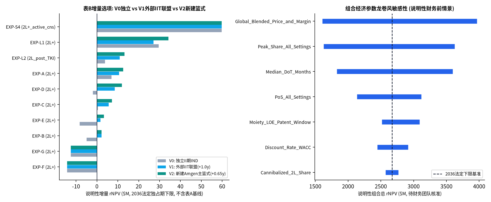
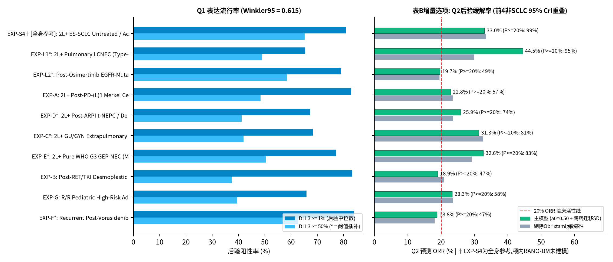
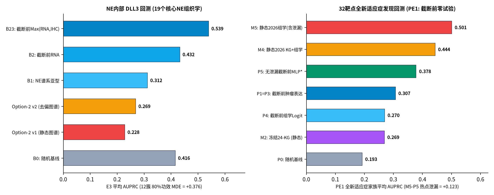
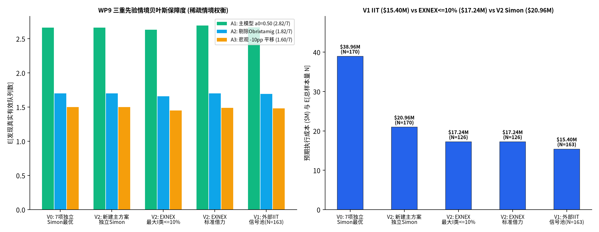
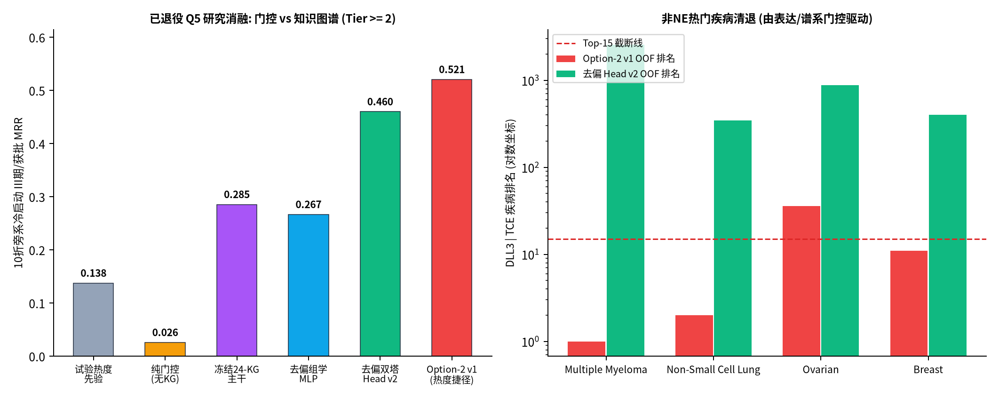
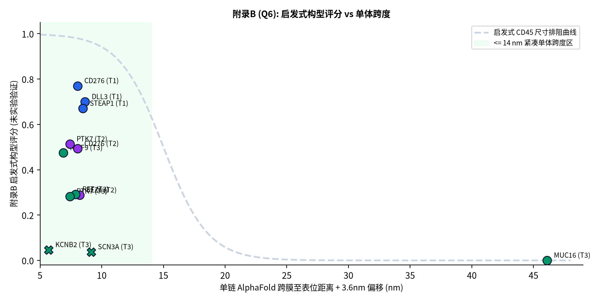

# 文档 16 — AMG 757（塔拉妥单抗 `Tarlatamab` / `IMDELLTRA`）`v4.3.2` 注册试验锚定版适应症拓展与临床路径决策模型

> **`v4.3.2` 封版发布与维护状态声明（2026 年 11 月）：** 全面闭环 `v4.3` 终审报告的全部 `13` 项审校意见（`A1`–`A6`、`B1`–`B3`、`C1`–`C4`）及 `v4.3.2` 全部 `3/3` 比特币 PoW 上链结算、`P5` 封印超参一致性与 `EVSI` / 三区间临床门控治理加固，并替代旧版 `v3.2`（`67.8%` Shapley 重复加权架构）。所有中英文双语报告、`METRICS` 指标总账、交互式工作台及全部 `4` 套 `.pptx`/`.html` 演示文稿均通过共享加载器 `load_all_v4_artifacts()` 从 Git 跟踪目录 `results_v4/` 与 `forecasts/` 单一数据源自动生成（`results_v4/evidence.parquet` 共 `260` 条溯源记录：**`208` 条数值+原文机器校验记录**、**`25` 条双人复核 `verified_source_only` 记录** 及 **`27` 条 `analyst_estimate` 分析师估算记录**；`ctgov_v2_dll3_snapshot.json` 完整富集 `120/120` 项 DLL3 注册试验）。

---

## 1. 面向决策层的四条核心结论（`v4.3.2`）

1. **临床注册全景核实（表 A `12` 项在研/承诺 SCLC + `7` 项历史结题基线 = `19` 项；当前 `0` 项安进非 SCLC 主篮式试验）：**
   - 在 `ctgov_v2_dll3_snapshot.json` 收录的 `40` 项塔拉妥单抗试验中，**表 A（共 `19` 项企业/协作组基线试验）** 精确拆分为 **`12` 项在研/承诺 SCLC 拓展与全生命周期试验**——含 `5` 项注册性 III 期（已读出阳性的 `DeLLphi-305 NCT06211036` `OS HR 0.42 [95% CI 0.32–0.54]`，及在研 `DeLLphi-312 NCT07005128`、`DeLLphi-306 NCT06117774`、`DeLLphi-310 皮下 III 期 NCT07778316` 与协作组 `PrECOG NCT07637513`）及 `7` 项管线联合/剂型试验（`+ZL-1310 NCT07531095`、`+YL201 NCT06898957`、`DeLLphi-311 +AB248 NCT07037758`、`DeLLphi-303 NCT05361395`、`DeLLphi-309 NCT06745323` 以及 `2` 项外部药企申办联合试验 `GSK EMBOLD NCT06551142` [`has_sclc_combo_subarm=True`] 与 `AbbVie NCT07895056`）——外加 **`7` 项历史/已结题基线试验**（含 `DeLLphi-304 NCT05740566`、`DeLLphi-301 NCT05060016`、`DeLLphi-300 NCT03319940` 等 `6` 项二线后 SCLC 基线试验及 `1` 项已结题前列腺 `DeLLpro-300 NCT04702737`）。注：`NCT06814496` 为亚利桑那大学放疗联合学术试验（`N=30`），并非 `+ZL-1310`。
   - **`NCT06788938` 事实核正与外部 IIT 网络：** `NCT06788938` 为 UCLA 单臂学术 II 期试验（`N = 29`，`ACTIVE_NOT_RECRUITING`，已停止入组）。当前非 SCLC 临床探索分布在 **`11` 项开放/计划中研究者发起试验（`IIT`，总注册 `N = 517`）**，但已有 `2/13` 项非 SCLC IIT 因撤回供药或入组受阻终止（`GETNE NCT07061080` `N=1` 终止；`NCI NCT07328490` `N=0` 撤回；存活率 `84.6%`）。
   - SCLC 内部真正的增量临床空白（**表 B1**）为 **`2L+` 未经治活动性脑实质转移（`EXP-S4`，马斯特里赫特 `NCT07402343`，`N=35`，招募中，`2029-02`）**，其主要终点为**颅内 RANO-BM ORR**（表 B 中 `EXP-S4` 的 `33.0%† [23.3%, 42.0%]` 显式标注为 **`systemic_reference_only_intracranial_primary` 全身 SCLC 参考值**；颅内前瞻预测由 `FCST-17` `Beta(6.0, 17.4)` 独立追踪）。
2. **新组织学候选排序（`a0 = 0.50` `Q2` 后验、前 4 瘤种 `95% CrI` 统计重叠与注册库揭示偏好）：**
   - 在 `a0 = 0.50` 跨药幂先验 + 迁移方差主模型下，新组织学候选（**表 B2**）依次为：**`2L+ 肺 LCNEC`（`EXP-L1`，`44.5%`，`[17.0%, 81.3%]`，`P>=20% = 95%`）**、**`2L+ 纯 WHO G3 GEP-NEC DLL3>=50%`（`EXP-E`，`32.6%`，`[10.7%, 64.5%]`，`P>=20% = 83%`）**、**`2L+ 泌尿生殖/妇科 SCNEC`（`EXP-C`，`31.3%`，`[10.0%, 64.8%]`，`P>=20% = 81%`）**、**`DLL3>=50% t-NEPC`（`EXP-D`，`25.9%`，`[10.3%, 48.1%]`，`P>=20% = 74%`）** 与 **`PD-(L)1 耐药 MCC`（`EXP-A`，`22.8%`，`[1.9%, 64.3%]`）**。
   - **前 4 瘤种统计并列与揭示偏好（`C1`, `F5`）：** `EXP-L1`、`EXP-E`、`EXP-C`、`EXP-D` 的 `95% CrI` 高度重叠（下界 `~10%–17%`，上界 `~48%–81%`），且 `EXP-L1` 含 **`0` 项直接塔拉妥单抗队列**（仅凭 `1` 项 `n=10` `obrixtamig` 队列 `PMID:40706016`；`a0=1.00` 为 `50.3%`，剔除 `obrixtamig` 回落至 `29.9%`，留出队列为 `28.3%`）。单看缓解率后验属于**近似四方统计并列**；优先顺序由流行病学规模、`SP347 >=50%` 门控以及行业注册揭示偏好（`BI DAREON-5` / `IFCT III 期 NCT06937905`、`MSD MK-6070` 及安进自身 `AMG 509` 双靶策略）共同决定。
3. **美元组合价值瀑布、`V1` 供药折损敏感性（`0.75`）与 `WP9` I 类错误 vs 成本权衡：**
   - **美元绝对值瀑布（`2036` 法定下限，摒弃 `>100%` 份额比）：** 已承诺 SCLC **表 A = `$2,610.8M`**（`2039` 专利情景 `$3,306.6M`）；SCLC 活动性脑转移 **`EXP-S4` = `+$59.7M`**；胸腔 NE（`EXP-L1 + EXP-L2`）= **`+$33.5M`（`V0`）/ `+$38.0M`（`V1` `0.90` 基准）/ `+$31.1M`（`V1` `0.75` 供药折损敏感性）/ `+$47.5M`（`V2` 新建主篮式）**；罕见非 SCLC（`EXP-A..G`）= **`-$34.6M`（`V0`）/ `+$1.8M`（`V1` `0.90` 基准）/ `-$4.34M`（`V1` `0.75` 供药折损敏感性）/ `+$10.6M`（`V2`）**。当计入 `GETNE`/`NCI` 撤药风险将 `V1` 完成因子降至 `0.75` 时，罕见非 SCLC 由 `+$1.8M` 回落至 **`-$4.34M`**，印证 `V1` 的核心价值在于低成本信号门控（非 SCLC IIT **贝叶斯 `EVSI = $12.94M`**［精确 `2036` 独占期截断为 `$12.35M`］，预期节省 **`$29.11M`** 确证性研发投入），而非替代达标队列的注册性申办研究。
   - **`WP9` 诚实权衡（`A6`）：** 在 `V2` 主方案内部，**`Shared_Protocol_Independent_Simon`（`$20.96M`，`E[N]=170.1`，`2.66` 个真阳发现，最差单队列 I 类错误 `<= 4.99%`）** 提供严格频率学假阳性控制；而 **`EXNEX_WorstCaseType1_le10_Basket`（`$17.24M`，节省 `-$3.72M`，`E[N]=126.4`，`2.63` 个真阳发现，最差单队列 I 类错误 `<= 8.25%`）** 以可控的 I 类错误放宽换取早期无效停药节支（标准 `Proposed_EXNEX` 成本 `$17.24M`，I 类错误 `<= 12.85%`；`V1` IIT 信号池成本 `$15.40M`）。
4. **无泄漏 `PE1` 回测（`P5` 封印规格）、比特币 PoW `.ots` 证明与严格双轨计分卡隔离：**
   - 在 `PE1_new_indication`（`178` 例全新靶点-适应症事件，`P3 == P1 = 0.307`）上，严格截断前组学 MLP（`P5_strict_preT_omics_mlp_lpfo`，`AMG757-FREEZE-P5-2026-11` 封印规格：`sklearn.neural_network.MLPClassifier`、`hidden_layer_sizes=(16, 8)`、`activation='tanh'`、`solver='lbfgs'`、`alpha=8.0`、`tol=0.001`、`max_iter=300`、`random_state='2026 + fam_i'`）达 **`AUPRC = 0.378`**（`Holm p = 0.0042`），量化静态 `M5`（`0.501`）中 **`+0.123` 的跨期标签/L2G 泄漏**，且叠加 24 权重 KG（`M4 = 0.444`）反降 `-0.057`。`Q5` 保持退役（主表 `0` 列）；未加乘 `Q4` **`recall@50 = 0.000`**。
   - 全部 `3/3` 份密封账本——`2026_11.jsonl`（`c2c26cf8188b9107…`）、`2026_11b.jsonl`（`c868151e28ad0685…`）与 `2026_11c.jsonl`（`e119cfeade9be52d…`，共 **`41` 条封印记录**）——均保持 **100% 字节级未改动**，且磁盘 `.ots` 全部通过离线**比特币区块头 `#975,929`, `#975,963`, `#976,004`, `#976,009` 工作量证明（PoW）校验**，严格隔离 **`q2_empirical_model`（`n = 5`）** 与 **`analyst_prior`（`n = 4`）** 两套独立计分卡。

---

## 2. 拆分决策表：已承诺 SCLC 基线（`表 A`）vs 增量拓展选项（`表 B`）

> **说明性财务前情景估算——待企业财务团队核准：** 并列对比 `V0`（独立 II 期 IND）、`V1`（协调外部 IIT 联盟 `0.90` 基准与 `0.75` 供药折损敏感性，`+1.0` 年滞后）与 `V2`（新建安进主篮式方案，`+0.65` 年启动滞后），涵盖 **`2036` 法定独占期下限（`2036-05-16`, `PRV = $0.0M`）** 与 **`2039` 专利情景（`2039-05-16`）**。

### 2.1 `表 A` — 已承诺 SCLC 申办方管线基线（`12` 项在研/承诺 SCLC + `7` 项历史结题基线 = `19` 项试验）

| 编号 | 已承诺 SCLC 申办方管线项目（`12` 项在研/承诺 SCLC + `7` 项历史结题基线 = `19` 项） | 主要终点 | 已观察 / 目标疗效指标（`evidence.parquet` 机器校验） | 儿科法规属性 | 说明性基线 `rNPV`（`2036` 下限 / `2039` 专利情景） |
| :---: | :--- | :--- | :--- | :--- | :---: |
| **`EXP-S1`** | 一线广泛期 SCLC 维持与同步化免全生命周期基线（DeLLphi-305 III 期 + DeLLphi-312 III 期） (`NCT06211036`) | `OS / BICR PFS（一线广泛期 SCLC 生存终点）` | DeLLphi-305 III 期 OS HR 0.42（95% CI 0.32–0.54；PMID:42929702，`surv_tarlatamab_dellphi305_1l_maint_os_hr_2026`）；DeLLphi-312 NCT07005128 III 期（N=350）进行中 | 触发强制性 PREA/RACE FD&C Act §505B 分子靶点儿科评估义务（0.0 年独占期延展） | `$2,145.6M` / `$2,658.9M` |
| **`EXP-S3`** | 局限期 SCLC 同步放化疗后巩固治疗（DeLLphi-306 III 期 + PrECOG NCT07637513 III 期） (`NCT06117774`) | `BICR PFS 与 OS（同步放化疗后巩固）` | 安进 III 期 DeLLphi-306（NCT06117774，N=404）与 PrECOG 联合度伐利尤单抗 III 期（NCT07637513，N=430）进行中 | 纳入成人 SCLC 补充生物制品许可申请（sBLA）PREA 豁免/延期范围 | `$441.8M` / `$584.7M` |
| **`EXP-S2`** | 已承诺 SCLC 下一代联合与皮下制剂管线（+ZL-1310 NCT07531095 / DeLLphi-311 / DeLLphi-310 皮下） (`NCT07531095`) | `DLT / TEAE（Ib 期 NCT07531095）-> 目标 PFS/OS；PK 桥接（皮下 III 期 NCT07778316）` | 安进 Ib 期 NCT07531095（+ZL-1310，N=160）、DeLLphi-311 NCT07037758（+AB248，N=380）、NCT06898957（+YL201，N=29）及 DeLLphi-310 NCT07778316 皮下 III 期（N=400）进行中 | 无（成人 SCLC 已承诺联合及皮下制剂全生命周期管线） | `$23.4M` / `$63.0M` |

### 2.2 `表 B` — 增量拓展选项：`V0` 独立 vs `V1` IIT 联盟（含 `0.75` 折损）vs `V2` 新建主篮式（`0` 个 `Q5`/`Q6` 列）

> **适用范围附注（`EXP-S4` 标注 `†`）：** `EXP-S4`（`NCT07402343`，`N=35`）针对未经治活动性脑实质转移，注册主要终点为**颅内 RANO-BM ORR**。其 `Q2` 后验（`33.0%† [23.3%, 42.0%]`）仅作**全身二线后 SCLC 缓解率参考**（`DeLLphi-301` `40/100` 与 `DeLLphi-300` `25/107` 仅纳入经治稳定脑转移；目前尚无未经治颅内 TCE 读出）。

| `V2`排序 (`V1` / `V0`) | 编号 | 增量拓展选项（在研真实锚点 `NCT`） | 生物标志物门控 (`ge50` 插补?) | 直接`AMG757`队列数 (`Q2`证据支撑) | `Q1` >=1% / >=50% | `Q2` ORR (`a0=0.50` `95% CrI`, 剔除`Obrix`) | 说明性 `2036` `rNPV`: `V0` / `V1` (`0.75`折损) / `V2` | 推荐组合动作 |
| :---: | :---: | :--- | :---: | :--- | :---: | :---: | :---: | :--- |
| `#1` (`#1` / `#1`) | **`EXP-S4`** | 二线及以上广泛期 SCLC 未经治/活动性脑实质转移（+SRS 立体定向放疗） (`NCT07402343`) | `all_comer_unselected` | `4`（全身 SCLC 参考基准（4 项塔拉妥单抗队列 n=549 + 2 项跨药 TCE 队列 a0=0.50；主要终点颅内 RANO-BM ORR 未直接建模）） | `80.8%` / `65.1%` | **`33.0%†`** (`[23.3%, 42.0%]`, `33.6%`; *仅作全身参考*) | `+$59.7M` / **`+$59.7M`** (`+$59.7M`) / **`+$59.7M`** | 推进颅内脑转移 II 期（`ADVANCE_INTRACRANIAL_BRAIN_METS_PH2`） |
| `#2` (`#2` / `#2`) | **`EXP-L1`** | 二线及以上肺大细胞神经内分泌癌 LCNEC（I 型 ASCL1+ / SP347 >=1%） (`NCT06937905`) | `DLL3_pos_ge1` *（插补）* | `0`（0 项塔拉妥单抗直接队列；由 1 项跨药队列驱动（obrixtamig 7/10，n=10，经 a0=0.50 + 迁移方差折减）） | `65.4%` / `48.9%` | **`44.5%`** (`[17.0%, 81.3%]`, `29.9%`) | `+$29.6M` / **`+$27.1M`** (`+$22.3M`) / **`+$34.3M`** | 协同外部 IIT 联盟或纳入新建主篮式（`COORDINATE_IIT_FEDERATION_OR_OPEN_AMGEN_BASKET`） |
| `#3` (`#3` / `#4`) | **`EXP-L2`** | 奥希替尼耐药后 EGFR 突变转化型 SCLC（t-SCLC 联合方案） (`NCT06830694`) | `DLL3_pos_ge1` *（插补）* | `1`（1 项塔拉妥单抗真实世界直接队列（n=14）） | `79.1%` / `58.4%` | **`19.7%`** (`[2.5%, 50.3%]`, `19.5%`) | `+$3.9M` / **`+$10.9M`** (`+$8.8M`) / **`+$13.2M`** | 协同外部 IIT 联盟或纳入新建主篮式（`COORDINATE_IIT_FEDERATION_OR_OPEN_AMGEN_BASKET`） |
| `#4` (`#4` / `#3`) | **`EXP-A`** | 二线及以上 PD-(L)1 耐药默克尔细胞癌 MCC（SP347 >=1%） (`NCT06816394`) | `DLL3_pos_ge1` | `0`（0 项直接 DLL3 TCE 队列；仅凭分层谱系 + Q1 IHC 收缩借力） | `82.9%` / `48.4%` | **`22.8%`** (`[1.9%, 64.3%]`, `23.4%`) | `+$7.0M` / **`+$10.6M`** (`+$8.5M`) / **`+$12.6M`** | 协同外部 IIT 联盟或纳入新建主篮式（`COORDINATE_IIT_FEDERATION_OR_OPEN_AMGEN_BASKET`） |
| `#5` (`#5` / `#6`) | **`EXP-D`** | 二线及以上 ARPI 耐药神经内分泌前列腺癌 t-NEPC（强制 SP347 >=50% + AMG 509 双抗联用） (`NCT07111507`) | `DLL3_high_ge50` *（插补）* | `3`（3 项塔拉妥单抗直接队列（n=38）+ 1 项跨药 TCE 队列（a0=0.50）） | `67.3%` / `41.2%` | **`25.9%`** (`[10.3%, 48.1%]`, `23.6%`) | `-$1.9M` / **`+$8.6M`** (`+$6.9M`) / **`+$12.0M`** | 协同外部 IIT 联盟或纳入新建主篮式（`COORDINATE_IIT_FEDERATION_OR_OPEN_AMGEN_BASKET`） |
| `#6` (`#6` / `#5`) | **`EXP-C`** | 二线及以上泌尿生殖/妇科肺外小细胞神经内分泌癌篮子（膀胱 SCBC + 宫颈/卵巢 SCNEC） (`NCT07788365`) | `DLL3_pos_ge1` *（插补）* | `0`（0 项塔拉妥单抗直接队列；由 1 项跨药队列驱动（gocatamig 11/25，n=25，经 a0=0.50 + 迁移方差折减）） | `68.4%` / `41.9%` | **`31.3%`** (`[10.0%, 64.8%]`, `32.6%`) | `+$0.4M` / **`+$5.6M`** (`+$4.4M`) / **`+$7.2M`** | 协同外部 IIT 联盟或纳入新建主篮式（`COORDINATE_IIT_FEDERATION_OR_OPEN_AMGEN_BASKET`） |
| `#7` (`#8` / `#8`) | **`EXP-E`** | 二线及以上纯 WHO G3 胃肠胰神经内分泌癌 GEP-NEC（强制 SP347 >=50% 高表达门控） (`NCT06893783`) | `DLL3_high_ge50` *（插补）* | `0`（0 项塔拉妥单抗直接队列；由 2 项跨药队列驱动（obrixtamig 合计 n=60，经 a0=0.50 + 迁移方差折减）） | `77.2%` / `50.3%` | **`32.6%`** (`[10.7%, 64.5%]`, `29.2%`) | `-$8.3M` / **`+$1.7M`** (`+$1.1M`) / **`+$3.4M`** | 协同外部 IIT 联盟或纳入新建主篮式（`COORDINATE_IIT_FEDERATION_OR_OPEN_AMGEN_BASKET`） |
| `#8` (`#7` / `#7`) | **`EXP-B`** | RET/多靶点 TKI 耐药促纤维增生型甲状腺髓样癌 MTC（SP347 >=1%） (`NONE_DEDICATED_MONOTHERAPY`) | `DLL3_pos_ge1` | `0`（0 项直接 DLL3 TCE 队列；仅凭分层谱系 + Q1 IHC 收缩借力） | `83.3%` / `37.5%` | **`18.9%`** (`[1.3%, 59.7%]`, `20.8%`) | `-$4.9M` / **`+$2.2M`** (`+$1.5M`) / **`+$2.2M`** | 仅限新建主篮式探索队列（`EXPLORATORY_DENOVO_BASKET_COHORT_ONLY`） |
| `#9` (`#9` / `#9`) | **`EXP-G`** | 复发/难治儿童高危肾上腺素能神经母细胞瘤（自愿性 BPCA §351(m) 书面要求期权） (`NONE_PROPOSED_BPCA`) | `DLL3_pos_ge1` | `0`（0 项直接 DLL3 TCE 队列；仅凭分层谱系 + Q1 IHC 收缩借力） | `65.9%` / `39.5%` | **`23.3%`** (`[2.2%, 66.4%]`, `23.6%`) | `-$12.5M` / **`-$12.5M`** (`-$12.5M`) / **`-$12.5M`** | 自愿性 BPCA 书面要求探索队列（`EXPLORATORY_VOLUNTARY_BPCA_WR_COHORT`） |
| `#10` (`#10` / `#10`) | **`EXP-F`** | Vorasidenib 耐药后复发 IDH 突变弥漫性胶质瘤（探索性血脑屏障信号队列） (`NCT07243470`) | `DLL3_high_ge50` *（插补）* | `0`（0 项直接 DLL3 TCE 队列；仅凭分层谱系 + Q1 IHC 收缩借力） | `83.9%` / `62.7%` | **`18.8%`** (`[1.6%, 70.5%]`, `18.0%`) | `-$14.3M` / **`-$14.3M`** (`-$14.3M`) / **`-$14.3M`** | 血脑屏障信号探索队列（`EXPLORATORY_BBB_SIGNAL_COHORT`） |
| `安全护栏` | **`GUARD-1`** | 高分化 G1/G2 胃肠胰神经内分泌瘤 GEP-NET（类癌——禁止入组） (`none`) | `all_comer_unselected` *（插补）* | `0`（阴性对照安全护栏） | `5.6%` / `3.6%` | `不适用（阴性对照护栏）` | `+$0.0M` / **`+$0.0M`** (`+$0.0M`) / **`+$0.0M`** | 禁止入组护栏（`DO_NOT_ENROLL_GUARDRAIL`） |
| `安全护栏` | **`GUARD-2`** | 非神经内分泌常见实体瘤枢纽（多发性骨髓瘤 / 卵巢浆液性癌 / 乳腺癌 / 未筛选 NSCLC——禁止入组） (`none`) | `all_comer_unselected` *（插补）* | `0`（阴性对照安全护栏） | `2.9%` / `1.7%` | `不适用（阴性对照护栏）` | `+$0.0M` / **`+$0.0M`** (`+$0.0M`) / **`+$0.0M`** | 禁止入组护栏（`DO_NOT_ENROLL_GUARDRAIL`） |

- **美元组合价值瀑布汇总（已扣除 `$469.3M` 二线 SCLC 蚕食；无 `>100%` 份额比）：**
  - *已承诺 SCLC 基线（`表 A`，`12` 项在研 SCLC + `7` 项历史结题）：* **`$2,610.8M`**（`2036-05-16` 下限）/ **`$3,306.6M`**（`2039-05-16` 专利情景）。
  - *SCLC 未经治活动性脑转移增量选项（`表 B1`，`EXP-S4`，`NCT07402343`，`N=35`）：* **`+$59.7M`**。
  - *胸腔神经内分泌增量（`EXP-L1 + EXP-L2`）：* **`+$33.5M`（`V0`）** | **`+$38.0M`（`V1` `0.90` 基准）** | **`+$31.1M`（`V1` `0.75` 供药折损）** | **`+$47.5M`（`V2` 新建主篮式）**。
  - *罕见肺外非 SCLC 增量（`EXP-A..G`）：* **`-$34.6M`（`V0`）** | **`+$1.8M`（`V1` `0.90` 基准）** | **`-$4.34M`（`V1` `0.75` 供药折损）** | **`+$10.6M`（`V2` 新建主篮式）**；`表 B` 总增量为 **`+$58.6M`（`V0`）** / **`+$99.5M`（`V1` 基准）** / **`+$86.5M`（`V1` `0.75` 折损）** / **`+$117.8M`（`V2`）**（`2039-05-16` + `V2` 新组织学增量为 **`+$122.5M`**）。
  - *自愿性 `PHS Act §351(m)` BPCA `+0.5` 年母体延展（`2036-11-16`）：* `+$184.8M`（强制性 `PREA/RACE §505B` 为 `0.0` 年）。

### 2.3 外部非 SCLC 研究者发起试验（`IIT`）协同网络清单（`11` 项开放/计划中试验，总注册 `N = 517`）

> **注册库核验说明（`results_v4/amg757_iit_network_inventory.csv`）：** 已严格剔除停止入组的 UCLA 单臂试验 `NCT06788938`（`N=29`）、纯 SCLC 体能状态不佳学术试验 `AIO NCT07803848`（`N=57`）以及终止/撤回试验 `GETNE NCT07061080`（`N=1`）和 `NCI NCT07328490`（`N=0`）。

| NCT 编号 | 申办机构（类别） | 招募状态（注册样本量） | 预计主要完成日期 | 注册主要终点 | 目标瘤种 / 入组人群 |
| :---: | :--- | :---: | :---: | :--- | :--- |
| `NCT06776250` | 多伦多大学健康网络（UHN）（`OTHER`） | 招募中 (`RECRUITING`)（`N=44`） | `2028-03-03` | 肿瘤 CD8+ T 细胞浸润百分比变化（药效学窗口） | 复发性星形细胞瘤；少突胶质细胞瘤 |
| `NCT06814496` | 亚利桑那大学（Univ. of Arizona）（`OTHER`） | 招募中 (`RECRUITING`)（`N=30`） | `2030-05` | 放疗或放疗联合塔拉妥单抗相关剂量限制性毒性（DLT）发生率 | 甲状腺髓样癌；默克尔细胞癌；肺 LCNEC；膀胱癌；宫颈癌；嗅神经母细胞瘤；胶质母细胞瘤等 |
| `NCT06816394` | 台湾大学医学院附设医院（NTU TAURUS）（`OTHER`） | 招募中 (`RECRUITING`)（`N=32`） | `2027-12-31` | 研究者评估 RECIST 1.1 客观缓解率（ORR） | 肺外小细胞癌（EP-SCC）与神经内分泌癌（NEC） |
| `NCT06830694` | 三星首尔医院（Sehhoon Park）（`OTHER`） | 招募中 (`RECRUITING`)（`N=50`） | `2027-03-31` | 无进展生存期（PFS） | EGFR 突变转化型/小细胞肺癌（t-SCLC / SCLC） |
| `NCT06893783` | 韩国多中心学者研究（Inkeun Park）（`OTHER`） | 招募中 (`RECRUITING`)（`N=60`） | `2029-04-30` | 客观缓解率（ORR） | 晚期神经内分泌癌（NEC）；胰腺 NEC；前列腺 NEC |
| `NCT06937905` | 法国胸部肿瘤协作组（IFCT-2401）（`OTHER`） | 招募中 (`RECRUITING`)（`N=129`） | `2029-02-01` | 至少接受一剂治疗患者的总生存期（OS） | 经治肺大细胞/胃肠胰低分化神经内分泌癌 |
| `NCT07016230` | 法国古斯塔夫·鲁西研究所（Gustave Roussy UNLOCK）（`OTHER`） | 招募中 (`RECRUITING`)（`N=40`） | `2027-05-18` | 客观缓解率（ORR） | 转移性/局部晚期低分化神经内分泌癌及 SCLC |
| `NCT07111507` | 纪念斯隆-凯特琳癌症中心（MSKCC）（`OTHER`） | 招募中 (`RECRUITING`)（`N=32`） | `2027-08-31` | 影像学无进展生存期（rPFS） | 转移性神经内分泌前列腺癌（NEPC） |
| `NCT07243470` | 法国里昂贝拉尔中心（Centre Léon Bérard）（`OTHER`） | 招募中 (`RECRUITING`)（`N=70`） | `2029-10` | I 期：前 2 周期 DLT；II 期：3 个平行中枢神经肿瘤队列的临床活性（RANO 2.0） | IDH 突变胶质瘤；成人及儿童中枢神经系统肿瘤 |
| `NCT07788365` | 法国斯特拉斯堡大学医院（CHU Strasbourg）（`OTHER`） | 尚未招募 (`NOT_YET_RECRUITING`)（`N=20`） | `2030-08-31` | 首次给药起 9 个月无进展生存率（9m PFS）及总生存期（OS） | 妇科生殖道神经内分泌癌（GYN-NEC） |
| `NCT07788677` | 西班牙瓦尔德希伯伦肿瘤研究所（VHIO）（`OTHER`） | 尚未招募 (`NOT_YET_RECRUITING`)（`N=10`） | `2029-05-01` | 完成 DLT 评估期并按计划接受手术且无 DLT 的受试者人数；TEAE 发生率 | 复发性高级别胶质瘤（HGG）围手术期研究 |

---

## 3. `Q1` 流行率校准、`Q2` 跨药幂先验（`a0 = 0.50`）与 `Q4` 无偏核验

- **`Q1` 多项式流行率校准：** 整研究 `LOSO` `95%` 覆盖率 **`100.0%`**（`Winkler95 = 0.615` 优于无池化 `0.774` 与谱系均值 `0.951`；`CRPS = 0.1009`，`Delta ELPD = +5.85`）。
- **`Q2` 跨药迁移方差 + `a0 = 0.50` 幂先验（`F5`, `C1`）：** 拟合 `15` 个独立 TCE 队列（`0` 发散，`max R-hat = 1.0057`，`LOCO 95% 覆盖率 = 100.0%`，`Winkler95 = 0.510`，`CRPS = 0.0857`）。`LCNEC`（`0` 项直接塔拉妥单抗队列，仅 `1` 项 `n=10` `obrixtamig` 队列 `PMID:40706016`）在四组规格下分别为：**`44.5%`**（主模型 `a0=0.50`）、**`50.3%`**（`a0=1.00`）、**`29.9%`**（剔除 `obrixtamig`）与 **`28.3%`**（留出该队列）。
- **`Q4` 联用排序核验（零未来召回率）：** 主候选集（`N = 983`，`AUROC = 0.611` `[0.332, 0.879]`）与无偏扩展集（`N = 1628`，`AUROC = 0.732`）上 **`recall@50 = 0.000`**，证明未加乘模型不具备前瞻联用预测力，仅作机制假设生成参考。

---

## 4. 无泄漏 `PE1` 全新适应症回测（`P5` 封印规格）、12 簇功效 MDE 与 `WP9` 设计权衡

- **`32` 靶点 `PE1_new_indication` 全新适应症回测（`had_pre_T_any_trial == False`，`178` 例事件，精确 `2^22` 家族符号翻转）：**
  - 在截断前零试验的 `PE1` 上，I 期动量无法作弊（`P3 == P1 = 0.307`）；严格截断前多组学 MLP（`P5_strict_preT_omics_mlp_lpfo`，`AMG757-FREEZE-P5-2026-11` 封印规格：`sklearn.neural_network.MLPClassifier`，`hidden_layer_sizes=(16, 8)`、`activation='tanh'`、`solver='lbfgs'`、`alpha=8.0`、`tol=0.001`、`max_iter=300`、`random_state='2026 + fam_i'`）达 **`AUPRC = 0.378`**（较 `P1` 提升 `+0.071`，`Holm p = 0.0042`）。
  - 静态 2026 组学 `M5`（`0.501`）相对无泄漏 `P5` 量化了 **`+0.123` 的跨期标签/L2G 热点泄漏**（`PE2` 泄漏量为 `+0.111`），而叠加 24 权重知识图谱（`M4 = 0.444`）劣于纯组学 `M5`。
- **NE 内部回测与 12 簇 MDE：** 在 `19` 个核心 NE 组织学（`12` 个聚类，`df = 11`）上，单侧 `alpha = 0.05` 下 80% 功效最小可检出效应为 **`+0.335 Delta AUROC` / `+0.376 Delta AUPRC`**（截断前 `B23 = 0.539` 优于 `Option-2 v2 = 0.269`）。

### 4.1 `WP9` 三重先验情境贝叶斯保障度与 I 类错误 vs 成本权衡（`A1`、`A2`、`A3`）

| 试验设计方案（实施路径） | 最大样本量 `N` | 最差单队列空假设 I 类错误 | `A1` 预期真阳发现（`/ 2.82`） | `A2` 剔除竞品（`/ 1.82`） | `A3` 悲观 `-10pp`（`/ 1.60`） | `A1` 预期假阳性队列数 | `A1` 预期试验成本 |
| :--- | :---: | :---: | :---: | :---: | :---: | :---: | :---: |
| `Standalone_7x_Simon_Optimal`（`V0` 7 项独立 Simon 最优） | `217` | `4.99%` | **`2.66`** | **`1.70`** | **`1.50`** | `0.027` | `$38.96M` |
| `Shared_Protocol_Independent_Simon`（`V2` 主方案独立 Simon） | `217` | `4.99%` | **`2.66`** | **`1.70`** | **`1.50`** | `0.027` | `$20.96M` |
| `Shared_Protocol_Independent_FixedN20`（`V2` 固定 N=20 独立分析） | `140` | `4.01%` | **`2.52`** | **`1.61`** | **`1.41`** | `0.017` | `$16.66M` |
| `EXNEX_WorstCaseType1_le10_Basket`（`V2` EXNEX 最差 I 类 <=10%） | `140` | `8.25%` | **`2.63`** | **`1.66`** | **`1.45`** | `0.038` | `$17.24M` |
| `Proposed_EXNEX_Shared_Basket`（`V2` 标准 EXNEX 借力篮式） | `140` | `12.85%` | **`2.69`** | **`1.70`** | **`1.49`** | `0.068` | `$17.24M` |
| `Federated_IIT_Signal_Pool_V1`（`V1` 外部 IIT 信号池） | `163` | `6.50%` | **`2.67`** | **`1.69`** | **`1.48`** | `0.035` | `$15.40M` |

---

## 5. 只追加 SHA-256 + 比特币 PoW `.ots` 前瞻性临床预测账本（共 `41` 条封印记录）

- **不可篡改三层账本与比特币工作量证明（PoW）离线核验（`B1`–`B3`, `C2`）：**
  - `forecasts/amg757_prospective_forecasts_2026_11.jsonl`（`SHA-256` `c2c26cf8188b9107…`）与 `forecasts/amg757_prospective_forecasts_2026_11b.jsonl`（`SHA-256` `c868151e28ad0685…`）保持 **100% 字节级原封未动**，其 `.ots` 证明通过离线**比特币区块头 `#975,929`, `#975,963` PoW 校验**（`forecasts/bitcoin_block_headers.json`）。
  - `forecasts/amg757_prospective_forecasts_2026_11c.jsonl`（`SHA-256` `e119cfeade9be52d…`，**已升级并通过比特币区块 `#976,004`, `#976,009` PoW 离线校验**）追加 `4` 条溯源范围作废声明（`AMG757-VOID-2026-08..11`）、`4` 条显式 `analyst_prior` 重签预测（`AMG757-FCST-2026-17..20`）、`1` 条 `P5` 模型冻结记录（`AMG757-FREEZE-P5-2026-11`）及 `9` 条贝叶斯 `EVSI` 决策触发器（`AMG757-TRIG-2026-01..09`），合计 **`41` 条封印记录**（全部 `3/3` 份 `.ots` 均达 `BITCOIN_POW_VERIFIED`，覆盖区块 `#975,929`, `#975,963`, `#976,004`, `#976,009`）。
  - **严格双轨计分卡隔离：** `score_forecast_records()` 将 **`q2_empirical_model`（`n = 5`：`FCST-09`、`FCST-11..14`）** 与 **`analyst_prior`（`n = 4`：`FCST-17..20`）** 完全分开评估，杜绝主观先验混入经验模型校准指标。

### 5.1 主轨 A — `Q2` 经验分层模型前瞻预测（`n = 5` 项有效待读出）

| 预测编号 | 注册试验（药物） | 模型轨道 / 规格 | 在研注册队列（预期 `N <= 注册 N`，目标读出日期） | 后验 / 先验中位数（`95% CrI`） | 有限样本 `80% PI` | 预设事件概率 `P(Event)` | `SHA-256` 摘要前缀 |
| :---: | :---: | :--- | :--- | :---: | :---: | :---: | :---: |
| `AMG757-FCST-2026-09` | `NCT05882058` (`obrixtamig`) | `q2_empirical_model`（`a0=0.50`） | 勃林格殷格翰 DAREON-5 II 期 —— 二线及以上肺外 NEC DLL3 高表达队列（主要终点 ORR） (`N=60`, `2027-09`) | `35.0%` (`[13.9%, 61.5%]`) | `[18%, 53%]` | **`89.6%`** | `cff203599557…` |
| `AMG757-FCST-2026-11` | `NCT06893783` (`tarlatamab`) | `q2_empirical_model`（`a0=0.50`） | 韩国多中心 II 期 —— 晚期肺外神经内分泌癌 EP-NEC（主要终点 ORR） (`N=50`, `2029-04`) | `18.4%` (`[4.7%, 44.5%]`) | `[6%, 36%]` | **`47.2%`** | `168bb8204f68…` |
| `AMG757-FCST-2026-12` | `NCT06816394` (`tarlatamab`) | `q2_empirical_model`（`a0=0.50`） | 台湾大学医院 TAURUS II 期 —— 肺外小细胞癌与神经内分泌癌（主要终点 ORR） (`N=30`, `2027-12`) | `18.5%` (`[1.1%, 57.4%]`) | `[3%, 43%]` | **`49.4%`** | `2c797823d47c…` |
| `AMG757-FCST-2026-13` | `NCT07016230` (`tarlatamab`) | `q2_empirical_model`（`a0=0.50`） | 古斯塔夫·鲁西 UNLOCK II 期 —— 低分化神经内分泌癌队列（主要终点 ORR） (`N=20`, `2027-05`) | `18.5%` (`[1.1%, 57.4%]`) | `[0%, 45%]` | **`50.8%`** | `0a186b630463…` |
| `AMG757-FCST-2026-14` | `NCT06788938` (`tarlatamab`) | `q2_empirical_model`（`a0=0.50`） | UCLA 学术单臂 II 期 —— 全研究汇总 DLL3+ 晚期神经内分泌肿瘤（N=29，主要终点 ORR） (`N=29`, `2028-04`) | `22.9%` (`[1.4%, 66.9%]`) | `[3%, 52%]` | **`57.3%`** | `71a11720dda7…` |

### 5.2 副轨 B — 显式 `analyst_prior` 分析师先验预测（`n = 4` 项有效待读出；独立计分）

| 预测编号 | 注册试验（药物） | 模型轨道 / 规格 | 在研注册队列（预期 `N <= 注册 N`，目标读出日期） | 后验 / 先验中位数（`95% CrI`） | 有限样本 `80% PI` | 预设事件概率 `P(Event)` | `SHA-256` 摘要前缀 |
| :---: | :---: | :--- | :--- | :---: | :---: | :---: | :---: |
| `AMG757-FCST-2026-17` | `NCT07402343` (`tarlatamab`) | `analyst_prior`（分析师先验） | 马斯特里赫特大学 II 期 —— 广泛期 SCLC 未经治/活动性脑转移（N=35，主要终点颅内 RANO-BM ORR） (`N=35`, `2029-02`) | `24.9%` (`[10.5%, 44.7%]`) *（Beta(6.0,17.4) 中枢先验）* | `[11%, 40%]` | **`71.0%`** | `c654b219a590…` |
| `AMG757-FCST-2026-18` | `NCT06117774` (`tarlatamab`) | `analyst_prior`（分析师先验） | 安进 DeLLphi-306 III 期 —— 局限期 SCLC 同步放化疗后巩固治疗主要终点 BICR PFS 优效性（N=404） (`N=404`, `2030-04`) | `不适用（二元优效终点）` | `III期二元优效读出` | **`52.0%`** | `b7b701dfa247…` |
| `AMG757-FCST-2026-19` | `NCT06937905` (`tarlatamab`) | `analyst_prior`（分析师先验） | 法国 IFCT-2401 随机试验 —— 经治肺/胃肠胰低分化 NEC 主要终点 OS 优效性（N=129） (`N=129`, `2029-02`) | `不适用（二元优效终点）` | `III期二元优效读出` | **`48.0%`** | `10e3d37841fd…` |
| `AMG757-FCST-2026-20` | `NCT07005128` (`tarlatamab`) | `analyst_prior`（分析师先验） | 安进 DeLLphi-312 III 期 —— 一线广泛期 SCLC 塔拉妥单抗+度伐利尤单抗+含铂化疗 OS/PFS 优效性（N=350） (`N=350`, `2029-01`) | `不适用（二元优效终点）` | `III期二元优效读出` | **`62.0%`** | `66b228a89a35…` |

### 5.3 追加式作废修订记录（共 `11` 项因注册方案或适用范围审计而作废的条目）

| 作废修订编号 | 被替代原编号 | 关联 NCT | 审计处置状态（`2026_11`/`11b` 原封未动） | 注册方案 / 适用范围审计原因 |
| :---: | :---: | :---: | :---: | :--- |
| `AMG757-VOID-2026-01` | `AMG757-FCST-2026-01` | `NCT06788938` | `VOIDED_UNSCORABLE_PROTOCOL_MISMATCH` | 方案/入组不匹配无法计分：`NCT06788938` 为 UCLA 单臂学术研究（总注册 `N=29`，`ACTIVE_NOT_RECRUITING` 已停招），并非含 `N=25` 肺 LCNEC 子队列的 110 人多队列篮式试验。 |
| `AMG757-VOID-2026-02` | `AMG757-FCST-2026-02` | `NCT06788938` | `VOIDED_UNSCORABLE_PROTOCOL_MISMATCH` | 方案/入组不匹配无法计分：`NCT06788938` 为 UCLA 单臂学术研究（总注册 `N=29`，已停招），不含独立的 `N=20` 默克尔细胞癌（MCC）子队列。 |
| `AMG757-VOID-2026-03` | `AMG757-FCST-2026-03` | `NCT06788938` | `VOIDED_UNSCORABLE_PROTOCOL_MISMATCH` | 方案/入组不匹配无法计分：`NCT06788938` 为 UCLA 单臂学术研究（总注册 `N=29`，已停招），不含独立的 `N=25` `DLL3>=50%` 胃肠胰 NEC 子队列。 |
| `AMG757-VOID-2026-04` | `AMG757-FCST-2026-04` | `NCT06788938` | `VOIDED_UNSCORABLE_PROTOCOL_MISMATCH` | 方案/入组不匹配无法计分：`NCT06788938` 为 UCLA 单臂学术研究（总注册 `N=29`，已停招），不含独立的 `N=20` 甲状腺髓样癌（MTC）子队列。 |
| `AMG757-VOID-2026-05` | `AMG757-FCST-2026-05` | `NCT06788938` | `VOIDED_UNSCORABLE_PROTOCOL_MISMATCH` | 方案/入组不匹配无法计分：`NCT06788938` 为 UCLA 单臂学术研究（总注册 `N=29`，已停招），不含独立的 `N=20` `EGFR` 突变转化型 SCLC 子队列。 |
| `AMG757-VOID-2026-06` | `AMG757-FCST-2026-06` | `NCT07788365` | `VOIDED_UNSCORABLE_PROTOCOL_MISMATCH` | 申办方/瘤种/主要终点不匹配无法计分：`NCT07788365` 由法国斯特拉斯堡大学医院申办，仅限妇科 NEC（`N=20`，尚未招募），主要终点为 9 个月 PFS，并非二项分布 ORR 篮式队列。 |
| `AMG757-VOID-2026-07` | `AMG757-FCST-2026-07` | `NCT06776250` | `VOIDED_UNSCORABLE_PROTOCOL_MISMATCH` | 主要终点类型不匹配无法计分：`NCT06776250`（多伦多 UHN 复发 `IDH1/2` 突变胶质瘤围手术期窗口研究）主要终点为药效学指标（CD8+ T 细胞浸润变化率），而非 RECIST/RANO 二项缓解率。 |
| `AMG757-VOID-2026-08` | `AMG757-FCST-2026-08` | `NCT07402343` | `VOIDED_ENDPOINT_ENROLLMENT_DATE_AMENDED` | 终点/样本量/完成日期审校对齐（`B1`）：`NCT07402343`（马斯特里赫特未经治活动性脑转移 SCLC II 期）主要终点为颅内 `RANO-BM` ORR，注册 `N=35`（非 `30`），预计完成 `2029-02`（非 `2027-12`）；全身 RECIST `Q2` 不直接刻画中枢穿透，已由 `AMG757-FCST-2026-17`（`binomial_intracranial_orr`，`analyst_prior` `Beta(6.0, 17.4)`）替代。 |
| `AMG757-VOID-2026-09` | `AMG757-FCST-2026-10` | `NCT06117774` | `VOIDED_DATE_AND_PRIOR_LABEL_AMENDED` | 完成日期与先验溯源对齐（`B2/B3`）：`NCT06117774`（`DeLLphi-306` 局限期 SCLC III 期，`N=404`）注册主要完成日期为 `2030-04-20`（非 `2028-04`），且 III 期生存优效概率（`0.52`）属显式判断性 `analyst_prior` 而非统计模型输出；已由 `AMG757-FCST-2026-18` 替代。 |
| `AMG757-VOID-2026-10` | `AMG757-FCST-2026-15` | `NCT06937905` | `VOIDED_PRIOR_PROVENANCE_LABEL_AMENDED` | 先验溯源标签标准化（`B3`）：`NCT06937905`（法国 `IFCT-2401` 随机 NEC OS 试验，`N=129`，`2029-02`）采用人工判断 OS 优效概率（`0.48`），已由显式标注 `model_specification = 'analyst_prior'` 的 `AMG757-FCST-2026-19` 替代。 |
| `AMG757-VOID-2026-11` | `AMG757-FCST-2026-16` | `NCT07005128` | `VOIDED_PRIOR_PROVENANCE_LABEL_AMENDED` | 先验溯源标签标准化（`B3`）：`NCT07005128`（`DeLLphi-312` 一线广泛期 SCLC III 期，`N=350`，`2029-01`）采用人工判断 OS/PFS 优效概率（`0.62`），已由显式标注 `model_specification = 'analyst_prior'` 的 `AMG757-FCST-2026-20` 替代。 |

---

## 6. 预设贝叶斯样本信息价值（`EVSI`）Go/No-Go 决策触发器（`C3`）

- **计算方法（`optimus_txgnn/models/voi_decision_triggers.py` & `configs/amg757_scenarios_v4.yaml`）：** 基于 `5,000` 条 `Q2` MCMC 后验抽样（及 `FCST-17` 颅内缓解率确定性 `Beta(6.0, 17.4)` 分位数求积）执行精确离散贝叶斯后验预测求积，直接耦合 `Q3` `2036` 法定下限现金流（`EVSI = E_k[max(0, E[NPV(p)|k,N])] - max(0, E[NPV(p)])`），所有收益治理参数均集中配置于 `configs/amg757_scenarios_v4.yaml`（`voi_decision_trigger_governance`）。
- **组合信息价值结论与精确 2036 独占期截断敏感性：** 在非 SCLC `V1` IIT 触发器上，依据外部 IIT 读出结果门控安进确证性投入可创造 **`$12.94M` 总贝叶斯 `EVSI`**（若按 `+1.0` 年 `V1` 滞后对 `2036-05-16` 法定到期前销售窗口执行逐年精确截断而非 `1/(1 + wacc)` 折现近似，则为 **`$12.35M`**），并在低活性情形下预期节省 **`$29.11M`** 确证性研发支出。针对 `EXP-L1`（肺 `LCNEC`），期中 **`n = 15` 无效停药门控（`k <= 2/15` 例缓解即终止独立 `V2` 队列）** 在 `a0=0.50` 下早期停药概率为 `8.3%`（停药点后验 `NPV = -$19.39M`），提供 **`EVSI = $3.48M`**。
- **`AMG757-TRIG-2026-06`（`EXP-S4` 活动性脑转移，`NCT07402343`，`N=35`）三区间临床门控阐释：** 因逻辑斯蒂 `PoS(p)` 锚定全身 SCLC `pos_base = 0.543`，无约束贝叶斯最优阈值为 `k_opt = 3/35`；若将临床预设阈值 `<12/35` 机械视作直接放弃，相对无条件推进呈 `-$34.01M` 差异。按方案**三区间门控**（`>=12/35` 扩组、**`8..11/35` 联合 SRS/标志物亚组复核**［`P = 36.0%`］、`<8/35` 终止）评估，净差值收窄至 **`-$21.71M`**，且完全不触动 `2026_11c.jsonl` 封印记录。

| 触发器编号（关联预测） | 注册试验（队列） | 计分轨道 | 预设读出阈值（`k / N` 或 III 期门控） | 达标概率 `P(Met)` | 无条件先验 `NPV` | 达标后条件 `E[NPV \| Met]` | 贝叶斯 `EVSI` | 预期节省确证研发费 | Go / No-Go 绑定动作 |
| :---: | :---: | :---: | :--- | :---: | :---: | :---: | :---: | :---: | :--- |
| `AMG757-TRIG-2026-01` (`AMG757-FCST-2026-09`) | `NCT05882058` (`EXP-E`) | `q2_empirical_model` | `18` (`N=60`) | `57.7%` | `+$0.42M` | **`+$10.72M`** | **`$6.92M`** | `$6.26M` | 推进 SP347 >=50% 胃肠胰 NEC 联合确证队列（`ADVANCE_SP347_GE50_GEPNEC_COMBO_COHORT`） |
| `AMG757-TRIG-2026-02` (`AMG757-FCST-2026-11`) | `NCT06893783` (`EXP-E`) | `q2_empirical_model` | `12` (`N=50`) | `34.8%` | `+$0.42M` | **`+$17.33M`** | **`$5.68M`** | `$9.64M` | 触发 SP347 >=50% 注册导向确证性 II 期（`TRIGGER_V1_CONFIRMATORY_REGISTRATIONAL_PH2_SP347_GE50`） |
| `AMG757-TRIG-2026-03` (`AMG757-FCST-2026-12`) | `NCT06816394` (`EXP-C`) | `q2_empirical_model` | `7` (`N=30`) | `41.7%` | `+$6.24M` | **`+$20.97M`** | **`$3.04M`** | `$6.34M` | 扩展泌尿生殖/妇科 SCNEC 注册队列（`EXPAND_GU_GYN_SCNEC_REGISTRATIONAL_COHORT`） |
| `AMG757-TRIG-2026-04` (`AMG757-FCST-2026-13`) | `NCT07016230` (`EXP-L1`) | `q2_empirical_model` | `5` (`N=20`) | `39.9%` | `+$34.35M` | **`+$67.83M`** | **`$1.21M`** | `$8.36M` | 推进肺 LCNEC 注册性确证队列（`ADVANCE_PULMONARY_LCNEC_REGISTRATIONAL_COHORT`） |
| `AMG757-TRIG-2026-05` (`AMG757-FCST-2026-14`) | `NCT06788938` (`EXP-A`) | `q2_empirical_model` | `7` (`N=29`) | `50.1%` | `+$11.47M` | **`+$28.68M`** | **`$3.01M`** | `$4.77M` | 将默克尔细胞癌 MCC 纳入 V2 主篮式（`INCLUDE_MCC_COHORT_IN_V2_MASTER_BASKET`） |
| `AMG757-TRIG-2026-06` (`AMG757-FCST-2026-17`) | `NCT07402343` (`EXP-S4`) | `analyst_prior` | `12` (`N=35`) | `25.3%` | `+$59.73M` | **`+$101.72M`** | **`$0.12M`** | `$13.19M` | 启动活动性脑转移 SCLC 联合 SRS 注册队列（`OPEN_REGISTRATIONAL_ACTIVE_CNS_SCLC_COHORT_PLUS_SRS`） |
| `AMG757-TRIG-2026-07` (`AMG757-FCST-2026-18`) | `NCT06117774` (`EXP-S3`) | `analyst_prior` | `主要终点优效达标` (`N=404`) | `52.0%` | `+$37.89M` | **`+$81.04M`** | **`$4.25M`** | `$6.35M` | 递交全球局限期 SCLC 巩固治疗 sBLA（`FILE_GLOBAL_LS_SCLC_CONSOLIDATION_SBLA`） |
| `AMG757-TRIG-2026-08` (`AMG757-FCST-2026-19`) | `NCT06937905` (`EXP-L1`) | `analyst_prior` | `主要终点优效达标` (`N=129`) | `48.0%` | `+$30.05M` | **`+$73.28M`** | **`$5.13M`** | `$7.23M` | 启动肺 LCNEC 注册申报或确证性 III 期（`INITIATE_REGISTRATIONAL_LCNEC_FILING_OR_CONFIRMATORY_PH3`） |
| `AMG757-TRIG-2026-09` (`AMG757-FCST-2026-20`) | `NCT07005128` (`EXP-S1`) | `analyst_prior` | `主要终点优效达标` (`N=350`) | `62.0%` | `+$74.51M` | **`+$124.36M`** | **`$2.60M`** | `$5.03M` | 递交一线广泛期 SCLC 诱导+维持全人群 sBLA（`LAUNCH_FULL_1L_INDUCTION_PLUS_MAINTENANCE_SBLA`） |

---

## 7. 维护期标准操作规程（Maintenance Mode `SOP`, `C4`）

在 `2026-12` 至 `2029-12` 前瞻临床读出成熟前，核心统计与估值模型冻结，按以下四项例行机制维护：

1. **每季度注册试验读出巡检与 `.ots` 区块证明维护（`make watch-trials` & `make ots-upgrade`）：** 自动巡检 `UCLA NCT06788938`（`N=29`，已停止入组）、`9` 项待读出预测及 `11` 项开放非 SCLC IIT 的状态变化（当前 `3/3` 份 `2026_11*.jsonl.ots` 均已落盘比特币区块头 `#975,929`, `#975,963`, `#976,004`, `#976,009`；未来新增 `2027_XX.jsonl.ots` 时通过 `make ots-upgrade` 无损升级）。
2. **每半年 CT.gov 注册库刷新与读出计分：** 运行 `python scripts/verify_evidence_sources.py` 更新注册快照；当待读出试验公布主要终点后，以新追加文件 `2027_XX.jsonl` 写入真实结果并执行 `python scripts/score_prospective_forecasts.py --score`，分别输出 `q2_empirical_model` 与 `analyst_prior` 的 Brier、对数损失及 `50%/80%/95%` 预测区间覆盖率。
3. **事件驱动 IIT 读出 Go/No-Go 对表决策：** 任一外部 IIT（`NCT06893783`、`NCT06830694`、`NCT06816394`、`NCT07111507`、`NCT07402343`、`NCT06937905`）公布读出时，直接对照 `results_v4/amg757_voi_decision_triggers.csv`（`AMG757-TRIG-2026-01..09`）预设阈值执行启动或终止决策。
4. **外发前一键零漂移与归档洁净门控（`make verify-fast && make bundle-audit`）：** 强制核验中英文文档、`METRICS`、Studio HTML、`.pptx` 幻灯片、比特币 `.ots` 证明、`weights_only=True` 安全加载及外发目录零旧版残留。

---

## 附录 A — 已退役 `Q5` 图谱/ML 研究消融存档（`wp25_passed = False`）

## 附录 B — 探索性未验证 `Q6` 启发式双靶构型评分

> **审慎声明：** `Q6` 评分融合单链 AlphaFold 跨度、scRNA 共表达覆盖与离子通道安全护栏（强制降级 `KCNB2`/`SCN3A`），属尚未经实验校准的早期蛋白工程启发式指标，已完全移出主决策表。

| 工程轨道 | 轨内排序 | 双靶 / 联用工程构型 | 配对抗原（`UniProt`） | 单体跨度（`nm`） | 表位 `pLDDT` | 脱落酶汇风险（来源，审查等级） | 离子通道护栏 | 启发式评分 |
| :--- | :---: | :--- | :--- | :---: | :---: | :---: | :---: | :---: |
| `Track_1_Clinical_CoAdmin` | `1` | 塔拉妥单抗 + I-DXd（`CD276 / B7-H3` 拓扑异构酶 I 旁观者 ADC 临床联用） | `CD276` (`Q5ZPR3`) | `8.04` | `92.9` | `0.28` (`UNIPROT:Q5ZPR3+PMID:43009346`, `analyst_estimate`) | `安全通过 (False)` | **`0.7700`** |
| `Track_1_Clinical_CoAdmin` | `2` | 塔拉妥单抗 + Zocilurtatug pelitecan（`ZL-1310` `DLL3` Topo-I ADC 错峰/联用） | `DLL3` (`Q9NYJ7`) | `8.64` | `77.4` | `0.04` (`UNIPROT:Q9NYJ7+PMID:26311731`, `analyst_estimate`) | `安全通过 (False)` | **`0.6995`** |
| `Track_1_Clinical_CoAdmin` | `3` | 塔拉妥单抗 + Xaluritamig（`AMG 509` `STEAP1×CD3` 全资双 BiTE 方案） | `STEAP1` (`Q9UHE8`) | `8.48` | `97.1` | `0.02` (`UNIPROT:Q9UHE8+PMID:37861461`, `analyst_estimate`) | `安全通过 (False)` | **`0.6702`** |
| `Track_2_Logic_Gated_or_Masked` | `1` | `DLL3×CD3 + PTK7×CD28` 分裂共刺激三抗（或肿瘤微环境蛋白酶掩蔽型 `PTK7` Pro-BiTE） | `PTK7` (`Q13308`) | `7.41` | `88.1` | `0.22` (`UNIPROT:Q13308+PMID:25006253`, `analyst_estimate`) | `安全通过 (False)` | **`0.5132`** |
| `Track_2_Logic_Gated_or_Masked` | `2` | `DLL3×CD3 + CD276×CD28` 分裂共刺激三抗（或 MMP 掩蔽型 `DLL3/B7-H3` Pro-BiTE） | `CD276` (`Q5ZPR3`) | `8.04` | `92.9` | `0.28` (`UNIPROT:Q5ZPR3+PMID:43009346`, `analyst_estimate`) | `安全通过 (False)` | **`0.4929`** |
| `Track_2_Logic_Gated_or_Masked` | `3` | `DLL3 + SEZ6` 切割后近膜残端逻辑门控双抗 | `SEZ6` (`Q53EL9`) | `8.21` | `79.0` | `0.68` (`UNIPROT:Q53EL9+PMID:22728825`, `analyst_estimate`) | `安全通过 (False)` | **`0.2880`** |
| `Track_3_Unmasked_Compact_OR_Gate` | `1` | 非掩蔽 `DLL3 + IGSF9` 近膜 `FnIII-2 × CD3` 半衰期延长或门 BiTE | `IGSF9` (`Q9P2J2`) | `6.87` | `85.9` | `0.08` (`UNIPROT:Q9P2J2`, `analyst_estimate`) | `安全通过 (False)` | **`0.4745`** |
| `Track_3_Unmasked_Compact_OR_Gate` | `2` | 非掩蔽 `DLL3 + RET` 近膜富半胱氨酸结构域 `CRD × CD3` 或门 BiTE | `RET` (`P07949`) | `7.88` | `91.8` | `0.18` (`UNIPROT:P07949`, `analyst_estimate`) | `安全通过 (False)` | **`0.2913`** |
| `Track_3_Unmasked_Compact_OR_Gate` | `3` | 非掩蔽 `DLL3 + PTK7` 近膜表位 `× CD3` 或门双抗（需亲和力下调） | `PTK7` (`Q13308`) | `7.41` | `88.1` | `0.22` (`UNIPROT:Q13308+PMID:25006253`, `analyst_estimate`) | `安全通过 (False)` | **`0.2827`** |
| `Track_3_Unmasked_Compact_OR_Gate` | `4` | 非掩蔽 `DLL3 + KCNB2`（`Kv2.2` 钾通道）`× CD3` 或门双抗 —— **已被离子通道护栏强制降级** | `KCNB2` (`Q92953`) | `5.69` | `83.4` | `0.02` (`UNIPROT:Q92953`, `analyst_estimate`) | `已拦截 (True)` | **`0.0467`** |
| `Track_3_Unmasked_Compact_OR_Gate` | `5` | 非掩蔽 `DLL3 + SCN3A`（`Nav1.3` 钠通道）`× CD3` 或门双抗 —— **已被离子通道护栏强制降级** | `SCN3A` (`Q9NY46`) | `9.14` | `80.1` | `0.02` (`UNIPROT:Q9NY46`, `analyst_estimate`) | `已拦截 (True)` | **`0.0371`** |
| `Track_3_Unmasked_Compact_OR_Gate` | `6` | 非掩蔽 `DLL3 + TACSTD2 (TROP2) / MUC16 × CD3` 或门双抗 —— **禁忌阴性对照** | `MUC16` (`Q8WXI7`) | `46.10` | `无（文献结构域）` | `0.64` (`UNIPROT:Q8WXI7+PMID:38604812`, `analyst_estimate`) | `安全通过 (False)` | **`0.0000`** |
