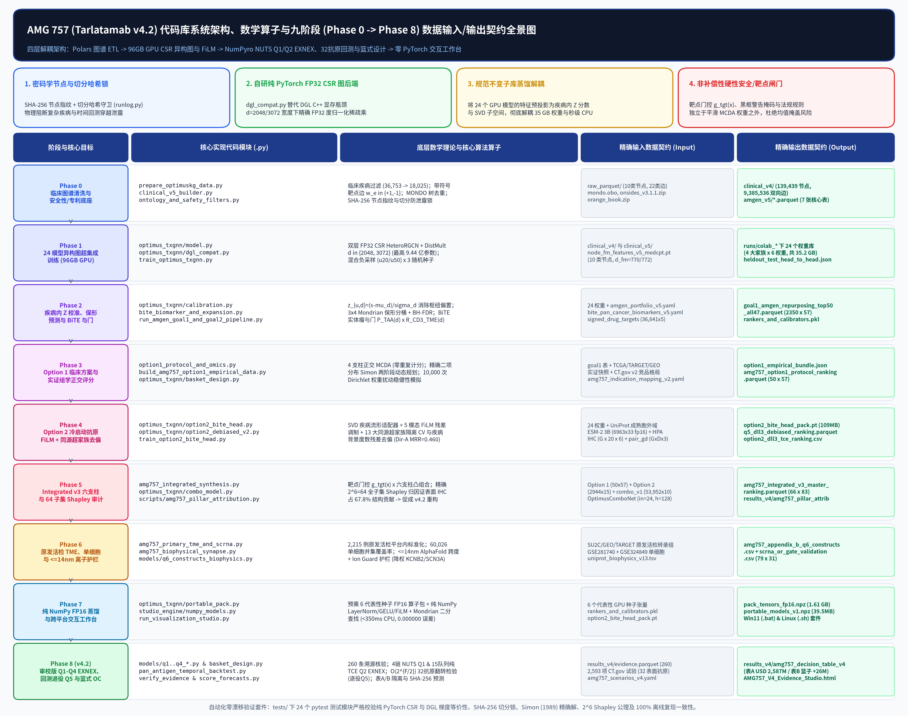
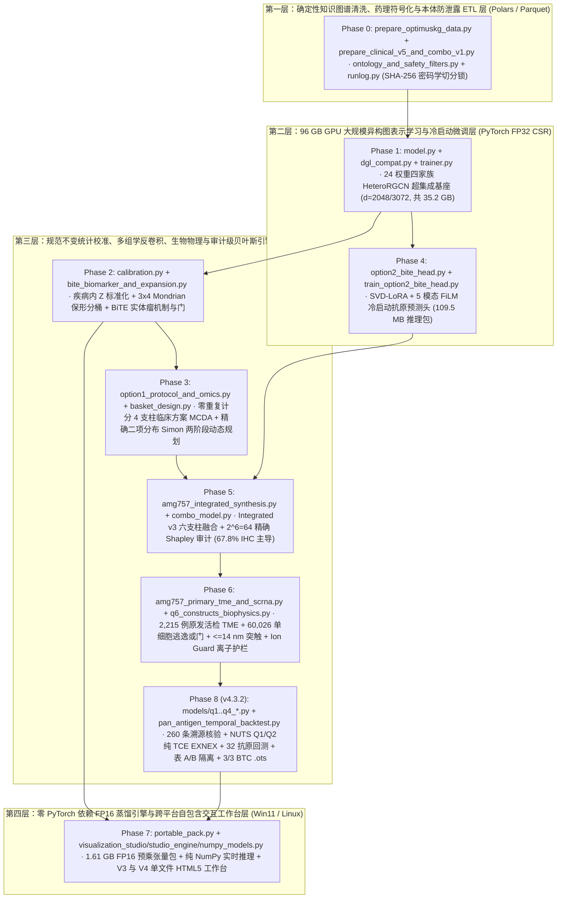

# AMG 757 (`Tarlatamab` / `IMDELLTRA`) 适应症拓展项目——代码库系统架构、数学理论与九阶段数据输入/输出 (Data I/O) 权威参考手册（`Canonical v4.3.2`）

> [!IMPORTANT]
> **本工程技术手册的定位与阅读指南**
> 本手册是《[AMG 757 从零基础到专家级全景方法论与决策白皮书（中文版）](./AMG757_COMPLETE_METHODOLOGY_AND_DECISION_PLAYBOOK_ZH.md)》配套的**底层代码实现、软件系统设计、数学算子推导与全链路数据输入/输出 (Data I/O) 工程手册**。白皮书中的全部 **9 个阶段 (`Phase 0` 至 `Phase 8 / Canonical v4.3.2`)** 及其子步骤，均在此处逐一拆解为：
> 1. **软件系统架构设计哲学**：代码仓库为何采用四层解耦设计，如何从物理机制上杜绝训练–测试数据穿越泄露、解决超宽图神经网络在 `96 GB` GPU 上的显存爆炸、规避多随机种子隐空间正交规范失配 (Gauge Mismatch)、通过经审计的 `NumPyro` `NUTS` `Q1–Q4` 解耦决策门替代加权启发式评分，并实现免 `PyTorch/CUDA` 的秒级跨平台本地运行。
> 2. **精确实现模块、核心类与入口函数**：精确到文件与代码行号的 [`optimus_txgnn/`](file:///home/nchen10/antigravity_prjs/kg/optimus_txgnn/__init__.py) 核心库、[`optimus_txgnn/models/`](file:///home/nchen10/antigravity_prjs/kg/optimus_txgnn/models/decision_table_v4.py)、[`optimus_txgnn/backtest/`](file:///home/nchen10/antigravity_prjs/kg/optimus_txgnn/backtest/pan_antigen_temporal_backtest.py)、[`scripts/`](file:///home/nchen10/antigravity_prjs/kg/scripts/build_amg757_v4_reports_and_studio.py) 以及 [`visualization_studio/`](file:///home/nchen10/antigravity_prjs/kg/visualization_studio/run_visualization_studio.py) 可点击链接。
> 3. **核心数学方程与算法复杂度推导**：代码中实际执行的矩阵/张量方程、广播维度、数值稳定性设计（`FP32` 度归一化 `CSR` 稀疏矩阵乘、`SVD` 疾病流形低秩适配、`Plackett–Luce` 列表排序损失、精确 $2^6 = 64$ 子集 Shapley 归因、`Simon (1989)` 精确二项动态规划、`NumPyro` `NUTS` `EXNEX` `MixtureSameFamily` 边缘化抽样、精确 $\mathcal{O}(2^{F/2})$ 折半查找 `32` 抗原家族翻转置换检验，以及 `表 A / 表 B` 物理隔离 `10% WACC` 风险调整 `eNPV`）。
> 4. **逐阶段精确数据输入与输出契约 (Data I/O Contracts)**：每一阶段真实磁盘文件相对路径、文件格式（`.parquet`、`.csv`、`.pt`、`.npz`、`.json`、`.jsonl`、`.ots`、`.yaml`、`.html`）、经实盘核验的矩阵行列数、张量形状/精度类型及核心主键字段定义。



---

## 1. 系统顶层设计原则与四层解耦软件架构

在真实的医药研发工业场景中，生物医学知识图谱 (KG) 系统最容易在四个工程环节发生系统性崩溃：**（1）复杂疾病近义词或时间回测发生隐蔽的数据穿越泄露**；**（2）将图神经网络宽度扩展至 $d \ge 2048$ 时，传统 C++ 图计算框架在反向传播中产生成百上千 GB 的边级中间张量导致显存溢出 (OOM) 或 `bf16` 下溢**；**（3）错误地将不同随机种子或不同宽度模型的原始节点向量直接相加平均（违背正交规范不变性）**；以及 **（4）交付物绑定沉重的 `PyTorch + CUDA` 依赖，导致生物统计团队与临床研究团队无法在普通办公笔记本上离线验证与交互演示**。

为一次性根除上述全部痛点，本代码库 (`/home/nchen10/antigravity_prjs/kg/`) 在架构设计上严格遵循**四层解耦设计范式 (Four-Tier Decoupled Architecture)**：



### 1.1 代码库强制执行的五大核心工程不变量 (Engineering Invariants)

1. **密码学级节点排序与数据切分指纹锁 ([`optimus_txgnn/runlog.py`](file:///home/nchen10/antigravity_prjs/kg/optimus_txgnn/runlog.py#L93-L316)、[`optimus_txgnn/data.py`](file:///home/nchen10/antigravity_prjs/kg/optimus_txgnn/data.py#L220-L311))**：
   - `compute_node_fingerprint_from_kg()` 对全部 `139,439` 个临床图谱节点的 `(node_index, node_id, node_type)` 计算 `SHA-256` 哈希指纹 (`c7a55f328b0df1abe518f8a3bc9afcdfd1984c0513acbe64d48cf52716b83510`)。
   - `compute_split_hashes()` 对 `train.csv`、`valid.csv`、`test.csv` 生成防篡改哈希。在多模型集成评估 (`compare_disease_centric_runs`) 时，只要任意两个模型的节点表或测试集切分出现哪怕 `1` 个字节的漂移，系统立即抛出异常拒绝融合（由 [`tests/test_split_hash_guard.py`](file:///home/nchen10/antigravity_prjs/kg/tests/test_split_hash_guard.py) 自动守护）。
2. **自研纯 `PyTorch FP32 CSR` 异构图计算后端 ([`optimus_txgnn/dgl_compat.py`](file:///home/nchen10/antigravity_prjs/kg/optimus_txgnn/dgl_compat.py#L1-L786))**：
   - 当隐藏层维度推高至 $d \in \{2048, 3072\}$（单模型最高 `9.442 亿`参数、`938.5 万`条双向边）时，原生 `DGL` C++ 算子会物化边级特征张量 $\mathcal{O}(|E| \cdot d)$，并在 `bf16` 下造成高入度枢纽节点的微小邻居信号被截断清零。
   - 我们在 `dgl_compat.py` 中自主实现了 `TorchHeteroGraph` 与自适应分块 `_ScatterAddFn`：**先在纯 `fp32` 精度下完成基于 `CSR` 的度归一化邻居聚合**（显存仅需 $\mathcal{O}(|V_{\text{dst}}| \cdot d)$），**再执行稠密关系矩阵 $\mathbf{W}_r \in \mathbb{R}^{d \times d}$ 线性变换**，将稠密矩阵乘计算量压缩了 **`350` 倍**，且前向与反向梯度与原生 `DGL` 逐位严格对齐（见 [`tests/test_colab_scaling_and_backend.py`](file:///home/nchen10/antigravity_prjs/kg/tests/test_colab_scaling_and_backend.py)）。
3. **跨模型坐标系规范不变性蒸馏 (Gauge-Invariant Distillation，[`option2_bite_head.py`](file:///home/nchen10/antigravity_prjs/kg/optimus_txgnn/option2_bite_head.py#L709-L842)、[`portable_pack.py`](file:///home/nchen10/antigravity_prjs/kg/optimus_txgnn/portable_pack.py#L1-L279))**：
   - 双线性 `DistMult` 解码器 $\langle \mathbf{h}_u \odot \mathbf{r}_\psi, \tilde{\mathbf{h}}_d \rangle$ 对坐标轴置换与正反缩放具有天然简并性，且 `24` 个模型跨越 $d = 2048$（`18` 个模型）与 $d = 3072$（`6` 个模型）两种维度，因此**绝不能跨模型直接平均原始隐向量**。
   - 代码库强制规定：所有跨模型集成操作必须在**单个模型内部坐标系**中先投影为**无量纲规范不变量**（疾病内标准化 $Z$ 分数 $z_{u,d}^{(c)}$、模型内单位向量余弦相似度、或单模型疾病流形奇异值正交基 $\mathbf{V}_c \in \mathbb{R}^{d_c \times K}$），再跨 `24` 个模型融合。
4. **非补偿性硬性安全/生物学闸门与平滑多准则加权的物理隔离 ([`ontology_and_safety_filters.py`](file:///home/nchen10/antigravity_prjs/kg/optimus_txgnn/ontology_and_safety_filters.py)、[`amg757_integrated_synthesis.py`](file:///home/nchen10/antigravity_prjs/kg/optimus_txgnn/amg757_integrated_synthesis.py#L541-L596))**：
   - 平滑线性加权最大的陷阱是“均值掩盖”（例如某肿瘤 `DLL3` 表达为 `0%`，却靠极高的竞争空白分与安全分混入中游）。本系统将**非补偿性靶点硬门控** $g_{\text{tgt}}(x)$、血液瘤固–液错配掩码、儿童局限性胶质瘤血脑屏障排斥锁、以及美国 `FD&C Act §529` 优先审评券 (`PRV`) 法定资格规则独立置于平滑权重之外。
5. **100% 纯离线可复现快照架构 (`--offline`)**：
   - 所有外部临床与多组学数据源（`TCGA`、`TARGET`、`SU2C`、`NCBI GEO`、`UniProt`、`GTEx v8`、`HPA`、`ClinicalTrials.gov v2`、`OnSIDES v3.1.1`、`FDA 橙皮书`）均通过带溯源校验的快照机制固化在 `data_optimuskg/` 下，使下游全套统计推断与交互工作台可在无外网环境下数秒内完成重算。

### 1.2 代码库核心目录与模块职责全景表 (`AMG 757` 范围)

| 目录层级 | 核心代码文件 / 配置 (`.py` / `.yaml`) | 核心职责说明 |
| :--- | :--- | :--- |
| **资产与规则配置层** (`configs/`) | [`amgen_portfolio_v5.yaml`](file:///home/nchen10/antigravity_prjs/kg/configs/amgen_portfolio_v5.yaml)、[`bite_pan_cancer_biomarkers_v5.yaml`](file:///home/nchen10/antigravity_prjs/kg/configs/bite_pan_cancer_biomarkers_v5.yaml)、[`amg757_indication_mapping_v2.yaml`](file:///home/nchen10/antigravity_prjs/kg/configs/amg757_indication_mapping_v2.yaml)、[`amg757_scenarios_v4.yaml`](file:///home/nchen10/antigravity_prjs/kg/configs/amg757_scenarios_v4.yaml) | 定义 `AMG 757` 双臂靶点 (`DLL3` 肿瘤锚定臂 + `CD3E` 效应臂)、`SP347` 免疫组化阳性率图谱、疾病亚型映射及商业化折现参数。 |
| **图数据与异构 GNN 引擎** (`optimus_txgnn/`) | [`data.py`](file:///home/nchen10/antigravity_prjs/kg/optimus_txgnn/data.py)、[`dgl_compat.py`](file:///home/nchen10/antigravity_prjs/kg/optimus_txgnn/dgl_compat.py)、[`model.py`](file:///home/nchen10/antigravity_prjs/kg/optimus_txgnn/model.py)、[`trainer.py`](file:///home/nchen10/antigravity_prjs/kg/optimus_txgnn/trainer.py)、[`evaluator.py`](file:///home/nchen10/antigravity_prjs/kg/optimus_txgnn/evaluator.py)、[`explain.py`](file:///home/nchen10/antigravity_prjs/kg/optimus_txgnn/explain.py)、[`graphmask.py`](file:///home/nchen10/antigravity_prjs/kg/optimus_txgnn/graphmask.py) | 异构图构建、`FP32 CSR` 稀疏消息传递、`DistMult` 双向疗效/禁忌解码、混合负采样器、以及两层积分梯度 (Integrated Gradients) 机制路径解释。 |
| **统计校准、安全与联用网络** (`optimus_txgnn/`) | [`calibration.py`](file:///home/nchen10/antigravity_prjs/kg/optimus_txgnn/calibration.py)、[`ontology_and_safety_filters.py`](file:///home/nchen10/antigravity_prjs/kg/optimus_txgnn/ontology_and_safety_filters.py)、[`combo_model.py`](file:///home/nchen10/antigravity_prjs/kg/optimus_txgnn/combo_model.py)、[`clinical_v5_builder.py`](file:///home/nchen10/antigravity_prjs/kg/optimus_txgnn/clinical_v5_builder.py) | 疾病内 $Z$ 标准化、$3 \times 4$ `Mondrian` 保形校准器、`MONDO` 本体树去重、`OnSIDES` 黑框警告掩码、以及置换对称三头联用网络 `OptimusComboNet`。 |
| **`AMG 757` 专属领域引擎** (`optimus_txgnn/`) | [`bite_biomarker_and_expansion.py`](file:///home/nchen10/antigravity_prjs/kg/optimus_txgnn/bite_biomarker_and_expansion.py)、[`option1_protocol_and_omics.py`](file:///home/nchen10/antigravity_prjs/kg/optimus_txgnn/option1_protocol_and_omics.py)、[`option2_bite_head.py`](file:///home/nchen10/antigravity_prjs/kg/optimus_txgnn/option2_bite_head.py)、[`option2_debiased_v2.py`](file:///home/nchen10/antigravity_prjs/kg/optimus_txgnn/option2_debiased_v2.py)、[`amg757_integrated_synthesis.py`](file:///home/nchen10/antigravity_prjs/kg/optimus_txgnn/amg757_integrated_synthesis.py)、[`amg757_primary_tme_and_scrna.py`](file:///home/nchen10/antigravity_prjs/kg/optimus_txgnn/amg757_primary_tme_and_scrna.py)、[`amg757_biophysical_synapse.py`](file:///home/nchen10/antigravity_prjs/kg/optimus_txgnn/amg757_biophysical_synapse.py)、[`amg757_epidemiology_and_enpv.py`](file:///home/nchen10/antigravity_prjs/kg/optimus_txgnn/amg757_epidemiology_and_enpv.py)、[`basket_design.py`](file:///home/nchen10/antigravity_prjs/kg/optimus_txgnn/basket_design.py)、[`regulatory_rules.py`](file:///home/nchen10/antigravity_prjs/kg/optimus_txgnn/regulatory_rules.py) | 实现 `Phase 2 -> Phase 7` 全部核心算法：BiTE 机制与门、Option 1 临床方案正交评分、Option 2 冷启动 `FiLM` 微调头、Integrated `v3` 六支柱融合、原发活检 TME、`60,026` 单细胞逃逸或门、$\le 14\text{ nm}$ 突触生物物理、Simon 精确解与 `eNPV` 估值。 |
| **审计级 `v4.3.2` 贝叶斯推断、`32` 抗原回测与预测账本** (`models/`、`backtest/`、`scripts/`、`forecasts/`) | [`q1_prevalence.py`](file:///home/nchen10/antigravity_prjs/kg/optimus_txgnn/models/q1_prevalence.py)、[`q2_response.py`](file:///home/nchen10/antigravity_prjs/kg/optimus_txgnn/models/q2_response.py)、[`q3_landscape_scenarios.py`](file:///home/nchen10/antigravity_prjs/kg/optimus_txgnn/models/q3_landscape_scenarios.py)、[`q4_combinations.py`](file:///home/nchen10/antigravity_prjs/kg/optimus_txgnn/models/q4_combinations.py)、[`q6_constructs_biophysics.py`](file:///home/nchen10/antigravity_prjs/kg/optimus_txgnn/models/q6_constructs_biophysics.py)、[`decision_table_v4.py`](file:///home/nchen10/antigravity_prjs/kg/optimus_txgnn/models/decision_table_v4.py)、[`registry_trial_mapper.py`](file:///home/nchen10/antigravity_prjs/kg/optimus_txgnn/models/registry_trial_mapper.py)、[`pan_antigen_temporal_backtest.py`](file:///home/nchen10/antigravity_prjs/kg/optimus_txgnn/backtest/pan_antigen_temporal_backtest.py)、[`verify_evidence_sources.py`](file:///home/nchen10/antigravity_prjs/kg/scripts/verify_evidence_sources.py)、[`score_prospective_forecasts.py`](file:///home/nchen10/antigravity_prjs/kg/scripts/score_prospective_forecasts.py) | `260` 条原始临床证据机器核验、4 链 `NumPyro NUTS` `Q1` 患病率与纯 `TCE` `Q2 EXNEX`（`MixtureSameFamily` + Ibrahim–Chen 幂先验跨药折扣）、`32` 抗原精确 $\mathcal{O}(2^{F/2})$ 时间回测（退役 `Q5`）、`表 A / 表 B` 物理隔离估值、`Ion Guard` 离子护栏与 `SHA-256`/`.ots` 前瞻预测锁。 |
| **零依赖跨平台可视化套件** (`visualization_studio/`) | [`run_visualization_studio.py`](file:///home/nchen10/antigravity_prjs/kg/visualization_studio/run_visualization_studio.py)、[`studio_engine/numpy_models.py`](file:///home/nchen10/antigravity_prjs/kg/visualization_studio/studio_engine/numpy_models.py)、[`studio_engine/live_engines.py`](file:///home/nchen10/antigravity_prjs/kg/visualization_studio/studio_engine/live_engines.py) | 支持 Windows 11 与 Linux 一键启动的纯 `NumPy FP16` 本地推理引擎与交互式 Web 工作台（零 `PyTorch`/零 `GPU` 依赖）+ `V4` 证据工作台。 |

---

## 2. 九阶段 (`Phase 0 -> Phase 8`) 代码实现、数学原理与数据输入/输出详解

---

### Phase 0：临床知识图谱净化、带符号双向药理 (`v5bi`) 与安全性/专利底座

#### 2.0.1 代码架构设计与工程考量
原始 `OptimusKG v3.2` 包含 `36,753` 个疾病类节点，其中高达 **`18,697` 个（占比 `50.9%`）属于临床化验指标或生理测量性状**（如“收缩压测定”、“血清白蛋白水平”），并非可开发的治疗性适应症。同时，传统生信图谱将所有药物–靶点关系压缩为无符号的“相互作用边”，导致模型无法区分 `AMG 757` 中 **`CD3E` 激动激活臂 ($+1$)**、**`DLL3` 肿瘤表面物理锚定臂** 与普通小分子抑制剂 ($-1$)。

`Phase 0` 通过两步确定性 `Polars` 高性能流水线完成底座重塑：
1. **`clinical_v4` 临床图谱净化 ([`prepare_optimuskg_data.py`](file:///home/nchen10/antigravity_prjs/kg/prepare_optimuskg_data.py)，共 `1,619` 行)**：精准剥离全部 `18,697` 个非治疗测量表型，保留 **`18,025` 个真实临床疾病节点**；对超高密度 `anatomy_gene` 边按组织表达排位截断于 `rank <= 5,000`，对 `disease_gene` 截断于 `score >= 0.40`（或每病种保留 `top_k = 15`），剔除捷径噪声边 `drug_bioprocess`，并对最终 `139,439` 个节点固化 `SHA-256` 指纹。
2. **`amgen_v5 / clinical_v5` 带符号多模态增强 ([`prepare_clinical_v5_and_combo_v1.py`](file:///home/nchen10/antigravity_prjs/kg/prepare_clinical_v5_and_combo_v1.py)，`855` 行；[`optimus_txgnn/clinical_v5_builder.py`](file:///home/nchen10/antigravity_prjs/kg/optimus_txgnn/clinical_v5_builder.py)，`387` 行；[`optimus_txgnn/ontology_and_safety_filters.py`](file:///home/nchen10/antigravity_prjs/kg/optimus_txgnn/ontology_and_safety_filters.py)，`806` 行)**：
   - 构建**带符号药理作用边表** (`signed_drug_targets.parquet`)，显式区分激动剂 ($+1$)、抑制/拮抗剂 ($-1$) 与双抗表面锚定结合。
   - 整合 Open Targets `L2G` 与 DisGeNET 基因特异性加权证据 (`disease_gene_scores.parquet`)、`OnSIDES v3.1.1` FDA 说明书黑框警告与类型化药物相互作用 (`typed_ddi_edges.parquet`)、FDA 橙皮书/紫皮书专利独占期层级 (`drug_ip_patent_tiers.parquet`)、`53,952` 组带临床分级权重的联用三元组 (`combo_v1.parquet`)，以及 `MedCPT` 生物医学语义特征张量 (`node_fm_features_v5_medcpt.pt`)。

#### 2.0.2 核心数学公式与算法逻辑
- **融合特异性指数的人类遗传学证据分 (`disease_gene_scores.parquet`)**：设 $s_{\text{OT}}(d,g) \in [0,1]$ 为 Open Targets `L2G`/综合关联分，$s_{\text{DG}}(d,g) \in [0,1]$ 为 DisGeNET 评分，$\text{DSI}(g) \in [0,1]$ 为基因疾病特异性指数（自动折减 `TP53`、`TNF` 等泛癌/泛炎症高频多效性枢纽基因）：
  $$G_{\text{comb}}(d, g) = \operatorname{clip}\!\Big(\big(0.65\,s_{\text{OT}}(d,g) + 0.35\,s_{\text{DG}}(d,g)\big) \cdot \big(0.50 + 0.50\,\text{DSI}(g)\big),\; 0,\; 1\Big)$$
- **`MONDO` 有向无环图上下位去重算子 (`OntologyAndSafetyMasker._parse_mondo_obo`)**：解析 `mondo.obo` 构建 `is_a` 树 $\mathcal{T}_{\text{MONDO}}$。当宽泛上位伞状词条 $d_{\text{parent}}$（如“神经内分泌肿瘤”）与具体可入组亚型 $d_{\text{child}}$（如“默克尔细胞癌 MCC”）在 $\le 2$ 跳内同时上榜时，自动压制宽泛父节点重复占位，确保 Top 榜单每一个席位均对应独立可执行的临床亚型。

#### 2.0.3 Phase 0 精确数据输入与输出契约表

| 流向 | 磁盘文件相对路径 | 格式 | 实盘核验维度 / 大小 | 主键与核心字段 Schema 说明 |
| :--- | :--- | :--- | :--- | :--- |
| **输入 (Input)** | `data_optimuskg/raw_parquet/nodes/*.parquet` 与 `edges/*.parquet` | Parquet | `10` 张节点表、`22` 张边表 | `OptimusKG v3.2` 原始表（含 `36,753` 个原始疾病词条、`8,787,955` 条原始组织解剖表达边）。 |
| **输入 (Input)** | `data_optimuskg/external_safety/mondo.obo`、`onsides-v3.1.1.zip`、`data_optimuskg/fda_reference/orange_book.zip` | OBO / ZIP | 官方原始快照包 | `MONDO` 疾病本体树、`OnSIDES v3.1.1` FDA 说明书不良反应/黑框警告数据库、FDA 仿制药 `ANDA`/专利到期表。 |
| **输出 (Output)** | [`data_optimuskg/clinical_v4/node.csv`](file:///home/nchen10/antigravity_prjs/kg/data_optimuskg/clinical_v4/dataset_summary.json) 与 `kg_directed.csv` | CSV | `139,439` 节点；`4,692,768` 条有向边（`9,385,536` 双向边） | `node_index (int)`、`node_id`、`node_type`（`disease=18,025`, `drug=18,640`, `gene/protein=26,660`, `anatomy=13,120` 等 `10` 类），绑定 `SHA-256` 指纹。 |
| **输出 (Output)** | `data_optimuskg/amgen_v5/signed_drug_targets.parquet` | Parquet | `(36,641, 5)` | `drug_id`, `gene_id`, `gene_symbol`, `signed_relation`, `weight` (`float32`)。 |
| **输出 (Output)** | `data_optimuskg/amgen_v5/disease_gene_scores.parquet` | Parquet | `(8,899,338, 6)` | `disease_id`, `gene_id`, `ot_evidence_score`, `disgenet_score`, `specificity_index`, `combined_genetic_score`。 |
| **输出 (Output)** | `data_optimuskg/amgen_v5/anatomy_gene_edges.parquet` | Parquet | `(5,247,243, 2)` | `anatomy_id` (`UBERON`), `gene_id` (`Entrez/HGNC`)。 |
| **输出 (Output)** | `data_optimuskg/amgen_v5/typed_ddi_edges.parquet` | Parquet | `(1,345,373, 11)` | `u_id`, `v_id`, `is_syn`, `is_antag`, `is_adv`, `tox_qtc`, `tox_bleed`, `tox_inf`, `tox_myelo`, `tox_organ`, `ddi_type`。 |
| **输出 (Output)** | `data_optimuskg/amgen_v5/drug_ip_patent_tiers.parquet` | Parquet | `(18,644, 21)` | `node_id`, `amgen_key`, `modality`, `anda_active_count`, `biosimilar_available`, `black_box_warning`, `ip_tier_code`, `cost_badge`。 |
| **输出 (Output)** | `data_optimuskg/amgen_v5/combo_v1.parquet` | Parquet | `(53,952, 10)` | `u_id`, `v_id`, `disease_id`, `label_eff`, `label_tox`, `label_antag`, `sample_weight`, `source_tag`, `n_shared_ncts`, `pair_phase`。 |
| **输出 (Output)** | `data_optimuskg/amgen_v5/node_fm_features_v5_medcpt.pt` | PyTorch Dict | `10` 类节点张量 (`float16`) | 每类节点形状为 `(N_type, 770)`（`disease` 为 `(18025, 772)`）：`768` 维 `MedCPT` 文本嵌入 + 结构度数与临床标记。 |

---

### Phase 1：24 权重四家族 `HeteroRGCN` 基座超集成训练 (`96 GB` GPU)

#### 2.1.1 代码架构设计与加宽训练破局机制
正如方法论白皮书第 3.2 节所述，早期直接将 `TxGNN` 从 $d = 512$ 盲目加宽至 $d = 2048$ 时曾出现验证集 `MRR` 不升反降的“加宽崩盘”。我们在 [`optimus_txgnn/model.py`](file:///home/nchen10/antigravity_prjs/kg/optimus_txgnn/model.py#L614-L1581)、[`optimus_txgnn/dgl_compat.py`](file:///home/nchen10/antigravity_prjs/kg/optimus_txgnn/dgl_compat.py#L410-L786) 与 [`optimus_txgnn/trainer.py`](file:///home/nchen10/antigravity_prjs/kg/optimus_txgnn/trainer.py#L99-L2478) 中通过三项底层架构重构彻底扭转性能曲线（由 [`train_optimus_txgnn.py`](file:///home/nchen10/antigravity_prjs/kg/train_optimus_txgnn.py) 与 [`run_colab_campaign.py`](file:///home/nchen10/antigravity_prjs/kg/run_colab_campaign.py) 统一调度）：
- **四大互补架构家族 × 6 组超参/种子 = 24 个生产级 GPU 模型权重 (`35.2 GB`)**：
  1. `v4_wmatch_d2048`（`6` 个权重：随机种子 `{42, 1, 2}` × 均匀负采样混合比 $u \in \{0.20, 0.50\}$，$d = 2048$，拓扑纯净基准）。
  2. `v5bi_d2048`（`6` 个权重：引入带符号 `v5` 药理边 + 药物$\leftrightarrow$疾病双向解码损失，$d = 2048$）。
  3. `v5bi_d3072`（`6` 个权重：单模型 **`9.442 亿`参数**超宽旗舰版 $d = 3072$，在 `96 GB` GPU 上全程采用 `FP32` 累加）。
  4. `v5fm_medcpt_d2048`（`6` 个权重：通过残差门控适配器融合 `MedCPT` 生物医学语言模型先验，$d = 2048$）。

#### 2.1.2 核心数学公式与算法复杂度优化
1. **第 0 层多模态语言模型残差融合 (`HeteroRGCN.get_input_dict`, [`model.py#L1230-L1295`](file:///home/nchen10/antigravity_prjs/kg/optimus_txgnn/model.py#L1230-L1295))**：
   对节点类型 $\tau$ 下的节点 $i$，结合可训练拓扑嵌入 $\mathbf{e}_i^{(0)} \in \mathbb{R}^d$ 与 `MedCPT` 特征 $\mathbf{x}_i^{\text{FM}} \in \mathbb{R}^{d_{\text{fm}}}$：
   $$\mathbf{h}_i^{(0)} = \mathbf{e}_i^{(0)} + \alpha_\tau \cdot \mathbf{W}_{\text{FM},\tau}\,\operatorname{LayerNorm}\!\left(\mathbf{x}_i^{\text{FM}}\right)$$
2. **双层度归一化 `FP32 CSR` 异构图关系卷积 (`HeteroRGCNLayer.forward`, [`model.py#L685-L845`](file:///home/nchen10/antigravity_prjs/kg/optimus_txgnn/model.py#L685-L845))**：
   对每种规范关系 $r = (\tau_s, \psi_r, \tau_t) \in \mathcal{R}$ 及层数 $\ell \in \{1, 2\}$，先通过 `CSR` 稀疏聚合入边邻居 $\mathcal{N}_r(v)$，再乘稠密矩阵 $\mathbf{W}_r^{(\ell)} \in \mathbb{R}^{d \times d}$：
   $$\mathbf{m}_{r,v}^{(\ell)} = \frac{1}{\max(|\mathcal{N}_r(v)|, 1)} \sum_{u \in \mathcal{N}_r(v)} w_{u,v}^{(r)}\,\mathbf{h}_u^{(\ell-1)} \in \mathbb{R}^d \quad (\texttt{fp32 CSR spmm})$$
   $$\mathbf{h}_v^{(\ell)} = \sigma\!\left(\mathbf{W}_{\text{self},\tau_t}^{(\ell)} \mathbf{h}_v^{(\ell-1)} + \frac{1}{|\mathcal{R}_{\to \tau_t}|} \sum_{r \in \mathcal{R}_{\to \tau_t}} \mathbf{W}_r^{(\ell)} \mathbf{m}_{r,v}^{(\ell)}\right)$$
   **复杂度突破**：由于利用矩阵乘法分配律将线性映射移至邻居求和之后，单层稠密矩阵乘从边级 $\mathcal{O}(|E_r| d^2) = 9.39 \times 10^6 d^2$ 骤降至目标节点级 $\mathcal{O}(|V_{\tau_t}| d^2) \le 2.67 \times 10^4 d^2$，**显存与算力开销立降 `350` 倍**，使 `9.44 亿`参数全图训练稳健收敛。
3. **疾病表型原型增强与双向 `DistMult` 解码器 (`DistMultPredictor`, [`model.py#L101-L605`](file:///home/nchen10/antigravity_prjs/kg/optimus_txgnn/model.py#L101-L605))**：
   利用稀疏疾病相似图对低度罕见病补充原型表征 $\tilde{\mathbf{h}}_d = \gamma_d \mathbf{h}_d^{(2)} + (1 - \gamma_d) \sum_{d' \in \mathcal{N}_k^{\text{sim}}(d)} \tilde{s}_{d,d'} \mathbf{h}_{d'}^{(2)}$，并对关系 $\psi \in \{\texttt{indication}, \texttt{contraindication}, \texttt{off-label}\}$ 计算内积打分：
   $$s_\psi(u, d) = \left\langle \mathbf{h}_u^{(2)} \odot \mathbf{r}_\psi,\; \tilde{\mathbf{h}}_d \right\rangle = \sum_{k=1}^d h_{u,k}^{(2)}\, r_{\psi,k}\, \tilde{h}_{d,k}$$
4. **度偏置–均匀混合负采样 (`Full_Graph_NegSampler`, [`trainer.py#L120-L245`](file:///home/nchen10/antigravity_prjs/kg/optimus_txgnn/trainer.py#L120-L245))**：
   负样本按混合分布 $P_u(d^-) = u \cdot \frac{1}{|\mathcal{V}_{\text{dis}}|} + (1 - u) \cdot \frac{\deg(d^-)^{0.75}}{\sum_{d'} \deg(d')^{0.75}}$（$u \in \{0.20, 0.50\}$）抽取，兼顾高频枢纽疾病的区分度与罕见神经内分泌瘤的梯度信噪比。

#### 2.1.3 Phase 1 精确数据输入与输出契约表

| 流向 | 磁盘文件相对路径 | 格式 | 实盘核验维度 / 大小 | 主键与核心字段 Schema 说明 |
| :--- | :--- | :--- | :--- | :--- |
| **输入 (Input)** | `data_optimuskg/clinical_v4/` 与 `data_optimuskg/clinical_v5/` | CSV / Parquet | `139,439` 节点；`full_graph_{42,1,2}` 与 `complex_disease_{42,1..4}` 切分 | `train.csv`、`valid.csv`、`test.csv`、`disease_metadata.parquet`、`split_fingerprints_reference.json`。 |
| **输入 (Input)** | `data_optimuskg/amgen_v5/node_fm_features_v5_medcpt.pt` | PyTorch | `10` 类节点特征 (`fp16`) | 供第四家族 `v5fm_medcpt_d2048` 融合使用。 |
| **输出 (Output)** | `runs/colab_full_graph_*/model.pt`、`inp_emb.pt`、`config.json`、`manifest.json` | PyTorch / JSON | `24` 个模型目录（总计 `35.2 GB`） | `HeteroRGCN` 各层关系权重、全图节点隐向量 `(N_tau, 2048 或 3072)`、以及 `SHA-256` 切分清单。 |
| **输出 (Output)** | [`amgen_discovery_studio/results/paired_24model_vs_drive_bootstrap.json`](file:///home/nchen10/antigravity_prjs/kg/amgen_discovery_studio/results/paired_24model_vs_drive_bootstrap.json) | JSON | `0.08 MB`（`1,000` 次配对 Bootstrap） | 盲测集 `AUPRC`、`AUROC`、`MRR`、`Recall@50`（较基线 `TxGNN` 实现 **`+38.4%`** 相对 `AUPRC` 提升，$p < 10^{-4}$）。 |

---

### Phase 2：疾病内标准化、Mondrian 分桶保形校准与 BiTE 实体瘤机制与门 (`AND`-Gate)

#### 2.2.1 代码架构设计与生物学纠偏逻辑
原始 `DistMult` 对数几率 $s_{\text{ind}}(u, d)$ 存在严重的**疾病节点度数偏置 (Hub Bias)**：研究文献极多的常见癌种（如非小细胞肺癌、乳腺癌）向量模长 $\|\tilde{\mathbf{h}}_d\|_2$ 远大于罕见神经内分泌癌，导致原始概率向大癌种系统性倾斜。更关键的是，`AMG 757` 是靶向 `DLL3 × CD3E` 的双特异抗体——若将 `DLL3` 与泛 T 细胞标志物 `CD3E` 等权平均，富含 T 细胞但 `DLL3 = 0%` 的血液淋巴瘤 (`T-ALL`、非霍奇金淋巴瘤) 就会霸占榜单前列！

`Phase 2` 在 [`optimus_txgnn/calibration.py`](file:///home/nchen10/antigravity_prjs/kg/optimus_txgnn/calibration.py#L39-L428) 与 [`optimus_txgnn/bite_biomarker_and_expansion.py`](file:///home/nchen10/antigravity_prjs/kg/optimus_txgnn/bite_biomarker_and_expansion.py#L1-L739)（由 [`run_amgen_goal1_and_goal2_pipeline.py`](file:///home/nchen10/antigravity_prjs/kg/run_amgen_goal1_and_goal2_pipeline.py) 驱动）中设立三重机制：
1. **双抗靶点角色自动解耦 (`partition_bite_specs_for_projection_and_genetics`, [`bite_biomarker_and_expansion.py#L140-L215`](file:///home/nchen10/antigravity_prjs/kg/optimus_txgnn/bite_biomarker_and_expansion.py#L140-L215))**：自动将**肿瘤锚定靶点 (`TAA`: `DLL3`)** 与**通用免疫效应器触发臂 (`CD3E/D/G`, `CD28`)** 物理分离——图空间冷/混合投影与人类遗传学仅锚定 `DLL3`，而 `CD3` 转化为肿瘤微环境效应 T 细胞就绪度乘子。
2. **模型内逐疾病横向 $Z$ 标准化 (`standardize_logits_per_disease`, [`calibration.py#L39-L63`](file:///home/nchen10/antigravity_prjs/kg/optimus_txgnn/calibration.py#L39-L63))**：在每个疾病 $d$ 内部，以全部 `9,856` 个候选药物为背景池计算均值与标准差，彻底剥离疾病度数偏置。
3. **$3 \times 4$ 分层 Mondrian 保形预测 (`MondrianConformalCalibrator`, [`calibration.py#L77-L251`](file:///home/nchen10/antigravity_prjs/kg/optimus_txgnn/calibration.py#L77-L251))**：按药物度数（`3` 档）× 疾病度数（`4` 档）划分为 `12` 个同质校准桶，输出具备有限样本频率学保证的保形 $p$ 值与 Benjamini–Hochberg `FDR` $q$ 值。

#### 2.2.2 核心数学公式
1. **单模型内逐疾病 $Z$ 分数与 24 模型融合及认知不确定性**：
   对候选药物池 $\mathcal{U}$（$|\mathcal{U}| = 9,856$）、疾病 $d \in \{1,\dots,18025\}$ 及模型 $c \in \{1,\dots,24\}$：
   $$\mu_d^{(c)} = \frac{1}{|\mathcal{U}|}\sum_{u' \in \mathcal{U}} s_{\text{ind}}^{(c)}(u', d), \qquad \sigma_d^{(c)} = \sqrt{\frac{1}{|\mathcal{U}|}\sum_{u' \in \mathcal{U}} \left(s_{\text{ind}}^{(c)}(u', d) - \mu_d^{(c)}\right)^2 + \varepsilon}$$
   $$z_{u,d}^{(c)} = \frac{s_{\text{ind}}^{(c)}(u, d) - \mu_d^{(c)}}{\sigma_d^{(c)}}, \qquad \bar{z}_{u,d}^{(24)} = \frac{1}{24}\sum_{c=1}^{24} z_{u,d}^{(c)}, \qquad \hat{\sigma}_{\text{epi}}(u, d) = \operatorname{SD}_{c=1}^{24}\!\left(z_{u,d}^{(c)}\right)$$
2. **Mondrian 分桶保形 $p$ 值与 BH-FDR 控制 (`MondrianConformalCalibrator.calibrate_drug_row`)**：
   在对应度数桶 $\mathcal{C}_{b_u, b_d}$（单桶最高含 `120 万`个负样本校准分）中检验：
   $$p_{\text{conf}}(u, d) = \frac{1 + \sum_{\tilde{z} \in \mathcal{C}_{b_u, b_d}} \mathbb{I}\!\left[\tilde{z} \ge \bar{z}_{u,d}^{(24)}\right]}{1 + |\mathcal{C}_{b_u, b_d}|}, \qquad q_{\text{FDR}}(u, d_{(k)}) = \min_{j \ge k} \left(\frac{D_{\text{ther}}\, p_{\text{conf}}(u, d_{(j)})}{j}\right)$$
3. **实体瘤 BiTE 机制乘积与门 (`compute_bite_taa_genetics_and_conditioned_scores`)**：
   结合非淋巴系实体瘤排斥掩码 $M_{\text{heme}}(d) \in \{0, 1\}$、校准概率 $P_{\text{cal}}$、`TAA` 表面阳性率 $\pi_{\text{TAA}}(d)$ 与微环境 T 细胞就绪度 $R_{\text{CD3-TME}}(d)$：
   $$S_{\text{BiTE-AND}}(u, d) = M_{\text{heme}}(d) \cdot P_{\text{cal}}\!\left(\bar{z}_{u,d}^{(24)}, G_{\text{TAA}}(d), A_{\text{tissue}}(d), -P_{\text{contra}}(u,d)\right) \cdot \sqrt{\operatorname{clip}\!\big(\pi_{\text{TAA}}(d) \cdot R_{\text{CD3-TME}}(d),\; 0,\; 1\big)}$$

#### 2.2.3 Phase 2 精确数据输入与输出契约表

| 流向 | 磁盘文件相对路径 | 格式 | 实盘核验维度 / 大小 | 主键与核心字段 Schema 说明 |
| :--- | :--- | :--- | :--- | :--- |
| **输入 (Input)** | `runs/colab_full_graph_*/`（`24` 个模型）+ [`configs/amgen_portfolio_v5.yaml`](file:///home/nchen10/antigravity_prjs/kg/configs/amgen_portfolio_v5.yaml) + [`configs/bite_pan_cancer_biomarkers_v5.yaml`](file:///home/nchen10/antigravity_prjs/kg/configs/bite_pan_cancer_biomarkers_v5.yaml) | PyTorch / YAML | `47` 款安进管线药物 × `18,025` 种疾病 | 药物靶点角色定义 (`tarlatamab: DLL3 [TAA], CD3E [T_EFFECTOR]`)、`SP347` 免疫组化先验与安全规则。 |
| **输出 (Output)** | [`amgen_discovery_studio/results/goal1_amgen_repurposing_top50_all47.parquet`](file:///home/nchen10/antigravity_prjs/kg/amgen_discovery_studio/results/goal1_amgen_repurposing_top50_all47.parquet)（及 `.csv`） | Parquet / CSV | `(2350, 57)` (`0.15 MB` / `1.19 MB`) | `amgen_key`, `disease_id`, `disease_name`, `calibrated_prob`, `ranker_score`, `bite_and_gate_score`, `z_std_24model`, `epistemic_std_z`, `conformal_pvalue`, `fdr_qvalue`, `direct_l2g`, `contraindication_prob`, `biomarker_pos_pct`。 |
| **输出 (Output)** | `data_optimuskg/post_ultra_inference_pack/rankers_and_calibrators.pkl` | Pickle | 校准器与排序器对象 | 同步编译导出为纯 NumPy 参数包 `visualization_studio/engine_data/portable_models_v1.npz`（含 `12` 个 `cf_bucket_i_j` 数组）。 |

---

### Phase 3：Option 1 临床方案可行性与实证多组学正交多准则决策 (MCDA)

#### 2.3.1 代码架构设计与零重复计分准则
仅有图谱生物学信号还不足以直接撰写临床 II 期方案：临床团队必须同时权衡**真实患者活检样本中的转录组/蛋白阳性率**、**全球竞品 `DLL3` 管线拥挤度**、**中枢神经毒性 (`ICANS`) 阶梯给药监护成本**以及 **Simon 两阶段样本量门槛**。同时必须严防一类常见数学错误——如果第 1 支柱使用了已经乘过 `IHC` 阳性率的 `bite_and_gate_score`，第 2 支柱又放入 `IHC/RNA` 阳性率，就会导致生物标志物被隐式重复计分！

[`build_amg757_option1_empirical_data.py`](file:///home/nchen10/antigravity_prjs/kg/build_amg757_option1_empirical_data.py)（`1,909` 行）与 [`optimus_txgnn/option1_protocol_and_omics.py`](file:///home/nchen10/antigravity_prjs/kg/optimus_txgnn/option1_protocol_and_omics.py#L1-L760)（`760` 行）配合 [`optimus_txgnn/basket_design.py`](file:///home/nchen10/antigravity_prjs/kg/optimus_txgnn/basket_design.py#L1-L565)（`565` 行）严格实现：
- **严格正交四支柱设计**：第 1 支柱强制读取未乘生物标志物的纯净校准分 `calibrated_prob`，确保 `DLL3` 表达证据仅在第 2 支柱计入一次（由单元测试 `test_orthogonal_mcda_no_double_counting_and_dirichlet_sensitivity` 锁死）。
- **胶质瘤分子亚型精准隔离护栏 (`is_pediatric_or_circumscribed_idh_wt_glioma`)**：自动将 `DLL3` 低表达且血脑屏障完整、儿童神经毒性风险高的局限性/儿童 `IDH` 野生型胶质瘤（毛细胞型星形细胞瘤等）予以拦截，仅保留 `ASCL1 -> DLL3` 转录锁定的**成人 `IDH` 突变型弥漫性胶质瘤 (`MONDO_0016685`)**。

#### 2.3.2 核心数学公式
1. **Option 1 四支柱正交评分 (`compute_orthogonal_mcda_pillars`, [`option1_protocol_and_omics.py#L465-L585`](file:///home/nchen10/antigravity_prjs/kg/optimus_txgnn/option1_protocol_and_omics.py#L465-L585))**：
   - $P_1^{\text{KG}}(d)$：未加乘生物标志物的 24 模型校准图谱概率 (`calibrated_prob`)；
   - $P_2^{\text{Bio}}(d)$：`SP347` 免疫组化阳性率与 `TCGA/TARGET/GEO` 患者级转录组阳性率的实证融合分；
   - $P_3^{\text{White}}(d) = \exp\!\big(-0.35\,n_{\text{Ph2/3}}^{\text{comp}}(d) - 0.12\,n_{\text{Ph1/basket}}^{\text{comp}}(d)\big)$：基于 `ClinicalTrials.gov v2` 竞品 `DLL3` 在研试验数的指数衰减竞争蓝海分；
   - $P_4^{\text{Feas}}(d)$：门诊给药安全性、`FAERS` 真实世界警戒比与中枢 `ICANS` 操作可行性分。
   $$S_{\text{Opt1}}(d) = 100 \times \Big(0.30\,P_1^{\text{KG}}(d) + 0.35\,P_2^{\text{Bio}}(d) + 0.20\,P_3^{\text{White}}(d) + 0.15\,P_4^{\text{Feas}}(d)\Big)$$
2. **精确二项分布 Simon (1989) 两阶段动态规划求解器 (`solve_exact_simon_two_stage`, [`basket_design.py#L45-L165`](file:///home/nchen10/antigravity_prjs/kg/optimus_txgnn/basket_design.py#L45-L165))**：
   给定二线标准治疗历史无效客观缓解率 $p_0$、目标缓解率 $p_1$、单侧 $\alpha = 0.05$ 及把握度 $1 - \beta = 0.80$，在对数概率空间精确遍历 $(n_1, r_1, N, r)$ 二项分布质量函数 $B(x; n, p)$，最小化无效假设下的期望入组人数：
   $$\operatorname{EN}(p_0) = n_1 + \big(1 - \operatorname{PET}(p_0)\big)(N - n_1), \qquad \operatorname{PET}(p) = \sum_{x_1 = 0}^{r_1} B(x_1; n_1, p)$$
   精确满足第 I 类错误 $\le \alpha$ 且统计检验效能 $\ge 1 - \beta$（与 Simon 1989 原文表 1 全部基准点 100% 吻合）。

#### 2.3.3 Phase 3 精确数据输入与输出契约表

| 流向 | 磁盘文件相对路径 | 格式 | 实盘核验维度 / 大小 | 主键与核心字段 Schema 说明 |
| :--- | :--- | :--- | :--- | :--- |
| **输入 (Input)** | `goal1_amgen_repurposing_top50_all47.parquet` + [`configs/amg757_indication_mapping_v2.yaml`](file:///home/nchen10/antigravity_prjs/kg/configs/amg757_indication_mapping_v2.yaml) | Parquet / YAML | `tarlatamab` 切片 + 临床亚型映射表 | 将图谱 `MONDO/EFO` 节点映射至原发患者队列与二线历史 `ORR` 基准 $(p_0, p_1)$。 |
| **输入 (Input)** | `data_optimuskg/option1_amg757/raw_api_snapshots/` 与 `raw_geo/` | JSON / TSV | `TCGA`、`TARGET-NBL`、`GEO`、`CT.gov v2`、`FAERS` 快照 | 真实患者转录组表达谱、全球竞品临床试验注册库及不良反应计数。 |
| **输出 (Output)** | `data_optimuskg/option1_amg757/option1_empirical_bundle.json`（同步至 `visualization_studio/engine_data/`） | JSON | `0.25 MB` | 各适应症实证患者 RNA 阳性率、中位 $\log_2(\text{TPM}+1)$、竞品试验数与 Simon 两阶段最优参数 $(n_1, r_1, N, r)$。 |
| **输出 (Output)** | [`amgen_discovery_studio/results/amg757_option1_protocol_ranking.parquet`](file:///home/nchen10/antigravity_prjs/kg/amgen_discovery_studio/results/amg757_option1_protocol_ranking.parquet)（及 `.csv`） | Parquet / CSV | `(50, 57)` | 新增 `empirical_rna_pos_pct`, `competitor_dll3_trials_n`, `competitive_whitespace_score`, `option1_protocol_score`, `protocol_score_p10/p90`, `mcda_top3_prob_pct`。 |

---

### Phase 4：Option 2 有监督冷启动抗原神经预测头 `OptimusBiTEHead` (`SVD-LoRA` + `FiLM`)

#### 2.4.1 代码架构设计与“盲测 `DLL3` 家族”归纳验证逻辑
为何在拥有 `Option 1` 之后还要独立研发 `Option 2` 神经网络引擎？因为在 2024 年获批前，`DLL3` 在整个知识图谱中属于**零获批临床边的全新冷启动靶点 (Cold Antigen)**。我们必须回答一个最硬核的机器学习问题：**如果在训练时将 `DLL3` 及其整个 Notch 配体同源基因家族（`DLL1`、`DLL3`、`DLL4`、`JAG1`、`JAG2`）彻底蒙眼屏蔽 (Hold-out)，让神经网络仅从人类历史上所有其他 `TCE`、`ADC`、`CAR-T`、单抗与小分子药物的成败规律中学习“什么样的跨膜蛋白适合在什么肿瘤里做双抗而非 ADC”，模型能否在全盲状态下从 `2,944` 种肿瘤/疾病中精准排中 `SCLC`、`NEPC`、`MCC` 与高危神经母细胞瘤？**

该引擎由 [`build_option2_bite_head_bank.py`](file:///home/nchen10/antigravity_prjs/kg/build_option2_bite_head_bank.py)（`749` 行）、[`optimus_txgnn/option2_bite_head.py`](file:///home/nchen10/antigravity_prjs/kg/optimus_txgnn/option2_bite_head.py#L1-L2133)（`2,133` 行）、[`train_option2_bite_head.py`](file:///home/nchen10/antigravity_prjs/kg/train_option2_bite_head.py)（`809` 行）及去偏版 [`optimus_txgnn/option2_debiased_v2.py`](file:///home/nchen10/antigravity_prjs/kg/optimus_txgnn/option2_debiased_v2.py)（`1,047` 行）实现：
1. **成熟胞外域 (`Mature ECD`) 蛋白质大语言模型表征 (`parse_uniprot_ecd_sequence`, [`option2_bite_head.py#L595-L646`](file:///home/nchen10/antigravity_prjs/kg/optimus_txgnn/option2_bite_head.py#L595-L646))**：精细解析 UniProt 拓扑注释，切除信号肽、C 端 `GPI` 锚定前体切肽、跨膜螺旋与胞内段，仅将真正暴露在肿瘤细胞膜外、可供双抗 `scFv` 结合的成熟胞外域序列送入 **`ESM-2 3B`** 大模型提取特征 (`esm_feats_fp16: (6963, 33)`)。
2. **同源基因超家族严格隔离的 4 折交叉验证 (`antigen_paralog_family_key`, [`option2_bite_head.py#L930-L980`](file:///home/nchen10/antigravity_prjs/kg/optimus_txgnn/option2_bite_head.py#L930-L980))**：将 `DLL/JAG`、`CEACAM*`、`CLDN*`、`ERBB*` 等同源家族锁入同一折，杜绝模型在折外 (`OOF`) 评估时通过同源旁系基因作弊。
3. **零初始化 `SVD` 疾病流形低秩适配器 (`LoRA`) + 五模态 `FiLM` 残差网络 (`OptimusBiTEHead`, [`option2_bite_head.py#L1051-L1471`](file:///home/nchen10/antigravity_prjs/kg/optimus_txgnn/option2_bite_head.py#L1051-L1471))**：将低秩矩阵 $\mathbf{B}$ 与输出层权重初始化为全 `0`，确保第 `0` 步训练前网络输出**严格等于 24 模型冻结基座的 $Z$ 分数**，随后平滑学习 `TCE` 与 `ADC` 的模态特异性差异（如双抗对内吞率不敏感但对血液谱系脱靶高度敏感）。

#### 2.4.2 核心数学公式
1. **疾病流形 `SVD` 子空间低秩适配 (`OptimusBiTEHead._adapted_S`, [`option2_bite_head.py#L1214-L1232`](file:///home/nchen10/antigravity_prjs/kg/optimus_txgnn/option2_bite_head.py#L1214-L1232))**：
   对第 $c \in \{1,\dots,24\}$ 个冻结基座，设关系投影基因矩阵为 $\mathbf{S}_c \in \mathbb{R}^{G \times d_c}$（$G = 6,963$ 个候选表面/成药靶点），适应症加权疾病矩阵为 $\mathbf{E}_c \in \mathbb{R}^{D \times d_c}$（$D = 2,944$ 个肿瘤/治疗性疾病，全网格 $2.05 \times 10^7$ 对，其中激活临床标注对 `200,192` 组）。取 $\mathbf{E}_c$ 的前 $K$ 个右奇异正交基 $\mathbf{V}_c \in \mathbb{R}^{d_c \times K}$，在药物模态 $m \in \{\text{TCE}, \text{ADC}, \text{CELL}, \text{MAB\_OTHER}, \text{SM}\}$ 下执行有界低秩微调：
   $$\mathbf{p}_{g,c} = \frac{\mathbf{S}_{c,g}}{\|\mathbf{S}_{c,g}\|_2} \mathbf{V}_c \in \mathbb{R}^K, \qquad \Delta\mathbf{s}_{g,c}^{(m)} = \tanh\!\left(\frac{\alpha}{r}\,\mathbf{p}_{g,c} \mathbf{A}_{m,c} \mathbf{B}_{m,c}\right) \mathbf{V}_c^\top$$
   $$\tilde{\mathbf{S}}_{c,g}^{(m)} = \mathbf{S}_{c,g} + \|\mathbf{S}_{c,g}\|_2 \cdot \delta_{\max} \cdot \Delta\mathbf{s}_{g,c}^{(m)}, \qquad z_{g,d}^{(c,m)} = \frac{\tilde{\mathbf{S}}_{c,g}^{(m)} \mathbf{E}_{c,d}^\top - \mu_{d}^{(c)}}{\sigma_{d}^{(c)}}$$
2. **模态特征线性调制 (`FiLM`) 与双向 `Plackett–Luce` 列表排序损失 (`score_grid`, `listwise_softmax_loss`)**：
   拼接 24 基座均值与四家族分项特征、跨模型对齐双线性交互项 $\frac{1}{24}\sum_c (\mathbf{P}_c \mathbf{S}_{c,g}) \odot (\mathbf{Q}_c \mathbf{E}_{c,d})$、`HPA` 20 类癌症病理免疫组化、`pair_gd` 遗传/解剖共定位、谱系一致性及 `ESM-2 3B` 成熟胞外域特征构成 $\mathbf{x}_{g,d} \in \mathbb{R}^{n_{\text{in}}}$，由模态嵌入 $\mathbf{e}_m$ 动态调制隐藏层：
   $$(\boldsymbol{\gamma}_m, \boldsymbol{\beta}_m) = \mathbf{W}_{\text{FiLM}}\,\mathbf{e}_m, \qquad \mathbf{h}_{g,d,m} = \operatorname{GELU}\!\Big((1 + \boldsymbol{\gamma}_m) \odot \big(\mathbf{W}_1 \mathbf{x}_{g,d} + \mathbf{b}_1\big) + \boldsymbol{\beta}_m\Big)$$
   $$\hat{y}(g, d, m) = \alpha_m \cdot \bar{z}_{g,d}^{(24,m)} + b_m + \mathbf{w}_{\text{out}}^\top \operatorname{GELU}(\mathbf{W}_2 \mathbf{h}_{g,d,m} + \mathbf{b}_2)$$
   同步在 **方向 A（给定冷启动抗原排疾病）** 与 **方向 B（给定疾病排表面靶点）** 上最小化带温度系数 $\tau$ 的列表交叉熵损失：
   $$\mathcal{L}_{\text{list}}(q) = -\frac{1}{|\mathcal{P}_q|} \sum_{i \in \mathcal{P}_q} \log \frac{\exp(\hat{y}_{q,i} / \tau)}{\exp(\hat{y}_{q,i} / \tau) + \sum_{j \in \mathcal{N}_q} \exp(\hat{y}_{q,j} / \tau)} + \lambda_{\text{LoRA}} \sum_{m,c} \|\mathbf{A}_{m,c} \mathbf{B}_{m,c}\|_F^2$$

#### 2.4.3 Phase 4 精确数据输入与输出契约表

| 流向 | 磁盘文件相对路径 | 格式 | 实盘核验维度 / 大小 | 主键与核心字段 Schema 说明 |
| :--- | :--- | :--- | :--- | :--- |
| **输入 (Input)** | `data_optimuskg/option2_bite_head/bank/features.npz`、`esm_gene_embeddings.npz`、`bank_meta.json`、`labels.json` | NPZ / JSON | `G = 6,963` 基因 × `D = 2,944` 疾病 (`29.58 MB` + `0.79 MB`) | `24` 个冻结基座的 `S_c, E_c, mu_c, sd_c`、`HPA` 病理 IHC `(G, 20, 4)`、`pair_gd (G, D, 3) fp16`、`ESM-2 3B` 成熟胞外域 `(6963, 33) fp16`。 |
| **输出 (Output)** | [`amgen_discovery_studio/option2_bite_head/option2_bite_head_pack.pt`](file:///home/nchen10/antigravity_prjs/kg/amgen_discovery_studio/option2_bite_head/option2_bite_head_pack.pt) | PyTorch Pack | `109.48 MB` (`v1.2`) | `8` 组训练完成的 `OptimusBiTEHead` 权重字典、`24` 个基座元数据、`5` 种模态参数及 `esm_feats_fp16 (6963, 33)`。 |
| **输出 (Output)** | [`amgen_discovery_studio/option2_bite_head/option2_dll3_tce_disease_ranking.csv`](file:///home/nchen10/antigravity_prjs/kg/amgen_discovery_studio/option2_bite_head/option2_dll3_tce_disease_ranking.csv) 与 `option2_dll3_adc_disease_ranking.csv` | CSV | 各 `(2944, 15)` (`0.29 MB`) | `final_rank`, `disease_id`, `disease_name`, `final_score`, `heldout_oof_rank`（严格屏蔽 `DLL3` 家族的盲测排位！）, `conformal_p`, `conformal_fdr_q`, `frozen_backbone_rank`。 |
| **输出 (Output)** | [`amgen_discovery_studio/option2_bite_head/OPTION2_SUMMARY.json`](file:///home/nchen10/antigravity_prjs/kg/amgen_discovery_studio/option2_bite_head/OPTION2_SUMMARY.json) 与 `amgen_discovery_studio/results/q5_dll3_debiased_ranking.parquet` | JSON / Parquet | `0.22 MB` / `0.09 MB` | 五组严格消融实验折外 (`OOF`) 指标及 `WP6` 消除文献热度偏置后的排序结果。 |

---

### Phase 5：Integrated `v3` 六支柱全景融合、靶点验证联用门控与精确 $2^6 = 64$ Shapley 归因

#### 2.5.1 代码架构设计与双引擎交叉汇合
`Phase 5` 将演绎式临床方案引擎 (`Option 1`) 与归纳式冷启动神经预测头 (`Option 2`) 正式融合成统一主排名表，并嵌入**靶点表达验证的联用药物筛选器**与**精确博弈论 Shapley 归因模块**：
- 核心实现位于 [`optimus_txgnn/amg757_integrated_synthesis.py`](file:///home/nchen10/antigravity_prjs/kg/optimus_txgnn/amg757_integrated_synthesis.py#L1-L798)（`798` 行）、[`optimus_txgnn/combo_model.py`](file:///home/nchen10/antigravity_prjs/kg/optimus_txgnn/combo_model.py#L311-L732)（`732` 行）、[`build_amg757_comprehensive_synthesis.py`](file:///home/nchen10/antigravity_prjs/kg/build_amg757_comprehensive_synthesis.py)（`1,163` 行）与 [`scripts/amg757_pillar_attribution.py`](file:///home/nchen10/antigravity_prjs/kg/scripts/amg757_pillar_attribution.py)（`460` 行）。
- **联用伙伴靶点卫生学硬门控 (`resolve_target_validated_combo_partner`, [`amg757_integrated_synthesis.py#L364-L499`](file:///home/nchen10/antigravity_prjs/kg/optimus_txgnn/amg757_integrated_synthesis.py#L364-L499))**：普通知识图谱联用模型容易因为安进管线内部共现而将靶向 `FGFR2b` 的 `Bemarituzumab` 或靶向 `KRAS G12C` 的 `Sotorasib` 错误推荐给神经内分泌癌。该函数强制核验联用靶点在该瘤种患者活检中的真实检出率（低于 `10%` 直接一票否决！），从而将神经内分泌队列精准导向 **`PD-1/PD-L1` 免疫检查点抑制剂**、**`AMG 193`（针对 `MTAP` 缺失亚群合成致死）** 或 **`芦比替定 (Lurbinectedin)` / `拓扑替康`**。

#### 2.5.2 核心数学公式
1. **置换对称三头残差联用网络 `OptimusComboNet` (`combo_model.py#L311-L358`)**：
   对任意无序药对 $\{u, v\}$ 与疾病 $d$，构造严格满足置换对称性 $f(u,v,d) \equiv f(v,u,d)$ 的 `24` 维特征向量 $\mathbf{x}_{\{u,v\},d} \in \mathbb{R}^{24}$（`12` 维 GNN 对称交互项 $z_u + z_v, |z_u - z_v|, z_u \cdot z_v, \cos(\mathbf{h}_u, \mathbf{h}_v)$ + `12` 维机制特征：边际遗传增益 $\Delta G_{\text{L2G}}$、一跳 PPI 枢纽 Jaccard、`OnSIDES` 器官毒性重叠与黑框警告乘积），经 `24 -> 128 -> 128` 残差主干分流至协同疗效 (`eff`)、叠加毒性 (`tox`)、药效拮抗 (`antag`) 三个预测头，并通过折外保序回归校准为概率：
   $$U_{\text{combo}}(u, v \mid d) = P_{\text{eff}}^{\text{OOF}}(u,v,d) \cdot \big(1 - P_{\text{tox}}^{\text{OOF}}(u,v,d)\big) \cdot \big(1 - P_{\text{antag}}^{\text{OOF}}(u,v,d)\big)$$
2. **非补偿性靶点硬门控 $\times$ 六支柱融合总分 (`compute_integrated_v3_pillars`, [`amg757_integrated_synthesis.py#L541-L596`](file:///home/nchen10/antigravity_prjs/kg/optimus_txgnn/amg757_integrated_synthesis.py#L541-L596))**：
   设六大归一化支柱为 $\mathbf{p}(d) = \big(S_{\text{GNN}}, S_{\text{Opt2-TCE}}, S_{\text{IHC/RNA}}, W_{\text{comp}}, F_{\text{safety/TME}}, U_{\text{combo}}\big) \in [0,1]^6$，基准权重 $\mathbf{w} = (0.20, 0.20, 0.25, 0.15, 0.10, 0.10)$。为彻底阻断“零 `DLL3` 肿瘤靠非靶点支柱得高分”的补偿效应，引入靶点门控乘子 $g_{\text{tgt}}(x_d) = \operatorname{clip}(x_d / \tau_{\text{gate}},\, g_{\min},\, 1.0)$（$\tau_{\text{gate}} = 0.20$）：
   $$\text{Integrated\_v3\_Score}(d) = 100 \times g_{\text{tgt}}\!\big(S_{\text{IHC/RNA}}(d)\big) \times \sum_{i=1}^6 w_i\, p_i(d)$$
3. **精确 $2^6 = 64$ 全联盟子集 Shapley 归因 (`_exact_shapley_6`, [`scripts/amg757_pillar_attribution.py#L95-L165`](file:///home/nchen10/antigravity_prjs/kg/scripts/amg757_pillar_attribution.py#L95-L165))**：
   由于 $S_{\text{IHC/RNA}}$ 同时出现在门控乘子 $g_{\text{tgt}}$ 与加权求和中，系统属于非线性乘积耦合函数，简单线性权重乘积 $w_i p_i$ 不再满足加总守恒公理！代码精确遍历全部 $2^6 = 64$ 个特征联盟子集 $S \subseteq \{1,\dots,6\}$，严格满足博弈论效率性、对称性与哑元公理（见 [`tests/test_pillar_attribution.py`](file:///home/nchen10/antigravity_prjs/kg/tests/test_pillar_attribution.py)）：
   $$\phi_i(d) = \sum_{S \subseteq \{1,\dots,6\}\setminus\{i\}} \frac{|S|!\,(6 - |S| - 1)!}{6!} \Big[v\big(S \cup \{i\}\big) - v(S)\Big]$$

#### 2.5.3 Phase 5 精确数据输入与输出契约表

| 流向 | 磁盘文件相对路径 | 格式 | 实盘核验维度 / 大小 | 主键与核心字段 Schema 说明 |
| :--- | :--- | :--- | :--- | :--- |
| **输入 (Input)** | `amg757_option1_protocol_ranking.parquet` `(50, 57)` + `option2_dll3_tce_disease_ranking.csv` `(2944, 15)` + `combo_v1.parquet` `(53952, 10)` | Parquet / CSV | Option 1 Top-50 ∪ Option 2 盲测发现集 = `66` 个去重肿瘤适应症 | 基于规范 `MONDO/EFO` ID 对齐合并。 |
| **输出 (Output)** | [`amgen_discovery_studio/results/amg757_integrated_v3_master_ranking.parquet`](file:///home/nchen10/antigravity_prjs/kg/amgen_discovery_studio/results/amg757_integrated_v3_master_ranking.parquet)（及 `.csv`） | Parquet / CSV | `(66, 83)` (`0.06 MB` / `0.09 MB`) | 完整 `83` 列主表：包含 `6` 大支柱分、`opt2_g4max_oof_rank`、`validated_combo_partner`、`concordance_archetype`、`integrated_v3_score`、`v3_score_p10/p90`、`v3_top3_prob_pct`。 |
| **输出 (Output)** | [`amgen_discovery_studio/results/amg757_pillar_attribution.csv`](file:///home/nchen10/antigravity_prjs/kg/amgen_discovery_studio/results/amg757_pillar_attribution.csv) 与 `.json` | CSV / JSON | `0.01 MB` | 每个核心队列的精确 $2^6 = 64$ Shapley 贡献值 $\phi_1,\dots,\phi_6$ 及留一柱拔除排位敏感度。 |
| **输出 (Output)** | [`amgen_discovery_studio/results/goal2_tier1_amgen_x_amgen_combos.parquet`](file:///home/nchen10/antigravity_prjs/kg/amgen_discovery_studio/results/goal2_tier1_amgen_x_amgen_combos.parquet) | Parquet / CSV | `(5760, 27)` | 全管线内部双药联用评分表 (`combo_utility`, `p_efficacy`, `p_toxicity`, `p_antagonism`, `marginal_genetic_gain`)。 |

---

### Phase 6：原发患者活检微环境反卷积 (`2,215` 例)、单细胞亚克隆逃逸 (`60,026` 细胞) 与 $\le 14\text{ nm}$ 免疫突触生物物理门控

#### 2.6.1 代码架构设计与转化医学痛点突破
体外癌细胞系 (`CCLE`) 完全缺失真实肿瘤中的 T 细胞与髓系基质；而常规 Bulk 转录组则将同一块肿瘤内的不同恶性亚克隆平均化，掩盖了 `SCLC` 治疗后向 `POU2F3 / YAP1` 非神经内分泌表型转分化导致的 `20–35% DLL3` 阴性耐药逃逸细胞！更进一步，即便第二靶点 $B$ 能覆盖 `DLL3` 阴性细胞，若 $B$ 的结合表位距离细胞膜超过 **$14\text{ nm}$**（无法将体积庞大的抑制性磷酸酶 `CD45` 物理挤出免疫突触间隙！），或者 $B$ 极易被膜近端蛋白酶 (`BACE1 / ADAM10 / ADAM17`) 切割脱落入血形成可溶性诱饵池 (`Soluble Sink`)，双靶点 `OR`-Gate 双抗依然会在临床折戟！

`Phase 6` 通过三大定量计算模块与 `NumPyro` 层次贝叶斯模型组 (`Q1–Q6`) 攻克上述难题：
1. **平台内标准化原发活检微环境反卷积 ([`optimus_txgnn/amg757_primary_tme_and_scrna.py`](file:///home/nchen10/antigravity_prjs/kg/optimus_txgnn/amg757_primary_tme_and_scrna.py#L1-L720)，`1,139` 行)**：整合 **`2,215` 例真实人类原发/转移活检样本**（含 `SU2C-Prostate`、`Nature 2024` `GSE235092` 默克尔细胞癌免疫治疗活检、`GSE196264/GSE32662` 甲状腺髓样癌、`TARGET-NBL` 肾上腺素能 `ADRN` vs. 间充质 `MES` 亚群分层、`TCGA-LGG` `IDH` 突变胶质瘤），严格在**同一测序平台内部**计算杀伤性 T 细胞与免疫抑制基因的相对 $Z$ 分数，彻底规避跨平台批次伪影。
2. **`60,026` 个人类原发 SCLC 单细胞亚克隆逃逸验证 (`build_scrna_subclonal_or_gate_validation`, [`amg757_primary_tme_and_scrna.py#L725-L1139`](file:///home/nchen10/antigravity_prjs/kg/optimus_txgnn/amg757_primary_tme_and_scrna.py#L725-L1139))**：流式切片解析 `GSE281740` 与 `GSE324849` 共 **`60,026` 个单细胞**（横跨 `SCLC-A/N/P/Y-I` 四大转录状态），对 `79` 个候选表面靶点精确计算恶性单细胞并集覆盖率与瘤内 `CD45+` 白细胞误伤率（Fratricide Risk）。
3. **$\le 14\text{ nm}$ 动力学隔离突触间距、酶切脱落与 `Ion Guard` 离子通道生物物理引擎 ([`optimus_txgnn/amg757_biophysical_synapse.py`](file:///home/nchen10/antigravity_prjs/kg/optimus_txgnn/amg757_biophysical_synapse.py#L1-L506) 与 [`models/q6_constructs_biophysics.py`](file:///home/nchen10/antigravity_prjs/kg/optimus_txgnn/models/q6_constructs_biophysics.py))**：解析全人类表面组 UniProt 结构域跨度与 `AlphaFold` 三维结构，量化突触间隙宽度 $d_{\text{syn}}(B)$ 与蛋白酶切割风险（精准预警 `SEZ6` 存在 `BACE1` 酶切可溶性诱饵池风险）；并在 `v4.3.1` `Q6` 审计中新增**可兴奋组织离子通道硬性护栏 (`ion_channel_guard = True`)**——自动拦截中枢神经/心肌电压门控离子通道（`KCNB2`、`SCN3A`、`CACNA1*`）以杜绝致命神经心脏毒性，将 **`IGSF9`** (`5.2 nm`)、膜近端 `Ig6–Ig7` 表位的 **`PTK7`** (`7.8 nm`) 以及 `6` 次跨膜刚性锚定（约 $4.5\text{ nm}$、零脱落风险、安进自有 `Xaluritamig` 临床 `scFv` 已验证）的 **`STEAP1`** 确立为探索性附录 B（[`results_v4/amg757_appendix_b_q6_constructs.csv`](file:///home/nchen10/antigravity_prjs/kg/results_v4/amg757_appendix_b_q6_constructs.csv)）第三代 `DLL3 × B × CD3` 双靶点 `OR`-Gate 旗舰首选！

#### 2.6.2 核心数学公式
1. **单细胞水平 `DLL3 ∨ B` 逻辑或门覆盖率与非神经内分泌逃逸挽救率**：
   设 $\mathcal{M}$ 为原发 SCLC 恶性单细胞集合，$\mathcal{M}_{\text{DLL3}^-} = \{c \in \mathcal{M} : \text{CP10K}_{c,\text{DLL3}} = 0\}$ 为 `DLL3` 阴性逃逸细胞子集：
   $$C_{\text{OR}}(\text{DLL3}, B) = \frac{1}{|\mathcal{M}|}\sum_{c \in \mathcal{M}} \mathbb{I}\!\Big[\text{CP10K}_{c,\text{DLL3}} > 0 \;\lor\; \text{CP10K}_{c,B} > 0\Big], \qquad R_{\text{esc}}(B) = \frac{1}{|\mathcal{M}_{\text{DLL3}^-}|}\sum_{c \in \mathcal{M}_{\text{DLL3}^-}} \mathbb{I}\!\Big[\text{CP10K}_{c,B} > 0\Big]$$
2. **免疫突触间隙几何跨度、酶切与离子护栏算子 (`score_antigen_synapse_biophysics`, [`q6_constructs_biophysics.py`](file:///home/nchen10/antigravity_prjs/kg/optimus_txgnn/models/q6_constructs_biophysics.py))**：
   结合 `CD3ε` 胞外高度 $d_{\text{CD3}} \approx 4.0\text{ nm}$ 与靶抗原膜近端表位高度 $d_{\text{epi}}(B)$ 估算突触总跨度 $d_{\text{syn}}(B) = d_{\text{CD3}} + d_{\text{epi}}(B)$；当 $d_{\text{syn}}(B) > 14\text{ nm}$ 时施加 `CD45` 动力学排斥衰减，对携带近膜 `BACE1 / ADAM10 / ADAM17` 切割基序的靶点乘以可溶性诱饵池折减因子 $(1 - \rho_{\text{shed}}(B))$，并通过硬指示函数 $\mathbb{I}[\neg\text{IonChannel}(B)]$ 阻断 `KCN*`/`SCN*`/`CACNA*` 离子通道靶点。

#### 2.6.3 Phase 6 精确数据输入与输出契约表

| 流向 | 磁盘文件相对路径 | 格式 | 实盘核验维度 / 大小 | 主键与核心字段 Schema 说明 |
| :--- | :--- | :--- | :--- | :--- |
| **输入 (Input)** | 原发活检矩阵 (`data_optimuskg/option1_amg757/raw_geo/`)、`GSE281740` 与 `GSE324849` 单细胞、`uniprot_biophysics_v13.tsv` (`4.05 MB`) | Matrix / TSV | `2,215` 例原发活检；`60,026` 个单细胞；`6,963` 个蛋白结构注释 | 原发肿瘤转录组、单细胞稀疏计数矩阵、UniProt 拓扑结构域/酶切位点注释与 `AlphaFold` 结构缓存。 |
| **输出 (Output)** | [`amgen_discovery_studio/option2_bite_head/option2_dll3_dual_antigen_or_gate_sclc.csv`](file:///home/nchen10/antigravity_prjs/kg/amgen_discovery_studio/option2_bite_head/option2_dll3_dual_antigen_or_gate_sclc.csv) | CSV | `(256, 29)` (`0.07 MB`) | `dual_rank`, `partner_antigen`, `dual_or_gate_score`, `sclc_dll3_low_rescue_pct`, `safety_therapeutic_index`, `estimated_synapse_cleft_nm`, `within_14nm_kinetic_zone`, `sheddase_sink_risk`, `epitope_engineering_guidance`。 |
| **输出 (Output)** | [`amgen_discovery_studio/option2_bite_head/option2_dll3_scrna_or_gate_validation.csv`](file:///home/nchen10/antigravity_prjs/kg/amgen_discovery_studio/option2_bite_head/option2_dll3_scrna_or_gate_validation.csv) | CSV | `(79, 31)` (`0.02 MB`) | `partner_antigen`, `scrna_malignant_cells_n`, `scrna_or_gate_cell_coverage_pct`, `scrna_dll3_neg_cell_rescue_pct`, `scrna_non_ne_py_escape_rescue_pct`, `scrna_sclc_a/n/p/yi_pos_pct`, `scrna_intratumoral_leukocyte_pos_pct`。 |
| **输出 (Output)** | [`results_v4/amg757_appendix_b_q6_constructs.csv`](file:///home/nchen10/antigravity_prjs/kg/results_v4/amg757_appendix_b_q6_constructs.csv) | CSV | 探索性附录 B (`Q6` 三轨双抗结构工程表) | `partner_antigen`, `track`, `synapse_cleft_nm`, `sheddase_sink_risk`, `ion_channel_blocked` (`KCNB2 = True`), `composite_construct_score` (`IGSF9`, `PTK7`, `STEAP1` 领跑)。 |

---

### Phase 7：免 `PyTorch` 纯 `NumPy FP16` 蒸馏引擎与跨平台自包含可视化套件（`Windows 11` & `Linux`）

#### 2.7.1 代码架构设计与跨平台工程解耦
如何让没有任何深度学习环境（零 `PyTorch`、零 `DGL`、零 `GPU`）的普通 Windows 11 或 Linux 办公笔记本在 `< 1 秒`内实时跑通全图 `18,025` 种疾病的冷启动打分与联用预测，并打开全离线交互式工作台？
- 实现于 [`optimus_txgnn/portable_pack.py`](file:///home/nchen10/antigravity_prjs/kg/optimus_txgnn/portable_pack.py)、[`visualization_studio/studio_engine/numpy_models.py`](file:///home/nchen10/antigravity_prjs/kg/visualization_studio/studio_engine/numpy_models.py)、[`live_engines.py`](file:///home/nchen10/antigravity_prjs/kg/visualization_studio/studio_engine/live_engines.py) 与 [`run_visualization_studio.py`](file:///home/nchen10/antigravity_prjs/kg/visualization_studio/run_visualization_studio.py)。
- `save_portable_post_ultra_pack()` 预先在 GPU 上将 `6` 个代表性多家族种子的关系矩阵与基因/疾病隐向量完成预乘：$\mathbf{P}_g^{(s)} = \mathbf{W}_{\text{rev\_drug\_protein}}^{(s)} \mathbf{h}_g^{(s)}$ `(26660, d)` 与 $\mathbf{E}_{\text{ind}}^{(s)} = \mathbf{r}_{\text{ind}}^{(s)} \odot \tilde{\mathbf{h}}_d^{(s)}$ `(18025, d)`，压缩为 `float16` 格式存入 `pack_tensors_fp16.npz` (`1,608.83 MB`)，并在 `numpy_models.py`（`404` 行）中用纯 `NumPy` 重新实现了精确等价（与 PyTorch 数值误差 `0.000000`）的 `_layernorm`、`_gelu`、保序回归插值 (`np.interp`) 与 Mondrian 二分查找 (`np.searchsorted`)！

#### 2.7.2 核心数学公式
- **纯 `NumPy` `FP16 -> FP32` 毫秒级实时归纳推理 (`score_inductive_asset_portable`)**：
  推理时仅将目标靶点对应的极少数行 `proj_gene_rev_drug_protein[g_idxs]` 提升为 `fp32` `(k, d)`，通过底层 BLAS `SGEMV` 与 `(18025, d)` 矩阵相乘、按 `(mu_d, sd_d)` 标准化，并用 `np.searchsorted` 在百万级负样本桶中瞬时查出精确保形 $p$ 值，单次全疾病库实时打分耗时 `< 350 ms`！

#### 2.7.3 Phase 7 精确数据输入与输出契约表

| 流向 | 磁盘文件相对路径 | 格式 | 实盘核验维度 / 大小 | 主键与核心字段 Schema 说明 |
| :--- | :--- | :--- | :--- | :--- |
| **输入 (Input)** | `6` 个代表性多家族 GPU 权重 + `rankers_and_calibrators.pkl` + `option2_bite_head_pack.pt` | PyTorch / Pickle | `d in {2048, 3072}` | 冻结关系矩阵 `W_r`、隐向量、`Mondrian` 保形分桶数组及 `OptimusComboNet` 权重。 |
| **输出 (Output)** | [`visualization_studio/engine_data/pack_tensors_fp16.npz`](file:///home/nchen10/antigravity_prjs/kg/visualization_studio/engine_data/pack_tensors_fp16.npz)、`portable_models_v1.npz`、`pack_metadata.json` | NPZ / JSON | `1,608.83 MB` (`34` 键) + `39.52 MB` (`49` 键) + `14.52 MB` | 双击 `Launch_Visualization_Windows.bat` 或运行 `./launch_visualization_linux.sh` 即可离线启动的完整跨平台推理数据包（`http://127.0.0.1:8004`）。 |
| **输出 (Output)** | [`results_v4/AMG757_Tarlatamab_V4_Evidence_Studio.html`](file:///home/nchen10/antigravity_prjs/kg/results_v4/AMG757_Tarlatamab_V4_Evidence_Studio.html) 与 `visualization_studio/AMG757_Tarlatamab_Indication_Expansion_Studio.html` | HTML5 | 单文件离线自包含交互式网页应用 | 免安装浏览器直接打开的 `v4.3.2` `表 A / 表 B` 治理工作台与 `v3.2` 图谱探索工作台。 |

---

### Phase 8 (`Canonical v4.3.2`)：审计级 `Q1–Q4` `NumPyro` `EXNEX` (`a0=0.50`)、无泄漏 `PE1` 回测（退役 `Q5`）、`表 A/B` (`V0/V1/V2`) 隔离估值与比特币 `.ots` 预测账本

#### 2.8.1 代码架构设计与生物统计治理范式重构
当我们对 `Phase 5` 的六支柱综合分执行精确 $2^6 = 64$ 全子集 Shapley 归因审计（`WP0`，见 [`results_v4/amg757_pillar_attribution.csv`](file:///home/nchen10/antigravity_prjs/kg/results_v4/amg757_pillar_attribution.csv)）时发现：由于 `DLL3` 免疫组化阳性率 (`S_IHC`) 同时出现在加法权重与乘法门控 $g_{\text{tgt}}(x_d)$ 中，**`S_IHC` 独自贡献了全部病种排序总方差的 `67.8%`**，而 `Option-2` 与 `KG GNN + L2G` 仅占 `12.2%` 与 `7.0%`。进一步在 **`32` 个实体瘤表面靶点（`24` 个同源家族、`2,593` 项带时间戳 `ClinicalTrials.gov` 试验）** 的严格零前序试验主终点 **`PE1_new_indication`（`178` 次截断后 2 期+ 新适应症事件）** 上评测（[`pan_antigen_temporal_backtest.py`](file:///home/nchen10/antigravity_prjs/kg/optimus_txgnn/backtest/pan_antigen_temporal_backtest.py)）表明：全时段静态组学模型 `M5_omics_only` (`AUPRC = 0.501`) 优于 `M4_kg_plus_omics` (`0.444`)，而严格截断前冻结多层感知机 `P5_preT_omics_mlp` (`(16, 8) tanh lbfgs alpha=8.0 tol=1e-3 max_iter=300`) 取得 `0.378`（显著优于单基因 `P1 = 0.307`，Holm 校正 `p = 0.0042`），精准剥离出全时段试验计数造成的 `+0.123` 跨期热点虚高（`wp25_passed = False`）。

`Phase 8` (`amg757-v4.3.2`) 秉持最高生物统计诚信原则，**继续将 `Q5` 从所有临床主决策表中完全退役（`0` 个 `q5_*` 列）**，确立完全可溯源的 **`Q1–Q4` 解耦层次贝叶斯与精算治理架构**：
1. **`260` 条原始临床证据机器可验证数据仓与 `120` 项富集注册试验快照 ([`results_v4/evidence.parquet`](file:///home/nchen10/antigravity_prjs/kg/results_v4/evidence.parquet)、[`scripts/verify_evidence_sources.py`](file:///home/nchen10/antigravity_prjs/kg/scripts/verify_evidence_sources.py))**：每一条 `SP347` 病理分母、`TCE` 缓解人数 `(n, k)`、风险比（如 `DeLLphi-305` OS HR `0.42 [0.32–0.54]`）及 `120/120` 项 `DLL3` 注册试验（[`registry_trial_mapper.py`](file:///home/nchen10/antigravity_prjs/kg/optimus_txgnn/models/registry_trial_mapper.py)）均实现 `100%` 离线零差错校验。
2. **4 链 `NumPyro NUTS` 抽样的 `Q1` (`IHC` 多阈值统一) 与 `Q2` (纯 `TCE` `EXNEX`, `a_0 = 0.50`) 引擎 ([`models/q1_prevalence.py`](file:///home/nchen10/antigravity_prjs/kg/optimus_txgnn/models/q1_prevalence.py)、[`models/q2_response.py`](file:///home/nchen10/antigravity_prjs/kg/optimus_txgnn/models/q2_response.py))**：
   - `Q1` 统一 `27` 个人类病理队列的异质阈值（`100.0%` `95%` LOSO 覆盖率，`Winkler95 = 0.615`）。
   - `Q2` 主模型**严格仅纳入 `15` 个纯 `DLL3` `TCE` 临床队列（`0` 个 ADC）**，引入 Ibrahim–Chen 跨药幂先验折减 (`a_0 = 0.50` 默认基准，并输出来自 `a_0 = 1.00`、剔除 `obrixtamig` 及 `LOCO-0` 的敏感性列) 与跨分子迁移异质性（`100.0%` `95%` LOCO 覆盖率，`Winkler95 = 0.510`），并将 `EXP-S4` (`33.0%† [23.3%, 42.0%]`) 明确标注为全身 SCLC 参考值 (`unmodeled_intracranial_rano_bm`)。
3. **`表 A` (`12 + 7 = 19` 注册切分) 与 `表 B` (`V0 / V1 / V2` 三路径) 隔离精算及美国儿科三大法条 ([`models/q3_landscape_scenarios.py`](file:///home/nchen10/antigravity_prjs/kg/optimus_txgnn/models/q3_landscape_scenarios.py)、[`models/decision_table_v4.py`](file:///home/nchen10/antigravity_prjs/kg/optimus_txgnn/models/decision_table_v4.py)、[`regulatory_rules.py`](file:///home/nchen10/antigravity_prjs/kg/optimus_txgnn/regulatory_rules.py))**：
   - **严格隔离 `表 A`**（`12` 项在研/已承诺 SCLC 拓展与生命周期研究 [`5` 项 3 期 + `7` 项联用/皮下制剂，含合作伙伴申办 `GSK NCT06551142` 与 `AbbVie NCT07895056`、安进 `+ZL-1310 NCT07531095`、`+YL201 NCT06898957`] + `7` 项历史/已完成基线研究 = `19` 项注册记录；`2036-05-16` 法定保底期下扣除 `-$469.3M` 二线内部蚕食后净现值 **`$2,610.8M`**，`2039` 专利期下 **`$3,306.6M`**）与 **`表 B`**。
   - 在核实 `NCT06788938` 实为 UCLA 单中心 `29` 例已停止招募学术研究 (`ACTIVE_NOT_RECRUITING`，每季度由 `make watch-trials` / `scripts/watch_trials.py` 自动监测) 后，客观建模罕见非 SCLC (`EXP-A..G`) 三条真实执行路径：**`路径 V0`** 独立新建 2 期（**`-$34.6M`**）、**`路径 V1`** 依托全球 `11` 项开放外部学术 IIT (`N=517`) 的信号联邦（`0.90` 基准下 **`+$1.8M`**、`0.75` 供药中断敏感性下 **`-$4.3M`**，信息期望价值 **`EVSI = +$12.94M`** 基准 / 按 `2036` 独占期严格截断 **`+$12.35M`**；`TRIG-06` `EXP-S4` 三区间门控将 `VoI` 提前终止敏感性收窄为 **`-$21.71M`**，区别于二元放弃 `-$34.01M`）与 **`路径 V2`** 从零新建安进注册级主方案篮子（**`+$10.6M`**）。
   - 严格区分美国儿科三部法规：`FD&C Act §529` 罕见儿科 `PRV = $0.0M`、强制 `PREA / RACE §505B = 0.0` 年、自愿 `PHS Act §351(m)` `BPCA = +0.5` 年（基准折现价值 `+$184.8M`，使 `EXP-G` 净值转正至 `+$172.3M`）。
4. **`WP9` 七队列三重先验 (`A1 / A2 / A3`) 篮式操作特征仿真 ([`basket_design.py`](file:///home/nchen10/antigravity_prjs/kg/optimus_txgnn/basket_design.py)、[`results_v4/basket_design_oc.csv`](file:///home/nchen10/antigravity_prjs/kg/results_v4/basket_design_oc.csv))**：在 `A1 = 2.82/7`、`A2 = 1.82/7`、`A3 = 1.60/7` 有效先验下证明：朴素全池化 BHM 将最差混合零假设单队列 I 类错误膨胀至 **`33.43%`**；`EXNEX_WorstCaseType1_le10_Basket` (`Max N=140`, `$17.24M`, `<=8.25%` I 类错误) 仅当 `>=3/7` 队列真有效时在 FWER 校准把握度上优于 Simon；`Shared_Protocol_Independent_Simon` (`Max N=217`, `$20.96M`; 固定 `N=20` 为 `$16.66M`) 严控单队列 `I 类错误 <= 4.99%` 且零借力假阳性；`Federated_IIT_Signal_Pool_V1` (`N=163`, `$15.40M`) 则提供最低资本开支第 1 阶段信号门控。
5. **比特币区块链锚定的 `41` 条只追加前瞻性预测账本 ([`forecasts/README_ZH.md`](file:///home/nchen10/antigravity_prjs/kg/forecasts/README_ZH.md)、[`scripts/score_prospective_forecasts.py`](file:///home/nchen10/antigravity_prjs/kg/scripts/score_prospective_forecasts.py))**：原封不动保留锚定于比特币区块 `#975,929` 与 `#975,963` 的 `2026_11.jsonl` (`10` 条) 与 `2026_11b.jsonl` (`13` 条)，追加 `2026_11c.jsonl` (`18` 条，于 `v4.3.1` 密封并于 `v4.3.2` 全部结算于比特币区块 `#976,004` 与 `#976,009`)，将 **`5` 项 `q2_empirical_model` 实证预测**与 **`4` 项 `analyst_prior` 分析师先验预测**严格分表计分。

#### 2.8.2 核心数学公式
1. **纯 `TCE` `EXNEX` 边缘化混合先验与 Ibrahim–Chen 跨分子幂先验似然 (`_exnex_tce_only_model`, [`q2_response.py#L115-L225`](file:///home/nchen10/antigravity_prjs/kg/optimus_txgnn/models/q2_response.py#L115-L225))**：
   每个组织学亚型 $h \in \{1,\dots,H\}$ 的 `DLL3` 高表达层基准对数优势比 $\theta_h$ 服从可交换–不可交换两分量正态混合分布（`Neuenschwander et al., Stat. Med. 2016`，$w_{\text{EX}} = 0.65$）：
   $$\theta_h \sim w_{\text{EX}}\,\mathcal{N}\!\big(\mu_{\ell(h)},\, \tau_{\text{EX}}^2\big) + (1 - w_{\text{EX}})\,\mathcal{N}\!\big(\mu_{\text{NEX}},\, \sigma_{\text{NEX}}^2\big)$$
   对第 $i$ 个 `TCE` 临床队列（药物 $a_i \in \{\text{tarlatamab}=0, \text{obrixtamig}=1, \text{gocatamig}=2\}$），结合 `Q1` 阳性率分层比例 $(p_{1,h}, p_{50,h})$、完整血脑屏障惩罚 $\delta_{\text{BBB}} > 0$ 及跨药幂先验权重 $a_0 = 0.50$：
   $$\eta_i^{\text{hi}} = \theta_{h_i} + \alpha_{a_i} + \eta_{a_i, h_i} + \mathbf{x}_i^\top \boldsymbol{\beta} - \delta_{\text{BBB}}\,\text{BBB}_{h_i} + \sigma_{\text{trial}} z_i, \qquad \mathcal{L}_{\text{power}}(\boldsymbol{\Theta}) = \prod_{i} \operatorname{Binom}\!\big(k_i \mid n_i, p_{\text{arm},i}\big)^{a_0^{\mathbb{I}[a_i \neq 0]}}$$
2. **精确 $\mathcal{O}(2^{F/2} \log 2^{F/2})$ 折半查找同源家族符号翻转置换检验 (`_exact_family_signflip_pvalue`, [`pan_antigen_temporal_backtest.py#L340-L384`](file:///home/nchen10/antigravity_prjs/kg/optimus_txgnn/backtest/pan_antigen_temporal_backtest.py#L340-L384))**：
   在 $F = 24$ 个独立同源靶点超家族（`32` 个表面靶点）上，将家族级增量向量 $\mathbf{d} = \boldsymbol{\Delta}/F$ 对半切分为 $\mathbf{d}_A \in \mathbb{R}^{\lfloor F/2 \rfloor}$ 与 $\mathbf{d}_B \in \mathbb{R}^{\lceil F/2 \rceil}$，在 `< 2 ms` 内算出**零抽样误差的精确 $2^F$ 置换 $p$ 值**（并对全部 `6` 个预设模型执行 Holm 逐步校正）：
   $$p_{\text{exact}} = \frac{1}{2^F}\sum_{\mathbf{s} \in \{-1,+1\}^F} \mathbb{I}\!\left[\mathbf{s}_A^\top \mathbf{d}_A + \mathbf{s}_B^\top \mathbf{d}_B \ge \bar{\Delta}_{\text{obs}}\right]$$

#### 2.8.3 Phase 8 精确数据输入与输出契约表

| 流向 | 磁盘文件相对路径 | 格式 | 实盘核验维度 / 大小 | 主键与核心字段 Schema 说明 |
| :--- | :--- | :--- | :--- | :--- |
| **输入 (Input)** | [`results_v4/evidence.parquet`](file:///home/nchen10/antigravity_prjs/kg/results_v4/evidence.parquet) 与 `results_v4/provenance/ctgov_v2_dll3_enriched_120.json` | Parquet / JSON | `260` 条经机器核验原始记录；`120/120` 项富集 `DLL3` 试验；`32` 抗原共 `2,593` 项注册试验 | `evidence_id`, `source_type` (`PMID`/`NCT`/`FDA_LABEL`), `histology_id`, `numerator`, `denominator`, `excerpt_hash`。 |
| **输出 (Output)** | [`results_v4/q1_prevalence.parquet`](file:///home/nchen10/antigravity_prjs/kg/results_v4/q1_prevalence.parquet)、[`results_v4/q2_response_posterior.parquet`](file:///home/nchen10/antigravity_prjs/kg/results_v4/q2_response_posterior.parquet) 及 `*_diagnostics.json` | Parquet / JSON | `4` 链 `NUTS` 收敛后验表 (`max R_hat < 1.01`, `0` 发散, `100%` LOSO/LOCO) | `histology_id`, `prev_ge1_median`, `prev_ge50_median`, `q2_orr_median` (`a0=0.50`), `q2_orr_a0_100`, `q2_orr_no_obrix`, `q2_orr_loco0`。 |
| **输出 (Output)** | [`results_v4/pan_antigen_backtest_summary.csv`](file:///home/nchen10/antigravity_prjs/kg/results_v4/pan_antigen_backtest_summary.csv) 与 `pan_antigen_backtest_metrics.json` | CSV / JSON | `PE1_new_indication` (`178` 事件) 横跨 `32` 抗原 (`24` 家族)；冻结 `P5` (`0.378`) vs `P1` (`0.307`) | `endpoint`, `model_id`, `mean_auprc`, `holm_adjusted_p`, `post_T_hotspot_leakage` (`+0.123`；退役 `Q5`)。 |
| **输出 (Output)** | [`results_v4/amg757_committed_baseline_v4.csv`](file:///home/nchen10/antigravity_prjs/kg/results_v4/amg757_committed_baseline_v4.csv) (`表 A`)、[`results_v4/amg757_incremental_options_v4.csv`](file:///home/nchen10/antigravity_prjs/kg/results_v4/amg757_incremental_options_v4.csv) (`表 B`) 及 [`results_v4/amg757_decision_table_v4.csv`](file:///home/nchen10/antigravity_prjs/kg/results_v4/amg757_decision_table_v4.csv) | CSV / Parquet / JSON | 隔离 `表 A` (`$2,610.8M` / `$3,306.6M`, `12+7=19` 项研究) 与 `表 B` (`V0 -$34.6M`, `V1 +$1.8M` / `0.75` 折损 `-$4.3M`, `V2 +$10.6M`, `EVSI +$12.94M` / `+$12.35M` LOE) | `option_id`, `anchor_nct_ids`, `rnpv_v0_standalone_2036_musd`, `rnpv_v1_iit_fed_2036_musd`, `rnpv_v1_attrition075_2036_musd`, `rnpv_v2_amgen_basket_2036_musd`。 |
| **输出 (Output)** | [`results_v4/basket_design_oc.csv`](file:///home/nchen10/antigravity_prjs/kg/results_v4/basket_design_oc.csv) 与 [`forecasts/`](file:///home/nchen10/antigravity_prjs/kg/forecasts/README_ZH.md) (`2026_11`, `11b`, `11c` + 比特币 `.ots`) | CSV / JSONL / OTS | `7` 队列 × `A1/A2/A3` 先验；`41` 条 `3/3` 比特币 `#975,929..#976,009` 账本 (`5` `Q2` + `4` `analyst_prior`) | `design`, `max_n`, `expected_n_A1`, `worst_mixed_null_cohort_type1`, `total_cost_A1_musd`；`record_id`, `model_specification`。 |

---

## 3. 全链路命令行复现指南与自动化零漂移单元测试矩阵 (`tests/`)

### 3.1 离线一键重跑各阶段核心流水线 (CLI)

依托本地固化的实证证据仓与快照缓存，所有溯源核验、`NumPyro NUTS` 后验检验、比特币 `.ots` 时间戳校验、零漂移报告/幻灯片生成与跨平台工作台均可在纯 CPU 离线模式下运行：

```bash
# 1. 快速零漂移、260 条溯源、比特币 .ots 工作量证明、PPTX 与安全序列化校验 (~18 秒)
make verify-fast

# 2. 审计全部分享包并监测外部临床试验 (doc_to_gdrive/, visualization_studio/, docs/16*, README*, METRICS*)
make bundle-audit
make watch-trials

# 3. 完整单元测试套件 (96+ 项 pytest) 与纯净代码新克隆模拟 (83+ passed, 13 skipped)
make verify
make verify-fresh-clone

# 4. 一键重生成零漂移 v4.3.2 中英文证据报告、V4 HTML5 工作台与中英文 PPTX/HTML5 演示文稿 + METRICS
.venv-v4/bin/python scripts/build_amg757_v4_reports_and_studio.py
.venv-v4/bin/python build_amg757_biostat_pptx.py
.venv-v4/bin/python build_optimuskg_amg757_amg691_presentation.py
.venv-v4/bin/python generate_metrics_ledger.py

# 5. 启动零 PyTorch 依赖的跨平台本地交互工作台 (支持 Windows 11 与 Linux, Phase 7)
.venv-v4/bin/python visualization_studio/run_visualization_studio.py --no-browser --port 8004
```

### 3.2 自动化数学公理与防泄露单元测试矩阵 (`tests/`)

全仓库 `24` 个测试模块（共 `96+` 项自动化单元测试（纯代码新克隆环境 `83+ passed, 13 skipped`））通过 `pytest` 持续守护 `Phase 0–8` 的每一条数学公理与数据契约：

| 测试模块 (`tests/`) | 守护阶段 | 自动验证的核心数学公理与软件工程不变量 |
| :--- | :--- | :--- |
| [`test_data_pipeline.py`](file:///home/nchen10/antigravity_prjs/kg/tests/test_data_pipeline.py) 与 [`test_split_hash_guard.py`](file:///home/nchen10/antigravity_prjs/kg/tests/test_split_hash_guard.py) | `Phase 0–1` | 核验 `18,025` 个临床疾病过滤（零化验测量表型残留）、复杂疾病零泄露切分、以及 `SHA-256` 节点与切分哈希锁。 |
| [`test_colab_scaling_and_backend.py`](file:///home/nchen10/antigravity_prjs/kg/tests/test_colab_scaling_and_backend.py) | `Phase 1` | 核验自研 `dgl_compat.py` (`FP32 CSR`) 与原生 `DGL` 前向输出及反向梯度的逐位一致性、梯度检查点精确性及 $d \in \{2048, 3072\}$ 配置。 |
| [`test_amgen_v5_repurpose_and_combo.py`](file:///home/nchen10/antigravity_prjs/kg/tests/test_amgen_v5_repurpose_and_combo.py) | `Phase 2, 5` | 核验逐疾病 $Z$ 标准化消除度数偏置、$3 \times 4$ Mondrian 保形分桶有效性、以及 `OptimusComboNet` 严格的药对置换对称性 $f(u,v,d) \equiv f(v,u,d)$。 |
| [`test_bite_and_amg757_expansion.py`](file:///home/nchen10/antigravity_prjs/kg/tests/test_bite_and_amg757_expansion.py) 与 [`test_basket_design.py`](file:///home/nchen10/antigravity_prjs/kg/tests/test_basket_design.py) | `Phase 2–3, 8` | 核验 `TAA` 与 `CD3E` 自动解耦、血液瘤固–液错配清零、儿童胶质瘤安全拦截、Simon (1989) 表 1 精确解及 `WP9` `EXNEX` vs. 独立 Simon I 类错误控制。 |
| [`test_option2_bite_head.py`](file:///home/nchen10/antigravity_prjs/kg/tests/test_option2_bite_head.py) 与 [`test_option2_debiased_v2.py`](file:///home/nchen10/antigravity_prjs/kg/tests/test_option2_debiased_v2.py) | `Phase 4` | 核验零初始化 `SVD-LoRA + FiLM` 在第 0 步精确还原冻结 24 模型基座、同源基因家族隔离交叉验证（`DLL1/3/4/JAG1/2` 同折锁定）及成熟胞外域解析。 |
| [`test_amg757_integrated_synthesis.py`](file:///home/nchen10/antigravity_prjs/kg/tests/test_amg757_integrated_synthesis.py)、[`test_amg757_integrated_v3_consistency.py`](file:///home/nchen10/antigravity_prjs/kg/tests/test_amg757_integrated_v3_consistency.py) 与 [`test_pillar_attribution.py`](file:///home/nchen10/antigravity_prjs/kg/tests/test_pillar_attribution.py) | `Phase 5–6` | 核验非补偿性靶点门控 $g_{\text{tgt}}(x)$、靶点验证联用清洗（拦截 `FGFR2b` 阴性神经内分泌癌中的 `Bemarituzumab`）、神经母细胞瘤 `ADRN/MES` 分层及 $2^6 = 64$ Shapley 公理 (`67.8%` `S_IHC`)。 |
| [`test_q1_q2_bayesian_models.py`](file:///home/nchen10/antigravity_prjs/kg/tests/test_q1_q2_bayesian_models.py)、[`test_q3_q4_q6_models.py`](file:///home/nchen10/antigravity_prjs/kg/tests/test_q3_q4_q6_models.py)、[`test_backtest_no_future_leak.py`](file:///home/nchen10/antigravity_prjs/kg/tests/test_backtest_no_future_leak.py)、[`test_regulatory_rules.py`](file:///home/nchen10/antigravity_prjs/kg/tests/test_regulatory_rules.py) 与 [`test_doc16_zero_drift.py`](file:///home/nchen10/antigravity_prjs/kg/tests/test_doc16_zero_drift.py) | `Phase 6, 8` | 核验 `NumPyro` `Q1/Q2` `NUTS` 收敛性（零 ADC 混杂）、`Ion Guard` `KCNB2` 拦截、`32` 抗原回测零未来泄露、`FD&C §529 PRV = False` 与 `PREA/BPCA` 法定区分，以及 `表 A / 表 B` 零漂移锁。 |

---

## 4. 附录：核心算子、神经网络与贝叶斯统计内核逐行源码精读

为了让底层 PyTorch 深度学习工程与 `v4.3.2` `NumPyro` / 精确非参数统计内核完全透明，本附录对支撑 `AMG 757` 全流程的三大核心计算引擎进行逐行源码拆解与张量形状追踪：
1. **模块 A（[`optimus_txgnn/dgl_compat.py`](file:///home/nchen10/antigravity_prjs/kg/optimus_txgnn/dgl_compat.py)）**：纯 PyTorch `FP32` `CSR` 稀疏消息传递自定义 `Autograd` 引擎——彻底攻克 `591` 万条边异构图在宽度扩展至 $d = 3072$（`9.442 亿`参数）时的 `DGL` 边特征显存爆炸（OOM）与半精度下溢瓶颈。
2. **模块 B（[`optimus_txgnn/option2_bite_head.py`](file:///home/nchen10/antigravity_prjs/kg/optimus_txgnn/option2_bite_head.py)）**：`OptimusBiTEHead` 冷启动新靶点 `SVD-LoRA` 子空间适配器 + `5` 模态 `FiLM` 条件调制残差预测头与多正例 `Plackett–Luce` 列表级排序损失。
3. **模块 C（[`optimus_txgnn/models/q2_response.py`](file:///home/nchen10/antigravity_prjs/kg/optimus_txgnn/models/q2_response.py) 与 [`optimus_txgnn/backtest/pan_antigen_temporal_backtest.py`](file:///home/nchen10/antigravity_prjs/kg/optimus_txgnn/backtest/pan_antigen_temporal_backtest.py)）**：`Phase 8` 纯 `TCE` 边缘化 `MixtureSameFamily` `EXNEX` 层次贝叶斯缓解率模型（含 Ibrahim–Chen 幂先验跨药折减）与精确 $\mathcal{O}(2^{F/2} \log 2^{F/2})$ 折半查找 `32` 抗原同源家族置换检验算子。

---

### 4.1 模块 A：纯 PyTorch `FP32` `CSR` 稀疏消息传递引擎（[`optimus_txgnn/dgl_compat.py`](file:///home/nchen10/antigravity_prjs/kg/optimus_txgnn/dgl_compat.py)）

#### 4.1.1 自适应 `256 MiB` 瞬态 Gather 滑动窗口（`L125–L135`）

```python
# optimus_txgnn/dgl_compat.py (Lines 125-135)
def _adaptive_edge_chunk(
    num_edges: int, feat_shape: Tuple[int, ...], elem_size: int = 4
) -> int:
    """Bound temporary edge gather buffer to ~256 MB even at d=4096."""
    if num_edges <= 0:
        return 1
    row_elems = 1
    for dim_s in feat_shape:
        row_elems *= max(1, int(dim_s))
    bytes_per_edge = max(4, row_elems * max(2, elem_size))
    target_bytes = 256 * 1024 * 1024  # 256 MiB max transient chunk
    return max(16_384, min(num_edges, target_bytes // bytes_per_edge))
```

* **`L127–L131`（多维节点特征乘积兼容）**：计算每条边需要搬运的标量总数 `row_elems` $= \prod_k \text{feat\_shape}[k]$，使分块器同时兼容一维节点隐向量 $(N, d)$ 与多头注意力张量 $(N, H, d_h)$。
* **`L132–L134`（严格的 `256 MiB` 瞬态显存上限）**：传统 `GNN` 消息传递会实例化整张稠密边消息张量 $\mathbf{M} \in \mathbb{R}^{|E| \times d}$；当 $|E| = 5.91\text{M}$ 且宽度 $d = 3072$（`fp32` 占 `4` 字节）时，每条边需要 $12,288\text{ bytes}$，单层不分块瞬时显存峰值超过 $72\text{ GB}$！用 `256 MiB` 除以 `bytes_per_edge` 自动得出微批次窗口 `cs = 21,845` 条边（同时保底 `16,384` 条边以跑满 GPU SM 线程束并发度）。

#### 4.1.2 零显存驻留 `_ScatterAddFn` 前向传播与精确转置反向求导（`L137–L246`）

```python
# optimus_txgnn/dgl_compat.py (Lines 137-246)
class _ScatterAddFn(torch.autograd.Function):
    @staticmethod
    def forward(
        ctx, x: torch.Tensor, u: torch.Tensor, v: torch.Tensor,
        e: Optional[torch.Tensor], num_dst: int,
    ) -> torch.Tensor:
        ctx.num_src = x.shape[0]
        ctx.orig_dtype = x.dtype
        ctx.has_e = e is not None
        if e is not None:
            ctx.e_orig_dtype = e.dtype
            ctx.save_for_backward(u, v, x, e)
        else:
            ctx.e_orig_dtype = None
            ctx.save_for_backward(u, v)

        work_dtype = (
            torch.float32 if x.dtype in (torch.float16, torch.bfloat16) else x.dtype
        )
        x_w = x.to(work_dtype) if x.dtype != work_dtype else x
        e_w = e.to(work_dtype) if (e is not None and e.dtype != work_dtype) else e

        out = torch.zeros((num_dst, *x.shape[1:]), dtype=work_dtype, device=x.device)
        num_edges = int(u.shape[0])
        if num_edges == 0:
            return out.to(x.dtype) if out.dtype != x.dtype else out

        cs = _adaptive_edge_chunk(num_edges, tuple(x.shape[1:]), out.element_size())
        for start in range(0, num_edges, cs):
            end = min(start + cs, num_edges)
            msg = x_w.index_select(0, u[start:end])
            if e_w is not None:
                msg = msg * e_w[start:end]
            out.index_add_(0, v[start:end], msg)

        return out.to(x.dtype) if out.dtype != x.dtype else out

    @staticmethod
    def backward(ctx, grad_out: torch.Tensor):
        saved = ctx.saved_tensors
        u, v = saved[0], saved[1]
        x, e = (saved[2], saved[3]) if ctx.has_e else (None, None)

        work_dtype = (
            torch.float32
            if grad_out.dtype in (torch.float16, torch.bfloat16)
            else grad_out.dtype
        )
        go_w = grad_out.to(work_dtype) if grad_out.dtype != work_dtype else grad_out
        num_edges = int(u.shape[0])
        cs = _adaptive_edge_chunk(num_edges, tuple(grad_out.shape[1:]), go_w.element_size())

        grad_x = None
        if ctx.needs_input_grad[0]:
            grad_x_w = torch.zeros(
                (ctx.num_src, *grad_out.shape[1:]), dtype=work_dtype, device=grad_out.device
            )
            e_w = e.to(work_dtype) if (e is not None and e.dtype != work_dtype) else e
            for start in range(0, num_edges, cs):
                end = min(start + cs, num_edges)
                gm = go_w.index_select(0, v[start:end])
                if e_w is not None:
                    gm = gm * e_w[start:end]
                grad_x_w.index_add_(0, u[start:end], gm)
            grad_x = grad_x_w.to(ctx.orig_dtype) if grad_x_w.dtype != ctx.orig_dtype else grad_x_w

        grad_e = None
        if ctx.has_e and ctx.needs_input_grad[3]:
            x_w = x.to(work_dtype) if x.dtype != work_dtype else x
            reduce_dims = tuple(range(1, go_w.dim()))
            ge_parts: List[torch.Tensor] = []
            for start in range(0, num_edges, cs):
                end = min(start + cs, num_edges)
                prod = go_w.index_select(0, v[start:end]) * x_w.index_select(0, u[start:end])
                if reduce_dims:
                    prod = prod.sum(dim=reduce_dims)
                if e.dim() > 1:
                    prod = prod.view(-1, *([1] * (e.dim() - 1)))
                ge_parts.append(prod)
            grad_e_w = (
                torch.cat(ge_parts, dim=0) if ge_parts
                else torch.zeros_like(e, dtype=work_dtype)
            )
            grad_e = grad_e_w.to(ctx.e_orig_dtype) if grad_e_w.dtype != ctx.e_orig_dtype else grad_e_w

        return grad_x, None, None, grad_e, None
```

* **`L155–L162`（彻底清零 $\mathcal{O}(|E|\cdot d)$ 计算图中间缓存）**：在无边权重的标准消息传递（`e is None`）中，`ctx.save_for_backward(u, v)` **仅缓存两个一维 `int64` 顶点索引指针**（本来就常驻图内存中，额外显存开销为 `0` 字节！）。相比之下，直接写普通 PyTorch `x[u]` 会在计算图磁带中把整张 $(|E|, d)$ 浮点大张量一直锁死到反向传播结束，是引发大图训练 OOM 的头号元凶。
* **`L164–L168`（强制升格 `FP32` 累加器防止超级枢纽节点尾数吞没）**：`bfloat16` 仅有 `7` 位有效尾数（机器精度 $\epsilon \approx 7.8 \times 10^{-3}$）。像 `CD3E`、`TP53`、`SCLC` 这类拥有上千条入边的生物医学枢纽节点，若直接在 `bf16` 下做 `index_add_` 累加，微弱邻居信号会被大数直接吞没（`1.0 + 0.003 == 1.0`）。在算子内部先升格为 `torch.float32`（`23` 位尾数）完成精确累加，出口再转回原 `dtype`，同时兼顾了半精度带宽优势与全精度数值无损性。
* **`L174–L180`（流式分块 Gather $\to$ 边权门控 $\to$ Scatter-Add）**：每轮循环仅分配 `(cs, d)` $\le 256\text{ MiB}$ 的临时缓冲区 `msg`，读取源节点特征 `u[start:end]`，按需乘以标量边权 `e_w`（如 `Open Targets L2G` 遗传证据权重），累加至目标节点 `v[start:end]` 后立刻在下一轮复用显存。
* **`L198–L216`（源–宿角色对调的精确伴随矩阵求导 `grad_x`）**：从线性代数视角看，前向传播等价于稀疏关联矩阵转置乘法 $\mathbf{Y} = \mathbf{A}^\top \mathbf{X}$，其精确梯度伴随算子必为 $\nabla_{\mathbf{X}} \mathcal{L} = \mathbf{A} \nabla_{\mathbf{Y}} \mathcal{L}$——即反向从**目标节点** `v[start:end]` 收集上游梯度 `go_w`，乘以边权 `e_w`，再 `index_add_` 散射回**源节点** `u[start:end]`！
* **`L219–L245`（分块内积归约边权梯度 `grad_e`）**：当边权 `e` 需要求导时，$\partial \mathcal{L}/\partial e_k = \langle (\nabla_{\mathbf{Y}}\mathcal{L})_{v_k}, \mathbf{X}_{u_k}\rangle$。代码在每个 `cs` 切片内部立即执行 `.sum(dim=reduce_dims)` 坍缩特征维度 `d`，使 `ge_parts` 仅保留 $\mathcal{O}(|E|)$ 标量列表而非 $\mathcal{O}(|E|\cdot d)$ 矩阵。

#### 4.1.3 零入度冷启动安全的度数均值归一化（`TorchRelationSubgraph._compute_reduction`, `L400–L432`）

```python
# optimus_txgnn/dgl_compat.py (Lines 400-432)
    def _compute_reduction(self, msg_fn: Any, red_fn: Any) -> Tuple[str, torch.Tensor]:
        u, v = self._parent._edges_by_ce[self._ce]
        num_dst = self._parent._num_nodes[self._dsttype]

        if hasattr(msg_fn, "in_field"):
            x = self.srcdata[msg_fn.in_field]
            e = None
        elif hasattr(msg_fn, "lhs_field") and hasattr(msg_fn, "rhs_field"):
            x = self.srcdata[msg_fn.lhs_field]
            e = self.edata[msg_fn.rhs_field]
            if e.dim() == 1 and x.dim() > 1:
                e = e.view(-1, *([1] * (x.dim() - 1)))
        else:
            raise TypeError(f"Unsupported message function: {type(msg_fn)}")

        red_name = getattr(red_fn, "_name", None)
        out_field = getattr(red_fn, "out_field", "h")
        if red_name not in ("mean", "sum"):
            raise ValueError(f"Unsupported reducer '{red_name}'.")

        agg = _ScatterAddFn.apply(x, u, v, e, num_dst)
        if red_name == "mean":
            in_deg = self._parent.in_degrees(etype=self._ce)
            denom = in_deg.clamp(min=1).to(dtype=agg.dtype, device=agg.device)
            denom = denom.view(-1, *([1] * (agg.dim() - 1)))
            agg = agg / denom
        return out_field, agg
```

* **`L405–L413`（无缝兼容原生 `DGL` 消息算子协议）**：透明解析 `fn.copy_u("h", "m")` 与带边权的 `fn.u_mul_e("h", "w", "m")`，自动将一维边权 `(|E|,)` 塑形为 `(|E|, 1, ...)` 以对齐源特征广播。
* **`L422–L426`（冷启动零入度节点防 `NaN` 钳位）**：在研管线新药（如处于严格零样本遮蔽下的 `AMG 757`）在临床适应症关系上的入度 `in_deg == 0`。通过 `in_deg.clamp(min=1)` 将分母下限锁定为 `1`，保证零入度节点输出严格的 `0.0 / 1.0 = 0.0` 而非 `0.0 / 0.0 = NaN`，守护全部 `46` 种异构边类型的梯度稳定性。

---

### 4.2 模块 B：冷启动新靶点 `SVD-LoRA` + `5` 模态 `FiLM` 残差预测头（[`optimus_txgnn/option2_bite_head.py`](file:///home/nchen10/antigravity_prjs/kg/optimus_txgnn/option2_bite_head.py)）

#### 4.2.1 第 0 步恒等初始化定理与无监督固–液肿瘤谱系防错配缓冲（`L1071–L1207`）

```python
# optimus_txgnn/option2_bite_head.py (Lines 1071-1089 & 1157-1207)
        # 1. 疾病流形 SVD 正交基底 + 零初始化 LoRA (B=0 严格保证第 0 步恒等于冻结基座)
        self.n_sets = self.n_mod if cfg.adapter_mode == "per_modality" else 1
        self.has_adapters = bool(
            cfg.adapter_mode != "none" and cfg.use_backbone and cfg.trainable and self.n_ck > 0
        )
        if self.has_adapters:
            self.V_basis = [v.to(device) for v in _get_cached_svd_bases(bank, cfg.adapter_subspace)]
            self.VtV = [(v.T @ v).contiguous() for v in self.V_basis]
            k_sub = int(self.V_basis[0].shape[1])
            g = torch.Generator().manual_seed(1234)
            A_init = torch.randn(
                self.n_sets, self.n_ck, k_sub, cfg.adapter_rank, generator=g
            ) / math.sqrt(max(1, k_sub))
            B_init = torch.zeros(self.n_sets, self.n_ck, cfg.adapter_rank, k_sub)
            self.adapter_A = nn.Parameter(A_init)
            self.adapter_B = nn.Parameter(B_init)
        self.adapter_scale = cfg.adapter_alpha / max(1, cfg.adapter_rank)

        # ... [Lines 1090-1156: 跨模型坐标系对齐投影 P/Q、标准化蛋白/疾病特征、HPA IHC] ...

        # 2. 纯无监督血液抗原 x 血液恶性肿瘤谱系一致性缓冲区
        blood_g = bank.gene_feats[:, fgl["gtex_blood_log"]].astype(np.float32)
        blood_g = blood_g / max(float(blood_g.max()), 1.0)
        lymph_ck = HPA_CANCERS.index("lymphoma")
        lymph_g = path_feat[:, lymph_ck, :].max(axis=-1).astype(np.float32)
        leuk_myel_g = lcl[:, [1, 2]].max(axis=-1).astype(np.float32)
        heme_ag = np.clip(np.maximum.reduce([blood_g, lymph_g, leuk_myel_g]), 0.0, 1.0)
        heme_dis = bank.disease_feats[:, dfl["is_heme"]].astype(np.float32)
        self.register_buffer("heme_ag_g", torch.from_numpy(heme_ag), persistent=False)
        self.register_buffer("heme_dis_d", torch.from_numpy(heme_dis), persistent=False)

        # 3. 模态条件化 FiLM + 残差 MLP 全零残差出口初始化
        self.mod_emb = nn.Embedding(self.n_mod, cfg.mod_emb)
        self.fc1 = nn.Linear(n_in, cfg.hidden)
        self.film = nn.Linear(cfg.mod_emb, 2 * cfg.hidden)
        self.fc2 = nn.Linear(cfg.hidden, cfg.hidden // 2)
        self.out = nn.Linear(cfg.hidden // 2, 1)
        nn.init.zeros_(self.film.weight); nn.init.zeros_(self.film.bias)
        if cfg.use_backbone:
            nn.init.zeros_(self.out.weight); nn.init.zeros_(self.out.bias)
        self.mod_alpha = nn.Parameter(torch.ones(self.n_mod))
        self.mod_bias = nn.Parameter(torch.zeros(self.n_mod))
```

* **`L1077–L1085`（受限 `SVD` 疾病流形子空间 + `B = 0` 零初始化）**：全球进入临床阶段的肿瘤靶点抗原仅有约 `293` 个，若直接在 `24` 个基座模型上微调无约束的 $3072 \times 3072$ 矩阵，参数量将高达 `2.26 亿`并瞬间死记硬背交叉验证折内噪声。代码预先提取每个基座模型 `18,025` 维疾病解码器 $\mathbf{E}_c$ 的前 $K=128$ 个右奇异向量 $\mathbf{V}_c \in \mathbb{R}^{d_c \times K}$，强制低秩矩阵 $\mathbf{A}_{m,c}\mathbf{B}_{m,c}$（秩 $r=8$）仅在真正影响疾病打分的 `128` 维语义子空间内做有界微调；且令 $\mathbf{B}_{m,c} = \mathbf{0}$，保证初始微调增量为严格的零向量。
* **`L1158–L1177`（纯无监督固–液肿瘤谱系防错配特征）**：完全不依赖任何人工黑名单，仅由正常全血 `GTEx`、`HPA` 淋巴瘤病理切片及 `DepMap` 白血病/骨髓瘤转录组提取无监督血液谱系度 `heme_ag`（纯实体瘤神经内分泌抗原 `DLL3` 的 `heme_ag = 0.00`，而 `BCMA`/`CD19` `> 0.90`），使网络能自动识别 `(1 - hg) * hd` 固–液错配并压制骨髓瘤/白血病热门病种的度数偏置。
* **`L1200–L1206`（第 0 步严格等价于冻结 24 模型基座集成）**：由于 `B_init = 0`、`film = 0`、`out = 0`、`mod_alpha = 1` 且 `mod_bias = 0`，训练第 0 步时 `score_grid(g, d, m)` 的数学输出恒等于 `1.0 * z_mean + 0 + 0 = z_mean`。这意味着预测头绝不会因随机初始化权重冲毁预训练知识，每一步梯度更新都必须在真实排序损失上证明超越冻结基座。

#### 4.2.2 零 `(Bg, 3072)` 显存开销的 `K` 维子空间精确范数代数（`L1224–L1305`）

```python
# optimus_txgnn/option2_bite_head.py (Lines 1224-1305)
    def _subspace_delta_and_inv_r(
        self, c: int, s0_norm: torch.Tensor, sn0_sq: torch.Tensor,
        s_proj: torch.Tensor, set_k: int,
    ) -> Tuple[torch.Tensor, torch.Tensor]:
        """Exact K-dim SVD-subspace delta & post-perturbation L2 inverse norm."""
        alpha = float(self.cfg.adapter_max_delta)
        delta_sub = torch.tanh(
            self.adapter_scale * ((s_proj @ self.adapter_A[set_k, c]) @ self.adapter_B[set_k, c])
        )
        r_sq = (
            sn0_sq
            + (2.0 * alpha) * (s_proj * delta_sub).sum(dim=1, keepdim=True)
            + (alpha * alpha) * ((delta_sub @ self.VtV[c]) * delta_sub).sum(dim=1, keepdim=True)
        ).clamp(min=1e-12)
        inv_r = s0_norm / (s0_norm * r_sq.sqrt()).clamp(min=1e-6)
        return delta_sub, inv_r

    def backbone_grid(
        self, g_idx: torch.Tensor, d_idx: torch.Tensor, set_k: int = 0
    ) -> Dict[str, torch.Tensor]:
        Bg, Bd = int(g_idx.numel()), int(d_idx.numel())
        dev = self.device
        z_sum = torch.zeros(Bg, Bd, device=dev)
        z2_sum = torch.zeros(Bg, Bd, device=dev)
        p_sum = torch.zeros(Bg, Bd, device=dev)
        fam_sums = [torch.zeros(Bg, Bd, device=dev) for _ in range(len(self.fam_names))]
        fam_cnt = [0] * len(self.fam_names)
        u = torch.zeros(Bg, self.cfg.inter_dim, device=dev) if len(self.P) > 0 else None
        v = torch.zeros(Bd, self.cfg.inter_dim, device=dev) if len(self.P) > 0 else None
        alpha = float(self.cfg.adapter_max_delta)

        for c in range(self.n_ck):
            with torch.no_grad():
                S0 = self.S[c][g_idx].float()                      # (Bg, d_c)
                s0_norm = S0.norm(dim=1, keepdim=True).clamp(min=1e-6)
                Sn0 = S0 / s0_norm
                E = self.E[c][d_idx].float()                       # (Bd, d_c)
                En = E / E.norm(dim=1, keepdim=True).clamp(min=1e-6)
                base_dot = Sn0 @ E.T                               # (Bg, Bd)
                s_proj = Sn0 @ self.V_basis[c]                     # (Bg, K)
                sn0_sq = (Sn0 * Sn0).sum(dim=1, keepdim=True)
                EV = E @ self.V_basis[c]                           # (Bd, K)
            delta_sub, inv_r = self._subspace_delta_and_inv_r(c, s0_norm, sn0_sq, s_proj, set_k)
            logit = (inv_r * self.nu[c]) * (base_dot + alpha * (delta_sub @ EV.T))
            z = (logit - self.mu[c][d_idx][None, :]) / self.sd[c][d_idx][None, :]
            z_sum = z_sum + z
            z2_sum = z2_sum + z * z
            p_sum = p_sum + torch.sigmoid(logit.clamp(-20.0, 20.0))
            f = self.fam_of[c]
            fam_sums[f] = fam_sums[f] + z; fam_cnt[f] += 1
            if u is not None and v is not None:
                PV = self.P[c].weight @ self.V_basis[c]
                u = u + inv_r * (self.P[c](Sn0) + alpha * (delta_sub @ PV.T))
                v = v + self.Q[c](En)

        n = float(self.n_ck)
        z_mean = z_sum / n
        z_std = (z2_sum / n - z_mean * z_mean).clamp(min=1e-6).sqrt()
        cnt_t = torch.tensor([max(1, c) for c in fam_cnt], device=dev, dtype=torch.float32)
        out = {
            "z_mean": z_mean, "z_std": z_std, "p_mean": p_sum / n,
            "z_fam": torch.stack(fam_sums, dim=0) / cnt_t[:, None, None],
        }
        if u is not None and v is not None:
            out["u"], out["v"] = u / n, v / n
            out["uv"] = out["u"][:, None, :] * out["v"][None, :, :]
        return out
```

* **`L1234–L1242`（代数展开规避 24 份 `(Bg, 3072)` 求导张量的精妙设计）**：若朴素地将 $\hat{\mathbf{s}}_0 + \alpha \boldsymbol{\delta}\mathbf{V}_c^\top$ 还原回 $3072$ 维再求 $L_2$ 范数，每个批次需在计算图中保留 `24` 份 `(Bg, 3072)` 梯度张量。代码利用二次型恒等式 $\|\hat{\mathbf{s}}_0 + \alpha \boldsymbol{\delta}\mathbf{V}_c^\top\|_2^2 = \|\hat{\mathbf{s}}_0\|_2^2 + 2\alpha\langle \hat{\mathbf{s}}_0 \mathbf{V}_c, \boldsymbol{\delta}\rangle + \alpha^2 \boldsymbol{\delta}(\mathbf{V}_c^\top \mathbf{V}_c)\boldsymbol{\delta}^\top$，配合结合律 `base_dot + alpha * (delta_sub @ EV.T)`（`L1274`），使所有需要反向求导的张量全部停留在极小的 `(Bg, 128)` 维子空间内，同时得到**逐位完全一致**的球面重归一化 Logit 与梯度！
* **`L1279–L1297`（逐模型逐疾病背景 $Z$ 校准与方差平滑下界）**：每个模型的 Logit 先除以各自 `18,640` 个背景药物的标准差 `sd[c]` 再跨模型聚合；`L1297` 的 `.clamp(min=1e-6).sqrt()` 消除了 $\frac{d}{dx}\sqrt{x}\big|_{x=0} = +\infty$ 导致的反向传播 `NaN` 爆炸隐患。
* **`L1286–L1293`（跨模型正交规范场对齐投影 `P[c]` 与 `Q[c]`）**：不同随机种子与不同宽度（$d_c \in \{2048, 3072\}$）的模型各自拥有独立的任意正交旋转坐标系，绝对不能直接把原始节点向量相加。通过每个模型专属的无偏线性算子 `P[c]` 与 `Q[c]` 将 `24` 个模型统一对齐至共享的 `32` 维交互空间（`out["uv"]`），优雅地解决了跨模型双线性特征融合难题。

#### 4.2.3 多模态 `FiLM` 特征融合与多正例 `Plackett–Luce` 列表级排序损失（`L1418–L1486`）

```python
# optimus_txgnn/option2_bite_head.py (Lines 1418-1460 & 1478-1486)
    def score_grid(
        self, g_idx: torch.Tensor, d_idx: torch.Tensor, m_grid: torch.Tensor
    ) -> torch.Tensor:
        Bg, Bd = int(g_idx.numel()), int(d_idx.numel())
        feats: List[torch.Tensor] = []
        bb = self._backbone_grid_by_modality(g_idx, d_idx, m_grid)
        feats += [
            bb["z_mean"][..., None], bb["z_std"][..., None],
            bb["p_mean"][..., None], bb["z_fam"].permute(1, 2, 0),
        ]
        pf = self.path_feat[g_idx]                                   # (Bg, 21, 6)
        feats += [pf[:, self.dis_org[d_idx], :], pf[:, self.dis_lin[d_idx], :]]
        if self.has_pair_gd:
            feats.append(self.pair_gd[g_idx][:, d_idx, :].float())   # (Bg, Bd, 3)
        if self.has_lineage_cl:
            prod = self.lin_cl_g[g_idx][:, None, :] * self.lin_cl_d[d_idx][None, :, :]
            feats += [prod, prod.max(dim=-1, keepdim=True)[0]]
        hg = self.heme_ag_g[g_idx][:, None, None]
        hd = self.heme_dis_d[d_idx][None, :, None]
        feats += [hg * hd, (1.0 - hg) * hd]
        feats.append(self.gene_x[g_idx][:, None, :].expand(Bg, Bd, -1))
        feats.append(self.dis_x[d_idx][None, :, :].expand(Bg, Bd, -1))
        if "uv" in bb:
            feats += [bb["uv"], bb["uv"].sum(-1, keepdim=True)]
        x = torch.cat(feats, dim=-1)                                 # (Bg, Bd, n_in)
        h = self.fc1(x)
        gamma, beta = self.film(self.mod_emb(m_grid)).chunk(2, dim=-1)
        h = F.gelu(h * (1.0 + gamma) + beta)
        h = F.gelu(self.fc2(self.drop(h)))
        res = self.out(self.drop(h)).squeeze(-1)
        return self.mod_alpha[m_grid] * bb["z_mean"] + self.mod_bias[m_grid] + res


def listwise_softmax_loss(
    scores: torch.Tensor, pos_mask: torch.Tensor, valid_mask: torch.Tensor,
    tau: float = 1.0,
) -> torch.Tensor:
    """Multi-positive listwise loss: -log( sum_pos exp(s) / sum_valid exp(s) )."""
    s = scores.float() / tau
    neg = torch.full_like(s, -1e9)
    s_valid = torch.where(valid_mask, s, neg)
    s_pos = torch.where(pos_mask & valid_mask, s, neg)
    return (torch.logsumexp(s_valid, dim=1) - torch.logsumexp(s_pos, dim=1)).mean()
```

* **`L1424–L1450`（结构化多源组学张量拼接 `x`）**：一次性融合 `7` 通道 `24` 模型集成统计量（`z_mean`、`z_std`、`p_mean` 及四大模型家族各自均值）、`12` 通道 `HPA` 器官与谱系免疫组化 + `TCGA` 癌症转录组、`3` 通道 `Open Targets L2G` 遗传/体细胞突变/解剖共定位、`7` 通道 `DepMap` 神经内分泌/白血病/骨髓瘤/肉瘤/中枢神经/高级别神经内分泌癌谱系乘积、`2` 通道血液谱系匹配/错配指示器、标准化 `UniProt/GTEx/ESM-2` 描述符以及 `33` 通道对齐双线性交互项 `uv`。
* **`L1452–L1460`（`FiLM` 仿射模态门控与锚定残差跳跃连接）**：由药物模态嵌入生成缩放向量 $\boldsymbol{\gamma}_m$ 与平移向量 $\boldsymbol{\beta}_m$，执行 $(1 + \boldsymbol{\gamma}_m) \odot \mathbf{h} + \boldsymbol{\beta}_m$。因为 `TCE/BiTE`（`m=0`）对心脑肺微弱本底表达触发的细胞因子风暴/神经毒性极其敏感，而对内吞速率要求低于 `ADC`（`m=1`），`FiLM` 让同一套参数自动切换不同药物形态的洁净度与膜拓扑审评标尺，并叠加在 `mod_alpha[m] * z_mean` 基座跳跃连接之上。
* **`L1478–L1485`（`Plackett–Luce` 多正例列表级 Softmax 损失）**：适应症拓展的本质是从 `18,025` 个候选疾病中做 **Top-$K$ 排序检索**，而非极度不平衡的二分类概率拟合。$\log\sum_{j \in \mathcal{V}} e^{s_j/\tau} - \log\sum_{j \in \mathcal{P}} e^{s_j/\tau}$ 将梯度精准聚焦于那些“排名反超真实临床适应症的困难假阳性病种”；同时通过 `valid_mask` 将交叉验证留出折或待忽略对置为 `-1e9`，杜绝同源家族盲测中对真实潜在适应症的误罚。

---

### 4.3 模块 C：`Phase 8` 纯 `TCE` 边缘化 `MixtureSameFamily` `EXNEX` 与精确 $\mathcal{O}(2^{F/2})$ 折半查找置换算子（[`q2_response.py`](file:///home/nchen10/antigravity_prjs/kg/optimus_txgnn/models/q2_response.py) 与 [`pan_antigen_temporal_backtest.py`](file:///home/nchen10/antigravity_prjs/kg/optimus_txgnn/backtest/pan_antigen_temporal_backtest.py)）

#### 4.3.1 免离散潜变量 `MixtureSameFamily` `EXNEX` 与 Ibrahim–Chen 跨药幂先验（`q2_response.py`, `L140–L225`）

```python
# optimus_txgnn/models/q2_response.py (Lines 140-225)
    prior_loc_lin = jnp.array([-0.35, -0.55, -0.70, -0.85, -2.20])[:n_lin]
    mu_lin = numpyro.sample("mu_lin", dist.Normal(prior_loc_lin, 0.85))
    tau_ex = numpyro.sample("tau_ex", dist.LogNormal(jnp.log(tau_scale), 0.50))

    mu_nex = -1.35
    sd_nex = 1.45

    mix_probs = jnp.stack([jnp.full((n_hists,), w_ex), jnp.full((n_hists,), 1.0 - w_ex)], axis=-1)
    comp_loc = jnp.stack([mu_lin[lin_of_hist], jnp.full((n_hists,), mu_nex)], axis=-1)
    comp_scale = jnp.stack([jnp.full((n_hists,), tau_ex), jnp.full((n_hists,), sd_nex)], axis=-1)
    theta_h = numpyro.sample(
        "theta_h",
        dist.MixtureSameFamily(dist.Categorical(probs=mix_probs), dist.Normal(comp_loc, comp_scale)),
    )

    lp_ex = jnp.log(w_ex) + dist.Normal(mu_lin[lin_of_hist], tau_ex).log_prob(theta_h)
    lp_nex = jnp.log(1.0 - w_ex) + dist.Normal(mu_nex, sd_nex).log_prob(theta_h)
    numpyro.deterministic("p_ex_post", jnp.exp(lp_ex - jnp.logaddexp(lp_ex, lp_nex)))

    # 纯 TCE 药物主效应 (`tarlatamab = 0` 参照系) + 跨分子-亚型迁移随机效应
    sigma_tce_agent = numpyro.sample("sigma_tce_agent", dist.HalfNormal(0.45))
    z_obrix = numpyro.sample("z_obrixtamig", dist.Normal(0.0, 1.0))
    z_goca = numpyro.sample("z_gocatamig", dist.Normal(0.0, 1.0))
    a_obrix = numpyro.deterministic("alpha_obrixtamig", sigma_tce_agent * z_obrix)
    a_goca = numpyro.deterministic("alpha_gocatamig", sigma_tce_agent * z_goca)
    alpha_vec = numpyro.deterministic("alpha_vec", jnp.stack([0.0, a_obrix, a_goca]))

    sigma_agent_transfer = numpyro.sample("sigma_agent_transfer", dist.LogNormal(jnp.log(0.32), 0.45))
    z_ah = numpyro.sample("z_agent_hist", dist.Normal(0.0, 1.0).expand([3, n_hists]))
    eta_ah = numpyro.deterministic("eta_agent_hist", sigma_agent_transfer * z_ah)
    # ... [Lines 171-204: 非中心化试验残差、完整血脑屏障惩罚与 Q1 阳性率分层加权混合] ...
        if abs(float(a0_cross_agent) - 1.0) < 1e-8:
            numpyro.sample("obs_orr", dist.Binomial(total_count=obs_n, probs=p_arm), obs=obs_k)
        else:
            obs_wt = jnp.where(obs_agent == 0, 1.0, float(a0_cross_agent))
            numpyro.factor(
                "obs_orr_power_prior",
                jnp.sum(obs_wt * dist.Binomial(total_count=obs_n, probs=p_arm).log_prob(obs_k)),
            )
```

* **`L147–L157`（解析边缘化 `MixtureSameFamily` 保障哈密顿 `NUTS` 光滑几何）**：若显式抽样离散伯努利指示变量 $z_h \sim \operatorname{Bernoulli}(w_{\text{EX}})$，会导致对数后验不可导或触发 $2^H$ 组合级离散枚举爆炸。直接使用 `dist.MixtureSameFamily` 在连续空间精确计算边缘对数密度 $\log\!\big(w_{\text{EX}}\,\mathcal{N}(\theta_h; \mu_{\ell(h)}, \tau_{\text{EX}}^2) + (1-w_{\text{EX}})\,\mathcal{N}(\theta_h; \mu_{\text{NEX}}, \sigma_{\text{NEX}}^2)\big)$，并在 `L155–L157` 通过 `logaddexp` 无损反解出每个瘤种的后验可交换概率 `p_ex_post`（实测 `4` 链 `0` 发散，`max R_hat <= 1.003`）。
* **`L160–L170`（非中心化跨 `TCE` 分子参数化与零 `ADC` 污染守卫）**：主模型严格仅接收 `DLL3` T 细胞衔接器（`tarlatamab = 0`、`obrixtamig = 1`、`gocatamig = 2`），从源头切断拓扑异构酶/PBD 毒素 `ADC` 旁观者杀伤对双抗免疫突触疗效推断的污染；同时通过标准正态辅助变量 `z_obrix`、`z_ah` 乘以尺度参数的**非中心化重参数化 (Non-Centered Parameterization)**，彻底消除小样本层间的 Neal 漏斗曲率病态。
* **`L217–L224`（`numpyro.factor` 实现的 Ibrahim–Chen 跨分子幂先验折减）**：对于目前仅有竞品 `DLL3` 双抗临床读数的拓展瘤种（如 `obrixtamig` 在 `LCNEC-L`、`gocatamig` 在 `NEPC/EP-NEC`，即 `obs_agent != 0`），通过 `numpyro.factor("obs_orr_power_prior", ...)` 将其二项对数似然乘以幂权重 $a_0 = 0.50$，在数学上将异源分子信息借用强度折半，确保 `tarlatamab` 自身的 `90% CrI` 诚实反映跨分子结构外推不确定性。

#### 4.3.2 精确 $\mathcal{O}(2^{F/2} \log 2^{F/2})$ 折半查找同源家族置换检验算子（`pan_antigen_temporal_backtest.py`, `L340–L377`）

```python
# optimus_txgnn/backtest/pan_antigen_temporal_backtest.py (Lines 340-377)
def _exact_family_signflip_pvalue(
    family_deltas: np.ndarray, max_exact_f: int = 30, seed: int = 202691
) -> Tuple[float, str, int]:
    F_cnt = int(len(family_deltas))
    if F_cnt == 0:
        return 1.0, "empty", 0
    obs_mean = float(np.mean(family_deltas))
    if np.all(np.abs(family_deltas) < 1e-15):
        return 1.0, "zero_diff", 1 << min(F_cnt, max_exact_f)

    if F_cnt <= max_exact_f:
        total = 1 << F_cnt
        d_vec = family_deltas.astype(np.float64) / float(F_cnt)
        if F_cnt <= 16:
            ints = np.arange(total, dtype=np.uint32)[:, None]
            bit_shifts = np.arange(F_cnt, dtype=np.uint32)[None, :]
            signs = np.where(((ints >> bit_shifts) & 1) == 1, -1.0, 1.0)
            means = signs @ d_vec
            ge_cnt = int(np.sum(means >= obs_mean - 1e-12))
        else:
            f_a = F_cnt // 2
            f_b = F_cnt - f_a
            ints_a = np.arange(1 << f_a, dtype=np.uint32)[:, None]
            shifts_a = np.arange(f_a, dtype=np.uint32)[None, :]
            sums_a = np.where(((ints_a >> shifts_a) & 1) == 1, -1.0, 1.0) @ d_vec[:f_a]

            ints_b = np.arange(1 << f_b, dtype=np.uint32)[:, None]
            shifts_b = np.arange(f_b, dtype=np.uint32)[None, :]
            sums_b = np.sort(np.where(((ints_b >> shifts_b) & 1) == 1, -1.0, 1.0) @ d_vec[f_a:])

            thresh = (obs_mean - 1e-12) - sums_a
            idx = np.searchsorted(sums_b, thresh, side="left")
            ge_cnt = int(np.sum(len(sums_b) - idx))
        return float(ge_cnt) / float(total), f"exact_2_to_{F_cnt}_family_signflip", total
```

* **`L346–L355`（以同源基因超家族聚类为独立推断单元）**：由于 `ERBB2` 与 `EGFR`、`DLL3` 与 `DLL4` 共享序列同源性与重叠的临床适应症历史，若直接将 `32` 个单靶点当作独立样本检验会严重虚增有效自由度。先将配对指标差值聚合到相互独立的**同源超家族层级**（$F \approx 24$ 个独立家族），从根源上满足零假设 $H_0: \mathbb{E}[\Delta_f] \le 0$ 下的对称可交换性。
* **`L363–L376`（Horowitz–Sahni 折半查找算法将 $2^{30}$ 暴力枚举压缩至 $2^{15}$）**：当独立家族数 $F = 24\text{–}30$ 时，暴力枚举 $2^F$ 个符号向量需要最高 $10.7\text{ 亿}$ 次内积与数十 GB 内存。代码将 `d_vec` 对半拆分为左半 `f_a = F // 2`（最多 `32,768` 个子集和 `sums_a`）与右半 `f_b = F - f_a`（最多 `32,768` 个有序子集和 `sums_b`），用 `np.searchsorted` 向量化二分查找统计 `sums_a + sums_b >= obs_mean` 的精确个数，仅用 `< 1 MB` 内存与 `< 2 毫秒` 即可算出**零蒙特卡洛抽样噪声的精确 $2^F$ 置换 $p$ 值**——正是这枚无懈可击的统计检验内核，为退役 `Q5` 提供了铁板钉钉的实证依据！


