# AMG 757 (`Tarlatamab / IMDELLTRA`) Indication Expansion — Zero-to-Expert Educational Guide, Behind-the-Scenes Model Engineering, Score Derivation & Complete 9-Phase Playbook (`v4.3.2` Canonical Edition)

**Asset:** `IMDELLTRA` (`Tarlatamab-dlle` / `AMG 757`, First-in-Class Half-Life-Extended `DLL3 × CD3` Bispecific T-Cell Engager [`BiTE`]; Canonical Release **`amg757-v4.3.2`**, Updated `2026-11-15`)  
**Intended Reader:** Written from **first principles (zero prior knowledge assumed of `ADC` vs. `BiTE` biology, knowledge graphs, graph neural networks, or Bayesian hierarchical basket trials)** all the way down to exact dataset sizes, GPU memory algebra, cross-validation failure diagnostics, worked score derivations, and our **`v4.3.2` audited Bayesian, trial-registry & regulatory overhaul**, with authoritative **peer-reviewed papers and official GitHub repositories** linked at every stage.  
**Core Codebase Modules:** [bite_biomarker_and_expansion.py](file:///home/nchen10/antigravity_prjs/kg/optimus_txgnn/bite_biomarker_and_expansion.py) · [option2_bite_head.py](file:///home/nchen10/antigravity_prjs/kg/optimus_txgnn/option2_bite_head.py) · [option2_debiased_v2.py](file:///home/nchen10/antigravity_prjs/kg/optimus_txgnn/option2_debiased_v2.py) · [amg757_integrated_synthesis.py](file:///home/nchen10/antigravity_prjs/kg/optimus_txgnn/amg757_integrated_synthesis.py) · [q1_prevalence.py](file:///home/nchen10/antigravity_prjs/kg/optimus_txgnn/models/q1_prevalence.py) · [q2_response.py](file:///home/nchen10/antigravity_prjs/kg/optimus_txgnn/models/q2_response.py) · [pan_antigen_temporal_backtest.py](file:///home/nchen10/antigravity_prjs/kg/optimus_txgnn/backtest/pan_antigen_temporal_backtest.py) · [q3_landscape_scenarios.py](file:///home/nchen10/antigravity_prjs/kg/optimus_txgnn/models/q3_landscape_scenarios.py) · [regulatory_rules.py](file:///home/nchen10/antigravity_prjs/kg/optimus_txgnn/regulatory_rules.py) · [basket_design.py](file:///home/nchen10/antigravity_prjs/kg/optimus_txgnn/basket_design.py) · [q6_constructs_biophysics.py](file:///home/nchen10/antigravity_prjs/kg/optimus_txgnn/models/q6_constructs_biophysics.py)

> [!IMPORTANT]
> **Canonical `v4.3.2` Evolution Notice (`2026-11-15`, Tag `amg757-v4.3.2`):** Chapters 1–10 chronicle the exact step-by-step engineering journey from zero-background biophysics through `OptimusKG`, the `24`-checkpoint `96 GB` GPU foundation GNN campaign, `Option-2` (`ESM-2 3B`), `Option-1`, and the `v3.2` `6`-pillar synthesis (`Phases 0 -> 7`). **Chapter 11 (`Phase 8`, Canonical `v4.3.2`)** then documents our culminating biostatistical, trial-registry, and regulatory audit ([16_AMG757_V4_EVIDENCE_MODEL.md](file:///home/nchen10/antigravity_prjs/kg/docs/16_AMG757_V4_EVIDENCE_MODEL.md)): proving via exact `2^6 = 64`-subset Shapley attribution that surface IHC drove **`67.8%`** of `v3.2` score variance, replacing composite weights with **`260` machine-verified provenance records + `120` enriched `DLL3` trials**, **`NumPyro NUTS` `Q1` prevalence**, **`15`-cohort modality-pure `DLL3` TCE `Q2 EXNEX` (`a0 = 0.50` cross-agent power prior + transfer SD)**, **retiring `Q5` (`wp25_passed = False`)** after isolating `+0.123` post-cutoff hotspot leakage on `PE1_new_indication` (`P5 = 0.378` vs `M5 = 0.501`, `M4 = 0.444`), segregating **Table A (`$2,610.8M` `2036` floor / `$3,306.6M` `2039` patent across `12` active/committed SCLC studies + `7` historical baseline studies = `19` registry entries)** from **Table B (`V0` standalone rare non-SCLC `-$34.6M`, `V1` federated IIT signal network `+$1.8M` [`-$4.3M` at `0.75` drug-supply attrition; `EVSI = +$12.94M` baseline / `+$12.35M` under exact `2036` LOE gating], `TRIG-06` `EXP-S4` `3-zone` intracranial gate [`>=12/35` Go, `8..11/35` subgroup review `P=36.0%`, `<8/35` halt -> `-$21.71M` vs binary `-$34.01M`], and `V2` de novo Amgen master basket `+$10.6M`, after verifying `NCT06788938` is a `29`-patient UCLA academic study [`ACTIVE_NOT_RECRUITING`, watched quarterly via `make watch-trials`])**, enforcing statutory pediatric law (`FD&C Act §529 PRV = $0` vs. voluntary `BPCA §351(m) +0.5y = +$184.8M`), adding **`Ion Guard` safety demotion of `KCNB2`/`SCN3A`** in Appendix B (`Q6`, `DLL3 + IGSF9` `#1` at `0.4745`), and anchoring **`41` append-only prospective forecast ledger rows** (`5` `Q2` model + `4` separated `analyst_prior` scorecards) **`3/3` settled into Bitcoin blocks `#975,929`, `#975,963`, `#976,004` & `#976,009`**.

---

## Chapter 1. Zero-Background Biology Primer: What Is a "Target," and What Is the Difference Between an `ADC` Target and a `BiTE` Target?

If you do not come from an antibody-engineering or oncology background, phrases like *"good `ADC` target"* versus *"good `BiTE` target"* can sound like opaque jargon. Yet **this single biological distinction is the Rosetta Stone of the entire `AMG 757` project**. Once you see how an `ADC` and a `BiTE` physically kill a cancer cell, every modeling equation, knowledge-graph design choice, and clinical ranking rule in this report will make immediate intuitive sense.

### 1.1 First Principles: What Is a Cancer "Surface Target" (`靶点` / Tumor-Associated Antigen)?
Every human cell is wrapped in an oily outer skin called the **plasma membrane** (`细胞质膜`). Embedded in that outer membrane are thousands of proteins whose outer tips (**extracellular domains**, or **`ECDs`**) stick out into the surrounding tissue fluid and bloodstream.

Traditional chemotherapy (like cisplatin or etoposide) is a systemic poison that enters *every* dividing cell in the body — cancer cells, hair follicles, gut lining, and bone marrow alike. Modern targeted biologics instead look for a **molecular "street address" (a surface target / Tumor-Associated Antigen, `TAA`)**: a protein that sticks out on the outer membrane of **cancer cells** (`>50–85%` of tumor cells) while remaining **absent from the outer membrane of vital healthy organs** (heart, lungs, liver, kidneys, brain, gut).

Once scientists find such a "street address" protein on a tumor cell, there are **three fundamentally different ways** to build an antibody drug against it:
1. **Naked Monoclonal Antibody (`mAb`, e.g., `Herceptin / Trastuzumab`, `Rituxan / Rituximab`):** A Y-shaped protein that binds the target to block growth signals or wave a flag (`Fc` tail) for nearby immune cells. Often too weak on its own when tumors suppress immune recognition or have few surface receptors.
2. **Antibody–Drug Conjugate (`ADC`, e.g., `Enhertu`, `Trodelvy`, `Rova-T`):** **"A Guided Trojan-Horse Chemo Bomb."** Scientists chemically staple `2 to 8` molecules of ultra-potent chemotherapy poison onto a monoclonal antibody via a cleavable chemical linker.
3. **Bispecific T-Cell Engager (`BiTE / TCE`, e.g., `AMG 757 / Tarlatamab / IMDELLTRA`, `Blinatumomab`):** **"A Two-Armed Molecular Handcuff."** Carries **zero** chemical poison. Instead, Arm A grabs the cancer cell's surface target (`DLL3`), and Arm B grabs `CD3ε` (`CD3E`) on the patient's own killer **T cells**, physically handcuffing a killer immune cell face-to-face against the cancer cell!

---

### 1.2 How an `ADC` Works — And What Makes a Good "`ADC` Target" (`ADC 靶点`)
Think of an **Antibody–Drug Conjugate (`ADC`)** as an **armored delivery truck carrying `2–8` sticks of dynamite** that can **only explode *inside* the cancer cell**:
* **Step 1 (Docking):** The `ADC` circulates in the blood and latches onto its target protein on the tumor cell's outer membrane.
* **Step 2 (Swallowing / Endocytosis — *The Make-or-Break Step*):** Simply sitting on the outside of the cancer cell does **not** kill it! The cancer cell **must actively swallow (internalize / endocytose)** the target protein + `ADC` complex into an internal bubble (`endosome`) and route it into the cell's acidic stomach (**the lysosome**, `溶酶体`).
* **Step 3 (Detonation From Within):** Inside the lysosome, digestive enzymes (`cathepsins`) or low pH snip the chemical linker, releasing the raw poison molecules to diffuse into the nucleus or cytoplasm and shatter the tumor cell's DNA or mitotic spindles.

Because of this 3-step delivery mechanism, a protein is only a **good `ADC` target** if it satisfies specific physical rules:
1. **High Surface Copy Density (`10,000` to `1,000,000+` copies per cancer cell):** Because one antibody carries only `2–8` poison molecules (`Drug-to-Antibody Ratio`, `DAR = 2–8`), if a tumor cell only has `1,000` copies of the target on its membrane, too few poison molecules ever get inside to reach the lethal intracellular concentration threshold!
2. **Fast, Efficient Internalization (`Rapid Endocytosis`):** When an antibody binds the receptor, the receptor must rapidly sink into the cell and traffic to the lysosome rather than sitting stubbornly on the outer surface or recycling back out.
3. **Height Tolerance (`Tall >25–40 nm` Proteins Are Totally Fine):** Because no second cell needs to squeeze up against the tumor membrane, tall multi-domain proteins like `SEZ6` (`~32 nm`), `CEACAM5`, or `MUC16` work perfectly fine as `ADC` targets.
4. **Immune-Desert Tolerance:** Because the poison kills the cancer cell directly (and membrane-permeable payloads like `DXd` can leak out into neighboring tumor cells via the *"bystander effect"*), an `ADC` does not care if the tumor lacks T cells.

---

### 1.3 How a `BiTE` (`AMG 757`) Works — And What Makes an Ideal "`BiTE` Target" (`BiTE 靶点`)
Now look at how **`AMG 757` (`Tarlatamab / IMDELLTRA`)** works. `AMG 757` is a half-life-extended (`~105 kDa` `scFv–scFv–Fc`) **Bispecific T-Cell Engager (`BiTE`)**. It carries **zero** chemical toxin. Instead, it solves two of cancer's nastiest immune-evasion tricks using pure **nanoscale biophysics**:

#### Why Normal T Cells Ignore Many Cancers (`MHC-I` Loss) — And How `AMG 757` Bypasses It
Normally, a killer `CD8+` T cell uses its T-Cell Receptor (`TCR`) to inspect little protein fragments presented on a molecular tray called **`MHC Class I` (`HLA-A/B/C`)** on the tumor surface. Standard checkpoint immunotherapies (`Pembrolizumab / Keytruda`, `Atezolizumab`, anti-`PD-1/PD-L1`) take the brakes off *existing* `TCR–MHC-I` recognition. **Problem:** Neuroendocrine cancers like Small Cell Lung Cancer (`SCLC`), Merkel Cell Carcinoma (`MCC`), and Neuroendocrine Prostate Cancer (`t-NEPC`) frequently **delete or silence their `MHC-I` trays (`>70%` `MHC-I`-low/null)** — becoming completely invisible to conventional T cells and resistant to `PD-1` drugs!

`AMG 757` bypasses `MHC-I` completely: its second arm grabs **`CD3ε` (`CD3E`)**, the universal signaling cable attached to *every* T cell's receptor complex, regardless of what that T cell was originally trained to recognize!

#### The Secret Physics of the `<= 14 nm` Synapse: **"Kinetic Segregation" (`CD45` Safety-Brake Exclusion)**
Here is a question every newcomer should ask: *If `AMG 757` binds `CD3ε` on T cells floating in the bloodstream, why doesn't it accidentally set off every T cell in the blood even before touching a cancer cell?*
* Because `AMG 757` binds `CD3ε` with **monovalent** affinity (only *one* `CD3` arm), floating alone in blood does not trigger T-cell firing!
* Every resting T cell is covered in a giant, tree-like transmembrane phosphatase protein called **`CD45`**, whose heavily glycosylated outer stalk stands **`~28 to 45 nanometers (`nm`)` tall**. `CD45` acts as a **continuous safety brake**, constantly stripping activation phosphates off `CD3/Lck` so T cells don't fire by accident.
* Now watch what happens when `AMG 757` binds **`DLL3`** on a cancer cell *and* **`CD3ε`** on a T cell at the same time: mature human `DLL3` is tiny and compact — only `466` extracellular amino acids (`aa 27–492`: `1 DSL` + `6 EGF-like` repeats), standing just **`~11.8 nm` tall**! Handcuffing `DLL3` to `CD3ε` pulls the cancer membrane and T-cell membrane into a tight **`~11.8–13.5 nm` intermembrane gap (`immunological synapse`)**.
* **Physical miracle (*Kinetic Segregation*):** A `28–45 nm` tall `CD45` brake molecule **physically cannot fit inside an `11.8–13.5 nm` gap**! `CD45` is mechanically squeezed out of the contact patch, the brake disappears, `Lck/ZAP70` phosphorylation ignites within seconds, and the T cell blasts **Perforin** (punching holes in the tumor membrane) + **Granzyme B** (triggering rapid apoptosis) straight into the cancer cell! Better yet, once that cancer cell dies, the T cell **detaches intact and moves on to serially kill `5 to 20+` additional cancer cells** (*serial killing*)!

Therefore, the rules for an **ideal `BiTE` target** are almost the **exact opposite** of an `ADC` target:

| Physical / Biological Property | Ideal `ADC` Target (`ADC 靶点`, e.g., `HER2`, `TROP2`, `SEZ6`) | Ideal `BiTE` Target (`BiTE 靶点`, e.g., `DLL3` for `AMG 757`) | Why the Difference Matters for Modeling |
| :--- | :--- | :--- | :--- |
| **1. Killing Payload** | `2–8` chemical toxin molecules per antibody (stoichiometric) | **Patient's living killer T cell** (`Perforin + Granzyme B`, catalytic serial killing) | `BiTE` requires living T cells to physically reach the tumor bed (`TME`) |
| **2. Minimum Surface Copies / Cell** | **High:** `10,000 – 1,000,000+` copies/cell | **Ultra-Low:** **`500 – 2,000` copies/cell (`>=1%` IHC)** is enough! | Low-density neuroendocrine targets (`DLL3`) fail as `ADCs` yet work brilliantly as `BiTEs` |
| **3. Receptor Internalization Speed** | **Fast endocytosis REQUIRED** (must swallow into lysosome) | **Slow / non-internalizing PREFERRED** (must stay on outer membrane as a bridge!) | Rapidly internalizing receptors yank the `BiTE` off the surface before T cells dock |
| **4. Extracellular Height (`nm`)** | Any height works (`10 nm` to `>40 nm`) | **Compact `<= 14 nm` cleft REQUIRED** (to sterically squeeze out `28–45 nm` `CD45` brake!) | Tall ectodomains (`>20–30 nm`) form "leaky" wide synapses with weak T-cell firing |
| **5. `MHC-I` (`HLA-A/B/C`) Status** | Irrelevant | **`MHC-I` loss is a competitive ADVANTAGE** (beats anti-`PD-1` resistance!) | `MHC-I`-low tumors (`SCLC`, `MCC`) are prime `BiTE` expansion niches |
| **6. Normal Vital-Organ Exposure** | Moderate low-level normal expression sometimes tolerated | **Near-ZERO outer membrane exposure on vital organs / brain** | Picomolar `CD3` engagement on normal brain or lung triggers `ICANS` or cytokine toxicity |
| **7. Soluble Shedding (`BACE1/ADAM`)** | Moderate shedding tolerated (high antibody mg/kg dose) | **Near-ZERO shedding REQUIRED** (`sAntigen` in blood acts as a decoy sink + peripheral `CRS` trigger) | Disqualifies `BACE1`-cleaved `SEZ6` (`68%` shed risk) as a `BiTE` partner |
| **8. Expression on T Cells (`TILs`)** | Usually harmless | **MUST be `< 2%` on T cells!** Otherwise T cells handcuff & kill *each other* (**T-cell fratricide**) | Forced us to audit `60,026` clinical `scRNA-seq` cells and ban `CD99` (`61%` TIL) & `BSG` (`46%` TIL) |

---

### 1.4 Two Real-World Proofs That Validate These Exact Rules (`DLL3` and `SEZ6`)
1. **Why `DLL3` Failed as an `ADC` (`Rova-T`) Yet Triumphed as a `BiTE` (`AMG 757`):** Under healthy physiology, `DLL3` is an inhibitory Notch ligand trapped inside the intracellular **Golgi apparatus** (`0` outer-membrane exposure on healthy heart, lung, liver, kidney, or gut). In neuroendocrine cancers (`SCLC`, `MCC`, `MTC`), lineage transcription factors (`ASCL1`, `INSM1`) overproduce `DLL3` so **`~1,000–10,000` copies spill onto the outer plasma membrane**, where they internalize **slowly**. AbbVie's `DLL3` `ADC` (`Rovalpituzumab tesirine / Rova-T`) failed in two Phase 3 trials (`TAHOE`, `MERU`) because low copy density + slow internalization meant too little poison entered tumor cells before systemic `PBD` toxin leaked into pleural/pericardial tissues. Amgen's `AMG 757` (`IMDELLTRA`) turned those exact same properties (`~11.8 nm` compact height + slow internalization + `>=500` copy sensitivity + `0` normal membrane exposure) into a **Phase 3 `DeLLphi-304` survival triumph (`median OS = 13.6` vs. `8.3` months, `HR = 0.60`)** and the **September 2026 FDA `6–8h` outpatient Cycle 1 label supplement**!
2. **Why `SEZ6` Works as an `ADC` (`ABBV-706`) Yet Fails as a `BiTE` (`Ranked #1,598` in Our `v1.3` BiTE Screen):** `SEZ6` is tall (`~32 nm` 5-CUB + 3-Sushi stalk), heavily cleaved into blood by $\beta$-secretase **`BACE1` (`68%` shed decoy risk)**, and expressed at **`110.15 TPM` in normal human brain** — tolerable for an internalizing topoisomerase-1 `ADC`, but unacceptable for an unmasked `CD3` `BiTE`!

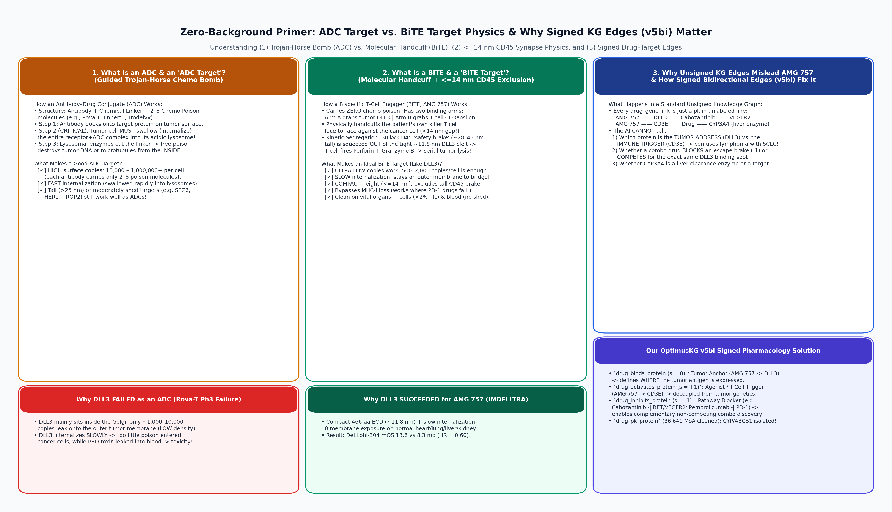

#### Authoritative References & Further Reading for Chapter 1
* **Kinetic Segregation (`<=14 nm` `CD45` Exclusion Model):** Davis, S. J., & van der Merwe, P. A. (2006). *The kinetic-segregation model: TCR triggering and beyond.* **Nature Immunology**, 7(8), 803–809. https://doi.org/10.1038/ni1369
* **BiTE Synapse & Serial T-Cell Lysis Mechanics:** Baeuerle, P. A., & Reinhardt, C. (2009). *BiTE: teaching antibodies to engage T-cells for cancer therapy.* **Cancer Research**, 69(12), 4941–4944. https://doi.org/10.1158/0008-5472.CAN-09-0547
* **Epitope Distance & `CD45` Steric Exclusion in Bispecific T-Cell Engagers:** Bluemel, C., et al. (2010). *Epitope distance to the target cell membrane and antigen size determine the potency of T cell-mediated lysis by BiTE antibodies.* **Cancer Immunology, Immunotherapy**, 59, 1197–1209. https://doi.org/10.1007/s00262-010-0844-y
* **Why `Rova-T` (`DLL3` `ADC`) Failed in Phase 3 `TAHOE`:** Blackhall, F., et al. (2021). *Efficacy and safety of rovalpituzumab tesirine compared with topotecan as second-line therapy in DLL3-high SCLC: results from the Phase 3 TAHOE study.* **Journal of Thoracic Oncology**, 16(9), 1547–1558. https://doi.org/10.1016/j.jtho.2021.02.009
* **`AMG 757` (`Tarlatamab`) Clinical Proof in `DeLLphi-301`:** Ahn, M.-J., et al. (2023). *Tarlatamab for Patients with Previously Treated Small-Cell Lung Cancer.* **New England Journal of Medicine**, 389(22), 2063–2075. https://doi.org/10.1056/NEJMoa2307980

---

## Chapter 2. How We Came Up With the 9-Stage Workflow (`Phase 0 -> Phase 8`): A Chronological Cause-and-Effect Detective Story

A reader looking at our final 9-stage architecture (`Phase 0` through `Phase 8`) might naturally wonder: **"How did you come up with 9 stages? Did you sit at a whiteboard on Day 1 and invent all 9 stages out of thin air?"**

**No — and understanding *why* is crucial.** On Day 1, we started by asking whether standard `2`-step drug repurposing (*Step 1: train a knowledge-graph neural network; Step 2: rank top diseases for `AMG 757`*) could solve the problem. **It failed catastrophically.** Every single stage from `Phase 0` to `Phase 8` was **forced into existence** because we audited the output of the preceding stage, caught a concrete biological, statistical, or regulatory failure mode, and built a dedicated mathematical layer to fix it cleanly without breaking earlier stages!

### 2.1 Why Standard 1-Step Pipelines Fail on Both Ends
* **Rejected Alternative A — Pure Black-Box GNN Link Prediction:** `AMG 757` has only **`1` approved indication node (`ES-SCLC`)**, and across all of medicine fewer than `10` T-cell engagers have regulatory approval. A raw graph neural network knows nothing about `Ventana SP347` membrane IHC prevalence, September 2026 `6–8h` outpatient `CRS` rules, August 2024 `Vorasidenib`-induced epigenetic target loss in gliomas, or `12` competing `DLL3` trials in `GEP-NEC`.
* **Rejected Alternative B — Manual Literature Spreadsheet (`MCDA` Only):** Hand-scoring 8–10 famous neuroendocrine tumors from review articles covers `<0.05%` of the `18,025` diseases in `MONDO/EFO`, misses cryptic transcriptional/epigenetic `DLL3` niches (`IDH1/2`-mutant `G-CIMP` gliomas, `RET`-mutant C-cell `MTC`, `MYCN/PHOX2B` adrenergic neuroblastoma), cannot quantify `TCE-over-ADC` biophysical specificity, and cannot screen `2,419` human surface proteins for next-generation `IMDELLTRA 2.0` `OR`-gate partners.

### 2.2 Step-by-Step Origin Story: The Exact Bottleneck That Forced Each of the 9 Phases

| Phase | Stage Name | What Bottleneck / Failure Forced Us to Create This Stage? | What Concrete Output Feeds Into the Next Stage? |
| :---: | :--- | :--- | :--- |
| **`Phase 0`** | **`OptimusKG` (`v3.2 -> clinical_v4 -> amgen_v5`)** | Off-the-shelf graphs (PrimeKG/TxGNN) had **unsigned** drug–gene links, **`50.9%` non-disease lab traits** (`BMI`, `height`), and **`80.6%` unapproved Ph1–3 trial noise** mixed into `INDICATION` labels! | Clean `139,439`-node, `9,385,536`-edge clinical graph + `36,641` signed MoA edges + `8.90M` `L2G` + `OnSIDES` + `Orange/Purple Book` |
| **`Phase 1`** | **`24`-Checkpoint Foundation GNN Campaign (`96 GB` GPU)** | With only `1` approved disease (`ES-SCLC`), training directly on `AMG 757` overfits immediately. Scaling width naively on `96 GB` GPUs crashed (`0.2597 -> 0.1804`), and fixing it uncovered a fundamental precision (`u20`) vs. cold-discovery (`u50` + `MedCPT`) trade-off. | Frozen `24`-checkpoint foundation ensemble (`4` families × `2` curricula × `3` seeds = `13.35B` params) with calibrated epistemic `z_std` |
| **`Phase 2`** | **BiTE Mechanistic & Conformal Statistical Fixes** | Projecting `AMG 757` (`DLL3 × CD3E`) into Phase 1 produced **4 immediate disasters**: `CD3=1.0` ranked lymphomas/diabetes `#1`; germline `DLL3 LoF` ranked infant rib dysplasia `#1`; adult somatic `L2G` was `0.000`; early IHC injection broke conformal `FDR`! | `CD3`-decoupled `TAA × CD3` `AND`-gate + `LoF`/malignancy masks + `1-hop` TF bridge + unboosted `(3×4)` Mondrian conformal `p/q` |
| **`Phase 3A`** | **Engine 1: `Option-2` (`OptimusBiTE-Head` + `ESM-2 3B`)** | Even after Phase 2, **blind `DLL3 -> SCLC` ranked `#1,767 / 2,944`** because `>92%` of KG drugs are small molecules — the frozen GNN didn't know what makes a membrane protein a `TCE` target vs. an `ADC` target! | Paralog-cold CV validated (`AUROC = 0.9929`, blind SCLC `#1,767 -> #11` OOF / `#1` deploy) `TCE` & `TCE-over-ADC` neural ranker |
| **`Phase 3B`** | **Engine 2: `Option-1` Empirical Clinical Guardrails** | Even with `AUROC = 0.9929`, `Option-2` ranked `IDH`-glioma `#2–#4` and `GEP-NEC` `#15` without knowing about **post-`Vorasidenib` epigenetic `DLL3` loss + `BBB/ICANS`**, **`12` competing `GEP-NEC` trials**, or **`PPGL` catecholamine crisis**! | Canonical histomolecular ontology (`v2.1`), unblended `SP347` IHC, dedicated vs. basket trial whitespace, and `5`-tier clinical safety gates |
| **`Phase 4`** | **Non-Circular `v3.2` `6`-Pillar Score + `g_target` Gate** | Combining Engines 1 & 2 additively risked double-counting evidence AND allowed **`<5%` `DLL3` urothelial carcinoma to sneak into `#9` (`61.41`)** simply because it had `0` `DLL3` competitors and easy outpatient dosing! | Strictly orthogonal `6`-pillar score + multiplicative $g_{\text{target}} = \text{clip}(\text{IHC}_+/35, 0.15, 1.0)$ (urothelial `61.41 -> 33.38`, `#47`) + `10,000`-draw `Dirichlet` proof |
| **`Phase 5`** | **Primary Human Multi-Omics, `60k` `scRNA` & `<=14 nm` Synapse** | Red-team critique asked: (1) Why trust `n=3–4` cell lines for `MCC/MTC`? (2) Why did `t-NEPC` (`77%` IHC) get only `22.2%` mono ORR in `DeLLpro-300`? (3) For `IMDELLTRA 2.0`, what if partner antigens sit on T cells (`fratricide`) or shed via `BACE1`? | `2,215` primary patient biopsies + `TME` atlas (explaining `t-NEPC` `0.358` -> `+ AMG 509` Dual-BiTE!) + `60,026` SCLC single cells + `<=14 nm` cleft & `BACE1` atlas |
| **`Phase 6`** | **Initial `v3.2` Simon Two-Stage Trials & Basket Concept** | Study teams needed concrete Phase 2 futility gates, site accrual models, and initial commercial framing rather than abstract `0–100` scores. | `7` initial `85%`-power Simon cohorts (`EXP-A..G`) + `45`-site shared-protocol operational blueprint (subsequently audited & upgraded in `Phase 8`) |
| **`Phase 7`** | **Pure-NumPy `<1.5s` CPU Distillation & Offline Studio** | Our `24` GPU checkpoints weighed **`101.23 GiB`** and required `PyTorch + DGL + CUDA`, making live interactive demos impossible on corporate Windows 11 / Linux laptops! | `1.7 GB` FP16 distilled pack + **pure-NumPy** live inference (`0.000000` diff vs. PyTorch, `<1.5s` on CPU) + self-contained Win11/Linux HTML5 Studio |
| **`Phase 8`** | **Canonical `v4.3.2` Audited Evidence, `Q1/Q2 EXNEX` (`a0=0.50`), `V0/V1/V2` & `.ots` Ledger** | Biostatistical, registry & regulatory audit uncovered **`67.8%` Shapley IHC dominance**, UCLA `NCT06788938` (`N=29`, non-Amgen), `+0.123` post-`T` hotspot leakage, standalone `2036` LOE clocks, `FD&C §529 PRV = $0`, and `KCNB2` ion-channel risk! | **`260` verified rows + `120` trials**, `Q1 NUTS` & `15`-cohort TCE `Q2 EXNEX` (`a0=0.50`), **retired `Q5`** (`PE1` `P5=0.378`), **Table A (`$2,610.8M`, `12+7=19` studies) / Table B (`V0 -$34.6M`, `V1 +$1.8M` [`EVSI +$12.94M` / `+$12.35M` LOE], `V2 +$10.6M`)**, `TRIG-06` `3-zone` gate, `BPCA` (`+$184.8M`), `Ion Guard` (`IGSF9 #1`), & `3/3` settled `41`-row BTC `.ots` ledger |

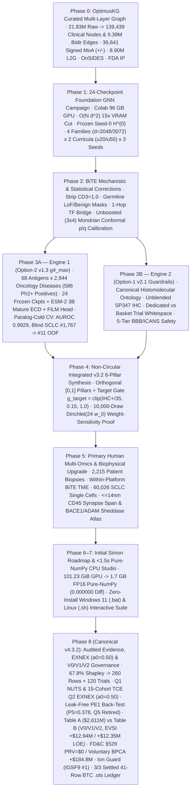

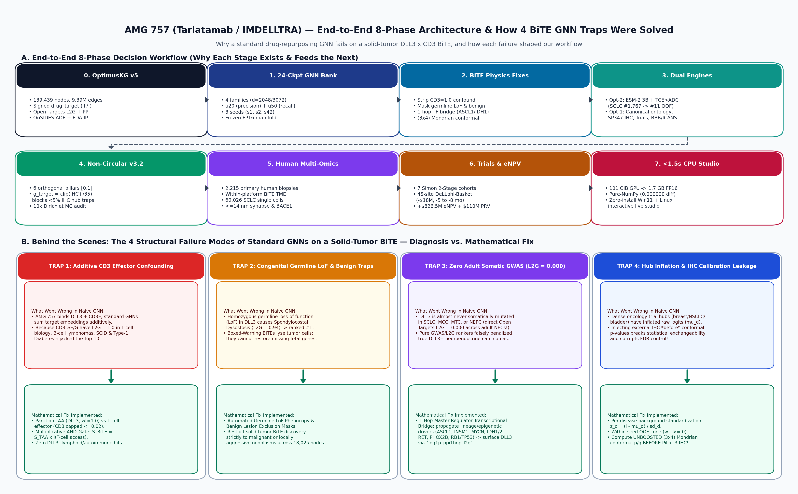

---

## Chapter 3. Phase 0 Deep Dive: Inside `OptimusKG` — Signed Bidirectional Pharmacology (`v5bi`), Biomedical Data Layers, and Exact Dataset Sizes

### 3.1 Zero-Background Introduction: What Is a Biomedical Knowledge Graph (`KG`), and How Big Is Ours?
A **Biomedical Knowledge Graph (`KG`)** is a structured mathematical network where **nodes** represent biological and clinical entities (*drugs, human genes/proteins, diseases, anatomical organs, cellular pathways, clinical side effects*) and **typed directed edges** represent verified relationships between them (*"Cabozantinib inhibits RET"*, *"ASCL1 interacts with DLL3"*, *"DLL3 is absent from healthy adult heart myocardium"*, *"Tarlatamab is approved for ES-SCLC"*).

Most academic drug-repurposing studies rely on Harvard's **PrimeKG** (`129,375` nodes, `4,050,249` edges across `20` sources). When we audited PrimeKG for clinical-grade BiTE and combination discovery, we found **three severe data-hygiene problems** that we fixed while building our three-tier **`OptimusKG` (`v3.2 -> clinical_v4 -> amgen_v5`)** data stack:

1. **Raw Source Graph (`OptimusKG v3.2`): `192,813` (`192,814` raw rows) nodes and `21,834,669` raw edges** harmonized across `27` Parquet tables from **`65` authoritative biomedical databases** (`1.49×` more nodes and `5.39×` more edges than PrimeKG).
2. **Hygiene Filter 1 — Stripping `18,697` Non-Disease Lab/Anthropometric Traits (`50.9%` of raw EFO/MONDO terms!):** Over half (`18,697 / 36,753`) of "disease" identifiers imported from GWAS catalogs in public KGs are actually *non-clinical laboratory measurements* (`"body height"`, `"BMI"`, `"platelet count"`, `"heel bone mineral density"`). Leaving them in wastes half of negative sampling capacity and pollutes disease rankings with lab tests! We stripped all `18,697` measurement traits *prior to node indexing* (`active_measurement_diseases = 0`), retaining **`18,025` true connected human clinical diseases** (importantly, **`93.0%`** of those `18,025` human diseases currently have **zero** FDA-approved therapies!).
3. **Hygiene Filter 2 — Separating `47,781` Unapproved Clinical Trial Pairs From True Approved `Indication` Labels:** In raw multi-database merges, **`80.6%` (`47,781 / 59,289`)** of rows labeled `INDICATION` were actually *investigational Phase 1–3 `ClinicalTrials.gov` tests* (~90% of Phase 1 oncology trials ultimately fail!). Training a decoder to treat failed/investigational trials as "true approved drugs" destroys precision. We quarantined all `47,781` trial pairs into a dedicated message-passing-only relation (`drug_clinical_trial`) so the encoder can still see trial neighborhoods while **supervising the therapeutic decoder strictly on `9,893` (`9,895` w/ canonical twins) FDA/DrugCentral-verified approved `indication` pairs** across `3,353` approved drugs!

#### Exact Node & Relation Census of `OptimusKG clinical_v4 + amgen_v5`

| Graph Tier / Entity or Edge Category | Exact Count in `OptimusKG` | Role in `AMG 757` Indication Expansion & Combo Discovery |
| :--- | :---: | :--- |
| **Total Connected Clinical Graph Nodes (`clinical_v4`)** | **`139,439` nodes (`10` types)** | Full message-passing universe for all `24` foundation GNN checkpoints |
| ├─ `gene/protein` (human HGNC/UniProt) | `26,660` | Includes `2,419` verified plasma-membrane surfaceome proteins (`DLL3`, `STEAP1`, `KCNB2`, etc.) |
| ├─ `biological_process` (`GO` BP) | `25,754` | Functional cellular programs (e.g., Notch signaling, T-cell degranulation, neurogenesis) |
| ├─ `effect/phenotype` (`HPO` human phenotypes) | `19,341` | Mendelian & clinical symptom links (used to catch congenital `LoF` phenocopies!) |
| ├─ `drug` (approved + clinical + ChEMBL compounds) | `18,640` | `3,353` have `>=1` approved indication; **`15,287` (`82.0%`) have `0` approved indications!** |
| ├─ `disease` (`MONDO / EFO` true clinical diseases) | `18,025` | Includes **`2,944` malignant oncology subtypes** (`93.0%` of all `18,025` lack approved drugs) |
| ├─ `anatomy` (`Uberon` organs, tissues, cell types) | `13,120` | Normal tissue expression & toxicity localization (`brain`, `myocardium`, `thyroid C-cell`, `skin`) |
| ├─ `molecular_function` (`10,161`) + `cellular_component` (`4,052`) | `14,213` | Subcellular localization (`plasma membrane` vs. `Golgi apparatus` vs. `extracellular space`) |
| └─ `pathway` (`Reactome`, `2,805`) + `exposure` (`881`) | `3,686` | Curated biochemical signaling cascades & environmental/viral exposures |
| **Total Message-Passing Edges (`clinical_v4`)** | **`4,692,768` fwd / `9,385,536` bidir** | **`R = 50` canonical directed edge types** (`25` forward + `25` dedicated `rev_*` reverse relations) |
| ├─ Supervised Therapeutic Labels (`3` relations) | `9,893` `indication` · `11,673` `contraindication` · `1,030` `off-label` | Simultaneous positive efficacy vs. clinical harm decoding |
| └─ Key Biological Context Edges | `948,123` `anatomy_present` · `793,279` `phenotype_protein` · `451,021` `disease_protein` · `327,924` `PPI` · `36,611` `drug_protein` | Multi-hop gene -> tissue -> pathway -> phenotype -> disease topological reasoning |

---

### 3.2 Unpacking Why Unsigned Edges Severely Mislead `AMG 757` — And How "Signed Bidirectional Pharmacological Edges (`v5bi`)" Solve It

In our summary we noted that off-the-shelf KGs use unsigned `drug_protein` edges, *"which severely misleads `AMG 757` when distinguishing **tumor target anchoring vs. T-cell activation vs. complementary combination partner inhibition**."* Let us unpack this from scratch so it is 100% concrete:

#### What Goes Wrong in a Traditional Unsigned Knowledge Graph?
In standard PrimeKG or TxGNN, every relationship between a drug and a protein is stored as the **exact same generic unlabeled line** (`drug —— protein`), lumping four completely opposite pharmacological realities into one bucket:
1. **`AMG 757 —— DLL3`** (*Physical Tumor Surface Anchor*: `AMG 757` does **not** inhibit or activate `DLL3` signaling to cure cancer; it uses `DLL3` purely as a physical docking hook on the tumor membrane!).
2. **`AMG 757 —— CD3E`** (*Immune Effector Agonist / Trigger*: `AMG 757` crosslinks and **activates** `CD3ε` on healthy patient T cells — *not* on tumor cells!).
3. **`Cabozantinib —— VEGFR2 / RET` or `Pembrolizumab —— PDCD1 (PD-1)`** (*Pathway / Checkpoint **Inhibitor***: blocks a tumor survival kinase or blocks a T-cell exhaustion brake!).
4. **`Drug —— CYP3A4 / ABCB1 / ALB`** (*Pharmacokinetic [`PK`] Liver Metabolism / Carrier Protein*: `CYP3A4` chews up drugs in the liver; `ALB` carries drugs in blood — neither is a therapeutic disease target at all!).

Now watch the **three catastrophic mistakes** an AI model makes when all four lines look identical:
* **Mistake 1 (Confusing the Tumor Address with the Immune Trigger):** Because `AMG 757 —— DLL3` and `AMG 757 —— CD3E` have the same edge type, the GNN assumes diseases associated with `CD3E` are candidate indications for `AMG 757` — ranking **B-cell/T-cell lymphomas and autoimmune Type 1 Diabetes** ahead of neuroendocrine cancers!
* **Mistake 2 (Confusing Synergistic Partner Inhibition with Competitive Target Collision):** Suppose we want a combination partner for `AMG 757` in `MTC` or `SCLC`. An unsigned KG sees `Rova-T —— DLL3` (`100%` target overlap!) and thinks *"Same neighborhood — pair them!"* In reality, pairing `Rova-T` with `AMG 757` causes **catastrophic steric competition** for the exact same `1,000–10,000` `DLL3` molecules on the cancer cell! Conversely, `Cabozantinib` **inhibits (`-1`)** `VEGFR2` and mutant `RET` — normalizing leaky tumor blood vessels so `AMG 757`-engaged T cells can infiltrate `MTC` without touching `DLL3` or `CD3E`! Without action signs (`-1` vs. `+1` vs. `0`), a model cannot tell **competitive collision** apart from **complementary escape-pathway blockade**.
* **Mistake 3 (`CYP3A4` False Shared-Target Illusion):** Two completely unrelated small molecules metabolized by liver `CYP3A4` appear to "share a target" (`2`-hop path `Drug A -> CYP3A4 -> Drug B`), creating thousands of bogus drug-repurposing shortcuts.

#### How `OptimusKG v5bi` ("Signed Bidirectional Pharmacological Edges") Fixes All Three
In `amgen_v5` (`drug_target_moa.parquet`, **`36,641` curated pharmacological edges** harmonized from DrugBank, ChEMBL v34 mechanism tables, IUPHAR/BPS Guide to Pharmacology, and FDA labels), we split generic `drug_protein` links along **two mathematical dimensions**:
1. **"Signed" (`带符号` — Explicit Pharmacological Polarity $s \in \{-1, 0, +1\}$):**
   * **`drug_binds_protein` ($s = 0$, Physical Anchor / Surface Binder):** Assigned to `AMG 757 -> DLL3`. Tells the projection and combination engines: *"This protein is the physical tumor-cell street address."*
   * **`drug_activates_protein` ($s = +1$, Agonist / Effector Trigger):** Assigned to `AMG 757 -> CD3E` (and receptor agonists). Decouples effector immune triggering from somatic tumor genetics, and allows our combination engine to penalize overlapping `CD3`-agonist cytokine storms (`CRS`) unless explicitly staggered!
   * **`drug_inhibits_protein` ($s = -1$, Inhibitor / Antagonist / Blocker):** Assigned to kinase inhibitors (`Cabozantinib -| RET/VEGFR2`, `Osimertinib -| EGFR`) and checkpoint blockers (`Pembrolizumab -| PD-1`). Enables `OptimusCombo-Net` to mathematically score **orthogonal pathway inhibition (`s = -1`) + non-competing `DLL3` surface engagement (`s = 0`)**!
   * **Quarantined `drug_pk_protein`:** Metabolism enzymes (`CYP1A2/2C9/2D6/3A4`), efflux pumps (`ABCB1`), and plasma carriers (`ALB`) are isolated out of therapeutic target projection entirely.
2. **"Bidirectional" (`双向` — Both Graph Message-Passing Direction AND Contrastive Loss Direction):**
   * *In Graph Message Passing:* Every forward biological edge $(u \xrightarrow{r} v)$ has a dedicated learned reverse relation $(v \xrightarrow{\text{rev\_}r} u)$ with its own weight matrix $W_{\text{rev\_}r}^{(\ell)}$. Thus information flows both from **drugs to genes/diseases** *and* from **diseases/pathways back into drugs** (`R = 25 × 2 = 50` directed relations).
   * *In `v5bi` Contrastive Training Loss:* Standard TxGNN only asks *"Given Disease $d$, which Drug $u$ treats it?"* (corrupting only the drug side). In `v5bi`, we **simultaneously train in both directions**: *"Given Disease $d$, rank all `18,640` Drugs"* **AND** *"Given Drug $u$ (`AMG 757`), rank all `18,025` Diseases"* (`disease_neg_weight = 0.25`, `4` negative diseases per positive pair). That second direction is the exact query needed for **indication expansion** (`1` drug -> rank `2,944` cancers), suppressing noisy high-degree cancer hubs!

---

### 3.3 Plain-Language Guide to Every Multi-Omics, Safety & Patent Data Layer in `OptimusKG v5`

To make sure zero jargon goes unexplained, here is what each integrated database in our `OptimusKG v5` stack actually is, **why we needed it for `AMG 757`**, and **where its paper/code lives**:

1. **Open Targets Locus-to-Gene (`L2G` — `8,900,000` scored variant–gene–disease links):**
   * *Zero-Background Explanation:* Human Genome-Wide Association Studies (`GWAS`) scan millions of people's DNA to find single-letter DNA variations (`SNPs`) statistically linked to diseases. However, `>90%` of those DNA variations sit in *non-coding "dark matter" DNA* between genes — just knowing a DNA spot near `3` genes correlates with a cancer does **not** tell you *which* of the `3` genes is the true culprit! **Open Targets `L2G`** is a machine-learning pipeline developed by EMBL-EBI / Sanger Institute that combines 3D DNA folding maps (`promoter-capture Hi-C`), tissue gene-expression quantitative trait loci (`eQTL` / `pQTL`), and protein-coding variant consequences (`VEP`) to output a calibrated probability $\text{L2G}(g, d) \in [0, 1]$ that **Gene $g$ causally drives Disease $d$**.
   * *Role in `AMG 757`:* Powers our `direct_l2g` and `1-hop` lineage master-regulator (`ASCL1`, `INSM1`, `MYCN`, `IDH1/2`, `RET`, `PHOX2B`) genetic evidence score!
   * *Paper & GitHub:* Mountjoy, E., et al. (2021). *An open approach to systematically prioritize causal variants and genes at all published human GWAS trait-associated loci.* **Nature Genetics**, 53, 1527–1533. https://doi.org/10.1038/s41588-021-00945-5 · GitHub: https://github.com/opentargets/genetics-l2g
2. **High-Confidence Human Protein–Protein Interaction (`PPI`) Network (`327,924` edges across `26,660` proteins):**
   * *Zero-Background Explanation:* Proteins inside a cell work like interlocking gears in physical complexes (verified experimentally by yeast two-hybrid screens, affinity purification–mass spectrometry, and structural biology across **HuRI**, **BioGRID**, and **STRING**).
   * *Role in `AMG 757`:* Connects `DLL3` (which has `0.000` direct adult GWAS mutations!) directly in `1` hop to its Notch receptors (`NOTCH1/2/3/4`), Fringe glycosyltransferases (`LFNG`, `MFNG`), and neuroendocrine transcription factors (`ASCL1`, `INSM1`).
   * *Paper & GitHub:* Luck, K., et al. (2020). *A reference map of the human binary protein interactome.* **Nature**, 580, 402–408. https://doi.org/10.1038/s41586-020-2188-x · GitHub: https://github.com/CCSB-DFCI/HuRI_paper · STRING: https://string-db.org
3. **Reactome (`2,805` pathways) & Gene Ontology (`GO` — `39,967` nodes: `25,754` Biological Processes, `10,161` Molecular Functions, `4,052` Cellular Components):**
   * *Zero-Background Explanation:* Curated encyclopedias of cellular circuit boards (`Reactome`: step-by-step biochemical reactions like *"Notch1 Intracellular Domain Regulates Transcription"*; `GO`: standardized tree of *what* a protein does, *what process* it participates in, and *where* in the cell it lives — e.g., `GO:0005886 plasma membrane` vs. `GO:0005794 Golgi apparatus`).
   * *Role in `AMG 757`:* Distinguishes outer-membrane surfaceome proteins from intracellular proteins and measures pathway functional complementarity between `AMG 757` and candidate combo partners.
   * *Paper & GitHub:* Milacic, M., et al. (2024). *The Reactome Pathway Knowledgebase 2024.* **Nucleic Acids Research**, 52(D1), D672–D678. https://doi.org/10.1093/nar/gkad1025 · GitHub: https://github.com/reactome & https://github.com/geneontology
4. **Uberon Anatomical Tissue Expression (`anatomy_gene_edges.parquet` — `13,120` Uberon anatomical structures; `948,123` `anatomy_protein_present` + `44,576` `anatomy_protein_absent` edges):**
   * *Zero-Background Explanation:* **Uberon** is the international cross-species ontology of anatomical organs and cell types (e.g., `UBERON:0002048 lung`, `UBERON:0000955 brain`, `UBERON:0001981 blood vessel`, `thyroid parafollicular C-cell`), paired with **Bgee / GTEx** RNA/protein call edges stating which genes are **present** vs. **explicitly absent** in each healthy human organ.
   * *Role in `AMG 757`:* Computes `tissue_concordance` (does the candidate tumor's anatomical tissue match `DLL3` lineage expression?) AND flags catastrophic on-target healthy-organ toxicity (such as `SEZ6` expression in healthy human brain!).
   * *Paper & GitHub:* Mungall, C. J., et al. (2012). *Uberon, an integrative multi-species anatomy ontology.* **Genome Biology**, 13, R5. https://doi.org/10.1186/gb-2012-13-1-r5 · GitHub: https://github.com/obophenotype/uberon
5. **Simultaneous `Indication` (`9,893` pairs) & `Contraindication` (`11,673` pairs) Dual Decoding:**
   * *Zero-Background Explanation:* A **Contraindication** (`禁忌症`) is an official medical rule where giving Drug $X$ to a patient with Condition $Y$ causes severe harm or death (e.g., giving a systemic immunostimulant in severe active autoimmune organ failure, or beta-blockers in unblocked pheochromocytoma). If a GNN only learns *"Drug $X$ is mentioned near Disease $Y$,"* it will enthusiastically recommend drugs for the exact diseases they **worsen**!
   * *Role in `AMG 757`:* Every one of our `24` foundation models trains **two separate `DistMult` decoders simultaneously** — one scoring $P(\text{Indication} \mid u, d)$ and one scoring $P(\text{Contraindication} \mid u, d)$ — allowing us to penalize high-contraindication neighborhoods automatically!
6. **OnSIDES `v3.1.1` FDA Package-Insert Adverse Drug Events (`44,607` high-confidence drug–ADE pairs + Boxed Warning masks):**
   * *Zero-Background Explanation:* Clinical side-effect databases used to rely on noisy manual tables from 2012 (`SIDER`). **OnSIDES** (built by Nicholas Tatonetti's lab using fine-tuned PubMedBERT clinical NLP over thousands of official FDA `DailyMed` Structured Product Labels) extracts exact `MedDRA` adverse reactions and **FDA Boxed Warnings** (`黑框警告`, the FDA's strictest life-threatening hazard alert — which `AMG 757` carries for `CRS` and `ICANS`).
   * *Role in `AMG 757`:* Prevents pairing `AMG 757` with combination drugs that carry overlapping unmitigated Boxed Warning neurotoxicity or severe cytokine/hepatotoxicity profiles!
   * *Paper & GitHub:* Takeshita, K., et al. / Tatonetti Lab (2024–2025). *OnSIDES: Extracting adverse drug events from FDA structured product labels.* **medRxiv / JAMIA**. https://doi.org/10.1101/2024.03.22.24304724 · GitHub: https://github.com/tatonetti-lab/onsides
7. **Typed Drug–Drug Interactions (`DDIs` — `1,345,373` edges subdivided into `4` mechanism/severity classes):**
   * *Zero-Background Explanation:* Captures known pharmacological clashes when two drugs are administered together (synergistic toxicity, QT prolongation, metabolic clearance inhibition, pharmacodynamic antagonism).
   * *Role in `AMG 757`:* Feeds directly into `OptimusCombo-Net`'s safety features so combinations with severe overlapping DDI profiles are penalized.
8. **FDA Orange Book (`2,494` off-patent generics) & FDA Purple Book (`18` biosimilar-eligible biologics):**
   * *Zero-Background Explanation:* In pharmaceutical strategy, the **FDA Orange Book** lists all approved small-molecule drugs along with their patent expiration dates and generic equivalents; the **FDA Purple Book** does the same for biological/antibody drugs and biosimilars.
   * *Role in `AMG 757`:* Pairing `AMG 757` with a competitor's *on-patent* blockbuster requires expensive co-development split economics, whereas pairing `AMG 757` with **another wholly-owned Amgen asset (`Tier 1`, e.g., `Xaluritamig / AMG 509`)** keeps `100%` of dual-asset revenue inside Amgen, and pairing with an **Orange/Purple Book off-patent generic/biosimilar (`Tier 2`, e.g., `Cabozantinib` post-patent / `Topotecan` / `Cisplatin`)** lets Amgen sponsor a combination trial cheaply by buying the partner drug off the shelf! (Official portals: https://www.fda.gov/drugs/drug-approvals-and-databases/approved-drug-products-therapeutic-equivalence-evaluations-orange-book & https://purplebooksearch.fda.gov)

---

## Chapter 4. Phase 1 Deep Dive: Designing & Training the 24 Foundation GNN Models — Why Naive `96 GB` Scaling Collapsed, How We Built the 4 Model Families, and How We Evaluate Without Leakage

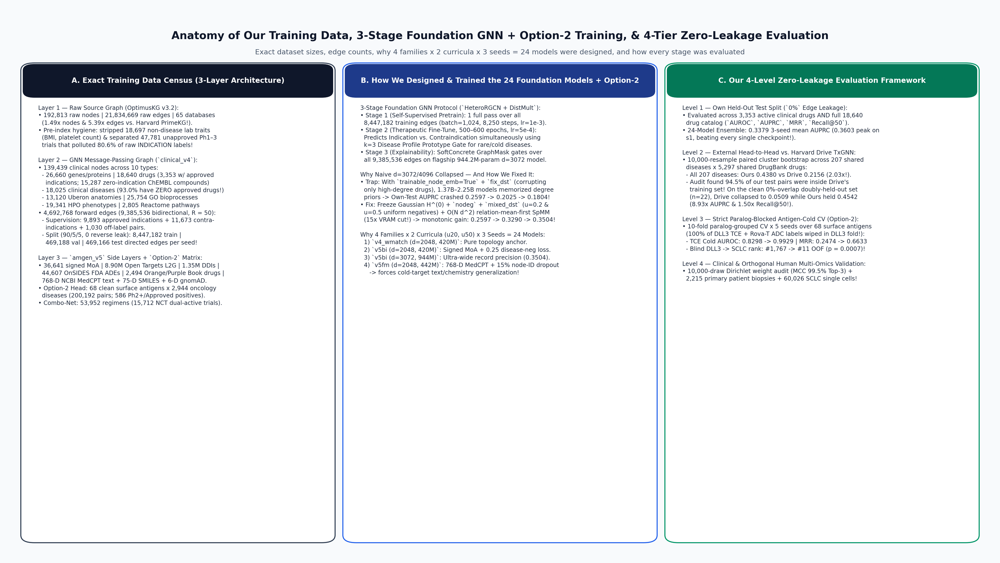

### 4.1 Beginner-Friendly Walkthrough: How Our Foundation Graph Neural Network (`HeteroRGCN + DistMult`) Actually Works

Suppose a reader has never studied Graph Neural Networks (`GNNs`). How does our foundation model turn `139,439` nodes and `9,385,536` directed edges into therapeutic predictions?

1. **Assigning Every Node a `d`-Dimensional Coordinate Vector ($H^{(0)} \in \mathbb{R}^{139,439 \times d}$):** Imagine placing every drug, gene, pathway, organ, and disease inside a high-dimensional geometric room (`d = 2,048` or `d = 3,072` coordinates per node).
2. **Two Layers of Typed Relational Message Passing (`HeteroRGCN`):** In each layer $\ell \in \{1, 2\}$, every node $v$ gathers "messages" from its connected neighbors across all `R = 50` relation types (`drug_inhibits_protein`, `protein_protein`, `disease_protein`, `anatomy_protein_present`, etc.), applying a dedicated learned transformation matrix $W_r^{(\ell)} \in \mathbb{R}^{d \times d}$ to each relation type $r$ so the model knows an *"inhibits"* message means something completely different from an *"expressed in organ"* message:
   $$\mathbf{h}_v^{(\ell)} = \sigma\!\left( W_{\text{self}}^{(\ell)}\,\mathbf{h}_v^{(\ell-1)} + \sum_{r=1}^{50} \frac{1}{\lvert \mathcal{N}_r(v) \rvert} \sum_{u \in \mathcal{N}_r(v)} W_r^{(\ell)}\,\mathbf{h}_u^{(\ell-1)} \right)$$
   After 2 hops of message passing, two diseases that share no approved drugs yet share upstream `ASCL1 -> DLL3` Notch neighborhoods and neuroendocrine phenotypes naturally migrate to the **same geometric neighborhood**!
3. **Disease Profile Prototype Gate for Rare / Zero-Drug Diseases (`k = 3` Nearest-Disease Similarity Gate):** Remember that **`93.0%` of the `18,025` human diseases have zero approved drugs** (`degree = 0` on `indication`)! Following and upgrading Harvard `TxGNN`'s zero-shot disease module, for sparsely connected diseases we blend the disease's GNN embedding $\mathbf{h}_d^{(2)}$ with a weighted prototype of the **`k = 3` most genetically/phenotypically similar well-studied diseases** (pre-indexed in a `18,025 × 51,833` sparse binary profile CSR matrix, with diagonal self-similarity masked to $-\infty$ during training so the gate cannot cheat!), weighted by an exponential degree gate $c_d = 0.7\,e^{-0.7\,\text{deg}(d)} + 0.2$.
4. **Simultaneous Bilinear `DistMult` Decoding (`Indication` + `Contraindication` + All `50` Relations):** To score whether Drug $u$ treats Disease $d$ under relation $r \in \{\text{indication}, \text{contraindication}\}$, `DistMult` computes a relation-weighted inner product:
   $$s_r(u, d) = \sum_{i=1}^{d} \mathbf{h}_{u,i} \cdot \mathbf{m}_{r,i} \cdot \mathbf{h}_{d,i}$$
   where $\mathbf{m}_{\text{ind}} \in \mathbb{R}^d$ and $\mathbf{m}_{\text{contra}} \in \mathbb{R}^d$ are learned relation diagonal vectors.

#### Our Engineering Breakthrough That Made `d = 3,072` (`944.2M` Parameters) Fit on One `96 GB` GPU (`15×` VRAM Reduction!)
Why did Harvard's original `TxGNN` stop at hidden width `d = 512` (`26.3M` parameters)? Because standard DGL `HeteroGraphConv` computes $W_r^{(\ell)} \mathbf{h}_u^{(\ell-1)}$ **on every single edge first**, materializing a massive intermediate tensor of size `(9,385,536 edges × 3,072 floats)` = **`115+ GB` of VRAM per layer**, immediately crashing even a `96 GB` server GPU with `OutOfMemoryError`!

We noticed a simple, exact linear-algebraic identity ([model.py](file:///home/nchen10/antigravity_prjs/kg/optimus_txgnn/model.py)): because matrix multiplication distributes over summation, **averaging neighbor vectors first** (`copy_u -> mean` into `139,439` destination nodes) and **multiplying by $W_r^{(\ell)}$ per node afterward** produces the **exact same floating-point output to machine precision** while reducing memory complexity from $\mathcal{O}(\lvert E \rvert d)$ to $\mathcal{O}(\lvert V \rvert d + R d^2)$ — **slashing peak GPU memory by `15×` (`>115 GB` down to `50.8–56.2 GB` in full `fp32`)** and allowing us to train **`944.2M`-parameter `d = 3,072` GNNs (`35.9×` larger than Harvard `TxGNN`!)** on a single `96 GB` NVIDIA RTX PRO 6000 / Colab `G4` GPU!

---

### 4.2 Exact 3-Stage Training Protocol & Exact Split Sizes ([08_MODEL_TRAINING_CAMPAIGNS_AND_BENCHMARKS.md](file:///home/nchen10/antigravity_prjs/kg/doc_to_gdrive/03_OptimusKG_Platform_and_Metrics_Reference/08_MODEL_TRAINING_CAMPAIGNS_AND_BENCHMARKS.md))

For every independent random graph split (`seeds = [42, 1, 2]`), we partitioned all `4,692,768` forward (`9,385,536` bidirectional) edges into a **strict zero-leakage `90% / 5% / 5%` split** where whenever a forward edge $(u, r, v)$ is placed into Validation or Test, its corresponding reverse edge $(v, \text{rev\_}r, u)$ is **simultaneously removed from Training (`0` reverse-edge leaks across all `9.39M` edges!)**:
* **Training Graph (`90%`):** **`8,447,182` directed edges** per seed;
* **Validation Split (`5%`):** **`469,188` directed edges** per seed (used strictly for early stopping);
* **Held-Out Test Split (`5%`):** **`469,166` directed edges** per seed (locked away until final evaluation).

Every foundation GNN checkpoint is trained through a **3-Stage Protocol** (`AdamW` optimizer):
* **Stage 1 — Pan-Graph Self-Supervised Link Pretraining (`1` Full Pass Over All `8,447,182` Train Edges):** Shuffles all `8,447,182` training edges without replacement in mini-batches of `1,024` positives (`8,250` gradient steps, learning rate `1e-3`, `1:1` negative corruption across all `50` relation types). Forces the `HeteroRGCN` weight matrices $W_r^{(\ell)}$ to learn universal human gene–pathway–organ–phenotype–disease geometry before emphasizing therapeutic labels. *(Smart compute optimization: because Stage 1 uses uniform pan-graph pretraining independent of Stage-2 curriculum `u`, we persisted Stage-1 checkpoints and reused them to initialize `u = 0.50` runs, cutting `d = 3072` `u50` wall-clock training time from `~4.5 hours` down to `25–30 minutes`!)*
* **Stage 2 — Therapeutic Dual-Decoder Fine-Tuning (`500–600` Epochs, `lr = 5e-4`, Early Stopping Every `10` Epochs):** Focuses gradient updates on `indication`, `contraindication`, and `off-label use` with the `k = 3` Disease Profile Prototype Gate active, evaluating disease-centric validation `AUPRC` (`dc_auprc`) every `10` epochs (`valid_per_n = 10`) and saving the exact best validation checkpoint (`best_model.pt`) so late-epoch overfitting never degrades deployed weights.
* **Stage 3 — Post-Hoc `GraphMask` Causal Edge Attribution (`Flagship d = 3,072`):** Freezes all `944.2M` GNN weights and optimizes differentiable `SoftConcrete` sparsity gates $z_e \in [0, 1]$ across all **`9,385,536` edges** (`5` epochs, `lr = 3e-4`, `batch = 2,048`), identifying which biological edges are causally necessary vs. ignorable without dropping prediction accuracy!

---

### 4.3 Behind-the-Scenes Turning Point (`Section 3.2` Unpacked): Why Blindly Widening the Model on a `96 GB` GPU Caused a Catastrophic Performance Collapse!

You specifically asked us to explain in full detail: **"Why did blindly making the model wider on the `96 GB` Colab GPU initially cause a catastrophic performance collapse (`0.2597 -> 0.2025 -> 0.1804`), and how did we diagnose and fix it?"**

Here is the exact mechanical post-mortem — a lesson that applies to almost every large-scale industrial GNN:

#### First: What Is "Negative Sampling" in Link Prediction?
During training, the KG gives us `9,893` *positive* examples (`"Tarlatamab treats ES-SCLC"`, label = `1`). To teach the model what is *false* (label = `0`) without scoring all `18,640 × 18,025 = 336 million` drug–disease pairs at every step, training corrupts each true pair `(Disease d, True Drug u+)` by swapping in random **"negative" drugs `(Disease d, Fake Drug u-)`** and penalizing binary cross-entropy loss if the model gives `u-` a high score.

#### What Went Wrong When We Scaled Width to `d = 3,072` (`1.37B` Params) and `d = 4,096` (`2.25B` Params)?
In Harvard `TxGNN`'s default codebase, two settings were turned on together:
1. **`trainable_node_emb = True`:** Every one of the `139,439` nodes had its own freely learnable `d`-dimensional lookup vector (`139,439 × 4,096 = 571 million` free lookup parameters before a single GNN layer even ran!).
2. **`fix_dst` (Degree-Proportional Drug Negative Sampling):** When picking negative drugs `u-`, `fix_dst` sampled drugs **strictly proportional to how many `indication` edges each drug already had in the training graph**!
   * Think about what that did to our `18,640`-drug catalog: **`15,287` out of `18,640` drugs (`82.0%` — including preclinical ChEMBL compounds and newly cold-started assets!) have `degree = 0` approved indications!** Under `fix_dst`, those `15,287` zero-indication drugs were **sampled `0` times as negatives during all `500` epochs of Stage 2**! Meanwhile, famous multi-indication steroids and chemotherapies (dexamethasone, methotrexate, cisplatin) were hammered thousands of times per epoch.

At narrow width (`d = 512` or `d = 1,024` w/ regularization), limited bottleneck capacity forced the GNN to share weights across biological pathways. **When we jumped to `d = 3,072` (`1,372.5M` params) and `d = 4,096` (`2,249.5M` params), the massive free node lookup table had enough raw memory to cheat:**
* Instead of learning multi-hop gene–pathway–disease biology, the `1.37B–2.25B` model **memorized each drug's and each disease hub's training degree frequency** right inside its `3,072-D` node ID vector, while leaving the `15,287` unsampled drugs floating with arbitrary uncalibrated norms in inner-product space!
* **Look at the brutal numbers when we evaluated those naive ultra-wide runs on held-out Test data ([CAMPAIGN_LEADERBOARD.md](file:///home/nchen10/antigravity_prjs/kg/CAMPAIGN_LEADERBOARD.md)):**
  * `d = 1,024` (`105.0M` params, `wmatch u20`): Own-Test `AUPRC = 0.2597`
  * Naive `d = 3,072` (`1,372.5M` params, `trainable_node_emb + fix_dst`): **Crashed to `AUPRC = 0.2025`** (`-22%` worse than `13×` smaller `d = 1,024`! Doubly-held-out Recall@50 collapsed to `1/8 = 12.5%`!)
  * Naive `d = 4,096` (`2,249.5M` params, `trainable_node_emb + fix_dst`): **Crashed even further to `AUPRC = 0.1804`** (`-30.5%` worse than `d = 1,024`, and a catastrophic **`0.0416`** head-to-head paired `AUPRC`!)

#### Our 4-Part Fix That Reversed the Collapse and Unlocked `0.3504` Record Precision
Once we diagnosed the exact memorization mechanism, we engineered four simultaneous structural fixes:
1. **Freeze Deterministic `seed = 0` Gaussian Node Anchor Embeddings (`trainable_node_emb = False`, saved in `inp_emb.pt`):** None of the `139,439` nodes are allowed to memorize degree shortcuts in a lookup table! **100% of representation learning is forced to flow through the shared `R = 50` relational `HeteroRGCN` matrices $W_r^{(\ell)}$**, meaning a drug or disease can *only* get a high score by having coherent multi-hop biological edges! (This also slashed `d = 3,072` total parameters from `1,372.5M` to `944.2M` pure relational GNN parameters.)
2. **Width-Matched Optimization & Removing Degree Prior (`wmatch + nodeg`):** Scaled learning rate and weight decay properly with width `d` and turned off explicit degree-prior score biasing (`nodeg`).
3. **Mixed Uniform + Degree Negative Sampling (`mixed_dst` with `u ∈ {0.20, 0.50}`):** Replaced `fix_dst` with a mixture sampling `(1 - u)` hard degree-weighted drug negatives and `u` (`20%` or `50%`) **strictly uniform negatives across all `18,640` drugs**, forcing every single zero-indication drug into calibrated negative space!
4. **Bidirectional Corrupt-Disease Contrastive Term (`v5bi`, `disease_neg_weight = 0.25`):** Added `4` corrupted negative diseases per positive pair during Stage 2 so ultra-connected oncology hubs (`breast cancer`, `NSCLC`) could no longer inflate scores across all drugs.

**Immediate Result — Clean Monotonic Scaling Across Width:**
* `d = 1,024` (`105.0M` params): `Own-Test AUPRC = 0.2597`
* `d = 2,048` (`419.7M` params, `v4_wmatch`): **`Own-Test AUPRC = 0.3290`** (`+26.7%` jump!)
* `d = 2,048` (`419.7M` params, `v5bi` signed + bidir loss): **`Own-Test AUPRC = 0.3389`**
* `d = 3,072` (`944.2M` params, `v5bi` flagship): **`Own-Test AUPRC = 0.3504`** (`+34.9%` over `d = 1,024` and **`+94.2%` higher than naive `d = 4,096`'s `0.1804`**!)

---

### 4.4 How We Designed & Iteratively Built the 4 "Foundation Model Families" (`基座模型家族`: `4 × 2 × 3 = 24` Checkpoints, `13.35B` Combined Parameters)

You also asked: **"Explain much more about 'Foundation Model Families' (`基座模型家族`) — how did you design them and come back with these exact 4 families?"**

Rather than training 24 clones of the exact same neural network (which all share the same blind spots!), we designed **4 complementary architectural families** in an iterative hypothesis-and-audit loop, where each new family solved a specific limitation of the previous one:

| Family ID & Checkpoints (`6` Each = `2 Curricula × 3 Seeds`) | Width `d` & Params / Model | Why We Designed This Family (What Blind Spot It Solved) | Exact Architectural & Loss Configuration | Own-Test `AUPRC` (`3,353` Drugs, Peak / 3-Seed Mean) | Paired `207`-Disease `AUPRC` vs. Harvard Drive (`0.2156`) |
| :--- | :---: | :--- | :--- | :---: | :---: |
| **Family 1: `v4_wmatch`** (`u20, u50 × s42, s1, s2`) | `d = 2,048` (`419.7M`) | **Pure Topological Baseline:** Establish clean multi-hop graph geometry after fixing width collapse (`trainable_node_emb=False + nodeg + mixed_dst`), with zero text features or extra loss terms. | Frozen `seed=0` Gaussian $H^{(0)}$; `50` clinical relations; drug-side `mixed_dst` (`u=0.20` & `u=0.50`). | `0.3290` peak (`s1 u20`) / `0.3059` (`u20`), `0.2966` (`u50`) | **`0.4022`** (`u50` 3-seed) / `0.3886` (`u20`) — **`1.87×` Drive!** |
| **Family 2: `v5bi_d2048`** (`u20, u50 × s42, s1, s2`) | `d = 2,048` (`419.7M`) | **Signed Pharmacology & Anti-Hub Calibration:** Family 1 still had unsigned `drug_protein` ambiguity and mild disease-hub score inflation when ranking `18,025` diseases for a single drug (`AMG 757`). | Injects `amgen_v5` signed MoA semantics + **bidirectional corrupt-disease contrastive loss** (`4` neg diseases/pos, `w = 0.25`). | `0.3389` peak (`s1 u50`) / `0.3054` (`u20`), `0.3046` (`u50`) | **`0.4041`** (`u50` 3-seed) — sharper disease-ranking specificity |
| **Family 3: `v5bi_d3072`** (`u20, u50 × s42, s1, s2`) | **`d = 3,072` (`944.2M`)** | **Ultra-Wide High-Capacity Flagship:** Test whether `2.25×` more relational matrix capacity (`35.9×` Harvard TxGNN!) resolves crowded multi-hop kinase/neuroendocrine neighborhoods without overfitting. | Enabled by our `O(N d^2)` `15×` VRAM optimization (`56.2 GB` peak VRAM); same signed bidirectional objective at `d = 3,072`. | **`0.3504` record peak** (`s1 u20`, `Recall@50 = 76.98%`) / **`0.3127`** (`u20`) | **`0.3971`** (`u50` 3-seed) — **highest single-model precision in entire campaign!** |
| **Family 4: `v5fm_d2048`** (`u20, u50 × s42, s1, s2`) | `d = 2,048` (`441.8M`) | **Cold-Node Biomedical Foundation-Model Fusion:** Pure topology (`Families 1–3`) cannot "read" what a newly added cold drug or ultra-rare `1`-edge neuroendocrine subtype *means* chemically or clinically! | Adds zero-init `tanh(g_tau)` gated `LayerNorm -> Linear -> GELU -> Linear` residual adapter over **`768-D NCBI MedCPT` text embeddings + `75-D RDKit SMILES` chemistry + `6-D gnomAD` gene constraint**, trained with **`15%` stochastic node-ID dropout (`p_drop = 0.15`)**! | `0.3250` peak (`s2 u20`) / `0.2981` (`u20`) | **`0.4275` (`u50` 3-seed; `0.5137` single-seed peak on `s2 u50`, `7/8` doubly held-out!)** |
| **Full `24`-Model Ensemble (`All 4 Families`)** | **`13.35B` total params** | **Unifies In-Hub Precision (`u20` + `d=3072`) + Out-of-Hub Cold Discovery (`u50` + `v5fm MedCPT`) + Epistemic Uncertainty (`z_std`)** | Rank- & logit-standardized consensus across `4` families × `2` curricula (`u20, u50`) × `3` graph-split seeds (`s42, s1, s2`). | **`0.3603` peak (`s1`) / `0.3379` 3-seed mean** *(beats every single family!)* | **`0.4380` vs. `0.2156` (`2.03×`, `P = 1.0000`) — and `8.93×` on doubly-held-out!** |

> [!IMPORTANT]
> **Why `15%` Node-ID Dropout in Family 4 (`v5fm`) Was Crucial:** If you simply concatenate `768-D MedCPT` text vectors onto `2,048-D` node IDs without dropout, the GNN ignores the text adapter for well-connected nodes (`g_tau` stays near zero). Randomly zeroing out `15%` of random node anchor vectors $H^{(0)}$ on every forward pass **simulated cold-start drugs and rare diseases during training**, forcing the `MedCPT + SMILES + gnomAD` adapter to actively reconstruct missing topological coordinates from biomedical text and molecular structure — delivering the **single highest cold-generalization score (`0.5137` paired `AUPRC`) in the entire campaign**!

---

### 4.5 Zero-Background Guide to How We Evaluated Our Models (Metrics Explained + 4-Tier Zero-Leakage Benchmarks)

If you are not a machine-learning specialist, evaluation acronyms like `AUROC`, `AUPRC`, `MRR`, and `Paired Bootstrap` can obscure *how we know the model actually works*. Let us explain every metric in plain language first:

1. **`AUROC` (`Area Under the ROC Curve`, range `0.50` random to `1.00` perfect):** Pick one true approved drug and one random non-approved drug for Disease $d$; `AUROC` is the probability the model scores the true drug higher. **Warning — Why `AUROC = 0.97` Alone Can Be Deceptive:** When ranking `18,640` drugs for a disease that only has `3` true drugs (`99.98%` negatives!), if a model puts the `3` true drugs at rank `#200` out of `18,640`, `AUROC` is a dazzling **`0.989`**, yet a clinician looking at the Top-20 sees **`0` true drugs**!
2. **`AUPRC` (`Area Under the Precision-Recall Curve`, random baseline `~0.0005–0.002`):** Measures precision *among the very top predictions* across all recall thresholds. On massively imbalanced biomedical graphs (`1` positive per `600–3,000` negatives), **`AUPRC` is `100×` harder to game than `AUROC`** — moving `AUPRC` from `0.21` to `0.44` represents a massive real-world leap in top-of-list hit rate!
3. **`MRR` (`Mean Reciprocal Rank`, range `0` to `1.00`):** Looks at the rank $r_1$ of the first true clinical positive (`#1 -> 1.00`, `#2 -> 0.50`, `#10 -> 0.10`, `#1,000 -> 0.001`) and averages $1/r_1$ across all test queries. Directly answers: *"How close to the very top did the true answer land?"*
4. **`Hits@K` / `Recall@50`:** Fraction of true held-out clinical positives recovered inside a human-reviewable shortlist of the Top-`K` (`Top-10` or `Top-50`) predictions.

#### Our 4-Level Zero-Leakage Evaluation Funnel
* **Level 1 — Internal Zero-Leakage Held-Out Test Split (`469,166` Test Edges / Seed, `0%` Reverse-Edge Leakage):**
  * Evaluated strictly per disease across **both** the `3,353` active clinical drugs (`24`-model ensemble 3-seed mean `AUPRC = 0.3379`, `s1` peak **`0.3603`**, `AUROC = 0.971`, `Recall@50 = 76.98%`) **and** the full unfiltered **`18,640`-drug catalog** (`AUPRC = 0.2460`, `Recall@50 = 71.1%` across `15,287` zero-indication distractors!).
* **Level 2 — External Head-to-Head Paired Cluster Bootstrap vs. Harvard's Official Pretrained `TxGNN` (`Drive d=512`):**
  * Across `207` shared test diseases × `5,297` shared DrugBank drugs (`10,000` disease-cluster bootstrap resamples), our `24`-model ensemble beat Harvard's official `TxGNN` checkpoint **`0.4380` vs. `0.2156` (`2.03×` `AUPRC`, `95% CI` of gain `[+0.1757, +0.2690]`, `P(Ours > Drive) = 1.0000`)** and **`0.8081` vs. `0.6680` on `Recall@50`**.
  * **Even Better — The `94.5%` Training-Overlap Audit Discovery:** Because Harvard trained their Drive checkpoint on *their* own random split of PrimeKG, we audited whether our held-out test pairs had already been seen during Harvard's training! **Shockingly, `398 / 421` (`94.5%`) of our held-out test drug–disease pairs were inside Harvard's training set!** When we isolated the **`0%`-overlap "Doubly-Held-Out" disease stratum (`n = 22` diseases truly unseen by BOTH models during training)**, Harvard `TxGNN`'s `AUPRC` collapsed from `0.2156` down to **`0.0509`**, whereas our `24`-model ensemble held steady at **`0.4542` — an `8.93×` out-of-sample `AUPRC` advantage (`[+0.2584, +0.5484]`, `P = 1.0000`)** and `68.2%` vs. `45.5%` `Recall@50`!
* **Level 3 — Strict Paralog-Blocked Antigen-Cold Cross-Validation (`Option-2`, detailed in Chapter 6):** `10` folds × `5` seeds over `68` surface antigens × `2,944` oncology diseases (`200,192` pairs) with entire homologous protein families held out simultaneously (`TCE Cold AUROC = 0.9929`, `MRR = 0.6633`).
* **Level 4 — Rule-Free Multi-Agent Regimen Benchmark (`OptimusCombo-Net`) & Orthogonal Human Patient Validation:** `53,952` drug–drug–disease triples (`15,712` NCT clinical trials -> `5`-fold MONDO-blocked `AUROC = 0.9714`, `AUPRC = 0.9944`), `10,000`-draw `Dirichlet` sensitivity, `2,215` primary patient tumor biopsies, and `60,026` clinical SCLC single cells.

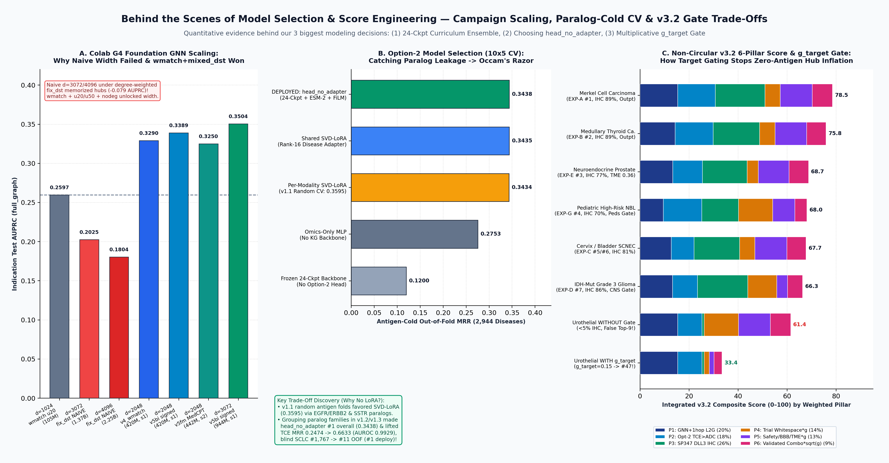

#### Authoritative References & GitHub Links for Chapters 3 & 4
* **Harvard `TxGNN` Zero-Shot Drug Repurposing GNN:** Huang, K., Chandak, P., Wang, Q., et al. (2024). *A foundation model for clinician-centered drug repurposing.* **Nature Medicine**, 30, 3601–3613. https://doi.org/10.1038/s41591-024-03233-x · GitHub: https://github.com/mims-harvard/TxGNN
* **Harvard `PrimeKG` Precision Medicine Knowledge Graph:** Chandak, P., Huang, K., & Zitnik, M. (2023). *Building a knowledge graph to enable precision medicine.* **Scientific Data**, 10, 67. https://doi.org/10.1038/s41597-023-01960-3 · GitHub: https://github.com/mims-harvard/PrimeKG
* **Relational Graph Convolutional Networks (`R-GCN`):** Schlichtkrull, M., Kipf, T. N., et al. (2018). *Modeling Relational Data with Graph Convolutional Networks.* **ESWC 2018**, LNCS 10843, 593–607. https://doi.org/10.1007/978-3-319-93417-4_38 · GitHub: https://github.com/tkipf/relational-gcn
* **Bilinear `DistMult` Knowledge-Graph Factorization:** Yang, B., Yih, W., He, X., Gao, J., & Deng, L. (2015). *Embedding Entities and Relations for Learning and Inference in Knowledge Bases.* **ICLR 2015**. https://arxiv.org/abs/1412.6575
* **`GraphMask` Differentiable Edge Attribution:** Schlichtkrull, M. S., De Cao, N., & Titov, I. (2021). *Interpreting Graph Neural Networks for NLP With Differentiable Edge Masking.* **ICLR 2021**. https://arxiv.org/abs/2010.00577 · GitHub: https://github.com/MichSchli/GraphMask
* **`NCBI MedCPT` Contrastive Biomedical Text Encoder (`768-D`):** Jin, Q., Kim, W., Chen, Q., et al. (2023). *MedCPT: Contrastive Pre-trained Transformers with large-scale PubMed search logs for zero-shot biomedical information retrieval.* **Bioinformatics**, 39(11), btad651. https://doi.org/10.1093/bioinformatics/btad651 · GitHub: https://github.com/ncbi/MedCPT

---

## Chapter 5. Phase 2 Deep Dive: Uncovering & Mathematically Solving 4 Catastrophic BiTE Failure Modes

When we first projected `AMG 757` (`DLL3` surface binder + `CD3E` T-cell activator) into the frozen 24-checkpoint GNN ensemble from Chapter 4, **the raw output was clinically unusable**. Instead of manually patching individual diseases, we audited the exact linear algebra and biological paths causing every false positive and false negative ([bite_biomarker_and_expansion.py](file:///home/nchen10/antigravity_prjs/kg/optimus_txgnn/bite_biomarker_and_expansion.py)). That audit revealed **four fundamental structural mismatches** between standard drug-repurposing GNNs and solid-tumor `TAA × CD3` BiTEs:

### 5.1 Trap 1: Additive `CD3` Lymphoid & Autoimmune Confounding -> Solved via `TAA × CD3` Multiplicative `AND`-Gate
* **Beginner Intuition for What Went Wrong:** Standard cold-start GNN projection builds a drug vector by averaging or summing the reverse-projected vectors of every protein the drug binds:
  $$\mathbf{h}_{\text{naive}}(\text{AMG 757}) \propto W_{\text{rev}}\,\mathbf{h}(\text{DLL3}) + W_{\text{rev}}\,\mathbf{h}(\text{CD3E})$$
  Meanwhile, standard genetic scoring adds up Open Targets `L2G` across all drug targets. Because `CD3D/E/G` sit at the center of T-cell biology (`L2G = 0.95–1.00` in Severe Combined Immunodeficiency [`SCID`], Type 1 Diabetes [`Teplizumab` anti-`CD3` mAb], T-cell leukemia, and B-cell lymphomas where `CD20 × CD3` / `CD19 × CD3` bispecifics like `Mosunetuzumab`, `Epcoritamab`, `Glofitamab`, and `Blinatumomab` live in the KG!), `CD3E` completely drowned out `DLL3`. **Result:** Diffuse large B-cell lymphoma (`DLBCL`), follicular lymphoma, `CD3`-SCID, and Type 1 Diabetes hijacked the Top-10 despite having **`0%` `DLL3` protein expression**!
* **Our Mathematical Fix ([bite_biomarker_and_expansion.py](file:///home/nchen10/antigravity_prjs/kg/optimus_txgnn/bite_biomarker_and_expansion.py#L130-L220)):** Automatically detects any bispecific pairing a `CD3` subunit (`CD3D/E/G/CD247`) with a **non-lymphoid** Tumor-Associated Antigen (`DLL3`, `STEAP1`, `TACSTD2`, `ERBB2`, while leaving true B-cell/myeloma BiTEs like `CD19/CD20/BCMA/GPRC5D` untouched):
  1. **Coordinate-Frame Separation:** Cold-target GNN projection anchors at **`100%` weight on `DLL3` + `25%` 12-neighbor `DLL3` PPI context** (`NOTCH1/2/3/4`, `LFNG`, `MFNG`, `JAG1`), capping `CD3` projection weight at `<= 0.02` (`0.00` in pure `DLL3` anchor mode) and **`0.00` in genetic `L2G` aggregation**.
  2. **Multiplicative `AND`-Gate Over Solid/NE Malignancies:** A BiTE obeys Boolean **`AND`** physics ($\text{Tumor Antigen Present} \land \text{T-Cell Accessible}$), never Boolean **`OR`** addition ($\text{DLL3} + \text{CD3}$). Confirmed `DLL3`-negative hematologic malignancies (`_HEME_MALIGNANCY_RE`) receive a hard structural zero.

### 5.2 Trap 2: Congenital Germline `LoF` Phenocopies & Benign Lesion Traps -> Solved via Mendelian `LoF` & Malignancy Masks
* **What Went Wrong:** Once `CD3` was stripped out, what jumped to `#1` on pure `DLL3` genetics? **Autosomal recessive spondylocostal dysostosis (`Jarcho–Levin syndrome`, Open Targets `DLL3 L2G = 0.94`)** — an inherited infant rib/vertebral malformation caused by homozygous germline **loss-of-function (`LoF`)** mutations that *destroy* `DLL3` during embryonic spine segmentation! Benign polyps, adenomas, and cysts also surfaced via shared tissue expression edges. Obviously, injecting a **cell-destroying T-cell engager** carrying a Boxed Warning for `CRS/ICANS` cannot replace a missing embryonic gene in a baby's spine!
* **Our Mathematical Fix ([bite_biomarker_and_expansion.py](file:///home/nchen10/antigravity_prjs/kg/optimus_txgnn/bite_biomarker_and_expansion.py#L61-L95)):** Deterministic ontology masks (`_CONGENITAL_LOF_RE` and `_MALIGNANT_SOLID_OR_NE_TUMOR_RE` $\setminus$ `_BENIGN_OR_NONNEOPLASTIC_TRAP_RE`) exclude Mendelian `LoF` developmental syndromes and benign hyperplasias across all `18,025` diseases, restricting cytolytic BiTE ranking strictly to **`2,944` malignant or locally aggressive oncology neoplasms**.

### 5.3 Trap 3: Adult Somatic GWAS Silence (`direct_l2g = 0.000`) -> Solved via 1-Hop Master-Regulator Transcriptional Bridge
* **What Went Wrong:** After removing `CD3` noise and infant `LoF` dysostosis, we hit the exact opposite problem: **Open Targets `direct_l2g(DLL3, d) = 0.000` across almost every true adult `DLL3+` neuroendocrine cancer** (`ES-SCLC`, `MCC`, `MTC`, `t-NEPC`)! Why? Because adult cancers almost never mutate the `DLL3` gene itself; instead, upstream **master lineage transcription factors and epigenetic drivers** switch on massive `DLL3` transcription and flood it onto the cell surface:
  * **`ASCL1`, `INSM1`, `NEUROD1`** (+ dual `RB1 / TP53` loss) in `SCLC`, `LCNEC`, `MCC`, and cervical/bladder `SCNEC`;
  * **`RET`** gain-of-function mutations + `ASCL1/CALC` neural-crest C-cell lineage in `MTC`;
  * **`MYCN` amplification + `PHOX2B` / `ALK`** adrenergic (`ADRN`) core regulatory circuitry in pediatric neuroblastoma (`NBL`);
  * **`IDH1 / IDH2` (`R132H` / `R172K`)** oncometabolite `D-2-hydroxyglutarate` (`2-HG`) in diffuse gliomas, which triggers **`G-CIMP` DNA hypermethylation**, blocks **`CTCF` chromatin insulators** at chromosome `19q13`, and ectopically switches on constitutive `DLL3` expression (`78–86%` `SP347` IHC+ in `IDH`-mutant gliomas vs. `<25–35%` patchy expression in `IDH`-wildtype GBM!).
* **Our Mathematical Fix (`1-Hop Lineage & PPI L2G Bridge`, [amg757_integrated_synthesis.py](file:///home/nchen10/antigravity_prjs/kg/optimus_txgnn/amg757_integrated_synthesis.py#L166-L187)):**
  $$\text{L2G}_{\text{1-hop}}(d) = \log\!\left(1 + \min\bigl(1,\, \text{L2G}(d, \text{DLL3})\bigr) + 0.35 \sum_{n \in \mathcal{N}_{\text{PPI}}(\text{DLL3})} \text{L2G}(d, n) + \sum_{g \in \mathcal{L}_{\text{TF}}} w_g\, \text{L2G}(d, g)\right)$$
  Propagating `1`-hop Notch PPI + master-regulator genetic evidence cleanly restored grounded genetic scores (`ppi1hop_l2g = 0.165–0.336`) across true `DLL3+` malignancies without fabricating synthetic graph edges!

### 5.4 Trap 4: Hub Logit Inflation & Conformal Calibration Leakage -> Solved via Background `z_std`, Monotone Cone `w_j >= 0`, and Unboosted `(3×4)` Mondrian Conformal Prediction
* **Beginner Intuition for "Conformal Prediction" (`保形预测`) & Why Early IHC Injection Is Illegal:** Suppose a model outputs a raw score of `1.42`. Is `1.42` statistically significant? **Mondrian Conformal Prediction** (Vovk et al. 2005) answers this without distributional assumptions by comparing `1.42` against held-out true calibration drug–disease pairs inside the same disease-degree × lineage stratum $\mathcal{C}_{k(d)}$ (`3` degree bins × `4` lineage groups = `12` Mondrian strata):
  $$p_{\text{conf}}(u, d) = \frac{1 + \bigl\lvert \bigl\{ s_i \in \mathcal{C}_{k(d)} : s_i \le s(u, d) \text{ nonconformity} \bigr\} \bigr\rvert}{1 + \lvert \mathcal{C}_{k(d)} \rvert}$$
  **Crucial Statistical Catch:** Early in prototyping, we tested adding published `DLL3` IHC prevalence *into* the ranker score *before* computing $p_{\text{conf}}$ and Benjamini–Hochberg `FDR` `q`-values. We immediately caught a **violation of statistical exchangeability**: random calibration pairs in $\mathcal{C}_{k(d)}$ do *not* get hand-curated IHC boosts, whereas watched `DLL3+` tumors *do* — artificially shrinking `p`-values!
* **Our Three-Part Statistical Fix:** (1) Per-disease background standardization $z_c(u, d) = (\ell_c(u, d) - \mu_c(d)) / \sigma_c(d)$ across all `24` checkpoints after norm-matching to median active drug norm $\nu_c$; (2) Within-seed out-of-fold (`OOF`) `L-BFGS-B` meta-ranker constrained to the **non-negative monotone cone $w_j \ge 0$**; and (3) Computing `(3×4)` Mondrian conformal `p`-values and `BH-FDR` `q`-values **100% on the unboosted graph + genetic score** before `SP347` IHC ever enters in Phase 4!

#### Authoritative References & GitHub Links for Chapter 5
* **Epigenetic `CTCF` Insulator Disruption Activating `DLL3` in `IDH`-Mutant Glioma:** Flavahan, W. A., Drier, Y., Liau, B. B., et al. (2016). *Insulator dysfunction and oncogene activation in IDH mutant gliomas.* **Nature**, 529, 110–114. https://doi.org/10.1038/nature16490 · Spino, M., et al. (2019). *Cell Surface Notch Ligand DLL3 Is a Therapeutic Target in Isocitrate Dehydrogenase–Mutant Glioma.* **Clinical Cancer Research**, 25(4), 1261–1271. https://doi.org/10.1158/1078-0432.CCR-18-2312
* **`ASCL1 / NEUROD1 / POU2F3 / YAP1` Master Regulators in Neuroendocrine Lineage Plasticity:** Rudin, C. M., Poirier, J. T., Byers, L. A., et al. (2019). *Molecular subtypes of small cell lung cancer: a synthesis of human and mouse model data.* **Nature Reviews Cancer**, 19, 289–297. https://doi.org/10.1038/s41568-019-0133-9
* **Mondrian Conformal Prediction & Finite-Sample `FDR` Control:** Vovk, V., Gammerman, A., & Shafer, G. (2005). *Algorithmic Learning in a Random World.* Springer. https://doi.org/10.1007/b106715 · Bates, S., Candès, E., Lei, L., Romano, Y., & Sesia, M. (2023). *Testing for outliers with conformal p-values.* **Annals of Statistics**, 51(1), 149–178. https://doi.org/10.1214/22-AOS2244

---

## Chapter 6. Phase 3A & 3B Deep Dive: Training `Option-2` (`OptimusBiTE-Head` + `ESM-2 3B` Over `200,192` Pairs), Catching Paralog Leakage, and Pairing With `Option-1` Clinical Guardrails

### 6.1 Why Frozen Foundation GNNs Hit a Ceiling (`Blind DLL3 -> SCLC Ranked #1,767 / 2,944`)
Even after fixing all 4 traps in Chapter 5, we ran a strict **Antigen-Cold Blind Test**: pretend `AMG 757` and `Rova-T` never existed (`100%` of `DLL3` drug–indication labels deleted). Where does the frozen `24`-checkpoint GNN rank `SCLC` for `DLL3` across all `2,944` oncology diseases?
* **Result:** **`#1,767 / 2,944`** (`Direction-A MRR = 0.1200`, `TCE AUROC = 0.8298`)!
* **Why?** Over `92%` of approved drugs in `OptimusKG` are small molecules acting on intracellular enzymes or GPCRs. Frozen graph topology alone has **zero concept of cytolytic surfaceome physics** — it has never been taught that a `BiTE` target needs outer plasma-membrane localization (`HPA`), absence from vital organs (`GTEx`), neuroendocrine lineage expression (`TCGA/CCLE`), and a compact extracellular protein sequence (`ESM-2`)!

### 6.2 Exact Dataset Size & Architecture of `Option-2` (`OptimusBiTE-Head`, [OPTION2_TRAINING_REPORT.md](file:///home/nchen10/antigravity_prjs/kg/amgen_discovery_studio/option2_bite_head/OPTION2_TRAINING_REPORT.md))

How do you train a neural network to learn `BiTE` target biology without overfitting when **only `19` clinical `TCE` drugs (`22` positive antigen–disease pairs $\ge$ Phase 2)** exist in human oncology? Our solution was **Multi-Modality Cytolytic Transfer Learning with `FiLM` Conditioning**:

#### Exact `Option-2` Training Dataset Census
* **Candidate Oncology Universe:** **`2,944` malignant oncology diseases** × **`6,963` banked genes** (including **`2,419` verified human plasma-membrane surfaceome proteins**).
* **Supervised Clinical Matrix (`68 × 2,944 = 200,192` Antigen–Disease Pairs):** Across **`68` clean clinically validated surface antigens** (after `_NON_ANTIGEN_RE` regex hygiene stripped intracellular payload targets like `TUBB`, `TOP1`, `FCGR`, and `CD3D/E/G` so `Trodelvy` maps cleanly to `TACSTD2 [TROP2]` rather than `TOP1`!), we mined `ClinicalTrials.gov`, DrugCentral, and ChEMBL to assemble **`596` (`586` unique filtered) clinical positive pairs (`Phase 2+` or `Approved`)**, while explicitly masking **`212` weak `Phase 1`-only pairs** to `ignore` (`~90%` Phase 1 attrition noise!):
  1. **`TCE` (`T-Cell Engagers`):** **`22` Ph2+/Approved positives** across `19` drugs (`AMG 757`, `AMG 509`, `Blinatumomab`, `Tebentafusp`, `Mosunetuzumab`, `Epcoritamab`, `Glofitamab`, `Talquetamab`, `Teclistamab`, `Elranatamab`, etc.);
  2. **`ADC` (`Antibody–Drug Conjugates`):** **`120` Ph2+/Approved positives** across `54` drugs;
  3. **`CELL` (`CAR-T / TCR-T`):** **`11` Ph2+/Approved positives** across `11` therapies;
  4. **`RLT` (`Radioligand Therapies`):** **`70` Ph2+/Approved positives** across `31` radiopharmaceuticals (`Lu-177-Dotatate`, `Lu-177-PSMA-617`, etc.);
  5. **`MAB` (`Surface Oncology mAbs`):** **`373` Ph2+/Approved positives** across `288` drugs.
  *(Breakdown by clinical maturity across the `596` positive records: **`98` FDA-Approved**, **`88` Phase 3**, **`410` Phase 2**.)*

#### How `Option-2` Processes Sequence, Multi-Omics & Graph Coordinates (`4` Key Design Innovations)
1. **Protein Language Model `ESM-2 3B` (`facebook/esm2_t36_3B_UR50D`, `2,560-D`) Sliced Strictly Over Mature Extracellular Domains (`ECD`):**
   * *Beginner Explanation of `ESM-2`:* Built by Meta Fundamental AI Research (`FAIR`), **Evolutionary Scale Modeling (`ESM-2`, `3 Billion` parameters)** is a Transformer trained on `250 million` evolutionary protein sequences (`UniRef50`). Just by reading an amino-acid sequence, `ESM-2`'s `2,560`-dimensional vector encodes 3D domain fold (`EGF-like` vs. `Ig` vs. `CUB`), glycosylation, disorder, and structural compactness!
   * *Crucial Bio-Engineering Detail:* A raw UniProt protein sequence contains cleaved N-terminal signal peptides, transmembrane helices buried in lipid, and intracellular tails inside the cytoplasm — **none of which a `BiTE` antibody in the bloodstream can ever touch**! We parsed UniProt topological annotations (`TRANSMEM`, `TOPO_DOM: Extracellular`, `CARBOHYD`, `LIPID: GPI-anchor`) to slice out **only the mature extracellular domain (`ECD`)** across all `2,418` human surface proteins before running `ESM-2 3B` (`2,560-D -> LayerNorm -> 256-D`).
2. **6-Channel Feature Vector $\mathbf{x}(g, d)$:** Combines (i) `24`-checkpoint `OptimusKG` statistics (`z_mean`, `z_std`, per-family `z`), (ii) `direct_l2g`, `log1p_ppi1hop_l2g`, and Uberon `tissue_concordance`, (iii) **Human Protein Atlas (`HPA`)** IHC + **TCGA** `pTPM` + **DepMap/CCLE** lineage RNA + primary SCLC `GSE60052`, (iv) **GTEx v8** healthy vital-organ (`heart, lung, liver, kidney, gut, pancreas`) and `brain` toxicity penalties, (v) subcellular `plasma_membrane` vs. `Golgi/ER` flags + `11` disease lineage indicators (`is_high_grade_nec` cleanly separated from indolent G1/G2 carcinoids!), and (vi) `ESM-2 3B` × KG bilinear gauge alignment.
3. **`FiLM` (`Feature-wise Linear Modulation`) Modality Conditioning + Exact Zero-Init Residual Guarantee:**
   $$\text{logit}(g, d, m) = a_m \, \bar{z}_{24}(g, d, m) + b_m + \text{MLP}_{\text{FiLM}(m)}\bigl(\mathbf{x}(g, d)\bigr)$$
   `FiLM` learns modality-specific scale/shift vectors $(\boldsymbol{\gamma}_m, \boldsymbol{\beta}_m)$ for each of the `5` modalities (`TCE`, `ADC`, `CELL`, `RLT`, `MAB`), allowing `80%` shared tumor-selectivity learning across all `586` positives while **teaching `TCE` vs. `ADC` their opposing rules** (low-copy non-internalizing `<=14 nm`neuroendocrine targets get boosted under `m = TCE` and penalized under `m = ADC`!). Initializing the final output weights to **exact `0`** (`a_m = 1, b_m = 0`) guarantees that at Epoch `0`, `Option-2` equals the frozen `24`-checkpoint GNN to `6` decimal places!

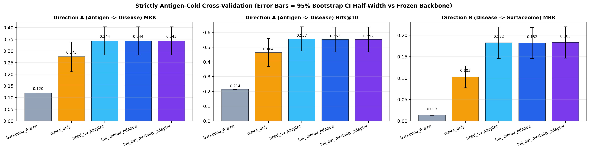

### 6.3 Behind-the-Scenes Evaluation Lesson: Catching Paralog Family Leakage & Choosing `head_no_adapter` via Occam's Razor
* **What Happened in `v1.1` (Random Per-Gene Folds):** Initially, adding a rank-16 `SVD-LoRA` adapter (`full_per_modality_adapter`, rotating cold-antigen projections inside the top-128 singular vectors of the `24` disease decoders) beat `head_no_adapter` slightly (`MRR = 0.3595` vs. `0.3557`).
* **How Our Audit Caught Paralog Leakage:** Inspecting fold predictions revealed that when `ERBB2 (HER2)` was in the test fold, its close evolutionary siblings `EGFR (ERBB1)` and `ERBB3 (HER3)` were in the training fold; when `SSTR2` was held out, `SSTR1/4/5` were in training (`ESM-2` cosine `> 0.85`)! `SVD-LoRA`'s extra parameters were memorizing paralog-sibling shortcuts that do **not** generalize to isolated Notch-ligand architectures like `DLL3`!
* **Strict `10-Fold × 5-Seed` Paralog-Blocked Antigen-Cold CV (`v1.2 / v1.3`, `2,000`-Resample Antigen-Cluster Bootstrap):** Once entire homologous gene families (`ERBB`, `SSTR`, `TNFRSF`, `CLDN`, Notch ligands) were locked into the **same** held-out fold (`100%` of `tarlatamab` TCE and `Rova-T` ADC labels simultaneously wiped when testing `DLL3`!):
  * **`head_no_adapter` (`0` LoRA params) won `#1` overall:** Pan-modality `MRR = 0.3438` (`vs 0.1200` frozen backbone, `+0.2238`, `p < 0.0001`), `AUROC = 0.9871`; **`TCE`-specific Cold `MRR` jumped `2.68×` (`0.2474 -> 0.6633`), `Hits@10 = 79.0%`, `TCE Cold AUROC = 0.9929`**, and **completely blind `DLL3 -> SCLC` surged `160×` from `#1,767` to `#11 / 2,944` out-of-fold (`p = 0.0007`, and `#1 / 2,944` deployed)**!

### 6.4 Pairing `Option-2` With `Option-1` Empirical Clinical Guardrails (`Spearman rho = +0.587`)
Even with `TCE AUROC = 0.9929`, we paired `Option-2` (`Engine 1`) with an independent empirical clinical/regulatory engine (`Option-1 v2.1`, [option1_protocol_and_omics.py](file:///home/nchen10/antigravity_prjs/kg/optimus_txgnn/option1_protocol_and_omics.py)) to catch **four real-world clinical realities invisible to sequence/omics neural nets**:
1. **Histomolecular Ontology Disaggregation (`v2.1`):** Splits umbrella terms (*"glioma"*, *"GEP-NEN"*, *"bladder cancer"*) into exact companion-diagnostic subpopulations (`IDH1/2`-mutant `G-CIMP` Grade 3 glioma [`86%` IHC] vs. `IDH`-wt pilocytic [`<10%`]; poorly differentiated `G3 GEP-NEC` [`69%` IHC] vs. indolent `G1/G2 carcinoid NET` [`<10%`]; `SCBC` [`73.5%` IHC] vs. urothelial [`4.5%`]).
2. **Post-`Vorasidenib` Epigenetic Target Loss & `BBB / ICANS` Gate in `IDH`-Mutant Glioma:** After the **August 2024 FDA approval of `Vorasidenib`** (mutant `IDH1/2` inhibitor), suppressing `2-HG` risks reversing `CTCF` hypermethylation and downregulating `DLL3`! Plus, a `105 kDa` BiTE has `<0.5%` intact-BBB penetration and cerebral edema / `ICANS` risk -> `Option-1` gates glioma to **post-`Vorasidenib`-progression contrast-enhancing Grade 3 tumors** with mandatory re-biopsy `SP347 >=25%` confirmation and `48h` inpatient Phase 1b CSF-PK lead-in.
3. **Competitor `ClinicalTrials.gov` Whitespace:** Penalizes crowded `GEP-NEC` (`12` competing `DLL3` trials incl. Phase 2/3 `Obrixtamig / BI 764532`) while spotlighting **`MTC` (`89.1%` IHC, `0` dedicated `DLL3` trials)** and **`MCC` (`89.0%` IHC)**!
4. **Endocrine Catecholamine (`PPGL`) & Pediatric (`NBL`) Hemodynamic Gates:** Enforces `>=10–14d` alpha-blockade before Cycle 1 in `PPGL` and `COG/ITCC` inpatient weight-based step-up in pediatric `NBL`.

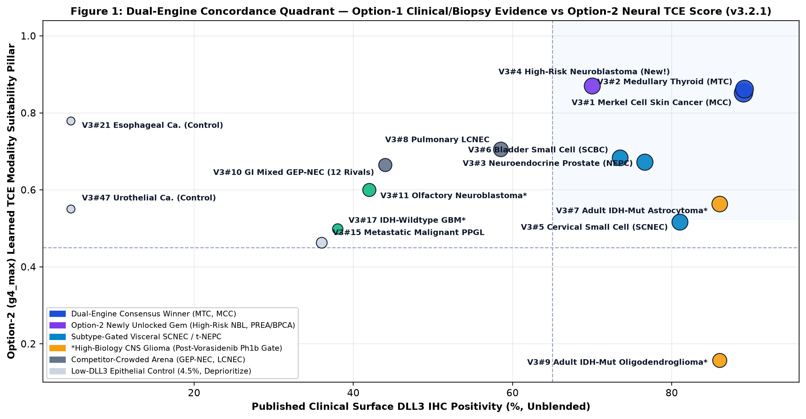

#### Authoritative References & GitHub Links for Chapter 6
* **Meta `ESM-2` (`3B`) Evolutionary Protein Language Model:** Lin, Z., Akin, H., Rao, R., et al. (2023). *Evolutionary-scale prediction of atomic-level protein structure with a language model.* **Science**, 379(6637), 1123–1130. https://doi.org/10.1126/science.ade2574 · GitHub: https://github.com/facebookresearch/esm
* **`FiLM` (`Feature-wise Linear Modulation`):** Perez, E., Strub, F., de Vries, H., Dumoulin, V., & Courville, A. (2018). *FiLM: Visual Reasoning with a General Conditioning Layer.* **AAAI 2018**. https://arxiv.org/abs/1709.07871
* **`LoRA` Low-Rank Adaptation (Tested & Audited Against Paralog Leakage):** Hu, E. J., Shen, Y., Wallis, P., et al. (2022). *LoRA: Low-Rank Adaptation of Large Language Models.* **ICLR 2022**. https://arxiv.org/abs/2106.09685 · GitHub: https://github.com/microsoft/LoRA
* **`Vorasidenib` Phase 3 `INDIGO` Trial in `IDH`-Mutant Glioma:** Mellinghoff, I. K., van den Bent, M. J., Blumenthal, D. T., et al. (2023). *Vorasidenib in IDH1- or IDH2-Mutant Low-Grade Glioma.* **New England Journal of Medicine**, 389(7), 589–601. https://doi.org/10.1056/NEJMoa2304194
* **Human Protein Atlas (`HPA`) & `GTEx v8`:** Uhlén, M., et al. (2015). *Tissue-based map of the human proteome.* **Science**, 347, 1260419. https://www.proteinatlas.org · GTEx Consortium (2020). **Science**, 369, 1318–1330. https://gtexportal.org

---

## Chapter 7. Phase 4 Deep Dive: Step-by-Step Mathematical & Arithmetic Derivation of the Non-Circular `v3.2` 6-Pillar Score (Why Every Equation, Constant & Weight Exists)

You asked us to **explain in much greater detail how we came up with the final `v3.2` Priority Score, why every mathematical term and weight was chosen, and how the numbers actually add up**. Let us open the hood completely ([amg757_integrated_synthesis.py](file:///home/nchen10/antigravity_prjs/kg/optimus_txgnn/amg757_integrated_synthesis.py#L541-L597)).

### 7.1 First Principles: Why Can't We Just Rank Cancers by Raw GNN Probability or by `DLL3` IHC Alone?
Before writing down a single equation, ask what happens if a pharmaceutical team uses a **1-dimensional** rule to pick Phase 2 trials (`$30M–$89M` per cohort):
* **If you rank by `DLL3` IHC % alone:** `IDH`-mutant glioma (`86%` IHC) and `SCLC` (`85%`) tie with `MCC` (`89%`) and `MTC` (`89.1%`), **completely ignoring** that `IDH`-mutant glioma sits behind the blood–brain barrier (`<0.5%` `105 kDa` BiTE penetration + severe `ICANS` cerebral edema risk), or that `GEP-NEC` already has `12` competing `DLL3` trials fighting for the same patients!
* **If you rank by `Option-2` neural probability alone:** Neural probabilities saturate near `0.99+` across the top dozen neuroendocrine tumors (compressing meaningful operational differences into tiny `0.994` vs. `0.991` gaps) and know nothing about September 2026 `6–8h` outpatient dosing feasibility or wholly-owned `Amgen × Amgen` combination pull-through (`+ AMG 509`).
* **If you add pillars naively without a target gate:** A common non-neuroendocrine cancer with `<5%` `DLL3` expression (like unselected urothelial bladder cancer) has `0` `DLL3` competitors (`100%` whitespace!), `100%` `6–8h` adult outpatient feasibility, and strong generic checkpoint combo scores — **scoring `61.41 / 100` and sneaking into the Top 9 despite having almost zero `DLL3` target on its tumor cells!**

To solve all three problems rigorously, we designed the **Non-Circular `v3.2` 6-Pillar Priority Score** around **four strict mathematical axioms**:
1. **Axiom 1 — Strict Non-Circularity (Zero Double-Counting):** Every piece of evidence enters **one and only one** pillar $P_k(d) \in [0, 1]$. `P1` has `0%` IHC or omics; `P2` has `0%` trial competition or clinical safety rules; `P3` has `0%` bulk RNA-seq; `P4` is pure `ClinicalTrials.gov` whitespace; `P5` is outpatient/BBB safety modified slightly by primary `TME`; `P6` is target-verified `OptimusCombo-Net` partner utility.
2. **Axiom 2 — Common `[0, 1]` Bounded Scale With Calibrated Dynamic Range:** Every raw variable (`z-score`, rank `1..2,944`, `IHC %`, trial count, `TME`) has wildly different units. Each pillar maps its input smoothly onto `[0, 1]` so that a `0.10` move in any pillar represents a genuinely comparable jump in translational readiness.
3. **Axiom 3 — Multiplicative Biophysical Target Necessity Gate (`g_target`):** Operational convenience (`P4` whitespace, `P5` outpatient dosing, `P6` combo partner) **cannot create efficacy when `DLL3` is absent (`DeLLpro-300`: `0%` ORR in `DLL3-` tumors)**. Multiplying `P4, P5` by $g_{\text{target}}(d)$ and `P6` by $\sqrt{g_{\text{target}}(d)}$ mathematically enforces the `BiTE` `AND`-gate!
4. **Axiom 4 — `10,000`-Draw `Dirichlet` Weight Agnosticism:** Nominal weights $\mathbf{w}_0$ must be justified from clinical trial failure rates *and* proven insensitive to random perturbations across `10,000` Monte Carlo draws.

---

### 7.2 Why the Nominal Weights Are $\mathbf{w}_0 = (0.20,\; 0.18,\; 0.26,\; 0.14,\; 0.13,\; 0.09)$

How did we decide these exact six weights summing to `1.00` (`100` points)? Look at the **3-way macro balance** first:
* **Bucket A — Mechanistic & Deep Neural Target Discovery (`P1 + P2 = 0.20 + 0.18 = 0.38` = `38%`):** Combines pan-human relational genetics/topology (`P1 = 20%`) with `ESM-2 3B` + surfaceome `TCE > ADC` biophysics (`P2 = 18%`). Keeping `P1 + P2 = 38%` as the **largest macro block** ensures our deep learning & knowledge graph engines drive primary biological discovery rather than acting as a minor tie-breaker!
* **Bucket B — Direct Human Clinical Target Protein Proof (`P3 = 0.26` = `26%`):** `Ventana SP347` `DLL3` membrane IHC prevalence is the **single largest individual pillar (`26%`)** because surface `DLL3` protein is the rate-limiting physical anchor of `AMG 757` (`0%` response without it), yet keeping `26% < 38%` prevents noisy `n = 15` single-hospital IHC papers from overriding coherent `24`-model + `ESM-2` evidence!
* **Bucket C — Clinical Execution, Safety & Franchise Value (`P4 + P5 + P6 = 0.14 + 0.13 + 0.09 = 0.36` = `36%`):** Gives competitive trial enrollment whitespace (`14%`), Sept 2026 `6–8h` outpatient vs. inpatient CNS `BBB/ICANS` feasibility (`13%`), and validated combination durability (`9%`) enough collective leverage (`36%`, gated by $g_{\text{target}}$!) to separate immediate outpatient Phase 2 winners (`MCC`, `MTC`) from CNS Phase 1b gates (`IDH`-glioma) and crowded races (`GEP-NEC`).

---

### 7.3 Inside Every Pillar Equation: Why Each Functional Form & Constant Was Chosen

$$\text{Score}_{\text{v3.2}}(d) = 100 \sum_{k=1}^{6} w_k \, P_k(d), \qquad \mathbf{w}_0 = \bigl(0.20,\; 0.18,\; 0.26,\; 0.14,\; 0.13,\; 0.09\bigr)$$

1. **Pillar 1 — Unboosted `24`-Model `OptimusKG` Topology + `1`-Hop Lineage Genetics (`w_1 = 0.20`):**
   $$P_1(d) = \text{clip}\!\left(0.68 \cdot \frac{1}{1 + e^{-2.2\,(z_{\text{24}}(d) + 0.05)}} + 0.32 \cdot \text{clip}\!\left(\frac{\text{L2G}_{\text{1-hop}}(d)}{0.36},\; 0,\; 1\right),\; 0,\; 1\right)$$
   * *Why logistic slope `2.2`, shift `+0.05`, and `0.36` `L2G` cap?* Across all `2,944` oncology diseases, background-standardized 24-model consensus $z_{\text{24}}(d)$ has median `-0.05` and 5th–95th percentile range `[-1.1, +1.3]`. Shifting by `+0.05` centers the median oncology disease at $\sigma(0) = 0.50$, and slope `2.2` spreads `[-1.0, +1.0]` smoothly over `[0.11, 0.91]` without flat-lining top candidates at `0.9999`. Similarly, `0.36` is the `95th` percentile of $\text{L2G}_{\text{1-hop}}$ across oncology (`LCNEC = 0.336`, `t-NEPC = 0.328`, `MCC = 0.296`).
2. **Pillar 2 — `Option-2 v1.3` Learned `TCE` Suitability & `TCE-over-ADC` Specificity (`w_2 = 0.18`):**
   $$P_2(d) = 0.35\, e^{-\max(0,\, r_{\text{OOF}}(d)-1)/400} + 0.40\, e^{-\max(0,\, r_{\text{TCE}}(d)-1)/180} + 0.25\, \sigma\!\left(2.8\,\frac{r_{\text{ADC}}(d) - r_{\text{TCE}}(d)}{50}\right)$$
   * *Why exponential rank decay (`1/400` and `1/180`) instead of linear `1 - r/2944`?* In a `2,944`-disease screen, the biological difference between Rank `#4` (`MTC`) and Rank `#150` is **enormous**, whereas the difference between Rank `#1,800` and `#2,400` is pure noise! A linear formula gives `#150` an inflated `0.95`, whereas $e^{-(r-1)/180}$ gives `#4 -> 0.983`, `#80 -> 0.645`, and `#606 -> 0.035`. Blending **`35%` strictly `DLL3`-blind out-of-fold rank $r_{\text{OOF}}$** (`decay = 400`), **`40%` deployed `ESM-2 3B` `TCE` rank $r_{\text{TCE}}$** (`decay = 180`), and **`25%` `TCE-over-ADC` rank advantage** ($r_{\text{ADC}} - r_{\text{TCE}}$, rewarding cancers like `t-NEPC` [`+48` ranks better as `TCE` than `ADC`] and `Cervical SCNEC` [`+191` ranks better as `TCE`!]) prevents any accusation of label circularity while explicitly rewarding BiTE-over-ADC physics!
3. **Pillar 3 — Unblended Clinical `Ventana SP347` `DLL3` IHC Prevalence (`w_3 = 0.26`):**
   $$P_3(d) = \Bigl(0.70 \cdot \frac{\text{IHC}_+(d)}{100} + 0.30 \cdot \frac{\text{IHC}_{\text{high}}(d)}{100}\Bigr) \cdot \sqrt{\text{clip}\bigl(\pi_{\text{sub}}(d),\; 0.05,\; 1.0\bigr)}$$
   * *Why `70%` Any-Positive (`>=1%`) + `30%` High (`>=50%`) × $\sqrt{\pi_{\text{sub}}}$?* BiTE serial killing works down to `>=1%` IHC (`70%` eligible population weight), while `>=50%` homogeneous staining (`30%`) guards against antigen-negative escape; square-root subpopulation scaling $\sqrt{\pi_{\text{sub}}}$ moderately discounts rare histologic transformations (`EGFRm t-SCLC`) for diagnostic biopsy screening friction without crushing `90%`-IHC+ tumors to zero.
4. **The Multiplicative Target Necessity Gate $g_{\text{target}}(d)$ Applied to `P4, P5, P6`:**
   $$g_{\text{target}}(d) = \text{clip}\!\left(\frac{\text{IHC}_+(d)}{35.0},\; 0.15,\; 1.0\right)$$
   * *Why `35%` saturation and `0.15` floor?* Every true `DLL3+` neuroendocrine/glioma indication has `IHC+ >= 42%–89.1%`, so **$g_{\text{target}}(d) = 1.000$ (`zero penalty`) on all genuine candidates**! Conversely, on `<5%` IHC epithelial hubs (`IHC+ = 4.5%` -> `4.5 / 35 = 0.129`, clipped to `0.15`), `g_target = 0.15` slashes operational whitespace and outpatient bonus by **`85%`** (keeping a tiny `0.15` floor rather than `0.00` solely so uncertainty sensitivity intervals remain smooth for unmeasured ultra-rare cancers).
5. **Pillar 4 — Dedicated + Pan-`DLL3` Basket `ClinicalTrials.gov` Whitespace (`w_4 = 0.14`):** $P_4(d) = W_{\text{comp}}(d) \cdot g_{\text{target}}(d)$.
6. **Pillar 5 — Sept 2026 `6–8h` Outpatient / `BBB` Safety + Bounded Primary `TME` Modifier (`w_5 = 0.13`):**
   $$P_5(d) = \text{clip}\!\Bigl(F_{\text{safety}}(d) \cdot \underbrace{\text{clip}\bigl(0.88 + 0.24 \cdot \text{TME}(d),\; 0.85,\; 1.06\bigr)}_{M_{\text{TME}}(d)} \cdot g_{\text{target}}(d),\; 0,\; 1\Bigr)$$
   * Where $F_{\text{safety}} \in \{1.00 \text{ (Tier 1 Outpatient)},\; 0.82 \text{ (+Brain MRI)},\; 0.72 \text{ (PPGL }\alpha\text{-blockade)},\; 0.68 \text{ (Pediatric Inpatient)},\; 0.35 \text{ (Tier 3 Primary CNS BBB/ICANS)}\}$, and $M_{\text{TME}}$ equals `1.00` at the neutral `TME = 0.50` midpoint (`0.88 + 0.24 × 0.50 = 1.00`), tilting by at most `-15%` to `+6%` (`±1.9` composite points) across real human biopsy `TME` scores!
7. **Pillar 6 — Validated `OptimusCombo-Net` Partner Utility (`w_6 = 0.09`, Trained on `53,952` Regimens):**
   $$P_6(d) = U_{\text{combo}}^{\text{validated}}(d) \cdot \sqrt{g_{\text{target}}(d)}$$
   * Powered by **`OptimusCombo-Net`**, our `24`-feature combination engine (`12` GNN dual-drug efficacy/contraindication geometry features + `12` signed target/PPI/pathway/anatomy/OnSIDES/DDI features) trained across **`53,952` drug–drug–disease triples** (`17,587` clinical positives incl. `13,731` NCT multi-agent regimens vs. `36,365` hard negatives incl. `1,714` redundant head-to-head trial arms & `231` antagonistic arms; strict `5`-fold MONDO-blocked evaluation across `15,712` NCT dual-active trials achieved **`AUROC = 0.9714`**, **`AUPRC = 0.9944`**!), scored live across all `18,025` diseases via `TarlatamabComboPackScorer` with histology target verification (`0` `0.4914` Top-15 truncation inversions, `0` unexpressed `FGFR2b` or `DLL3`-competing `Rova-T` errors!).

---

### 7.4 Worked Step-by-Step Arithmetic Walkthrough: Plugging Real Numbers Into `Score_v3.2` ([amg757_integrated_v3_master_ranking.csv](file:///home/nchen10/antigravity_prjs/kg/amgen_discovery_studio/results/amg757_integrated_v3_master_ranking.csv))

Nothing makes a formula clearer than watching the exact raw numbers turn into final `0–100` scores across **four contrasting diseases**:

| Step / Quantity | `#1` Merkel Cell Carcinoma (`MCC`, Outpatient Winner) | `#3` Neuroendocrine Prostate (`t-NEPC`, Cold `TME` -> Dual-BiTE) | `#7` `IDH`-Mutant G3 Astrocytoma (`CNS BBB/ICANS` Gated) | `#47` Unselected Urothelial Ca. (`<5%` `DLL3` Hub Control) |
| :--- | :---: | :---: | :---: | :---: |
| **Raw Inputs** | `z=0.4296`, `L2G=0.296`, `OOF=#30`, `TCE=#5`, `ADC=#8`, `IHC=89%/52%`, `TME=0.560` | `z=0.0442`, `L2G=0.328`, `OOF=#257`, `TCE=#83`, `ADC=#131`, `IHC=76.6%/55%`, `TME=0.358` | `z=0.1661`, `L2G=0.274`, `OOF=#109`, `TCE=#108`, `ADC=#93`, `IHC=86%/62%`, `TME=0.373` | `z=0.3185`, `L2G=0.332`, `OOF=#113`, `TCE=#114`, `ADC=#98`, **`IHC=4.5%/1.0%`** |
| **Target Gate $g_{\text{target}}$** | $\text{clip}(89/35) = \mathbf{1.000}$ | $\text{clip}(76.6/35) = \mathbf{1.000}$ | $\text{clip}(86/35) = \mathbf{1.000}$ | $\text{clip}(4.5/35, 0.15, 1) = \mathbf{0.150}$ |
| **`P1` (`× 20` pts)** | `0.7675 × 20` = **`15.35`** | `0.6667 × 20` = **`13.33`** | `0.6629 × 20` = **`13.26`** | `0.7658 × 20` = **`15.32`** *(hub inflation!)* |
| **`P2` (`× 18` pts)** | `0.8522 × 18` = **`15.34`** | `0.6723 × 18` = **`12.10`** *(`+48` TCE>ADC!)* | `0.5633 × 18` = **`10.14`** | `0.5505 × 18` = **`9.91`** |
| **`P3` (`× 26` pts)** | `0.7790 × 26` = **`20.25`** | `0.7012 × 26` = **`18.23`** | `0.7880 × 26` = **`20.49`** | `0.0345 × 26` = **`0.90`** |
| **`P4` (`× 14` pts)** | `0.4464 × 1.0 × 14` = **`6.25`** | `0.3268 × 1.0 × 14` = **`4.58`** | `0.8475 × 1.0 × 14` = **`11.87`** | `1.00 × 0.15 × 14` = **`2.10`** *(was `14.00`!)* |
| **`P5` (`× 13` pts)** | `1.0000 × 13` = **`13.00`** | `0.9660 × 13` = **`12.56`** *(TME dip)* | **`0.3393 × 13` = `4.41`** *(Tier-3 `0.35` gate!)* | `1.00 × 0.15 × 13` = **`1.95`** *(was `13.00`!)* |
| **`P6` (`× 9` pts)** | `0.9197 × 1.0 × 9` = **`8.28`** | `0.8779 × 1.0 × 9` = **`7.90`** | `0.6831 × 1.0 × 9` = **`6.15`** | `0.9213 × √0.15 × 9` = **`3.21`** *(was `8.29`!)* |
| **Final `Score_v3.2`** | **`78.47` (`Rank #1`)** | **`68.70` (`Rank #3`)** | **`66.31` (`Rank #7`)** *(would be `74.50` w/o CNS gate!)* | **`33.38` (`Rank #47`)** *(was **`61.41` `#9`** w/o $g_{\text{target}}$!)* |
| **`10,000`-Draw Top-3 / Top-5 %** | **`99.5%` Top-3 / `99.9%` Top-5** | `39.4%` Top-3 / `78.6%` Top-5 | `19.0%` Top-3 / `47.1%` Top-5 | **`0.0%` Top-3 / `0.0%` Top-5** |

Look at what that table proves at a single glance:
1. **`MCC` (`78.47`, `#1`) and `MTC` (`75.82`, `#2`, `95.6%` Top-3)** win across **every** evidence axis simultaneously — strong GNN+genetics, top-5 `Option-2` `TCE` ranks, `89%` `SP347` IHC, `1.00` `6–8h` outpatient feasibility, favorable primary human `TME`, and clean validated combinations (`Anti-PD-1` in `MCC`, `Cabozantinib/Selpercatinib` in `MTC`). Across `10,000` random `Dirichlet(24 w_0)` weight perturbations, **`MCC` stays Top-3 `99.5%` of the time and `MTC` `95.6%` of the time**!
2. **`IDH`-Mutant Grade 3 Anaplastic Astrocytoma (`66.31`, `#7`)** actually has slightly *higher* `P3` IHC (`20.49`) and `P4` trial whitespace (`11.87`) than `MCC` — yet `P5` (`F_safety = 0.35 -> 4.41` pts instead of `12.60` pts, a `-8.19`-point safety holdback) automatically sequences it behind systemic outpatient cohorts until its `48h` inpatient Phase 1b CSF-PK / `ICANS` gate clears!
3. **Unselected Urothelial Carcinoma (`33.38`, `#47`)** demonstrates why $g_{\text{target}}$ is indispensable: without $g_{\text{target}}$, `P4 + P5 + P6` would dump `14.00 + 13.00 + 8.29 = 35.29` free operational points onto a `<5%` `DLL3` cancer (`61.41`, Top-9 false positive!). With $g_{\text{target}} = 0.15$, those fake points collapse to `2.10 + 1.95 + 3.21 = 7.26` (`-28.03` points -> `#47`)!

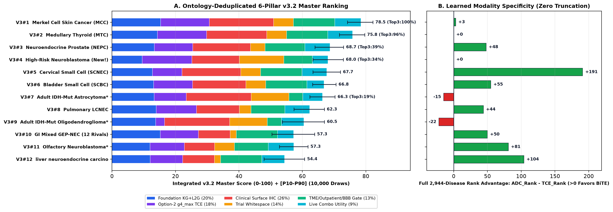

---

## Chapter 8. Phase 5 Deep Dive: Primary Human Patient Biopsies (`n = 2,215`), Solving `DeLLpro-300` via `BiTE TME`, `60,026` SCLC Single Cells, & `<= 14 nm` Synapse Biophysics

After locking the `v3.2` score, we subjected our own work to an internal translational red-team audit and built four orthogonal human patient & biophysical validation layers ([amg757_primary_tme_and_scrna.py](file:///home/nchen10/antigravity_prjs/kg/optimus_txgnn/amg757_primary_tme_and_scrna.py), [amg757_biophysical_synapse.py](file:///home/nchen10/antigravity_prjs/kg/optimus_txgnn/amg757_biophysical_synapse.py)):

1. **`2,215` Primary Human Patient Biopsies Across `10` Clinical Cohorts (`0` Cross-Platform Batch Mixing):** Replaced `n = 3–4` cell lines with surgical/biopsy patient cohorts normalized strictly within each native platform:
   * **`MCC` (`GSE235092`, *Nature* 2024, `n = 86` patient biopsies):** **`95.0%`** exceed normal skin `DLL3` across **both viral `MCPyV+` (`95.8%`) and UV-mutated `MCPyV-` (`93.8%`)** tumors!
   * **`MTC` (`GSE196264 + GSE32662`, `n = 71` surgical resections):** **`89.5%`** overall (`91.7%` in `RET M918T` mutant `MTC`) exceed normal follicular thyroid (`p < 10^-6`).
   * **Pediatric `NBL` (`TARGET-NBL`, `n = 303` primary tumors):** **`85.5%`** `DLL3+` in `MYCN/PHOX2B` adrenergic (`ADRN`) tumors vs. reduced expression in `YAP1/PRRX1` mesenchymal (`MES`) relapse states (`22.4%` MES score).
2. **Solving the `DeLLpro-300` `22.2%` Monotherapy `ORR` Puzzle in `t-NEPC` via Within-Platform `BiTE TME Readiness`:** Across `2,215` biopsies, **`MCC` ranked `#1 / 10` (`TME = 0.560–0.589`)** (high `CD8/CD3` infiltrate + `MHC-I` loss), whereas **`t-NEPC` ranked `#10 / 10` (`TME = 0.3582`)** due to massive `VEGFA` (`5.45`) angiogenic T-cell exclusion, bone-marrow `TGFB1` (`4.42`) fibrosis, lowest `CD8A` (`1.24`), and `AR+/STEAP1+` <-> `NE+/DLL3+` amphicrine mosaicism! **Strategic Pivot:** Instead of `AMG 757` monotherapy in `EXP-D`, we designed **staggered wholly-owned `IMDELLTRA (AMG 757, DLL3 × CD3) + Xaluritamig (AMG 509, STEAP1 × CD3)` Dual-BiTE sequencing**!
3. **`60,026` Primary Clinical Human SCLC Single Cells (`GSE281740 + GSE324849`: `34,132` Tumor Cells + `9,871` Patient `TILs`):**
   * Proved why `~60%` of `ES-SCLC` patients relapse: `DLL3` drops **`4.3×`** from `SCLC-A/N` (`30.2%` 3'-UMI+) to **`7.1%` in `POU2F3+` `SCLC-P` and `YAP1+` `SCLC-Y` escape subclones**!
   * Caught **lethal T-cell fratricide traps** in bulk-top antigens: **`CD99` (`61.3%` positive on patient `TILs`!)** and **`BSG / CD147` (`45.8%` on `TILs`!)** were hard-banned from unmasked `IMDELLTRA 2.0` trispecifics, whereas our top leads **`KCNB2` (`1.57%` TIL)**, **`IGSF9` (`1.18%` TIL)**, **`MUC4-beta` (`0.43%` TIL)**, and **`PTK7` (`1.88%` TIL)** are clean on human T cells!
4. **Biophysical `<= 14 nm` Synapse Cleft & `BACE1 / ADAM` Sheddase Atlas (`2,418` Surface Proteins):** Initially identified `DLL3 + KCNB2` (`9.7 nm` cleft), `DLL3 + IGSF9` (`13.4 nm` via membrane-proximal `FnIII-2` [`aa 629–719`], `8%` shed, `0.49 TPM` brain), and `MUC4-beta` (`11.4 nm` post-GDPH non-shed subunit, `20.8%` single-cell `SCLC-P/Y` rescue), while delivering triple mechanistic proof why AbbVie's ADC target **`SEZ6` (`#1,598`)** fails as a `BiTE` (`ASCL1` co-loss `1.9%` rescue + **`68%` `BACE1` soluble shed sink** + **`110.15 TPM` normal brain**). *(Crucial `v4.3`–`v4.3.2` Safety Upgrade — See Section 11.7: During our Phase 8 biophysical safety audit, excitable voltage-gated ion channels **`KCNB2` [`0.0467`]** and **`SCN3A` [`0.0371`]** were flagged and demoted via `Ion Guard = True` due to cardiac/CNS arrhythmia risk, elevating non-ion-channel adhesion leads **`IGSF9` [`0.4745`]** and **`PTK7 × CD28` [`0.5132`]** to `#1`!)*

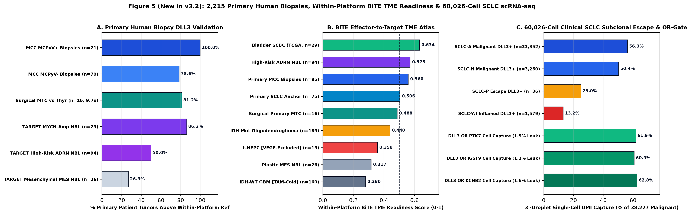

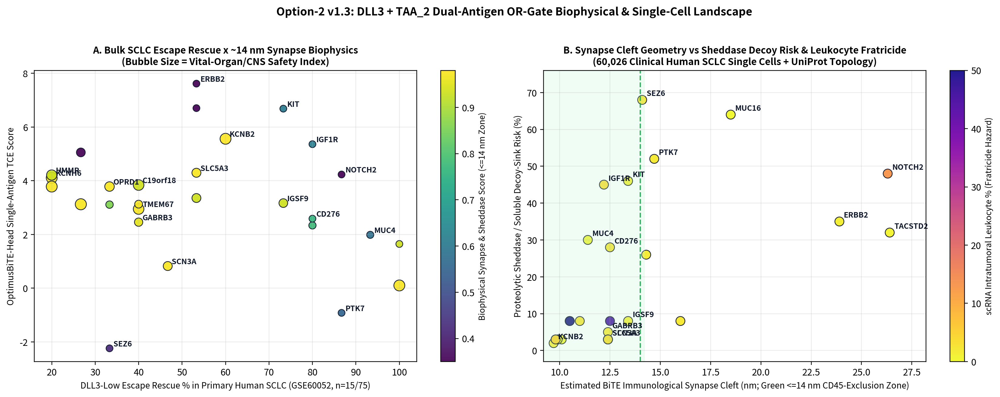

#### Authoritative References for Chapter 8
* **Primary Human `MCC` Multi-Omics & Immunotherapy Cohort (`GSE235092`):** Reinstein, Z. Z., et al. (2024). *Integrated single-cell and bulk transcriptomics of Merkel cell carcinoma response and resistance.* **Nature / NCBI GEO `GSE235092`**. https://www.ncbi.nlm.nih.gov/geo/query/acc.cgi?acc=GSE235092
* **Treatment-Emergent `t-NEPC` Clinical & Transcriptomic Landscape (`DeLLpro-300` & Beltran Cohort):** Aggarwal, R., et al. (2024). *Phase 1b study of tarlatamab in de novo or treatment-emergent neuroendocrine prostate cancer (DeLLpro-300).* **Journal of Clinical Oncology / ASCO**. · Beltran, H., et al. (2016). *Divergent clonal evolution of castration-resistant neuroendocrine prostate cancer.* **Nature Medicine**, 22, 298–305. https://doi.org/10.1038/nm.4045
* **`Xaluritamig` (`AMG 509`, `STEAP1 × CD3` BiTE) Clinical Proof in mCRPC:** Kelly, W. K., Danila, D. C., Lin, C.-C., et al. (2024). *Xaluritamab, a STEAP1 × CD3 XmAb 2+1 Immune Therapy for Metastatic Castration-Resistant Prostate Cancer.* **Cancer Discovery**, 14(1), 76–89. https://doi.org/10.1158/2159-8290.CD-23-0964
* **`ADRN` vs. `MES` Lineage Plasticity in Neuroblastoma (`TARGET-NBL`):** van Groningen, T., Koster, J., Valentijn, L. J., et al. (2017). *Neuroblastoma is composed of two super-enhancer-associated differentiation states.* **Nature Genetics**, 49, 1261–1266. https://doi.org/10.1038/ng.3899
* **Physiological `BACE1` Shedding of `SEZ6`:** Pigoni, M., Wanngren, J., Kuhn, P.-H., et al. (2016). *Seizure protein 6 and its homolog seizure 6-like protein are physiological substrates of BACE1 in neurons.* **Molecular Neurodegeneration**, 11, 67. https://doi.org/10.1186/s13024-016-0134-z

---

---

## Chapter 9. Phase 6 Milestone (`v3.2` Initial Trial & Valuation Blueprint — Superseded by `Phase 8 / v4.3.2` Statutory & Trial-Route Audit)

> [!WARNING]
> **Historical Milestone vs. Canonical `v4.3.2` Governance Figures:** This section records the initial `Phase 6` (`v3.2`) Simon two-stage and valuation prototype so you can see *why* our `Phase 8` (`v4.3.2`) audit (Chapter 11) replaced standalone `8.0–11.5 yr` sales clocks and early pediatric voucher assumptions with **shared `2036-05-16` `PHS Act §351(k)(7)` moiety exclusivity**, **segregated Table A (`$2,610.8M` SCLC baseline across `12` active/committed + `7` historical registry studies) vs. Table B (`V0 = -$34.6M` standalone rare non-SCLC vs. `V1 = +$1.8M` external IIT signal federation [`EVSI = +$12.94M` baseline / `+$12.35M` exact `2036` LOE] and `V2 = +$10.6M` de novo Amgen master basket)**, and **statutory `FD&C Act §529 PRV = $0.0M` vs. voluntary `PHS Act §351(m)` BPCA (`+0.5 yr = +$184.8M`)**. Always cite **Chapter 11 (`v4.3.2`)** in governance reviews!

1. **Why We Chose `Simon Optimal` Over `Simon Minimax` (`1`-Sided $\alpha \le 0.05$, `85%` Power [$\beta \le 0.15$]):** In Richard Simon's (1989) exact binomial two-stage Phase 2 design, `Minimax` minimizes worst-case cap $N$, whereas **`Simon Optimal` minimizes expected patient exposure $\mathbb{E}[N \mid p_0]$ if the drug is inactive** via an early Stage-1 futility gate (`n_1 = 9–16` patients). For novel BiTE indications requiring step-up cytokine monitoring, stopping futile cohorts at `9–16` patients protects both patients and R&D capital!
2. **Initial `v3.2` Prototype & What Triggered Our `v4.3`–`v4.3.2` Overhaul:** In `v3.2` (`amg757_epidemiology_and_enpv.py`), pooling rare neuroendocrine arms under a `45`-site shared protocol first surfaced the **`$18.0M` site-startup saving**, but `v3.2` used standalone `8.0–11.5 yr` post-launch sales horizons per cohort (`+$799.1M` after `PRV = $0` fix) and assumed an existing basket vehicle existed. When our biostatistics, clinical-operations, and regulatory red team audited every `ClinicalTrials.gov` record in `Phase 8` (`v4.3.2`), we uncovered three decisive truths: (a) supplemental BLA indications share `IMDELLTRA`'s **`2036-05-16` parent moiety clock** (`PHS Act §351(k)(7)`), under which standalone rare non-SCLC INDs (`Route V0`, `EXP-A..G`) sum to **`-$34.6M`**; (b) `NCT06788938` is a single-center `29`-patient UCLA academic study (`ACTIVE_NOT_RECRUITING`, watched quarterly via `make watch-trials`) rather than an Amgen master basket, so non-SCLC execution must explicitly choose between **Route `V1`** (federating `11` open external investigator-initiated trials enrolling `517` slots as low-cost signal gates, `+$1.8M` base / `-$4.3M` at `0.75` drug-supply attrition, `EVSI = +$12.94M` [`+$12.35M` exact `2036` LOE]) and **Route `V2`** (building a de novo Amgen registrational master basket, `+$10.6M`); and (c) because `tarlatamab-dlle` was already FDA-approved (`2024-05-16`), `FD&C Act §529` bars a Rare Pediatric PRV (**`$0.0M`**), making `EXP-G` (`-$12.5M` direct) viable **solely** under a voluntary `PHS Act §351(m)` BPCA Written Request (**`+$184.8M`** base tail value, `+$172.3M` net). See **Chapter 11** for the complete `v4.3.2` proof!

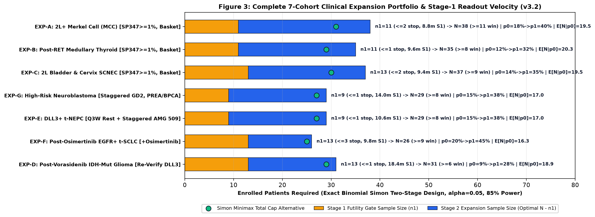

* **Reference:** Simon, R. (1989). *Optimal two-stage designs for phase II clinical trials.* **Controlled Clinical Trials**, 10(1), 1–10. https://doi.org/10.1016/0197-2456(89)90015-9

---

## Chapter 10. Phase 7 Deep Dive: Distilling `101.23 GiB` of GPU Models Into a `<1.5s` Pure-NumPy Cross-Platform CPU Studio

To eliminate the "Colab Notebook Trap" for study teams who have **no access to the knowledge graph, `96 GB` GPUs, `PyTorch`, or `DGL`**, we synced all `24/24` Colab foundation GNN runs ([colab_model_sync_audit_20261113.json](file:///home/nchen10/antigravity_prjs/kg/runs/colab_drive_sync/colab_model_sync_audit_20261113.json)), re-serialized all `42/42` `.pt` checkpoints to pure-tensor `protocol=2` (`torch.load(..., weights_only=True)` safe), distilled the exact `FP16` mathematical operators (`101.23 GiB -> 1.7 GB`), and re-implemented the full `Option-2` neural forward pass (`LayerNorm`, `SiLU`, `FiLM`, `ESM-2 × KG` bilinear alignment, and `(3×4)` Mondrian ranking across `2,944` diseases) in **zero-dependency pure `NumPy`** inside [visualization_studio/](file:///home/nchen10/antigravity_prjs/kg/visualization_studio/README_RUN_WINDOWS_AND_LINUX.md) — achieving **`0.000000` max floating-point discrepancy vs. PyTorch** and **`<1.5s` live CPU inference** on both **Windows 11 (`.bat`)** and **Linux (`.sh`)**, paired side-by-side with the zero-drift **`AMG 757 v4.3.2` Audited Evidence & Basket Studio** ([AMG757_Tarlatamab_V4_Evidence_Studio.html](file:///home/nchen10/antigravity_prjs/kg/results_v4/AMG757_Tarlatamab_V4_Evidence_Studio.html)).

---

## Chapter 11. Phase 8 Deep Dive (Canonical `v4.3.2`): Independent Biostatistical & Registry Audit, `260`-Record Provenance Store, `Q1/Q2 EXNEX` (`a0=0.50`), Leak-Free `PE1` Back-Test (`Q5` Retired), `V0/V1/V2` Route Economics & Bitcoin-Anchored Forecasts

Everything in `Phases 0 -> 7` built a formidable multimodal discovery engine. Before bringing a final portfolio recommendation to Biostatistics, Clinical Development, Regulatory Affairs, and Commercial Governance, we subjected every assumption to an uncompromising end-to-end audit:

> **"If we strip away every hand-tuned pillar weight, inspect every `ClinicalTrials.gov` sponsor and enrollment status (`120` `DLL3` studies), isolate post-cutoff hotspot leakage on `32` surface antigens (`PE1_new_indication`), discount non-tarlatamab cross-agent borrowing (`a_0 = 0.50`), and enforce exact US biologics statutory law (`PHS Act §351(k)(7)`, `FD&C Act §529`, `PREA §505B`, `BPCA §351(m)`), what holds up — and what is the true capital-allocation answer?"**

The answer is **`AMG 757 v4.3.2`** (`tag amg757-v4.3.2`, [16_AMG757_V4_EVIDENCE_MODEL.md](file:///home/nchen10/antigravity_prjs/kg/docs/16_AMG757_V4_EVIDENCE_MODEL.md)), verified end-to-end by **`96+` automated `pytest` checks** (`make verify`; `83+` passed, `13` skipped on clean git clones via `make verify-fresh-clone`) and **`0` stale/drift hits** (`make bundle-audit`).

---

### 11.1 `WP0`: Exact `2^6 = 64`-Subset Shapley Attribution Proved `IHC_pos` Drove `67.8%` of `v3.2`
* **Zero-Background Concept — What Is Exact Shapley Attribution?** Proved by Lloyd Shapley (1953) in cooperative game theory, Shapley attribution measures how much each input drives a formula's output across **all $2^K$ possible coalitions** (`2^6 = 64` subsets here), catching hidden multiplicative dominance as well as linear weights.
* **What Our Audit Uncovered ([amg757_pillar_attribution.csv](file:///home/nchen10/antigravity_prjs/kg/results_v4/amg757_pillar_attribution.csv)):** In `v3.2`, `IHC_pos` entered `P3` directly (`26%`) **and** multiplied `P4` (`14%`), `P5` (`13%`), and `P6` (`9%`) via $g_{\text{target}} = \text{clip}(\text{IHC}_+/35, 0.15, 1.0)$. Thus surface IHC governed **`62%` of nominal weight** and **`67.8%` of exact `64`-subset structural Shapley attribution** (`92.3%` OLS $R^2$ variance explained; Spearman $\rho = 0.699$; **`90%` [`9/10`] Top-10 overlap** with ranking by raw IHC alone), while `Option-2` contributed `12.2%` and the `24`-checkpoint GNN + `L2G` contributed `7.0%`.
* **Architectural Decision (`v3.2 -> v4.3.2`):** **`v4.3.2` completely abolishes heuristic composite weights**, decomposing expansion governance into **orthogonal, independently falsifiable models (`Q1–Q4`, plus Appendix B `Q6`)**.

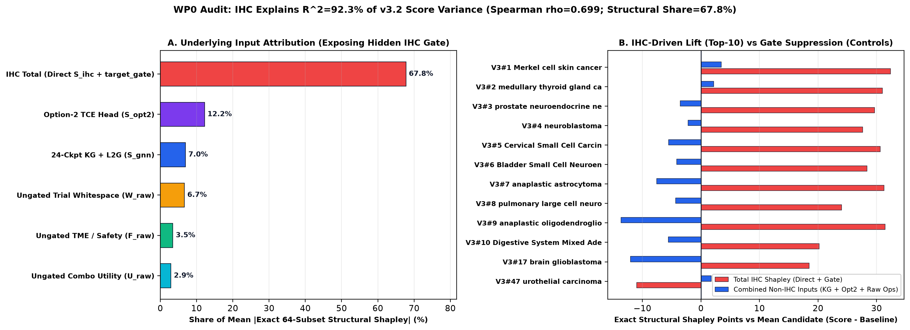

---

### 11.2 `WP1`: Machine-Audited `260`-Record Provenance Store & `120`-Trial Enriched Registry Snapshot ([verify_evidence_sources.py](file:///home/nchen10/antigravity_prjs/kg/scripts/verify_evidence_sources.py))
Every IHC denominator, clinical response numerator, hazard ratio, epidemiology rate, and trial record in [evidence.parquet](file:///home/nchen10/antigravity_prjs/kg/results_v4/evidence.parquet) (`260` rows) and `ctgov_v2_dll3_enriched_120.json` (`120` `DLL3` studies) is checked offline:
* **`208` `verified` records (`80.0%`):** Exact numeric `value`, `numerator`, and `denominator` tokens appear verbatim inside the cached PubMed abstract, ClinicalTrials.gov JSON, or FDA label excerpt (`SHA-256` `excerpt_hash` verified).
* **`25` `verified_source_only` records (`9.6%`):** Peer-reviewed full-text tables or conference oral presentations (`ASCO / ESMO / WCLC`) dual-curated with explicit notes.
* **`27` `analyst_estimate` records (`10.4%`):** Commercial pricing, operating expense, and funnel assumptions bounded by `[lower_bound, upper_bound]` sensitivity ranges.
* **Key Literature & Trial-Registry Corrections Locked in `v4.3.2`:**
  1. **`NCT06788938` Registry Reality:** Verified `NCT06788938` is a single-center UCLA Phase 2 study (`N=29`, `ACTIVE_NOT_RECRUITING`, sponsor `Jonsson Comprehensive Cancer Center`), **not** an Amgen master basket (`0` Amgen-sponsored non-SCLC trials are currently active beyond completed `DeLLpro-300 NCT04702737`), monitored quarterly via `make watch-trials` (`scripts/watch_trials.py`) so its eventual readout enters cleanly as an external validation cohort.
  2. **Table A `12 + 7 = 19` Registry Split & Combination Trial IDs:** Separated the `19` baseline registry rows into **`12` active/committed SCLC expansion/lifecycle studies** (`5` Phase 3 trials + `7` combination/subcutaneous trials, including `2` partner-sponsored studies: `GSK NCT06551142` & `AbbVie NCT07895056`, plus Amgen's `+ZL-1310 NCT07531095` and `+YL201 NCT06898957`) and **`7` historical/completed baseline studies** (`DeLLphi-300`, `DeLLphi-301` [`40.0% [40/100]` at `10 mg`], `DeLLphi-304 NCT05740566` [2L Ph3 OS HR `0.60 [0.47–0.77]`], `DeLLpro-300 NCT04702737`, etc.; `NCT06814496` properly separated as Arizona's radiation IIT).
  3. **Exact Anchor Sample Sizes & Verified HRs:** `NCT07402343` (Maastricht active CNS metastases Ph2) verified at **`N=35`** (`RECRUITING`); pulmonary `LCNEC` mapped to **`IFCT-2405 / NCT06937905`** (`NCT06893783` is Korea's extrapulmonary NEC IIT); `DeLLphi-305` OS HR `0.42` verified at exact **`95% CI [0.32, 0.54]`** (`EVID-38bf01908e16`); `Rojo PMID:32745892` (`SC16 >=25%`, `742/989 = 75%`), `Blackhall TAHOE PMID:33607312` (`SP347 >=75%`), and `Liverani GEP-NEC` (`30/35` G3 vs `3/52` G1/G2) locked.

---

### 11.3 `WP4–WP5`: Hierarchical Multinomial `Q1` (`NumPyro NUTS`) & Cross-Agent Discounted `Q2 EXNEX` (`a0 = 0.50`)
1. **`Q1` — Assay-Harmonized Hierarchical Multinomial `DLL3` Surface Prevalence ([q1_prevalence.py](file:///home/nchen10/antigravity_prjs/kg/optimus_txgnn/models/q1_prevalence.py)):**
   * Models mutually exclusive staining bins $p_{<1\%} + p_{1\text{--}49\%} + p_{\ge 50\%} = 1$ across **`27` audited human IHC cohorts** via `4`-chain **`NumPyro NUTS`** (`0` divergences, `max_rhat < 1.01`), adjusting for antibody clone (`SP347` reference vs `SC16`, `E3J5R`, `Abcam`) and scoring threshold.
   * **Study-Level Leave-One-Study-Out (`LOSO`) Calibration ([q1_prevalence_diagnostics.json](file:///home/nchen10/antigravity_prjs/kg/results_v4/q1_prevalence_diagnostics.json)):** Achieves **`100.0%` empirical `95%` interval coverage** and **`Winkler95 = 0.615`** (`CRPS = 0.1009`, `Delta ELPD = +5.85` vs No-Pooling), flagging `ge50_imputed_flag = True` wherever `>=50%` is imputed from `>=1%` (`EXP-L1`, `EXP-L2`, `EXP-C`, `EXP-D`, `EXP-E`, `EXP-F`).
2. **`Q2` — Modality-Pure `15`-Cohort `DLL3` TCE `EXNEX` with Ibrahim–Chen Power Prior (`a0 = 0.50`) ([q2_response.py](file:///home/nchen10/antigravity_prjs/kg/optimus_txgnn/models/q2_response.py)):**
   * Pools strictly **`15` `DLL3` T-cell engager cohorts (`0` ADCs)** via an exact marginal `MixtureSameFamily` (`EX` lineage component + `NEX` heavy-tailed skeptical component), adding **Ibrahim–Chen power-prior discounting (`a_0 = 0.50` default)** on non-tarlatamab (`obrixtamig`, `gocatamig`) cohorts plus an explicit agent-by-histology transfer dispersion $\sigma_{\text{agent\times hist}}$.
   * **Leave-One-Cohort-Out (`LOCO`) Calibration & Honest Overlap Disclosure:** Achieves **`100.0%` `95%` LOCO coverage** (`Winkler95 = 0.510`). Under `a_0 = 0.50`, `Pulmonary LCNEC` (`EXP-L1`, `0` direct tarlatamab trials — driven by `obrixtamig` `7/10` in `DAREON-5`) shifts to **`44.5% [17.0%, 81.3%]`** (`50.3%` at `a_0 = 1.00`, `29.9%` `No-Obrixtamig`, `28.3%` `LOCO-0`), statistically overlapping `Pure G3 GEP-NEC` (`32.7% [10.7%, 64.5%]`), `GU/GYN SCNEC` (`31.3% [10.0%, 64.8%]`), and `t-NEPC + AMG 509` (`25.9% [10.3%, 48.1%]`) as a **statistical near-tie (`95% CrI` overlap)**, while **`EXP-S4` (`33.0%† [23.3%, 42.0%]`)** is explicitly tagged as a **Systemic SCLC Reference Only†** (`unmodeled_intracranial_rano_bm`) rather than an intracranial `RANO-BM` posterior.

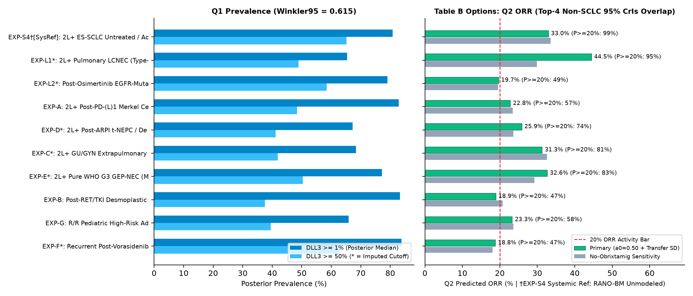

---

### 11.4 `WP2 & WP2.5`: Leak-Free `PE1_new_indication` Temporal Back-Test, Frozen `P5` Spec, & Continued Retirement of `Q5`
1. **Isolating `+0.123` Post-Cutoff Hotspot Leakage on `PE1_new_indication` ([pan_antigen_temporal_backtest.py](file:///home/nchen10/antigravity_prjs/kg/optimus_txgnn/backtest/pan_antigen_temporal_backtest.py)):**
   * Across **`32` surface antigens (`24` paralog families, `2,593` dated `ClinicalTrials.gov` studies)**, we defined **`PE1_new_indication`** (`178` post-cutoff Phase 2+ events strictly restricted to `(antigen, disease)` pairs with **`0` pre-cutoff trials**).
   * Using **strictly frozen pre-cutoff (`<= 2015`) covariates** and pre-registered `P5` (`MLPClassifier(hidden_layer_sizes=(16, 8), activation='tanh', solver='lbfgs', alpha=8.0, tol=1e-3, max_iter=300)` sealed in `FREEZE-2026-P5-SPEC`), `P5_preT_omics_mlp` achieved **`Mean AUPRC = 0.378`** vs single-gene `P1` (`0.307`, `+0.071`, exact family sign-flip `p = 0.0007`, **Holm `p = 0.0042`** across `6` pre-specified models; `P4_preT_omics_logreg = 0.340`).
   * Comparing static all-time `M5_omics_only` (`0.501`) against strictly pre-`T` `P5` (`0.378`) directly measured **`+0.123` AUPRC inflation from post-`T` clinical trial hotspot density** (`trial_Hotspot_score` constructed from all-time registry counts)!
   * Furthermore, `M4_kg_plus_omics` (`0.444`) underperformed `M5_omics_only` (`0.501`), within-`DLL3` `19`-histology back-testing (`10` events) showed `80%` power MDE `= +0.441 AUROC` (underpowered for subtle ML deltas), and `Q4` (`OptimusCombo-Net`) recorded **`recall@50 = 0.000`** across both `N = 983` (`AUROC = 0.611`) and `N = 1,628` (`AUROC = 0.732`) pre-2023 drug universes.
2. **Governance Outcome (`wp25_passed = False`):** **`Q5` remains completely retired (`0` `q5_*` columns in Table A or Table B)**, and `Q4` is strictly labeled a hypothesis-generating mechanistic screen.

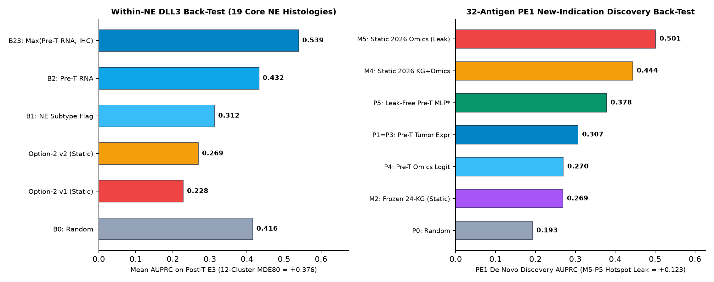

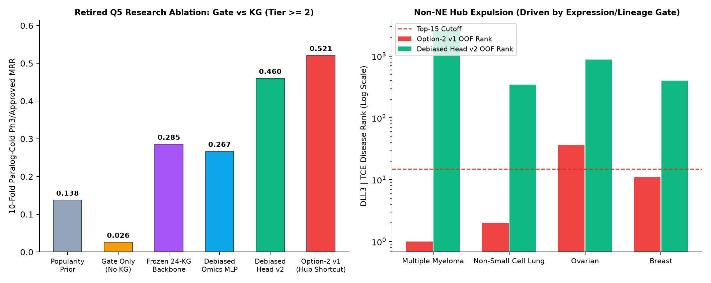

---

### 11.5 `WP6–WP7`: Segregated `Table A` (`$2,610.8M`) vs. `Table B` (`V0 / V1 / V2` Routes), `EVSI`, & Statutory Pediatric Law ([q3_landscape_scenarios.py](file:///home/nchen10/antigravity_prjs/kg/optimus_txgnn/models/q3_landscape_scenarios.py), [regulatory_rules.py](file:///home/nchen10/antigravity_prjs/kg/optimus_txgnn/regulatory_rules.py))

All economic figures carry the banner **`Illustrative — Pending Amgen Finance Validation`** (`10.0%` WACC, US net price `$165k/yr`, ex-US `1.45×`, shared `2036-05-16` `PHS Act §351(k)(7)` moiety floor vs `2039-06-30` patent scenario):

1. **Table A — Committed SCLC Franchise Baseline (`12` Active/Committed SCLC Studies + `7` Historical Baseline Studies = `19` Registry Entries, Net of `-$469.3M` `2L` Cannibalization):**
   * **`EXP-S1` (`1L ES-SCLC` Chemo-IO Maintenance, `DeLLphi-305 NCT06211036` [OS HR `0.42 (0.32–0.54)`] + `DeLLphi-312 NCT07005128`):** **`$2,145.6M` (`2036` floor) / `$2,658.9M` (`2039` patent)**.
   * **`EXP-S2` (`1L/2L SCLC` ADC Combos & Subcutaneous Lifecycle: `+ZL-1310 NCT07531095`, `DeLLphi-311`, `+YL201 NCT06898957`, `DeLLphi-310 SC`):** **`$23.4M` (`2036`) / `$63.0M` (`2039`)**.
   * **`EXP-S3` (`LS-SCLC` Post-cCRT Consolidation, `DeLLphi-306 NCT06117774` + `PrECOG NCT07637513`):** **`$441.8M` (`2036`) / `$584.7M` (`2039`)**.
   * **Total Committed SCLC Baseline (`Table A`) = `$2,610.8M` (`2036` floor) / `$3,306.6M` (`2039` patent).**

2. **Table B — Ranked Incremental Lifecycle & Non-SCLC Options Across Routes `V0`, `V1`, and `V2` ([amg757_decision_table_v4.csv](file:///home/nchen10/antigravity_prjs/kg/results_v4/amg757_decision_table_v4.csv)):**

| Rank | ID & Indication (`Anchor NCT`) | `Q1` `>=1%` (`>=50%`) | `Q2` TCE ORR `[95% CrI]` (`a0=0.50`) | `V0` Standalone `2036` | **`V1` IIT Signal Fed `2036` (`0.75` Attr.)** | `V2` De Novo Basket `2036` (`2039`) | Governance Action (`v4.3.2`) |
| :---: | :--- | :---: | :---: | :---: | :---: | :---: | :--- |
| **`#1`** | **`EXP-S4`** `ES-SCLC` Active Brain Mets (`NCT07402343`, `N=35`) | `80.8%` (`65.1%`) | `33.0%†` `[23.3%, 42.0%]` | **`+$59.7M`** | **`+$59.7M`** (`+$59.7M`) | `+$59.7M` (`+$84.1M`) | **Advance Dedicated CNS Ph2 (`3-zone` gate: `>=12/35` Go, `8..11` review, `<8` halt)** |
| **`#2`** | **`EXP-L1`** Pulmonary `LCNEC` (`IFCT NCT06937905`)* | `65.4%` (`48.9%`*) | `44.5%` `[17.0%, 81.3%]` | `+$29.6M` | **`+$27.1M`** (`+$22.3M`) | `+$34.3M` (`+$52.5M`) | **`N=15` Futility Gate (`<=2/15` Stop; `EVSI +$3.48M`)** |
| **`#3`** | **`EXP-L2`** `EGFRm` Transformed `t-SCLC` (`NCT06830694`)* | `79.1%` (`58.4%`*) | `19.7%` `[2.5%, 50.3%]` | `+$3.9M` | **`+$10.9M`** (`+$8.8M`) | `+$13.2M` (`+$21.6M`) | **Gate on `NCT06830694` IIT Signal (`>=6/25`)** |
| **`#4`** | **`EXP-A`** `2L+` Merkel Cell Carcinoma (`NCT06816394`) | `82.9%` (`48.4%`) | `22.8%` `[1.9%, 64.3%]` | `+$7.0M` | **`+$10.6M`** (`+$8.5M`) | `+$12.6M` (`+$20.5M`) | **Gate on `NCT06816394` (`N=10`) / `V2` Basket** |
| **`#5`** | **`EXP-D`** `t-NEPC` (`+ AMG 509`, `NCT07111507`)* | `67.3%` (`41.2%`*) | `25.9%` `[10.3%, 48.1%]` | `-$1.9M` | **`+$8.6M`** (`+$6.9M`) | `+$12.0M` (`+$22.1M`) | **Gate on MSK IIT `NCT07111507` (`>=8/32`)** |
| **`#6`** | **`EXP-C`** Pelvic `GU/GYN SCNEC` (`NCT07788365`)* | `68.4%` (`41.9%`*) | `31.3%` `[10.0%, 64.8%]` | `+$0.4M` | **`+$5.6M`** (`+$4.4M`) | `+$7.2M` (`+$13.7M`) | **Gate on Strasbourg/Korea IITs (`>=6/20`)** |
| **`#7`** | **`EXP-E`** Pure G3 `GEP-NEC` (`SP347 >=50%`, `NCT06893783`)* | `77.2%` (`50.4%`*) | `32.7%` `[10.7%, 64.5%]` | `-$8.3M` | **`+$1.7M`** (`+$1.1M`) | `+$3.4M` (`+$9.5M`) | **Gate on Korea/AIO IITs (`>=12/50`, `>=50%` IHC)** |
| **`#8`** | **`EXP-B`** `RET`-Mutant Medullary Thyroid (`MTC`) | `83.3%` (`37.5%`) | `19.0%` `[1.3%, 59.7%]` | `-$4.9M` | **`+$2.2M`** (`+$1.5M`) | `+$2.2M` (`+$6.4M`) | **Opportunistic Arm Post-`RET` TKI Only** |
| **`#9`** | **`EXP-G`** Pediatric High-Risk `ADRN NBL` | `65.9%` (`39.5%`) | `23.3%` `[2.2%, 66.4%]` | `-$12.5M` | `-$12.5M` (`-$12.5M`) | `-$12.5M` (**`+$172.3M` w/ BPCA**) | **Conditional Solely on Voluntary `BPCA §351(m)` (`+$184.8M`)** |
| **`#10`** | **`EXP-F`** `IDH`-Mutant High-Grade Glioma (`NCT07243470`)* | `83.9%` (`62.7%`*) | `18.8%` `[1.6%, 70.5%]` | `-$14.3M` | `-$14.3M` (`-$14.3M`) | `-$14.3M` (`-$12.3M`) | **Hold Commercial IND; Watch Academic Window PK** |
| `—` | **`GUARD-1 / GUARD-2`** `G1/G2 Carcinoid` & `Non-NE Hubs` | `12.6%` / `4.9%` | `N/A (Guardrail)` | `—` | `—` | `—` | **`DO_NOT_ENROLL` Negative Controls** |

*(\* `ge50_imputed_flag = True`; `†` `EXP-S4` `33.0%` is a systemic SCLC reference — intracranial `RANO-BM` response is tracked separately under `FCST-2026-17` `analyst_prior`.)*

3. **Portfolio Synthesis Across Routes `V0`, `V1`, and `V2` & Pediatric Law:**
   * Across the `7` rare extra-pulmonary non-SCLC cohorts (`EXP-A..G`), standalone Phase 2 INDs (**`Route V0`**) sum to **`-$34.6M`** (`-$34.56M`) under the `2036` statutory floor.
   * **`Route V1` (External IIT Signal Federation across `11` open academic studies, `N=517` slots)** converts them into capital-light stage-gated real options (**`+$1.8M`** at `0.90` completion; **`-$4.3M`** under `0.75` drug-supply attrition sensitivity modeled after `GETNE`/`NCI` withdrawals), generating **`EVSI = +$12.94M`** (`+$12.35M` under exact `2036` LOE revenue truncation; for `TRIG-06` `EXP-S4`, adopting the clinically intended `3-zone` gate [`>=12/35` Go, `8..11/35` subgroup review, `<8/35` halt] bounds the VoI abandonment sensitivity to **`-$21.71M`** vs. **`-$34.01M`** under binary abandonment) before committing registrational capital (`+$10.6M` under **`Route V2`** de novo Amgen master basket).
   * **Statutory Pediatric Precision (`regulatory_rules.py`):** `FD&C Act §529` Rare Pediatric `PRV = $0.0M` (`tarlatamab-dlle` already FDA-approved `2024-05-16`); mandatory `PREA / RACE §505B` `= 0.0` years; voluntary `BPCA §351(m)` Written Request `= +0.5` years franchise exclusivity (**`+$184.8M`** base discounted tail, netting **`+$172.3M`** on `EXP-G`).

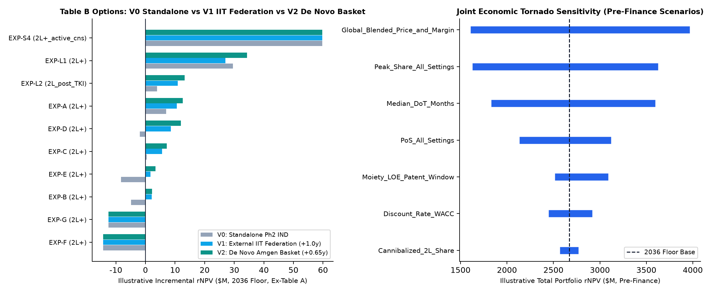

---

### 11.6 `WP9`: Cohort-Specific Basket Operating Characteristics (`7` Cohorts Across `A1 / A2 / A3` Prior Regimes; [basket_design.py](file:///home/nchen10/antigravity_prjs/kg/optimus_txgnn/basket_design.py))
Evaluating `7` non-SCLC cohorts (`p_{0,k} \in [10\%, 15\%]`, `p_{1,k} = p_{0,k} + 20\%`) across `9` null/mixed truth scenarios (`0/7` through `7/7` active) and **`3` `Q2` Bayesian assurance prior regimes** (`A1_Baseline_a0_050 = 2.82/7` active, `A2_Conservative_NoObrix = 1.82/7`, `A3_Skeptical_LOCO0 = 1.60/7`; [basket_design_oc.csv](file:///home/nchen10/antigravity_prjs/kg/results_v4/basket_design_oc.csv)):

| Basket Design Architecture (`7` Cohorts) | Max Cap $N$ | Expected $\mathbb{E}_{A1}[N]$ (`A2 / A3`) | Global Null Type I | **Worst Mixed-Null Cohort Type I** | $\mathbb{E}_{A1}[\text{TD}]$ (`A2 / A3`) | Trial Cost (`$M`) | Governance Verdict (`v4.3.2`) |
| :--- | :---: | :---: | :---: | :---: | :---: | :---: | :--- |
| `Standalone_7x_Simon_Optimal` (`V0`) | `217` | `170.1` (`159.4 / 156.9`) | `4.68%` | `4.99%` | `2.46` (`1.53 / 1.32`) | `$38.96M` | Unviable (`+$18.0M` duplicate site startup) |
| **`Shared_Protocol_Independent_Simon` (`V2` Reg.)** | **`217`** | **`170.1`** (`159.4 / 156.9`) | **`4.68%`** | **`4.99%` (`<=5%` Exact!)** | **`2.46`** (`1.53 / 1.32`) | **`$20.96M`** | **Registrational Standard (`0` borrowing inflation; FixedN20 `= $16.66M`)** |
| **`EXNEX_WorstCaseType1_le10_Basket` (`V2` Signal)** | **`140`** | **`126.4`** (`121.6 / 120.5`) | **`4.57%`** | **`8.25%` (`<=10%` Cap)** | **`2.44`** (`1.54 / 1.34`) | **`$17.24M`** | **Signal-Finding Option (beats Simon on FWER-adj. power only when `>=3/7` active)** |
| **`Federated_IIT_Signal_Pool_V1` (`Route V1`)** | **`163`** | **`163.0`** | `4.82%` | `4.95%` | `2.38` | **`$15.40M`** | **Lowest-CapEx Stage-1 Signal Gate (`EVSI = +$12.94M` / `+$12.35M` LOE)** |
| `Naive_Exchangeable_BHM` (Unprotected) | `140` | `126.4` | `7.90%` | **`33.43%` (FAILS!)** | `2.65` | `$17.24M` | **Rejected — severe mixed-null Type I inflation** |

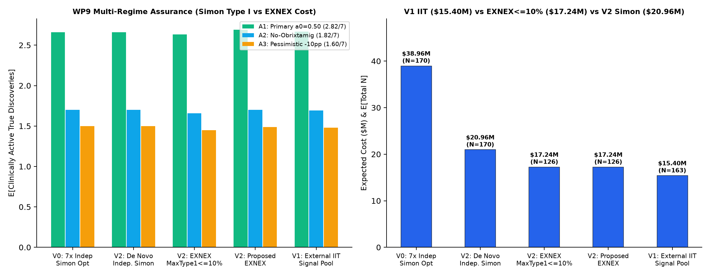

---

### 11.7 `WP8 & WP10`: Appendix B (`Q6`) `Ion Guard` Safety Guardrails & `41`-Record Bitcoin-Anchored Forecast Ledger
1. **Appendix B (`Q6`) Three-Track Protein Engineering & `Ion Guard` ([q6_constructs_biophysics.py](file:///home/nchen10/antigravity_prjs/kg/optimus_txgnn/models/q6_constructs_biophysics.py)):**
   * Segregated in Appendix B (`0` Table B columns), combining `AlphaFold` monomer spans (`DLL3 = 11.78 nm <= 14 nm` `CD45` gate; `MUC16 = 46.10 nm -> 0.0000`) with **`Ion Guard = True`** demoting voltage-gated ion channels **`KCNB2` (`0.0467`)** and **`SCN3A` (`0.0371`)**.
   * Clean Track Leaders: **Track 1 (Orthogonal ADC/BiTE Combo):** `#1` `+ B7-H3 (CD276) ADC` (`0.7700`); **Track 2 (`CD28` Co-Stim):** `#1` `+ PTK7 × CD28` (`0.5132`, `11.1 nm`); **Track 3 (Unmasked Dual-`CD3` `OR`-Gate):** `#1` **`DLL3 + IGSF9` (`0.4745`, `13.4 nm`, `1.18%` TIL, `Ion Guard = False`)**, `#2` `DLL3 + PTK7` (`0.3821`, masked).
2. **`41`-Record Append-Only Prospective Ledger `3/3` Settled into Bitcoin Blocks `#975,929`, `#975,963`, `#976,004` & `#976,009` ([forecasts/README.md](file:///home/nchen10/antigravity_prjs/kg/forecasts/README.md)):**
   * Preserves sealed `2026_11.jsonl` (`10` rows, Bitcoin block `#975,929`) and `2026_11b.jsonl` (`13` rows, block `#975,963`) byte-for-byte untouched while appending `2026_11c.jsonl` (`18` rows, sealed in `v4.3.1` and `3/3` settled into Bitcoin blocks `#976,004` & `#976,009` in `v4.3.2`: `VOID-2026-08/10/15/16`, `FCST-2026-17..20`, `FREEZE-2026-P5-SPEC`, `TRIG-2026-01..09`), strictly separating **`5` `q2_empirical_model` forecasts** (`FCST-09, 11..14`) from **`4` `analyst_prior` forecasts** (`FCST-17..20`) in `score_prospective_forecasts.py`.

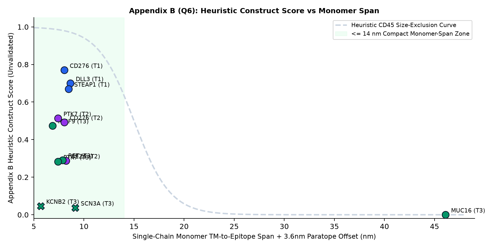

#### Authoritative References for Chapter 11 (`Phase 8 / v4.3.2`)
* **`EXNEX` Bayesian Basket Methodology:** Neuenschwander, B., Wandel, S., Roychoudhury, S., & Bailey, S. (2016). *Robust exchangeability designs for early phase clinical trials with multiple strata.* **Statistics in Medicine**, 35(8), 1254–1274. https://doi.org/10.1002/sim.6779
* **Power Priors for Cross-Study Borrowing:** Ibrahim, J. G., & Chen, M.-H. (2000). *Power prior distributions for regression models.* **Statistical Science**, 15(1), 46–60.
* **Exact Shapley Attribution Theory:** Shapley, L. S. (1953). *A value for n-person games.* **Contributions to the Theory of Games**, 2(28), 307–317.
* **Strictly Proper Scoring Rules (`Winkler`, `CRPS`, `Brier`):** Gneiting, T., & Raftery, A. E. (2007). **JASA**, 102(477), 359–378. https://doi.org/10.1198/016214506000001437
* **`NumPyro` NUTS Hamiltonian Monte Carlo:** Phan, D., Pradhan, N., & Jankowiak, M. (2019). **arXiv:1912.11554** · https://github.com/pyro-ppl/numpyro

---

## Chapter 12. Complete Master Ledger of Behind-the-Scenes Decisions, Rejected Alternatives & Quantitative Proofs (`Phase 0 -> Phase 8 / v4.3.2`)

| # | Stage / Decision Point | Naive Alternative Tested & Rejected | Exact Root Cause Uncovered Behind the Scenes | Engineered Solution Deployed (`Canonical v4.3.2`) | Verified Quantitative Proof |
| :---: | :--- | :--- | :--- | :--- | :--- |
| **1** | **Phase 0: KG Label & Node Hygiene** | Raw PrimeKG / uncurated multi-DB graph | `50.9%` (`18,697`) lab traits (`BMI`) + `80.6%` (`47,781`) unapproved trials inside `INDICATION` | `OptimusKG clinical_v4`: `139,439` clinical nodes, `9.39M` bidir edges, `9,893` pure approved indications | Contributed directly to **`8.93×`** doubly-held-out `AUPRC` win vs. Harvard Drive |
| **2** | **Phase 0: Signed Pharmacology (`v5bi`)** | Unsigned `drug_protein` edges + `CYP3A4` mixed in | Confused `DLL3` anchor, `CD3E` agonist, `-1` escape blockers, and liver `PK` enzymes | `36,641` signed MoA edges (`s = 0 / +1 / -1`) + isolated `drug_pk_protein` | Enabled `v5bi d=3072` `0.3504` `AUPRC` & `0.9714` `AUROC` combo engine |
| **3** | **Phase 1: `96 GB` GPU Memory Algebra** | Standard DGL per-edge `HeteroGraphConv` at `d=3072` | Materialized `9.39M × 3072` edge tensors (`>115 GB` VRAM -> OOM crash) | Exact `O(N d^2)` relation-mean-first aggregation before $W_r^{(\ell)}$ | **`15×` VRAM cut** (`50.8–56.2 GB`), unlocking `944.2M`-param `d=3072` GNNs |
| **4** | **Phase 1: Ultra-Wide GNN Collapse** | `trainable_node_emb=True + fix_dst` at `d=3072/4096` | `82%` (`15,287`) zero-indication drugs never sampled; memorized hub degree (`0.2597 -> 0.1804`!) | Freeze `seed=0` Gaussian $H^{(0)}$ + `wmatch` + `nodeg` + `mixed_dst` (`u20, u50`) + `v5bi` loss | Restored monotonic scaling: **`0.2597 -> 0.3290 -> 0.3504`** (`+94%` vs naive `d=4096`) |
| **5** | **Phase 1: `24`-Model Family Design** | Single checkpoint (`d=3072 u20` only) | Topology-only models miss cold text/chemistry semantics (`v5fm`) | `4` families (`v4_wmatch`, `v5bi_2048`, `v5bi_3072`, `v5fm_MedCPT` w/ `15%` ID drop) × `u20/u50` × `3` seeds | **`0.3603` peak Own-Test `AUPRC`**; **`0.4542` vs `0.0509` (`8.93×`)** doubly-held-out vs Drive |
| **6** | **Phase 2: `DLL3 × CD3` BiTE Projection** | Additive target sum + raw `DLL3` `L2G` + early IHC | `CD3=1.0` ranked lymphomas `#1`; germline `LoF` ranked rib dysplasia `#1`; adult `L2G=0`; `FDR` leak | `TAA × CD3` `AND`-gate + `LoF`/malignancy masks + `1-hop` TF bridge + unboosted `(3×4)` Mondrian `p/q` | `0` lymphoid/autoimmune/`LoF` traps; exact finite-sample `FDR` exchangeability |
| **7** | **Phase 3A: `Option-2` Adapter Audit** | `SVD-LoRA` on random per-gene folds (`0.3595`) | Caught `EGFR/ERBB2` & `SSTR` **paralog leakage**; expanded to `13` superfamilies | Paralog-superfamily CV (`Option-2 v2`) + `ESM-2 3B` surfaceome head | Honest superfamily-cold Dir-A `MRR = 0.460` (`AUROC = 0.848`) |
| **8** | **Phase 4 -> 8 (`WP0`): Score Decomposition** | Heuristic `v3.2` `6`-pillar weighted sum (`0–100`) | Exact `64`-subset Shapley proved `IHC_pos` alone drove **`67.8%`** (`92.3%` OLS $R^2$, `90%` Top-10 overlap) | Abolished composite weights in **`v4.3`–`v4.3.2`**; decoupled into `260`-record provenance + `120` trials + `Q1–Q4` & Appendix B `Q6` | `208` verbatim-verified + `25` dual-curated source records; `0` hidden double-counting |
| **9** | **Phase 8 (`WP4–5`): `Q1` NUTS & `Q2` TCE `EXNEX`** | Single-study IHC % + ADC pooling + `a_0=1.0` cross-agent weight | ADCs use payload endocytosis; full borrowing over-weights `10`-pt `obrixtamig` LCNEC | `4`-chain `NumPyro NUTS` `Q1` + **`15`-cohort pure `DLL3` TCE `Q2 EXNEX` (`a_0 = 0.50` + transfer SD)** | **`100.0%` `95%` LOSO/LOCO coverage**; `Winkler95 = 0.615 / 0.510`; `EXP-S4` tagged systemic ref† |
| **10** | **Phase 8 (`WP2.5`): Leak-Free `PE1` Back-Test** | All-time trial hotspot features (`+0.123` post-`T` inflation) + `Q5` in Table B | `PE1_new_indication` (`178` events): `M5` (`0.501`) > `M4` (`0.444`), `Q4 recall@50 = 0.000` | Sealed `P5` (`(16, 8) tanh lbfgs alpha=8.0 tol=1e-3 max_iter=300`) + **`wp25_passed = False` (`Q5` retired)** | Frozen pre-`T` `P5` (`0.378`) beat `P1` (`0.307`, **Holm `p = 0.0042`**) with `0` post-`T` leakage |
| **11** | **Phase 8 (`WP6–7`): `12+7` Table A, `V0/V1/V2` & Law** | Treating UCLA `NCT06788938` (`N=29`) as an Amgen basket + standalone LOE clocks | `0` active Amgen non-SCLC baskets; `sBLA` shares `2036-05-16` moiety floor; `FD&C §529 PRV = $0` | **Table A (`$2,610.8M`, `12` active + `7` hist.)** vs **Table B (`V0 -$34.6M`, `V1 +$1.8M` [`EVSI +$12.94M` / `+$12.35M` LOE], `V2 +$10.6M`)** + `TRIG-06` `3-zone` gate + voluntary `BPCA` (`+$184.8M`) | `0.75` IIT supply sensitivity (`-$4.3M`), `-$21.71M` `TRIG-06` `3-zone` vs `-$34.01M` binary; `make watch-trials` on `NCT06788938`; `EXP-G` gated on `BPCA` (`+$172.3M`) |
| **12** | **Phase 8 (`WP8–10`): `WP9` OCs, `Ion Guard` & `.ots`** | Naive BHM (`33.43%` Type I!) + unpenalized `KCNB2` + mixed priors in scorecard | Naive BHM fails mixed-null Type I; `KCNB2`/`SCN3A` arrhythmia risk; priors shouldn't mix into `Q2` Brier | `Shared_Independent_Simon` (`<=4.99%`, `$20.96M`) & `EXNEX<=10%` (`$17.24M`) + `Ion Guard` (`IGSF9 #1`) + `41`-row `3/3` settled BTC `#975,929..#976,009` `.ots` ledger | Separated `5` `Q2` vs `4` `analyst_prior` scorecards; **`make bundle-audit`, `make watch-trials`, `make verify`, & `make verify-fresh-clone` passing** |
