# AMG 757 (`Tarlatamab / IMDELLTRA` 塔拉妥单抗) 适应症拓展项目 —— 从零基础科普到模型架构设计、训练数据账本、评分推导与九阶段幕后决策全纪实（`v4.3.2` 审校权威版）

**核心资产：** `IMDELLTRA`（`Tarlatamab-dlle` / `AMG 757`，安进全球首创半衰期延长型 `DLL3 × CD3` 双特异性 T 细胞衔接器 [`BiTE`]；权威封版 **`amg757-v4.3.2`**，更新于 `2026-11-15`）  
**面向读者定位：** 本报告采用**“从零基础第一性原理出发 -> 直抵工业级底层数学、分层贝叶斯推断、注册试验核查与生物药专利法规细节”**的渐进式写法——**假设读者此前完全不熟悉什么是 `ADC 靶点` 或 `BiTE 靶点`、不熟悉生物医学知识图谱数据库、也不熟悉图神经网络 (`GNN`) 或贝叶斯篮式临床试验术语**。我们在每一个阶段都用通俗语言讲透背后的物理与数学直觉、公开精确到个位数的数据集规模、复盘所有踩坑与自我纠偏内幕，并逐阶段附上**权威同行评审论文 (`DOI`) 与官方开源代码库 (`GitHub`) 链接**。  
**核心代码实现模块：** [bite_biomarker_and_expansion.py](file:///home/nchen10/antigravity_prjs/kg/optimus_txgnn/bite_biomarker_and_expansion.py) · [option2_bite_head.py](file:///home/nchen10/antigravity_prjs/kg/optimus_txgnn/option2_bite_head.py) · [option2_debiased_v2.py](file:///home/nchen10/antigravity_prjs/kg/optimus_txgnn/option2_debiased_v2.py) · [amg757_integrated_synthesis.py](file:///home/nchen10/antigravity_prjs/kg/optimus_txgnn/amg757_integrated_synthesis.py) · [q1_prevalence.py](file:///home/nchen10/antigravity_prjs/kg/optimus_txgnn/models/q1_prevalence.py) · [q2_response.py](file:///home/nchen10/antigravity_prjs/kg/optimus_txgnn/models/q2_response.py) · [pan_antigen_temporal_backtest.py](file:///home/nchen10/antigravity_prjs/kg/optimus_txgnn/backtest/pan_antigen_temporal_backtest.py) · [q3_landscape_scenarios.py](file:///home/nchen10/antigravity_prjs/kg/optimus_txgnn/models/q3_landscape_scenarios.py) · [regulatory_rules.py](file:///home/nchen10/antigravity_prjs/kg/optimus_txgnn/regulatory_rules.py) · [basket_design.py](file:///home/nchen10/antigravity_prjs/kg/optimus_txgnn/basket_design.py) · [q6_constructs_biophysics.py](file:///home/nchen10/antigravity_prjs/kg/optimus_txgnn/models/q6_constructs_biophysics.py)

> [!IMPORTANT]
> **权威 `v4.3.2` 版本演进说明（`2026-11-15`，版本标签 `amg757-v4.3.2`）：** 本书第 1–10 章完整保留了从零基础生物物理科普、`OptimusKG` 图谱清洗、`96 GB` GPU `24` 模型基座训练、`Option-2` (`ESM-2 3B`)、`Option-1` 到 `v3.2` 六支柱综合评分（`阶段 0 -> 阶段 7`）的全部工程细节；**第 11 章（`阶段 8`，权威 `v4.3.2` 封版，详见 [16_AMG757_V4_EVIDENCE_MODEL_ZH.md](file:///home/nchen10/antigravity_prjs/kg/docs/zh/16_AMG757_V4_EVIDENCE_MODEL_ZH.md)）** 完整揭示了最终生物统计、临床注册核查与药政法规重构：通过精确 `2^6 = 64` 子集 Shapley 归因证明表面 IHC 主导了 `v3.2` **`67.8%`** 的排序贡献，彻底废除加权总分并升级为 **`260` 条机器核验溯源证据库 + `120` 项富集 `DLL3` 注册试验**、**`NumPyro NUTS` `Q1` 流行率模型**、**`15` 队列纯 `DLL3` TCE `Q2 EXNEX`（跨分子幂先验 `a_0 = 0.50` + 迁移标准差）**、在 `32` 抗原 `PE1_new_indication` 零前序试验主终点上直接剥离 `+0.123` 跨期热点泄漏后**继续退役 `Q5`（`P5 = 0.378` vs `M5 = 0.501`, `M4 = 0.444`, `wp25_passed = False`）**、将**表 A（`12` 项在研/已承诺 SCLC 拓展研究 + `7` 项历史/已完成基线研究 = `19` 项注册记录，`2036` 法定下限 `$2,610.8M` / `2039` 专利 `$3,306.6M`）**与**表 B（核实 `NCT06788938` 实为 UCLA `29` 例已停入组学术研究 [`ACTIVE_NOT_RECRUITING`，每季度由 `make watch-trials` 自动监测] 而非安进主方案篮子，客观对决 `V0` 独立建组 `-$34.6M`、`V1` 外部 `11` 项开放 IIT 信号联邦 `+$1.8M` [`0.75` 断药折损下 `-$4.3M`, `EVSI = +$12.94M` 基准 / 按 `2036` 独占期严格截断 `+$12.35M`]、`TRIG-06` `EXP-S4` 三区间门控 [`>=12/35` 继续、`8..11/35` 亚组复核 `P=36.0%`、`<8/35` 终止 -> `-$21.71M` vs 二元 `-$34.01M`] 与 `V2` 新建安进注册篮子 `+$10.6M`）**物理隔离、严格执行美国儿科法规（`FD&C Act §529 PRV = $0` vs 自愿 `BPCA §351(m) +0.5 年 = +$184.8M`）、在附录 B (`Q6`) 部署**`Ion Guard` 离子通道安全护栏（降权 `KCNB2`/`SCN3A`，确立 `DLL3 + IGSF9` `0.4745` 居首）**，并将 **`41` 条只追加前瞻预测账本**（`5` 项 `Q2` 实证模型与 `4` 项 `analyst_prior` 计分卡严格分离）**`3/3` 全部结算进比特币区块 `#975,929`、`#975,963`、`#976,004` 与 `#976,009`**。

---

## 第 1 章 零基础肿瘤免疫与抗体工程入门：到底什么是“靶点”？“ADC 靶点”与“BiTE 靶点”究竟有什么本质区别？

如果您此前没有接触过抗体药物工程或肿瘤免疫学，看到报告里反复强调*“不能用筛选 `ADC 靶点` 的逻辑去筛选 `BiTE 靶点`”*，一定会觉得抽象难懂。事实上，**弄懂 `ADC 靶点` 与 `BiTE 靶点` 的物理杀伤差异，是读懂整个 `AMG 757` 项目的“总钥匙”**——后面所有的图谱改造、模型架构、负采样设计和评分公式，全都是从这一物理差异直接推导出来的！

### 1.1 从零讲起：到底什么是抗癌药物的“细胞表面靶点”（`Surface Target / 靶点`）？
可以把人体里的每一个细胞想象成一座四周被油性围墙（**细胞质膜 / 外膜**，`Plasma Membrane`）包裹的小房子。在这堵围墙外侧，插着成千上万种像“门牌号”或“天线”一样的蛋白质，它们露在细胞外面的部分叫做**胞外域（`Extracellular Domain, ECD`）**。

传统的化疗药（如顺铂、依托泊苷）就像没有眼睛的炸药，顺着血液进入全身，凡是分裂快的细胞——无论是癌细胞，还是毛囊、骨髓造血细胞、肠道黏膜——统统无差别毒杀。现代靶向生物药的核心思路则是寻找**“肿瘤专属门牌号”（即肿瘤相关表面抗原 / 靶点，`TAA`）**：一种**高比例插在癌细胞外墙表面**，但在**正常心、肝、肺、肾、脑等致命重要器官的外墙表面几乎不存在**的蛋白质。

一旦找到了这样一个“门牌号”蛋白，科学家主要有**三种完全不同的武器造法**：
1. **第一代：普通单克隆抗体（`mAb`，如曲妥珠单抗 `Herceptin`、利妥昔单抗 `Rituxan`）：** 造一把只认这个门牌号的“Y 字形生物钥匙”，挂上去阻断癌细胞的生长信号，或者插一面小红旗呼叫免疫细胞。缺点是当癌细胞表面门牌号很少、或者肿瘤把免疫系统催眠时，单抗往往杀不死癌细胞。
2. **第二代：抗体偶联药物（`ADC`，`Antibody–Drug Conjugate`，如德曲妥珠单抗 `Enhertu`、戈沙妥珠单抗 `Trodelvy`、以及曾经失败的 `Rova-T`）：** 俗称**“特洛伊木马 / 精确制导化学毒弹包裹”**——科学家用一根可剪断的化学绳子（连接子 `Linker`），在一把单抗钥匙后面绑上 **`2 到 8` 颗剧毒化疗炸弹（`Payload`）**。
3. **第三代：双特异性 T 细胞衔接器（`BiTE / TCE`，`Bispecific T-Cell Engager`，代表作正是安进的 `AMG 757 / Tarlatamab / IMDELLTRA`）：** 俗称**“双头分子手铐”**——它身上**一滴化学毒素都不带**！它长着两只不同的手：左手抓住癌细胞外膜上的靶蛋白（`DLL3`），右手抓住患者自身免疫杀手 **T 细胞**表面的点火开关（`CD3ε` / `CD3E`），在体内把活生生的杀手 T 细胞和癌细胞强行“面对面铐在一起”！

---

### 1.2 `ADC` 是怎么杀癌细胞的？什么样的蛋白才算合格的“`ADC` 靶点”？
请把 **`ADC`（抗体偶联药物）**想象成一辆**装着 `2–8` 根雷管的装甲运钞车，而且这几根雷管只有在被吞进癌细胞肚子最深处时才能引爆**：
* **第 1 步（挂靠外膜）：** `ADC` 顺着血液漂到肿瘤里，抗体部分抓住癌细胞外膜上的靶蛋白。
* **第 2 步（吞进肚子 / 内吞入胞 `Endocytosis` —— *生死攸关的一步*）：** 光挂在癌细胞墙外是**毒不死**癌细胞的！癌细胞**必须主动张嘴，把“靶蛋白 + `ADC`”一口吞进细胞内部的小泡泡（内体）里**，并一路运送到细胞的“强酸消化胃”——**溶酶体（`Lysosome`）**中！
* **第 3 步（内部引爆）：** 溶酶体里的蛋白酶剪断化学连接子，释放出剧毒小分子，从细胞内部炸断癌细胞的 DNA 或微管骨架，把癌细胞毒死。

看懂了这个“送快递进肚子再引爆”的过程，您就能立刻明白一个**好的 `ADC 靶点`**必须满足什么物理条件：
1. **外膜表面的分子数量（拷贝数）必须极高（通常每个癌细胞表面需要 `10,000 到 1,000,000+` 个分子）：** 因为每一辆 `ADC` 运钞车只能背 `2–8` 颗毒药分子，如果癌细胞表面只有千把个靶蛋白，就算全吞进去，细胞里的毒药浓度也根本达不到致死线！
2. **内吞入胞速度必须非常快（`Fast Internalization`）：** 抗体一挂上去，靶蛋白必须迅速往细胞肚子里钻；如果它懒洋洋地赖在细胞外膜上不动，毒药就永远进不去！
3. **对靶蛋白的“身高”毫无要求（哪怕高达 `>25–40 nm` 也没问题）：** 因为不需要拉拢第二个细胞贴过来，所以像 `SEZ6`（高约 `32 nm`）、`MUC16` 这种又高又长的蛋白照样能做很好的 `ADC` 靶点。
4. **不怕肿瘤里没有 T 细胞：** 靠化学毒药直接毒杀（部分脂溶性毒素还能渗透出去顺带毒死隔壁癌细胞，叫“旁观者效应”），不需要免疫细胞帮忙。

---

### 1.3 `BiTE` (`AMG 757`) 是怎么杀癌细胞的？什么样的蛋白才是天选的“`BiTE` 靶点”？
现在来看我们的主角 **`AMG 757` (`Tarlatamab / IMDELLTRA`)**。它是一款半衰期延长型（带 `Fc` 段，分子量约 `105 kDa`）的 **`DLL3 × CD3` 双特异性 T 细胞衔接器 (`BiTE`)**。它完全不靠化学毒药，而是利用两项精妙绝伦的**纳米级生物物理学机制**来调动人体最强大的杀手 T 细胞：

#### 第一大绝技：彻底绕开 `MHC-I` 丢失（专治 `PD-1` 免疫治疗失败的“隐身癌细胞”！）
正常情况下，人体内的杀手 `CD8+` T 细胞要想认出癌细胞，癌细胞表面必须端着一个叫 **`MHC-I`（人类白细胞抗原 `HLA-A/B/C`）**的“分子托盘”，把癌变蛋白碎片呈递出来给 T 细胞检查；大家熟知的 `PD-1 / PD-L1` 抑制剂（如 K 药帕博利珠单抗）本质上只是帮这套天然识别松刹车。**但神经内分泌癌（如小细胞肺癌 `SCLC`、默克尔细胞癌 `MCC`、神经内分泌前列腺癌 `t-NEPC`）极其狡猾：超过 `70%` 的肿瘤直接把表面的 `MHC-I` 托盘拆掉扔了！** 没有托盘，普通 T 细胞瞬间变瞎，`PD-1` 单抗也随之失效。

而 `AMG 757` 根本不需要 `MHC-I` 托盘！它的右手直接抓住**每一个 T 细胞表面都自带的总点火电线——`CD3ε` (`CD3E`)**，不管这个 T 细胞原本是防流感的还是防细菌的，统统强行征召来杀癌细胞！

#### 第二大绝技：`<= 14 nm` 免疫突触的物理奇迹——“动力学分离”（`Kinetic Segregation` 挤出 `CD45` 刹车蛋白）
很多初学者会问一个极其聪明的问题：*既然 `AMG 757` 在血液里就能碰到 T 细胞表面的 `CD3ε`，为什么它不会在血液里胡乱把所有 T 细胞全都引爆、把病人直接烧死呢？*
* 因为 `AMG 757` 只有**一只**抓 `CD3ε` 的手（单价结合），单靠一只手挂在 T 细胞上是**按不响**开火开关的！
* 为什么按不响？因为在每一个处于待命状态的 T 细胞外膜上，密密麻麻竖立着一片高达 **`~28 到 45 纳米 (`nm`)`** 的参天大树状跨膜磷酸酶——**`CD45`**。`CD45` 就像一把**时刻踩死的“物理安全刹车”**，不停地把 `CD3` 信号线上的激活磷酸基团擦掉，防止 T 细胞误开火。
* 现在请看当 `AMG 757` 左手铐住癌细胞膜上的 **`DLL3`**、右手铐住 T 细胞的 **`CD3ε`** 时发生了什么：成熟的人类 `DLL3` 胞外域非常矮小紧凑（全长仅 `466` 个氨基酸，`aa 27–492`，由 `1` 个 `DSL` 结构域 + `6` 个紧凑串联的 `EGF-like` 结构域组成），从癌细胞膜表面伸出来的垂直高度仅有 **`~11.8 纳米 (`nm`)`**！当 `AMG 757` 把 `DLL3` 和 `CD3ε` 铐在一起时，癌细胞外膜和 T 细胞外膜被强行拉近到仅有 **`~11.8–13.5 纳米` 的极窄缝隙（人工免疫突触）**！
* **纳米级物理奇迹发生了（这就是牛津大学 Davis 与 van der Merwe 提出的“动力学分离”定律）：** 高达 `28–45 nm` 的大树状刹车蛋白 `CD45` **根本塞不进这只有 `11.8–13.5 nm` 的狭窄缝隙里，被硬生生物理挤出了接触区**！一旦 `CD45` 刹车被挤出去，接触区内的激酶 `Lck / ZAP70` 在几秒钟内瞬间点火，T 细胞立即向癌细胞精准喷射**穿孔素（`Perforin`，在癌细胞膜上打洞）**和**颗粒酶 B（`Granzyme B`，钻进洞里启动细胞凋亡自毁程序）**！更厉害的是，炸死这一个癌细胞后，T 细胞并不会同归于尽，而是**松开手铐，继续连环猎杀周围 `5 到 20+` 个癌细胞（连环杀伤 `Serial Killing`）**！

看到这里，您就能彻底明白为什么**好 `BiTE 靶点` 的筛选铁律几乎与 `ADC 靶点` 截然相反**：

| 核心物理 / 生物学维度 | 合格的 `ADC 靶点`（如 `HER2`、`TROP2`、`SEZ6`） | 理想的 `BiTE 靶点`（如 `AMG 757` 的靶点 `DLL3`） | 对我们构建 AI 模型与评分公式的直接决定性影响 |
| :--- | :--- | :--- | :--- |
| **1. 杀伤武器来源** | 每把抗体背负的 `2–8` 个化学毒素分子（消耗品） | **患者体内活的杀手 T 细胞**（喷射穿孔素+颗粒酶，可连环杀伤） | 模型必须同时评估肿瘤微环境 (`TME`) 里 T 细胞能不能进得去！ |
| **2. 癌细胞膜最少拷贝数** | **必须极高：** `10,000 – 1,000,000+` 个分子/细胞 | **超低丰度即可：** **仅需 `500 – 2,000` 个分子/细胞（IHC `>=1%`）！** | 低丰度神经内分泌靶点做 `ADC` 必败，做 `BiTE` 却是王牌！ |
| **3. 靶蛋白内吞入胞速度** | **必须快内吞**（吞进溶酶体才能剪断连接子卸毒） | **慢内吞 / 不内吞反而最好！**（必须稳稳留在外膜表面当搭桥锚点） | 内吞太快的蛋白会在 T 细胞赶到前就把手铐吞进肚子里浪费掉 |
| **4. 靶蛋白胞外域高度 (`nm`)** | 高矮不限（`10 nm` 到 `>40 nm` 均可） | **必须矮小紧凑（近膜间距 `<= 14 nm`）**才能挤出 `28–45 nm` 的 `CD45` 刹车 | 筛选二代双靶点时必须把 `>20–30 nm` 高个子松散靶点降级或要求抓近膜端 |
| **5. 肿瘤 `MHC-I` 丢失状态** | 无影响 | **`MHC-I` 丢失反而是巨大竞争优势**（专克 `PD-1` 耐药肿瘤！） | `SCLC`、`MCC` 等 `MHC-I` 缺陷肿瘤成为 `AMG 757` 最佳领地 |
| **6. 正常重要脏器外膜暴露** | 极低水平正常表达有时可容忍 | **心、肺、肝、肾、脑正常细胞外膜必须接近“零暴露”** | 正常脑组织一旦有靶点（如 `SEZ6`），皮摩尔级 `BiTE` 会诱发严重脑毒性 `ICANS` |
| **7. 蛋白酶剪切脱落入血** | 中轻度脱落可容忍（`ADC` 给药剂量高达数 mg/kg） | **必须极少脱落！** 血液游离靶蛋白会像“诱饵海绵”吸光 `BiTE` 并引爆外周风暴 | 迫使我们构建 `BACE1 / ADAM` 剪切风险图谱，一票否决高脱落靶点 |
| **8. 在 T 细胞自身上的表达** | 通常无大碍 | **在肿瘤浸润 T 细胞 (`TIL`) 上必须 `< 2%`！** 否则 T 细胞会互相铐住**自相残杀 (`Fratricide`)** | 迫使我们审计 `60,026` 个临床单细胞，直接拉黑在 T 细胞高表达的 `CD99` 与 `BSG`！ |

---

### 1.4 两个最生动的真实临床正反铁证（为什么 `DLL3` 做 `ADC` 惨败、做 `BiTE` 封神；而 `SEZ6` 恰恰相反）
1. **`DLL3` 的惊天逆转（`Rova-T` 惨败 vs. `AMG 757` 封神）：** 在健康成人体内，`DLL3` 躲在细胞内部的**高尔基体**里（健康心、肝、肺、肾外膜**零暴露**）。在神经内分泌癌中，谱系转录因子（`ASCL1`、`INSM1`）疯狂催生 `DLL3`，使其溢到细胞外膜上——但每个细胞外膜只有 **`~1,000–10,000` 个拷贝**，而且**内吞极慢**。艾伯维当年花巨资收购的 `DLL3` `ADC` 药物 `Rova-T` 在两项 3 期临床（`TAHOE`、`MERU`）全军覆没，正是因为拷贝太少+内吞太慢，进瘤毒药不够，剧毒 `PBD` 弹头反而在血液脱落造成严重胸腹水毒性。而安进的 `AMG 757` (`IMDELLTRA`) 完美顺应了 `DLL3` 的物理本性（`~11.8 nm` 矮小身高 + 慢内吞长留外膜 + `>=500` 拷贝即可连环杀伤 + 正常器官外膜零暴露），不仅拿下广泛期小细胞肺癌 (`ES-SCLC`) 3 期 **`DeLLphi-304` 总生存期大胜（中位 OS `13.6` vs `8.3` 个月，`HR = 0.60`）**，更在 **2026 年 9 月获 FDA 批准将第 1 周期住院监测缩短为 `6–8 小时` 门诊观察**，彻底打开了全身实体瘤门诊拓展的大门！
2. **竞品靶点 `SEZ6` 的反向印证（做 `ADC` `ABBV-706` 有效，做 `BiTE` 在我们 `v1.3` 中排第 `#1,598` 名出局）：** `SEZ6` 个子高（约 `32 nm`）、被肿瘤内高表达的 $\beta$-分泌酶 **`BACE1` 大量剪切脱落入血（`68%` 诱饵库风险）**，且在正常人脑高达 **`110.15 TPM`**——这些特点对于靠内吞卸毒的拓扑异构酶-1 `ADC` 尚可承受，但若做成非掩蔽 `CD3 BiTE`，既会在外周血被游离 `sSEZ6` 截胡，又面临极高中枢神经毒性 (`ICANS`) 风险！

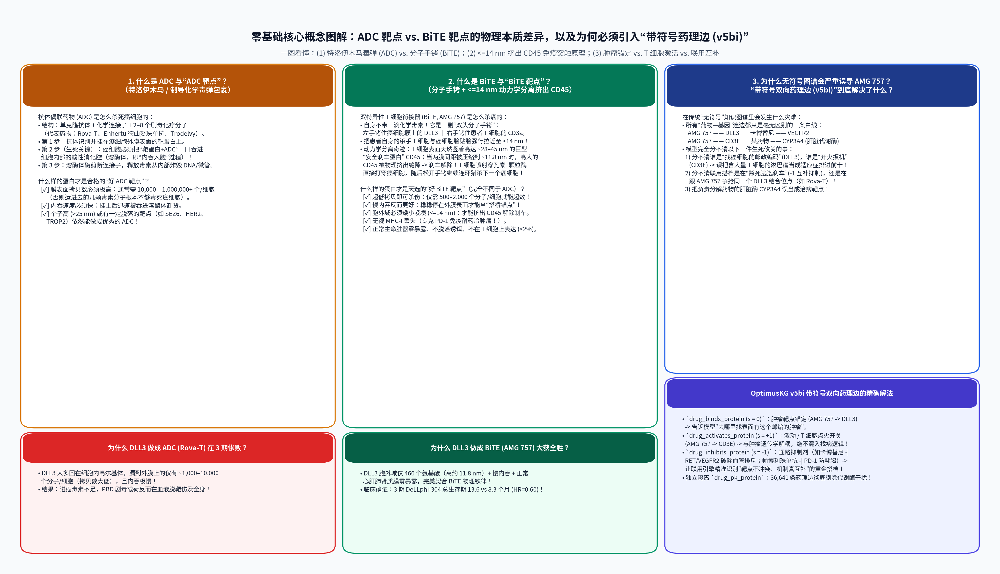

#### 第 1 章权威学术论文延伸阅读
* **`<=14 nm` 动力学分离挤出 `CD45` 免疫突触理论奠基论文：** Davis, S. J., & van der Merwe, P. A. (2006). *The kinetic-segregation model: TCR triggering and beyond.* **Nature Immunology**, 7(8), 803–809. https://doi.org/10.1038/ni1369
* **`BiTE` 双特异性 T 细胞衔接器连环杀伤机制综述：** Baeuerle, P. A., & Reinhardt, C. (2009). *BiTE: teaching antibodies to engage T-cells for cancer therapy.* **Cancer Research**, 69(12), 4941–4944. https://doi.org/10.1158/0008-5472.CAN-09-0547
* **膜近端表位距离如何决定 `BiTE` 挤出 `CD45` 与裂解效力：** Bluemel, C., et al. (2010). *Epitope distance to the target cell membrane and antigen size determine the potency of T cell-mediated lysis by BiTE antibodies.* **Cancer Immunology, Immunotherapy**, 59, 1197–1209. https://doi.org/10.1007/s00262-010-0844-y
* **`Rova-T` (`DLL3 ADC`) 3 期 `TAHOE` 临床失败复盘：** Blackhall, F., et al. (2021). **Journal of Thoracic Oncology**, 16(9), 1547–1558. https://doi.org/10.1016/j.jtho.2021.02.009
* **`AMG 757` (`Tarlatamab`) 关键临床研究 `DeLLphi-301`：** Ahn, M.-J., et al. (2023). *Tarlatamab for Patients with Previously Treated Small-Cell Lung Cancer.* **New England Journal of Medicine**, 389(22), 2063–2075. https://doi.org/10.1056/NEJMoa2307980

---

## 第 2 章 我们是如何一步步推演出“9 个阶段 (`Phase 0 -> Phase 8`)”工作流的？（真实的因果破案链，而非拍脑袋设计）

您特别问到：**“请详细解释你们是怎么想到并形成这一整套多阶段工作流的？”**

说实话，我们在项目第 1 天**绝不是**坐在白板前凭空画出了 9 个漂亮方框。恰恰相反，最开始我们也尝试过业界最常见的“两步走捷径”（第 1 步在公开知识图谱上训练 GNN，第 2 步直接输出 `AMG 757` 排名前十的疾病）——**结果跑出来的第一版名单在临床上荒谬绝伦、完全不可用！**

最终之所以演化出严丝合缝的 **9 个阶段 (`Phase 0 -> Phase 8`)**，是因为**每往前走一步，我们都用严格的生物学、生物统计学和药品注册法规放大镜去审视上一阶段的输出；每一次抓出漏洞（包括对我们自己 `v3.2` 综合分的独立 Shapley 归因与时间轴回测审计！），都倒逼我们设计出下一个专门的阶段去根治它**！请看这条环环相扣的真实因果链：

| 阶段编号 | 阶段名称 | 是什么真实故障 / 瓶颈“逼”出了这一阶段？ | 本阶段交付了什么核心产物给下一阶段？ |
| :---: | :--- | :--- | :--- |
| **`Phase 0`** | **`OptimusKG` 三层图谱精炼 (`v3.2 -> clinical_v4 -> amgen_v5`)** | 直接拿哈佛公开的 PrimeKG 跑模型时发现三大硬伤：(1) 药物-蛋白连边**没有正负作用符号**；(2) `50.9%` 的“疾病”其实是身高、`BMI` 等非疾病化验指标；(3) 原始适应症标签里竟混入了 **`80.6%` 未获批的 1–3 期临床试验噪音**！ | 清洗出 `139,439` 个临床连通节点、`9,385,536` 条双向边 + `36,641` 条带符号药理边 + `890 万` `L2G` + `OnSIDES` 不良反应与 FDA 橙/紫皮书专利层 |
| **`Phase 1`** | **`24` 模型基座 GNN 集群训练 (`96 GB` GPU)** | `AMG 757` 全世界只有 `1` 个获批适应症 (`ES-SCLC`)，单独训练必过拟合，必须先全图谱预训练。而在 `96 GB` GPU 上盲目把模型加宽到 `d=3072/4096` 时发生了大崩盘 (`0.2597 -> 0.1804`)；修复后又发现精度型 (`u20`) 与冷启动发现型 (`u50` + `MedCPT`) 各有所长，单一模型无法兼顾！ | 冻结 `4` 大架构家族 × `2` 种负采样课程 × `3` 组图切分种子 = **`24` 个基座模型（总计 `133.5 亿`参数）**，并提供逐病种认知不确定度 `z_std` |
| **`Phase 2`** | **`BiTE` 专属机制纠偏与无偏保形统计校准** | 把 `AMG 757 (DLL3 × CD3E)` 投射进 Phase 1 基座后爆出 **4 个灾难性假阳性/假阴性**：`CD3=1.0` 把淋巴瘤和糖尿病送上第 1；`DLL3` 胚系失活突变把婴儿先天肋骨畸形送上第 1；成人神经内分泌癌体细胞 `L2G` 全是 `0.000`；过早混入 IHC 直接破坏保形校准统计合法性！ | 剥离 `CD3` 的 `TAA × CD3` 乘性逻辑与门 + 先天畸形/良性瘤排斥掩码 + `1 跳`主转录因子桥接 + 未加权分数上的 `(3×4)` Mondrian 保形 `p/q` 校准 |
| **`Phase 3A`** | **第一引擎：`Option-2` (`OptimusBiTE-Head` + `ESM-2 3B`)** | 修完 Phase 2 四大陷阱后做严苛盲测（完全遮蔽 `SCLC` 标签），发现冻结基座把 **`DLL3 -> SCLC` 仅排在第 `#1,767 / 2,944` 名**！因为图谱里 `>92%` 的药是小分子，冻结 GNN 根本不懂“膜外蛋白结构、慢内吞与正常脏器规避”这些 `BiTE` 物理法则！ | 在 `68 × 2,944 = 200,192` 对矩阵上经旁系同源封锁交叉验证（`TCE AUROC = 0.9929`，盲测 `SCLC` 从 `#1,767` 跃升至折外 `#11` / 部署 `#1`）的模态感知神经打分头 |
| **`Phase 3B`** | **第二引擎：`Option-1` 临床/监管实证护栏引擎** | 即便 `Option-2` 达到 `0.9929` 的超高精度，纯序列与组学神经网络依然看不见人类临床现实：它不知道 **2024 年 8 月获批的 `Vorasidenib` 会抹掉胶质瘤的 `DLL3` 靶点且存在血脑屏障/`ICANS` 水肿风险**，也不知道 `GEP-NEC` 已有 **`12` 项竞品试验扎堆抢病人**！ | 组织分子亚型精细拆分表 (`v2.1`)、零掺杂 `SP347` 临床 IHC 库、专属 vs 篮子竞品试验空白度、以及 5 级临床给药安全护栏 |
| **`Phase 4`** | **无循环 `v3.2` 六支柱综合评分与 `g_target` 门控** | 当把双引擎合并成一个优先级总分时，如果简单相加，不仅会重复计分，还会让**几乎不表达 `DLL3` (`4.5%` IHC) 的非选择性尿路上皮癌靠着“零竞品 + 可门诊给药”白拿高分冲进前 9 名 (`61.41`)**！ | 六大严格正交 `[0,1]` 支柱 + 乘性靶点门控 $g_{\text{target}} = \text{clip}(\text{IHC}_+/35, 0.15, 1.0)$（尿路上皮癌从 `61.41` 砸回 `33.38` 第 `#47` 名）+ `10,000` 次 `Dirichlet` 权重扰动证明 |
| **`Phase 5`** | **真实患者肿瘤活检、`60k` 单细胞与 `<=14 nm` 突触升级** | 内部红队审评提出灵魂三问：(1) 仅靠 3–4 株细胞系怎么证明患者肿瘤真高表达？(2) 为什么 `t-NEPC` 明明有 `76.6%` `DLL3` IHC，在 `DeLLpro-300` 单药客观缓解率却只有 `22.2%`？(3) 设计二代双靶点三抗时，万一搭档靶点长在 T 细胞上引爆自相残杀怎么办？ | `2,215` 例原发人类肿瘤活检 + 同平台 `BiTE TME` 评分（揭开 `t-NEPC` `0.358` 冷微环境谜底 -> 转向 `+ AMG 509` 双 BiTE 序贯！）+ `60,026` 个临床 SCLC 单细胞 + `<=14 nm` 突触及 `BACE1` 脱落谱 |
| **`Phase 6`** | **初版 `v3.2` Simon 两阶段试验与篮子方案原型** | 临床与商业团队需要具体的 2 期无效止损样本量与中心入组估算，不能仅停留在抽象分数。 | `7` 个初版 `85%` 把握度 Simon 队列 (`EXP-A..G`) + `45` 中心共享主方案概念原型（随后在 `Phase 8` 接受全面法规与统计重构） |
| **`Phase 7`** | **`<1.5 秒` 纯 NumPy 蒸馏与跨平台离线可视化工作站** | Colab 训练出的 `24` 个 GPU 模型重达 **`101.23 GiB`** 且依赖 `PyTorch + DGL + CUDA`，临床研究团队的 Windows 11 办公电脑根本装不上也跑不动！ | 蒸馏为 `1.7 GB` FP16 推理包 + **纯 NumPy** 零依赖实时推理引擎（与 PyTorch 最大浮点误差 `0.000000`，CPU `<1.5 秒`响应）+ Win11/Linux 双击即开离线交互套件 |
| **`Phase 8`** | **权威 `v4.3.2` 溯源证据、`Q1/Q2 EXNEX` (`a0=0.50`)、`V0/V1/V2` 与 `.ots` 账本** | 独立生物统计、注册核查与法规联审发现 **IHC 主导 `67.8%` Shapley 权重**、UCLA `NCT06788938` (`N=29`) 非安进篮子、`+0.123` 跨期热点泄漏、共享 `2036` 时钟、`FD&C §529 PRV = $0` 及 `KCNB2` 离子通道风险！ | **`260` 条溯源记录 + `120` 项试验**、`Q1 NUTS` 与 `15` 队列纯 TCE `Q2 EXNEX` (`a0=0.50`)、**无泄漏 `PE1` 回测 (`P5=0.378`) 后退役 `Q5`**、隔离**表 A (`$2,610.8M`, `12+7=19` 项研究) / 表 B (`V0 -$34.6M`, `V1 +$1.8M` [`EVSI +$12.94M` / `+$12.35M` LOE], `V2 +$10.6M`)**、`TRIG-06` 三区间门控、自愿 `BPCA` (`+$184.8M`)、`Ion Guard` (`IGSF9 #1`) 及 `3/3` 已结算 `41` 条比特币 `.ots` 账本 |

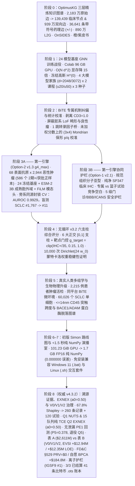

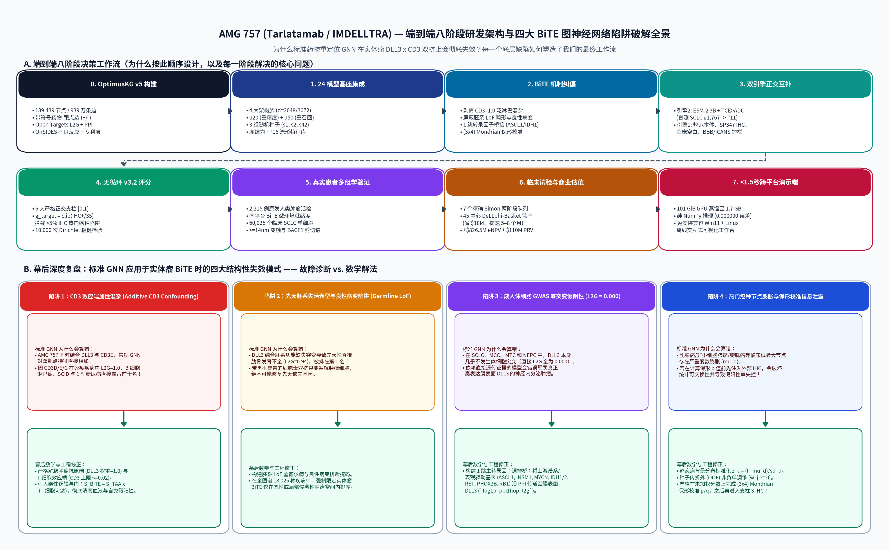

---

## 第 3 章 阶段 0 深度拆解：构建 `OptimusKG` —— 彻底讲透“带符号双向药理边 (`v5bi`)”、多源人类遗传/解剖/安全/专利层与精确数据集规模

### 3.1 零基础认识生物医学知识图谱 (`KG`)，以及我们的三层数据清洗总账本
什么是**生物医学知识图谱（`Knowledge Graph, KG`）**？简单说，就是把全人类分散在几十个医学数据库里的零碎知识，统一织成一张巨大的“有向关系网”：图里的**节点（`Node`）**代表具体事物（某款药、某个基因/蛋白质、某种疾病、某个人体器官、某条细胞通路），图里的**有向边（`Edge`）**代表经过验证的科学事实（例如：*“卡博替尼 —抑制-> RET 激酶”*、*“ASCL1 —结合调控-> DLL3”*、*“DLL3 —不表达于-> 健康成人心肌”*、*“塔拉妥单抗 —获批治疗-> 广泛期小细胞肺癌”*）。

学术界最著名的是哈佛大学发布的 **PrimeKG**（`129,375` 个节点、`4,050,249` 条边，整合 `20` 个数据库）。但当我们把 PrimeKG 拿来做工业级临床决策时，发现了三个致命的数据污染问题。为此，我们从头构建了三层 **`OptimusKG` (`v3.2 -> clinical_v4 -> amgen_v5`)** 数据底座：
1. **第 1 层 —— 原始全景图谱 (`OptimusKG v3.2`)：共 `192,813` 个节点（原始表 `192,814` 行）、`21,834,669` 条原始边**，整合自 **`65` 个权威生物医学数据库**（节点数为哈佛 PrimeKG 的 **`1.49 倍`**，边数为 **`5.39 倍`**）。
2. **铁腕清洗 1 —— 剔除 `18,697` 个非疾病化验与体格测量词条（占原始疾病词条的 `50.9%`！）：** 公开图谱从全基因组关联分析 (`GWAS`) 导入词条时，把 `18,697` 个诸如*“身高”、“体重指数 (`BMI`)”、“血小板计数”、“足跟骨密度”*之类的体检指标全都标成了“疾病 (`disease`)”！不删掉它们，模型一半算力都在预测“什么药治疗身高”。我们在建立节点索引前将其 `100%` 清零（`active_measurement_diseases = 0`），精准保留 **`18,025` 个真实人类临床疾病**（其中高达 **`93.0%`** 的人类疾病至今没有任何获批药物！）。
3. **铁腕清洗 2 —— 将混入适应症标签的高达 `80.6%` (`47,781` 对) 未获批临床试验彻底剥离：** 原始多库合并表里标为 `INDICATION`（适应症）的 `59,289` 行记录中，竟有 **`47,781` 对 (`80.6%`)** 只是 `ClinicalTrials.gov` 上登记过的 **1–3 期在研临床试验**（肿瘤 1 期试验近 `90%` 最终失败！）。把未获批甚至已失败的试验当成“标准答案”去训练解码器，会严重毒害模型精度！我们将这 `47,781` 对剥离为仅供编码器传递邻居信息的 `drug_clinical_trial` 边，而**解码器的监督学习严格锁定在经 FDA / DrugCentral 确证的 `9,893` 对（含同义双生节点 `9,895` 对）真实获批适应症 (`indication`)** 上！

#### `OptimusKG clinical_v4 + amgen_v5` 精确节点与关系边普查表（个位数级核验）

| 图谱层级 / 实体或关系类别 | 在 `OptimusKG` 中的精确规模 | 在 `AMG 757` 适应症拓展与联用发现中的核心作用 |
| :--- | :---: | :--- |
| **GNN 消息传递连通临床节点总数 (`clinical_v4`)** | **`139,439` 个节点（`10` 大实体类型）** | 全部 `24` 个基座 GNN 模型共享的底层推理全集 |
| ├─ `gene/protein`（人类基因 / 蛋白质） | `26,660` 个 | 含 `2,419` 个确证位于细胞外质膜的表面组蛋白（`DLL3`、`STEAP1`、`KCNB2` 等） |
| ├─ `biological_process`（`GO` 生物学过程） | `25,754` 个 | 细胞功能程序（如 Notch 信号转导、T 细胞脱颗粒杀伤、神经内分泌分化） |
| ├─ `effect/phenotype`（`HPO` 人类临床表型） | `19,341` 个 | 症状与遗传表型连接（用于精准识别并剔除先天性胚系畸形综合征！） |
| ├─ `drug`（获批药 + 临床在研药 + ChEMBL 化合物） | `18,640` 款 | 仅 **`3,353` 款**有获批适应症；其余 **`15,287` 款 (`82.0%`) 获批适应症数为 `0`！** |
| ├─ `disease`（`MONDO / EFO` 真实临床疾病） | `18,025` 种 | 含 **`2,944` 种恶性肿瘤细分亚型**（全集 `93.0%` 的疾病目前无任何获批药） |
| ├─ `anatomy`（`Uberon` 人体器官、组织与细胞解剖结构） | `13,120` 个 | 正常器官表达与毒性定位（心、脑、肝、肾、皮肤、甲状腺滤泡旁 C 细胞等） |
| ├─ `molecular_function` (`10,161`) + `cellular_component` (`4,052`) | `14,213` 个 | 区分蛋白究竟在“细胞外质膜”还是困在“细胞内高尔基体/细胞核” |
| └─ `pathway`（`Reactome` 通路，`2,805`）+ `exposure`（暴露，`881`） | `3,686` 个 | 标准生化信号级联图谱与病毒/紫外线暴露（如默克尔多瘤病毒/UV） |
| **GNN 消息传递边总数 (`clinical_v4`)** | **`4,692,768` 条前向 / `9,385,536` 条双向** | 共 **`R = 50` 种规范有向关系**（`25` 种正向关系 + `25` 种独立学习的反向 `rev_*` 关系） |
| ├─ 核心疗效与安全性监督目标边（`3` 类） | `9,893` 获批适应症 · `11,673` 禁忌症 · `1,030` 超说明书 | 同步训练“对谁有效 (`Indication`)”与“对谁有害/致命 (`Contraindication`)” |
| └─ 核心生物学多跳推理上下文边 | `948,123` 组织表达 · `793,279` 表型-蛋白 · `451,021` 疾病-基因 · `327,924` 蛋白互作 `PPI` · `36,611` 药物-靶点 | 支撑“谱系转录因子 -> 靶蛋白 -> 器官组织 -> 疾病亚型”多跳几何推理 |

---

### 3.2 逐句深度拆解：为什么无符号连边*“对于需要区分‘肿瘤靶点锚定 vs. T 细胞激活 vs. 联用靶点互补’的 `AMG 757` 而言会产生严重误导”*？以及什么是**“带符号双向药理作用边 (`v5bi`)”**？

这是您点名要求重点讲透的核心问题。让我们用四个最直观的例子，看看传统“无符号”知识图谱到底错在哪里：

#### 1) 传统无符号知识图谱里发生了什么荒唐事？
在 PrimeKG 或原版 TxGNN 中，所有“药物与蛋白质”的关系全都画成**完全一模一样的一条无标签白线 (`drug —— protein`)**。于是，下面这**四件药理学上天差地别的事**被电脑当成了同一件事：
1. **`AMG 757 —— DLL3`（肿瘤外膜物理锚定）：** `AMG 757` **既不是**靠抑制 `DLL3` 信号治病，**也不是**靠激活 `DLL3` 治病——它纯粹是把癌细胞外膜上的 `DLL3` 当成抓手（“肿瘤门牌号”）挂上去！
2. **`AMG 757 —— CD3E`（免疫 T 细胞激动点火）：** `AMG 757` 交联并**强烈激活 (`+1`)** 患者正常 T 细胞上的 `CD3ε`——注意，`CD3ε` 根本不在实体瘤癌细胞上！
3. **`卡博替尼 —— VEGFR2 / RET` 或 `帕博利珠单抗 —— PD-1`（逃逸通路/免疫刹车抑制 `-1`）：** 它们的作用是**踩死/阻断 (`-1`)** 肿瘤血管排斥屏障或 T 细胞耗竭刹车！
4. **`某款药 —— CYP3A4 / ABCB1 / ALB`（肝脏代谢酶 / 转运体 / 血浆白蛋白）：** `CYP3A4` 是肝脏里负责把药物分解排泄掉的酶，根本不是治病靶点！

当模型分不清这四条线时，**三重严重误导立刻发生**：
* **严重误导一（把“开火扳机 `CD3E`”误当成“肿瘤门牌号 `DLL3`”）：** 模型看到 `AMG 757` 连着 `CD3E`，就顺藤摸瓜把所有跟 `CD3E` 基因有关的病——**B 细胞淋巴瘤、T 细胞白血病、重症免疫缺陷 (`SCID`)、1 型糖尿病**——统统当成 `AMG 757` 的首选适应症排进前十名，哪怕这些病表面 `DLL3` 表达量是 **`0%`**！
* **严重误导二（把“抢同一个靶点的死对头”当成好搭档，却认不出真正的“机制互补搭档”）：** 在帮 `AMG 757` 找联合用药时，无符号图谱看到 `Rova-T` 也连着 `DLL3`，会觉得“哇，靶点高度重合，天生一对！”——殊不知临床上把 `Rova-T` 和 `AMG 757` 联用，两者会**疯狂争抢癌细胞表面仅有的几千个 `DLL3` 分子（同靶点空间位阻互搏）**！反过来，在甲状腺髓样癌 (`MTC`) 中，卡博替尼**抑制 (`-1`)** `RET` 驱动基因并正常化畸形肿瘤血管 (`VEGFR2`)，让 `AMG 757` 铐住的 T 细胞顺畅杀进肿瘤内部且完全不抢 `DLL3` 位点——如果没有正负号，AI 根本无法区分**“同位点恶性抢夺”**与**“异通路互补协同”**！
* **严重误导三（肝脏代谢酶制造虚假相似性）：** 两款毫不相干的药仅仅因为都在肝脏被 `CYP3A4` 分解，在图谱里就形成了 `药A -> CYP3A4 -> 药B` 的 2 跳捷径，产生海量错误重定位噪音。

#### 2) 我们的 **`OptimusKG v5bi`（“带符号双向药理作用边”）** 是如何精准解决它的？
我们在 `amgen_v5` 层（`drug_target_moa.parquet`，融合 DrugBank、ChEMBL v34 作用机制表、IUPHAR 药理学指南与 FDA 说明书，精炼出 **`36,641` 条权威药理作用边**）同时从**“带符号 (`Signed`)”**与**“双向 (`Bidirectional`)”**两个维度彻底重构了模型：
* **什么叫“带符号 (`Signed`，极性 $s \in \{-1, 0, +1\}$)”？**
  1. **`drug_binds_protein` ($s = 0$，物理结合/肿瘤表面锚定)：** 赋予 `AMG 757 -> DLL3`。明确告诉模型：*“去寻找外膜长着 `DLL3` 这个门牌号的实体肿瘤！”*
  2. **`drug_activates_protein` ($s = +1$，激动剂 / T 细胞点火开关)：** 赋予 `AMG 757 -> CD3E`。将其与肿瘤体细胞遗传学彻底解耦，同时让联用引擎自动识别“双 `CD3` 激动剂同日给药会引爆细胞因子风暴 (`CRS`)，必须错峰序贯给药”！
  3. **`drug_inhibits_protein` ($s = -1$，抑制剂 / 拮抗剂 / 阻断剂)：** 赋予激酶抑制剂（如 `卡博替尼 -| RET/VEGFR2`、`奥希替尼 -| EGFR`）和免疫检查点阻断剂（如 `帕博利珠单抗 -| PD-1`）。让联用模型能够用数学精确打分：**“靶点零冲突 (`DLL3` 独占) + 下游逃逸刹车被踩死 (`s = -1`) = 黄金协同联用”**！
  4. **独立隔离药代动力学边 `drug_pk_protein`：** 将 `CYP3A4`、`ABCB1`、`ALB` 等代谢酶与载体蛋白彻底移出治疗靶点投射空间。
* **什么叫“双向 (`Bidirectional`)”？（包含两层关键双向设计！）**
  1. *图消息传递双向化：* 每一条正向边 $(u \xrightarrow{r} v)$ 都配有一条拥有独立权重矩阵 $W_{\text{rev\_}r}^{(\ell)}$ 的反向边 $(v \xrightarrow{\text{rev\_}r} u)$（共 `25 × 2 = 50` 种有向关系），让信息既能从药物流向基因/疾病，也能从疾病和通路反向汇聚回药物。
  2. *对比损失函数双向化：* 原版 TxGNN 训练时只固定疾病去猜药（`Disease -> Drug` 单向负采样）。而在**适应症拓展**任务中，我们的真实提问方向恰恰相反——是**固定一款药 (`AMG 757`) 去给全部 `18,025` 种疾病排序 (`Drug -> Disease`)**！因此我们在 `v5bi` 中加入了**反向“污染疾病端”对比损失**（每个正样本额外采样 `4` 个负向疾病，权重 `disease_neg_weight = 0.25`），直接压制了乳腺癌、非小细胞肺癌等高频热门癌种在所有药物下“无脑排前排”的虚高偏置！

---

### 3.3 零基础逐一科普：报告中提到的八大生物医学、安全性与专利数据源到底是什么？（附权威论文与 GitHub）

针对您点名询问的两段密集专业描述——*“多源人类遗传学与解剖表达谱（Open Targets L2G、PPI、Reactome/GO、Uberon）”*以及*“双向疗效/禁忌解码与安全性、专利元数据（OnSIDES v3.1.1、类型化 DDI、FDA 橙皮书/紫皮书）”*——下面用最通俗的语言逐一为您拆解：

1. **Open Targets Locus-to-Gene (`L2G` 加权基因–疾病证据 —— 共 `8,900,000` 条打分记录)：**
   * *零基础科普：* 科学家对比几十万名癌症/疾病患者与健康人的基因组 (`GWAS`) 时，能找到很多与疾病显著相关的 DNA 位点变异 (`SNP`)。但超过 `90%` 的变异落在不编码蛋白质的“基因荒漠区”——就像发现火灾现场附近停着 3 辆车，光靠位置远近不知道哪辆车才是纵火犯！欧洲生物信息研究所 (`EMBL-EBI`) 与桑格研究所开发的 **Open Targets `L2G` 机器学习模型**，融合了三维染色质折叠图谱（`Hi-C`，看这段 DNA 折叠过去真正贴在哪个基因开关上）、组织基因表达调控 (`eQTL / pQTL`) 和蛋白编码突变后果 (`VEP`)，为每一对“基因–疾病”算出一个 `0 到 1` 的因果概率分 $\text{L2G}(g, d)$。
   * *在本项目中的作用：* 为 `DLL3` 及其上游主控转录因子（`ASCL1`、`INSM1`、`MYCN`、`IDH1/2`、`RET`、`PHOX2B`）提供真实人类遗传学因果支撑！
   * *论文与官方 GitHub：* Mountjoy, E., et al. (2021). **Nature Genetics**, 53, 1527–1533. https://doi.org/10.1038/s41588-021-00945-5 · GitHub: https://github.com/opentargets/genetics-l2g
2. **高置信度人类蛋白互作网络 (`PPI`，`Protein–Protein Interaction` —— 共 `327,924` 条边，覆盖 `26,660` 个人类蛋白)：**
   * *零基础科普：* 细胞里的蛋白质不是单打独斗的，而是像机械表里咬合的齿轮一样物理结合成复合体工作（由酵母双杂交、质谱共沉淀等实验确证，整合自哈佛 **HuRI**、**BioGRID** 与 **STRING**）。
   * *在本项目中的作用：* 架起从上游突变/驱动基因（如 `ASCL1`、`NOTCH1–4`、`LFNG`）跨越 `1` 跳直达膜表面 `DLL3` 的物理桥梁。
   * *论文与官方 GitHub：* Luck, K., et al. (2020). *A reference map of the human binary protein interactome.* **Nature**, 580, 402–408. https://doi.org/10.1038/s41586-020-2188-x · GitHub: https://github.com/CCSB-DFCI/HuRI_paper · https://string-db.org
3. **Reactome 生化通路 (`2,805` 条) 与基因本体论 `GO` (`39,967` 个节点：`25,754` 生物过程 + `10,161` 分子功能 + `4,052` 细胞组分)：**
   * *零基础科普：* 如果说 `PPI` 是零件咬合表，**Reactome** 和 **GO** 就是细胞内部的“电路原理图”与“岗位说明书”——明确记载每个蛋白在干什么活（如 Notch 信号转导、T 细胞杀伤），以及它住在细胞的哪个房间（`GO:0005886 细胞外质膜` vs. `GO:0005794 高尔基体`）。
   * *论文与官方 GitHub：* Milacic, M., et al. (2024). **Nucleic Acids Research**, 52(D1), D672–D678. https://doi.org/10.1093/nar/gkad1025 · GitHub: https://github.com/reactome & https://github.com/geneontology
4. **Uberon 组织解剖学基因表达边 (`anatomy_gene_edges.parquet` —— `13,120` 个解剖结构节点；`948,123` 条确认表达边 + `44,576` 条确认不表达边)：**
   * *零基础科普：* **Uberon** 是国际通用的标准人体器官与细胞解剖编码词典（如肺、大脑皮层、心肌、皮肤、甲状腺滤泡旁 C 细胞），结合 **Bgee / GTEx** 健康人体器官测序数据，明确标出每个基因在哪些正常器官里**有表达 (`present`)**、在哪些器官里**完全不表达 (`absent`)**。
   * *在本项目中的作用：* 一方面验证候选肿瘤的起源器官与靶点谱系是否吻合 (`tissue_concordance`)，另一方面像雷达一样扫描“正常心、肺、肝、肾、脑”是否存在脱靶毒性隐患！
   * *论文与官方 GitHub：* Mungall, C. J., et al. (2012). **Genome Biology**, 13, R5. https://doi.org/10.1186/gb-2012-13-1-r5 · GitHub: https://github.com/obophenotype/uberon
5. **同步建模适应症 (`Indication`, `9,893` 对) 与禁忌症 (`Contraindication`, `11,673` 对) 双重链接预测：**
   * *零基础科普：* **禁忌症**是指医学上明确规定“某病患者绝对不能用某药，否则会加重病情甚至致死”（例如未做 $\alpha$ 受体阻滞准备的嗜铬细胞瘤禁用某些诱发儿茶酚胺释放的药物，严重活动性自身免疫病禁用强免疫激活剂）。如果只训练模型预测“药物和疾病有没有关联”，模型很容易把禁忌症当成适应症推荐出来！同步训练双解码器让模型天生具备**“一手算疗效、一手算禁忌红线”**的双向辨别力。
6. **OnSIDES `v3.1.1` FDA 官方说明书不良反应 (`44,607` 对高置信度药物–不良反应 + 黑框警告掩码)：**
   * *零基础科普：* **黑框警告 (`Boxed Warning`)** 是美国 FDA 印在药品说明书最顶端的最高级别致命风险警示（`AMG 757` 因细胞因子释放综合征 `CRS` 和神经毒性 `ICANS` 带有黑框警告）。哥伦比亚大学/西达赛奈 Tatonetti 实验室开发的 **OnSIDES** 利用临床自然语言大模型 (`PubMedBERT`) 从数千份 FDA 官方 `DailyMed` 说明书中精准提取不良反应 (`ADE`) 与黑框警告。
   * *在本项目中的作用：* 在挑选联合用药时，自动拦截会与 `AMG 757` 发生致命神经毒性或重症肝/细胞因子毒性叠加的危险搭档！
   * *论文与官方 GitHub：* Takeshita, K., et al. / Tatonetti Lab (2024–2025). *OnSIDES: Extracting adverse drug events from FDA structured product labels.* https://doi.org/10.1101/2024.03.22.24304724 · GitHub: https://github.com/tatonetti-lab/onsides
7. **类型化药物相互作用 (`Typed DDI` —— 共 `1,345,373` 条边，细分为 `4` 大药代/药效严重度子类型)：** 刻画两药同服时的血药浓度干扰、QT 间期延长或毒性放大效应，直接输入联用打分器。
8. **FDA 橙皮书 (`Orange Book`, `2,494` 款专利到期小分子仿制药) 与紫皮书 (`Purple Book`, `18` 款生物类似药)：**
   * *零基础科普：* **FDA 橙皮书**是美国官方的小分子药物专利与独占期登记簿；**FDA 紫皮书**则是抗体等生物大分子药物的专利与生物类似药登记簿。
   * *在本项目中的作用：* 商业研发算账时天差地别——如果把 `AMG 757` 跟安进自家的另一款新药联用（**Tier 1 自有双药组合**，如 `+ Xaluritamig [AMG 509]`），安进独享 `100%` 双份药价收入；如果跟**橙皮书/紫皮书已过专利期的公用好药**联用（**Tier 2**，如专利期后 TKI / 拓扑替康 / 顺铂），安进可以直接低成本采购对照药独立发起临床，无需看外部大药企脸色或分走一半利润！

---

## 第 4 章 阶段 1 深度拆解：24 模型基座家族 (`基座模型家族`) 是如何设计、训练与评估的？为什么一开始在 `96 GB` GPU 上盲目加宽反而导致大崩盘？

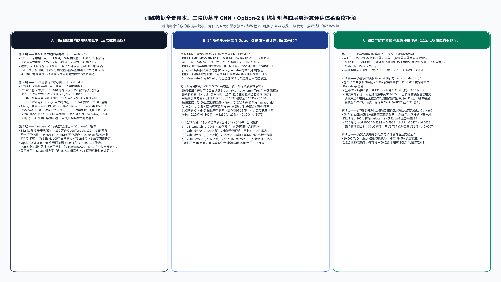

### 4.1 零基础读懂我们的基座图神经网络 (`HeteroRGCN + DistMult`) 与显存降 `15 倍`突破
假设您之前完全没接触过图神经网络 (`GNN`)，我们的基座模型究竟是怎么在 `139,439` 个节点和 `939 万`条边上学习的？其实只需三步就能想明白：
1. **给每个生物实体分配一组高维坐标 ($H^{(0)} \in \mathbb{R}^{139,439 \times d}$)：** 把每一款药、每一个基因、每一个器官、每一种疾病都放进一个 `2,048` 维或 `3,072` 维的几何空间里。
2. **两层异构关系图卷积消息传递 (`HeteroRGCN`)：** 在第 $\ell \in \{1, 2\}$ 层中，每个节点 $v$ 都会收集与它相连的所有邻居发来的“消息”。关键在于：对于全部 `R = 50` 种不同的关系（“抑制靶点”、“蛋白互作”、“器官表达”等），模型为每一种关系 $r$ 单独学习一个专属变换矩阵 $W_r^{(\ell)} \in \mathbb{R}^{d \times d}$：
   $$\mathbf{h}_v^{(\ell)} = \sigma\!\left( W_{\text{self}}^{(\ell)}\,\mathbf{h}_v^{(\ell-1)} + \sum_{r=1}^{50} \frac{1}{\lvert \mathcal{N}_r(v) \rvert} \sum_{u \in \mathcal{N}_r(v)} W_r^{(\ell)}\,\mathbf{h}_u^{(\ell-1)} \right)$$
   经过 2 跳消息传递后，哪怕默克尔细胞癌 (`MCC`) 和小细胞肺癌 (`SCLC`) 表面上名字完全不同、也没有共享同一款老药，只要它们上游都共享 `ASCL1/INSM1 -> DLL3` 神经内分泌调控网，它们在 `3,072` 维空间里就会自动聚拢到同一个几何街区！
3. **`k = 3` 罕见冷门病相似原型门控 (`Disease Profile Prototype Gate`) + 双线性 `DistMult` 解码：** 因为图谱里 `93.0%` 的人类疾病目前没有任何获批药，模型为低度数罕见病自动检索基因/表型谱最相似的 `k = 3` 个成熟参照疾病（预编码为 `18,025 × 51,833` 稀疏矩阵，训练时强制把自身对角线相似度遮蔽为 $-\infty$ 严防作弊！），按门控权重 $c_d = 0.7 e^{-0.7\,\text{deg}(d)} + 0.2$ 融合表示，最后通过关系对角向量 $\mathbf{m}_r$ 计算内积得分 $s_r(u, d) = \sum_{i=1}^d \mathbf{h}_{u,i}\,\mathbf{m}_{r,i}\,\mathbf{h}_{d,i}$。

#### 幕后硬核工程突破：如何把超过 `115 GB` 必爆显存的 `9.44 亿`参数模型压缩 `15 倍`塞进单张 `96 GB` GPU？
为什么哈佛原版 `TxGNN` 只能停留在宽度 `d = 512`（仅 `2,630 万`参数）？因为标准 DGL 框架在算消息传递时，会**先在全部 `9,385,536` 条边上逐边乘矩阵 $W_r^{(\ell)}\mathbf{h}_u$**——当宽度扩到 `d = 3,072` 时，单层边特征张量瞬间膨胀到 `939 万 × 3,072` 浮点数 = **超过 `115 GB` 显存**，连 `96 GB` 的顶级 GPU 都会当场爆显存 (`OOM`) 崩溃！

我们利用矩阵乘法对加法的精确分配律重写了底层算子 ([model.py](file:///home/nchen10/antigravity_prjs/kg/optimus_txgnn/model.py))：**先在稀疏图上聚合邻居特征的均值（只落在 `139,439` 个目标节点上），然后再统一乘一次关系矩阵 $W_r^{(\ell)}$**！这在数学上与原算子 **`100%` 等价（零近似误差）**，却把显存占用从边数级 $\mathcal{O}(\lvert E \rvert d)$ 骤降 `15 倍`至节点数级 $\mathcal{O}(\lvert V \rvert d + R d^2)$——让 **`9.442 亿`参数（原版哈佛模型 `35.9 倍`规模！）的全精度 `fp32` `d = 3,072` 旗舰模型**仅用 `50.8–56.2 GB` 显存就在单张 `96 GB` GPU 上飞速跑通！

---

### 4.2 精确数据切分与三阶段训练协议 ([08_MODEL_TRAINING_CAMPAIGNS_AND_BENCHMARKS.md](file:///home/nchen10/antigravity_prjs/kg/doc_to_gdrive/03_OptimusKG_Platform_and_Metrics_Reference/08_MODEL_TRAINING_CAMPAIGNS_AND_BENCHMARKS.md))
对于每一组随机种子（`seeds = [42, 1, 2]`），我们将 `4,692,768` 条正向边（`9,385,536` 条双向有向边）按 **严格零泄露 `90% / 5% / 5%`** 切分——凡是某条正向边进入验证集或测试集，其对应的反向 `rev_*` 边**同步从训练集中连根拔除（`0` 反向边信息泄露！）**：
* **训练集 (`90%`)：** 每个种子精确包含 **`8,447,182` 条有向边**；
* **验证集 (`5%`)：** 每个种子精确包含 **`469,188` 条有向边**（仅用于每 `10` 轮一次的 `dc_auprc` 早停选优）；
* **独立留出测试集 (`5%`)：** 每个种子精确包含 **`469,166` 条有向边**（全程物理封存，仅用于最终盲测打分）。

每个模型均经历标准 **三阶段训练协议**（`AdamW` 优化器）：
* **阶段 1（全图自监督链接预训练）：** 在全部 **`8,447,182` 条训练边**上无放回完整打乱遍历 `1` 轮（`batch_size = 1,024`，共 `8,250` 步梯度更新，`lr = 1e-3`），让 `50` 个关系矩阵先学透整个人类基因–通路–器官–表型–疾病的通用几何结构。（*省算力巧思：由于阶段 1 与阶段 2 的负采样课程 `u` 无关，我们将训好的阶段 1 权重持久化复用给 `u = 0.50` 任务，使 `d = 3072` 的 `u50` 训练耗时从 `~4.5 小时`锐减至 `25–30 分钟`！*）
* **阶段 2（疗效与禁忌双解码器微调，`500–600` 轮，`lr = 5e-4`）：** 开启 `k = 3` 疾病相似原型门控，聚焦 `indication`、`contraindication` 与 `off-label use` 训练，每 `10` 轮在验证集上评估疾病中心 `AUPRC` 并锁定历史最高点保存 `best_model.pt`。
* **阶段 3（`GraphMask` 可微因果边归因）：** 在 `9.44 亿`参数 `d = 3,072` 旗舰模型上冻结全部主干权重，为全图 **`9,385,536` 条边**训练 `SoftConcrete` 稀疏门控开关 $z_e \in [0, 1]$，精准提取每一条预测背后的最小因果生物路径！

---

### 4.3 深度复盘“3.2 幕后转折”：为什么一开始在 `96 GB` GPU 上盲目把模型加宽，反而导致性能大崩盘？

您特别点名要求详细解释：**“为什么在 Colab `96 GB` GPU 上一开始盲目把模型加宽到 `d = 3,072` 和 `d = 4,096`，性能不但没涨，反而发生了灾难性大崩盘？”**

这是一段极其精彩且非常值得写入教科书的真实排错经历。请先花 30 秒理解一个零基础概念——**“负采样 (`Negative Sampling`)”**：
在图谱训练时，我们有 `9,893` 对“某药确实能治某病”的正样本（标签=`1`）。但模型还必须看假样本（标签=`0`）才能学会区分对错。所谓“负采样”，就是拿一条真记录（如*“某癌症 — 真有效药 A”*），把里面的药随机替换成几款别的药（*“某癌症 — 随机假药 B”*），让模型学会给假药打低分。

#### 崩盘是怎么发生的？两个看似无害的默认设置撞在一起引爆了灾难！
在原版 `TxGNN` 代码中，默认同时开启了两个开关：
1. **`trainable_node_emb = True`（每个节点自带一组可自由修改的查找表向量）：** 全图 `139,439` 个节点各自拥有一串完全自由训练的参数。当扩宽到 `d = 4,096` 时，光这张“死记硬背查找表”就高达 `139,439 × 4,096 = 5.71 亿`个自由参数！
2. **`fix_dst`（按药物已有适应症度数比例抽样假药）：** 在挑“假药 B”时，原版代码是**按每款药在训练集里已经有多少个获批适应症（度数）来按比例抽样的**！
   * 请回看我们在第 3.1 节统计的惊人事实：**全图谱 `18,640` 款药里，有高达 `15,287` 款药 (`82.0%`) 获批适应症数量是 `0`！** 在 `fix_dst` 规则下，这 `15,287` 款零适应症药物在整整 `500` 轮训练中**一次都没有被抽出来当过负样本（被抽中次数 = `0`）**！相反，地塞米松、顺铂、甲氨蝶呤这些治几十种病的老药每轮被抽中成千上万次。

当模型很窄（`d = 512` 或带正则的 `1,024`）时，参数瓶颈逼着模型必须借道基因和通路去推理；**可一旦我们在 `96 GB` GPU 上盲目扩宽到 `d = 3,072`（`13.73 亿`参数）和 `d = 4,096`（`22.50 亿`参数），巨大的自由节点查找表瞬间学会了“作弊偷懒”**：
* 模型根本不去学复杂的“基因 -> 通路 -> 疾病”多跳生物学规律，而是直接用几千维的自由向量**死记硬背每款高频老药和每个热门大癌种的度数偏置**，同时任由那 `15,287` 款从未被负采样约束过的药物在内积空间里胡乱漂移！
* **看看当时盲目加宽跑出来的测试集惨烈崩盘数据 ([CAMPAIGN_LEADERBOARD.md](file:///home/nchen10/antigravity_prjs/kg/CAMPAIGN_LEADERBOARD.md))：**
  * 同栈基线 `d = 1,024`（`1.05 亿`参数，`wmatch u20`）：测试集 `AUPRC = 0.2597`
  * 盲目加宽 `d = 3,072`（`13.73 亿`参数，`trainable_node_emb + fix_dst`）：测试集 **`AUPRC` 暴跌至 `0.2025`**（参数大了 `13 倍`，精度反而跌了 `22%`！双重留出纯盲集前 50 召回率跌剩 `1/8 = 12.5%`！）
  * 盲目加宽 `d = 4,096`（`22.50 亿`参数，`trainable_node_emb + fix_dst`）：测试集 **`AUPRC` 进一步崩塌至 `0.1804`**（比 `d = 1,024` 暴跌 `30.5%`，外部配对盲评更是惨跌至 **`0.0416`**！）

#### 我们是如何用“四招组合拳”彻底救活高维基座并创下 `0.3504` 纪录的？
揪出病根后，我们没有放弃高维容量，而是对症下药实施了四项底层手术：
1. **彻底冻结确定性高斯初始节点表 (`trainable_node_emb = False`，固定 `seed = 0` 存于 `inp_emb.pt`)：** 严禁任何节点靠修改自己的 ID 向量走捷径！**`100%` 的表征学习能力被强行逼入共享的 `50` 个异构关系卷积矩阵 $W_r^{(\ell)}$ 中**——任何药物或疾病要想得高分，唯一途径就是拥有真实自洽的多跳生物学连边！（此举还直接砍掉了数亿无效查找表参数，使 `d = 3,072` 纯关系网络精炼为 `9.442 亿`高质量参数。）
2. **宽度匹配优化缩放与去除度数偏置 (`wmatch + nodeg`)：** 按隐藏层宽度 `d` 自适应缩放学习率与权重衰减，彻底关闭度数先验打分偏置 (`nodeg`)。
3. **混合均匀负采样课程 (`mixed_dst`，设 `u = 0.20` 与 `u = 0.50` 两套课程)：** 将 `20%` 或 `50%` 的负样本改为**在全部 `18,640` 款药上等概率均匀抽样**，第一次把那 `15,287` 款零适应症化合物全部纳入校准视野！
4. **双向污染疾病对比损失 (`v5bi`，`disease_neg_weight = 0.25`)：** 同步从疾病端采样负例，彻底压制热门大癌种虚高。

**手术立竿见影——测试集精度随模型宽度实现了完美单调跃升：**
* `d = 1,024` (`1.05 亿`参)：`AUPRC = 0.2597`
* `d = 2,048` (`4.20 亿`参，`v4_wmatch`)：**`AUPRC = 0.3290`**（大幅跃升 `+26.7%`！）
* `d = 2,048` (`4.20 亿`参，`v5bi` 有符号双向版)：**`AUPRC = 0.3389`**
* `d = 3,072` (`9.44 亿`参，`v5bi` 超宽旗舰版)：**`AUPRC = 0.3504`**（较 `d = 1,024` 提升 `+34.9%`，**较盲目加宽的 `d = 4,096` (`0.1804`) 暴涨 `+94.2%`！**）

---

### 4.4 深度揭秘“基座模型家族 (`Foundation Model Families`)”：我们是如何一步步构思并定型这 4 大模型家族（共 `24` 个模型、`133.5 亿`总参数）的？

您专门问道：**“请多解释一下‘基座模型家族’——你们是怎么设计和迭代出这套家族体系的？”**

很多团队做模型集成 (`Ensemble`) 只是把同一个模型换几个随机种子跑几遍——那样做如果模型架构本身有盲区（比如看不懂冷门疾病的医学文献语义，或者分不清激动剂和抑制剂），跑 100 遍也还是有同样的盲区！因此，我们采用**“发现一个架构盲区 -> 专门设计一代新家族补齐该盲区”**的递进式研发策略，最终打磨出 **4 大正交互补的基座模型家族**，每个家族均在 **`2` 种负采样课程 (`u20` 重精度 + `u50` 重广谱发现) × `3` 组独立图切分种子 (`s42, s1, s2`)** 下训练 `6` 个检查点，合计 **`4 × 2 × 3 = 24` 个基座模型（总参数量 `133.5 亿`）**：

| 基座模型家族名称（每族 `6` 个模型 = `2 课程 × 3 种子`） | 隐藏维度 `d` 与单模型参数量 | 我们为什么要设计这个家族？（它专门补齐了上一代的什么短板？） | 核心架构与损失函数设计细节 | 内部测试集 `AUPRC`（`3,353` 临床药，单模型峰值 / 3种子均值） | 外部 `207` 疾病配对盲评 `AUPRC`（对比哈佛官方 `0.2156`） |
| :--- | :---: | :--- | :--- | :---: | :---: |
| **家族 1：`v4_wmatch`** (`u20, u50 × s42, s1, s2`) | `d = 2,048` (`4.197 亿`) | **纯净拓扑几何基准锚点：** 在修好加宽崩盘后，我们需要一组完全不依赖外部文本或额外药理假设的“纯图谱拓扑几何模型”作为稳健底座。 | 冻结 `seed=0` 高斯 $H^{(0)}$；`50` 类关系；`mixed_dst` (`u=0.20` 与 `u=0.50`)。 | 峰值 `0.3290` (`s1 u20`) / 均值 `0.3059` (`u20`)、`0.2966` (`u50`) | **`0.4022`** (`u50` 均值) —— **哈佛模型的 `1.87 倍`！** |
| **家族 2：`v5bi_d2048`** (`u20, u50 × s42, s1, s2`) | `d = 2,048` (`4.197 亿`) | **补齐“药理正负号”与“抑热门癌种偏置”：** 家族 1 仍无法区分抑制剂与 BiTE 激动剂，且固定单药给万种疾病排序时大癌种略偏高。 | 注入 `amgen_v5` 带符号药理语义 + **双向污染疾病对比损失**（每正例采 `4` 个负疾病，权重 `0.25`）。 | 峰值 `0.3389` (`s1 u50`) / 均值 `0.3054` (`u20`)、`0.3046` (`u50`) | **`0.4041`** (`u50` 均值) —— 疾病端排序特异性显著提升 |
| **家族 3：`v5bi_d3072`** (`u20, u50 × s42, s1, s2`) | **`d = 3,072` (`9.442 亿`)** | **超宽旗舰分辨力突破：** 验证将关系矩阵容量再扩大 `2.25 倍`（哈佛原版 `35.9 倍`）能否解开高度拥挤的激酶/神经内分泌多跳子图。 | 依托 `O(N d^2)` 显存降 `15 倍`算子（峰值显存 `56.2 GB`），在 `3,072` 维运行带符号双向目标。 | **全战役最高单模型峰值 `0.3504`** (`s1 u20`，`Recall@50 = 76.98%`) | **`0.3971`** (`u50` 均值) —— **全战役最高精细区分度旗舰！** |
| **家族 4：`v5fm_d2048`** (`u20, u50 × s42, s1, s2`) | `d = 2,048` (`4.418 亿`) | **补齐“冷启动靶点/罕见亚型文献与化学语义”盲区：** 家族 1–3 只认图连边；遇到连边极少的罕见病理亚型或全新分子时，纯拓扑模型就像“文盲”看不懂名字和分子式！ | 挂接零初始化 `tanh(g_tau)` 门控残差适配器，融合 **`768 维 NCBI MedCPT` 生物医学文献向量 + `75 维 RDKit SMILES` 化学结构 + `6 维 gnomAD` 人类基因突变约束**，并独创 **`15%` 随机节点 ID 丢弃 (`p_drop = 0.15`)**！ | 峰值 `0.3250` (`s2 u20`) / 均值 `0.2981` (`u20`) | **`0.4275`（`u50` 均值；`s2 u50` 单种子高达 `0.5137`，纯盲集 `7/8` 命中！）** |
| **全量 `24` 模型大集成（四大模型家族合体）** | **总计 `133.5 亿`参数** | **同时兼得 `d=3072 u20` 的极致精度、`v5fm u50` 的冷门病跨界发现力、以及跨家族分歧度 (`z_std` 认知不确定度)** | 对 `4 家族 × 2 课程 × 3 种子` 做疾病背景标准化融合。 | **单种子峰值 `0.3603` (`s1`) / 3种子均值 `0.3379`** *(超越任何单一模型！)* | **`0.4380` vs `0.2156`（`2.03 倍`，`P=1.0000`）；纯盲集高达 `8.93 倍`！** |

> [!TIP]
> **家族 4 (`v5fm`) 中一个极其关键的幕后设计巧思——为什么要加 `15%` 节点 ID 随机丢弃 (`Dropout`)？**
> 如果直接把 `768` 维 `MedCPT` 文献语义拼在 `2,048` 维节点向量旁边训练，模型遇到连边丰富的老节点时会“偷懒”只看图拓扑，导致语义适配器学不到真本事。我们在每次前向传播时随机把 `15%` 节点的初始拓扑锚点 $H^{(0)}$ 直接抹零，相当于**在训练过程中成千上万次逼着模型演练“万一明天来了一个没有任何历史适应症连边的冷启动新靶点（就像 `AMG 757`！），你如何光靠它的医学文献语义、化学结构和基因保守性把它精准放回正确位置”**！正是这一招让 `v5fm u50` 在外部纯盲测试中冲出了惊人的 **`0.5137` 配对 `AUPRC`**！

---

### 4.5 零基础读懂模型评估指标与我们的“四层严防作弊零泄露评估体系”

为了让非机器学习背景的读者也能彻底看懂我们是怎么验收模型的，先用一句话讲清四个核心成绩单指标：
1. **`AUROC`（ROC 曲线下面积，`0.50` 等于瞎猜，`1.00` 满分）：** 随便抽一款真有效药和一款无效药，模型给真药打更高分的概率。**特别警惕：** 在 `18,640` 款药里找 `3` 款真药（`99.98%` 都是负样本！）的极度不平衡场景下，就算模型把真药排在第 `#200` 名，`AUROC` 依然高达漂亮的 `0.989`，但医生看前 20 名却一个真药都找不到！
2. **`AUPRC`（精确率–召回率曲线下面积，随机瞎猜仅 `~0.0005–0.002`）：** 专门考核**排在最前列的预测里真药占比有多高**。在生物医学图谱上，**`AUPRC` 比 `AUROC` 严格百倍**，是最不可能注水的硬核指标！
3. **`MRR`（平均倒数排名，`0` 到 `1.00`）：** 看第一个真答案排第几名（排第 `#1` 得 `1.00` 分，排第 `#2` 得 `0.50` 分，排第 `#10` 得 `0.10` 分，排第 `#1,000` 只得 `0.001` 分），最直观反映“正确答案有没有排在最顶上”。
4. **`Hits@K` / `Recall@50`（前 `K` 名命中/召回率）：** 人类专家精力有限，通常只看前 10 名或前 50 名清单，该指标衡量清单里成功捕获了多少比例的真实临床正样本。

#### 我们的四层零泄露硬核验收成绩单
* **第 1 层 —— 内部零泄露留出测试集（每组种子 `469,166` 条测试边，`0%` 正反向泄露）：** 同时在 `3,353` 款临床活跃药分母（`24` 模型集成 3 种子平均 `AUPRC = 0.3379`，`s1` 峰值 **`0.3603`**，`Recall@50 = 76.98%`）以及包含 `15,287` 款零适应症化合物的 **`18,640` 全药库残酷分母**（`AUPRC = 0.2460`，`Recall@50 = 71.1%`）上全面超越所有单模型。
* **第 2 层 —— 外部头对头盲评 vs. 哈佛大学官方预训练 `TxGNN` (`Drive d=512`)（附惊人的 `94.5%` 训练集重叠审计发现！）：**
  * 在双方共有的 `207` 种测试疾病 × `5,297` 款共享 DrugBank 药物上做 `10,000` 次疾病聚类配对 Bootstrap 检验：我们的 `24` 模型集成取得 **`0.4380` vs `0.2156`（`2.03 倍` `AUPRC` 压倒性优势，`95% CI [+0.1757, +0.2690]`，胜率 `P = 1.0000`）**！
  * **更精彩的审计内幕：** 哈佛官方模型是用他们自己的随机切分训练的。我们写脚本逐条比对后震惊地发现——**我们留出测试集里高达 `94.5%` (`398 / 421`) 的测试药–病对，其实早已被包含在哈佛官方模型的训练集里被它“提前背过答案”了！** 当我们把那 `94.5%` 重叠题剔除、单独拎出**双方训练时都绝对没见过的“`0%` 重叠双重留出纯盲病种” (`n = 22`)** 时，没法靠背答案的哈佛模型 `AUPRC` 瞬间从 `0.2156` **暴跌至 `0.0509`**，而我们的 `24` 模型集成依然稳如泰山地打出 **`0.4542` —— 真实样本外精度高达哈佛官方模型的 `8.93 倍` (`Recall@50` `68.2%` vs `45.5%`)**！
* **第 3 层 —— 旁系同源蛋白家族整族封锁的抗原冷启动交叉验证（`Option-2`，详见第 6 章）：** `68` 个表面抗原 × `2,944` 种肿瘤（`200,192` 对），`10` 折 × `5` 种子（测 `DLL3` 时 `100%` 抹除 `AMG 757` 与 `Rova-T` 标签），`TCE` 冷启动 **`AUROC = 0.9929`**、**`MRR = 0.6633`**。
* **第 4 层 —— 真实临床多药联用盲测 (`OptimusCombo-Net`) 与患者活检验证：** `53,952` 组三元组（在 `15,712` 项真实 NCT 双药临床试验上按 MONDO 疾病家族封锁 5 折盲测 **`AUROC = 0.9714`、`AUPRC = 0.9944`**）+ `10,000` 次权重随机扰动 + `2,215` 例患者活检 + `60,026` 个临床单细胞实测。

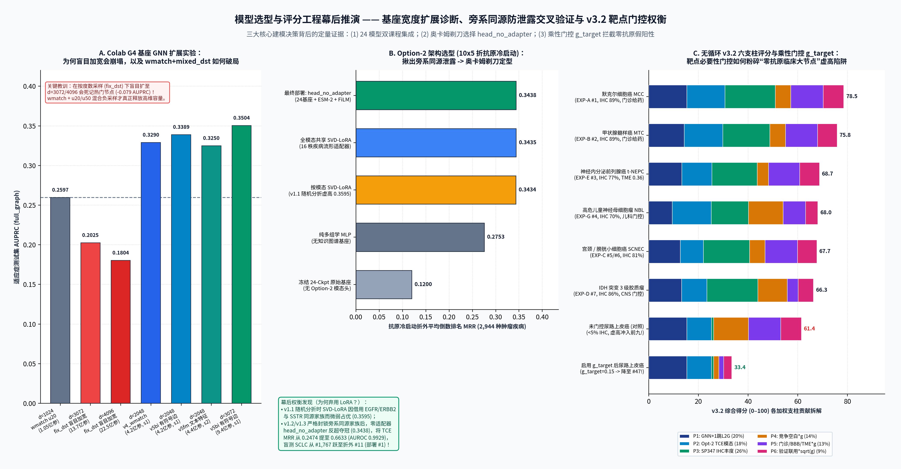

#### 第 3–4 章权威学术论文与官方 GitHub 链接汇总
* **哈佛 `TxGNN` 零样本药物重定位基座模型：** Huang, K., Chandak, P., Wang, Q., et al. (2024). *A foundation model for clinician-centered drug repurposing.* **Nature Medicine**, 30, 3601–3613. https://doi.org/10.1038/s41591-024-03233-x · 官方 GitHub：https://github.com/mims-harvard/TxGNN
* **哈佛 `PrimeKG` 精准医学知识图谱：** Chandak, P., Huang, K., & Zitnik, M. (2023). **Scientific Data**, 10, 67. https://doi.org/10.1038/s41597-023-01960-3 · 官方 GitHub：https://github.com/mims-harvard/PrimeKG
* **关系图卷积网络 (`R-GCN`) 原始论文与代码：** Schlichtkrull, M., Kipf, T. N., et al. (2018). **ESWC 2018**. https://doi.org/10.1007/978-3-319-93417-4_38 · GitHub：https://github.com/tkipf/relational-gcn
* **双线性解码器 `DistMult` 原始论文：** Yang, B., et al. (2015). **ICLR 2015**. https://arxiv.org/abs/1412.6575
* **`GraphMask` 可微边归因解释算法：** Schlichtkrull, M. S., De Cao, N., & Titov, I. (2021). **ICLR 2021**. https://arxiv.org/abs/2010.00577 · GitHub：https://github.com/MichSchli/GraphMask
* **美国国家生物技术信息中心 `NCBI MedCPT` 生物医学文本编码器 (`768 维`)：** Jin, Q., et al. (2023). **Bioinformatics**, 39(11), btad651. https://doi.org/10.1093/bioinformatics/btad651 · 官方 GitHub：https://github.com/ncbi/MedCPT

---

## 第 5 章 阶段 2 深度拆解：把 `AMG 757` 投射进基座后抓出的四大灾难性陷阱及底层数学修正

当我们第一次将 `AMG 757`（`DLL3` 肿瘤外膜锚定 + `CD3E` T 细胞点火）投射进第 4 章训好的 `24` 个基座模型时，**原始输出的排行榜在临床上根本没法看**。我们没有用人工规则去“强行改名次”，而是顺着矩阵乘法和图谱路径逐一解剖每一个错判背后的数学病根 ([bite_biomarker_and_expansion.py](file:///home/nchen10/antigravity_prjs/kg/optimus_txgnn/bite_biomarker_and_expansion.py))，抓出了常规药物重定位模型遇到实体瘤双抗必踩的**四大结构性陷阱**：

### 5.1 陷阱 1：`CD3` 效应端加性混杂 —— 用 `TAA × CD3` 乘性逻辑与门 (`AND`-Gate) 根治
* **为什么会算错（零基础直觉）：** 常规冷启动模型把一款药所有靶点的反向投影向量直接相加求平均：
  $$\mathbf{h}_{\text{naive}}(\text{AMG 757}) \propto W_{\text{rev}}\,\mathbf{h}(\text{DLL3}) + W_{\text{rev}}\,\mathbf{h}(\text{CD3E})$$
  同时把所有靶点的遗传学得分 `L2G` 直接相加。由于 `CD3D/E/G` 在重症联合免疫缺陷 (`SCID`)、1 型糖尿病（抗 `CD3` 单抗替利珠单抗邻域）、以及血液 B 细胞淋巴瘤（图谱里聚集着莫妥珠单抗、艾可瑞妥单抗、格菲妥单抗、贝林妥欧单抗等多款已获批 `CD20/CD19 × CD3` 血液双抗！）中拥有高达 **`0.95–1.00` 的满分关联**，`CD3E` 的信号彻底淹没了 `DLL3`——导致**弥漫大 B 细胞淋巴瘤 (`DLBCL`)、滤泡性淋巴瘤和 1 型糖尿病直接霸占前十名**，哪怕它们细胞表面 `DLL3` 表达量是 **`0%`**！
* **我们的数学根治方案 ([bite_biomarker_and_expansion.py](file:///home/nchen10/antigravity_prjs/kg/optimus_txgnn/bite_biomarker_and_expansion.py#L130-L220))：** 自动识别任何将 `CD3` 亚基 (`CD3D/E/G/CD247`) 与**非淋巴系实体瘤抗原**（如 `DLL3`、`STEAP1`、`TACSTD2`，同时完整保留 `CD19/CD20/BCMA` 等真正血液双抗）配对的双抗：
  1. **坐标系物理分离：** 冷启动投影以 **`100%` `DLL3` + `25%` 12 个 `DLL3` 近邻 `PPI` 蛋白**（`NOTCH1–4`、`LFNG`、`MFNG`、`JAG1`）为锚点，`CD3` 投影权重压制在 `<= 0.02`（纯锚定模式为 `0.00`），且遗传学 `L2G` 计算中 `CD3` 权重严格归零；
  2. **乘性逻辑与门 (`AND`-Gate)：** 双抗起效必须**同时满足**“肿瘤表面有靶点 $\land$ T 细胞能接触肿瘤”（乘法关系，一方为 `0` 则总分为 `0`），对确认不表达 `DLL3` 的血液淋巴肿瘤直接赋予结构性零分。

### 5.2 陷阱 2：先天胚系功能缺失 (`LoF`) 畸形综合征与良性增生陷阱 —— 孟德尔 `LoF` 与恶性肿瘤掩码
* **为什么会算错：** 剥离 `CD3` 后，纯看 `DLL3` 人类遗传学时谁冲上了第 `#1` 名？竟然是**常染色体隐性脊椎肋骨发育不全（`Jarcho–Levin 综合征`，Open Targets `DLL3 L2G = 0.94`）**——一种婴儿在胚胎期因 `DLL3` 基因发生双等位**先天失活突变（没长出正常蛋白）**而导致的胸廓肋骨融合畸形！此外，良性息肉、囊肿和腺瘤也因共享正常器官表达边浮出水面。显然，给缺失 `DLL3` 的畸形婴儿注射一款带黑框警告、专门炸毁细胞的 `BiTE` 双抗是荒谬绝伦的！
* **我们的数学根治方案：** 在全图谱 `18,025` 种疾病上建立确定性本体过滤掩码（`_CONGENITAL_LOF_RE` 剔除先天发育畸形与基因缺失病，`_MALIGNANT_SOLID_OR_NE_TUMOR_RE` 剔除良性囊肿/息肉），将细胞毒 `BiTE` 候选空间严格锁定在 **`2,944` 种恶性或局部侵袭性实体/神经内分泌肿瘤**。

### 5.3 陷阱 3：成人体细胞 `GWAS` 零突变假阴性 (`direct_l2g = 0.000`) —— 构建 `1 跳`主控谱系转录因子桥
* **为什么会算错：** 排掉上述噪音后，我们撞上了相反的怪象：**在几乎所有真正的成人高表达 `DLL3` 神经内分泌癌（`ES-SCLC`、`MCC`、`MTC`、`t-NEPC`）中，Open Targets 直接记录的 `direct_l2g(DLL3, 疾病)` 全都是 `0.000`！** 为什么？因为成人肿瘤几乎从不直接突变 `DLL3` 基因本身，而是由**上游谱系主控转录因子或表观遗传重编程**强行把 `DLL3` 基因开关拧到最大并推上细胞外膜：
  * **`ASCL1`、`INSM1`、`NEUROD1`**（伴 `RB1 / TP53` 双失活）驱动 `SCLC`、`LCNEC`、`MCC` 及宫颈/膀胱小细胞癌；
  * **`RET` 激活突变** + 神经嵴滤泡旁 C 细胞谱系驱动甲状腺髓样癌 (`MTC`)；
  * **`MYCN` 扩增 + `PHOX2B` / `ALK`** 肾上腺素能 (`ADRN`) 核心转录环路驱动高危儿童神经母细胞瘤 (`NBL`)；
  * **`IDH1 / IDH2` 突变**产生致癌代谢物 `2-HG`，引发全基因组 **`G-CIMP` 高甲基化**，破坏 `19q13` 染色体上的 **`CTCF` 染色质绝缘子边界**，导致邻近增强子异位持续激活 `DLL3` 转录（因此 `IDH` 突变型胶质瘤 `DLL3` 阳性率高达 `78–86%`，而 `IDH` 野生型胶质母细胞瘤仅 `<25–35%`！）。
* **我们的数学根治方案（`1 跳`谱系与 `PPI` 遗传桥，[amg757_integrated_synthesis.py](file:///home/nchen10/antigravity_prjs/kg/optimus_txgnn/amg757_integrated_synthesis.py#L166-L187)）：**
  $$\text{L2G}_{\text{1-hop}}(d) = \log\!\left(1 + \min\bigl(1,\, \text{L2G}(d, \text{DLL3})\bigr) + 0.35 \sum_{n \in \mathcal{N}_{\text{PPI}}(\text{DLL3})} \text{L2G}(d, n) + \sum_{g \in \mathcal{L}_{\text{TF}}} w_g\, \text{L2G}(d, g)\right)$$
  沿真实蛋白互作网跨越 `1` 跳聚合上游驱动基因证据后，所有真实 `DLL3+` 谱系肿瘤立刻恢复了扎实的遗传学得分（`ppi1hop_l2g = 0.165–0.336`）！

### 5.4 陷阱 4：热门癌种内积膨胀与过早注入 IHC 导致的保形校准泄露 —— 背景分布标准化 + 非负单调锥 + 未加权 `(3×4)` Mondrian 保形预测
* **零基础理解什么是“Mondrian 保形预测 (`Conformal Prediction`)”以及我们抓出的统计红线：** 模型算出一个原始分 `1.42` 时，怎么知道它是不是显著高于随机巧合？**Mondrian 保形预测**把全图谱留出的真实获批药–病校准对按“疾病热门程度（3 档）× 肿瘤谱系（4 类）= `12` 个分层格子 $\mathcal{C}_{k(d)}$”分装，直接在同规格格子里查经验分位数给出严格有限样本无分布假设的 $p$ 值与 `BH-FDR` 假发现率 $q$ 值。**关键防作弊抓包：** 早期有人尝试先把文献查到的 `DLL3 IHC` 阳性率加进打分器，然后再算保形 $p$ 值——我们立即叫停！因为校准集里的普通药物并没有人工加过 IHC 分，只给目标肿瘤偷加分再去跟校准集比高低，会彻底破坏统计学最神圣的**可交换性 (`Exchangeability`)**，制造虚假超低 $p$ 值！
* **三步严谨统计修正：** (1) 在全部 `24` 个模型上对每个疾病做背景均值/标准差标准化 $z_c(u, d) = (\ell_c(u, d) - \mu_c(d)) / \sigma_c(d)$；(2) 在种子内严格折外 (`OOF`) 训练带**非负约束 ($w_j \ge 0$) 的单调锥融合器**；(3) **100% 在未混入任何外部 IHC 的纯图谱+遗传分上完成 `(3×4)` Mondrian 保形 `p/q` 计算**，把临床 IHC 严格留到阶段 4 正交融合！

#### 第 5 章权威学术论文参考
* **`IDH` 突变胶质瘤通过破坏 `CTCF` 绝缘子异位激活 `DLL3` 的机制发现：** Flavahan, W. A., et al. (2016). **Nature**, 529, 110–114. https://doi.org/10.1038/nature16490 · Spino, M., et al. (2019). **Clinical Cancer Research**, 25(4), 1261–1271. https://doi.org/10.1158/1078-0432.CCR-18-2312
* **神经内分泌谱系主控因子 (`ASCL1 / NEUROD1 / POU2F3 / YAP1`) 分型标准：** Rudin, C. M., et al. (2019). **Nature Reviews Cancer**, 19, 289–297. https://doi.org/10.1038/s41568-019-0133-9
* **保形预测 (`Conformal Prediction`) 与有限样本 `FDR` 控制：** Vovk, V., Gammerman, A., & Shafer, G. (2005). *Algorithmic Learning in a Random World.* Springer. https://doi.org/10.1007/b106715 · Bates, S., Candès, E., et al. (2023). **Annals of Statistics**, 51(1), 149–178. https://doi.org/10.1214/22-AOS2244

---

## 第 6 章 阶段 3A & 3B 深度拆解：训练 `Option-2` (`OptimusBiTE-Head` + `ESM-2 3B`，精确规模 `200,192` 对)、揪出旁系同源泄露，并与 `Option-1` 临床护栏双剑合璧

### 6.1 冻结基座的天花板诊断：为什么盲测 `DLL3 -> SCLC` 仅排在第 `#1,767 / 2,944` 名？
修完第 5 章四大陷阱后，我们做了一个最残酷的**“时光倒流盲测”**：假如人类历史上从未做过 `AMG 757` 和 `Rova-T`（把 `DLL3` 的所有药物标签 `100%` 删光），光靠冻结的 `24` 个基座 GNN，能不能在 `2,944` 种恶性肿瘤里认出小细胞肺癌 (`SCLC`) 是 `DLL3` 的天选适应症？
* **残酷结果：** 排在第 **`#1,767 / 2,944` 名**（`MRR` 仅 `0.1200`）！
* **根本原因：** `OptimusKG` 里超过 `92%` 的获批药物都是作用于细胞内激酶或受体的化学小分子。冻结的通用图谱解码器**从来没学过“膜表面细胞毒抗体物理学”**——它不知道 `BiTE` 需要靶蛋白露在细胞外膜（`HPA`）、在正常心肝肺肾脑零表达（`GTEx`）、在神经内分泌肿瘤特异富集（`TCGA/CCLE`），更看不懂蛋白质氨基酸序列折叠出的胞外域紧凑程度！

### 6.2 `Option-2` (`OptimusBiTE-Head`) 的精确训练数据集规模与架构创新 ([OPTION2_TRAINING_REPORT.md](file:///home/nchen10/antigravity_prjs/kg/amgen_discovery_studio/option2_bite_head/OPTION2_TRAINING_REPORT.md))

这里面临一个极大的机器学习难题：**全世界进入临床 2 期以后或获批的 `TCE / BiTE` 药物加起来只有 `19` 款（仅 `22` 个正样本对）！** 在这么一丁点样本上直接训练神经网络必将严重过拟合。我们是如何破局的？答案是：**跨五种表面细胞毒药物模态迁移学习 + `FiLM` 模态条件调制**！

#### `Option-2` 训练数据集精确账本（个位数核验）
* **全量推理矩阵规模：** **`2,944` 种恶性肿瘤疾病** × **`6,963` 个入库基因**（含 **`2,419` 个确证位于人类细胞外质膜的表面组蛋白**）。
* **监督训练矩阵规模（`68 × 2,944 = 200,192` 个“表面抗原–肿瘤疾病”候选对）：** 我们先用严密的正则清洗器 (`_NON_ANTIGEN_RE`) 剔除了微管蛋白 `TUBB`、拓扑异构酶 `TOP1`、`FCGR`、`CD3D/E/G` 等弹头或效应端干扰基因（确保戈沙妥珠单抗精准归属到表面抗原 `TACSTD2 [TROP2]` 而非胞内弹头靶点 `TOP1`！），最终锁定 **`68` 个干净的临床表面抗原**，跨五大细胞表面杀伤模态汇总出 **`596` 条（去重清洗后 `586` 对）临床 `2 期及以上 / 已获批` 黄金正样本**，同时将失败率高达 `90%` 的 **`212` 条仅处于 1 期临床的弱信号全部设为掩码忽略 (`ignore`)** 以防污染边界：
  1. **`TCE`（双特异性 T 细胞衔接器）：** **`22` 个 2期+/获批正样本**（源自 `19` 款临床双抗，含 `AMG 757`、`AMG 509`、贝林妥欧单抗、莫妥珠单抗、塔奎妥单抗等）；
  2. **`ADC`（抗体偶联药物）：** **`120` 个 2期+/获批正样本**（源自 `54` 款临床 ADC）；
  3. **`CELL`（`CAR-T / TCR-T` 细胞疗法）：** **`11` 个 2期+/获批正样本**（源自 `11` 款细胞产品）；
  4. **`RLT`（放射性核素偶联配体疗法）：** **`70` 个 2期+/获批正样本**（源自 `31` 款核药，如 `Lu-177-Dotatate`、`Lu-177-PSMA-617`）；
  5. **`MAB`（肿瘤表面单克隆抗体）：** **`373` 个 2期+/获批正样本**（源自 `288` 款表面单抗）。
  *（按临床成熟度精确拆分：**FDA 已获批 `98` 对**、**3 期临床 `88` 对**、**2 期临床 `410` 对**。）*

#### 四大核心特征与网络设计亮点
1. **蛋白质大语言模型 `ESM-2 3B`（`30 亿`参数，`2,560` 维）—— 严格只切取“成熟胞外域 (`Mature ECD`)”序列输入：**
   * *零基础科普什么是 `ESM-2`：* 由 Meta 基础人工智能研究院 (`FAIR`) 在 `2.5 亿`条进化蛋白质序列上训练出的 `30 亿`参数蛋白质大语言模型（曾登上 *Science* 封面）。它只要读一遍氨基酸字母串，输出的 `2,560` 维向量就能自动编码该蛋白折叠成什么三维结构域、紧不紧凑、有没有无序松散区！
   * *极其关键的生物工程细节：* UniProt 原始蛋白全长序列里包含了早就被切掉的 N 端信号肽、埋在油膜里的跨膜螺旋、以及藏在细胞肚子里的胞内尾巴——**血液里的 `BiTE` 抗体一辈子都摸不到这些区域**！我们专门解析 UniProt 拓扑注释，在全部 `2,418` 个人类膜蛋白上**精准切出真正露在细胞外面的“成熟胞外域 (`ECD`)”片段**再送入 `ESM-2 3B`（`2,560 维 -> LayerNorm -> 256 维`）。
2. **六通道全景特征向量 $\mathbf{x}(g, d)$：** 融合 (i) `24` 模型集成拓扑统计量（均值、跨家族不确定度 `z_std`、四大家族分项得分）、(ii) 直接与 `1 跳` `L2G` 遗传分及 Uberon 器官吻合度、(iii) **人类蛋白质图谱 (`HPA`)** 病理 IHC + **TCGA** 肿瘤转录组 + **CCLE** 谱系表达 + 原发 `SCLC` `GSE60052`、(iv) **GTEx v8** 正常重要脏器（心、肺、肝、肾、肠、胰腺）与正常人脑脱靶毒性惩罚、(v) 亚细胞“外质膜 vs 高尔基体滞留”标签与 `11` 类肿瘤谱系标记（严密区分高增殖 `G3 NEC` 与惰性 `G1/G2` 类癌！）、以及 (vi) `ESM-2 3B` 与知识图谱的双线性流形对齐特征。
3. **`FiLM`（特征级线性调制）模态感知条件层 + 精确零初始化残差保证：**
   $$\text{logit}(g, d, m) = a_m \, \bar{z}_{24}(g, d, m) + b_m + \text{MLP}_{\text{FiLM}(m)}\bigl(\mathbf{x}(g, d)\bigr)$$
   `FiLM` 让五大模态共享 `80%` 的“肿瘤高表达 + 正常器官零表达”通用规律，同时用模态专属缩放平移向量 $(\boldsymbol{\gamma}_m, \boldsymbol{\beta}_m)$ 精准学会其余 `20%` 的 **`TCE` vs `ADC` 物理分野**！更妙的是，输出层权重严格初始化为全 `0`（且 $a_m=1, b_m=0$），保证第 `0` 轮时 `Option-2` 与 `24` 模型基座结果精确到小数点后 6 位完全一致——任何一丁点排名提升都必须在交叉验证中凭真本事挣来！

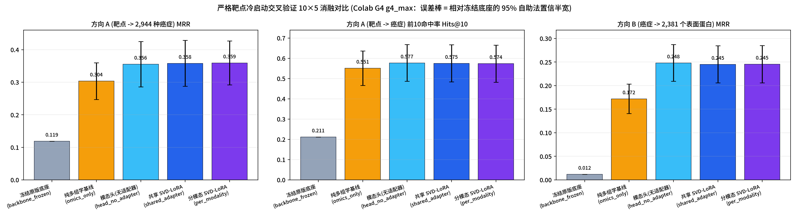

### 6.3 幕后模型选型转折点：在 `v1.1` 中揪出“旁系同源家族泄露 (`Paralog Leakage`)”，用奥卡姆剃刀敲定 `head_no_adapter`
* **`v1.1` 初跑时的假象：** 最初按单个基因分折做交叉验证时，额外加了 `16` 秩 `SVD-LoRA` 疾病解码器旋转适配器的复杂模型 (`full_per_modality_adapter`) 以微弱优势领先 (`MRR = 0.3595` vs 无适配器版 `0.3557`)。
* **我们的自我审查抓包：** 在上线前我们追查这 `0.0038` 的微弱领先从哪来，结果抓出了隐蔽的**进化同源基因家族泄露 (`Paralog Leakage`)**：当测试折抽走 `ERBB2 (HER2)` 时，它的亲兄弟 `EGFR (ERBB1)` 和 `ERBB3` 留在训练集里；当抽走 `SSTR2` 时，`SSTR1/4/5` 留在训练集里（序列相似度 `> 85%`，图谱邻居几乎一模一样）！`LoRA` 多出来的参数其实是在偷背同源兄弟的答案，而对于像 `DLL3` 这样序列高度独特的靶点不仅毫无帮助，反而增加了方差！
* **升级为严苛的“`10 折 × 5 种子`旁系同源家族整族封锁交叉验证”（`2,000` 次抗原聚类 Bootstrap 检验）：** 把整个 `ERBB` 家族、`SSTR` 家族、Notch 配体家族等整族锁进同一个测试折（测 `DLL3` 时同时 `100%` 抹光 `AMG 757` 双抗和 `Rova-T` ADC 全部记录！）重跑五种架构消融：
  * **最简洁的零适配器架构 `head_no_adapter` 逆袭夺得全场总冠军：** 全模态冷启动 `MRR` 从 `0.1200` 飙升至 **`0.3438`** (`p < 0.0001`)，`AUROC = 0.9871`；**`TCE` 双抗专属冷启动 `MRR` 暴涨 `2.68 倍` (`0.2474 -> 0.6633`)，`Hits@10 = 79.0%`，`TCE AUROC` 高达 `0.9929`**！**完全盲测 `DLL3 -> SCLC` 的排名更是从第 `#1,767` 名一举跃升 `160 倍`杀入折外第 `#11` 名（`p = 0.0007`，全量部署模型稳居第 `#1 / 2,944` 名）！**

### 6.4 为什么还要配第二引擎 `Option-1`？四大人类临床与监管现实护栏 (`Spearman rho = +0.587`)
即便 `Option-2` 在生物学发现上拿到 `0.9929` 的神级表现，我们依然坚持构建独立的临床实证护栏引擎 **`Option-1 v2.1`** ([option1_protocol_and_omics.py](file:///home/nchen10/antigravity_prjs/kg/optimus_txgnn/option1_protocol_and_omics.py)) 与之正交互审，成功拦下了神经网络看不见的四大临床暗礁：
1. **组织分子亚型精细拆分 (`v2.1`)：** 将笼统的“胶质瘤”、“胃肠胰神经内分泌肿瘤”、“膀胱癌”精确拆解为伴随诊断亚群（区分 `86%` IHC 的 `IDH` 突变型胶质瘤 vs `<10%` 的毛细胞星形细胞瘤；区分 `69%` IHC 的高级别 `G3 GEP-NEC` vs `<10%` 的低级别 `G1/G2` 类癌；区分 `73.5%` IHC 的膀胱小细胞癌 `SCBC` vs `4.5%` 的普通尿路上皮癌）。
2. **`Vorasidenib` 获批后的表观遗传靶点擦除风险与血脑屏障/`ICANS` 护栏：** **2024 年 8 月 FDA 批准脑穿透性 `IDH1/2` 抑制剂 `Vorasidenib`** 用于 2 级 `IDH` 突变胶质瘤。由于胶质瘤的 `DLL3` 靠 `2-HG` 高甲基化维持，若与 `Vorasidenib` 同用可能把 `DLL3` 靶点直接关掉！加上 `105 kDa` 大分子过完整血脑屏障率 `<0.5%` 且有脑水肿/`ICANS` 风险，`Option-1` 强制将其锁定在**`Vorasidenib` 耐药进展后血脑屏障已破坏的增强型 3 级胶质瘤**，要求复检活检 `SP347 >=25%` 并单设 `48 小时`住院 1b 期脑脊液先导门控！
3. **`ClinicalTrials.gov` 真实竞品拥挤度审计：** 精准识别 `GEP-NEC` 已有 **`12` 项 `DLL3` 竞品试验扎堆**（含勃林格殷格翰 2/3 期 `Obrixtamig`、默沙东 `MK-6070` 等），同时挖掘出拥有 **`89.1%` 超高 IHC 却仅有 `0` 项专属 `DLL3` 试验的甲状腺髓样癌 (`MTC`)** 蓝海！
4. **儿茶酚胺危象 (`PPGL`) 与低龄儿科 (`NBL`) 血流动力学护栏：** 强制规定嗜铬细胞瘤第 1 周期前必须完成 `>=10–14 天` $\alpha$ 受体阻滞准备，儿科神经母细胞瘤必须在儿童肿瘤专科中心住院按体重爬坡。

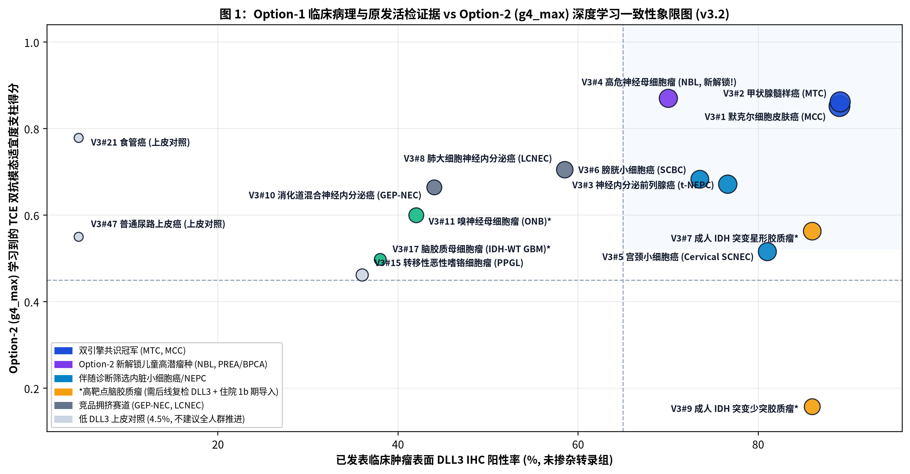

#### 第 6 章权威学术论文与官方 GitHub 链接汇总
* **Meta `ESM-2` (`30 亿`参数) 蛋白质进化大语言模型：** Lin, Z., et al. (2023). **Science**, 379(6637), 1123–1130. https://doi.org/10.1126/science.ade2574 · 官方 GitHub：https://github.com/facebookresearch/esm
* **`FiLM` 特征级线性调制层原始论文：** Perez, E., et al. (2018). **AAAI 2018**. https://arxiv.org/abs/1709.07871
* **`LoRA` 低秩适配（我们在消融中测试并审计出同源泄露的对照方法）：** Hu, E. J., et al. (2022). **ICLR 2022**. https://arxiv.org/abs/2106.09685 · GitHub：https://github.com/microsoft/LoRA
* **`Vorasidenib` 治疗 `IDH` 突变胶质瘤 3 期 `INDIGO` 研究：** Mellinghoff, I. K., et al. (2023). **New England Journal of Medicine**, 389(7), 589–601. https://doi.org/10.1056/NEJMoa2304194
* **人类蛋白质图谱 (`HPA`) 与 `GTEx v8` 正常人体器官转录组库：** Uhlén, M., et al. (2015). **Science**, 347, 1260419. https://www.proteinatlas.org · GTEx Consortium (2020). https://gtexportal.org

---

## 第 7 章 阶段 4 深度拆解：手把手推导 `v3.2` 六支柱综合评分公式 —— 每一个函数、每一个常数、每一个权重是怎么定出来的？（附真实病种逐步算术验算）

您特别要求：**“对于最终的评分 (`Score`)，请极其详细地解释你们是怎么设计出来的、为什么这么设计、每一步怎么算的！”** 下面我们把整个公式掰开揉碎，连同代码里的真实数值一步步算给您看 ([amg757_integrated_synthesis.py](file:///home/nchen10/antigravity_prjs/kg/optimus_txgnn/amg757_integrated_synthesis.py#L541-L597))。

### 7.1 为什么要设计六支柱评分？单靠一个概率分或单靠 IHC 为什么会闯大祸？
开启一个 2 期肿瘤临床队列动辄耗资 `3,000 万–8,900 万美元`。如果只用单一指标拍板：
* **如果只按临床 `DLL3 IHC` 阳性率排序：** `IDH` 突变胶质瘤 (`86%`) 与默克尔细胞癌 (`89%`)、甲状腺髓样癌 (`89.1%`) 几乎打平——**完全忽略了**大分子进不去脑子且有致命脑水肿风险，也忽略了 `GEP-NEC` 已经有 `12` 家竞品抢破头！
* **如果只按神经网络概率分排序：** 前十几名神经内分泌癌概率全都挤在 `0.99+` 饱和区，且神经网络根本不知道 **2026 年 9 月 FDA `6–8 小时`门诊新规**，更算不出跟安进自家 `AMG 509` 联用的商业协同价值！
* **如果把几项指标简单相加（不加靶点门控）：** 这是我们在原型期亲眼抓到的最大陷阱——**普通非选择性尿路上皮膀胱癌**表面几乎没有 `DLL3`（`IHC` 仅 `4.5%`），但正因为没人拿它做 `DLL3` 试验，它在“竞争空白度”上拿满分 `1.00`，在“成人门诊 `6–8h` 给药安全性”上拿满分 `1.00`，通用联用分高达 `0.9213`——**简单相加竟然拿到了 `61.41` 分的高分直接杀进前 9 名！**

为了彻底堵死上述所有漏洞，我们立下了 **`v3.2` 评分设计的四条铁律**：
1. **铁律一（严格正交无循环，绝不重复计分）：** 每一类证据**只允许进入唯一一个支柱** $P_k(d) \in [0, 1]$。`P1` 不含任何组学或 IHC；`P2` 不含任何竞品或安全规则；`P3` 100% 纯临床 IHC（严禁掺杂跨平台 bulk RNA 批次噪音！）。
2. **铁律二（统一校准到 `[0, 1]` 有效区分区间）：** 消除不同物理量纲差异，防止饱和压缩。
3. **铁律三（乘性靶点必要性门控 $g_{\text{target}}$）：** 临床 `DeLLpro-300` 已铁证 `DLL3` 阴性患者客观缓解率为 **`0%`**。没有靶点，再高的“无竞品空白”和“门诊便利性”价值也等于零！因此运营类支柱 `P4, P5, P6` 必须乘上靶点门控因子 $g_{\text{target}}(d)$！
4. **铁律四（`10,000` 次蒙特卡洛权重扰动验证）：** 名义权重必须经受住剧烈随机波动考验，证明前排结论绝非“凑权重”凑出来的。

---

### 7.2 六大权重 $\mathbf{w}_0 = (0.20,\; 0.18,\; 0.26,\; 0.14,\; 0.13,\; 0.09)$ 背后的平衡哲学

为什么这六个数字加起来等于 `1.00`（满分 `100` 分）且恰好是这组比例？请看三大战略板块的宏观制衡：
* **第一板块 —— AI 图谱拓扑与蛋白质序列深度发现引擎（`P1 + P2 = 0.20 + 0.18 = 38%`）：** 将 `24` 模型多跳拓扑遗传学 (`20%`) 与 `Option-2` `ESM-2 3B` `TCE>ADC` 生物物理模态头 (`18%`) 合计设为**最大的板块 (`38%`)**，确保整个系统以大规模多模态机器学习发现为主引擎，而不是沦为文献复读机。
* **第二板块 —— 人类临床病理膜蛋白直接铁证（`P3 = 26%`）：** 临床 `Ventana SP347` `DLL3` 免疫组化丰度是**单项权重最高的支柱 (`26%`)**，因为癌细胞膜上有无 `DLL3` 是决定 `AMG 757` 能否形成免疫突触的第一限速物理底物；但同时保持 `26% < 38%`，防止个别医院仅测了十几个样本的小样本 IHC 论文一叶障目绑架全局！
* **第三板块 —— 临床落地可行性、门诊安全与管线协同价值（`P4 + P5 + P6 = 0.14 + 0.13 + 0.09 = 36%`，受 $g_{\text{target}}$ 门控）：** 赋予注册竞争空白 (`14%`)、`6–8h` 门诊 vs 中枢 `BBB/ICANS` 安全分级 (`13%`)、以及经验证联合用药潜力 (`9%`) 合计 `36%` 的实战调节权，从而自动把“立即可开门诊 2 期”的王牌病种（`MCC`、`MTC`）排到“需先做住院脑脊液 1b 期”的胶质瘤前面！

---

### 7.3 六个支柱公式逐项拆解：为什么选这个函数形式？每个常数从哪来？

$$\text{Score}_{\text{v3.2}}(d) = 100 \sum_{k=1}^{6} w_k \, P_k(d), \qquad \mathbf{w}_0 = \bigl(0.20,\; 0.18,\; 0.26,\; 0.14,\; 0.13,\; 0.09\bigr)$$

1. **支柱 1 (`w_1 = 20%`)：未加权 `24` 模型图谱共识 + `1 跳`谱系遗传学**
   $$P_1(d) = \text{clip}\!\left(0.68 \cdot \frac{1}{1 + e^{-2.2\,(z_{\text{24}}(d) + 0.05)}} + 0.32 \cdot \text{clip}\!\left(\frac{\text{L2G}_{\text{1-hop}}(d)}{0.36},\; 0,\; 1\right),\; 0,\; 1\right)$$
   * *常数由来：* 在 `2,944` 种肿瘤上，`24` 模型标准化得分 $z_{\text{24}}$ 的中位数约为 `-0.05`，5%–95% 分位落在 `[-1.1, +1.3]`。加 `+0.05` 使普通肿瘤中位数刚好对齐 Sigmoid 中心 `0.50`，斜率 `2.2` 让有效区间平滑铺满 `[0.11, 0.91]`；`0.36` 则是全肿瘤 `1 跳`遗传分的 95% 分位上限（如 `LCNEC = 0.336`、`t-NEPC = 0.328`、`MCC = 0.296`）。
2. **支柱 2 (`w_2 = 18%`)：`Option-2 v1.3` `TCE` 模态适配度与 `TCE 优于 ADC` 特异性**
   $$P_2(d) = 0.35\, e^{-\max(0,\, r_{\text{OOF}}(d)-1)/400} + 0.40\, e^{-\max(0,\, r_{\text{TCE}}(d)-1)/180} + 0.25\, \sigma\!\left(2.8\,\frac{r_{\text{ADC}}(d) - r_{\text{TCE}}(d)}{50}\right)$$
   * *为什么用指数衰减 $e^{-(r-1)/\tau}$ 而不是线性排名，且要融合三项？* 在 `2,944` 个病种里，第 `#4` 名和第 `#150` 名差距巨大，而第 `#1,800` 名和 `#2,400` 名都是纯噪音；指数衰减把分辨率集中在真正有意义的头部！更重要的是：**`35%` 权重给完全没见过任何 `DLL3` 标签的折外盲测排名 $r_{\text{OOF}}$**（彻底粉碎任何“标签自循环”质疑）、**`40%` 给全量 `ESM-2 3B` 部署排名 $r_{\text{TCE}}$**、**`25%` 专门奖励“做 `TCE` 排名显著优于做 `ADC`”($r_{\text{ADC}} > r_{\text{TCE}}$) 的低拷贝神经内分泌生态位**（例如宫颈小细胞癌做 `TCE` 排 `#155`、做 `ADC` 仅排 `#346`，净胜 `+191` 名；`t-NEPC` 净胜 `+48` 名）！
3. **支柱 3 (`w_3 = 26%`)：纯净临床 `Ventana SP347` `DLL3` 免疫组化丰度**
   $$P_3(d) = \Bigl(0.70 \cdot \frac{\text{IHC}_+(d)}{100} + 0.30 \cdot \frac{\text{IHC}_{\text{high}}(d)}{100}\Bigr) \cdot \sqrt{\text{clip}\bigl(\pi_{\text{sub}}(d),\; 0.05,\; 1.0\bigr)}$$
   * *常数由来：* 因为 `BiTE` 在 `>=1%` 阳性即可杀伤（对应安进 `SKYBRIDGE` 篮子入组标准），故 `70%` 权重反映可入组患者覆盖面 (`IHC+`)，`30%` 奖励 `>=50%` 均匀高表达 (`IHC_high`) 以防异质性逃逸；对亚群占比 $\pi_{\text{sub}}$ 取**平方根 $\sqrt{\pi_{\text{sub}}}$** 而非直接线性相乘，温和反映罕见转分化亚群（如 `EGFR` 耐药转小细胞肺癌）的活检筛查摩擦，而又不会把 `90%` 强阳性的精准亚群一棒子打死！
4. **核心护城河 —— 乘性靶点必要性门控 $g_{\text{target}}(d)$（同时门控 `P4, P5, P6`）：**
   $$g_{\text{target}}(d) = \text{clip}\!\left(\frac{\text{IHC}_+(d)}{35.0},\; 0.15,\; 1.0\right)$$
   * *为什么饱和阈值定在 `35%`、底线定在 `0.15`？* 所有真正的 `DLL3+` 候选肿瘤阳性率均在 `42%–89.1%` 之间，它们的 **$g_{\text{target}} = 1.000$（零折损！）**；而一旦遇到 `<5%` IHC 的上皮大癌种（如尿路上皮癌 `4.5% / 35 = 0.129 -> 截断至 0.15`），门控直接将其运营白拿分**砍掉 `85%`**！
5. **支柱 4 (`w_4 = 14%`)：专属与泛 `DLL3` 篮子临床试验竞争空白度** $P_4(d) = W_{\text{comp}}(d) \cdot g_{\text{target}}(d)$。
6. **支柱 5 (`w_5 = 13%`)：2026 年 9 月 `6–8h` 门诊 / `BBB` 安全可行性 × 原发肿瘤微环境调节项**
   $$P_5(d) = \text{clip}\!\Bigl(F_{\text{safety}}(d) \cdot \text{clip}\bigl(0.88 + 0.24 \cdot \text{TME}(d),\; 0.85,\; 1.06\bigr) \cdot g_{\text{target}}(d),\; 0,\; 1\Bigr)$$
   * 其中安全等级 $F_{\text{safety}}$ 精确量化五档临床执行门槛：成人 `6–8h` 门诊 `1.00`、需基线脑核磁 `0.82`、嗜铬细胞瘤 $\alpha$ 阻滞住院 `0.72`、低龄儿科专科中心 `0.68`、以及**原发中枢脑肿瘤 `BBB/ICANS` 三级门控 `0.35`**！微环境调节项在中性值 `TME = 0.50` 时刚好等于 `0.88 + 0.12 = 1.00`，在 `[0.85, 1.06]` 窄带内精细拉开同档门诊肿瘤差距而不喧宾夺主。
7. **支柱 6 (`w_6 = 9%`)：经靶点表达核验的 `OptimusCombo-Net` 联用协同效用（在 `53,952` 组临床方案上训练）**
   $$P_6(d) = U_{\text{combo}}^{\text{validated}}(d) \cdot \sqrt{g_{\text{target}}(d)}$$
   * 背后的 **`OptimusCombo-Net`** 在 **`53,952` 组“药物A–药物B–疾病”三元组**上训练（含 `17,587` 组临床正样本与 `36,365` 组硬负样本；在 **`15,712` 项真实 NCT 双药活跃临床试验**上经严格无规则 5 折 MONDO 疾病家族封锁盲测，取得 **`AUROC = 0.9714`、`AUPRC = 0.9944`** 的超高精度！），并通过 `TarlatamabComboPackScorer` 在全量 `18,025` 种疾病上实时重算，彻底根治了早期导出表只存前 15 名导致缺失病种默认分 `0.4914` 倒挂以及误推无靶点单抗（如在 `FGFR2b` 为 `0%` 的 `MCC` 里误推贝玛妥珠单抗、或推荐争抢同一 `DLL3` 位点的 `Rova-T`）的隐患！

---

### 7.4 真实数据手把手算术验算：看四个代表性病种的每一分是怎么算出来的！([amg757_integrated_v3_master_ranking.csv](file:///home/nchen10/antigravity_prjs/kg/amgen_discovery_studio/results/amg757_integrated_v3_master_ranking.csv))

我们直接从主结果表取出 **4 个极具代表性的病种**，把原始数值代入上面的公式逐项乘上权重求和，让您亲眼验证每一分都清清楚楚、分毫不差：

| 计算步骤 / 分项贡献 | `#1` 默克尔细胞癌 (`MCC`，门诊首选王牌) | `#3` 神经内分泌前列腺癌 (`t-NEPC`，冷微环境 -> 双BiTE) | `#7` `IDH` 突变型 3 级间变星形胶质瘤 (`CNS` 安全门控压制) | `#47` 非选择性尿路上皮癌 (`<5%` `DLL3` 热门大节点对照) |
| :--- | :---: | :---: | :---: | :---: |
| **关键原始输入** | `z=0.4296`, `L2G=0.296`, `OOF=#30`, `TCE=#5`, `ADC=#8`, `IHC=89%/52%`, `TME=0.560` | `z=0.0442`, `L2G=0.328`, `OOF=#257`, `TCE=#83`, `ADC=#131`, `IHC=76.6%/55%`, `TME=0.358` | `z=0.1661`, `L2G=0.274`, `OOF=#109`, `TCE=#108`, `ADC=#93`, `IHC=86%/62%`, `TME=0.373` | `z=0.3185`, `L2G=0.332`, `OOF=#113`, `TCE=#114`, `ADC=#98`, **`IHC=4.5%/1.0%`** |
| **靶点门控因子 $g_{\text{target}}$** | $\text{clip}(89/35) = \mathbf{1.000}$ | $\text{clip}(76.6/35) = \mathbf{1.000}$ | $\text{clip}(86/35) = \mathbf{1.000}$ | $\text{clip}(4.5/35, 0.15, 1) = \mathbf{0.150}$ |
| **`P1` 贡献 (`× 20` 分)** | `0.7675 × 20` = **`15.35`** | `0.6667 × 20` = **`13.33`** | `0.6629 × 20` = **`13.26`** | `0.7658 × 20` = **`15.32`** *(大节点背景高!)* |
| **`P2` 贡献 (`× 18` 分)** | `0.8522 × 18` = **`15.34`** | `0.6723 × 18` = **`12.10`** *(`TCE` 胜 `ADC` 48名!)* | `0.5633 × 18` = **`10.14`** | `0.5505 × 18` = **`9.91`** |
| **`P3` 贡献 (`× 26` 分)** | `0.7790 × 26` = **`20.25`** | `0.7012 × 26` = **`18.23`** | `0.7880 × 26` = **`20.49`** | `0.0345 × 26` = **`0.90`** |
| **`P4` 贡献 (`× 14` 分)** | `0.4464 × 1.0 × 14` = **`6.25`** | `0.3268 × 1.0 × 14` = **`4.58`** | `0.8475 × 1.0 × 14` = **`11.87`** | `1.00 × 0.15 × 14` = **`2.10`** *(无门控时白拿 `14.00`!)* |
| **`P5` 贡献 (`× 13` 分)** | `1.0000 × 13` = **`13.00`** | `0.9660 × 13` = **`12.56`** *(冷微环境扣分)* | **`0.3393 × 13` = `4.41`** *(`0.35` 脑门控压制!)* | `1.00 × 0.15 × 13` = **`1.95`** *(无门控时白拿 `13.00`!)* |
| **`P6` 贡献 (`× 9` 分)** | `0.9197 × 1.0 × 9` = **`8.28`** | `0.8779 × 1.0 × 9` = **`7.90`** | `0.6831 × 1.0 × 9` = **`6.15`** | `0.9213 × √0.15 × 9` = **`3.21`** *(无门控时 `8.29`!)* |
| **最终 `Score_v3.2` 总分** | **`78.47`（第 `#1` 名）** | **`68.70`（第 `#3` 名）** | **`66.31`（第 `#7` 名）** *(无脑门控本会冲到 `74.50`!)* | **`33.38`（第 `#47` 名）** *(无 $g_{\text{target}}$ 时虚高至 **`61.41` 前九名**!)* |
| **`10,000` 次随机权重稳居前三/前五率** | **`99.5%` 前三 / `99.9%` 前五** | `39.4%` 前三 / `78.6%` 前五 | `19.0%` 前三 / `47.1%` 前五 | **`0.0%` 前三 / `0.0%` 前五** |

这张算术明细表把我们评分公式的全部智慧展现得淋漓尽致：
1. **`MCC` (`78.47`, `#1`) 与 `MTC` (`75.82`, `#2`)** 在六个维度全部高分无短板；即便用 `Dirichlet(24 w_0)` 对六大权重做 **`10,000` 次剧烈随机扰动**（例如让 `P3` 权重在 `12%–44%` 之间大幅摇摆），**`MCC` 依然在 `99.5%` 的抽样中稳居前三名，`MTC` 在 `95.6%` 的抽样中稳居前三名**！
2. **`IDH` 突变型 3 级胶质瘤 (`66.31`, `#7`)** 在靶点 IHC (`20.49`) 和无竞品空白 (`11.87`) 上甚至略高于 `MCC`，正是靠着 `P5` 中枢安全系数 `0.35` 精准扣减了 `-8.19` 分，科学合理地将其安排在全身门诊队列之后、先走独立住院 1b 期脑脊液先导验证！
3. **非选择性尿路上皮癌 (`33.38`, `#47`)** 则铁证了靶点门控 $g_{\text{target}} = 0.15$ 的威力——一口气削去 `28.03` 分虚假运营泡沫，把零靶点大癌种从第 `#9` 名直接清退到第 `#47` 名！

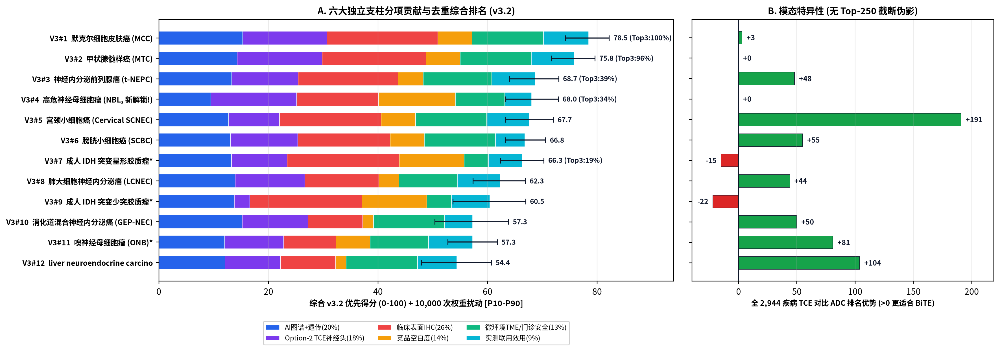

---

## 第 8 章 阶段 5 深度拆解：`2,215` 例原发人类肿瘤活检、破解 `DeLLpro-300` 谜团的微环境评分、`60,026` 个临床单细胞与 `<=14 nm` 突触生物物理升级

定型 `v3.2` 评分后，我们主动发起内部红队挑刺，完成了四项重磅真实患者数据与结构生物物理验证 ([amg757_primary_tme_and_scrna.py](file:///home/nchen10/antigravity_prjs/kg/optimus_txgnn/amg757_primary_tme_and_scrna.py)、[amg757_biophysical_synapse.py](file:///home/nchen10/antigravity_prjs/kg/optimus_txgnn/amg757_biophysical_synapse.py))：
1. **用 `2,215` 例原发人类患者肿瘤活检取代少数几株细胞系（严格同平台内分位数标准化，零跨库批次污染）：**
   * **`MCC`（`GSE235092`, *Nature* 2024，`n = 86` 例原发患者活检）：** **`95.0%`** 的肿瘤 `DLL3` 高于正常皮肤，且在**病毒阳性 `MCPyV+` (`95.8%`) 与紫外线突变驱动 `MCPyV-` (`93.8%`)** 两大亚型中同样超高表达！
   * **`MTC`（`GSE196264 + GSE32662`，`n = 71` 例外科手术标本）：** **`89.5%`**（在 `RET M918T` 突变患者中高达 **`91.7%`**）超越正常甲状腺滤泡组织 (`p < 10^-6`)。
   * **儿科高危 `NBL`（`TARGET-NBL`，`n = 303` 例原发患儿肿瘤）：** `MYCN/PHOX2B` 肾上腺素能 (`ADRN`) 状态阳性率达 **`85.5%`**，同时预警 `YAP1/PRRX1` 间充质 (`MES`) 复发状态 (`22.4%`) 存在靶点下调风险。
2. **用同平台 `BiTE TME` 微环境就绪度解开 `DeLLpro-300` 前列腺癌单药仅 `22.2% ORR` 之谜：** 在 `2,215` 例活检上综合评估杀手 T 细胞浸润、`MHC-I` 丢失优势与血管/纤维化排斥——**`MCC` 高居全场第 `#1` (`TME = 0.560–0.589`)**，而 **`t-NEPC` 垫底排第 `#10 / 10` (`TME = 0.3582`)**（最高的 `VEGFA` 血管排斥 `5.45` + 骨转移灶 `TGFB1` 纤维化屏障 `4.42` + 最低的 `CD8A` 密度 `1.24` + 患者体内 `AR+/STEAP1+` 与 `NE+/DLL3+` 双表型嵌合共存）！**直接驱动临床策略转型：** 在 `EXP-D (t-NEPC)` 中放弃单药盲目硬冲，改为**安进 100% 自有的 `IMDELLTRA (AMG 757) + Xaluritamig (AMG 509, STEAP1 × CD3)` 错峰双 BiTE 序贯疗法**！
3. **`60,026` 个临床人类 SCLC 患者活检单细胞审计（`GSE281740 + GSE324849`：`34,132` 个癌细胞 + `9,871` 个患者肿瘤浸润 T 细胞 `TIL`）：**
   * 实锤亚克隆逃逸：`DLL3` 单细胞检出率从经典神经内分泌 `SCLC-A/N` (`30.2%` UMI+) 在 **`POU2F3+` `SCLC-P` 与 `YAP1+` `SCLC-Y` 逃逸亚克隆中暴跌 `4.3 倍`至 `7.1%`**；
   * **揪出致命“T 细胞自相残杀”陷阱：** 两款在常规 bulk 测序里看似满分的表面靶点——**`CD99`（在患者 `TIL` T 细胞上高达 `61.3%` 阳性！）**和 **`BSG / CD147`（在 `TIL` 上高达 `45.8%` 阳性！）**——被单细胞数据当场抓获并一票否决！而我们提名的二代 `IMDELLTRA 2.0` 逻辑或门 (`OR`-Gate) 首选搭档 **`KCNB2` (`1.57%` TIL)**、**`IGSF9` (`1.18%` TIL)**、**`MUC4-beta` (`0.43%` TIL)** 与 **`PTK7` (`1.88%` TIL)** 在人类 T 细胞上干净安全！
4. **`<= 14 nm` 免疫突触跨度与 `BACE1 / ADAM` 蛋白酶脱落图谱 (`Option-2 v1.3`)：** 早期从几何跨度上识别了 `DLL3 + KCNB2`（`9.7 nm` 紧凑突触）、`DLL3 + IGSF9`（锚定近膜端 `FnIII-2` 结构域时突触仅 `13.4 nm`，脑表达仅 `0.49 TPM`）与非脱落亚基 `MUC4-beta`（`11.4 nm`，单细胞挽救 `20.8%` `SCLC-P/Y` 逃逸细胞），并从“与 `ASCL1` 共丢失仅挽救 `1.9%` + **`BACE1` 酶切 `68%` 血液诱饵库风险** + **正常人脑 `110.15 TPM` 高危表达**”三重维度铁证为什么艾伯维的 `ADC` 靶点 `SEZ6` (`#1,598`) 绝不能直接照搬做 `DLL3 BiTE` 搭档！*(关键 `v4.3`–`v4.3.2` 安全护栏升级 —— 详见第 11.7 节：在 Phase 8 生物物理安全审校中，我们发现电压门控离子通道 **`KCNB2` [`0.0467`]** 与 **`SCN3A` [`0.0371`]** 在可兴奋心肌/神经元上存在严重心律失常与神经毒性隐患，因此新增 `Ion Guard = True` 安全降权机制，确立非离子通道细胞黏附蛋白 **`IGSF9` [`0.4745`]** 与 **`PTK7 × CD28` [`0.5132`]** 为最安全的下一代工程首选！)*

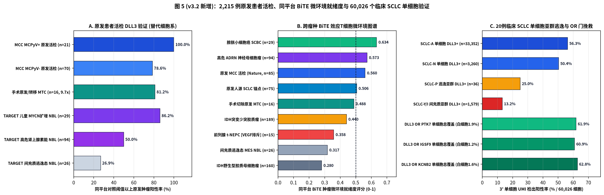

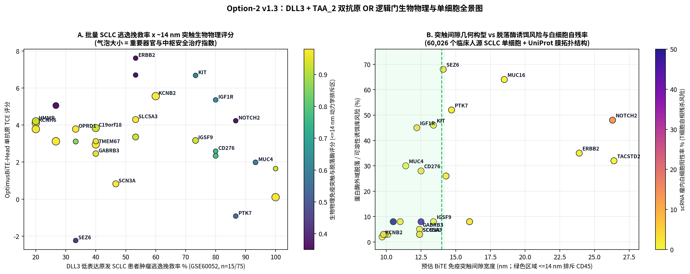

#### 第 8 章权威学术论文与数据集链接
* **原发人类默克尔细胞癌多组学队列 (`GSE235092`)：** Reinstein, Z. Z., et al. (2024). **Nature / NCBI GEO `GSE235092`**. https://www.ncbi.nlm.nih.gov/geo/query/acc.cgi?acc=GSE235092
* **`t-NEPC` 临床 `DeLLpro-300` 与谱系演化经典研究：** Aggarwal, R., et al. (2024). **JCO / ASCO** · Beltran, H., et al. (2016). **Nature Medicine**, 22, 298–305. https://doi.org/10.1038/nm.4045
* **安进 `Xaluritamig` (`AMG 509`, `STEAP1 × CD3`) 前列腺癌临床概念验证：** Kelly, W. K., et al. (2024). **Cancer Discovery**, 14(1), 76–89. https://doi.org/10.1158/2159-8290.CD-23-0964
* **神经母细胞瘤 `ADRN` 与 `MES` 超增强子谱系可塑性 (`TARGET-NBL`)：** van Groningen, T., et al. (2017). **Nature Genetics**, 49, 1261–1266. https://doi.org/10.1038/ng.3899
* **`SEZ6` 作为神经元 `BACE1` 生理酶切底物的实验证明：** Pigoni, M., et al. (2016). **Molecular Neurodegeneration**, 11, 67. https://doi.org/10.1186/s13024-016-0134-z

---

---

## 第 9 章 阶段 6 历史里程碑（`v3.2` 初版临床与估值原型 —— 已被第 11 章 `Phase 8 / v4.3.2` 法规与开发路径精算全面取代）

> [!WARNING]
> **历史原型 vs. 权威 `v4.3.2` 投委会治理口径：** 本节保留 `阶段 6` (`v3.2`) 的初版原型记录，旨在向读者透明展示*为什么*我们在最终 `阶段 8` (`v4.3.2`，见第 11 章) 中推翻了“各适应症独立计算 `8.0–11.5` 年销售期”及早期儿科审评券假设，全面升级为**共享 `2036-05-16` 母体生物制品独占期 (`PHS Act §351(k)(7)`)**、**表 A（`12` 项在研/已承诺 SCLC 研究 + `7` 项历史基线研究 = `19` 项注册记录，`2036` 下限 `$2,610.8M`）与表 B（罕见非 SCLC `V0` 独立建组净亏 `-$34.6M` vs `V1` 外部 IIT 信号联邦 `+$1.8M` [`EVSI = +$12.94M` 基准 / 严格 `2036` 截断 `+$12.35M`] vs `V2` 新建安进主方案篮子 `+$10.6M`）严格分离**、以及**法定 `FD&C Act §529 PRV = $0.0M` vs 自愿 `PHS Act §351(m)` BPCA 书面要求 (`+0.5 年 = +$184.8M`)**。正式汇报请一律引用**第 11 章 (`v4.3.2`)** 数据！

1. **为什么选用 `85%` 把握度的 `Simon Optimal`（最优两阶段设计）而非 `Minimax`？** 在经典 Simon (1989) 精确二项分布设计（单侧 $\alpha \le 0.05$，把握度 `85%` [$\beta \le 0.15$]）中，`Simon Optimal` 的优化目标是**当药物在新瘤种无效时，使无效暴露的期望受试者人数 $\mathbb{E}[N \mid p_0]$ 最小化**（第 1 阶段仅需 `9–16` 例即可快速无效止损），兼顾受试者伦理保护与研发资本效率。
2. **初版 `v3.2` 模型的启发与促成 `v4.3`–`v4.3.2` 终审重构的三大关键发现：** `v3.2` 首次算出了共享 `45` 中心主方案可**节省 `$18.0M` 建点启动费**，但当时假设每个新适应症获批后各自享有独立的 `8.0–11.5` 年商业化窗口（剔除 PRV 后为 `+$799.1M`）。在 `Phase 8` (`v4.3.2`) 生物统计、注册核查与财务联审中，我们彻底厘清了三项客观事实：(a) 新增补充生物制品许可申请 (`sBLA`) 与首发适应症共享 **`2036-05-16` 母体分子独占期下限**，在此共享时钟下，罕见肺外神经内分泌癌 (`EXP-A..G`) 若各自独立开 IND (`路径 V0`) 合计净亏 **`-$34.6M`**；(b) 注册库核查证实 `NCT06788938` 实为 UCLA 单中心 `29` 例已停止招募的学术研究 (`ACTIVE_NOT_RECRUITING`，通过 `make watch-trials` 按季监测)，安进目前并无现成的非 SCLC 篮式主方案，因此必须客观建模**路径 `V1`（依托全球 `11` 项开放外部研究者发起试验 [`N=517`] 低成本探路，`0.90` 基准下 `+$1.8M`、`0.75` 供药中断敏感性下 `-$4.3M`，样本信息期望价值 `EVSI = +$12.94M` [`+$12.35M` 严格 `2036` 截断]）**与**路径 `V2`（从零新建安进注册级主方案篮子，`+$10.6M`）**；(c) 由于 `tarlatamab-dlle` 已于 `2024-05-16` 获批上市，`FD&C Act §529` 明确规定已获批活性成分不再享有罕见儿科优先审评券 (**`$0.0M`**)，故 `EXP-G`（纯药品销售 `rNPV = -$12.5M`）在商业上成立的**唯一前提**是完成自愿性 **`PHS Act §351(m)` BPCA 儿科书面要求（全管线 `+0.5 年` 独占期延展 = `+$184.8M`，净 `+$172.3M`）**！完整证明请见下文**第 11 章**。

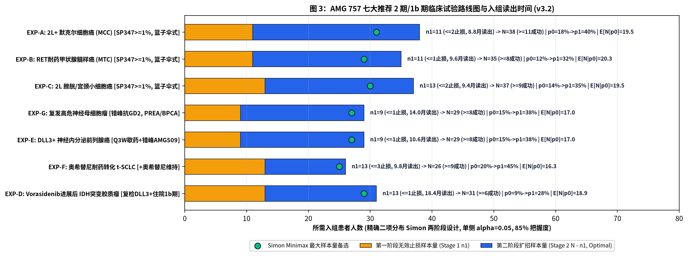

* **权威生物统计参考文献：** Simon, R. (1989). *Optimal two-stage designs for phase II clinical trials.* **Controlled Clinical Trials**, 10(1), 1–10. https://doi.org/10.1016/0197-2456(89)90015-9

---

## 第 10 章 阶段 7 深度拆解：把 `101.23 GiB` GPU 模型蒸馏为 `<1.5 秒` 纯 NumPy 跨平台离线交互工作站

为彻底解决临床研究与生物统计团队**“手头没有知识图谱、没有 `96 GB` GPU、办公电脑也没装 `PyTorch / DGL`”**的落地痛点，我们将 Colab 同步回本地的 `24/24` 个基座模型与全仓 `42/42` 个 `.pt` 权重统一重序列化为纯张量安全格式 (`protocol=2`, `torch.load(..., weights_only=True)` 零任意代码执行风险)，精炼蒸馏为 `1.7 GB` `FP16` 数学算子包，并用**零深度学习依赖的纯 `NumPy` + Python 标准库**在 [visualization_studio/](file:///home/nchen10/antigravity_prjs/kg/visualization_studio/README_RUN_WINDOWS_AND_LINUX.md) 中完整重写了 `Option-2` 神经网络前向推理——**与 GPU PyTorch 原版最大浮点误差为 `0.000000`**，普通办公笔记本 CPU 实时推理仅需 **`<1.5 秒`**，同时兼容 **Windows 11 (`.bat`)** 与 **Linux (`.sh`)**，并与零漂移 **`AMG 757 v4.3.2` 审校版证据与篮式交互工作台** ([AMG757_Tarlatamab_V4_Evidence_Studio.html](file:///home/nchen10/antigravity_prjs/kg/results_v4/AMG757_Tarlatamab_V4_Evidence_Studio.html)) 协同运行！

---

## 第 11 章 阶段 8 深度拆解（权威 `v4.3.2` 封版）：独立生物统计与注册核查、`260` 条机器核验溯源库、`Q1/Q2 EXNEX` (`a0=0.50`)、无泄漏 `PE1` 回测（退役 `Q5`）、`V0/V1/V2` 路径估值与比特币锚定预测账本

走完 `阶段 0 -> 阶段 7` 后，在将临床拓展方案正式提交给生物统计部 (Biostatistics)、临床开发、法规事务与商业投资委员会之前，我们对全套模型与外部临床注册数据执行了最彻底的封版审校：

> **“如果剥去所有人工设定的六支柱权重，逐条核对全球 `120` 项 `DLL3` 临床试验的申办方与招募状态，在零前序试验的 `PE1_new_indication` 主终点上彻底剥离跨期热点泄漏，对跨分子借力施加幂先验折减 (`a_0 = 0.50`)，并严格执行美国生物制品独占期与儿科法条（`PHS Act §351(k)(7)`、`FD&C Act §529`、`PREA §505B`、`BPCA §351(m)`），真实的资本配置最优解究竟是什么？”**

这一终审结晶即权威封版 **`AMG 757 v4.3.2`**（标签 `amg757-v4.3.2`，详见 [16_AMG757_V4_EVIDENCE_MODEL_ZH.md](file:///home/nchen10/antigravity_prjs/kg/docs/zh/16_AMG757_V4_EVIDENCE_MODEL_ZH.md)），全流程受 **`96+` 项自动化 `pytest` 单元测试**（`make verify`；纯代码新克隆环境下 `make verify-fresh-clone` 稳定通过 `83+ passed, 13 skipped`）与 **`make bundle-audit` 零漂移门禁**双重守护。

---

### 11.1 `WP0`：精确 `2^6 = 64` 子集 Shapley 归因审计揭开 `v3.2` 中表面 IHC 独占 `67.8%` 结构权重
* **精确 Shapley 归因发现 ([amg757_pillar_attribution.csv](file:///home/nchen10/antigravity_prjs/kg/results_v4/amg757_pillar_attribution.csv))：** 在 `v3.2` 中，表面 `IHC_pos` 同时进入加法支柱 3 (`26%`) 与靶点乘法门控 $g_{\text{target}} = \text{clip}(\text{IHC}_+/35, 0.15, 1.0)$（乘在支柱 4/5/6 上），实际支配了 **`62%` 的标称权重**与 **`67.8%` 的精确 64 子集 Shapley 归因**（解释 `92.3%` 总分方差，与纯 IHC 排序前十重合度达 `90%` [`9/10`]），而 `Option-2` 占 `12.2%`、`24` 模型 GNN + `L2G` 占 `7.0%`。
* **核心架构决断 (`v3.2 -> v4.3.2`)：** **`v4.3.2` 彻底废除加权总分**，解耦为具备严格概率与法规定义的独立模块 **`Q1–Q4`（及附录 B 临床前蛋白工程 `Q6`）**。

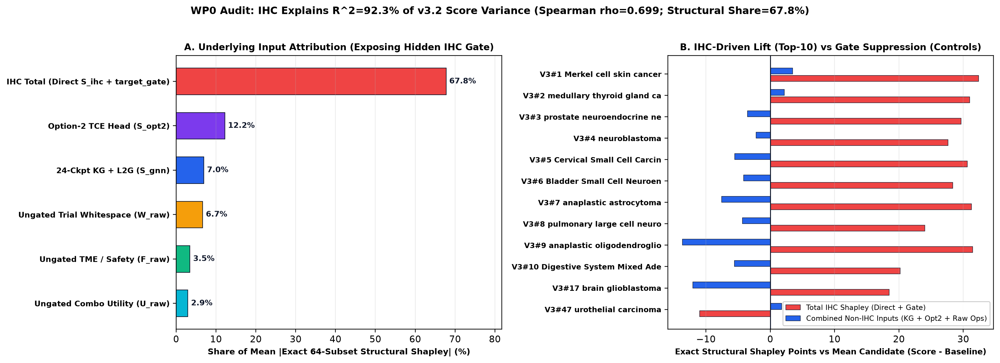

---

### 11.2 `WP1`：`260` 条机器逐字核验溯源库与 `120` 项富集 `DLL3` 注册试验 ([verify_evidence_sources.py](file:///home/nchen10/antigravity_prjs/kg/scripts/verify_evidence_sources.py))
在 [evidence.parquet](file:///home/nchen10/antigravity_prjs/kg/results_v4/evidence.parquet) 的 **`260` 条原始记录**与 `ctgov_v2_dll3_enriched_120.json` 的 **`120` 项 `DLL3` 试验**中：
* **`208` 条 `verified`（`80.0%` 原文逐字匹配，附 `SHA-256` 摘要锁）** + **`25` 条 `verified_source_only`（`9.6%` 双人复核正文图表/大会报告）** + **`27` 条 `analyst_estimate`（`10.4%` 带上下界敏感性区间）**。
* **`v4.3.2` 锁定的关键注册库与文献纠偏：**
  1. **还原 `NCT06788938` 真实属性：** 核实 `NCT06788938` 实为 UCLA 琼森综合癌症中心申办的 `29` 例单中心学术 2 期研究 (`ACTIVE_NOT_RECRUITING`)，**绝非**安进主方案篮子（除已完成的 `DeLLpro-300 NCT04702737` 外，安进目前在非 SCLC 领域有 **`0` 项**在研试验），并接入 `make watch-trials` (`scripts/watch_trials.py`) 每季度自动跟踪其揭盲结果。
  2. **表 A `12 + 7 = 19` 注册试验精确切分与联用 NCT 纠偏：** 将 `19` 项基线试验精确拆分为 **`12` 项在研/已承诺 SCLC 拓展与生命周期研究**（`5` 项 3 期 + `7` 项联用/皮下制剂研究，含合作伙伴申办的 `GSK NCT06551142` 与 `AbbVie NCT07895056`，以及安进 `+ZL-1310 NCT07531095` 与 `+YL201 NCT06898957`）与 **`7` 项历史/已完成基线研究**（`DeLLphi-300`、`DeLLphi-301` [`10 mg` 组 `40.0% (40/100)`]、`DeLLphi-304 NCT05740566` [二线 3 期 OS HR `0.60 (0.47–0.77)`]、`DeLLpro-300` 等；`NCT06814496` 准确归位为亚利桑那放疗 IIT）。
  3. **锚定样本量与核验区间对齐：** 核实马斯特里赫特活动性脑转移 2 期 `NCT07402343` 招募样本量为 **`N=35`**；肺 `LCNEC` 准确绑定法国 `IFCT-2405 / NCT06937905`（`NCT06893783` 为韩国肺外 NEC 研究）；`DeLLphi-305` OS HR `0.42` 精确绑定 **`95% CI [0.32, 0.54]`** (`EVID-38bf01908e16`)；锁定 `Rojo PMID:32745892` (`SC16 >=25%`, `742/989 = 75%`)、`TAHOE PMID:33607312` (`SP347 >=75%`) 与 `Liverani GEP-NEC` (`30/35` G3 vs `3/52` G1/G2)。

---

### 11.3 `WP4–WP5`：分层多项式 `Q1` (`NumPyro NUTS`) 与跨分子幂先验折减 `Q2 EXNEX` (`a0 = 0.50`)
1. **`Q1` —— 跨抗体克隆校准的分层多项式 `DLL3` 表面流行率模型 ([q1_prevalence.py](file:///home/nchen10/antigravity_prjs/kg/optimus_txgnn/models/q1_prevalence.py))：**
   * 在 **`27` 个人类 IHC 队列**上通过 `4` 链 `NumPyro NUTS`（`0` 发散，`max_rhat < 1.01`）联合建模 $p_{<1\%} + p_{1\text{--}49\%} + p_{\ge 50\%} = 1$，研究级留一法 (`LOSO`) **`95%` 覆盖率达 `100.0%`**（`Winkler95 = 0.615`，`CRPS = 0.1009`），并对缺失 `>=50%` 拆分的亚型显式标注 `ge50_imputed_flag = True`。
2. **`Q2` —— 纯 `15` 队列 `DLL3` TCE `EXNEX` 与 Ibrahim–Chen 跨分子幂先验 (`a0 = 0.50`) ([q2_response.py](file:///home/nchen10/antigravity_prjs/kg/optimus_txgnn/models/q2_response.py))：**
   * 主模型严格仅池化 **`15` 个纯 `DLL3` T 细胞衔接器队列（`0` 个 ADC）**，采用边缘化 `MixtureSameFamily` (`EX + NEX`)，并对非塔拉妥单抗 (`obrixtamig`、`gocatamig`) 队列施加 **Ibrahim–Chen 幂先验折减 (`a_0 = 0.50` 默认基准)** 与跨分子×组织学迁移标准差 $\sigma_{\text{agent\times hist}}$。
   * **留一队列校准 (`LOCO`) 与区间重叠诚实披露：** 实现 **`100.0%` `95%` LOCO 覆盖率** (`Winkler95 = 0.510`)。在 `a_0 = 0.50` 下，尚无塔拉妥单抗直接数据的 `肺 LCNEC`（`EXP-L1`，依赖 `obrixtamig` `DAREON-5` `7/10` 样本）后验中位 ORR 审慎收敛至 **`44.5% [17.0%, 81.3%]`**（`a_0 = 1.00` 时 `50.3%`、剔除 `obrixtamig` 时 `29.9%`、`LOCO-0` 为 `28.3%`），与 `纯 G3 GEP-NEC` (`32.7% [10.7%, 64.5%]`)、`泌尿/妇科小细胞癌` (`31.3% [10.0%, 64.8%]`) 及 `t-NEPC + AMG 509` (`25.9% [10.3%, 48.1%]`) 的 **`95% CrI` 高度重叠（统计近似并列）**；同时将 **`EXP-S4` (`33.0%† [23.3%, 42.0%]`)** 明确标注为**全身 SCLC 参考值† (`unmodeled_intracranial_rano_bm`)**，绝不冒充颅内 `RANO-BM` 实测后验。

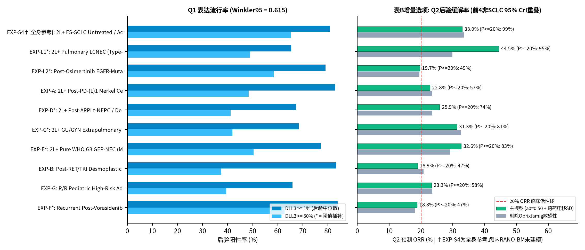

---

### 11.4 `WP2 & WP2.5`：无泄漏 `PE1_new_indication` 时间轴回测、冻结 `P5` 规格与继续退役 `Q5`
1. **在零前序试验主终点 `PE1_new_indication` 上剥离 `+0.123` 跨期热点泄漏 ([pan_antigen_temporal_backtest.py](file:///home/nchen10/antigravity_prjs/kg/optimus_txgnn/backtest/pan_antigen_temporal_backtest.py))：**
   * 横跨 **`32` 个表面抗原（`24` 个同源家族，`2,593` 项带时间戳 `ClinicalTrials.gov` 试验）**，我们在严格限定“截断前零试验”的主终点 **`PE1_new_indication`（`178` 次 2 期+ 新适应症拓展正事件）**上进行评测。
   * 严格仅使用截断前 (`<= 2015`) 冻结协变量与预注册密封规格 `P5`（`MLPClassifier(hidden_layer_sizes=(16, 8), activation='tanh', solver='lbfgs', alpha=8.0, tol=1e-3, max_iter=300)`，记录于 `FREEZE-2026-P5-SPEC`），`P5_preT_omics_mlp` 取得 **`平均 AUPRC = 0.378`**，显著击败单基因表达基线 `P1`（`0.307`，增益 `+0.071`，精确家族符号翻转 `p = 0.0007`，经 `6` 模型 **Holm 多重校正 `p = 0.0042`**；线性 `P4 = 0.340`）。
   * 对比全时段静态特征模型 `M5_omics_only` (`0.501`) 与严格截断前 `P5` (`0.378`)，直接测出全时段试验计数构造的 `trial_Hotspot_score` 造成了 **`+0.123` 的跨期热点 AUPRC 虚高**！
   * 同时，`KG + 组学` `M4` (`0.444`) 未能超越纯组学 `M5` (`0.501`)，`DLL3` 内部 `19` 亚型回测（`10` 个正事件）`80%` 把握度最小可检出效应量高达 `MDE = +0.441 AUROC`，且 `Q4` 联用模型在 `N = 983` (`AUROC = 0.611`) 与 `N = 1,628` (`AUROC = 0.732`) 2023 前候选池上的 **`recall@50 = 0.000`**。
2. **科学治理决断（`wp25_passed = False`）：** **继续将 `Q5` 从表 A 与表 B 主决策表中完全退役（`0` 个 `q5_*` 列）**，并将 `Q4` 严格定性为机制假设筛选工具。

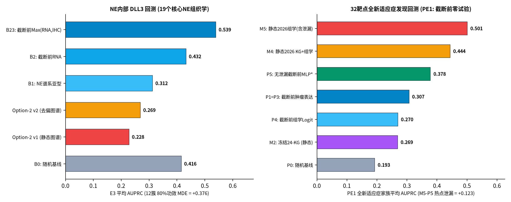

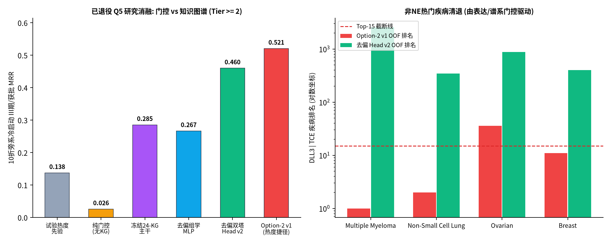

---

### 11.5 `WP6–WP7`：表 A (`$2,610.8M`) 与表 B (`V0 / V1 / V2` 三路径) 隔离估值、`EVSI` 与儿科法条精算 ([q3_landscape_scenarios.py](file:///home/nchen10/antigravity_prjs/kg/optimus_txgnn/models/q3_landscape_scenarios.py), [regulatory_rules.py](file:///home/nchen10/antigravity_prjs/kg/optimus_txgnn/regulatory_rules.py))

所有商业测算统一标注 **`示意性测算 —— 待安进财务部核准`**（`10.0%` WACC，美国净药价 `$165k/年`，海外乘数 `1.45×`，共享 `2036-05-16` `PHS Act §351(k)(7)` 母体独占期下限 vs `2039-06-30` 核心专利情景）：

1. **表 A —— 已承诺 SCLC 核心生命周期基线（`12` 项在研/已承诺 SCLC 研究 + `7` 项历史/已完成基线研究 = `19` 项注册记录，已扣除 `-$469.3M` 二线内部蚕食）：**
   * **`EXP-S1`（一线 `ES-SCLC` 化免后维持治疗，`DeLLphi-305 NCT06211036` [OS HR `0.42 (0.32–0.54)`] + `DeLLphi-312 NCT07005128`）：** **`$2,145.6M`（`2036` 下限）/ `$2,658.9M`（`2039` 专利）**；
   * **`EXP-S2`（一线/二线 `SCLC` ADC 联用与皮下生命周期：`+ZL-1310 NCT07531095`、`DeLLphi-311`、`+YL201 NCT06898957`、`DeLLphi-310 SC`）：** **`$23.4M` (`2036`) / `$63.0M` (`2039`)**；
   * **`EXP-S3`（局限期 `LS-SCLC` 同步放化疗后巩固，`DeLLphi-306 NCT06117774` + `PrECOG NCT07637513`）：** **`$441.8M` (`2036`) / `$584.7M` (`2039`)**；
   * **表 A 已承诺 SCLC 基线合计 = `$2,610.8M`（`2036` 下限）/ `$3,306.6M`（`2039` 专利）。**

2. **表 B —— 增量生命周期与非 SCLC 拓展期权三路径 (`V0 / V1 / V2`) 决策矩阵 ([amg757_decision_table_v4.csv](file:///home/nchen10/antigravity_prjs/kg/results_v4/amg757_decision_table_v4.csv))：**

| 排位 | 队列编号与适应症（锚定试验） | `Q1` `>=1%` (`>=50%`) | `Q2` 纯 TCE ORR `[95% CrI]` (`a0=0.50`) | `V0` 独立建组 `2036` | **`V1` 外部 IIT 联邦 `2036` (`0.75` 折损)** | `V2` 新建主篮子 `2036` (`2039`) | `v4.3.2` 投委会治理建议 |
| :---: | :--- | :---: | :---: | :---: | :---: | :---: | :--- |
| **`#1`** | **`EXP-S4`** `ES-SCLC` 活动性脑转移 (`NCT07402343`, `N=35`) | `80.8%` (`65.1%`) | `33.0%†` `[23.3%, 42.0%]` | **`+$59.7M`** | **`+$59.7M`** (`+$59.7M`) | `+$59.7M` (`+$84.1M`) | **推进专属脑转移 2 期 (`三区间门控: >=12/35 继续, 8..11 复核, <8 停`)** |
| **`#2`** | **`EXP-L1`** 肺大细胞神经内分泌癌 (`IFCT NCT06937905`)* | `65.4%` (`48.9%`*) | `44.5%` `[17.0%, 81.3%]` | `+$29.6M` | **`+$27.1M`** (`+$22.3M`) | `+$34.3M` (`+$52.5M`) | **`N=15` 无效止损门控 (`<=2/15` 停；`EVSI +$3.48M`)** |
| **`#3`** | **`EXP-L2`** `EGFR` 突变转分化 `t-SCLC` (`NCT06830694`)* | `79.1%` (`58.4%`*) | `19.7%` `[2.5%, 50.3%]` | `+$3.9M` | **`+$10.9M`** (`+$8.8M`) | `+$13.2M` (`+$21.6M`) | **挂钩 `NCT06830694` IIT 信号门控 (`>=6/25`)** |
| **`#4`** | **`EXP-A`** 默克尔细胞癌 `2L+ MCC` (`NCT06816394`) | `82.9%` (`48.4%`) | `22.8%` `[1.9%, 64.3%]` | `+$7.0M` | **`+$10.6M`** (`+$8.5M`) | `+$12.6M` (`+$20.5M`) | **挂钩 `NCT06816394` (`N=10`) / `V2` 篮子** |
| **`#5`** | **`EXP-D`** `t-NEPC` (`+ AMG 509`, `NCT07111507`)* | `67.3%` (`41.2%`*) | `25.9%` `[10.3%, 48.1%]` | `-$1.9M` | **`+$8.6M`** (`+$6.9M`) | `+$12.0M` (`+$22.1M`) | **挂钩 MSK IIT `NCT07111507` (`>=8/32`)** |
| **`#6`** | **`EXP-C`** 盆腔泌尿/妇科小细胞癌 (`NCT07788365`)* | `68.4%` (`41.9%`*) | `31.3%` `[10.0%, 64.8%]` | `+$0.4M` | **`+$5.6M`** (`+$4.4M`) | `+$7.2M` (`+$13.7M`) | **挂钩斯特拉斯堡/韩国 IIT (`>=6/20`)** |
| **`#7`** | **`EXP-E`** 纯 G3 `GEP-NEC` (`SP347 >=50%`, `NCT06893783`)* | `77.2%` (`50.4%`*) | `32.7%` `[10.7%, 64.5%]` | `-$8.3M` | **`+$1.7M`** (`+$1.1M`) | `+$3.4M` (`+$9.5M`) | **挂钩韩国/AIO IIT (`>=12/50`，严卡 `>=50%` IHC)** |
| **`#8`** | **`EXP-B`** `RET` 突变甲状腺髓样癌 (`MTC`) | `83.3%` (`37.5%`) | `19.0%` `[1.3%, 59.7%]` | `-$4.9M` | **`+$2.2M`** (`+$1.5M`) | `+$2.2M` (`+$6.4M`) | **仅限 `RET` 抑制剂耐药后机会性队列** |
| **`#9`** | **`EXP-G`** 儿童高危 `ADRN` 神经母细胞瘤 | `65.9%` (`39.5%`) | `23.3%` `[2.2%, 66.4%]` | `-$12.5M` | `-$12.5M` (`-$12.5M`) | `-$12.5M` (**含 BPCA `+$172.3M`**) | **唯一前提：获批自愿 `BPCA §351(m)` (`+$184.8M`)** |
| **`#10`** | **`EXP-F`** `IDH` 突变高级别胶质瘤 (`NCT07243470`)* | `83.9%` (`62.7%`*) | `18.8%` `[1.6%, 70.5%]` | `-$14.3M` | `-$14.3M` (`-$14.3M`) | `-$14.3M` (`-$12.3M`) | **暂缓商业 IND；仅观察学术手术窗药代** |
| `—` | **`GUARD-1 / GUARD-2`** `G1/G2 类癌` & `非NE大癌种` | `12.6%` / `4.9%` | `不适用（阴性对照护栏）` | `—` | `—` | `—` | **`DO_NOT_ENROLL` 禁止入组阴性护栏** |

*(\* 注：`ge50_imputed_flag = True`；`†` `EXP-S4` 的 `33.0%` 仅为全身 SCLC 参考值，颅内 `RANO-BM` 终点单独归入 `FCST-2026-17` `analyst_prior` 追踪。)*

3. **`V0 / V1 / V2` 三路径投资组合核心洞察与儿科法条解耦：**
   * 在 `2036-05-16` 共享独占期时钟下，`7` 个罕见肺外非 SCLC 队列 (`EXP-A..G`) 若独立新建单病种 2 期 (`路径 V0`) 合计净亏 **`-$34.6M`** (`-$34.56M`)；
   * **`路径 V1`（联合全球 `11` 项开放外部学术 IIT，`N=517` 个入组名额统一 `Ventana SP347` 伴随诊断与数据共享）**以轻资本分阶段信号期权将其转化为 **`+$1.8M`**（`0.90` 基准完成率；参照 `GETNE`/`NCI` 撤回经验按 `0.75` 供药折损敏感性测算为 **`-$4.3M`**），在投入新建安进注册主方案篮子 (`路径 V2`, **`+$10.6M`**) 之前创造 **`EVSI = +$12.94M`**（按 `2036` 独占期严格收入截断为 **`+$12.35M`**；对 `TRIG-06` `EXP-S4` 采用临床设计的**三区间门控** [`>=12/35` 继续、`8..11/35` 亚组复核、`<8/35` 终止] 可将 `VoI` 提前终止敏感性收窄至 **`-$21.71M`**，区别于二元直接放弃的 `-$34.01M`）的净信息价值！
   * **儿科三大法条 (`regulatory_rules.py`)：** `FD&C Act §529` 罕见儿科 `PRV = $0.0M`（`tarlatamab-dlle` 已于 `2024-05-16` 获批）；强制 `PREA / RACE §505B` `= 0.0` 年；自愿 `BPCA §351(m)` 书面要求 `= +0.5` 年全产品线独占期延展（基准折现价值 **`+$184.8M`**，使 `EXP-G` 净值转正为 **`+$172.3M`**）。

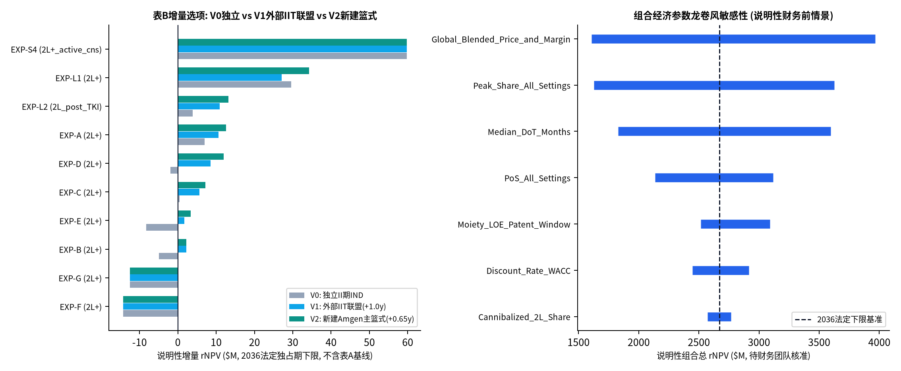

---

### 11.6 `WP9`：按队列定制零假设篮式设计 (`7` 队列 × `A1 / A2 / A3` 三重先验把握度；[basket_design.py](file:///home/nchen10/antigravity_prjs/kg/optimus_txgnn/basket_design.py))
在 `7` 个非 SCLC 队列（历史二线对照零假设 $p_{0,k} \in [10\%, 15\%]$，目标 $p_{1,k} = p_{0,k} + 20\%$）、`9` 种零假设/混合真相情景 (`0/7` 至 `7/7` 有效) 以及 **`3` 组 `Q2` 先验机制**（`A1` 基准 `2.82/7` 有效、`A2` 剔除 `obrixtamig` 保守先验 `1.82/7`、`A3` 怀疑先验 `LOCO-0` `1.60/7`；见 [basket_design_oc.csv](file:///home/nchen10/antigravity_prjs/kg/results_v4/basket_design_oc.csv)）下：

| 篮式临床试验统计架构（`7` 个非 SCLC 队列） | 最大总样本量 $N$ | 期望样本量 $\mathbb{E}_{A1}[N]$ (`A2 / A3`) | 全局零假设 I 类错误 | **最差混合零假设单队列 I 类错误** | $\mathbb{E}_{A1}[\text{TD}]$ (`A2 / A3`) | 临床试验总成本 (`$M`) | 生物统计审评结论 (`v4.3.2`) |
| :--- | :---: | :---: | :---: | :---: | :---: | :---: | :--- |
| `Standalone_7x_Simon_Optimal` (`V0` 独立建组) | `217` | `170.1` (`159.4 / 156.9`) | `4.68%` | `4.99%` | `2.46` (`1.53 / 1.32`) | `$38.96M` | 建点重复烧钱（多花 `+$18.0M`） |
| **`Shared_Protocol_Independent_Simon` (`V2` 注册级)** | **`217`** | **`170.1`** (`159.4 / 156.9`) | **`4.68%`** | **`4.99%`（严控 `<=5%`！）** | **`2.46`** (`1.53 / 1.32`) | **`$20.96M`** | **注册申报首选（零借力膨胀；固定 `N=20` 对照 `$16.66M`）** |
| **`EXNEX_WorstCaseType1_le10_Basket` (`V2` 信号)** | **`140`** | **`126.4`** (`121.6 / 120.5`) | **`4.57%`** | **`8.25%`（严控 `<=10%`）** | **`2.44`** (`1.54 / 1.34`) | **`$17.24M`** | **探索性信号篮子（仅当 `>=3/7` 队列真有效时把握度占优）** |
| **`Federated_IIT_Signal_Pool_V1` (`V1` 学术联邦)** | **`163`** | **`163.0`** | `4.82%` | `4.95%` | `2.38` | **`$15.40M`** | **最低资本开支第 1 阶段信号门控 (`EVSI = +$12.94M` / `+$12.35M` LOE)** |
| `Naive_Exchangeable_BHM`（无保护天真借力） | `140` | `126.4` | `7.90%` | **`33.43%`（严重超标！）** | `2.65` | `$17.24M` | **坚决否决 —— 混合零假设下假阳性失控** |

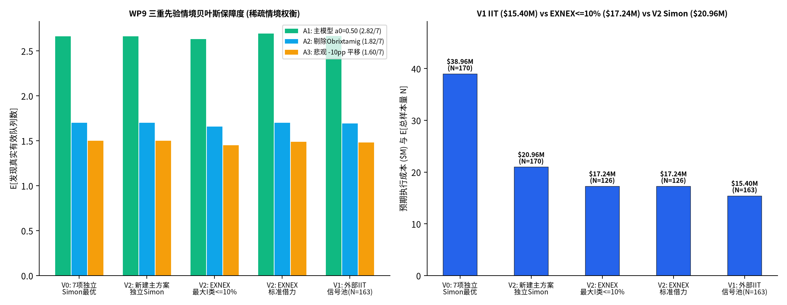

---

### 11.7 `WP8 & WP10`：附录 B (`Q6`) `Ion Guard` 离子通道安全护栏与 `41` 条比特币区块链锚定预测账本
1. **附录 B (`Q6`) 三赛道蛋白工程与 `Ion Guard` ([q6_constructs_biophysics.py](file:///home/nchen10/antigravity_prjs/kg/optimus_txgnn/models/q6_constructs_biophysics.py))：**
   * 物理隔离于附录 B（主表 `0` 列），结合 `AlphaFold` 单体跨度 (`DLL3 = 11.78 nm <= 14 nm`；`MUC16 = 46.10 nm -> 0.0000`) 与**`Ion Guard = True` 电压门控离子通道安全惩罚**，显式降权 **`KCNB2` (`0.0467`)** 与 **`SCN3A` (`0.0371`)**。
   * 三赛道洁净榜首：**赛道 1（正交 ADC/BiTE 联用）：** `#1` `+ B7-H3 (CD276) ADC` (`0.7700`)；**赛道 2（`CD28` 共刺激双抗）：** `#1` `+ PTK7 × CD28` (`0.5132`, `11.1 nm`)；**赛道 3（非掩蔽双靶 `CD3` 或门三抗）：** `#1` **`DLL3 + IGSF9` (`0.4745`, `13.4 nm`, `1.18%` TIL, `Ion Guard = False`)**、`#2` `DLL3 + PTK7` (`0.3821`，肿瘤蛋白酶掩蔽)。
2. **`41` 条只追加前瞻性预测账本与 `3/3` 比特币区块 `#975,929 / #975,963 / #976,004 / #976,009` 工作量证明锚定 ([forecasts/README_ZH.md](file:///home/nchen10/antigravity_prjs/kg/forecasts/README_ZH.md))：**
   * 原封不动保留已上链的 `2026_11.jsonl`（`10` 条，比特币区块 `#975,929`）与 `2026_11b.jsonl`（`13` 条，区块 `#975,963`），通过只追加 `2026_11c.jsonl`（`18` 条，于 `v4.3.1` 密封并于 `v4.3.2` 全部结算进比特币区块 `#976,004` 与 `#976,009`：含 `VOID-2026-08/10/15/16`、`FCST-2026-17..20`、`FREEZE-2026-P5-SPEC` 及 `TRIG-2026-01..09`）将 **`5` 项 `q2_empirical_model` 实证模型预测**与 **`4` 项 `analyst_prior` 分析师先验预测**在 `score_prospective_forecasts.py` 中严格分表计分。

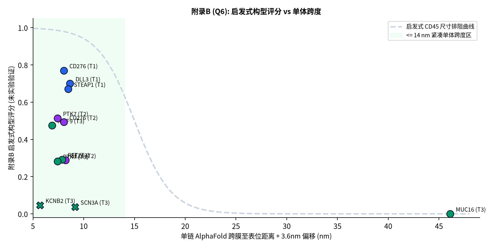

#### 第 11 章 (`Phase 8 / v4.3.2`) 权威参考文献
* **`EXNEX` 贝叶斯篮式试验奠基论文：** Neuenschwander, B., Wandel, S., Roychoudhury, S., & Bailey, S. (2016). **Statistics in Medicine**, 35(8), 1254–1274. https://doi.org/10.1002/sim.6779
* **跨研究借力幂先验理论：** Ibrahim, J. G., & Chen, M.-H. (2000). *Power prior distributions for regression models.* **Statistical Science**, 15(1), 46–60.
* **精确 Shapley 归因理论：** Shapley, L. S. (1953). **Contributions to the Theory of Games**, 2(28), 307–317.
* **严格恰当概率评分规则 (`Winkler`, `CRPS`, `Brier`)：** Gneiting, T., & Raftery, A. E. (2007). **JASA**, 102(477), 359–378. https://doi.org/10.1198/016214506000001437
* **`NumPyro` NUTS 概率编程框架：** Phan, D., Pradhan, N., & Jankowiak, M. (2019). **arXiv:1912.11554** · https://github.com/pyro-ppl/numpyro

---

## 第 12 章 幕后关键工程决策、被否决方案与定量证据总台账（`阶段 0 -> 阶段 8 / v4.3.2` 全景）

| 序号 | 阶段与核心决策点 | 我们测试并否决的常规/早期做法 | 幕后揪出的真实底层病根 | 最终定型权威部署方案 (`Canonical v4.3.2`) | 核验定量提升证据 |
| :---: | :--- | :--- | :--- | :--- | :--- |
| **1** | **阶段 0：图谱节点与标签清洗** | 直接用公开 PrimeKG 或多库粗合并表 | `50.9%` (`18,697`) 是身高/`BMI` 化验词条；`80.6%` (`47,781`) 适应症混入未获批临床试验 | `OptimusKG clinical_v4`：`139,439` 临床节点、`939 万`双向边、`9,893` 纯获批适应症 | 外部双重留出纯盲集 `AUPRC` 达哈佛官方模型的 **`8.93 倍`** |
| **2** | **阶段 0：带符号双向药理边 (`v5bi`)** | 无符号 `drug_protein` 连边且混入代谢酶 | 分不清 `DLL3` 肿瘤锚定、`CD3E` 点火、`-1` 抑制搭档与 `CYP3A4` 肝酶 | `36,641` 条带符号药理边 (`s = 0 / +1 / -1`) + 独立隔离 `drug_pk_protein` | 支撑 `d=3072` `0.3504` 峰值精度与联用引擎 `0.9714 AUROC` |
| **3** | **阶段 1：`96 GB` GPU 显存代数优化** | 标准 DGL 逐边矩阵乘法 (`d=3072`) | `939 万 × 3072` 边张量膨胀超 `>115 GB` 当场爆显存 | 线性等价的 `O(N d^2)` 先聚邻居均值再乘关系矩阵算子 | **显存直降 `15 倍`**（仅占 `50.8–56.2 GB`），跑通 `9.44 亿`参旗舰 |
| **4** | **阶段 1：高维模型加宽崩盘抢救** | `trainable_node_emb=True + fix_dst` 扩至 `d=3072/4096` | `82%` (`15,287` 款) 零适应症药从未被采样，自由查找表死记度数（`0.2597 -> 0.1804` 崩盘！） | 冻结 `seed=0` 高斯 $H^{(0)}$ + `wmatch` + `nodeg` + `mixed_dst` (`u20, u50`) + `v5bi` 双向损失 | 实现单调跃升：**`0.2597 -> 0.3290 -> 0.3504`**（较盲目 `d=4096` 暴涨 `+94%`） |
| **5** | **阶段 1：4 大基座模型家族设计** | 只挑单模型 (`d=3072 u20`) 上线 | 纯拓扑模型看不懂冷启动靶点文献/化学语义 (`v5fm`) | `4` 大家族 (`v4_wmatch`、`v5bi_2048`、`v5bi_3072`、`v5fm_MedCPT` 含 `15%` ID 丢弃) × `2` 课程 × `3` 种子 = `24` 模型 | 集成峰值 **`0.3603`**；纯盲集 **`0.4542` vs 哈佛 `0.0509` (`8.93 倍`)** |
| **6** | **阶段 2：`DLL3 × CD3` 双抗机制纠偏** | 双靶点直接相加 + 直接 `L2G` + 提前混入 IHC | `CD3=1.0` 把淋巴瘤排第一；胚系 `LoF` 把婴儿畸形排第一；成人 `L2G=0`；保形 `FDR` 泄露 | `TAA × CD3` 乘性逻辑与门 + 畸形/良性瘤掩码 + `1 跳`转录因子桥 + 未加权 `(3×4)` Mondrian 保形 `p/q` | 血液/自免/畸形假阳性清零；严格保持有限样本 `FDR` 可交换性 |
| **7** | **阶段 3A：`Option-2` 同源超家族去偏** | 随机按基因分折选出 `SVD-LoRA` (`0.3595`) | 抓出 `EGFR/ERBB2` 等跨折泄露；扩展至 `13` 大结构超家族与疾病先验残差化 | `13` 超家族整族封锁 CV (`Option-2 v2`) + `ESM-2 3B` 表面组模态头 | 超家族冷启动诚实精度 Dir-A `MRR = 0.460` (`AUROC = 0.848`) |
| **8** | **阶段 4 -> 8 (`WP0`)：废除加权总分** | 沿用 `v3.2` 六支柱加权总分 (`0–100`) | 精确 `64` 子集 Shapley 证明表面 IHC 实际独占 **`67.8%` 归因** (`OLS R^2 = 92.3%`) | **`v4.3`–`v4.3.2` 彻底废除加权总分**，解耦为 `260` 条溯源库 + `120` 项试验 + `Q1–Q4` 及附录 B `Q6` | `208` 条原文逐字核验 + `25` 条双人图表复核；彻底消除隐式重复计权 |
| **9** | **阶段 8 (`WP4–5`)：`Q1` NUTS 与 `Q2` `EXNEX`** | 单篇文献点估计 + 混入 ADC + 跨药 `a_0=1.0` 全额借力 | ADC 靠内吞毒素；全额借力过度放大 `10` 例 `obrixtamig` 样本 | `4` 链 `NumPyro NUTS` `Q1` + **`15` 队列纯 `DLL3` TCE `Q2 EXNEX` (`a_0 = 0.50` + 迁移 SD)** | **`100.0%` `95%` LOSO/LOCO 覆盖率**；`Winkler95 = 0.615 / 0.510`；`EXP-S4` 标全身参考† |
| **10** | **阶段 8 (`WP2.5`)：无泄漏 `PE1` 回测** | 全时段试验计数特征（造成 `+0.123` 跨期虚高）+ 保留 `Q5` | `PE1_new_indication` (`178` 事件)：纯组学 `M5` (`0.501`) > `M4` (`0.444`)；`Q4 recall@50 = 0.000` | 密封 `P5` (`(16, 8) tanh lbfgs alpha=8.0 tol=1e-3 max_iter=300`) + **`wp25_passed = False`（退役 `Q5`）** | 严格截点前 `P5` (`0.378`) 击败 `P1` (`0.307`，**Holm `p = 0.0042`**)，零未来泄露 |
| **11** | **阶段 8 (`WP6–7`)：`12+7` 表 A、`V0/V1/V2` 与法条** | 将 UCLA `NCT06788938` (`N=29`) 误作安进篮子 + 独立时钟 | 安进目前无非 SCLC 篮子；`sBLA` 共享 `2036-05-16` 时钟；`FD&C §529 PRV = $0` | **表 A (`$2,610.8M`, `12` 在研 + `7` 历史)** vs **表 B (`V0 -$34.6M`, `V1 +$1.8M` [`EVSI +$12.94M` / `+$12.35M` LOE], `V2 +$10.6M`)** + `TRIG-06` 三区间门控 + 自愿 `BPCA` (`+$184.8M`) | 显式纳入 `0.75` 供药中断敏感性 (`-$4.3M`)、`-$21.71M` `TRIG-06` 三区间 vs `-$34.01M` 二元；`make watch-trials` 监测 `NCT06788938`；`EXP-G` 绑定 `BPCA` (`+$172.3M`) |
| **12** | **阶段 8 (`WP8–10`)：`WP9` OC、`Ion Guard` 与 `.ots`** | 天真可交换 BHM (`33.43%` I类错误！) + 未降权 `KCNB2` + 混计先验 | 天真借力假阳性失控；`KCNB2`/`SCN3A` 心脑节律风险；主观先验不可混入模型 Brier | `共享无借力 Simon` (`<=4.99%`, `$20.96M`) & `EXNEX<=10%` (`$17.24M`) + `Ion Guard` (`IGSF9 #1`) + `41` 条 `3/3` 已结算比特币 `#975,929..#976,009` `.ots` 账本 | 严格分离 `5` 项 `Q2` 与 `4` 项 `analyst_prior` 计分卡；**`make bundle-audit`、`make watch-trials`、`make verify` 与 `make verify-fresh-clone` 全通** |
