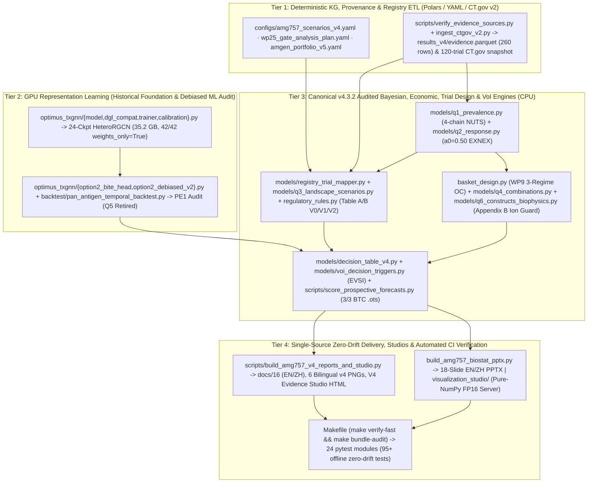

# IMDELLTRA® (AMG 757 / Tarlatamab) Indication Expansion — Comprehensive Summary of All Workstreams, Codebase, Models, Visualizations, Documents & Presentation Playbook (`v4.3.2` Canonical Edition)

> **Simplified Chinese Companion (`1:1` Full Edition):** [AMG757_INDICATION_EXPANSION_COMPREHENSIVE_MASTER_DOSSIER_ZH.md](AMG757_INDICATION_EXPANSION_COMPREHENSIVE_MASTER_DOSSIER_ZH.md)  
> **Polished English Presentation Deck (`18` Slides, Ready to Present):** [AMG757_Biostatistics_Evidence_Model_v4_3_EN.pptx](../01_Presentation_Decks_and_Interactive_Demo/AMG757_Biostatistics_Evidence_Model_v4_3_EN.pptx)  
> **Interactive Offline Bilingual Governance Studio:** [AMG757_Tarlatamab_V4_Evidence_Studio.html](../01_Presentation_Decks_and_Interactive_Demo/AMG757_Tarlatamab_V4_Evidence_Studio.html)  
> **Single-Source Canonical Technical Spec:** [docs/16_AMG757_V4_EVIDENCE_MODEL.md](16_AMG757_V4_EVIDENCE_MODEL.md)  
> **Release & Verification Status:** `Canonical v4.3.2` (`Nov 2026`, Maintenance Mode) · `260` Offline-Verified Provenance Rows · `120 / 120` Enriched `ClinicalTrials.gov` v2 DLL3 Trials · `41` Sealed Append-Only Forecast/Trigger Records (`3/3` Bitcoin PoW `.ots` Proofs Verified at Blocks `#975,929`, `#975,963`, `#976,004`, `#976,009`) · `95 / 95` Fast Offline CI Tests Passing.

---

## Table of Contents

1. [Plain-Language Big Picture: What the AMG 757 Indication Expansion Project Does & All 5 Current Workstreams](#1-plain-language-big-picture-all-5-current-workstreams)
2. [Chronological Evolution (`Phase 0 → Phase 8 / v4.3.2`) & Why Every Major Pivot Happened](#2-chronological-evolution--why-every-major-pivot-happened)
3. [Complete Codebase, Configuration, Data Artifacts & CI Architecture](#3-complete-codebase-configuration-data-artifacts--ci-architecture)
4. [Complete Inventory & Visual Audit of ALL Visualizations, Interactive Studios & Slide Decks](#4-complete-inventory--visual-audit-of-all-visualizations-studios--slide-decks)
5. [Complete Document Inventory & Stakeholder Reader Map (`docs/`, `amgen_discovery_studio/`, `doc_to_gdrive/`)](#5-complete-document-inventory--stakeholder-reader-map)
6. [Deep Mathematical & Empirical Summary of All Canonical `v4.3.2` Analytical Modules (`WP1`–`WP10`)](#6-deep-mathematical--empirical-summary-of-canonical-v432-modules)
7. [Bayesian Value-of-Information (`EVSI`) Triggers, Bitcoin PoW `.ots` Ledger & 4-Cadence Maintenance SOP](#7-bayesian-evsi-triggers-bitcoin-pow-ledger--maintenance-sop)
8. [Presentation Execution Playbook (`30`-Minute Executive Slot + `7`-Minute Live Studio Demo)](#8-presentation-execution-playbook)
9. [Red-Team Executive Q&A Defense Matrix (`18` Cross-Functional Stakeholder Questions)](#9-red-team-executive-qa-defense-matrix)

---

## 1. Plain-Language Big Picture: All 5 Current Workstreams

### 1.1 The Scientific & Business Question

**IMDELLTRA® (`AMG 757` / `tarlatamab-dlle`, `BLA 761344`)** is a first-in-class half-life extended **Bispecific T-cell Engager (`HLE BiTE®`)** approved by the FDA on **`2024-05-16`** for second-line extensive-stage Small Cell Lung Cancer (`2L ES-SCLC`). One binding arm grabs **`DLL3`** on the surface of neuroendocrine cancer cells; the other arm grabs **`CD3ε`** on a patient's own cytotoxic T cells, physically pulling the tumor cell and T cell within **`≤ 14 nm`** so bulky inhibitory `CD45` phosphatases (`~25–40 nm`) are squeezed out ("kinetic segregation") and the T cell lyses the tumor cell regardless of `MHC-I` loss.

The central strategic question of the **AMG 757 Indication Expansion Project** is:

> *Beyond Amgen's already-committed SCLC lifecycle trials, **which new cancer indications, clinical trial delivery routes, biomarker gating thresholds, combination partners, and next-generation escape constructs** maximize clinical probability of success and risk-adjusted capital efficiency — verified strictly against primary human data, live `ClinicalTrials.gov` ground truth, and US biologics exclusivity law?*

### 1.2 At-a-Glance Map of All 5 Active Project Workstreams ("Current Jobs")

Rather than a single script or spreadsheet, the current repository implements **five tightly integrated workstreams**:

| Workstream ("Job") | What It Built | Primary Code / Artifacts | Current Status (`v4.3.2`) |
| :--- | :--- | :--- | :--- |
| **Job 1: Knowledge Graph & Deep Learning Platform (`Phase 0–4`)** | Curated `139,439`-node / `9.39M`-edge `OptimusKG` (`clinical_v4` + signed `clinical_v5`), trained a `24`-checkpoint `HeteroRGCN` super-ensemble (`d = 2048/3072`, `13.35B` combined params), built `3×4` Mondrian conformal calibration, `Option-1` 4-pillar MCDA, and `Option-2` `OptimusBiTE-Head` (`ESM-2 3B` + `SVD-LoRA` + `FiLM`). | `optimus_txgnn/{data,model,dgl_compat,trainer,calibration,bite_biomarker_and_expansion,option1_protocol_and_omics,option2_bite_head,option2_debiased_v2}.py` | Complete & frozen (`42/42` `.pt` files `weights_only=True`). **Crucial audit verdict:** `Q5` KG/ML head is **retired (`0` columns in Table B)** for AMG 757 after failing `WP2.5` temporal back-test, while proving strong lift on multi-pathway immunology (`AMG 691`). |
| **Job 2: Primary Human Multi-Omics, Single-Cell & Synapse Biophysics (`Phase 5–6`)** | Replaced cell-line proxies with **`2,215` primary patient biopsies** (`MCC GSE235092`, `MTC GSE196264/32662`, pediatric `TARGET-NBL`), analyzed **`60,026` clinical SCLC single cells** (`20` patients) for subclonal escape & `10,953`-leukocyte TIL fratricide, and scored AlphaFold monomer spans (`≤14 nm`) with an **`Ion Guard`** safety filter. | `optimus_txgnn/{amg757_primary_tme_and_scrna,amg757_biophysical_synapse,amg757_integrated_synthesis}.py`, `optimus_txgnn/models/q6_constructs_biophysics.py` | Complete. Biopsies feed `Q1`; `60k` scRNA & AlphaFold spans populate segregated **Appendix B (`Q6`)** (`Track 1` `CD276 0.7700`; `Track 2` `PTK7 0.5132`; `Track 3` `IGSF9 0.4745`; `KCNB2`/`SCN3A` hard-demoted). |
| **Job 3: Canonical `v4.3.2` Audited Bayesian Evidence Model (`Phase 8` / `WP0–WP10`)** | Built a `260`-row offline provenance store & `120`-trial enriched CT.gov audit; 4-chain `NumPyro NUTS` `Q1` prevalence & `Q2` cross-agent (`a0 = 0.50`) `EXNEX` response; `32`-antigen leak-free `PE1` back-test; split `Table A` (`12+7 = 19` studies) vs. `Table B` (`10` options across `V0`/`V1`/`V2`); `WP9` 7-design × 3-regime basket OC; `Q4` unbiased combo audit; Bayesian `EVSI` Go/No-Go triggers; and `41`-row Bitcoin PoW `.ots` forecast ledger. | `optimus_txgnn/models/{q1..q4,q6,decision_table_v4,registry_trial_mapper,voi_decision_triggers}.py`, `optimus_txgnn/backtest/`, `optimus_txgnn/basket_design.py`, `optimus_txgnn/regulatory_rules.py`, `configs/amg757_scenarios_v4.yaml`, `forecasts/` | **Canonical Production Truth (`amg757-v4.3.2`)** in 4-Cadence Maintenance Mode awaiting `2026-12`–`2029-12` clinical readouts. |
| **Job 4: Visualizations, Interactive Studios & Presentation Decks (`Phase 7 & 8`)** | Built the zero-server bilingual `AMG757_Tarlatamab_V4_Evidence_Studio.html` (`5` governance tabs), the translational `AMG757_Tarlatamab_Indication_Expansion_Studio.html`, the cross-platform zero-PyTorch `visualization_studio/` (`1.61 GB FP16` pure-`NumPy` server), `20+` bilingual publication/educational PNG figures, and `4` presentation decks (`.pptx`/`.html`). | `scripts/build_amg757_v4_reports_and_studio.py`, `build_amg757_biostat_pptx.py`, `build_optimuskg_amg757_amg691_presentation.py`, `visualization_studio/` | **English 18-slide Biostat deck newly polished & verified** (fixed Slide 16 `Q6` data bug, 5 title overlaps, Slide 9 table collision, 4 truncated tables, and added speaker notes to all 18 slides). Visual audit of legacy `v3.2`/`v4.2` PNGs documented in Section 4.2. |
| **Job 5: Bilingual Documentation, Share Bundle & Automated CI (`Makefile`)** | Generated 1:1 EN/ZH technical monographs, zero-to-expert textbooks, codebase/math manuals, plain-language reports, live demo guides, and speaker playbooks (`.md`, `.docx`, `.pdf`), packaged cleanly in `doc_to_gdrive/` and verified by `95+` offline pytest checks. | `docs/`, `docs/zh/`, `amgen_discovery_studio/`, `doc_to_gdrive/01_AMG757_Indication_Expansion/`, `Makefile`, `tests/`, `scripts/audit_share_bundle.py` | **100% Zero-Drift Verified (`make verify-fast`: `95 passed, 0 failed`; `173` share-bundle files audited, `0` stale hits).** |

### 1.3 Bottom-Line Strategic Answers (`v4.3.2` One-Page Scorecard)

> **Illustrative Pre-Finance Scenarios — Pending Corporate Finance Validation:** All `rNPV` figures use the shared **`PHS Act §351(k)(7)` `2036-05-16` 12-year statutory Reference Product Exclusivity (`RPE`) floor**, net of **`$469.3M`** `2L` SCLC cannibalization, with **`FD&C Act §529` Rare Pediatric PRV = `$0.0M`**. Patent-extended (`2039-05-16`) upside is shown side by side.

1. **Committed SCLC Core (`Table A = $2,610.8M` `2036` Floor / `$3,306.6M` `2039` Patent):** `12` active/committed SCLC expansion & combo/SC studies (`5` Phase 3 + `7` combo/SC incl. `2` partner combos) + `7` historical/completed studies = `19` registry entries (`EXP-S1` `DeLLphi-305` OS HR `0.42 [0.32–0.54]` + `DeLLphi-312` = `$2,145.6M`; `EXP-S3` `DeLLphi-306` + `PrECOG` = `$441.8M`; `EXP-S2` `+ZL-1310`/`+YL201`/`DeLLphi-311`/`DeLLphi-310 SC` = `$23.4M`).
2. **#1 Incremental SCLC Gap (`Table B1`):** **Untreated/active parenchymal SCLC brain metastases (`EXP-S4`, Maastricht `NCT07402343`, `N = 35`, `+$59.7M`)** — excluded from major Phase 3 trials. Its `Q2` `33.0%†` is explicitly labeled **`systemic_reference_only_intracranial_primary`**; intracranial `RANO-BM` readout is tracked separately under `FCST-17` with a **3-zone clinical gate** (`≥12/35` expand, `8..11/35` SRS/biomarker subgroup review [`P = 36.0%`], `<8/35` halt).
3. **Top Non-SCLC Histologies (`Table B2/B3` — 4-Way Statistical Tie on ORR):** Under `Q2` `a0 = 0.50` cross-agent power prior, **`EXP-L1` Pulmonary `LCNEC` (`44.5% [17.0%, 81.3%]`, `0` direct AMG 757 cohorts; `29.9%` without obrixtamig)**, **`EXP-E` Pure WHO `G3 GEP-NEC` (`32.6%`)**, **`EXP-C` `GU/GYN SCNEC` (`31.3%`)**, and **`EXP-D` `t-NEPC` (`25.9%`)** have overlapping `95% CrI`s. Prioritization combines epidemiology, mandatory `SP347 ≥50%` gating (`G3 GEP-NEC` and `t-NEPC`), and revealed preference (`IFCT Ph3 NCT06937905`, `BI DAREON-5`, `MK-6070`, `AMG 509`).
4. **Dual-Route Economics & Two-Stage `EVSI` Strategy:** Amgen sponsors **`0` active non-SCLC master baskets** (`UCLA NCT06788938` is a closed `N = 29` academic study). Running `7` standalone Ph2 INDs (`Route V0`) destroys value on rare non-SCLC cohorts (**`-$34.6M`**). Instead:
   - **Stage 1 (`Route V1` External IIT Federation, `$15.40M` pool across `11` open IITs, `N = 517`):** Yields **`+$1.8M`** at `0.90` base completion (**`-$4.34M`** under `0.75` drug-supply attrition sensitivity reflecting `GETNE`/`NCI` withdrawals) and generates **`$12.94M` Bayesian `EVSI`** (**`$12.35M`** under exact `2036` LOE truncation), saving **`$29.11M`** in expected wasted confirmatory R&D — including an `n = 15` interim futility gate on `EXP-L1` (`k ≤ 2/15 → stop`, `EVSI = $3.48M`).
   - **Stage 2 (`Route V2` De Novo Amgen Registrational Master Basket):** Turns rare non-SCLC positive (**`+$10.6M`** `2036` / **`+$48.4M`** `2039`; Total Table B **`+$117.8M`** `2036` / **`+$206.6M`** `2039`). Use **`Shared Protocol Independent Simon` (`$20.96M`, `≤4.99%` worst-cohort Type I)** for FDA registration, or `Fixed N=20` (`$16.66M`) / `EXNEX ≤10%` (`$17.24M`, `≤8.25%` Type I) for exploratory screening.
5. **Pediatric Law (`EXP-G` Neuroblastoma):** `FD&C §529` PRV = **`$0.0M`** (already approved `2024-05-16`); mandatory `PREA/RACE §505B` = **`0.0` years**; standalone direct cashflow = **`-$12.5M`**. Justified **solely** if FDA issues a voluntary **`PHS Act §351(m)` `BPCA` Written Request** (`+0.5y` moiety RPE extension to `2036-11-16`, **`+$184.8M`** portfolio tail, netting **`+$172.3M`**).

---

## 2. Chronological Evolution (`Phase 0 → Phase 8 / v4.3.2`) & Why Every Major Pivot Happened

Understanding *how* the repository evolved explains why multiple generations of scripts, documents, and figures exist side by side — and why `v4.3.2` is far more rigorous than typical AI drug-repurposing decks:

| Milestone / Phase | What Was Built | Critical Audit Finding / Bottleneck Discovered | How the Next Milestone Solved It |
| :--- | :--- | :--- | :--- |
| **Phase 0 (`clinical_v4` + `clinical_v5`)** | Stripped `18,697` non-clinical lab traits from `OptimusKG v3.2` (`36,753 → 18,025` diseases); added signed pharmacology (`+1/-1/0`), `Open Targets L2G`, `OnSIDES v3.1.1`, `FDA Orange/Purple Book`, and `MedCPT` embeddings. | Unsigned drug-gene edges blurred tumor anchor (`DLL3`) with T-cell trigger (`CD3E`), causing lymphomas/autoimmune diseases to hijack top ranks; naive `d = 3072` GPU training collapsed due to hub memorization and `bf16` underflow. | Built custom `FP32` `CSR` sparse backend (`dgl_compat.py`, `15×` VRAM cut) + signed `v5bi` relations + mixed negative sampling (`u20`/`u50`). |
| **Phase 1–2 (`24`-Ckpt GNN + BiTE `AND`-Gate)** | Trained `4` model families × `6` configs = `24` checkpoints (`35.2 GB`, peak own-test AUPRC `0.3504`, `8.93×` over Drive TxGNN on doubly held-out diseases); added per-disease `Z`-scores, `3×4` Mondrian conformal calibration, and `DLL3` vs. `CD3E` partitioning. | Pure KG scores still missed patient-level RNA/IHC expression, competitor trial crowding, CNS/ICANS rules, and Simon 2-stage feasibility. | Created **Option 1 (`Phase 3`)** orthogonal 4-pillar clinical protocol MCDA + exact Simon (1989) solver. |
| **Phase 3–4 (`Option 1` + `Option 2` `OptimusBiTE-Head`)** | Built empirical multi-omics `Option-1` (`50` indications) and supervised cold-antigen `Option-2` (`ESM-2 3B` mature ECD + `SVD-LoRA` + `FiLM` across `68` surface antigens & `2,944` diseases). | Random antigen CV folds leaked paralog families (`DLL1/3/4`, `ERBB`, `CEACAM`); Oncology trial hubs (MM, Ovarian HGSC, Breast) still crept into `Option-2 v1` rankings. | Enforced `13`-superfamily paralog-disjoint CV (`option2_debiased_v2.py`) and non-compensatory target gating in **Phase 5 (`v3.2`)**. |
| **Phase 5–6 (`Integrated v3.2` + Primary Biopsies & `60k` scRNA)** | Unified `6` pillars + `2,215` primary human biopsies (`MCC`, `MTC`, `TARGET-NBL`) + `60,026` clinical SCLC single cells + `≤14 nm` synapse physics (`v3.2` composite). | **Four huge self-audit shocks (`WP0` / `v3.2.1`):** (1) Exact `2^6 = 64` Shapley proved surface IHC drove **`67.8%`** of `v3.2` score variance (`R² = 92.3%`); (2) `FD&C §529` bars PRV (`$0`) for already-licensed biologics; (3) `v3.2` assigned independent `8–11.5y` exclusivity clocks instead of one shared `2036-05-16` RPE floor; (4) `v3.2` lacked `Q1/Q2` Bayesian uncertainty and treated `KCNB2`/`SCN3A` ion channels as top OR-gates. | Abolished the `v3.2` composite completely and designed the **decoupled `v4.0`–`v4.3.2` Evidence Model (`Phase 8`)**. |
| **Phase 7 (`Zero-PyTorch Visualization Studio`)** | Distilled `35.2 GB` GPU checkpoints into a `1.61 GB FP16` portable tensor pack (`pack_tensors_fp16.npz` + `portable_models_v1.npz`) with pure-`NumPy` live inference (`<1.5s` CPU). | Needed a zero-server, zero-drift governance workbench for `v4.3.2` biostatistics & executive meetings. | Added single-file offline bilingual **`AMG757_Tarlatamab_V4_Evidence_Studio.html`** alongside the translational explorer. |
| **Phase 8 (`v4.0 → v4.1 → v4.2 → v4.3.0 → v4.3.1 → v4.3.2`)** | Built `260`-row provenance store, `120`-trial CT.gov snapshot, `NumPyro NUTS` `Q1`/`Q2`, `32`-antigen `PE1` back-test, `WP9` basket OC, `EVSI` triggers, and `41`-row Bitcoin `.ots` ledger. | **Registry & Temporal Audits:** (1) `NCT06788938` proved to be a closed `N = 29` UCLA study (not an Amgen basket); (2) `PE1` back-test isolated `+0.123` post-`T` leakage in static `M5` and showed KG (`M4`) degraded accuracy (`wp25_passed = False`); (3) `Q4` unbiased `recall@50 = 0.000`; (4) `2/13` academic IITs halted (`GETNE`/`NCI`). | Locked **`v4.3.2` Canonical Release**: split `Table A` (`12+7 = 19`) vs. `Table B` (`V0`/`V1 [0.90 & 0.75]`/`V2`), retired `Q5` (`0` columns), segregated `Q6` to Appendix B with **`Ion Guard`**, settled `3/3` Bitcoin `.ots` proofs (`#975,929–#976,009`), and froze core modeling in Maintenance Mode. |

### 2.1 `v3.2` → `v4.3.2` Cohort ID Crosswalk (Avoiding Label Confusion)

If you compare older `docs/13` (`v3.2`) tables against canonical `v4.3.2` (`docs/16` and the 18-slide deck), note these exact ID remappings locked in `optimus_txgnn/models/decision_table_v4.py`:

| Legacy `v3.2` ID (`docs/13`) | Canonical `v4.3.2` ID (`docs/16` & Slides) | Indication & Portfolio Bucket |
| :--- | :--- | :--- |
| *Not modeled in v3* | **`EXP-S1`, `EXP-S2`, `EXP-S3`** | **Table A** Committed SCLC Baseline (`12` active SCLC + `7` historical = `19` studies) |
| *Not modeled in v3* | **`EXP-S4`** | **Table B1** Incremental Intra-SCLC Active Parenchymal Brain Mets (`NCT07402343`, `N = 35`) |
| *Not in v3 Simon* | **`EXP-L1`** | **Table B2** 2L+ Pulmonary `LCNEC` (`IFCT NCT06937905`) |
| `AMG757-EXP-F` | **`EXP-L2`** | **Table B2** Post-Osimertinib `EGFRm` Transformed SCLC (`NCT06830694`) |
| `AMG757-EXP-A` | **`EXP-A`** | **Table B3** Post-PD-(L)1 Merkel Cell Carcinoma (`NCT06816394`) |
| `AMG757-EXP-B` | **`EXP-B`** | **Table B3** Post-RET/TKI Medullary Thyroid Carcinoma (`NONE_DEDICATED_MONOTHERAPY`) |
| `AMG757-EXP-C` | **`EXP-C`** | **Table B3** 2L+ `GU/GYN` Extrapulmonary SCNEC (`NCT07788365`) |
| `AMG757-EXP-E` | **`EXP-D`** | **Table B3** 2L+ Post-ARPI `t-NEPC` (`SP347 ≥50%`, `MSK NCT07111507`) |
| *New in v4* | **`EXP-E`** | **Table B3** 2L+ Pure WHO `G3 GEP-NEC` (`SP347 ≥50%`, `Korea NCT06893783`) |
| `AMG757-EXP-D` | **`EXP-F`** | **Table B3** Recurrent `IDH`-Mutant Diffuse Glioma (`NCT07243470`) |
| `AMG757-EXP-G` | **`EXP-G`** | **Table B3** R/R Pediatric High-Risk Adrenergic Neuroblastoma (`NONE_PROPOSED_BPCA`) |

---

## 3. Complete Codebase, Configuration, Data Artifacts & CI Architecture

### 3.1 Four-Tier Decoupled Software Architecture

### 3.2 Complete Directory & Module Map (AMG 757 Scope)

| Layer & Directory | Implementing Files | Core Role & Exact Outputs |
| :--- | :--- | :--- |
| **Configs (`configs/`)** | `amg757_scenarios_v4.yaml` (`537` lines), `wp25_gate_analysis_plan.yaml`, `amgen_portfolio_v5.yaml`, `bite_pan_cancer_biomarkers_v5.yaml`, `amg757_indication_mapping_v2.yaml` | Externalizes **every** financial parameter (`WACC = 10%`, US net price `$16,200/mo`, regional factor `0.72`, EBIT margin `64%`, tax `21%`, `2L` cannibalization, `V1`/`V2` route costs & lags, `EVSI` 3-zone clinical gates, and cohort anchors) with zero hidden hardcoding. |
| **Provenance & Registry (`optimus_txgnn/evidence/`, `scripts/`)** | `optimus_txgnn/evidence/schema.py`, `scripts/build_evidence_store_v1.py`, `scripts/ingest_ctgov_v2.py`, `scripts/ingest_pan_antigen_ctgov_v2.py`, `scripts/verify_evidence_sources.py`, `optimus_txgnn/models/registry_trial_mapper.py` | Compiles and offline-verifies `results_v4/evidence.parquet` (`260` rows), `ctgov_v2_dll3_snapshot.json` (`120` trials), `amg757_table_a_registry_inventory.csv` (`19` rows), `amg757_iit_network_inventory.csv` (`21` rows), and `amg757_registry_audit_v43.json`. |
| **Canonical `v4.3.2` Models (`optimus_txgnn/models/`, `optimus_txgnn/`)** | `q1_prevalence.py` (`698` lines), `q2_response.py`, `q3_landscape_scenarios.py` (`1,106` lines), `q4_combinations.py` (`1,334` lines), `q6_constructs_biophysics.py` (`398` lines), `decision_table_v4.py` (`482` lines), `voi_decision_triggers.py` (`522` lines), `basket_design.py`, `regulatory_rules.py` | Generates all `results_v4/*.parquet`, `*.csv`, `*.json`, and `q1/q2_posterior_draws.npz` (`5,000` MCMC draws each) driving every table, chart, HTML view, and PPTX slide. |
| **Back-Testing & Attribution (`optimus_txgnn/backtest/`, `scripts/`)** | `pan_antigen_temporal_backtest.py`, `dll3_temporal_backtest.py`, `scripts/amg757_pillar_attribution.py`, `optimus_txgnn/option2_debiased_v2.py` | Executes the `32`-antigen `PE1`/`PE2` exact `O(2^(F/2))` sign-flip back-test (`pan_antigen_backtest_metrics.json`), `19`-histology strict-NE `12`-cluster MDE (`backtest_metrics.json`), and `64`-subset Shapley audit (`amg757_pillar_attribution.json`). |
| **Forecast Ledger & Maintenance (`forecasts/`, `scripts/`)** | `forecasts/amg757_prospective_forecasts_2026_11{,b,c}.jsonl` + `.ots`, `bitcoin_block_headers.json`, `SHA256SUMS.txt`, `scripts/score_prospective_forecasts.py` | Verifies byte-level SHA-256 immutability and offline Bitcoin PoW Merkle proofs (`#975,929`, `#975,963`, `#976,004`, `#976,009`), separates `q2_empirical_model` (`n=5`) vs. `analyst_prior` (`n=4`), and runs `make watch-trials`. |
| **Single-Source Builders (`scripts/`, repo root)** | `scripts/build_amg757_v4_reports_and_studio.py` (`2,063` lines), `build_amg757_biostat_pptx.py` (`1,650+` lines), `build_optimuskg_amg757_amg691_presentation.py`, `generate_metrics_ledger.py`, `scripts/audit_share_bundle.py` | Shared `load_all_v4_artifacts()` renders `docs/16` (EN/ZH), `docs/figures_v4/` (EN/ZH), `AMG757_Tarlatamab_V4_Evidence_Studio.html`, `AMG757_Biostatistics_Evidence_Model_v4_3_{EN,ZH}.pptx`, `OptimusKG_*_Presentation_{EN,ZH}.pptx`, and `METRICS.md`. |
| **Legacy Foundation & Translational Engines (Preserved & Tested)** | `optimus_txgnn/{data,dgl_compat,model,trainer,calibration,bite_biomarker_and_expansion,option1_protocol_and_omics,option2_bite_head,amg757_primary_tme_and_scrna,amg757_biophysical_synapse,amg757_integrated_synthesis,portable_pack}.py`, `build_amg757_option1_empirical_data.py`, `build_amg757_comprehensive_synthesis.py`, `build_amg757_v13_or_gate_biophysics.py`, `build_option2_bite_head_bank.py`, `build_step_by_step_visual_guides.py` | Powers the upstream `24`-ckpt GNN ensemble, primary biopsy (`2,215`) / `60k` scRNA atlas, `v3.2` translational explorer, and `visualization_studio/` live `FP16` NumPy inference engine. |
| **Automated CI & Verification (`Makefile`, `tests/`)** | `Makefile` + `24` test modules in `tests/` (including `test_doc16_zero_drift.py`, `test_registry_and_anchors.py`, `test_q1_q2_bayesian_models.py`, `test_q3_q4_q6_models.py`, `test_backtest_no_future_leak.py`, `test_basket_design.py`, `test_prospective_forecasts.py`, `test_regulatory_rules.py`, `test_torch_weights_only_hygiene.py`) | `make verify-fast` (`~40s`, `95 passed`), `make bundle-audit` (`173` files scanned, `0` violations), `make verify`, `make verify-fresh-clone`, `make watch-trials`, `make score-forecasts`. |

---

## 4. Complete Inventory & Visual Audit of ALL Visualizations, Studios & Slide Decks

This section catalogs **every visualization artifact** across the project — interactive HTML5 studios, local zero-PyTorch server, static publication/educational PNGs, and slide decks — including a **direct pixel-level visual audit** distinguishing `v4.3.2` presentation-ready charts from legacy `v3.2`/`v4.2` diagrams.

### 4.1 Interactive HTML5 Studios & Zero-PyTorch Local Server

| Visualization App | File Path | Runtime Requirement | What It Shows & Interactive Features |
| :--- | :--- | :--- | :--- |
| **1. `v4.3.2` Audited Governance Evidence Studio** *(Primary Presentation Demo — Use in `95%` of meetings)* | [results_v4/AMG757_Tarlatamab_V4_Evidence_Studio.html](../01_Presentation_Decks_and_Interactive_Demo/AMG757_Tarlatamab_V4_Evidence_Studio.html) *(synced to `amgen_discovery_studio/client_decks/`, `visualization_studio/`, and `doc_to_gdrive/`)* | **Zero server / zero internet** — double-click in Chrome, Edge, or Safari | Single-file dark-mode HTML5 app with embedded JSON payload (`<script id="v4-evidence-payload">`) compiled directly from `results_v4/` (byte-locked by CI). Top-right **`中文 / EN`** instant language switch, KPI banner, and **`5` interactive tabs**: (1) *Table A (12+7) & Table B (V0/V1/V2)* with tier filter + row click evidence-quote inspector, (2) *PE1 Discovery Back-Test & Within-NE MDE*, (3) *WP9 Trade-Off & 11-Study IIT Network*, (4) *Bitcoin `.ots` Ledger & EVSI Triggers*, and (5) *Q4 Combos & Appendix B (Q6 Heuristics)*. |
| **2. Translational Multi-Omics & Subgraph Explorer** *(Optional `5%` deep-dive)* | `visualization_studio/AMG757_Tarlatamab_Indication_Expansion_Studio.html` | Local HTTP server via `visualization_studio/` | Deep-dive translational workbench exploring `18,025` diseases, `2,215` primary patient biopsies, `60,026` SCLC single cells, `≤14 nm` synapse biophysics, and `D3.js` (`d3.v7.min.js`) interactive KG mechanism paths. |
| **3. Zero-PyTorch Cross-Platform Visualization Server (`Windows 11` & `Linux`)** | `visualization_studio/run_visualization_studio.py` + `Full_Portfolio_47_Assets_Discovery_Portal.html` | Python + `NumPy` only (**0 PyTorch / 0 GPU**) | Serves all HTML studios, `47` Amgen asset JSON bundles (`explorer_data/assets/tarlatamab.json`), and a **pure-`NumPy` `FP16` live neural inference engine** (`pack_tensors_fp16.npz` `1.61 GB` + `portable_models_v1.npz` `39.5 MB`) capable of scoring any custom target combination in `< 1.5s` on CPU. Launch via `Launch_Visualization_Windows.bat` or `launch_visualization_linux.sh` (`http://127.0.0.1:8004`). |

### 4.2 Complete Inventory & Visual Audit of Static Publication & Educational Figures (`PNG`)

We visually inspected the static `.png` figures on disk. Below is the exact ground-truth status of **every figure group**:

#### A. Canonical `v4.3.2` Publication Figures — **100% Zero-Drift, Presentation-Ready** (`docs/figures_v4/` & `docs/figures_v4/zh/`, generated by `scripts/build_amg757_v4_reports_and_studio.py`)

| Figure File (`EN` & `zh/` Bilingual) | Used On Slide / Doc | What It Visualizes | Key Quantitative Takeaway |
| :--- | :---: | :--- | :--- |
| `fig_v4_1_temporal_backtest.png` | Slide 7, Doc 16 §4 | Dual-panel bar chart: **(Left)** Within-NE DLL3 back-test across `19` core NE histologies (`B23 = 0.539` vs. `Option-2 v2 = 0.269`, `12`-cluster `MDE80 = +0.376`); **(Right)** `32`-antigen `PE1` new-indication discovery (`P5 = 0.378`, `P1=P3 = 0.307`, static `M5 = 0.501`, static KG+omics `M4 = 0.444`). | Directly proves `+0.123` post-`T`/L2G hotspot leakage in static `M5` and shows adding 24-ckpt KG (`M4`) degrades accuracy. |
| `fig_v4_2_q1_q2_exnex_forest.png` | Slide 5, Doc 16 §3 | Dual-panel horizontal bar plot across all `10` Table B options: **(Left)** `Q1` posterior median `DLL3 ≥1%` and `≥50%` prevalence (`*` marks imputed `≥50%` cutoffs, `Winkler95 = 0.615`); **(Right)** `Q2` predicted ORR under `a0 = 0.50` vs. `No-Obrixtamig` sensitivity with `20%` activity bar. | Visualizes `LCNEC`'s sensitivity to the single `obrixtamig` cohort (`44.5% → 29.9%`) and tags `EXP-S4†` as Systemic Ref. |
| `fig_v4_3_sclc_lifecycle_tornado.png` | Slide 9, Doc 16 §2.2 | Dual-panel valuation graphic: **(Left)** Table B incremental `rNPV` (`$M`, `2036` floor) comparing `V0` Standalone vs. `V1` IIT Federation vs. `V2` De Novo Basket; **(Right)** Joint portfolio tornado sensitivity (`Global Price & Margin`, `Peak Share`, `Median DoT`, `PoS`, `LOE Window`, `WACC`, `2L Cannibalization`). | Shows visually how `V1`/`V2` flip `EXP-D`, `EXP-E`, `EXP-B` from negative to positive, and proves Price/Margin & Peak Share dominate total portfolio variance. |
| `fig_v4_4_debiased_ml_hub_audit.png` | Slide 8, Doc 16 App. A | Dual-panel ML audit: **(Left)** `10`-fold paralog-cold MRR ablation (`Popularity 0.138`, `Gate Only 0.026`, `Frozen 24-KG 0.285`, `Debiased Omics 0.267`, `Debiased Head v2 0.460` vs. shortcut `Option-2 v1 0.521`); **(Right)** Log-scale rank expulsion of non-NE oncology hubs (`MM`, `NSCLC`, `Ovarian`, `Breast`) from Top-15 to `>300`. | Documents why `Option-2 v1` was debiased and why `Q5` remains retired in Appendix A. |
| `fig_v4_5_3track_synapse_biophysics.png` | Slide 16, Doc 16 App. B | Scatter plot of Appendix B `Q6` heuristic construct score vs. single-chain AlphaFold monomer span (`+ 3.6 nm` paratope offset) overlaid with the `≤ 14 nm` `CD45` size-exclusion curve. | Clusters `Track 1` (`CD276 0.7700`, `DLL3 0.6995`, `STEAP1 0.6702`), `Track 2` (`PTK7 0.5132`), and `Track 3` (`IGSF9 0.4745`) cleanly inside `≤ 14 nm`, marks `KCNB2`/`SCN3A` as red/green `×` demoted ion channels, and isolates `MUC16` (`46.10 nm`) at `0.0000`. |
| `fig_v4_6_exnex_basket_oc.png` | Slide 13, Doc 16 §4.1 | Dual-panel trial design comparison: **(Left)** `E[Clinically Active True Discoveries]` across 3 prior regimes (`A1 = 2.82/7`, `A2 = 1.82/7`, `A3 = 1.60/7`); **(Right)** Expected cost & `E[Total N]` (`V0 $38.96M` → `V2 Simon $20.96M` → `EXNEX $17.24M` → `V1 IIT Pool $15.40M`). | Proves visually that shared-protocol operational savings (`$38.96M → $20.96M`), not Bayesian borrowing, generate the main economic lift. |

#### B. Active Translational & Audit Figures Retained from `v3.2` (`docs/figures_v3/`, generated by `build_amg757_comprehensive_synthesis.py` & `scripts/amg757_pillar_attribution.py`)

- **Actively Embedded in Canonical `v4.3.2` Slides:**
  - `fig_v3_5_primary_biopsies_tme_and_scrna_{en,zh}.png` (**Slide 4**): 3-panel translational chart — **(A)** Primary human biopsy `DLL3+` across `2,215` patients (`MCC MCPyV+ 100.0%`, `MTC 81.2% / 9.68×`, `MYCN-amp NBL 86.2% / 3.99×`), **(B)** Within-platform BiTE TME readiness (`SCBC 0.634`, `ADRN NBL 0.573`, `MCC 0.560`, `SCLC 0.506`), **(C)** `60,026`-cell clinical SCLC scRNA-seq (`SCLC-A 56.3%` → `SCLC-Y/I 13.2%`, plus `DLL3 OR IGSF9/PTK7` capture). **100% scientifically current.**
  - `fig_v3_7_pillar_shapley_attribution_{en,zh}.png` (**Slide 2**): Exact `64`-subset Shapley decomposition proving surface IHC explained `67.8%` of `v3.2` score share (`R² = 92.3%`), visually justifying the `v4` orthogonal redesign. **100% current.**
- **Historical `v3.2` Composite Figures (Preserved in `docs/figures_v3/` for `docs/13` provenance only — do NOT use for `v4.3.2` valuation):** `fig_v3_1_concordance_map`, `fig_v3_2_integrated_6pillar_ranking`, `fig_v3_3_seven_simon_cohorts_roadmap`, `fig_v3_4_three_horizon_or_gate_franchise`, `fig_v3_6_epidemiology_accrual_and_enpv`.

#### C. Educational & Methodology Figures (`amgen_discovery_studio/figures_methodology/` & `doc_to_gdrive/.../figures/`) — **IMPORTANT VISUAL AUDIT FINDING**

- **Conceptually Current & Clean to Show:**
  - `fig_amg757_edu_1_adc_vs_bite_targets_{en,zh}.png`: Zero-background 3-column biology primer comparing ADC ("Trojan-Horse Chemo Bomb" — why Rova-T failed) vs. BiTE ("Molecular Handcuff + `≤ 14 nm` `CD45` exclusion" — why IMDELLTRA succeeded) vs. Signed `v5bi` KG edges.
  - `fig_amg757_edu_2_training_data_and_evaluation_anatomy_{en,zh}.png`: 3-column anatomy of the `OptimusKG` 3-layer data census (`139,439` nodes, `9.39M` edges), 3-stage `24`-model GNN training protocol, and 4-level zero-leakage evaluation funnel.
  - `fig_amg757_method_2_model_evolution_and_score_tradeoffs_{en,zh}.png`: 3-panel historical engineering story — Colab `G4` width scaling (`0.2597 → 0.3504`), Option-2 paralog-cold CV ablation, and `v3.2` `g_target` non-compensatory gate demonstration (clearly labeled as historical `v3.2`).
  - `fig1_antigen_cold_cv_ablations.png` & `fig4_dll3_dual_antigen_or_gate_sclc.png` (and `_zh` versions): Option-2 `v1.3` cold-CV and scRNA OR-gate supporting plots.
- **Visual Audit Warning — Legacy Text Baked Inside 3 Overview PNGs (Missed by Text-Only CI Scanners):**
  Direct visual inspection revealed that three legacy schematic `.png` files in `amgen_discovery_studio/figures_methodology/` (and mirrored in `doc_to_gdrive/.../figures/`) were rendered prior to `v4.3.2` and still have older text baked into their image pixels:
  1. `fig_amg757_plain_overview_{en,zh}.png` (generated by `build_step_by_step_visual_guides.py` on Nov 12): still displays legacy `v3.2` single-indication eNPV totals, retired pediatric voucher text, a superseded basket name, and pre-`Ion Guard` `KCNB2` rank in its bottom panel.
  2. `fig_amg757_method_1_end_to_end_workflow_and_4_traps_{en,zh}.png` (Nov 14): Panels A/B accurately teach the 4 BiTE GNN traps, but Step 6 box still displays legacy `v3.2` trial/eNPV/voucher numbers.
  3. `fig_amg757_codebase_dataflow_{en,zh}.png` (Nov 15): 9-phase architecture map is accurate for Phases 0–7, while its title and Phase 8 box still cite intermediate `v4.2` (`Table A $2,587M / B +$26M`) rather than final `v4.3.2` (`Table A $2,610.8M / B V0–V2`).
  - **Actionable Recommendation:** Use the **6 canonical `docs/figures_v4/` figures + `fig_v3_5` + `fig_v3_7` + `edu_1`/`edu_2`** for your live presentation (all 100% synced in our polished English `.pptx` deck), and treat those 3 legacy schematic PNGs as historical context only (or re-render them before embedding in external decks).

### 4.3 Presentation Decks & Exact Change Log of Our English Deck Polish

| Deck File | Slides | Audience & Scope | Status |
| :--- | :---: | :--- | :--- |
| **[AMG757_Biostatistics_Evidence_Model_v4_3_EN.pptx](../01_Presentation_Decks_and_Interactive_Demo/AMG757_Biostatistics_Evidence_Model_v4_3_EN.pptx)** *(synced to `client_decks/` & `doc_to_gdrive/`)* | `18` | **Primary AMG 757 Indication Expansion Presentation** (Biostatistics, Clinical Dev, Regulatory, Portfolio Strategy) | **Newly Polished & Visually Verified (`v4.3.2` zero-drift)** |
| [AMG757_Biostatistics_Evidence_Model_v4_3_ZH.pptx](../01_Presentation_Decks_and_Interactive_Demo/AMG757_Biostatistics_Evidence_Model_v4_3_ZH.pptx) | `18` | Chinese companion biostatistics deck | Untouched (per instruction to polish English version only); passes `test_doc16_zero_drift.py` |
| [OptimusKG_Models_Apps_AMG757_AMG691_Presentation_EN.pptx](../../03_OptimusKG_Platform_and_Metrics_Reference/OptimusKG_Models_Apps_AMG757_AMG691_Presentation_EN.pptx) (+ `_ZH.pptx` & `.html`) | `16` | Cross-program platform overview (`OptimusKG v5` + `AMG 757 v4.3.2` + `AMG 691 v2.0`) | Zero-drift synced (`Slide 11` live `Q1/Q2` verified by CI) |

**Exact Polish & Bug-Fix Log Applied to `AMG757_Biostatistics_Evidence_Model_v4_3_EN.pptx` (in `build_amg757_biostat_pptx.py`):**
1. **Fixed a real factual bug on Slide 16 (`Appendix B / Q6`):** `q6_df` was previously keyed only by `partner_antigen`, causing Track 2 `CD276` (`0.4929`) to overwrite Track 1 `CD276` (`0.7700`) and Track 3 `PTK7` (`0.2827`) to overwrite Track 2 `PTK7` (`0.5132`), while `KCNB2`/`SCN3A` displayed a hardcoded `3.5–4.1 nm`. Indexing by `(construct_track, partner_antigen)` fixed Slide 16 to exact live values **`0.7700 (#1 T1)`**, **`0.5132 (#1 T2)`**, and **`5.69 / 9.14 nm`**.
2. **Eliminated all 5 Title-Overlaps-Subtitle collisions (Slides 2, 10, 13, 16, 17):** Replaced multi-line overflowing titles with punchy single-line executive headlines.
3. **Eliminated the severe Table-Overlaps-Card collision on Slide 9:** Resized Table A and tightened column widths so the `TABLE A COMMITTED TOTAL` row (`$2,610.8M` / `$3,306.6M`, `Net of $469.3M 2L offset`) sits cleanly above the bottom figure and green card.
4. **Eliminated 100% of mid-word string truncations (Slides 6, 9, 10, 17):** Removed raw `[:22]`/`[:26]`/`[:34]`/`[:54]` slicing (which had cut off `Merkel Cell Carci`, `PMID:429`, `IFCT-2401 Randomized T`, `obri`, etc.) and replaced with complete clinical labels while keeping all live numeric metrics and NCT IDs artifact-driven.
5. **Cleaned executive typography & added speaker notes to all 18 slides:** Stripped literal markdown backticks (`` `...` ``) from Slides 3, 5, 7, 8, 9, 10, 12, 13, 18; formatted signs cleanly (`-$34.6M`, `+$59.7M`, `-$4.34M` instead of `$-34.6M`/`$+59.7M`); replaced `->`/`<=`/`>=` with `→`/`≤`/`≥`; fixed KPI card & `DO_NOT_ENROLL` line wraps (Slides 1, 10, 11); balanced vertical card padding; and attached tailored executive speaker notes to **all 18 English slides** (verified by LibreOffice PDF + `pdftoppm` visual inspection and `make verify-fast`).

---

## 5. Complete Document Inventory & Stakeholder Reader Map

Every AMG 757 document currently in the workspace and share bundle (`doc_to_gdrive/01_AMG757_Indication_Expansion/`), organized by **governance status and reader role**:

### 5.1 Canonical `v4.3.2` Active Documents (Use These for Decisions & Presentations)

| Document (EN & ZH Pairs) | Formats | Exact Location(s) | Purpose & Best Audience |
| :--- | :---: | :--- | :--- |
| **This Comprehensive Master Summary & Presentation Dossier (`Doc 18`)** | `.md` | Repo root `AMG757_INDICATION_EXPANSION_COMPREHENSIVE_MASTER_DOSSIER_{EN,ZH}.md`, `docs/18_*`, `docs/zh/18_*`, `doc_to_gdrive/.../04_Technical_Deep_Dive_Reports/` | **Single all-in-one entry point** synthesizing all 5 jobs, codebase, visual audit, document map, full `v4.3.2` results, slide script, and 18-question Q&A. |
| **Canonical `v4.3.2` Evidence Model (`Doc 16`)** | `.md`, `.docx`, `.pdf` | `docs/16_AMG757_V4_EVIDENCE_MODEL.md`, `docs/zh/16_*_ZH.md`, `amgen_discovery_studio/AMG757_V4_EVIDENCE_MODEL_{EN,ZH}.md`, `doc_to_gdrive/.../04_Technical_Deep_Dive_Reports/` | **Byte-locked single-source statistical & financial reference** auto-generated by `scripts/build_amg757_v4_reports_and_studio.py` (`0` manual edits). |
| **Plain-Language Step-by-Step Report** | `.md` | `amgen_discovery_studio/AMG757_STEP_BY_STEP_PLAIN_LANGUAGE_REPORT_{EN,ZH}.md`, `doc_to_gdrive/.../03_Plain_Language_Step_by_Step_Reports/` | `5`-minute non-jargon executive & medical affairs walkthrough of the bottom-line business case. |
| **Biostatistics Presentation Plan & Speaker Playbook** | `.md` | `amgen_discovery_studio/AMG757_BIOSTATISTICS_PRESENTATION_PLAN_{EN,ZH}.md`, `doc_to_gdrive/.../02_Presentation_Plans_and_Speaker_Playbooks/` | Concise `30`-minute talk outline & concise red-team defense matrix. |
| **Interactive Visualization Live Demo Guide** | `.md` | `amgen_discovery_studio/AMG757_VISUALIZATION_LIVE_DEMO_GUIDE_{EN,ZH}.md`, `visualization_studio/demo_guides/`, `doc_to_gdrive/.../01_Presentation_Decks_and_Interactive_Demo/` | Click-by-click `7`-minute live demo script for `AMG757_Tarlatamab_V4_Evidence_Studio.html`. |
| **Zero-to-Expert Complete Methodology Textbook (`12` Chapters)** | `.md`, `.docx`, `.pdf` | `amgen_discovery_studio/AMG757_COMPLETE_METHODOLOGY_AND_DECISION_PLAYBOOK_{EN,ZH}.md`, `doc_to_gdrive/.../04_Technical_Deep_Dive_Reports/` | Deep educational textbook (`~713` lines) teaching ADC vs. BiTE physics, `OptimusKG`, 24-GNN training turnaround, Option 1/2, and `v4.3.2` overhaul. |
| **Codebase Architecture, Math & 9-Phase Data I/O Manual** | `.md`, `.docx`, `.pdf` | `amgen_discovery_studio/AMG757_CODEBASE_ARCHITECTURE_MATH_AND_IO_GUIDE_{EN,ZH}.md`, `doc_to_gdrive/.../04_Technical_Deep_Dive_Reports/` | Engineering & mathematical specification (`~870` lines) with line-by-line annotated PyTorch/NumPyro kernels and exact file I/O schemas. |
| **Forecast Ledger README & Audit Trail** | `.md`, `.jsonl`, `.ots` | `forecasts/README.md`, `forecasts/README_ZH.md`, `forecasts/amg757_prospective_forecasts_2026_11{,b,c}.jsonl` | Immutable cryptographic record of all `41` prospective forecasts, voids, `P5` model freeze, and `EVSI` triggers. |
| **Platform Metrics & Project Handoff** | `.md` | `METRICS.md`, `docs/zh/METRICS_ZH.md`, `ANTIGRAVITY_PROJECT_HANDOFF.md`, `doc_to_gdrive/00_README_DOCUMENT_INDEX.md` | Cross-program verified metrics ledger (`OptimusKG` + `AMG 757 v4.3.2` + `AMG 691 v2.0`) and Google Drive IDs. |

### 5.2 Historical / Superseded Reference Documents (Preserved for Provenance Only)

- **Preserved in `docs/` with explicit `v4.3.2` supersession banners:** `docs/11_AMG757_OPTION1_COMPLETE_GUIDE_AND_COLLEAGUE_PLAYBOOK.md` (Option-1 multi-omics/deconfounding reference), `docs/12_AMG757_OPTION2_MODALITY_CONDITIONED_BITE_HEAD.md` (Option-2 `SVD-LoRA` + `FiLM` GPU training reference), and `docs/13_AMG757_COMPREHENSIVE_INDICATION_EXPANSION_AND_RECOMMENDATIONS.md` (`v3.2.1` historical synthesis baseline).
- **Quarantined outside share bundles (`_local_archive_superseded_v3_v42/`):** All superseded `v3.x` and `v4.2` decks/reports (explicitly marked `README_SUPERSEDED_DO_NOT_SHARE.md` and excluded from `doc_to_gdrive/`).

### 5.3 Quick Guide: "Which File Should I Open?"

- **Preparing to present in 30 minutes?** Open [AMG757_Biostatistics_Evidence_Model_v4_3_EN.pptx](../01_Presentation_Decks_and_Interactive_Demo/AMG757_Biostatistics_Evidence_Model_v4_3_EN.pptx) + Sections 8–9 of this dossier + [AMG757_Tarlatamab_V4_Evidence_Studio.html](../01_Presentation_Decks_and_Interactive_Demo/AMG757_Tarlatamab_V4_Evidence_Studio.html).
- **Sending a clean executive package to Amgen colleagues?** Share `doc_to_gdrive/01_AMG757_Indication_Expansion/` (zero code, `.md`/`.docx`/`.pdf`/`.pptx`/`.html`/`.csv`, audited by `make bundle-audit`).
- **Auditing exact equations or reproducing any number in Python?** Read `AMG757_CODEBASE_ARCHITECTURE_MATH_AND_IO_GUIDE_EN.md` and run `make verify-fast`.

---

## 6. Deep Mathematical & Empirical Summary of Canonical `v4.3.2` Modules

### 6.1 `WP1` — Offline Provenance Store (`260` Rows) & Enriched `120`-Trial CT.gov Ground Truth

- **Provenance Breakdown (`results_v4/evidence.parquet`):** `208` (`80.0%`) verbatim value-in-excerpt machine-verified records + `25` (`9.6%`) dual-reviewed table/abstract `verified_source_only` records + `27` (`10.4%`) explicitly bounded `analyst_estimate` records = **`260` rows**.
- **Five Registry Misreads Caught & Permanently Blocked by CI (`tests/test_registry_and_anchors.py`):**
  1. **`NCT06788938` (UCLA):** Single-arm academic study (`N = 29`, `ACTIVE_NOT_RECRUITING`), NOT an Amgen master basket (`0` active Amgen non-SCLC baskets exist).
  2. **`NCT07402343` (Maastricht):** Enrolls `N = 35` (not `N = 30`) with primary endpoint **Intracranial RANO-BM ORR** (`EXP-S4` `33.0%†` tagged `systemic_reference_only_intracranial_primary`).
  3. **`NCT07531095` / `NCT06898957` vs. `NCT06814496`:** `+ZL-1310` = `NCT07531095` (`N = 160`), `+YL201` = `NCT06898957` (`N = 29`), whereas `NCT06814496` is the Univ. of Arizona RT+BiTE academic study (`N = 30`).
  4. **`NCT07788365` & `NCT06776250`:** Strasbourg GYN-NEC (`N = 20`, primary **9-month PFS**) and UHN Toronto glioma (`N = 44`, primary **% CD8+ TIL change**) are unscorable as binomial ORR (`FCST-06..07` voided).
  5. **`NCT06937905` & `NCT07111507`:** `IFCT-2401` randomized Ph3 NEC = `NCT06937905` (`N = 129`, OS); `MSKCC` NEPC = `NCT07111507` (`N = 32`, rPFS).
- **Exact `40`-Trial Tarlatamab Census:**
  - **Table A (`19` Industry/Cooperative Baseline Studies = `12` Active SCLC + `7` Historical Baseline):** `5` active Phase 3 SCLC (`DeLLphi-305 NCT06211036`, `DeLLphi-312 NCT07005128`, `DeLLphi-306 NCT06117774`, `DeLLphi-310 SC NCT07778316`, `PrECOG NCT07637513`) + `7` active combo/SC pipeline studies (`+ZL-1310 NCT07531095`, `+YL201 NCT06898957`, `DeLLphi-311 NCT07037758`, `DeLLphi-303 NCT05361395`, `DeLLphi-309 NCT06745323`, plus `2` partner combos: `GSK EMBOLD NCT06551142` [`has_sclc_combo_subarm=True`] & `AbbVie NCT07895056`) + `7` historical completed studies (`6` 2L+ SCLC incl. `DeLLphi-304`, `DeLLphi-301`, `DeLLphi-300` + `1` completed NEPC `DeLLpro-300 NCT04702737`).
  - **External IIT Inventory (`21` Academic Studies → `11` Open/Planned Non-SCLC Federation Candidates, `N = 517`):** Excludes closed `UCLA NCT06788938` (`N = 29`), SCLC-only `AIO NCT07803848` (`N = 57`), and `2/13` terminated/withdrawn non-SCLC IITs (`GETNE NCT07061080` `N = 1`; `NCI NCT07328490` `N = 0` → **`84.6%` survival rate**, motivating the `0.75` `V1` attrition stress test).

| NCT ID | Sponsor | Status (`N`) | Primary Completion | Registered Primary Outcome | Target Conditions |
| :---: | :--- | :---: | :---: | :--- | :--- |
| `NCT06776250` | UHN Toronto | `RECRUITING` (`44`) | `2028-03-03` | % change in CD8+ TILs | Astrocytic / Oligodendroglial Glioma |
| `NCT06814496` | Univ. of Arizona | `RECRUITING` (`30`) | `2030-05` | DLT (RT + tarlatamab) | Melanoma, MTC, Sinonasal Ca |
| `NCT06816394` | NTU Hospital Taiwan (`TAURUS`) | `RECRUITING` (`32`) | `2027-12-31` | Investigator ORR (RECIST 1.1) | Extrapulmonary SCC & NEC |
| `NCT06830694` | Samsung Medical Center | `RECRUITING` (`50`) | `2027-03-31` | PFS | Transformed / SCLC |
| `NCT06893783` | Korea Multicenter (Inkeun Park) | `RECRUITING` (`60`) | `2029-04-30` | ORR | Extrapulmonary & Pancreatic NEC |
| `NCT06937905` | `IFCT` (`IFCT-2401`, France) | `RECRUITING` (`129`) | `2029-02-01` | Overall Survival (OS) | Pulmonary & GEP NEC |
| `NCT07016230` | Gustave Roussy (`UNLOCK`) | `RECRUITING` (`40`) | `2027-05-18` | ORR | SCLC & Poorly Differentiated NEC |
| `NCT07111507` | Memorial Sloan Kettering (`MSKCC`) | `RECRUITING` (`32`) | `2027-08-31` | rPFS | Metastatic NE Prostate Cancer |
| `NCT07243470` | Centre Léon Bérard | `RECRUITING` (`70`) | `2029-10` | Phase I DLT (first 2 cycles) | Adult & Pediatric Glioma / CNS |
| `NCT07788365` | Univ. Hospital Strasbourg | `NOT_YET_RECRUITING` (`20`) | `2030-08-31` | 9-Month PFS | Gynecologic NEC |
| `NCT07788677` | Vall d'Hebron (`VHIO`) | `NOT_YET_RECRUITING` (`10`) | `2029-05-01` | Surgical Window DLT Completion | High-Grade Glioma (HGG) |

### 6.2 `Q1` — 4-Chain NUTS Multinomial Surface DLL3 Prevalence (`q1_prevalence.py`)

- **Model Mechanics:** Couples paired nested IHC thresholds (`≥1%` & `≥50%`, or `≥25%` & `≥75%`) from the same study into a single multinomial observation unit; adjusts for antibody clone shifts (`SP347` vs. `SC16` vs. `SP263`), study overdispersion, and `8` parent lineage groups; bridges RNA-only histologies via an in-model OOF `RNA → IHC` link (auto-capped at Evidence Grade D); and sets explicit `ge50_imputed_flag = True` whenever `n_ihc_studies_ge50 == 0`.
- **LOSO Calibration (`0` divergences, `max R-hat = 1.0084`):**

| Model Specification | LOSO `95%` Coverage | `Winkler95` (`↓`) | `CRPS` (`↓`) | `ΔELPD` vs. No-Pooling |
| :--- | :---: | :---: | :---: | :---: |
| **Full Hierarchical `Q1` (4-Chain NUTS)** | **`100.0%`** | **`0.615`** | **`0.1009`** | **`+5.85`** |
| No-Pooling Independent Beta | `96.2%` | `0.774` | `0.1401` | `0.00` (Ref) |
| Parent-Lineage Collapsed | `92.3%` | `0.951` | `0.1040` | `-0.09` |

- **CDx Gating Rule:** `SCLC`, `MCC`, `LCNEC`, `t-SCLC`, and `GU/GYN SCNEC` support all-comer or `SP347 ≥1%` gating, whereas `G3 GEP-NEC` and `t-NEPC` mandate **`SP347 ≥50%`** (`DeLLpro-300` `DLL3-` ORR = `0% [0/14]`; `obrixtamig` GEP-NEC `DLL3 ≥50%` `40.0% [12/30]` vs. `DLL3-low` `3.3% [1/30]`).

### 6.3 `Q2` — TCE-Only `EXNEX` + Cross-Agent Power Prior (`a0 = 0.50`, `q2_response.py`)

- **Mathematical Formulation:** Fits **`15` independent DLL3 TCE cohorts** (zero ADC contamination!) using a marginalized `MixtureSameFamily` `EXNEX` prior ($w_{\text{EX}} = 0.65$) with non-centered cross-agent main effects ($\alpha_a$), agent-by-histology transfer SD ($\eta_{a,h}$), intact-BBB penalty ($\delta_{\text{BBB}}$), and Ibrahim–Chen power-prior likelihood discounting ($a_0 = 0.50$ for non-tarlatamab TCEs):
  $$\theta_h \sim w_{\text{EX}}\,\mathcal{N}\!\big(\mu_{\ell(h)},\,\tau_{\text{EX}}^2\big) + (1 - w_{\text{EX}})\,\mathcal{N}\!\big(\mu_{\text{NEX}},\,\sigma_{\text{NEX}}^2\big), \qquad \mathcal{L}_{\text{power}}(\boldsymbol{\Theta}) = \prod_{i} \operatorname{Binom}\!\big(k_i \mid n_i, p_{\text{arm},i}\big)^{a_0^{\mathbb{I}[a_i \neq 0]}}$$
- **Calibration:** `0` divergences, `max R-hat = 1.0057`, **`100.0%` LOCO `95%` coverage**, `Winkler95 = 0.510`, `CRPS = 0.0857`, `ΔELPD = +4.36`.
- **Key Sensitivity & 4-Way Tie:**

| Target Cohort | Direct `AMG757` | Primary `a0 = 0.50` ORR (`95% CrI`, `P≥20%`) | `a0 = 1.00` | `No-Obrixtamig` | Clinical Anchor & Scope |
| :--- | :---: | :---: | :---: | :---: | :--- |
| **`EXP-L1`** (Pulmonary LCNEC) | `0` | **`44.5%`** (`[17.0%, 81.3%]`, `95%`) | `50.3%` | **`29.9%`** *(LOCO `28.3%`)* | `0` tarlatamab; `1` `n=10` obrixtamig (`7/10`, `PMID:40706016`) |
| **`EXP-S4`** (ES-SCLC Active CNS) | `4` | **`33.0%†`** (`[23.3%, 42.0%]`, `99%`) | `32.7%` | `33.6%` | **Systemic Ref Only†** (`NCT07402343` `N=35` primary: Intracranial ORR) |
| **`EXP-E`** (Pure G3 GEP-NEC) | `0` | **`32.6%`** (`[10.7%, 64.5%]`, `83%`) | `34.1%` | `29.2%` | Obrixtamig `40.0%` (`12/30`) `DLL3≥50%` vs. `3.3%` (`1/30`) low |
| **`EXP-C`** (GU/GYN SCNEC) | `0` | **`31.3%`** (`[10.0%, 64.8%]`, `81%`) | `33.5%` | `32.6%` | Gocatamig `44.0%` (`11/25`, `NCT04471727`, `a0=0.50` transfer) |
| **`EXP-D`** (Post-ARPI t-NEPC) | `3` | **`25.9%`** (`[10.3%, 48.1%]`, `74%`) | `27.1%` | `23.6%` | `DeLLpro-300` (`NCT04702737`): `22.2%` (`4/18`) in DLL3+ |
| **`EXP-A`** (Post-PD-(L)1 MCC) | `0` | **`22.8%`** (`[1.9%, 64.3%]`, `57%`) | `22.3%` | `23.4%` | `0` DLL3 TCE cohorts (lineage + `Q1` IHC shrinkage) |
| **`EXP-L2`** (Post-Osimertinib t-SCLC) | `1` | **`19.7%`** (`[2.5%, 50.3%]`, `49%`) | `19.0%` | `19.5%` | Real-world tarlatamab monotherapy `7.1%` (`1/14`, `PMID:43026871`) |

### 6.4 `WP2` & `WP2.5` — Leak-Free `PE1` Discovery Back-Test & Why `Q5` Remains Retired

- **Exact `O(2^(F/2))` Meet-in-the-Middle Family Sign-Flip Back-Test (`pan_antigen_temporal_backtest.py`):** Evaluated across `32` surface antigens (`24` paralog families, `178` strictly first-ever post-2015 indication entries with `had_pre_T_any_trial == False`):

| Model (`PE1`: First-Ever Entry, `178` Events) | Temporal Hygiene | `PE1` `AUPRC` | `Δ` vs. `P1` | Audit Note / `Holm p` |
| :--- | :--- | :---: | :---: | :--- |
| **`P1` Raw Tumor Expression** | Strict Pre-`T` | `0.3070` | `0.0000` | Primary Baseline |
| **`P3` Pre-`T` Ph1 + Selectivity** | Strict Pre-`T` | `0.3070` | `+0.0000` | `P3 == P1` (Zero Ph1 shortcut) |
| **`P4` Pre-`T` LPFO Omics Logistic** | Strict Pre-`T` | `0.2698` | `-0.0372` | Linear omics underfits |
| **`P5` Strict Pre-`T` Omics MLP (Frozen Spec)** | **Strict Pre-`T` (`0` L2G)** | **`0.3783`** | **`+0.0713`** | **`Holm p = 0.0042` (Best leak-free)** |
| **`M5` Static-2026 Omics MLP (LPFO)** | Static 2026 Labels | `0.5011` | `+0.1941` | **`+0.1228` Post-`T`/L2G Hotspot Leak** |
| **`M4` Static-2026 KG + Omics** | Static 2026 KG + Labels | `0.4439` | `+0.1369` | **KG degrades accuracy (`-0.0572` vs. `M5`)** |

- **Sealed `P5` Spec (`AMG757-FREEZE-P5-2026-11`):** `sklearn.neural_network.MLPClassifier(hidden_layer_sizes=(16, 8), activation='tanh', solver='lbfgs', alpha=8.0, tol=0.001, max_iter=300, random_state='2026 + fam_i')`.
- **Governance Conclusion (`wp25_passed = False`):** Adding the 24-ckpt KG (`M4`) trailed omics-only (`M5`) on both `PE1` and `PE2` (and `19`-histology within-NE `B23 = 0.539` beat `Option-2 v2 = 0.269`; `12`-cluster `80%`-power MDE = `+0.335 ΔAUROC` / `+0.376 ΔAUPRC`). `Q5` therefore has **`0` columns in Table B**, contrasting cleanly with multi-pathway immunology (`AMG 691`, where OptimusKG adds validated orthogonal lift).

### 6.5 `Q3` — Split Portfolio Tables (`Table A` vs. `Table B`), Cashflow Engine & Statutory Law (`q3_landscape_scenarios.py`)

- **Core Cashflow Formula Implemented in Code (`_compute_cohort_cashflows_musd`):**
  $$\text{Peak Net Sales} = \frac{I_{\text{annual}} \cdot \pi_{\text{bio}} \cdot r_{\text{CDx}} \cdot s_{\text{peak}} \cdot \text{DoT}_{\text{mo}} \cdot (P_{\text{US}} \cdot f_{\text{reg}}) \cdot \omega_{\text{Amgen}}}{10^6}$$
  $$\text{Net rNPV} = \text{PoS} \cdot \left(\text{PV}_{\text{gross op}} - \text{PV}_{\text{2L cannib}}\right) - \frac{\text{R\&D} \cdot (1 - \tau)}{(1 + \text{WACC})^{0.75}}$$
  with base assumptions `WACC = 10.0%`, `US net price = $16,200/mo`, `regional blended factor = 0.72`, `EBIT margin = 64%`, `tax = 21%`, `SP347 CDx adoption = 76%`, 3-year ramp (`40% / 75% / 100%`), 3-year post-LOE biosimilar tail (`20% × 55%` decaying `0.75^t`), and `V1` (`$2.20M`/cohort coordination + `62%` confirmatory R&D if positive + `+1.00y` lag, tested at `0.90` & `0.75` completion) vs. `V2` (`$8.40M` shared master startup + `$3.80M`/cohort + `44%` pivotal expansion + `+0.65y` lag).

- **`Table A` Committed SCLC Baseline (`12` Active SCLC + `7` Historical = `19` Studies):**
  - **`EXP-S1`** (1L ES-SCLC Maint. & Chemo-IO: `DeLLphi-305` OS HR `0.42 [0.32–0.54]` + `DeLLphi-312`): **`$2,145.6M`** (`2036`) / **`$2,658.9M`** (`2039`)
  - **`EXP-S3`** (LS-SCLC Post-cCRT: `DeLLphi-306` `N=404` + `PrECOG` `N=430`): **`$441.8M`** (`2036`) / **`$584.7M`** (`2039`)
  - **`EXP-S2`** (Committed SCLC Combos & SC: `+ZL-1310 NCT07531095`, `+YL201 NCT06898957`, `DeLLphi-311`, `DeLLphi-310 SC`): **`$23.4M`** (`2036`) / **`$63.0M`** (`2039`)
  - **Table A Total (Net of `$469.3M` `2L` SCLC Cannibalization):** **`$2,610.8M`** (`2036` floor) / **`$3,306.6M`** (`2039` patent).

- **`Table B` — `10` Incremental Options & Dollar Portfolio Waterfall (`2036` RPE Floor):**

| `V2` # | ID | Incremental Option (`Live Anchor NCT`) | `Q1` `≥1%` / `≥50%` | `Q2` ORR (`a0=0.50` / `No-Obrix`) | `V0` Indep | `V1` IIT `0.90` (`0.75` Sens) | `V2` Basket (`2036`) |
| :---: | :---: | :--- | :---: | :---: | :---: | :---: | :---: |
| `#1` | **`EXP-S4`** | 2L+ ES-SCLC Active Brain Mets +SRS (`NCT07402343`) | `80.8%` / `65.1%` | `33.0%†` / `33.6%` | `+$59.7M` | **`+$59.7M`** (`+$59.7M`) | **`+$59.7M`** |
| `#2` | **`EXP-L1`** | 2L+ Pulmonary LCNEC (`NCT06937905`) | `65.4%` / `48.9%` | `44.5%` / `29.9%` | `+$29.6M` | **`+$27.1M`** (`+$22.3M`) | **`+$34.3M`** |
| `#3` | **`EXP-L2`** | Post-Osimertinib EGFRm t-SCLC (`NCT06830694`) | `79.1%` / `58.4%` | `19.7%` / `19.5%` | `+$3.9M` | **`+$10.9M`** (`+$8.8M`) | **`+$13.2M`** |
| `#4` | **`EXP-A`** | 2L+ Post-PD-(L)1 Merkel Cell Carcinoma (`NCT06816394`) | `82.9%` / `48.4%` | `22.8%` / `23.4%` | `+$7.0M` | **`+$10.6M`** (`+$8.5M`) | **`+$12.6M`** |
| `#5` | **`EXP-D`** | 2L+ Post-ARPI t-NEPC (`SP347 ≥50%`, `NCT07111507`) | `67.3%` / `41.2%` | `25.9%` / `23.6%` | `-$1.9M` | **`+$8.6M`** (`+$6.9M`) | **`+$12.0M`** |
| `#6` | **`EXP-C`** | 2L+ GU/GYN Extrapulmonary SCNEC (`NCT07788365`) | `68.4%` / `41.9%` | `31.3%` / `32.6%` | `+$0.4M` | **`+$5.6M`** (`+$4.4M`) | **`+$7.2M`** |
| `#7` | **`EXP-E`** | 2L+ Pure WHO G3 GEP-NEC (`SP347 ≥50%`, `NCT06893783`) | `77.2%` / `50.3%` | `32.6%` / `29.2%` | `-$8.3M` | **`+$1.7M`** (`+$1.1M`) | **`+$3.4M`** |
| `#8` | **`EXP-B`** | Post-RET/TKI Medullary Thyroid Ca (`NONE_DEDICATED_MONOTHERAPY`) | `83.3%` / `37.5%` | `18.9%` / `20.8%` | `-$4.9M` | **`+$2.2M`** (`+$1.5M`) | **`+$2.2M`** |
| `#9` | **`EXP-G`** | R/R Pediatric Neuroblastoma (`NONE_PROPOSED_BPCA`) | `65.9%` / `39.5%` | `23.3%` / `23.6%` | `-$12.5M` | `-$12.5M` (`-$12.5M`) | `-$12.5M` |
| `#10` | **`EXP-F`** | Recurrent IDH-Mutant Glioma (`NCT07243470`) | `83.9%` / `62.7%` | `18.8%` / `18.0%` | `-$14.3M` | `-$14.3M` (`-$14.3M`) | `-$14.3M` |
| `Guard` | **`GUARD-1/2`** | G1/G2 Carcinoid (`5.6%`) & Non-NE Hubs (`2.9%`) | `≤5.6%` | `DO_NOT_ENROLL` | `$0.0M` | `DO_NOT_ENROLL` | `DO_NOT_ENROLL` |

- **Portfolio Dollar Waterfall:** `Table A = $2,610.8M` (`$3,306.6M` in `2039`); `Table B1 (EXP-S4) = +$59.7M` (`+$84.1M`); `Table B2 (EXP-L1 + EXP-L2) = +$33.5M (V0) / +$38.0M (V1 base) / +$31.1M (V1 0.75) / +$47.5M (V2)` (`+$74.2M` in `2039`); `Table B3 (EXP-A..G) = -$34.6M (V0) / +$1.8M (V1 base) / -$4.34M (V1 0.75) / +$10.6M (V2)` (`+$48.4M` in `2039`); **Total Table B = `+$58.6M (V0) / +$99.5M (V1) / +$86.5M (V1 0.75) / +$117.8M (V2)` (`+$206.6M` in `2039`)**.
- **Pediatric Statutory Law (`optimus_txgnn/regulatory_rules.py`):** `FD&C §529` PRV = `$0.0M` (ineligible post-`2024-05-16`); mandatory `PREA/RACE §505B` = `0.0y` (`$0` lift); voluntary `PHS Act §351(m)` `BPCA` Written Request = `+0.5y` moiety extension (to `2036-11-16`, `+$184.8M` base tail, netting `+$172.3M` on `EXP-G`).

### 6.6 `WP9` — Cohort-Specific Basket Designs & 3-Regime Bayesian Assurance (`basket_design.py`)

Calibrated to exact 2L SoC nulls (`12%/32%` for `LCNEC`/`MCC`/`SCNEC`/`t-NEPC`/`MTC`; `15%/35%` for `t-SCLC`; `10%/30%` for `G3 GEP-NEC`):

| Design (`7` Non-SCLC Cohorts) | Route | Max `N` | Worst Null Type I | `A1` (`2.82/7`) | `A2` (`1.82/7`) | `A3` (`1.60/7`) | `A1` `E[FP]` | `A1` `E[Cost]` |
| :--- | :---: | :---: | :---: | :---: | :---: | :---: | :---: | :---: |
| `Standalone_7x_Simon_Optimal` | `V0` | `217` | `4.99%` | `2.66` | `1.70` | `1.50` | `0.027` | `$38.96M` |
| **`Shared_Protocol_Independent_Simon`** | **`V2`** | **`217`** | **`4.99%`** | **`2.66`** | **`1.70`** | **`1.50`** | **`0.027`** | **`$20.96M`** |
| `Shared_Protocol_Independent_FixedN20` | `V2` | `140` | `4.01%` | `2.52` | `1.61` | `1.41` | `0.017` | `$16.66M` |
| `Naive_Exchangeable_BHM` | `V2` | `140` | **`33.43%`** *(Fail)* | — | — | — | — | `$17.61M` |
| **`EXNEX_WorstCaseType1_le10_Basket`** | **`V2`** | **`140`** | **`8.25%`** | `2.63` | `1.66` | `1.45` | `0.038` | **`$17.24M`** |
| `Proposed_EXNEX_Shared_Basket` | `V2` | `140` | `12.85%` | `2.69` | `1.70` | `1.49` | `0.068` | `$17.24M` |
| **`Federated_IIT_Signal_Pool_V1`** | **`V1`** | **`163`** | **`6.50%`** | `2.67` | `1.69` | `1.48` | `0.035` | **`$15.40M`** |

### 6.7 `Q4` Unbiased Combination Audit & Appendix B (`Q6`) 3-Track Escape Biophysics

- **`Q4` Candid Disclosure (`q4_combinations.py`):** Zero circular hand-wired DDI overrides; features come strictly from `1,345,373` `typed_ddi_edges.parquet` rows + `OnSIDES v3.1.1`. On unbiased pre-2023 universes (`N = 983` KG drugs & `N = 1,628` extended biologics/ADCs), **`recall@50 = 0.000`** (`AUROC = 0.611` & `0.732`). Combination execution therefore anchors strictly on **4 clinically registered/mechanistically validated axes**: (1) **Anti-PD-(L)1** (`DeLLphi-305` OS HR `0.42`), (2) **Topo-I Bystander ADCs** (`+ZL-1310 NCT07531095`, `+YL201 NCT06898957`, `GSK NCT06551142`), (3) **Amgen Dual-BiTE (`Tarlatamab + AMG 509 STEAP1`)** for `t-NEPC` with staggered Cycle 1 step-up dosing, and (4) **Cranial SRS** (`EXP-S4 NCT07402343`, Arizona `NCT06814496`).
- **Appendix B (`Q6`, `q6_constructs_biophysics.py` — `0` Columns in Table A/B):** Uses committed offline AlphaFold single-chain monomer C-alpha spans (`+ 3.6 nm` paratope offset) + `60k` scRNA `SCLC-P/Y` rescue + `10,953`-TIL fratricide guard + **`Ion Guard`** (hard-demoting excitable voltage-gated channels `KCNB2`/`SCN3A`):
  - **Track 1 (Clinical Co-Admin):** `#1 CD276` (`8.04 nm`, `28%` shed, **`0.7700`**), `#2 DLL3 / ZL-1310` (`8.64 nm`, `4%`, `0.6995`), `#3 STEAP1 / AMG 509` (`8.48 nm`, `2%`, `0.6702`).
  - **Track 2 (Logic-Gated / Masked):** `#1 PTK7×CD28` (`7.41 nm`, `22%`, **`0.5132`**), `#2 CD276×CD28` (`8.04 nm`, `28%`, `0.4929`), `#3 SEZ6` (`8.21 nm`, `68%` BACE1 shed, `0.2880`).
  - **Track 3 (Unmasked OR-Gate):** `#1 IGSF9` (`6.87 nm`, `8%`, `1.18%` TIL+, **`0.4745`**), `#2 RET` (`7.88 nm`, `18%`, `0.2913`), `#3 PTK7` (`7.41 nm`, `22%`, `0.2827`); **Demoted Ion Guard:** `KCNB2` (`5.69 nm`, **`0.0467`**) & `SCN3A` (`9.14 nm`, **`0.0371`**); **Steric Control:** `MUC16` (`46.10 nm`, `64%` shed, **`0.0000`**).

---

## 7. Bayesian `EVSI` Triggers, Bitcoin PoW Ledger & Maintenance SOP

### 7.1 Pre-Committed Bayesian Value-of-Information (`EVSI`) Go/No-Go Triggers (`voi_decision_triggers.py`)

Exact discrete Bayes posterior-predictive quadrature over `5,000` `Q2` MCMC draws (calibrated via 1D bisection so $\mathbb{E}[\text{NPV}(p)] \equiv \text{rNPV}_{\text{uncond}}$ to `< 1e-9`) yields **`$12.94M` total non-SCLC `V1` IIT Bayesian `EVSI`** (**`$12.35M`** under exact `2036-05-16` LOE revenue truncation), saving **`$29.11M`** in expected confirmatory R&D:
- **`EXP-L1` `n = 15` Interim Futility Rule:** `k ≤ 2/15` responders → stop standalone `V2` LCNEC arm (`P = 8.3%`, `posterior NPV = -$19.39M`, **`EVSI = $3.48M`**).
- **`TRIG-06` (`EXP-S4`, `NCT07402343`, `N = 35`) 3-Zone Clinical Gate:** `≥12/35` expand, **`8..11/35` SRS/biomarker subgroup review (`P = 36.0%`)**, `<8/35` halt — narrowing net lift vs. unconditional commit from `-$34.01M` (binary) to **`-$21.71M`**.

| Trigger ID (`Forecast`) | Trial (`Cohort`) | Track | Readout Rule (`k / N`) | `P(Met)` | Uncond. `NPV` | `E[NPV \| Met]` | `EVSI` | R&D Saved | Pre-Committed Go / No-Go Action |
| :---: | :---: | :---: | :--- | :---: | :---: | :---: | :---: | :---: | :--- |
| `TRIG-01` (`FCST-09`) | `NCT05882058` (`EXP-E`) | `q2_empirical` | `≥18 / 60` | `57.7%` | `+$0.42M` | `+$10.72M` | **`$6.92M`** | `$6.26M` | Advance `SP347 ≥50%` GEP-NEC combo cohort |
| `TRIG-02` (`FCST-11`) | `NCT06893783` (`EXP-E`) | `q2_empirical` | `≥12 / 50` | `34.8%` | `+$0.42M` | `+$17.33M` | **`$5.68M`** | `$9.64M` | Trigger `V1` confirmatory `SP347 ≥50%` Ph2 |
| `TRIG-03` (`FCST-12`) | `NCT06816394` (`EXP-C`) | `q2_empirical` | `≥7 / 30` | `41.7%` | `+$6.24M` | `+$20.97M` | **`$3.04M`** | `$6.34M` | Expand GU/GYN SCNEC registrational cohort |
| `TRIG-04` (`FCST-13`) | `NCT07016230` (`EXP-L1`) | `q2_empirical` | `≥5 / 20` | `39.9%` | `+$34.35M` | `+$67.83M` | **`$1.21M`** | `$8.36M` | Advance Pulmonary LCNEC registrational cohort |
| `TRIG-05` (`FCST-14`) | `NCT06788938` (`EXP-A`) | `q2_empirical` | `≥7 / 29` | `50.1%` | `+$11.47M` | `+$28.68M` | **`$3.01M`** | `$4.77M` | Include MCC cohort in `V2` master basket |
| `TRIG-06` (`FCST-17`) | `NCT07402343` (`EXP-S4`) | `analyst_prior` | `≥12 / 35` *(3-zone)* | `25.3%` | `+$59.73M` | `+$101.72M` | **`$0.12M`** | `$13.19M` | Open registrational active CNS SCLC + SRS |
| `TRIG-07` (`FCST-18`) | `NCT06117774` (`EXP-S3`) | `analyst_prior` | Primary Superiority (`404`) | `52.0%` | `+$37.89M` | `+$81.04M` | **`$4.25M`** | `$6.35M` | File global LS-SCLC consolidation sBLA |
| `TRIG-08` (`FCST-19`) | `NCT06937905` (`EXP-L1`) | `analyst_prior` | Primary Superiority (`129`) | `48.0%` | `+$30.05M` | `+$73.28M` | **`$5.13M`** | `$7.23M` | Initiate registrational LCNEC filing / Ph3 |
| `TRIG-09` (`FCST-20`) | `NCT07005128` (`EXP-S1`) | `analyst_prior` | Primary Superiority (`350`) | `62.0%` | `+$74.51M` | `+$124.36M` | **`$2.60M`** | `$5.03M` | Launch full 1L induction + maintenance sBLA |

### 7.2 `41`-Record Append-Only Bitcoin PoW Ledger (`forecasts/`) & 4-Cadence Maintenance SOP

- **Cryptographic Proofs (`3/3` Files Untouched, `BITCOIN_POW_VERIFIED`):** `2026_11.jsonl` (`10` rows) & `2026_11b.jsonl` (`13` rows) anchored to Bitcoin blocks **`#975,929` & `#975,963`**; `2026_11c.jsonl` (`18` rows: `VOID-08..11`, `FCST-17..20`, `P5` freeze, `TRIG-01..09`) anchored to **`#976,004` & `#976,009`**.
- **Separated Scorecards:** Track A (`q2_empirical_model`, `n = 5`: `FCST-09`, `FCST-11..14`) is scored strictly separately from Track B (`analyst_prior`, `n = 4`: `FCST-17..20`), with all `11` voided amendments (`VOID-01..11`) preserved permanently in the audit trail.
- **4-Cadence Maintenance Mode SOP (`Makefile`):**
  1. **Quarterly (`make watch-trials` & `make ots-upgrade`):** Audits `UCLA NCT06788938` + `9` forecast trials + `11` open IITs.
  2. **Semi-Annual (`make score-forecasts`):** Refreshes CT.gov snapshot, appends new readout rows in `2027_XX.jsonl`, computes separated `Q2` vs. `analyst_prior` Brier/log-loss/PI coverage.
  3. **Event-Driven Trigger Execution:** Matches incoming IIT `k / N` readouts directly against `amg757_voi_decision_triggers.csv`.
  4. **Pre-Share Gate (`make verify-fast && make bundle-audit`):** Enforces 100% zero-drift parity across EN/ZH docs, `.pptx` text, `weights_only=True` checkpoints, Bitcoin `.ots` proofs, and `doc_to_gdrive/`.

---

## 8. Presentation Execution Playbook

### 8.1 `30`-Minute Executive Slot (`20` Min Polished English Deck + `10` Min Live Studio & Q&A)

| Slide | Min | Core Narrative Beat | Key Numbers & Proof Points |
| :---: | :---: | :--- | :--- |
| **1** | `1.0` | **Cover & Mandate:** Single-source zero-drift evidence model (not black-box AI). | `260` provenance rows, `120` trials, `$2,610.8M` Table A, `41` Bitcoin-anchored rows |
| **2** | `1.5` | **Registry Reality & Self-Audit:** Lead with two self-caught corrections (`UCLA NCT06788938` & `67.8%` Shapley IHC dominance). | `12+7 = 19` Table A vs. `11` open IITs (`N=517`); `11/13` (`84.6%`) IIT survival |
| **3** | `1.0` | **WP1 Provenance & 120-Trial Audit:** Deterministic offline verification & 5 CI-blocked misreads. | `208` excerpt + `25` table + `27` bounded; `NCT07531095` (`+ZL-1310`) vs. `NCT06814496` (RT) |
| **4** | `1.0` | **Primary Biopsies & `60k` SCLC Atlas:** Zero cell-line proxies; link subclonal escape & TIL fratricide to strategy. | MCC `84.7%` (`100%` MCPyV+); `4.3×` drop in `SCLC-P/Y/I`; `CD99`/`BSG` vs. `IGSF9`/`PTK7` |
| **5** | `1.0` | **`Q1` Multinomial Prevalence:** Clone-adjusted 4-chain NUTS + direct CDx gating rule. | `100.0%` LOSO, `Winkler95 = 0.615`, `ΔELPD = +5.85`; `SP347 ≥50%` mandatory in GEP-NEC & t-NEPC |
| **6** | `1.5` | **`Q2` Cross-Agent Power Prior (`a0=0.50`):** 4-way CrI tie, LCNEC `0` direct cohorts, `EXP-S4†` systemic-ref boundary. | LCNEC `44.5%` → `29.9%` No-Obrix; revealed preference (`BI`, `IFCT`, `MK-6070`, `AMG 509`) |
| **7** | `1.0` | **`WP2` Leak-Free `PE1` Back-Test:** Expose `+0.123` post-`T`/L2G hotspot leakage in static ML. | `P5 = 0.378` (`Holm p = 0.0042`) vs. static `M5 = 0.501` vs. KG+omics `M4 = 0.444` (`-0.057`) |
| **8** | `1.0` | **`WP2.5` Gate & `Q5` Retirement:** Turn retiring the GNN head into scientific rigor; contrast with `AMG 691`. | `wp25_passed = False`; `0` `q5_*` columns in Table B; `42/42` `weights_only=True` |
| **9** | `1.5` | **Table A Committed SCLC Core:** Lock `$2,610.8M` (`2036`) / `$3,306.6M` (`2039`); isolate `EXP-S4` CNS gap. | `DeLLphi-305` OS HR `0.42 [0.32–0.54]`; net of `$469.3M` 2L offset; `EXP-S4` `+$59.7M` |
| **10** | `1.5` | **Table B (`10` Incremental Options):** Walk live `V0` / `V1` (`0.75` sens) / `V2` table. | `#1 EXP-S4` `+$59.7M`, `#2 EXP-L1` `+$34.3M`, `#3 EXP-L2` `+$13.2M`, `#4 EXP-A` `+$12.6M`, `GUARD-1/2` |
| **11** | `1.5` | **Dollar Waterfall & Bayesian `EVSI`:** Present the two-stage `EVSI`-gated capital rule. | Rare NE: `-$34.6M` (`V0`) → `+$1.8M` (`V1`) / `-$4.34M` (`0.75`) → `+$10.6M` (`V2`); **`EVSI = $12.94M`** |
| **12** | `1.0` | **Pediatric Statutory Precision (`EXP-G`):** Disentangle the 3 US statutes cleanly. | `§529 PRV = $0`; `PREA §505B = 0.0y`; voluntary `BPCA §351(m) = +0.5y` (`+$184.8M`) |
| **13** | `1.5` | **`WP9` Basket Design Trade-Off:** Registration Type I control (`Simon`) vs. screening cost (`EXNEX`/`V1`). | `V2` Simon `$20.96M` (`≤4.99%`) vs. `EXNEX ≤10%` `$17.24M` (`≤8.25%`) vs. `V1` Pool `$15.40M` |
| **14** | `0.5` | **3-Regime Assurance Stress Test (`A1`/`A2`/`A3`):** Shared protocol drives savings when `≤3/7` active. | `A1 = 2.82/7`, `A2 = 1.82/7`, `A3 = 1.60/7`; shared protocol cuts cost `$38.96M → $20.96M` |
| **15** | `0.5` | **`Q4` Combination Candor:** Disclose `recall@50 = 0.000`; anchor on 4 registered/mechanistic axes. | PD-(L)1, Topo-I ADCs (`+ZL-1310`/`+YL201`), Amgen Dual-BiTE (`+AMG 509`), Cranial SRS |
| **16** | `0.5` | **Appendix B (`Q6`) Escape Biophysics:** Segregated protein engineering + `Ion Guard`. | Track 1 `CD276` (`0.7700`), Track 2 `PTK7` (`0.5132`), Track 3 `IGSF9` (`0.4745`); `MUC16` excluded |
| **17** | `0.5` | **Bitcoin PoW `.ots` Ledger:** Tamper-proof accountability & separated scorecards. | `41` records, `3/3` files at `#975,929–#976,009`; `5` `Q2` + `4` `analyst_prior` + `11` voids |
| **18** | `1.0` | **4 Study Team Decisions & Studio Handoff:** Ask for approval on Decisions 1–4 and launch live HTML Studio. | Open `AMG757_Tarlatamab_V4_Evidence_Studio.html` |

### 8.2 `7`-Minute Live Studio Demo Flow (`AMG757_Tarlatamab_V4_Evidence_Studio.html`)

1. **`0:00–1:15` (Header + `中文 / EN` Toggle):** Show zero-server bilingual toggle and top KPI governance badges (`260` rows, `120` trials, `3/3` Bitcoin blocks).
2. **`1:15–3:00` (Tab 1 — Table A & Table B):** Filter Table B tiers, click `EXP-S4` and `EXP-L1` to inspect verbatim provenance quotes, and contrast `V0` (`-$34.6M`) vs. `V1` (`+$1.8M` / `-$4.34M` at `0.75`) vs. `V2` (`+$10.6M`).
3. **`3:00–4:15` (Tab 2 — `PE1` Back-Test):** Show `P5` (`0.378`) vs. static `M5` (`0.501`) and `M4` (`0.444`), explaining why `Q5` has `0` columns in Table B.
4. **`4:15–5:30` (Tab 3 — `WP9` & `11`-Study IIT Network):** Show Naive BHM `33.43%` Type I explosion vs. `V2` Simon (`$20.96M`) and the live `11`-trial IIT federation table (`N = 517`).
5. **`5:30–7:00` (Tabs 4 & 5 — Bitcoin `.ots` Ledger, `EVSI` Triggers & `Ion Guard`):** Display the `9` pre-committed `k / N` triggers (`EVSI = $12.94M`), `3/3` Bitcoin PoW proofs, `Q4` `recall@50 = 0.000` candor, and Appendix B `DLL3 + IGSF9` (`0.4745`) after `KCNB2`/`SCN3A` demotion.

---

## 9. Red-Team Executive Q&A Defense Matrix (`18` Questions)

### Biostatistics & Methodology
1. **Why rank `EXP-L1` (LCNEC) `#2` with `0` direct tarlatamab cohorts (`44.5% → 29.9%` without obrixtamig)?** — Slide 6 openly flags the 4-way statistical tie on ORR; `#2` reflects thoracic epidemiology, `SP347 ≥1%` gating, and external revealed preference (`IFCT Ph3 NCT06937905`, `BI DAREON-5`), tightly risk-managed by an **`n = 15` interim futility gate (`k ≤ 2/15 → stop`, `EVSI = $3.48M`)**.
2. **Why does your 24-checkpoint `OptimusKG` GNN have `0` columns in Table B?** — Pre-registered scientific discipline (`WP2.5`): on leak-free `PE1`, adding 24-ckpt KG (`M4 = 0.444`) trailed omics-only (`M5 = 0.501`), so `Q5` was retired (`wp25_passed = False`). By contrast, in multi-pathway immunology (`AMG 691`), the same KG adds validated orthogonal lift (`AUROC = 1.0000`).
3. **Why choose `a0 = 0.50` for cross-agent borrowing?** — `a0 = 1.00` ignores construct differences vs. obrixtamig/gocatamig; `a0 = 0.00` discards clinical proof-of-mechanism. `a0 = 0.50` + transfer SD yields `100.0%` LOCO coverage (`Winkler95 = 0.510`), with both `a0 = 1.00` and `No-Obrixtamig` displayed transparently side by side.
4. **Why not use `EXNEX ≤10%` (`$17.24M`) for registration instead of Independent Simon (`$20.96M`)?** — Under `≤3/7` active cohorts, `EXNEX ≤10%` permits up to `8.25%` worst-cohort Type I error (`Naive BHM = 33.43%`). Use `V1` IIT pooling (`$15.40M`) or `Fixed N=20`/`EXNEX ≤10%` for screening, and **`Shared Protocol Independent Simon` (`≤4.99%` Type I)** for FDA registration.
5. **Why keep `EXP-S4`'s `33.0%†` if `NCT07402343` measures intracranial RANO-BM ORR?** — Zero untreated intracranial TCE cohorts exist to fit an empirical intracranial model; `33.0%†` is tagged `systemic_reference_only_intracranial_primary`, while Maastricht `N = 35` intracranial readout is tracked separately in Track B (`FCST-17`, `Beta(6.0, 17.4)`, median `24.9%`, 3-zone clinical gate).

### Clinical Development & Operations
6. **Isn't `NCT06788938` already Amgen's non-SCLC master basket?** — No: our `120`-trial CT.gov snapshot confirmed `NCT06788938` is a closed single-arm **UCLA** academic study (`N = 29`, `ACTIVE_NOT_RECRUITING`). Amgen currently sponsors `0` active non-SCLC master baskets.
7. **What if academic IITs lose drug supply like `GETNE` (`N=1`) and `NCI` (`N=0`)?** — That `11/13` (`84.6%`) survival signal directly motivated our `0.75` attrition stress test (Rare Non-SCLC flips from `+$1.8M` to `-$4.34M`). Hence `V1` is positioned strictly as an **`EVSI`-gated Stage-1 screen (`$12.94M` EVSI)**, not a substitute for registrational sponsorship.
8. **Why mandate `SP347 ≥50%` in `G3 GEP-NEC` and `t-NEPC`?** — `DeLLpro-300` showed `0%` (`0/14`) ORR in `DLL3-` prostate cancer; `obrixtamig` showed `40.0%` (`12/30`) in `DLL3 ≥50%` vs. `3.3%` (`1/30`) in `DLL3-low` GEP-NEC. Unscreened enrollment would dilute ORR below the `10%–12%` null.
9. **How is dual-CRS managed in `Tarlatamab + AMG 509` (`t-NEPC`)?** — Staggered Cycle 1 step-up dosing (completing initial step-up on agent 1 before introducing agent 2 after Cycle 1 Day 15) with prophylactic dexamethasone and tocilizumab readiness.

### Corporate Finance & Regulatory/Legal
10. **Are these `rNPV` figures approved by Corporate Finance?** — No — explicitly tagged **"Illustrative Pre-Finance Scenarios — Pending Corporate Finance Validation"** to compare relative route efficiency (`V0`/`V1`/`V2`) under consistent statutory rules.
11. **Why is Table B (`+$58.6M` to `+$117.8M`) small next to Table A (`$2,610.8M`)?** — Table A captures blockbuster 1L ES-SCLC (`$2,145.6M`) and LS-SCLC (`$441.8M`), while `2029–2031` launches face a short window under the `2036-05-16` RPE floor. Under `2039` patent protection, Table B nearly doubles to **`+$206.6M`** (plus `+$184.8M` under voluntary `BPCA`).
12. **How sensitive is `$12.94M` `EVSI` to exact `2036-05-16` LOE truncation?** — Re-truncating revenue years at `2036-05-16` under `+1.0y` `V1` lag changes `EVSI` only slightly to **`$12.35M`**, confirming robust value creation.
13. **Can `EXP-G` Neuroblastoma claim a Rare Pediatric Disease Priority Review Voucher (`PRV`)?** — **No (`$0.0M` hard-locked).** `FD&C Act §529 (21 U.S.C. §360ff)` requires a novel active ingredient; tarlatamab-dlle was licensed `2024-05-16`.
14. **Does mandatory `RACE / PREA §505B` grant `+6` months exclusivity?** — **No (`0.0` years).** Only a voluntary FDA **`PHS Act §351(m)` `BPCA` Written Request** fulfilled `≥270` days pre-LOE grants `+0.5y` moiety RPE extension (to `2036-11-16`, `+$184.8M`).

### Translational Biology, Protein Engineering & Audit Governance
15. **Why demote `KCNB2` and `SCN3A` in Appendix B (`Q6`)?** — Both are excitable voltage-gated ion channels (`Kv2.2`/`Nav1.3`) posing severe CNS/cardiac on-target neurotoxicity and low antibody tractability. `Ion Guard` hard-demotes them (`0.0467`/`0.0371`), leaving **`IGSF9` (`0.4745`, `6.87 nm`, `1.18%` TIL+)** as `#1` Track 3 hypothesis.
16. **Why is `MUC16` scored `0.0000`?** — Steric negative control: its `46.10 nm` ectodomain vastly exceeds the `≤14 nm` `CD45` kinetic-segregation limit and suffers `64%` sheddase sink risk.
17. **How is hindsight bias prevented when `2027–2029` readouts arrive?** — All `41` records sit in `3/3` untouched append-only `.jsonl` files anchored to Bitcoin blocks `#975,929`, `#975,963`, `#976,004`, `#976,009`, with strict `q2_empirical_model` (`n=5`) vs. `analyst_prior` (`n=4`) scorecard separation.
18. **How can any colleague audit every number offline without a GPU?** — Run `make verify-fast && make bundle-audit` (`< 45s` on any laptop, `95` tests + `173`-file bundle audit) or double-click `AMG757_Tarlatamab_V4_Evidence_Studio.html`.
