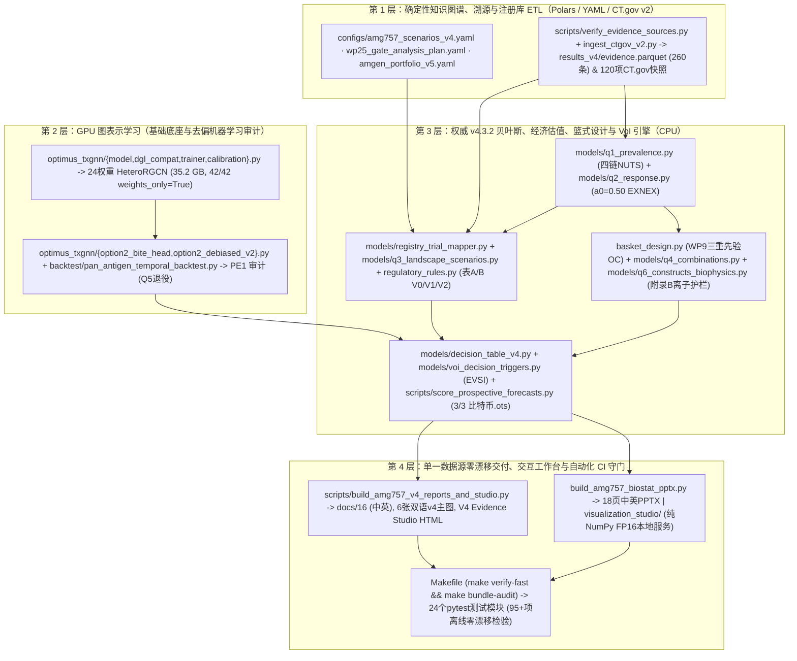

# IMDELLTRA®（AMG 757 / 塔拉妥单抗）适应症拓展——全量工作流、代码架构、建模引擎、可视化与文档全景汇总及汇报主档案（`v4.3.2` 权威封版）

> **英文配套版本（`1:1` 完整对照）:** [AMG757_INDICATION_EXPANSION_COMPREHENSIVE_MASTER_DOSSIER_EN.md](AMG757_INDICATION_EXPANSION_COMPREHENSIVE_MASTER_DOSSIER_EN.md)  
> **精修英文汇报幻灯片（`18` 页，可直接上台演讲）:** [AMG757_Biostatistics_Evidence_Model_v4_3_EN.pptx](../01_Presentation_Decks_and_Interactive_Demo/AMG757_Biostatistics_Evidence_Model_v4_3_EN.pptx)  
> **免服务器双语交互治理工作台:** [AMG757_Tarlatamab_V4_Evidence_Studio.html](../01_Presentation_Decks_and_Interactive_Demo/AMG757_Tarlatamab_V4_Evidence_Studio.html)  
> **单一数据源权威技术摘要:** [docs/zh/16_AMG757_V4_EVIDENCE_MODEL_ZH.md](16_AMG757_V4_EVIDENCE_MODEL_ZH.md)  
> **版本与核验状态:** `Canonical v4.3.2`（`2026 年 11 月`，维护模式） · `260` 条离线核验溯源证据 · `120 / 120` 项 `ClinicalTrials.gov` v2 DLL3 注册试验富集快照 · `41` 条追加式封印预测与触发器记录（`3/3` 份比特币 PoW `.ots` 证明已核验至区块 `#975,929`、`#975,963`、`#976,004`、`#976,009`） · `95 / 95` 项离线快速 CI 单元测试全部通过。

---

## 目录

1. [通俗全景概览：AMG 757 适应症拓展项目在做什么？当前全部 5 大工作流一览](#1-通俗全景概览当前全部-5-大工作流一览)
2. [项目演进全史（`Phase 0 → Phase 8 / v4.3.2`）：为何每一步都发生关键方法学转向？](#2-项目演进全史与关键方法学转向)
3. [完整代码库、配置文件、数据产物与自动化 CI 架构](#3-完整代码库配置文件数据产物与自动化-ci-架构)
4. [全量可视化资产、交互工作台与演示文稿盘点及像素级审计](#4-全量可视化资产交互工作台与演示文稿盘点及审计)
5. [全量文档清单与跨部门读者导览图（`docs/`、`amgen_discovery_studio/`、`doc_to_gdrive/`）](#5-全量文档清单与跨部门读者导览图)
6. [权威 `v4.3.2` 核心分析模块数学原理与实证结果详述（`WP1`–`WP10`）](#6-权威-v432-核心分析模块数学原理与实证结果详述)
7. [贝叶斯信息价值（`EVSI`）触发器、比特币 PoW `.ots` 账本与四节奏维护期 SOP](#7-贝叶斯-evsi-触发器比特币-pow-账本与维护期-sop)
8. [高管汇报执行脚本（`30` 分钟标准议程 + `7` 分钟工作台现场演示）](#8-高管汇报执行脚本)
9. [红队高管问答攻防矩阵（`18` 道跨部门核心质询）](#9-红队高管问答攻防矩阵)

---

## 1. 通俗全景概览：当前全部 5 大工作流一览

### 1.1 核心科学问题与商业命题

**IMDELLTRA®（`AMG 757` / `tarlatamab-dlle`，`BLA 761344`）** 是全球首款获批的半衰期延长型 **双特异性 T 细胞衔接器（`HLE BiTE®`）**，已于 **`2024-05-16`** 获 FDA 批准用于二线广泛期小细胞肺癌（`2L ES-SCLC`）。其一只结合臂抓住神经内分泌肿瘤表面的 **`DLL3`** 蛋白，另一只结合臂抓住患者自身杀伤性 T 细胞表面的 **`CD3ε`**，将肿瘤细胞与 T 细胞物理拉近至 **`≤ 14 nm`** 突触间隙，借“动力学分离”挤走体积庞大的抑制性磷酸酶 `CD45`（`~25–40 nm`），绕过 `MHC-I` 缺失直接裂解肿瘤细胞。

**AMG 757 适应症拓展项目** 要回答的核心命题非常明确：

> *在安进已经立项推进的 SCLC 生命周期试验之外，**哪些新癌种、哪条临床开发路径（外部 IIT 联盟 vs. 新建主篮式）、何种伴随诊断门槛、哪些联用组合与下一代抗逃逸构型**，能在严格锚定原发人类组织数据、真实 `ClinicalTrials.gov` 注册库与美国生物药独占期法规的前提下，实现临床成功概率与资本效率的双重最优？*

### 1.2 当前全部 5 大核心工作流（“当前任务全景表”）

当前代码库并非单一脚本或静态表格，而是由 **五大相互衔接的工作流** 构成的完整研发与决策体系：

| 工作流（Job） | 完成了什么工作 | 核心代码与产物 | 当前状态（`v4.3.2`） |
| :--- | :--- | :--- | :--- |
| **工作流 1：知识图谱与深度学习底座（`Phase 0–4`）** | 清洗构建 `139,439` 节点 / `939 万` 边的 `OptimusKG`（`clinical_v4` + 有向符号药理 `clinical_v5`）；在 `96 GB` GPU 上训练 `24` 权重 `HeteroRGCN` 超级集成（`d = 2048/3072`，总参数 `133.5 亿`）；构建 `3×4` Mondrian 共形校准、`Option-1` 四支柱 MCDA 及 `Option-2` `OptimusBiTE-Head`（`ESM-2 3B` + `SVD-LoRA` + `FiLM`）。 | `optimus_txgnn/{data,model,dgl_compat,trainer,calibration,bite_biomarker_and_expansion,option1_protocol_and_omics,option2_bite_head,option2_debiased_v2}.py` | 已封版（`42/42` 个 `.pt` 权重均安全加载 `weights_only=True`）。**关键审计裁定：** 经 `WP2.5` 跨期无泄漏回测检验，**`Q5` KG/ML 排序头在 AMG 757 上正式退役（表 B 占 `0` 列）**，但在多通路免疫项目（`AMG 691`）中显著有效。 |
| **工作流 2：原发人类多组学、单细胞与突触生物物理（`Phase 5–6`）** | 彻底剔除细胞系代理，整合 **`2,215` 例原发人类肿瘤活检**（`MCC GSE235092`、`MTC GSE196264/32662`、儿童 `TARGET-NBL`）；解析 **`60,026` 个临床 SCLC 单细胞**（`20` 例患者）量化亚克隆逃逸与 `10,953` 个浸润白细胞自残风险；计算 AlphaFold 单链跨度（`≤ 14 nm`）并引入 **`Ion Guard` 离子通道护栏**。 | `optimus_txgnn/{amg757_primary_tme_and_scrna,amg757_biophysical_synapse,amg757_integrated_synthesis}.py`、`optimus_txgnn/models/q6_constructs_biophysics.py` | 已完成。原发活检支撑 `Q1`；`60k` 单细胞与 AlphaFold 构型隔离输出至 **附录 B（`Q6`）**（`赛道 1` `CD276 0.7700`；`赛道 2` `PTK7 0.5132`；`赛道 3` `IGSF9 0.4745`；强制拦截 `KCNB2`/`SCN3A`）。 |
| **工作流 3：权威 `v4.3.2` 审计版贝叶斯证据模型（`Phase 8` / `WP0–WP10`）** | 构建 `260` 条离线溯源库与 `120` 项 CT.gov 富集快照；四链 `NumPyro NUTS` 拟合 `Q1` 表面流行率与 `Q2` 跨药幂先验（`a0 = 0.50`）`EXNEX` 缓解率；完成 `32` 靶点无泄漏 `PE1` 回测；拆分 **表 A（`12+7 = 19` 项）** vs. **表 B（`10` 项选项跨 `V0`/`V1`/`V2`）**；完成 `WP9` 7 设计 × 3 先验保障度仿真、`Q4` 无偏联用审计、贝叶斯 `EVSI` 触发器与 `41` 条比特币 PoW `.ots` 账本。 | `optimus_txgnn/models/{q1..q4,q6,decision_table_v4,registry_trial_mapper,voi_decision_triggers}.py`、`optimus_txgnn/backtest/`、`optimus_txgnn/basket_design.py`、`optimus_txgnn/regulatory_rules.py`、`configs/amg757_scenarios_v4.yaml`、`forecasts/` | **唯一权威生产真值（`amg757-v4.3.2`）**，现已进入四节奏维护模式，等待 `2026-12` 至 `2029-12` 临床读出对表验证。 |
| **工作流 4：可视化系统、交互工作台与演示文稿（`Phase 7 & 8`）** | 构建免服务器双语 **`AMG757_Tarlatamab_V4_Evidence_Studio.html`**（`5` 大治理标签页）、转化多组学工作台 `AMG757_Tarlatamab_Indication_Expansion_Studio.html`、跨平台零 PyTorch 本地可视化服务器 `visualization_studio/`（`1.61 GB FP16` 纯 `NumPy` 实时推理）、`20+` 组中英双语高清科研/教学图，以及 `4` 套 `.pptx`/`.html` 演示文稿。 | `scripts/build_amg757_v4_reports_and_studio.py`、`build_amg757_biostat_pptx.py`、`build_optimuskg_amg757_amg691_presentation.py`、`visualization_studio/` | **英文 18 页生物统计演示文稿已完成精修与逐页视觉核验**（修复第 16 页 `Q6` 数据错位 Bug、5 处标题遮挡、第 9 页表格重叠、4 张截断表格并补齐全部 18 页演讲备注）。旧版 `v3.2`/`v4.2` 示意图的像素审计详见第 4.2 节。 |
| **工作流 5：中英双语文档体系、外发包与自动化 CI（`Makefile`）** | 生成 1:1 中英双语技术专著、零基础教科书、代码数学参考手册、通俗解读报告、现场演示脚本与演讲攻防手册（`.md`/`.docx`/`.pdf`），封装洁净无代码外发包 `doc_to_gdrive/`，由 `95+` 项离线单元测试持续守门。 | `docs/`、`docs/zh/`、`amgen_discovery_studio/`、`doc_to_gdrive/01_AMG757_Indication_Expansion/`、`Makefile`、`tests/`、`scripts/audit_share_bundle.py` | **100% 零漂移校验通过（`make verify-fast`：`95 passed, 0 failed`；扫描 `173` 份外发文件，`0` 旧版残留）。** |

### 1.3 一页看懂核心战略结论（`v4.3.2` 决策底线）

> **说明性财务前情景——待企业财务团队核准：** 所有 `rNPV` 均锚定美国 **`PHS Act §351(k)(7)` `2036-05-16` 共享 12 年母体参考产品独占期（`RPE`）法定下限**，净扣除 **`$469.3M`** 二线 SCLC 蚕食，且 **`FD&C Act §529` 罕见儿科 PRV 硬锁为 `$0.0M`**。`2039-05-16` 专利情景仅作并列参考。

1. **已承诺 SCLC 核心盘（`表 A = $2,610.8M` `2036` 下限 / `$3,306.6M` `2039` 专利）：** 精确包含 `12` 项在研/承诺 SCLC 拓展与联合/皮下研究（`5` 项 III 期 + `7` 项联合/SC，含 `2` 项药企合作）+ `7` 项历史结题基线 = `19` 项注册试验（`EXP-S1` `DeLLphi-305` OS HR `0.42 [0.32–0.54]` + `DeLLphi-312` = `$2,145.6M`；`EXP-S3` `DeLLphi-306` + `PrECOG` = `$441.8M`；`EXP-S2` `+ZL-1310`/`+YL201`/`DeLLphi-311`/`DeLLphi-310 SC` = `$23.4M`）。
2. **SCLC 内部头号增量空白（`表 B1`）：** **未经治/活动性实质脑转移（`EXP-S4`，马斯特里赫特 `NCT07402343`，`N = 35`，`+$59.7M`）**——主流 III 期均将其排除。其 `Q2` `33.0%†` 显式标为 **`systemic_reference_only_intracranial_primary`**；颅内 `RANO-BM` 读出独立归入 `FCST-17` 并采用 **三区间临床门控**（`≥12/35` 扩增、`8..11/35` SRS/生物标志物亚组复核 [`P = 36.0%`]、`<8/35` 终止）。
3. **非 SCLC 领先瘤种（`表 B2/B3` — ORR 呈四方统计并列）：** 在 `Q2` `a0 = 0.50` 跨药幂先验下，**`EXP-L1` 肺 `LCNEC`（`44.5% [17.0%, 81.3%]`，`0` 项直接 AMG 757 队列；剔除 obrixtamig 降至 `29.9%`）**、**`EXP-E` 纯 WHO `G3 GEP-NEC`（`32.6%`）**、**`EXP-C` `GU/GYN SCNEC`（`31.3%`）** 与 **`EXP-D` `t-NEPC`（`25.9%`）** 的 `95% CrI` 高度重叠。商业排序取决于患者基数、强制 `SP347 ≥50%` 伴随诊断（`G3 GEP-NEC` 与 `t-NEPC`）以及行业注册揭示偏好（`IFCT III 期 NCT06937905`、`BI DAREON-5`、`MK-6070`、`AMG 509`）。
4. **双路径经济学与两步走 `EVSI` 策略：** 安进当前在研非 SCLC 主篮式为 **`0` 项**（`UCLA NCT06788938` 实为已停入组的 `N = 29` 单臂学术试验）。对罕见非 SCLC 瘤种单独开 `7` 个独立 II 期 IND（`路径 V0`）将亏损 **`-$34.6M`**。最优解为两步走：
   - **第一步（`路径 V1` 外部 IIT 联盟，`$15.40M` 信号池，涵盖 `11` 项开放 IIT，`N = 517`）：** `0.90` 基准下净值 **`+$1.8M`**（反映 `GETNE`/`NCI` 中止事件的 `0.75` 供药折损敏感性下翻负为 **`-$4.34M`**），但可产生 **`$12.94M` 贝叶斯 `EVSI`**（精确 `2036` LOE 截断 **`$12.35M`**），预期节省 **`$29.11M`** 无效确证研发投入——含 `EXP-L1` 的 `n = 15` 期中无效停药线（`k ≤ 2/15 → 停药`，`EVSI = $3.48M`）。
   - **第二步（`路径 V2` 安进新建注册主篮式）：** 将罕见非 SCLC 组合扭负为正（`2036` **`+$10.6M`** / `2039` **`+$48.4M`**；表 B 总计 `2036` **`+$117.8M`** / `2039` **`+$206.6M`**）。FDA 注册确证采用 **`Shared Protocol Independent Simon`（`$20.96M`，最差 I 类错误 `≤4.99%`）**，探索初筛可选 `Fixed N=20`（`$16.66M`）或 `EXNEX ≤10%`（`$17.24M`，最差 I 类错误 `≤8.25%`）。
5. **儿科法规底线（`EXP-G` 神经母细胞瘤）：** `FD&C §529` PRV = **`$0.0M`**（因 `2024-05-16` 已获批成人 SCLC）；强制 `PREA/RACE §505B` = **`0.0` 年**；独立商业现金流 = **`-$12.5M`**。**唯一正收益支点** 是获 FDA 签发自愿性 **`PHS Act §351(m)` `BPCA` 书面要求**（全母体 RPE 顺延 `+0.5` 年至 `2036-11-16`，释放 **`+$184.8M`** 组合尾部，净收益 **`+$172.3M`**）。

---

## 2. 项目演进全史与关键方法学转向

理解项目如何从早期版本演进至 `v4.3.2`，就能彻底看懂仓库里为什么并存着多代脚本、文档与图件，以及每一次自我推翻背后严密的科学原因：

| 演进阶段 | 构建的核心内容 | 自我审计揪出的致命问题 | 下一阶段的根治方案 |
| :--- | :--- | :--- | :--- |
| **Phase 0（`clinical_v4` + `clinical_v5`）** | 从 `OptimusKG v3.2` 中清除 `18,697` 个非临床检验指标（`36,753 → 18,025` 真临床疾病）；加入有向符号药理（`+1/-1/0`）、`Open Targets L2G`、`OnSIDES v3.1.1`、`FDA 橙/紫皮书`与 `MedCPT` 文本向量。 | 无符号边混淆了肿瘤锚定臂（`DLL3`）与 T 细胞激活臂（`CD3E`），导致淋巴瘤/自免病霸榜；盲目扩宽至 `d = 3072` 引发枢纽记忆塌陷与 `bf16` 精度下溢。 | 自研纯 PyTorch `FP32` `CSR` 稀疏图引擎（`dgl_compat.py`，显存降 `15×`）+ 有向 `v5bi` 关系 + 混合负采样（`u20`/`u50`）。 |
| **Phase 1–2（`24` 权重 GNN + BiTE `AND` 门控）** | 训练 `4` 大家族 × `6` 配置 = `24` 权重超级集成（`35.2 GB`，单模型自测 AUPRC 峰值 `0.3504`，双重留出疾病上超外部 Drive TxGNN `8.93×`）；引入逐疾病 `Z` 标准化、`3×4` Mondrian 共形校准与 `DLL3`/`CD3E` 物理剥离。 | 纯图谱分数未纳入真实患者活检表达、竞品试验拥挤度、血脑屏障/ICANS 与 Simon 二阶段可行性。 | 推出 **Option 1（`Phase 3`）** 四支柱正交临床方案 MCDA + 精确 Simon (1989) 求解器。 |
| **Phase 3–4（`Option 1` + `Option 2` `OptimusBiTE-Head`）** | 构建多组学 `Option-1`（`50` 适应症）与有监督冷靶点 `Option-2`（`ESM-2 3B` 成熟胞外域 + `SVD-LoRA` + `FiLM`，横跨 `68` 表面靶点与 `2,944` 肿瘤疾病）。 | 随机抗原交叉验证存在旁系同源家族泄漏（`DLL1/3/4`、`ERBB`、`CEACAM`）；骨髓瘤/卵巢癌/乳腺癌等高试验度数枢纽在 `Option-2 v1` 中虚高。 | 在 `option2_debiased_v2.py` 强制 `13` 组旁系超家族整组隔离，并在 **Phase 5（`v3.2`）** 加入非补偿靶点门控。 |
| **Phase 5–6（整合 `v3.2` + 原发活检与 `60k` 单细胞）** | 整合 `6` 大支柱 + `2,215` 例原发人类活检（`MCC`、`MTC`、`TARGET-NBL`）+ `60,026` 个临床 SCLC 单细胞 + `≤14 nm` 突触生物物理（`v3.2` 综合体系）。 | **四记自我审计重锤（`WP0` / `v3.2.1`）：**（1）精确 `2^6 = 64` 子集 Shapley 证明表面 IHC 独占 `v3.2` 综合分 **`67.8%`** 权重（`R² = 92.3%`）；（2）`FD&C §529` 否决已获批药的儿科 PRV（`$0`）；（3）`v3.2` 为各适应症误配独立 `8–11.5` 年独占期而非共享 `2036-05-16` 母体时钟；（4）`v3.2` 缺少 `Q1/Q2` 贝叶斯区间且曾误把 `KCNB2`/`SCN3A` 离子通道排在或门前列。 | 彻底废除 `v3.2` 综合加权分，重构解耦式 **`v4.0`–`v4.3.2` 证据模型（`Phase 8`）**。 |
| **Phase 7（零 PyTorch 可视化工作台）** | 将 `35.2 GB` GPU 权重蒸馏为 `1.61 GB FP16` 便携张量包（`pack_tensors_fp16.npz` + `portable_models_v1.npz`），实现纯 `NumPy` `<1.5s` CPU 实时推理。 | 高管与统计评审需要完全免服务器、零漂移的 `v4.3.2` 治理演示工具。 | 新增单文件离线双语 **`AMG757_Tarlatamab_V4_Evidence_Studio.html`**，与转化多组学浏览器并轨。 |
| **Phase 8（`v4.0 → v4.1 → v4.2 → v4.3.0 → v4.3.1 → v4.3.2`）** | 建成 `260` 条溯源库、`120` 项 CT.gov 富集快照、`NumPyro NUTS` `Q1`/`Q2`、`32` 靶点 `PE1` 回测、`WP9` 篮式仿真、`EVSI` 触发器与 `41` 条比特币 `.ots` 账本。 | **注册与跨期深度审计：**（1）查明 `NCT06788938` 为已停入组的 UCLA `N=29` 单臂学术研究；（2）`PE1` 回测测出静态 `M5` 含 `+0.123` 热点泄漏且 KG（`M4`）劣化（`wp25_passed = False`）；（3）`Q4` 无偏 `recall@50 = 0.000`；（4）`2/13` 项外部 IIT 中止（`GETNE`/`NCI`）。 | 锁定 **`v4.3.2` 权威封版**：拆分表 A（`12+7 = 19`）与表 B（`V0`/`V1 [0.90 & 0.75]`/`V2`），正式退役 `Q5`（`0` 列），`Q6` 附 **`Ion Guard`** 隔离至附录 B，`3/3` 比特币 `.ots` 落盘（`#975,929–#976,009`），全面转入维护模式。 |

### 2.1 `v3.2` → `v4.3.2` 队列编号对照表（避免跨版本混淆）

对照旧版 `docs/13`（`v3.2`）与权威 `v4.3.2`（`docs/16` 与 18 页幻灯片）时，请以 `optimus_txgnn/models/decision_table_v4.py` 锁定的映射为准：

| 历史 `v3.2` 编号（`docs/13`） | 权威 `v4.3.2` 编号（`docs/16` 与幻灯片） | 适应症与投资组合分层 |
| :--- | :--- | :--- |
| *v3 未建模* | **`EXP-S1`、`EXP-S2`、`EXP-S3`** | **表 A** 已承诺 SCLC 基线（`12` 在研 SCLC + `7` 历史基线 = `19` 项） |
| *v3 未建模* | **`EXP-S4`** | **表 B1** SCLC 内部增量：活动性脑转移 +SRS（`NCT07402343`, `N = 35`） |
| *未入 v3 Simon* | **`EXP-L1`** | **表 B2** 2L+ 肺 `LCNEC`（`IFCT NCT06937905`） |
| `AMG757-EXP-F` | **`EXP-L2`** | **表 B2** 奥希替尼耐药 `EGFRm` 转化型 SCLC（`NCT06830694`） |
| `AMG757-EXP-A` | **`EXP-A`** | **表 B3** 经治 PD-(L)1 默克尔细胞癌（`NCT06816394`） |
| `AMG757-EXP-B` | **`EXP-B`** | **表 B3** 经治 RET/TKI 甲状腺髓样癌（`NONE_DEDICATED_MONOTHERAPY`） |
| `AMG757-EXP-C` | **`EXP-C`** | **表 B3** 2L+ `GU/GYN` 肺外小细胞癌（`NCT07788365`） |
| `AMG757-EXP-E` | **`EXP-D`** | **表 B3** 2L+ 经治 ARPI `t-NEPC`（`SP347 ≥50%`, `MSK NCT07111507`） |
| *v4 新增* | **`EXP-E`** | **表 B3** 2L+ 纯 WHO `G3 GEP-NEC`（`SP347 ≥50%`, 韩国 `NCT06893783`） |
| `AMG757-EXP-D` | **`EXP-F`** | **表 B3** 复发 `IDH` 突变弥漫性胶质瘤（`NCT07243470`） |
| `AMG757-EXP-G` | **`EXP-G`** | **表 B3** R/R 儿童高危肾上腺素能神经母细胞瘤（`NONE_PROPOSED_BPCA`） |

---

## 3. 完整代码库、配置文件、数据产物与自动化 CI 架构

### 3.1 四层解耦软件架构图

### 3.2 代码库核心目录与文件职责全览（AMG 757 范围）

| 分层与目录 | 核心文件 | 核心职责与精确产物 |
| :--- | :--- | :--- |
| **配置与规则（`configs/`）** | `amg757_scenarios_v4.yaml`（`537` 行）、`wp25_gate_analysis_plan.yaml`、`amgen_portfolio_v5.yaml`、`bite_pan_cancer_biomarkers_v5.yaml`、`amg757_indication_mapping_v2.yaml` | 将全部商业估值参数（`WACC = 10%`、美净月价 `$16,200`、区域折算 `0.72`、EBIT 率 `64%`、税率 `21%`、二线蚕食、`V1`/`V2` 路径费用与滞后、`EVSI` 三区间临床门控、各队列锚点）完全外置配置化，杜绝隐蔽硬编码。 |
| **溯源与注册库审计（`optimus_txgnn/evidence/`, `scripts/`）** | `optimus_txgnn/evidence/schema.py`、`scripts/build_evidence_store_v1.py`、`scripts/ingest_ctgov_v2.py`、`scripts/ingest_pan_antigen_ctgov_v2.py`、`scripts/verify_evidence_sources.py`、`optimus_txgnn/models/registry_trial_mapper.py` | 构建并离线机器核验 `results_v4/evidence.parquet`（`260` 条）、`ctgov_v2_dll3_snapshot.json`（`120` 项试验）、`amg757_table_a_registry_inventory.csv`（`19` 项）、`amg757_iit_network_inventory.csv`（`21` 项）与 `amg757_registry_audit_v43.json`。 |
| **权威 `v4.3.2` 建模引擎（`optimus_txgnn/models/`, `optimus_txgnn/`）** | `q1_prevalence.py`（`698` 行）、`q2_response.py`、`q3_landscape_scenarios.py`（`1,106` 行）、`q4_combinations.py`（`1,334` 行）、`q6_constructs_biophysics.py`（`398` 行）、`decision_table_v4.py`（`482` 行）、`voi_decision_triggers.py`（`522` 行）、`basket_design.py`、`regulatory_rules.py` | 生成全部 `results_v4/*.parquet`、`*.csv`、`*.json` 及 `q1/q2_posterior_draws.npz`（各 `5,000` 次 MCMC 抽样），为全部报告、图表、工作台与 PPTX 提供唯一数据源。 |
| **跨期回测与归因（`optimus_txgnn/backtest/`, `scripts/`）** | `pan_antigen_temporal_backtest.py`、`dll3_temporal_backtest.py`、`scripts/amg757_pillar_attribution.py`、`optimus_txgnn/option2_debiased_v2.py` | 执行 `32` 靶点 `PE1`/`PE2` 精确 `O(2^(F/2))` 家族符号翻转回测（`pan_antigen_backtest_metrics.json`）、`19` 严格 NE 亚型 `12` 簇 MDE（`backtest_metrics.json`）及 `64` 子集 Shapley 归因（`amg757_pillar_attribution.json`）。 |
| **预测账本与维护（`forecasts/`, `scripts/`）** | `forecasts/amg757_prospective_forecasts_2026_11{,b,c}.jsonl` + `.ots`、`bitcoin_block_headers.json`、`SHA256SUMS.txt`、`scripts/score_prospective_forecasts.py` | 校验字节级 SHA-256 与离线比特币 PoW 默克尔证明（`#975,929`、`#975,963`、`#976,004`、`#976,009`），隔离评估 `q2_empirical_model`（`n=5`）与 `analyst_prior`（`n=4`），运行 `make watch-trials`。 |
| **单一数据源交付构建器（`scripts/` 与根目录）** | `scripts/build_amg757_v4_reports_and_studio.py`（`2,063` 行）、`build_amg757_biostat_pptx.py`（`1,650+` 行）、`build_optimuskg_amg757_amg691_presentation.py`、`generate_metrics_ledger.py`、`scripts/audit_share_bundle.py` | 通过共享加载器 `load_all_v4_artifacts()` 一键生成 `docs/16`（中英）、`docs/figures_v4/`（中英）、`AMG757_Tarlatamab_V4_Evidence_Studio.html`、`AMG757_Biostatistics_Evidence_Model_v4_3_{EN,ZH}.pptx`、`OptimusKG_*_Presentation_{EN,ZH}.pptx` 与 `METRICS.md`。 |
| **上游图谱与转化医学引擎（保留并受测）** | `optimus_txgnn/{data,dgl_compat,model,trainer,calibration,bite_biomarker_and_expansion,option1_protocol_and_omics,option2_bite_head,amg757_primary_tme_and_scrna,amg757_biophysical_synapse,amg757_integrated_synthesis,portable_pack}.py`、`build_amg757_option1_empirical_data.py`、`build_amg757_comprehensive_synthesis.py`、`build_amg757_v13_or_gate_biophysics.py`、`build_option2_bite_head_bank.py`、`build_step_by_step_visual_guides.py` | 支撑上游 `24` 权重 GNN 集成、原发活检（`2,215` 例）与 `60k` 单细胞图谱、`v3.2` 转化浏览器及 `visualization_studio/` 纯 `NumPy FP16` 实时推理引擎。 |
| **自动化 CI 守门（`Makefile`, `tests/`）** | `Makefile` + `24` 个 `tests/*.py` 测试模块（含 `test_doc16_zero_drift.py`、`test_registry_and_anchors.py`、`test_q1_q2_bayesian_models.py`、`test_q3_q4_q6_models.py`、`test_backtest_no_future_leak.py`、`test_basket_design.py`、`test_prospective_forecasts.py`、`test_regulatory_rules.py`、`test_torch_weights_only_hygiene.py`） | `make verify-fast`（`~40s`，`95 passed`）、`make bundle-audit`（扫描 `173` 文件，`0` 违规）、`make verify`、`make verify-fresh-clone`、`make watch-trials`、`make score-forecasts`。 |

---

## 4. 全量可视化资产、交互工作台与演示文稿盘点及审计

本节全面盘点项目中 **全部可视化资产**——包括交互式 HTML5 工作台、跨平台零 PyTorch 本地服务器、静态高清科研/教学 PNG 图件以及 PPTX 演示文稿——并汇报我们对所有静态 PNG 图件进行的 **直接像素级视觉审计发现**。

### 4.1 交互式 HTML5 工作台与零 PyTorch 本地服务器

| 可视化应用 | 文件路径 | 运行条件 | 功能定位与核心交互能力 |
| :--- | :--- | :--- | :--- |
| **1. `v4.3.2` 审计版治理证据工作台** *(高管与生物统计主推荐——适配 `95%` 会议)* | [results_v4/AMG757_Tarlatamab_V4_Evidence_Studio.html](../01_Presentation_Decks_and_Interactive_Demo/AMG757_Tarlatamab_V4_Evidence_Studio.html) *(同步至 `client_decks/`、`visualization_studio/` 与 `doc_to_gdrive/`)* | **零服务器、零网络**——双击即可在 Chrome / Edge / Safari 打开 | 单文件深色 HTML5 应用，内置由 `results_v4/` 自动编译的 JSON 载荷（CI 字节级锁定）。右上角一键 **`中文 / EN`** 实时切换，含顶部 KPI 治理徽章与 **`5` 大交互标签页**：（1）*表 A (12+7) 与表 B (V0/V1/V2)*（支持分层筛选 + 点击任意行展开原始文献摘录）、（2）*PE1 发现回测与严格 NE MDE*、（3）*WP9 统计权衡与 11 项外部 IIT 清单*、（4）*比特币 `.ots` 账本与 EVSI 触发器*、（5）*Q4 联用与附录 B（Q6 生物物理）*。 |
| **2. 转化多组学与子图浏览器** *(可选 `5%` 深度问答)* | `visualization_studio/AMG757_Tarlatamab_Indication_Expansion_Studio.html` | 通过 `visualization_studio/` 本地 HTTP 启动 | 面向转化医学的深度浏览器，支持检索 `18,025` 种疾病、`2,215` 例原发活检、`60,026` 个 SCLC 单细胞、`≤14 nm` 突触物理及 `D3.js`（`d3.v7.min.js`）交互式知识图谱机制路径。 |
| **3. 跨平台零 PyTorch 本地可视化服务（`Windows 11` & `Linux`）** | `visualization_studio/run_visualization_studio.py` + `Full_Portfolio_47_Assets_Discovery_Portal.html` | 仅需 Python + `NumPy`（**零 PyTorch / 零 GPU**） | 托管全部 HTML 工作台、`47` 款安进资产 JSON（含 `explorer_data/assets/tarlatamab.json`）及 **纯 `NumPy FP16` 实时神经推理引擎**（`pack_tensors_fp16.npz` `1.61 GB` + `portable_models_v1.npz` `39.5 MB`），可在普通 CPU 笔记本上 `< 1.5s` 实时打分任意新靶点组合。Windows 双击 `Launch_Visualization_Windows.bat`，Linux 运行 `launch_visualization_linux.sh`（`http://127.0.0.1:8004`）。 |

### 4.2 静态科研与教学图件（`PNG`）全量盘点与像素级视觉审计

我们逐一打开并核查了磁盘上的静态 `.png` 图像，以下是所有图件分组的精确状态：

#### A. 权威 `v4.3.2` 主图——**100% 零漂移，可直接用于汇报**（`docs/figures_v4/` 与 `docs/figures_v4/zh/`，由 `scripts/build_amg757_v4_reports_and_studio.py` 生成）

| 图件文件名（中英双语） | 对应幻灯片 / 文档 | 可视化内容 | 核心量化结论 |
| :--- | :---: | :--- | :--- |
| `fig_v4_1_temporal_backtest.png` | 第 7 页、Doc 16 §4 | 双联柱状图：**（左）** `19` 严格 NE 亚型 DLL3 回测（`B23 = 0.539` vs. `Option-2 v2 = 0.269`，`12` 簇 `MDE80 = +0.376`）；**（右）** `32` 靶点 `PE1` 新适应症发现回测（`P5 = 0.378`、`P1=P3 = 0.307`、静态 `M5 = 0.501`、静态 KG+组学 `M4 = 0.444`）。 | 直观证明静态 `M5` 存在 `+0.123` 截断后/L2G 热点泄漏，且加入 24 权重 KG（`M4`）反而劣化。 |
| `fig_v4_2_q1_q2_exnex_forest.png` | 第 5 页、Doc 16 §3 | 双联水平条形图覆盖表 B 全部 `10` 项选项：**（左）** `Q1` `DLL3 ≥1%` 与 `≥50%` 后验中位数（`*` 标出插补阈值，`Winkler95 = 0.615`）；**（右）** `Q2` 主模型 `a0 = 0.50` vs. 剔除 `Obrixtamig` 预测 ORR，附 `20%` 活性参考线。 | 清晰展示 `LCNEC` 对单一 `obrixtamig` 队列的高度敏感性（`44.5% → 29.9%`），并标明 `EXP-S4†` 为全身参考。 |
| `fig_v4_3_sclc_lifecycle_tornado.png` | 第 9 页、Doc 16 §2.2 | 双联估值图：**（左）** 表 B 在 `V0` / `V1` / `V2` 三路径下的增量 `rNPV`（`$M`, `2036` 下限）；**（右）** 组合龙卷风敏感性（全球净价与利润率、峰值份额、中位 DoT、PoS、独占期窗口、WACC、二线蚕食）。 | 直观展示 `V1`/`V2` 如何把 `EXP-D`/`EXP-E`/`EXP-B` 扭负为正，并明确净价利润率与峰值份额主导总组合波动。 |
| `fig_v4_4_debiased_ml_hub_audit.png` | 第 8 页、Doc 16 附录 A | 双联去偏审计图：**（左）** `10` 折旁系冷靶点 MRR 消融（`Popularity 0.138`、`Gate Only 0.026`、`Frozen 24-KG 0.285`、`Debiased Omics 0.267`、`Debiased Head v2 0.460` vs. 含捷径 `Option-2 v1 0.521`）；**（右）** 对数坐标展示骨髓瘤/NSCLC/卵巢癌/乳腺癌等非 NE 枢纽由前 15 驱逐至 `>300` 名外。 | 完整记录 `Option-2` 去偏历程与 `Q5` 退役依据。 |
| `fig_v4_5_3track_synapse_biophysics.png` | 第 16 页、Doc 16 附录 B | 散点图绘制附录 B `Q6` 启发式构型分 vs. AlphaFold 单链跨度（`+ 3.6 nm` 互补位偏置），叠加 `≤ 14 nm` `CD45` 空间排斥曲线。 | `赛道 1`（`CD276 0.7700`、`DLL3 0.6995`、`STEAP1 0.6702`）、`赛道 2`（`PTK7 0.5132`）与 `赛道 3`（`IGSF9 0.4745`）全部落在 `≤ 14 nm` 绿区；`KCNB2`/`SCN3A` 标为 `×` 拦截，`MUC16`（`46.10 nm`）在 `0.0000` 剔除。 |
| `fig_v4_6_exnex_basket_oc.png` | 第 13 页、Doc 16 §4.1 | 双联试验设计对照：**（左）** 三重先验情境（`A1 = 2.82/7`、`A2 = 1.82/7`、`A3 = 1.60/7`）下期望真阳性发现数；**（右）** 期望成本与期望总样本量（`V0 $38.96M` → `V2 Simon $20.96M` → `EXNEX $17.24M` → `V1 IIT 信号池 $15.40M`）。 | 直观证明共享主方案降本（`$38.96M → $20.96M`）而非跨队列借力才是核心红利。 |

#### B. 从 `v3.2` 沿用的有效转化与审计图件（`docs/figures_v3/`，由 `build_amg757_comprehensive_synthesis.py` 与 `scripts/amg757_pillar_attribution.py` 生成）

- **当前直接嵌入 `v4.3.2` 正式幻灯片（100% 科学有效）：**
  - `fig_v3_5_primary_biopsies_tme_and_scrna_{en,zh}.png`（**第 4 页**）：三联转化图——（A）`2,215` 例原发活检 `DLL3+`（`MCC MCPyV+ 100.0%`、`MTC 81.2% / 9.68×`、`MYCN` 扩增 NBL `86.2% / 3.99×`）、（B）同平台 BiTE TME 就绪度（`SCBC 0.634`、`ADRN NBL 0.573`、`MCC 0.560`、`SCLC 0.506`）、（C）`60,026` 临床 SCLC 单细胞逃逸与 `DLL3 OR IGSF9/PTK7` 捕获率。
  - `fig_v3_7_pillar_shapley_attribution_{en,zh}.png`（**第 2 页**）：精确 `64` 子集 Shapley 分解图，证明表面 IHC 驱动 `v3.2` 综合分 `67.8%` 权重（`R² = 92.3%`）。
- **历史 `v3.2` 综合分图件（仅留存 `docs/figures_v3/` 供 `docs/13` 溯源，请勿用于 `v4.3.2` 估值汇报）：** `fig_v3_1`、`fig_v3_2`、`fig_v3_3`、`fig_v3_4`、`fig_v3_6`。

#### C. 科普教学与方法学图件（`amgen_discovery_studio/figures_methodology/` 与 `doc_to_gdrive/.../figures/`）——**重要视觉审计警示**

- **概念准确、可直接辅助教学讲解：**
  - `fig_amg757_edu_1_adc_vs_bite_targets_{en,zh}.png`：零基础三栏科普图，对比 ADC（“特洛伊木马化疗炸弹”，解释 Rova-T 失败）vs. BiTE（“分子手铐 + `≤14 nm` `CD45` 排斥”，解释 IMDELLTRA 成功）vs. `v5bi` 有向符号知识图谱。
  - `fig_amg757_edu_2_training_data_and_evaluation_anatomy_{en,zh}.png`：三栏全景拆解 `OptimusKG` 三层数据规模（`139,439` 节点、`939 万` 边）、`24` 权重三阶段训练协议与四层零泄漏评估漏斗。
  - `fig_amg757_method_2_model_evolution_and_score_tradeoffs_{en,zh}.png`：三联工程演进图——Colab `G4` 宽度缩放逆转（`0.2597 → 0.3504`）、Option-2 旁系冷验证消融与历史 `v3.2` `g_target` 门控效果。
  - `fig1_antigen_cold_cv_ablations.png` 与 `fig4_dll3_dual_antigen_or_gate_sclc.png`（及 `_zh` 版）：Option-2 `v1.3` 支撑图。
- **像素级视觉审计警示——3 张旧版示意图像素中仍固化着历史版本文字（文本 CI 扫描器无法检测图片像素）：**
  我们直接打开查看所有方法学 PNG 后发现，以下 3 张图渲染早于 `v4.3.2` 定稿，图片像素中仍带有旧版数字：
  1. `fig_amg757_plain_overview_{en,zh}.png`（11 月 12 日生成）：底部仍印有历史 `v3.2` 单适应症 eNPV 合计、已退役的儿科优先审评券旧值、历史篮式命名及 `Ion Guard` 拦截前的 `KCNB2` 排序。
  2. `fig_amg757_method_1_end_to_end_workflow_and_4_traps_{en,zh}.png`（11 月 14 日生成）：四大 BiTE GNN 陷阱原理解析完全准确，但第 6 步方框仍显示历史 `v3.2` 试验与财务旧值。
  3. `fig_amg757_codebase_dataflow_{en,zh}.png`（11 月 15 日生成）：Phase 0–7 架构映射准确，但标题与 Phase 8 方框仍写着过渡版 `v4.2` 数字（表 A `$2,587M` / 表 B `+$26M`），尚未更新至 `v4.3.2` 终稿（表 A `$2,610.8M` / 表 B `V0–V2`）。
  - **执行建议：** 正式高管汇报请使用 **6 张权威 `docs/figures_v4/` 主图 + `fig_v3_5` + `fig_v3_7` + `edu_1`/`edu_2`**（已 100% 嵌入精修后的英文 18 页 PPTX），上述 3 张旧示意图仅作历史脉络参考，或在重绘后再外发。

### 4.3 演示文稿全览与本次英文版 PPTX 精修变更清单

| 演示文稿 | 页数 | 目标受众与覆盖范围 | 当前状态 |
| :--- | :---: | :--- | :--- |
| **[AMG757_Biostatistics_Evidence_Model_v4_3_EN.pptx](../01_Presentation_Decks_and_Interactive_Demo/AMG757_Biostatistics_Evidence_Model_v4_3_EN.pptx)** *(同步至 `client_decks/` 与 `doc_to_gdrive/`)* | `18` | **AMG 757 适应症拓展主汇报文稿**（生物统计、临床开发、法规、投资组合战略） | **本次已全面精修并逐页视觉核验（`v4.3.2` 零漂移）** |
| [AMG757_Biostatistics_Evidence_Model_v4_3_ZH.pptx](../01_Presentation_Decks_and_Interactive_Demo/AMG757_Biostatistics_Evidence_Model_v4_3_ZH.pptx) | `18` | 中文配套生物统计汇报文稿 | 严格遵嘱保持未改动；通过 `test_doc16_zero_drift.py` 校验 |
| [OptimusKG_Models_Apps_AMG757_AMG691_Presentation_EN.pptx](../../03_OptimusKG_Platform_and_Metrics_Reference/OptimusKG_Models_Apps_AMG757_AMG691_Presentation_EN.pptx)（含 `_ZH.pptx` 及 `.html`） | `16` | 跨项目平台总览（`OptimusKG v5` + `AMG 757 v4.3.2` + `AMG 691 v2.0`） | 零漂移同步（第 11 页实时 `Q1/Q2` 经 CI 锁死） |

**本次对英文版 `AMG757_Biostatistics_Evidence_Model_v4_3_EN.pptx`（`build_amg757_biostat_pptx.py`）执行的精确修复清单：**
1. **修复第 16 页（附录 B `Q6`）真实数据错位 Bug：** 原代码仅按 `partner_antigen` 建索引，导致赛道 2 `CD276`（`0.4929`）覆盖了赛道 1 `CD276`（`0.7700`）、赛道 3 `PTK7`（`0.2827`）覆盖了赛道 2 `PTK7`（`0.5132`），且 `KCNB2`/`SCN3A` 跨度被硬编码为 `3.5–4.1 nm`。现已改为按 `(construct_track, partner_antigen)` 精确索引，第 16 页恢复真实实时值 **`0.7700 (#1 T1)`**、**`0.5132 (#1 T2)`** 与 **`5.69 / 9.14 nm`**。
2. **消除全部 5 处标题折行遮挡副标题碰撞（第 2、10、13、16、17 页）：** 精炼英文主标题为单行高管金句，彻底杜绝标题与副标题重叠。
3. **修复第 9 页表格与下方卡片严重重叠：** 重新排版表 A 行高与列宽，令 `TABLE A COMMITTED TOTAL`（`$2,610.8M` / `$3,306.6M`、`Net of $469.3M 2L offset`）完整清晰呈现于下方图表与绿色卡片之上。
4. **清除 4 张表格全部截断残词（第 6、9、10、17 页）：** 移除原脚本中生硬的 `[:22]`/`[:26]`/`[:34]`/`[:54]` 字符截断（曾截断为 `Merkel Cell Carci`、`PMID:429`、`IFCT-2401 Randomized T`、`obri`），替换为完整规范临床名称，同时保留全部实时数值与 NCT 编号自动拉取。
5. **全面提升高管排版质感并补齐 18 页演讲备注：** 清除第 3、5、7、8、9、10、12、13、18 页残留的 Markdown 反引号（`` `...` ``）；规范负号与美元符顺序（`-$34.6M`、`+$59.7M`、`-$4.34M`）；将 `->`/`<=`/`>=` 升级为 `→`/`≤`/`≥`；修复第 1、10、11 页 KPI 卡片与 `DO_NOT_ENROLL` 异常换行；均衡卡片留白；并为 **全部 18 页英文幻灯片** 配齐实战演讲备注（已通过 LibreOffice + `pdftoppm` 逐页渲染复核及 `make verify-fast` 验证）。

---

## 5. 全量文档清单与跨部门读者导览图

以下列出当前仓库与洁净外发包（`doc_to_gdrive/01_AMG757_Indication_Expansion/`）中 **所有 AMG 757 文档** 及其版本状态：

### 5.1 权威 `v4.3.2` 现行文档（用于汇报、评审与决策）

| 文档名称（均含中英双语 1:1 配套） | 格式 | 精确路径 | 定位与推荐读者 |
| :--- | :---: | :--- | :--- |
| **本全景汇总与汇报主档案（`Doc 18`）** | `.md` | 根目录 `AMG757_INDICATION_EXPANSION_COMPREHENSIVE_MASTER_DOSSIER_{EN,ZH}.md`、`docs/18_*`、`docs/zh/18_*`、`doc_to_gdrive/.../04_Technical_Deep_Dive_Reports/` | **一站式总入口**：覆盖 5 大工作流、演进史、代码架构、可视化像素审计、文档地图、`v4.3.2` 全量结论、逐页讲稿与 18 题攻防。 |
| **权威 `v4.3.2` 证据模型专著（`Doc 16`）** | `.md`, `.docx`, `.pdf` | `docs/16_AMG757_V4_EVIDENCE_MODEL.md`、`docs/zh/16_*_ZH.md`、`amgen_discovery_studio/AMG757_V4_EVIDENCE_MODEL_{EN,ZH}.md`、`doc_to_gdrive/.../04_Technical_Deep_Dive_Reports/` | **单一数据源字节锁定技术报告**，由 `scripts/build_amg757_v4_reports_and_studio.py` 全自动生成（`0` 人工手改）。 |
| **通俗分步解读报告** | `.md` | `amgen_discovery_studio/AMG757_STEP_BY_STEP_PLAIN_LANGUAGE_REPORT_{EN,ZH}.md`、`doc_to_gdrive/.../03_Plain_Language_Step_by_Step_Reports/` | `5` 分钟无公式通俗总览，适合高管、临床医学与跨部门同事快速抓重点。 |
| **生物统计汇报方案与演讲脚本** | `.md` | `amgen_discovery_studio/AMG757_BIOSTATISTICS_PRESENTATION_PLAN_{EN,ZH}.md`、`doc_to_gdrive/.../02_Presentation_Plans_and_Speaker_Playbooks/` | 精炼版 `30` 分钟汇报大纲与红队防御速查。 |
| **交互式可视化现场演示指南** | `.md` | `amgen_discovery_studio/AMG757_VISUALIZATION_LIVE_DEMO_GUIDE_{EN,ZH}.md`、`visualization_studio/demo_guides/`、`doc_to_gdrive/.../01_Presentation_Decks_and_Interactive_Demo/` | `AMG757_Tarlatamab_V4_Evidence_Studio.html` `7` 分钟逐点击演示台词与问答速查表。 |
| **零基础到专家完整方法学教科书（`12` 章）** | `.md`, `.docx`, `.pdf` | `amgen_discovery_studio/AMG757_COMPLETE_METHODOLOGY_AND_DECISION_PLAYBOOK_{EN,ZH}.md`、`doc_to_gdrive/.../04_Technical_Deep_Dive_Reports/` | 深度教学长文（`~713` 行），从零讲透 ADC vs. BiTE 物理、`OptimusKG`、`24` 模型训练逆转、Option 1/2 到 `v4.3.2` 重构。 |
| **代码架构、数学原理与 9 阶段 I/O 手册** | `.md`, `.docx`, `.pdf` | `amgen_discovery_studio/AMG757_CODEBASE_ARCHITECTURE_MATH_AND_IO_GUIDE_{EN,ZH}.md`、`doc_to_gdrive/.../04_Technical_Deep_Dive_Reports/` | 工程与数学详参（`~870` 行），含逐行代码注释（`dgl_compat`、`OptimusBiTEHead`、`q2_response`、`PE1` 符号翻转）及全表字段契约。 |
| **前瞻预测账本说明与审计日志** | `.md`, `.jsonl`, `.ots` | `forecasts/README.md`、`forecasts/README_ZH.md`、`forecasts/amg757_prospective_forecasts_2026_11{,b,c}.jsonl` | `41` 条追加式预测、作废修订、`P5` 冻结与 `EVSI` 触发器的密码学原件。 |
| **跨项目指标总账与交接手册** | `.md` | `METRICS.md`、`docs/zh/METRICS_ZH.md`、`ANTIGRAVITY_PROJECT_HANDOFF.md`、`doc_to_gdrive/00_README_DOCUMENT_INDEX.md` | 汇总 `OptimusKG` + `AMG 757 v4.3.2` + `AMG 691 v2.0` 核心指标与 Google Drive 资产 ID。 |

### 5.2 历史基线参考文档（仅作科研溯源，不作 `v4.3.2` 估值依据）

- **保留于 `docs/` 并置顶 `v4.3.2` 取代声明：** `docs/11_*`（Option-1 多组学与去混杂工程参考）、`docs/12_*`（Option-2 `SVD-LoRA` + `FiLM` GPU 训练参考）、`docs/13_*`（`v3.2.1` 历史综合基线）。
- **隔离归档目录（`_local_archive_superseded_v3_v42/`）：** 所有已退役的 `v3.x` / `v4.2` 旧版文稿与幻灯片（内含 `README_SUPERSEDED_DO_NOT_SHARE.md`，已从 `doc_to_gdrive/` 彻底剔除）。

### 5.3 快速选读指南：“我该打开哪份文件？”

- **准备 30 分钟上台汇报：** 打开 [AMG757_Biostatistics_Evidence_Model_v4_3_EN.pptx](../01_Presentation_Decks_and_Interactive_Demo/AMG757_Biostatistics_Evidence_Model_v4_3_EN.pptx) + 本档案第 8–9 节 + [AMG757_Tarlatamab_V4_Evidence_Studio.html](../01_Presentation_Decks_and_Interactive_Demo/AMG757_Tarlatamab_V4_Evidence_Studio.html)。
- **向外部分享洁净无代码全套资料：** 直接打包发送 `doc_to_gdrive/01_AMG757_Indication_Expansion/`（全套 `.md`/`.docx`/`.pdf`/`.pptx`/`.html`/`.csv`，已通过 `make bundle-audit`）。
- **复核精确公式或本地一键重跑校验：** 查阅 `AMG757_CODEBASE_ARCHITECTURE_MATH_AND_IO_GUIDE_ZH.md` 并执行 `make verify-fast`。

---

## 6. 权威 `v4.3.2` 核心分析模块数学原理与实证结果详述

### 6.1 `WP1` — 离线溯源库（`260` 条）与 `120` 项 CT.gov 注册真值

- **溯源构成（`results_v4/evidence.parquet`）：** `208` 条（`80.0%`）原文逐字机器匹配 `verified` + `25` 条（`9.6%`）双人复核图表 `verified_source_only` + `27` 条（`10.4%`）显式有界 `analyst_estimate` = **`260` 条**。
- **CI 永久锁死的五大注册库纠偏（`tests/test_registry_and_anchors.py`）：**
  1. **`NCT06788938`（UCLA）：** 单臂学术研究（`N = 29`，`ACTIVE_NOT_RECRUITING`），非安进主篮式（安进在研非 SCLC 主篮式数为 `0`）。
  2. **`NCT07402343`（Maastricht）：** 注册样本量为 `N = 35`（非 `N = 30`），主终点为 **颅内 RANO-BM ORR**（`EXP-S4` `33.0%†` 显式标为 `systemic_reference_only_intracranial_primary`）。
  3. **`NCT07531095` / `NCT06898957` vs. `NCT06814496`：** `+ZL-1310` = `NCT07531095`（`N = 160`）、`+YL201` = `NCT06898957`（`N = 29`），而 `NCT06814496` 实为亚利桑那大学放疗+BiTE 学术试验（`N = 30`）。
  4. **`NCT07788365` & `NCT06776250`：** 斯特拉斯堡妇科 NEC（`N = 20`，主终点 **9 个月 PFS**）与多伦多 UHN 胶质瘤（`N = 44`，主终点 **CD8+ TIL 变化率**）不可按二项式 ORR 计分（已作废 `FCST-06..07`）。
  5. **`NCT06937905` & `NCT07111507`：** `IFCT-2401` 随机 III 期 NEC = `NCT06937905`（`N = 129`, OS）；`MSKCC` NEPC = `NCT07111507`（`N = 32`, rPFS）。
- **全部 `40` 项塔拉妥单抗试验全景盘点：**
  - **表 A（`19` 项 = `12` 在研 SCLC + `7` 历史结题基线）：** `5` 项在研 III 期（`DeLLphi-305 NCT06211036`、`DeLLphi-312 NCT07005128`、`DeLLphi-306 NCT06117774`、`DeLLphi-310 SC NCT07778316`、`PrECOG NCT07637513`）+ `7` 项联合/皮下管线（`+ZL-1310 NCT07531095`、`+YL201 NCT06898957`、`DeLLphi-311 NCT07037758`、`DeLLphi-303 NCT05361395`、`DeLLphi-309 NCT06745323` 及 `2` 项外部药企合作：`GSK EMBOLD NCT06551142` [`has_sclc_combo_subarm=True`] 与 `AbbVie NCT07895056`）+ `7` 项历史结题（`6` 项 2L+ SCLC 含 `DeLLphi-304`/`301`/`300` + `1` 项已完成 NEPC `DeLLpro-300 NCT04702737`）。
  - **外部 IIT 清单（`21` 项学术研究 → `11` 项开放/计划非 SCLC 联盟候选，总样本 `N = 517`）：** 剔除已停入组 `UCLA NCT06788938`（`N = 29`）、仅限 SCLC 的 `AIO NCT07803848`（`N = 57`），以及 `2/13` 项中止/撤回研究（`GETNE NCT07061080` `N = 1`、`NCI NCT07328490` `N = 0` → **`84.6%` 存活率**，直接驱动 `0.75` `V1` 供药折损测试）。

| NCT 编号 | 申办机构 | 状态（`N`） | 预计完成 | 注册主要终点 | 目标瘤种 |
| :---: | :--- | :---: | :---: | :--- | :--- |
| `NCT06776250` | 多伦多 UHN | `RECRUITING`（`44`） | `2028-03-03` | CD8+ TIL 浸润变化率 | 星形/少突胶质瘤 |
| `NCT06814496` | 亚利桑那大学 | `RECRUITING`（`30`） | `2030-05` | DLT（放疗 + 塔拉妥单抗） | 黑色素瘤、MTC、鼻窦未分化癌 |
| `NCT06816394` | 台大医院（`TAURUS`） | `RECRUITING`（`32`） | `2027-12-31` | 研究者评估 ORR（RECIST 1.1） | 肺外小细胞癌与 NEC |
| `NCT06830694` | 韩国三星医疗中心 | `RECRUITING`（`50`） | `2027-03-31` | PFS | 转化型 / SCLC |
| `NCT06893783` | 韩国多中心（Inkeun Park） | `RECRUITING`（`60`） | `2029-04-30` | ORR | 肺外与胰腺 NEC |
| `NCT06937905` | 法国 `IFCT`（`IFCT-2401`） | `RECRUITING`（`129`） | `2029-02-01` | 总生存期（OS） | 肺与 GEP 神经内分泌癌 |
| `NCT07016230` | 巴黎古斯塔夫·鲁西（`UNLOCK`） | `RECRUITING`（`40`） | `2027-05-18` | ORR | SCLC 与低分化 NEC |
| `NCT07111507` | 纪念斯隆-凯特琳（`MSKCC`） | `RECRUITING`（`32`） | `2027-08-31` | rPFS | 转移性神经内分泌前列腺癌 |
| `NCT07243470` | 法国里昂中心 | `RECRUITING`（`70`） | `2029-10` | I 期前 2 周期 DLT | 成人与儿童胶质瘤 / CNS |
| `NCT07788365` | 斯特拉斯堡大学医院 | `NOT_YET_RECRUITING`（`20`） | `2030-08-31` | 9 个月 PFS | 妇科生殖道 NEC |
| `NCT07788677` | 西班牙 `VHIO` | `NOT_YET_RECRUITING`（`10`） | `2029-05-01` | 术前窗口无 DLT 完赛率 | 高级别胶质瘤（HGG） |

### 6.2 `Q1` — 四链 NUTS 多项分层表面 DLL3 流行率（`q1_prevalence.py`）

- **模型机制：** 将同一文献成对嵌套阈值（`≥1%` & `≥50%` 或 `≥25%` & `≥75%`）耦合为单一多项分布观测单元；同步校正抗体克隆偏移（`SP347` vs. `SC16` vs. `SP263`）、研究间过离散与 `8` 大谱系层级；无直接 IHC 研究的组织学通过模型内 OOF `RNA → IHC` 桥接（自动封顶 Grade D）；凡缺 `≥50%` 观测的队列一律显式标注 `ge50_imputed_flag = True`。
- **LOSO 校准结果（`0` 发散，`max R-hat = 1.0084`）：**

| 模型规格 | LOSO `95%` 覆盖率 | `Winkler95`（`↓`） | `CRPS`（`↓`） | `ΔELPD` vs. 无池化 |
| :--- | :---: | :---: | :---: | :---: |
| **完整分层 `Q1`（四链 NUTS）** | **`100.0%`** | **`0.615`** | **`0.1009`** | **`+5.85`** |
| 无池化独立 Beta | `96.2%` | `0.774` | `0.1401` | `0.00`（基准） |
| 父谱系坍缩模型 | `92.3%` | `0.951` | `0.1040` | `-0.09` |

- **伴随诊断（CDx）红线：** `SCLC`、`MCC`、`LCNEC`、`t-SCLC`、`GU/GYN SCNEC` 支持全人群或 `SP347 ≥1%`；`G3 GEP-NEC` 与 `t-NEPC` 必须强制 **`SP347 ≥50%`**（`DeLLpro-300` `DLL3-` ORR = `0% [0/14]`；`obrixtamig` GEP-NEC `DLL3 ≥50%` `40.0% [12/30]` vs. `DLL3-low` `3.3% [1/30]`）。

### 6.3 `Q2` — 纯 TCE `EXNEX` + 跨药幂先验（`a0 = 0.50`，`q2_response.py`）

- **数学形式：** 仅纳入 **`15` 个独立 DLL3 TCE 临床队列**（零 ADC 污染），采用边缘化 `MixtureSameFamily` `EXNEX` 先验（$w_{\text{EX}} = 0.65$）、非中心化跨药主效应（$\alpha_a$）、药-瘤种交互迁移标准差（$\eta_{a,h}$）、完整血脑屏障惩罚（$\delta_{\text{BBB}}$）及 Ibrahim–Chen 幂先验似然折扣（非塔拉妥单抗 TCE 权重 $a_0 = 0.50$）：
  $$\theta_h \sim w_{\text{EX}}\,\mathcal{N}\!\big(\mu_{\ell(h)},\,\tau_{\text{EX}}^2\big) + (1 - w_{\text{EX}})\,\mathcal{N}\!\big(\mu_{\text{NEX}},\,\sigma_{\text{NEX}}^2\big), \qquad \mathcal{L}_{\text{power}}(\boldsymbol{\Theta}) = \prod_{i} \operatorname{Binom}\!\big(k_i \mid n_i, p_{\text{arm},i}\big)^{a_0^{\mathbb{I}[a_i \neq 0]}}$$
- **校准诊断：** `0` 发散、`max R-hat = 1.0057`、**`100.0%` LOCO `95%` 覆盖率**、`Winkler95 = 0.510`、`CRPS = 0.0857`、`ΔELPD = +4.36`。
- **前四瘤种统计并列与敏感性：**

| 目标队列 | 直接 `AMG757` | 主模型 `a0 = 0.50` ORR（`95% CrI`, `P≥20%`） | `a0 = 1.00` | 剔除 `Obrixtamig` | 关键临床锚点与适用边界 |
| :--- | :---: | :---: | :---: | :---: | :--- |
| **`EXP-L1`**（肺 LCNEC） | `0` | **`44.5%`**（`[17.0%, 81.3%]`, `95%`） | `50.3%` | **`29.9%`** *(LOCO `28.3%`)* | `0` 塔拉妥单抗；`1` `n=10` obrixtamig（`7/10`, `PMID:40706016`） |
| **`EXP-S4`**（ES-SCLC 脑转移） | `4` | **`33.0%†`**（`[23.3%, 42.0%]`, `99%`） | `32.7%` | `33.6%` | **仅全身 SCLC 参考†**（`NCT07402343` `N=35` 主终点为颅内 ORR） |
| **`EXP-E`**（纯 G3 GEP-NEC） | `0` | **`32.6%`**（`[10.7%, 64.5%]`, `83%`） | `34.1%` | `29.2%` | Obrixtamig `40.0%`（`12/30`）`DLL3≥50%` vs. `3.3%`（`1/30`）低表达 |
| **`EXP-C`**（GU/GYN SCNEC） | `0` | **`31.3%`**（`[10.0%, 64.8%]`, `81%`） | `33.5%` | `32.6%` | Gocatamig `44.0%`（`11/25`, `NCT04471727`, `a0=0.50` 迁移） |
| **`EXP-D`**（经治 ARPI t-NEPC） | `3` | **`25.9%`**（`[10.3%, 48.1%]`, `74%`） | `27.1%` | `23.6%` | `DeLLpro-300`（`NCT04702737`）：DLL3+ `22.2%`（`4/18`） |
| **`EXP-A`**（经治 PD-(L)1 MCC） | `0` | **`22.8%`**（`[1.9%, 64.3%]`, `57%`） | `22.3%` | `23.4%` | `0` DLL3 TCE 队列（仅依赖谱系与 `Q1` IHC 收缩） |
| **`EXP-L2`**（奥希替尼耐药 t-SCLC） | `1` | **`19.7%`**（`[2.5%, 50.3%]`, `49%`） | `19.0%` | `19.5%` | 真实世界塔拉妥单抗单药 `7.1%`（`1/14`, `PMID:43026871`） |

### 6.4 `WP2` 与 `WP2.5` — 无泄漏 `PE1` 回测与 `Q5` 退役逻辑

- **精确 `O(2^(F/2))` 折半家族符号翻转回测（`pan_antigen_temporal_backtest.py`）：** 横跨 `32` 个表面靶点（`24` 个旁系家族、`178` 例 2015 年后截断前零试验的首次新适应症进入 `had_pre_T_any_trial == False`）：

| 模型（`PE1`：首次进入，`178` 例） | 时间洁净度 | `PE1` `AUPRC` | `Δ` vs. `P1` | 审计裁定 / `Holm p` |
| :--- | :--- | :---: | :---: | :--- |
| **`P1` 原始肿瘤表达** | 严格 Pre-`T` | `0.3070` | `0.0000` | 核心基线 |
| **`P3` 截断前 I 期 + 选择性** | 严格 Pre-`T` | `0.3070` | `+0.0000` | `P3 == P1`（零 I 期捷径） |
| **`P4` 截断前 LPFO 组学逻辑回归** | 严格 Pre-`T` | `0.2698` | `-0.0372` | 线性组学欠拟合 |
| **`P5` 严格截断前组学 MLP（封印）** | **严格 Pre-`T`（`0` L2G）** | **`0.3783`** | **`+0.0713`** | **`Holm p = 0.0042`（最优无泄漏）** |
| **`M5` 静态 2026 组学 MLP（LPFO）** | 静态 2026 标签 | `0.5011` | `+0.1941` | **`+0.1228` 截断后/L2G 热点泄漏** |
| **`M4` 静态 2026 KG + 组学** | 静态 2026 KG + 标签 | `0.4439` | `+0.1369` | **加入 KG 反而劣化（`-0.0572` vs. `M5`）** |

- **封印 `P5` 精确超参数（`AMG757-FREEZE-P5-2026-11`）：** `sklearn.neural_network.MLPClassifier(hidden_layer_sizes=(16, 8), activation='tanh', solver='lbfgs', alpha=8.0, tol=0.001, max_iter=300, random_state='2026 + fam_i')`。
- **治理结论（`wp25_passed = False`）：** 加入 24 权重知识图谱（`M4`）在 `PE1`/`PE2` 均弱于纯组学（`M5`），且在 `19` 严格 NE 亚型上 `B23 = 0.539` 显著领先 `Option-2 v2 = 0.269`（`12` 簇 `80%` 功效 MDE = `+0.335 ΔAUROC` / `+0.376 ΔAUPRC`）。故 **`Q5` 在表 B 中占 `0` 列**，与多通路免疫项目 `AMG 691`（OptimusKG 贡献 `AUROC = 1.0000`）形成清晰边界。

### 6.5 `Q3` — 拆分组合表（表 A vs. 表 B）、现金流模型与儿科法规（`q3_landscape_scenarios.py`）

- **代码实现的现金流方程（`_compute_cohort_cashflows_musd`）：**
  $$\text{Peak Net Sales} = \frac{I_{\text{annual}} \cdot \pi_{\text{bio}} \cdot r_{\text{CDx}} \cdot s_{\text{peak}} \cdot \text{DoT}_{\text{mo}} \cdot (P_{\text{US}} \cdot f_{\text{reg}}) \cdot \omega_{\text{Amgen}}}{10^6}$$
  $$\text{Net rNPV} = \text{PoS} \cdot \left(\text{PV}_{\text{gross op}} - \text{PV}_{\text{2L cannib}}\right) - \frac{\text{R\&D} \cdot (1 - \tau)}{(1 + \text{WACC})^{0.75}}$$
  基准参数：`WACC = 10.0%`、美净月价 `$16,200`、全球折算 `0.72`、EBIT 利润率 `64%`、税率 `21%`、`SP347` 伴随诊断渗透率 `76%`、3 年爬坡（`40%/75%/100%`）、LOE 后 3 年生物类似药衰减尾（`20% × 55%` 按 `0.75^t` 递减），并精细对比 `V1`（`$2.20M`/队列协同 + 阳性后 `62%` 确证研发 + `+1.00y` 滞后，含 `0.90` 与 `0.75` 双完成率）与 `V2`（`$8.40M` 主方案启动 + `$3.80M`/队列 + 阳性后 `44%` 关键扩增 + `+0.65y` 滞后）。

- **表 A 已承诺 SCLC 基线（`12` 在研 SCLC + `7` 历史基线 = `19` 项）：**
  - **`EXP-S1`**（1L ES-SCLC 维持与同步化免：`DeLLphi-305` OS HR `0.42 [0.32–0.54]` + `DeLLphi-312`）：**`$2,145.6M`**（`2036`） / **`$2,658.9M`**（`2039`）
  - **`EXP-S3`**（LS-SCLC 巩固：`DeLLphi-306` `N=404` + `PrECOG` `N=430`）：**`$441.8M`**（`2036`） / **`$584.7M`**（`2039`）
  - **`EXP-S2`**（SCLC 下一代联用与 SC：`+ZL-1310 NCT07531095`、`+YL201 NCT06898957`、`DeLLphi-311`、`DeLLphi-310 SC`）：**`$23.4M`**（`2036`） / **`$63.0M`**（`2039`）
  - **表 A 合计（净扣 `$469.3M` 二线 SCLC 蚕食）：** **`$2,610.8M`**（`2036` 下限） / **`$3,306.6M`**（`2039` 专利）。

- **表 B — `10` 项增量选项与美元投资组合瀑布（`2036` 法定下限）：**

| `V2` 排 | 编号 | 增量选项（`实时锚点 NCT`） | `Q1` `≥1%` / `≥50%` | `Q2` ORR（`a0=0.50` / 剔除竞品） | `V0` 独立 | `V1` IIT `0.90`（`0.75` 折损） | `V2` 篮式 (`2036`) |
| :---: | :---: | :--- | :---: | :---: | :---: | :---: | :---: |
| `#1` | **`EXP-S4`** | 2L+ ES-SCLC 活动性脑转移 +SRS（`NCT07402343`） | `80.8%` / `65.1%` | `33.0%†` / `33.6%` | `+$59.7M` | **`+$59.7M`**（`+$59.7M`） | **`+$59.7M`** |
| `#2` | **`EXP-L1`** | 2L+ 肺 LCNEC（`NCT06937905`） | `65.4%` / `48.9%` | `44.5%` / `29.9%` | `+$29.6M` | **`+$27.1M`**（`+$22.3M`） | **`+$34.3M`** |
| `#3` | **`EXP-L2`** | 奥希替尼耐药 EGFRm t-SCLC（`NCT06830694`） | `79.1%` / `58.4%` | `19.7%` / `19.5%` | `+$3.9M` | **`+$10.9M`**（`+$8.8M`） | **`+$13.2M`** |
| `#4` | **`EXP-A`** | 2L+ 经治 PD-(L)1 默克尔细胞癌（`NCT06816394`） | `82.9%` / `48.4%` | `22.8%` / `23.4%` | `+$7.0M` | **`+$10.6M`**（`+$8.5M`） | **`+$12.6M`** |
| `#5` | **`EXP-D`** | 2L+ 经治 ARPI t-NEPC（`SP347 ≥50%`, `NCT07111507`） | `67.3%` / `41.2%` | `25.9%` / `23.6%` | `-$1.9M` | **`+$8.6M`**（`+$6.9M`） | **`+$12.0M`** |
| `#6` | **`EXP-C`** | 2L+ GU/GYN 肺外 SCNEC（`NCT07788365`） | `68.4%` / `41.9%` | `31.3%` / `32.6%` | `+$0.4M` | **`+$5.6M`**（`+$4.4M`） | **`+$7.2M`** |
| `#7` | **`EXP-E`** | 2L+ 纯 WHO G3 GEP-NEC（`SP347 ≥50%`, `NCT06893783`） | `77.2%` / `50.3%` | `32.6%` / `29.2%` | `-$8.3M` | **`+$1.7M`**（`+$1.1M`） | **`+$3.4M`** |
| `#8` | **`EXP-B`** | 经治 RET/TKI 甲状腺髓样癌（`NONE_DEDICATED_MONOTHERAPY`） | `83.3%` / `37.5%` | `18.9%` / `20.8%` | `-$4.9M` | **`+$2.2M`**（`+$1.5M`） | **`+$2.2M`** |
| `#9` | **`EXP-G`** | R/R 儿童神经母细胞瘤（`NONE_PROPOSED_BPCA`） | `65.9%` / `39.5%` | `23.3%` / `23.6%` | `-$12.5M` | `-$12.5M`（`-$12.5M`） | `-$12.5M` |
| `#10` | **`EXP-F`** | 复发 IDH 突变胶质瘤（`NCT07243470`） | `83.9%` / `62.7%` | `18.8%` / `18.0%` | `-$14.3M` | `-$14.3M`（`-$14.3M`） | `-$14.3M` |
| `护栏` | **`GUARD-1/2`** | G1/G2 类癌（`5.6%`）与非 NE 枢纽（`2.9%`） | `≤5.6%` | `DO_NOT_ENROLL` | `$0.0M` | `DO_NOT_ENROLL` | `DO_NOT_ENROLL` |

- **美元组合瀑布：** `表 A = $2,610.8M`（`2039` `$3,306.6M`）；`表 B1 (EXP-S4) = +$59.7M`（`+$84.1M`）；`表 B2 (EXP-L1 + EXP-L2) = +$33.5M (V0) / +$38.0M (V1) / +$31.1M (V1 0.75) / +$47.5M (V2)`（`2039` `+$74.2M`）；`表 B3 (EXP-A..G) = -$34.6M (V0) / +$1.8M (V1) / -$4.34M (V1 0.75) / +$10.6M (V2)`（`2039` `+$48.4M`）；**表 B 总计 = `+$58.6M (V0) / +$99.5M (V1) / +$86.5M (V1 0.75) / +$117.8M (V2)`（`2039` `+$206.6M`）**。
- **儿科法规硬规则（`optimus_txgnn/regulatory_rules.py`）：** `FD&C §529` PRV = `$0.0M`（`2024-05-16` 获批后不适用）；强制 `PREA/RACE §505B` = `0.0` 年（`$0` 溢价）；自愿 `PHS Act §351(m)` `BPCA` 书面要求 = `+0.5` 年母体顺延（至 `2036-11-16`，组合尾部 `+$184.8M`，`EXP-G` 净值 `+$172.3M`）。

### 6.6 `WP9` — 逐队列篮式设计与三重先验保障度（`basket_design.py`）

逐队列二线标准治疗零假设校准（`LCNEC`/`MCC`/`SCNEC`/`t-NEPC`/`MTC` 为 `12%/32%`；`t-SCLC` 为 `15%/35%`；`G3 GEP-NEC` 为 `10%/30%`）：

| 设计方案（`7` 非 SCLC 队列） | 路径 | Max `N` | 最差 I 类错误 | `A1` (`2.82/7`) | `A2` (`1.82/7`) | `A3` (`1.60/7`) | `A1` `E[FP]` | `A1` `E[成本]` |
| :--- | :---: | :---: | :---: | :---: | :---: | :---: | :---: | :---: |
| `Standalone_7x_Simon_Optimal` | `V0` | `217` | `4.99%` | `2.66` | `1.70` | `1.50` | `0.027` | `$38.96M` |
| **`Shared_Protocol_Independent_Simon`** | **`V2`** | **`217`** | **`4.99%`** | **`2.66`** | **`1.70`** | **`1.50`** | **`0.027`** | **`$20.96M`** |
| `Shared_Protocol_Independent_FixedN20` | `V2` | `140` | `4.01%` | `2.52` | `1.61` | `1.41` | `0.017` | `$16.66M` |
| `Naive_Exchangeable_BHM` | `V2` | `140` | **`33.43%`** *(失控)* | — | — | — | — | `$17.61M` |
| **`EXNEX_WorstCaseType1_le10_Basket`** | **`V2`** | **`140`** | **`8.25%`** | `2.63` | `1.66` | `1.45` | `0.038` | **`$17.24M`** |
| `Proposed_EXNEX_Shared_Basket` | `V2` | `140` | `12.85%` | `2.69` | `1.70` | `1.49` | `0.068` | `$17.24M` |
| **`Federated_IIT_Signal_Pool_V1`** | **`V1`** | **`163`** | **`6.50%`** | `2.67` | `1.69` | `1.48` | `0.035` | **`$15.40M`** |

### 6.7 `Q4` 联合给药无偏审计与附录 B（`Q6`）三赛道生物物理

- **`Q4` 坦诚披露（`q4_combinations.py`）：** 零人工硬连线 DDI 边，全部特征源自 `1,345,373` 条 `typed_ddi_edges.parquet` + `OnSIDES v3.1.1`。在 2023 年前无偏肿瘤药物池（`N = 983` 与扩展 `N = 1,628`）上，**`recall@50 = 0.000`**（`AUROC = 0.611` 与 `0.732`）。联用执行严格聚焦 **四大临床在研/机制确证轴**：（1）**抗 PD-(L)1**（`DeLLphi-305` OS HR `0.42`）、（2）**Topo-I 旁观者 ADC**（`+ZL-1310 NCT07531095`、`+YL201 NCT06898957`、`GSK NCT06551142`）、（3）**安进全资双 BiTE（`塔拉妥单抗 + AMG 509 STEAP1`）** 攻克 `t-NEPC`（第 1 周期错峰阶梯爬坡）、（4）**颅脑立体定向放疗 SRS**（`EXP-S4 NCT07402343`、亚利桑那 `NCT06814496`）。
- **附录 B（`Q6`，`q6_constructs_biophysics.py` — 表 A/B 占 `0` 列）：** 整合离线 AlphaFold 单链 C-alpha 跨度（`+ 3.6 nm` 偏置）、`60k` 单细胞 `SCLC-P/Y` 逃逸覆盖、`10,953` 白细胞自残过滤与 **`Ion Guard`**（拦截可兴奋电压门控离子通道 `KCNB2`/`SCN3A`）：
  - **赛道 1（临床联用）：** `#1 CD276`（`8.04 nm`, `28%` 脱落, **`0.7700`**）、`#2 DLL3 / ZL-1310`（`8.64 nm`, `4%`, `0.6995`）、`#3 STEAP1 / AMG 509`（`8.48 nm`, `2%`, `0.6702`）。
  - **赛道 2（逻辑门控/掩蔽）：** `#1 PTK7×CD28`（`7.41 nm`, `22%`, **`0.5132`**）、`#2 CD276×CD28`（`8.04 nm`, `28%`, `0.4929`）、`#3 SEZ6`（`8.21 nm`, `68%` BACE1 脱落, `0.2880`）。
  - **赛道 3（非掩蔽或门）：** `#1 IGSF9`（`6.87 nm`, `8%`, `1.18%` TIL+, **`0.4745`**）、`#2 RET`（`7.88 nm`, `18%`, `0.2913`）、`#3 PTK7`（`7.41 nm`, `22%`, `0.2827`）；**离子护栏降权：** `KCNB2`（`5.69 nm`, **`0.0467`**）与 `SCN3A`（`9.14 nm`, **`0.0371`**）；**空间负对照：** `MUC16`（`46.10 nm`, `64%` 脱落, **`0.0000`**）。

---

## 7. 贝叶斯 `EVSI` 触发器、比特币 PoW 账本与维护期 SOP

### 7.1 预设贝叶斯信息价值（`EVSI`）Go/No-Go 触发器（`voi_decision_triggers.py`）

基于 `5,000` 次 `Q2` MCMC 抽样的精确离散贝叶斯后验预测求积（一维二分校准保证 $\mathbb{E}[\text{NPV}(p)] \equiv \text{rNPV}_{\text{uncond}}$ 误差 `< 1e-9`），以开放外部 `V1` IIT 读出门控安进确证性投入产生 **`$12.94M` 总贝叶斯 `EVSI`**（按 `2036-05-16` 精确 LOE 截断为 **`$12.35M`**），预期节省 **`$29.11M`** 确证性研发投入：
- **`EXP-L1` `n = 15` 期中无效停药规则：** `k ≤ 2/15` 缓解即终止独立 `V2` LCNEC 臂（早停率 `8.3%`，后验 `NPV = -$19.39M`，**`EVSI = $3.48M`**）。
- **`TRIG-06`（`EXP-S4`, `NCT07402343`, `N = 35`）三区间临床门控：** `≥12/35` 扩增、**`8..11/35` SRS/生物标志物亚组复核（`P = 36.0%`）**、`<8/35` 终止——将净差值由二元一刀切的 `-$34.01M` 收窄至 **`-$21.71M`**。

| 触发器编号（预测） | 试验（队列） | 轨道 | 读出规则（`k / N`） | `P(达标)` | 无条件 `NPV` | `E[NPV \| 达标]` | `EVSI` | 省研发 | 预设 Go / No-Go 执行动作 |
| :---: | :---: | :---: | :--- | :---: | :---: | :---: | :---: | :---: | :--- |
| `TRIG-01` (`FCST-09`) | `NCT05882058` (`EXP-E`) | `q2_empirical` | `≥18 / 60` | `57.7%` | `+$0.42M` | `+$10.72M` | **`$6.92M`** | `$6.26M` | 推进 `SP347 ≥50%` GEP-NEC 联用队列 |
| `TRIG-02` (`FCST-11`) | `NCT06893783` (`EXP-E`) | `q2_empirical` | `≥12 / 50` | `34.8%` | `+$0.42M` | `+$17.33M` | **`$5.68M`** | `$9.64M` | 触发 `V1` 确证性 `SP347 ≥50%` II 期 |
| `TRIG-03` (`FCST-12`) | `NCT06816394` (`EXP-C`) | `q2_empirical` | `≥7 / 30` | `41.7%` | `+$6.24M` | `+$20.97M` | **`$3.04M`** | `$6.34M` | 扩增 GU/GYN SCNEC 注册队列 |
| `TRIG-04` (`FCST-13`) | `NCT07016230` (`EXP-L1`) | `q2_empirical` | `≥5 / 20` | `39.9%` | `+$34.35M` | `+$67.83M` | **`$1.21M`** | `$8.36M` | 推进肺 LCNEC 注册队列 |
| `TRIG-05` (`FCST-14`) | `NCT06788938` (`EXP-A`) | `q2_empirical` | `≥7 / 29` | `50.1%` | `+$11.47M` | `+$28.68M` | **`$3.01M`** | `$4.77M` | 将 MCC 队列纳入 `V2` 主篮式 |
| `TRIG-06` (`FCST-17`) | `NCT07402343` (`EXP-S4`) | `analyst_prior` | `≥12 / 35` *(三区间)* | `25.3%` | `+$59.73M` | `+$101.72M` | **`$0.12M`** | `$13.19M` | 启动活动性脑转移 SCLC + SRS 注册队列 |
| `TRIG-07` (`FCST-18`) | `NCT06117774` (`EXP-S3`) | `analyst_prior` | 主终点优效（`404`） | `52.0%` | `+$37.89M` | `+$81.04M` | **`$4.25M`** | `$6.35M` | 递交全球 LS-SCLC 巩固治疗 sBLA |
| `TRIG-08` (`FCST-19`) | `NCT06937905` (`EXP-L1`) | `analyst_prior` | 主终点优效（`129`） | `48.0%` | `+$30.05M` | `+$73.28M` | **`$5.13M`** | `$7.23M` | 启动 LCNEC 注册递交或确证 III 期 |
| `TRIG-09` (`FCST-20`) | `NCT07005128` (`EXP-S1`) | `analyst_prior` | 主终点优效（`350`） | `62.0%` | `+$74.51M` | `+$124.36M` | **`$2.60M`** | `$5.03M` | 启动 1L 诱导+维持全线 sBLA |

### 7.2 `41` 条追加式比特币 PoW 账本（`forecasts/`）与四节奏维护 SOP

- **密码学存证（`3/3` 原封未动，`BITCOIN_POW_VERIFIED`）：** `2026_11.jsonl`（`10` 条）与 `2026_11b.jsonl`（`13` 条）锚定比特币区块 **`#975,929` & `#975,963`**；`2026_11c.jsonl`（`18` 条：`VOID-08..11`、`FCST-17..20`、`P5` 冻结、`TRIG-01..09`）锚定 **`#976,004` & `#976,009`**。
- **严格双轨隔离计分：** Track A（`q2_empirical_model`, `n = 5`：`FCST-09`、`FCST-11..14`）与 Track B（`analyst_prior`, `n = 4`：`FCST-17..20`）完全分离计分，全部 `11` 条作废修订（`VOID-01..11`）永久留痕。
- **四节奏维护模式运行手册（`Makefile`）：**
  1. **季度巡检（`make watch-trials` & `make ots-upgrade`）：** 巡检 UCLA `NCT06788938` + `9` 项待读出试验 + `11` 项开放 IIT。
  2. **半年刷新与计分（`make score-forecasts`）：** 刷新 CT.gov 快照，在新文件 `2027_XX.jsonl` 追加读出，分别输出 `Q2` 与 `analyst_prior` Brier/log-loss/PI 校准。
  3. **事件驱动触发拍板：** 外部 IIT 读出后直接对照 `amg757_voi_decision_triggers.csv` 决策。
  4. **外发前零漂移门控（`make verify-fast && make bundle-audit`）：** 一键验证中英文档、`.pptx` 文本、`weights_only=True`、比特币 `.ots` 与 `doc_to_gdrive/` 外发包。

---

## 8. 高管汇报执行脚本

### 8.1 `30` 分钟标准议程（`20` 分钟精修英文幻灯片 + `10` 分钟工作台演示与问答）

| 页码 | 分钟 | 核心叙事节点 | 关键数据与证明锚点 |
| :---: | :---: | :--- | :--- |
| **1** | `1.0` | **封面与治理定位：** 单一数据源零漂移生物统计证据模型（非黑箱 AI）。 | `260` 溯源、`120` 试验、表 A `$2,610.8M`、`41` 条比特币存证 |
| **2** | `1.5` | **注册库真值与自我审计：** 开场主动亮出两项纠偏（`UCLA NCT06788938` 与 `67.8%` Shapley IHC）。 | 表 A `12+7 = 19` vs. `11` 开放 IIT（`N=517`）；IIT 存活率 `11/13`（`84.6%`） |
| **3** | `1.0` | **WP1 溯源与 120 试验审计：** 离线确定性校验及 CI 拦截的 5 项注册误读。 | `208` 原文 + `25` 表格 + `27` 有界；`NCT07531095`（`+ZL-1310`）vs. `NCT06814496`（放疗） |
| **4** | `1.0` | **原发活检与 `60k` SCLC 单细胞：** 零细胞系代理；亚克隆逃逸与 TIL 自残直连战略。 | MCC `84.7%`（`MCPyV+ 100%`）；`SCLC-P/Y/I` 骤降 `4.3×`；`CD99`/`BSG` vs. `IGSF9`/`PTK7` |
| **5** | `1.0` | **`Q1` 多项流行率模型：** 克隆校正四链 NUTS 与伴随诊断红线。 | `100.0%` LOSO、`Winkler95 = 0.615`、`ΔELPD = +5.85`；GEP-NEC/t-NEPC 强制 `SP347 ≥50%` |
| **6** | `1.5` | **`Q2` 跨药幂先验（`a0=0.50`）：** 前四瘤种 CrI 重叠、LCNEC 零直接队列与 `EXP-S4†` 边界。 | LCNEC `44.5%` → 剔除竞品 `29.9%`；揭示偏好（`BI`、`IFCT`、`MK-6070`、`AMG 509`） |
| **7** | `1.0` | **`WP2` 无泄漏 `PE1` 回测：** 精准剥离静态机器学习 `+0.123` 截断后/L2G 热点泄漏。 | `P5 = 0.378`（`Holm p = 0.0042`）vs. 静态 `M5 = 0.501` vs. KG+组学 `M4 = 0.444`（`-0.057`） |
| **8** | `1.0` | **`WP2.5` 门控与 `Q5` 退役：** 将退役 GNN 转化为科学诚实标杆；对比 `AMG 691`。 | `wp25_passed = False`；表 B `0` 列 `q5_*`；`42/42` `weights_only=True` |
| **9** | `1.5` | **表 A 已承诺 SCLC 基线：** 锁定 `$2,610.8M`（`2036`） / `$3,306.6M`（`2039`），剥离 `EXP-S4` 脑转移空白。 | `DeLLphi-305` OS HR `0.42 [0.32–0.54]`；净扣 `$469.3M` 二线蚕食；`EXP-S4` `+$59.7M` |
| **10** | `1.5` | **表 B（`10` 项增量选项）：** 逐行演示 `V0` / `V1`（`0.75` 折损） / `V2` 实时数据表。 | `#1 EXP-S4` `+$59.7M`、`#2 EXP-L1` `+$34.3M`、`#3 EXP-L2` `+$13.2M`、`#4 EXP-A` `+$12.6M`、`GUARD-1/2` |
| **11** | `1.5` | **美元价值瀑布与贝叶斯 `EVSI`：** 呈现两步走 `EVSI` 门控资金分配法则。 | 罕见 NE：`-$34.6M`（`V0`）→ `+$1.8M`（`V1`） / `-$4.34M`（`0.75`）→ `+$10.6M`（`V2`）；**`EVSI = $12.94M`** |
| **12** | `1.0` | **儿科法规精确拆解（`EXP-G`）：** 厘清三部美国法案的适用与估值。 | `§529 PRV = $0`；`PREA §505B = 0.0y`；自愿 `BPCA §351(m) = +0.5y`（`+$184.8M`） |
| **13** | `1.5` | **`WP9` 篮式设计权衡：** 注册 I 类错误严控（`Simon`）vs. 筛查节支（`EXNEX`/`V1`）。 | `V2` Simon `$20.96M`（`≤4.99%`）vs. `EXNEX ≤10%` `$17.24M`（`≤8.25%`）vs. `V1` 信号池 `$15.40M` |
| **14** | `0.5` | **三重先验压力测试（`A1`/`A2`/`A3`）：** `≤3/7` 有效时共享主方案降本是主驱动。 | `A1 = 2.82/7`、`A2 = 1.82/7`、`A3 = 1.60/7`；共享主方案成本 `$38.96M → $20.96M` |
| **15** | `0.5` | **`Q4` 联用坦诚披露：** 披露 `recall@50 = 0.000`，聚焦四大临床在研/机制轴。 | PD-(L)1、Topo-I ADC（`+ZL-1310`/`+YL201`）、安进双 BiTE（`+AMG 509`）、颅脑 SRS |
| **16** | `0.5` | **附录 B（`Q6`）抗逃逸物理：** 隔离蛋白工程假设与 `Ion Guard` 护栏。 | 赛道 1 `CD276`（`0.7700`）、赛道 2 `PTK7`（`0.5132`）、赛道 3 `IGSF9`（`0.4745`）；`MUC16` 剔除 |
| **17** | `0.5` | **比特币 PoW `.ots` 账本：** 防篡改前瞻问责与双轨隔离计分。 | `41` 条记录、`3/3` 文件锚定 `#975,929–#976,009`；`5` `Q2` + `4` `analyst_prior` + `11` 作废 |
| **18** | `1.0` | **四大决议与工作台移交：** 提请拍板决议 1–4 并打开离线交互工作台进入问答。 | 双击 `AMG757_Tarlatamab_V4_Evidence_Studio.html` |

### 8.2 `7` 分钟工作台现场演示动线（`AMG757_Tarlatamab_V4_Evidence_Studio.html`）

1. **`0:00–1:15`（顶栏 + `中文 / EN` 切换）：** 演示零服务器一键双语切换与顶部治理徽章（`260` 溯源、`120` 试验、`3/3` 比特币区块）。
2. **`1:15–3:00`（标签页 1 — 表 A 与表 B）：** 筛选表 B 分层，点击 `EXP-S4` 与 `EXP-L1` 展示原始文献逐字摘录，对比 `V0`（`-$34.6M`）vs. `V1`（`+$1.8M` / `0.75` 折损 `-$4.34M`）vs. `V2`（`+$10.6M`）。
3. **`3:00–4:15`（标签页 2 — `PE1` 回测）：** 展示 `P5`（`0.378`）vs. 静态 `M5`（`0.501`）与 `M4`（`0.444`），解释表 B 零 `Q5` 列的严谨逻辑。
4. **`4:15–5:30`（标签页 3 — `WP9` 与 `11` 项 IIT 网络）：** 展示朴素 BHM `33.43%` I 类错误失控 vs. `V2` Simon（`$20.96M`）及 `11` 项开放 IIT 清单（`N = 517`）。
5. **`5:30–7:00`（标签页 4 & 5 — 比特币 `.ots`、`EVSI` 触发器与 `Ion Guard`）：** 呈现 `9` 项预设 `k / N` 触发器（`EVSI = $12.94M`）、`3/3` 比特币 PoW 证明、`Q4` `recall@50 = 0.000` 坦诚披露及附录 B `DLL3 + IGSF9`（`0.4745`）。

---

## 9. 红队高管问答攻防矩阵（`18` 题）

### 生物统计与方法学
1. **`EXP-L1`（LCNEC）仅有 `0` 项直接塔拉妥单抗队列（剔除竞品 `44.5% → 29.9%`），为何排 `#2`？** — 第 6 页已坦诚标注四方统计并列；`#2` 源于胸腔患者基数、`SP347 ≥1%` 门控与外部揭示偏好（`IFCT III 期 NCT06937905`、`BI DAREON-5`），并由 **`n = 15` 期中无效停药线（`k ≤ 2/15 → 停药`，`EVSI = $3.48M`）** 严密锁险。
2. **为何庞大的 24 权重 `OptimusKG` GNN 在表 B 中占 `0` 列？** — 预注册科学纪律（`WP2.5`）：在无泄漏 `PE1` 上，加入 KG（`M4 = 0.444`）弱于纯组学（`M5 = 0.501`），故退役 `Q5`（`wp25_passed = False`）；而在多通路免疫项目 `AMG 691` 上，同一图谱带来 `AUROC = 1.0000` 的实证增益。
3. **跨药借力为何选 `a0 = 0.50`？** — `1.00` 忽视分子差异，`0.00` 浪费临床概念验证；`a0 = 0.50` + 迁移标准差达成 `100.0%` LOCO 覆盖（`Winkler95 = 0.510`），且并列展示 `a0 = 1.00` 与 `No-Obrixtamig` 全敏感性。
4. **注册阶段为何不用更省钱的 `EXNEX ≤10%`（`$17.24M`）替代独立 Simon（`$20.96M`）？** — 在 `≤3/7` 有效队列下，`EXNEX ≤10%` 最差 I 类错误达 `8.25%`（朴素 BHM 达 `33.43%`）；探索筛查用 `V1`（`$15.40M`）或 `Fixed N=20`/`EXNEX ≤10%`，FDA 注册必须锁定 **`Shared Protocol Independent Simon`（`≤4.99%` I 类错误）**。
5. **`NCT07402343` 测的是颅内 RANO-BM ORR，为何表 B 仍保留 `EXP-S4` 的 `33.0%†`？** — 全球尚无未经治活动性脑转移 TCE 历史队列；`33.0%†` 显式标为 `systemic_reference_only_intracranial_primary`，而马斯特里赫特 `N = 35` 真实颅内读出独立在 Track B（`FCST-17`, `Beta(6.0, 17.4)`, 中位数 `24.9%`）中按三区间门控追踪。

### 临床开发与运营
6. **`NCT06788938` 不是安进现有的非 SCLC 主篮式吗？** — 否：`120` 项 CT.gov 快照核实其为已停入组的 **UCLA** 单臂学术研究（`N = 29`, `ACTIVE_NOT_RECRUITING`）；安进在研非 SCLC 主篮式为 `0` 项。
7. **学术 IIT 发生 `GETNE`（`N=1`）/`NCI`（`N=0`）停药怎么办？** — 正因实测存活率 `11/13`（`84.6%`），我们增设了 `0.75` 供药折损敏感性（罕见非 SCLC 由 `+$1.8M` 翻负至 `-$4.34M`），由此明确 `V1` 仅作 **`EVSI` 门控初筛（`$12.94M` EVSI）**，达标后注册仍由安进 `V2` 主导。
8. **为何 `G3 GEP-NEC` 与 `t-NEPC` 必须强制 `SP347 ≥50%`？** — `DeLLpro-300` 证实 `DLL3-` 前列腺癌 ORR 为 `0%`（`0/14`）；`obrixtamig` 证实 GEP-NEC `DLL3 ≥50%` ORR `40.0%`（`12/30`）vs. 低表达 `3.3%`（`1/30`）。
9. **双 BiTE 联用（`塔拉妥单抗 + AMG 509`）如何防控双重 CRS？** — 强制第 1 周期错峰阶梯爬坡（先完成首药爬坡并度过细胞因子峰，第 15 天后再引入次药）+ 预防性激素与托珠单抗预案。

### 企业财务与法规法律
10. **这些 `rNPV` 已获企业财务核准了吗？** — 未核准——全程标注 **“说明性财务前情景——待企业财务团队核准”**，用于在统一法定口径下对比 `V0`/`V1`/`V2` 相对资本效率。
11. **为何表 B（`+$58.6M`–`+$117.8M`）相对表 A（`$2,610.8M`）偏小？** — 表 A 已含重磅 1L ES-SCLC（`$2,145.6M`）与 LS-SCLC（`$441.8M`），且 `2036-05-16` 法定下限下晚上市适应症窗口较短；`2039` 专利情景下表 B 翻倍至 **`+$206.6M`**（自愿 `BPCA` 另加 `+$184.8M`）。
12. **`$12.94M` `EVSI` 对精确 `2036-05-16` 悬崖敏感吗？** — 按 `2036-05-16` 精确截断有效销售年份后 `EVSI` 仍高达 **`$12.35M`**，结论高度稳健。
13. **`EXP-G` 儿童神经母细胞瘤能否申请罕见儿科疾病优先审评券（`PRV`）？** — **不能（硬锁 `$0.0M`）。** `FD&C Act §529` 要求全新活性成分，而塔拉妥单抗已于 `2024-05-16` 获批成人 SCLC。
14. **强制 `RACE / PREA §505B` 能否带来 `+6` 个月独占期？** — **不能（`0.0` 年）。** 唯有 FDA 主动签发并按期完成的 **自愿性 `PHS Act §351(m)` `BPCA` 书面要求** 可顺延全母体 `+0.5` 年（至 `2036-11-16`, `+$184.8M`）。

### 转化医学、蛋白工程与防篡改治理
15. **附录 B（`Q6`）为何强行降权 `KCNB2` 与 `SCN3A`？** — 二者属可兴奋电压门控离子通道（`Kv2.2`/`Nav1.3`），存在严重中枢/心脏在靶神经毒性且抗体成药性差；`Ion Guard` 将其压至 `0.0467`/`0.0371`，确立 **`IGSF9`（`0.4745`, `6.87 nm`, `1.18%` TIL+）** 为赛道 3 首选假设。
16. **为何 `MUC16` 评分为 `0.0000`？** — 空间负对照：其 `46.10 nm` 胞外域远超 `≤14 nm` `CD45` 动力学分离极限且脱落汇风险高达 `64%`。
17. **`2027–2029` 临床读出后如何杜绝“马后炮”篡改？** — 全部 `41` 条记录封印于 `3/3` 原封未动的追加式 `.jsonl` 文件并锚定比特币区块 `#975,929`、`#975,963`、`#976,004`、`#976,009`，`q2_empirical_model`（`n=5`）与 `analyst_prior`（`n=4`）严格分轨计分。
18. **同事如何在无 GPU 的笔记本上离线复核全部数字？** — 执行 `make verify-fast && make bundle-audit`（`< 45s`，`95` 项测试 + `173` 文件扫描）或直接双击打开 `AMG757_Tarlatamab_V4_Evidence_Studio.html`。
