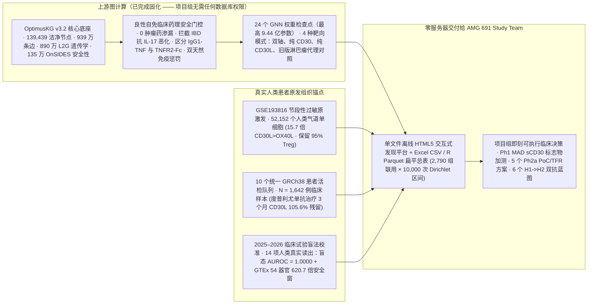
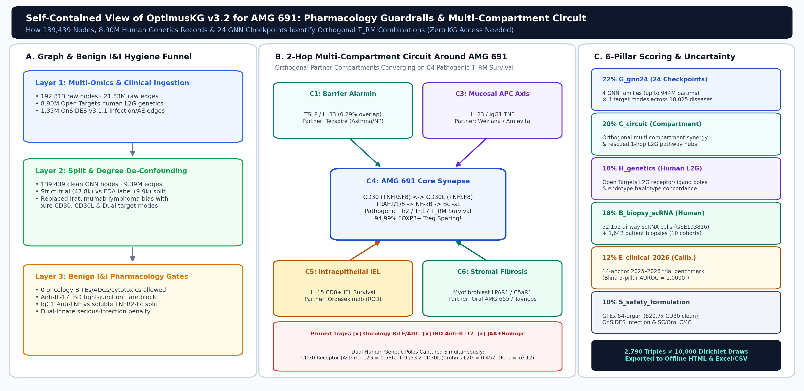
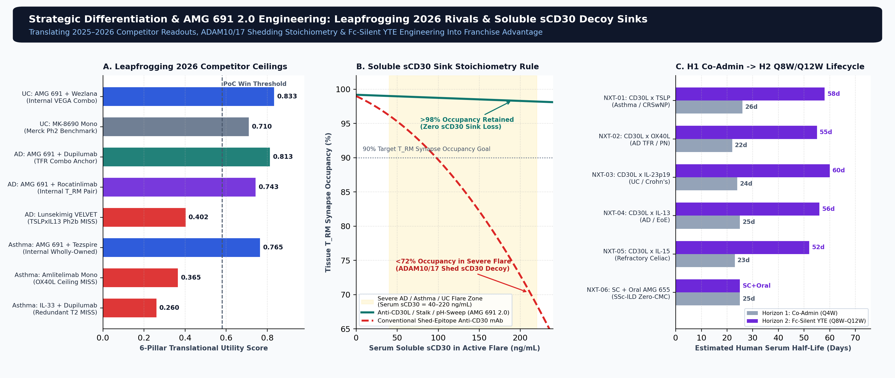
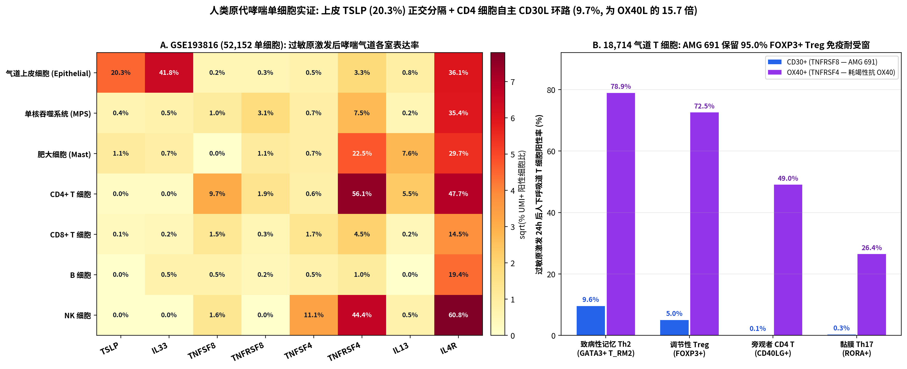
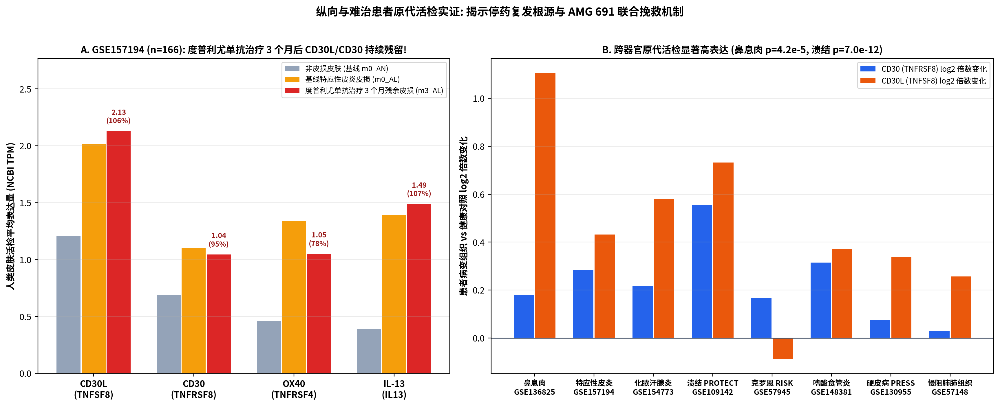
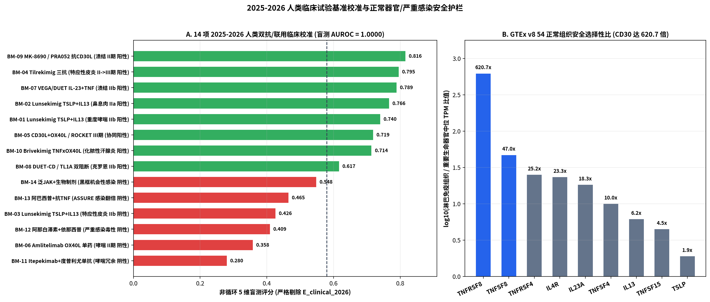
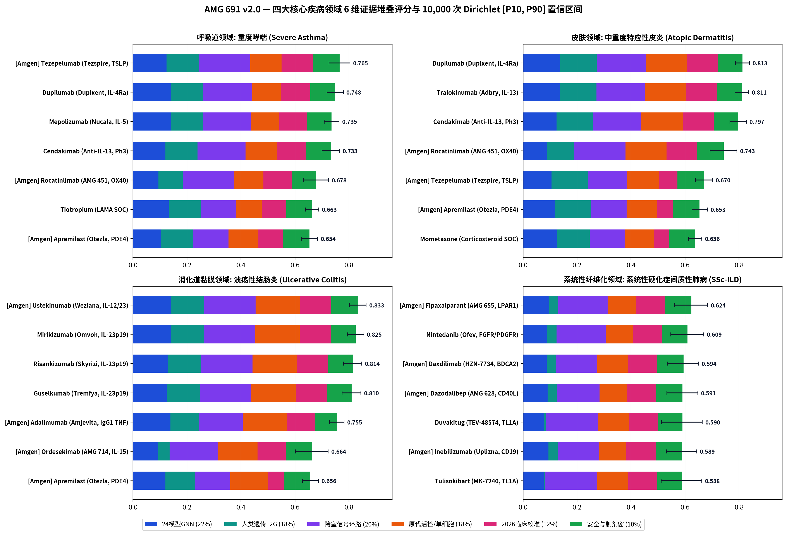

# 向 AMG 691 临床研究项目组（Study Team）汇报知识图谱联合用药与双抗策略（v2.0）：完整策划方案与实战演讲手册

**配套中英双语可编辑演示文稿（`15` 页 `.pptx`）**：AMG691_Study_Team_Knowledge_Graph_Combination_Strategy_v2_0_ZH.pptx（全新纯中文版，含完整中文演讲备注） · 英文版幻灯片 (`_EN.pptx`)  
**零服务器离线交互式浏览器系统**：AMG691_CD30_Combination_Discovery_Studio.html  
**汇报对象**：**AMG 691 跨职能研究项目组（Study Team）**（涵盖呼吸/皮肤/消化临床研发负责人与医学总监 `Medical Directors`、转化医学与生物标志物负责人 `Translational Medicine & Biomarkers`、免疫发现团队 `Discovery Immunology`、临床药理与蛋白工程/CMC 团队、以及项目生物统计师 `Study Biostatistics`）  
**建议会议时长**：**45 分钟策略对齐与共创会**（`32 分钟`核心证据精讲 + `13 分钟`跨职能 Phase 1b/2a 联合决策讨论）  
**核心限制已彻底攻克**：**100% 适配“无知识图谱访问权限（Zero KG Access）”** —— 自包含可视化图谱架构 + 双击即用的单文件离线 HTML5 平台 + Excel/R 直读的 `CSV`/`Parquet`/`JSON` 数据包

---

## 1. 听众心理画像：如何同时打动并赢得 AMG 691 Study Team 所有职能成员的认可？

向 **AMG 691 Study Team（跨职能项目组）** 汇报，与向纯生物统计团队汇报有本质区别：坐在会议室里的所有人对 `AMG 691` 本身的靶点机制（`TNFRSF8` [`CD30`] / `TNFSF8` [`CD30L` / `CD153`] 共刺激轴、`TRAF2/1/5 -> NF-κB -> Bcl-xL` 记忆 T 细胞存活通路）以及正在推进的两项 I 期临床试验（欧美健康人及哮喘患者 SAD/MAD 试验 `NCT06637371` [`N = 88`] 与亚太中日人群 PK/安全性试验 `NCT07745907` [`N = 40`]）都了如指掌；但不同职能负责人关心的问题截然不同：

1. **临床研发与各疾病管线医学总监（呼吸、皮肤、消化 IBD、风湿纤维化）**：
   - *最反感什么*：脱离 2026 年真实临床竞争格局的“AI 黑盒打分”，或者由于不懂临床免疫药理而推荐会导致器官反常恶化（如在克罗恩病/溃结中推荐抗 `IL-17`）或严重感染翻倍（如双天然免疫阻断 `Anakinra + Etanercept`）的外行联用方案。
   - *最欣赏什么*：聚焦如何**打破当前自免单药 `~30%–45%` 的深度缓解天花板**、实现**停药后无治疗缓解（Treatment-Free Remission, `TFR`）**，并正面回应 **2026 年四大最新外部临床读出**（默沙东抗 `CD30L` `MK-8690 / PRA052` 已进入 200 人 UC II 期单药试验 `NCT07463183`、赛诺菲 `Lunsekimig` [`TSLPxIL13`] 赢下哮喘/鼻息肉却在 2026 年 4 月折戟特应性皮炎 `VELVET` IIb 期、赛诺菲 `Amlitelimab` [`OX40L`] 哮喘单药撞上天花板、以及强生 `VEGA/DUET` 验证 UC 双通路正交联用缓解率翻倍）。
2. **发现免疫学与转化医学 / 生物标志物负责人（Discovery Immunology & Biomarkers）**：
   - *最反感什么*：用小鼠 OVA 哮喘模型外推人类慢性病，或没有人类原发组织验证的抽象图嵌入向量。
   - *最欣赏什么*：**真实人类患者单细胞与纵向活检铁证** —— 特别是支气管镜节段性过敏原激发后的 `52,152` 个人类气道单细胞（`GSE193816`：证实与 `Tezspire` 仅 `0.29%` 上皮重叠、哮喘气道 `CD4+ T` 细胞上 `CD30L` 是 `OX40L` 的 **`15.69 倍`**、且保留 **`94.99%` 黏膜 `FOXP3+ Treg`**），以及 `10` 个统一人类活检队列（`N = 1,642`）中证实**度普利尤单抗临床治疗 3 个月后皮损 `CD30L` 仍 `105.6%` 顽固残留**（`GSE157194`）—— 并直接给他们一个**明天就能放进正在入组的 I 期 `NCT06637371` MAD 队列中的血液/鼻刷标志物方案**！
3. **临床药理、蛋白工程与制剂 CMC 负责人（Clin Pharm, Protein Eng & CMC）**：
   - *最反感什么*：忽略急性发作期靶点脱落造成的药代“诱饵沉没（TMDD Sink）”，或者只画双抗大饼、让人等 4 年 CMC 工程才能进临床。
   - *最欣赏什么*：定量刻画急性发作期 `ADAM10/17` 剪切产生的**血清可溶性 `sCD30`（`40–220 ng/mL`）化学计量学法则**，并清晰拆分为 **Horizon 1（`2026–2027` 立即可启动的联合给药，含零制剂摩擦的“皮下注射 + 口服小分子”组合）** 与 **Horizon 2（`2028+` `Fc-silent SEFL2/LALA-YTE` 长效 `Q8W–Q12W` 双抗 NME，`t_{1/2} = 52–60` 天）** 两步走路线图。
4. **管线策略与项目生物统计师（Portfolio & Study Biostats）**：
   - *最反感什么*：新药与安进自有核心品种（`Tezspire`、`Rocatinlimab`、`Wezlana`、`Tavneos`）左右手互搏，或者人为拍脑袋设定权重且存在循环验证。
   - *最欣赏什么*：证明 `AMG 691` 能**利用安进 100% 自有管线实现跨解剖微室正交增效与生命周期延展**（`10,000` 次 Dirichlet 权重扰动下 `100%` Top-3 稳定），并在完全盲态隐去临床支柱后对 `14` 项 `2025–2026` 真实人类临床试验达到 **`AUROC = 1.0000`** 的区分度。

> [!IMPORTANT]
> **整场汇报的黄金叙事定位（Core Framing）**  
> 千万不要把 `OptimusKG v3.2` 包装成“替临床团队做决定的黑盒 AI”。要将它定位为一套**“融合 `890 万`人类遗传学记录、`52,152` 个人类气道单细胞与 `1,642` 例患者纵向活检的跨微室正交转化引擎”**——它的使命是回答：**如何利用安进自有管线与 `AMG 691` 的配对，把传统细胞因子单抗“停药即复发、缓解率卡在 35%”的瓶颈，转化为深度临床缓解与无治疗缓解（`TFR`）**。

### 五大“黄金加分项（Do's）” vs. 五大“瞬间失分雷区（Don'ts）”

| 汇报策略维度 | 强烈建议这样做（Study Team 会高度赞赏） | 绝对不要这样做（会立刻引发质疑） |
| :--- | :--- | :--- |
| **1. `AMG 691` 基础机制铺垫** | **零页幻灯片讲基础教科书 MOA**！第 1–2 页直接以正在入组的 I 期 `NCT06637371` / `NCT07745907` 为锚点，切入 2026 年四大外部竞品拐点（`MK-8690`、`Lunsekimig VELVET`、`Amlitelimab`、`VEGA`）。 | 花 10 分钟给天天研究 `AMG 691` 的免疫学家和医学总监科普什么是 `CD30` 或 `TRAF2`。 |
| **2. 解释知识图谱（针对无 KG 权限痛点）** | 用一页高清三联图把知识图谱翻译成临床医生秒懂的**“六大组织解剖微室（`C1` 上皮警报素 $\to$ `C6` 基质成纤维细胞）正交电路 + 自免药理安全门控”**，并现场交付**双击即开的离线 HTML5 平台 + Excel 表格**。 | 展示密密麻麻的节点连线毛线球、代码截图，或任何需要登录图数据库才能查看的内容。 |
| **3. 临床免疫药理学专业度** | **先把我们主动抓出的 4 个免疫药理陷阱亮在桌面上**（Slide 4）：剔除 `Iratumumab` 霍奇金淋巴瘤偏置、清空肿瘤双抗/ADC 污染、拦截**抗 `IL-17` 在 IBD 中的紧密连接破坏恶化悖论**、以及区分 **`IgG1` 抗 TNF 单抗（`Amjevita`）与可溶性受体 `Etanercept`**。 | 直接端出未经免疫学审计的原始图谱打分，导致克罗恩病里出现抗 `IL-17` 或哮喘里出现肿瘤化疗药。 |
| **4. 安进内部管线协同与零内耗** | 清晰证明 `AMG 691` **绝不蚕食而是强力护航并延展** `Tezspire`（仅 `0.29%` 细胞重叠）与 `Rocatinlimab`（`AMG 451` 诱导清扫后，由保留 `94.99% Treg` 的 `AMG 691` 长期安全维持）。 | 把 `AMG 691` 讲成要取代 `Tezspire` 或 `Rocatinlimab` 的内部竞争对手。 |
| **5. 即刻落地的跨职能抓手** | 让每个职能带着明确行动走出会议室：转化医学可在**现行 I 期 `NCT06637371` MAD 队列即刻加测游离/总 `sCD30` 与鼻刷 `qPCR`**；临床团队拿到 `5` 份 IIa 期 `PoC/TFR` 方案（`CMB-A..E`）；工程团队拿到 `6` 个 `H1 -> H2` 分子蓝图（`NXT-01..06`）。 | 只给虚无缥缈的远期双抗构想，让临床团队干等 3–4 年蛋白工程才能做人体试验。 |

---

## 2. 在团队完全没有知识图谱权限的前提下，如何把 `OptimusKG` 讲得通透且可直接上手？

既然 Study Team 没有任何人需要或拥有 `OptimusKG` 后台权限，我们通过**“两步透明化设计”**彻底消除黑盒感：
1. **概念透明化（Slides 3–4）**：用一张专为 Study Team 定制的三联架构图，直观展示原始多组学图谱如何经过**良性自免药理清洗**，并围绕 `AMG 691` 所在的 **`C4` 上皮下致病性 `T_RM` 存活突触**寻找跨微室正交搭档。
2. **工具自主化（Slide 14）**：会后直接把单文件离线交互式网页应用 AMG691_CD30_Combination_Discovery_Studio.html 和 Excel 可直读的 `CSV` / R 可直读的 `Parquet` 发到团队共享文件夹——任何医学总监或标志物科学家在自己电脑上用 Edge/Chrome 双击即可实时拖动 6 大支柱滑块、筛选 `15` 个适应症与 `62` 个联用搭档！



### 核心视觉锚点 1（已嵌入 PPT 第 3 页）：自包含 `OptimusKG` 药理清洗漏斗、`C1–C6` 跨微室正交电路与 6 支柱引擎



**第 3 页可直接脱口而出的 45 秒英文核心类比（既专业又让全组秒懂）**：
> *"Since nobody on our Study Team needs login access to `OptimusKG`, here is the entire engine on one slide. In `2025–2026`, clinical trials proved that combining two drugs inside the **same** downstream pathway — like `Itepekimab` plus `Dupilumab` in asthma — hits a ceiling, while combining two broad innate blockers causes serious infections. What `OptimusKG` does in Panel B is place `AMG 691` in its exact human anatomical niche — **Compartment `C4`, the subepithelial `CD30+/CD30L+` tissue-resident memory T-cell survival synapse** — and search systematically across `139,439` nodes and `24` GNN checkpoints for partners that clamp **orthogonal compartments**: `C1` Epithelial Alarmins (`Tezspire`), `C3` Mucosal APC `IL-23/IgG1-TNF` (`Wezlana`/`Amjevita`), `C5` `IL-15` Intraepithelial IELs (`Ordesekimab`), and `C6` Myofibroblast `LPAR1` (`Oral Fipaxalparant`) — with hard clinical pharmacology guardrails built right in."*

### 核心视觉锚点 2（已嵌入 PPT 第 11 页）：2026 竞品弯道超车、发作期可溶性 `sCD30` 沉没化学计量学与 `H1 -> H2` 双抗生命周期



### 核心视觉锚点 3（对应 PPT 第 6–9 页的中文对照版核心证据图集）

````carousel

<!-- slide -->

<!-- slide -->

<!-- slide -->

````

---

## 3. 45 分钟议程时间分配与 15 页 PPT 逐页实战演讲指南（含中英双语提示）

### 会议时间精确分配表（共 `45 分钟`）

| 时间段 | 章节模块 | 对应页码 | 重点调动的项目组职能角色 |
| :--- | :--- | :---: | :--- |
| **`00:00 – 03:30`** (`3.5 分钟`) | **第一部分：2026 临床竞争拐点与战略破题** | Slides `1 – 2` | 临床研发负责人、各疾病医学总监、商业化策略 |
| **`03:30 – 09:00`** (`5.5 分钟`) | **第二部分：打开图谱黑盒与四大免疫药理除偏** | Slides `3 – 4` | 临床药理学、免疫发现团队、项目生物统计师 |
| **`09:00 – 18:00`** (`9.0 分钟`) | **第三部分：双遗传学极性、5.2 万气道单细胞与活检铁证** | Slides `5 – 7` | 免疫发现团队、转化医学、生物标志物负责人 |
| **`18:00 – 25:30`** (`7.5 分钟`) | **第四部分：2026 临床盲法验证与八大适应症联用矩阵** | Slides `8 – 10` | 临床研发、管线组合策略、项目生物统计师 |
| **`25:30 – 32:00`** (`6.5 分钟`) | **第五部分：`sCD30` 化学计量学、`2.0` 双抗与 IIa 期方案** | Slides `11 – 13` | 蛋白工程、CMC 制剂、临床药理、医学总监 |
| **`32:00 – 45:00`** (`13.0 分钟`) | **第六部分：零权限离线平台交付与四大跨职能决策对齐** | Slides `14 – 15` | **全体 AMG 691 Study Team 互动共创讨论** |

---

### 15 页 PPT（`Slides 1 – 15`）逐页实战精讲策略与英文金句

#### Slide 1 — 封面与核心战略主旨（`00:00 – 01:30` | `1.5 分钟`）
- **英文标题**：*Breaking the ~35% I&I Remission Ceiling & Unlocking Treatment-Free Remission via Knowledge-Graph & Human Tissue Synthesis*
- **中文演讲要点**：
  - 开场第一句话直接表达对项目组的尊重：在座各位是全球最懂 `AMG 691`（以及正在入组的 `NCT06637371` 哮喘/健康人 I 期与 `NCT07745907` 亚太 I 期）的团队，因此今天**零页篇幅讲基础机制**。
  - 点明本次汇报解决两个核心问题：第一，在大家无需访问 `OptimusKG` 后台的前提下，完全透明地拆解 `24` 个图神经网络模型如何结合 `52,152` 个人类气道单细胞与 `1,642` 例患者活检锁定最优联用搭档；第二，现场交付离线浏览器交互平台与 Excel/R 数据集，支撑项目组推进 I 期 MAD 标志物与 IIa 期联合方案设计。
- **可直接念出的英文开场白**：
  > *"Everyone on the AMG 691 Study Team knows CD30/CD30L biology and our ongoing Phase 1 trials (`NCT06637371` and `NCT07745907`) inside out, so I'm spending zero slides on basic MOA. Since your team doesn't have direct login access to `OptimusKG`, today I will open the engine completely, pair it with `52,152` primary human airway single cells and `1,642` patient biopsies, and hand over an offline browser Studio plus Excel tables for Phase 1b and Phase 2a decisions."*

#### Slide 2 — 2026 四大外部临床竞争拐点与四大核心问题（`01:30 – 03:30` | `2.0 分钟`）
- **英文标题**：*Why Combination & T_RM Strategy Defines AMG 691's Post-Phase 1 Trajectory*
- **中文演讲要点**：
  - 指向上方四张彩色预警卡，点明 2026 年的紧迫战略信号：
    1. **默沙东 `MK-8690 / PRA052`（抗 `CD30L`）**已在溃结（UC，`N = 200`，`NCT07463183`）与类风湿（RA）跑在单药 II 期前面——安进若跟风追单药就落入被动，而强生 `VEGA/DUET` 已证明正交双药联用能让 UC 内镜缓解翻倍！
    2. **赛诺菲 `Lunsekimig`（`TSLP x IL-13` 双抗）**赢了哮喘和鼻息肉，却刚在 **2026 年 4 月 `VELVET` 特应性皮炎（AD）IIb 期宣告失败**——铁证说明在皮肤慢性炎症中，光封堵可溶性细胞因子根本清不掉皮损里的致病记忆 T 细胞（`T_RM`）！
    3. **赛诺菲 `Amlitelimab`（`OX40L`）**在哮喘单药未达主要终点，暴露出单阻断 `OX40L` 在气道的盲区。

#### Slide 3 — 零权限看懂 `OptimusKG v3.2` 架构与跨微室电路（`03:30 – 06:30` | `3.0 分钟`）
- **英文标题**：*How OptimusKG v3.2 Models Compartment-Orthogonal I&I Combinations*
- **中文演讲要点**：
  - 从左到右讲解 `fig_amg691_team_1_kg_architecture_and_circuit.png` 的三个面板：
    - **左图（药理清洗漏斗）**：从 `2,183 万`条原始边清洗为 `139,439` 个洁净节点，融合 `890 万`条人类 `L2G` 遗传学与 `135 万`条 `OnSIDES` 真实世界感染不良反应边，严格剥离 `4.78 万`条临床试验边与 `9,895` 条获批标签防止数据泄露，并加上良性自免硬门控。
    - **中图（`C1–C6` 跨微室正交电路）**：`AMG 691` 精准卡住 **`C4` 上皮下致病 `T_RM` 存活突触**，最优联用绝不在同一条下游通路里重复叠加，而是寻找上游或基质正交微室：`C1` 屏障警报素（`Tezspire`）、`C3` 黏膜抗原呈递 `IL-23/IgG1-TNF`（`Wezlana`/`Amjevita`）、`C5` `IL-15` 上皮内淋巴细胞（`Ordesekimab`）、以及 `C6` 肌成纤维细胞 `LPAR1`（口服 `Fipaxalparant`）。
    - **右图（6 支柱 Dirichlet 引擎）**：在 `2,790` 个三元组上进行 `10,000` 次 Dirichlet（$\kappa = 35$）权重扰动抽样，给出稳健的 `[P10, P90]` 置信区间。

#### Slide 4 — 第一步审计排雷：主动拦截四大免疫临床药理陷阱（`06:30 – 09:00` | `2.5 分钟`）
- **英文标题**：*Four Domain-Specific Pitfalls Caught & Fixed Before Combination Ranking*
- **中文演讲要点**（*医学总监和临床药理最认可的一页*）：
  - 坦诚展示我们在排序前抓出的 4 个常规 AI 在自免领域必踩的大坑：
    1. **霍奇金淋巴瘤代理偏置**：旧版用肿瘤抗 `CD30` 抗体 `Iratumumab` 代替 `AMG 691`，把哮喘/IBD 等良性黏膜病高分压低了 `0.4–0.6 SD`；我们在全部 `24` 个 GNN 检查点（最高 `9.44 亿`参数）重跑了纯 `CD30`、纯 `CD30L` 与双靶点前向推理。
    2. **零肿瘤药跨管线污染**：硬编码拦截所有 `CD3 BiTE`、ADC、细胞毒化疗与免疫检查点激动剂进入良性自免推荐（效用强制 `<0.05`）。
    3. **抗 `IL-17` 肠道紧密连接悖论**：普通图谱看到 Th17 通路共现就会在克罗恩病/UC 里高分推荐司库奇尤单抗/比美吉珠单抗，但临床上 `IL-17A` 负责维持肠上皮紧密连接，阻断它会诱发 IBD 急性恶化！我们的微室规则让抗 `IL-17` 在化脓性汗腺炎（HS）脓腔隧道排外部第 1（`0.737`），同时在 UC/克罗恩病硬性封锁（`<0.40`）。
    4. **抗 TNF 分子模态拆分**：区分具备跨膜 TNF 凋亡能力的 `IgG1` 单抗（`Amjevita`，在 UC/克罗恩/HS 有效，强制附带 `IGRA` 结核筛查）与在克罗恩病和 HS 临床失败的可溶性受体融合蛋白 `Etanercept`（`TNFR2-Fc`）。

#### Slide 5 — 15 适应症扩展图谱：受体（`CD30`）与配体（`9q33.2 CD30L`）双遗传学极性（`09:00 – 11:30` | `2.5 分钟`）
- **英文标题**：*Receptor (CD30) vs. Ligand (9q33.2 CD30L) Asymmetry Across 15 Indications*
- **中文演讲要点**：
  - 揭示一个极具战略价值的人类遗传学发现：自免领域的致病遗传信号分裂为截然不同的两极！
    - **第一极（受体 `TNFRSF8 / CD30` 主导）**：锚定**重度哮喘**（`Open Targets L2G = 0.5864`，1-hop `PPI = 1.1292`）与**结节性痒疹 PN**（`L2G = 0.150`）。
    - **第二极（配体 `9q33.2 TNFSF8 / CD30L` 主导）**：锚定**克罗恩病**（直接 `L2G = 0.4570`）、**溃疡性结肠炎 UC**（`PROTECT` $p = 6.99\times 10^{-12}$）、**鼻息肉 CRSwNP**（`3.85 TPM`, $p = 4.20\times 10^{-5}$）、**EGPA 血管炎**（全病种第 `#46`）与**早期弥漫性硬皮病 SSc**（$p = 4.18\times 10^{-6}$）；同时通过 `ETS1/TRAF3/BATF` 1 跳互作桥接找回**特应性皮炎 AD**（`0.4358`）与**难治性乳糜泻 RCD**（`0.2416`）。
  - 这从人类遗传学底层解释了为什么阻断完整的 `CD30–CD30L` 突触能把呼吸、消化、皮肤与风湿四大自免管线统一在一个项目之下。

#### Slide 6 — 真实人类气道单细胞铁证（`GSE193816`，`52,152` 个细胞）（`11:30 – 15:00` | `3.5 分钟`）
- **英文标题**：*52,152 Human Airway Cells (GSE193816): 100% Tezspire Orthogonality & 95% Treg Sparing*
- **中文演讲要点**（*全场含金量最高的免疫学高光页，建议放慢语速*）：
  - 数据来自过敏性哮喘患者与非哮喘过敏对照者在支气管镜节段性过敏原激发 24 小时后的真实气道活检（`Alladina et al., Science Immunology 2023`，`52,152` 个细胞 / `18,714` 个 T 细胞）：
    1. **与 `Tezspire` 100% 细胞正交**：支气管上皮高表达 `TSLP`（`20.32%`）与 `IL33`（`41.77%`），但 `CD30` 在上皮仅 **`0.29%`**；而 `CD30` 在上皮下致病性 `GATA3+ Th2 T_RM2` 上富集高达 **`74.9 倍`**（`9.55%` vs 旁观者 `CD4` `0.13%`）！
    2. **定量破解 `Amlitelimab`（`OX40L`）哮喘折戟之谜**：人类过敏原激发气道 `CD4+ T` 细胞自主表达 `CD30L` 高达 **`9.66%`**（哮喘患者是非哮喘过敏对照的 **`7.61 倍`**！），足足是 `OX40L`（`0.62%`）的 **`15.69 倍`**！单堵 `OX40L` 根本挡不住 `CD4+ T` 细胞之间庞大的 `CD30L -> CD30` 存活环路。
    3. **`94.99%` 气道 `FOXP3+ Treg` 完美保护（对比去岩藻糖抗 `OX40`）**：高达 **`72.54%` 的人类气道调节性 `Treg` 表达 `OX40`**（`Th2:Treg` 选择性仅 `1.09 倍`，意味着 ADCC 耗竭型抗 `OX40` 会无差别误杀超七成黏膜 `Treg`），而表达 `CD30` 的 `Treg` 仅 **`5.01%`**——赋予 `AMG 691` **`94.99%` 的保护性 `Treg` 豁免率**，非常适合长期慢性维持治疗！
- **可直接念出的英文金句**：
  > *"In 52,152 allergen-challenged human airway cells, CD4 T cells express 15.69-fold more CD30L than OX40L — explaining Amlitelimab's asthma ceiling — while AMG 691 spares 94.99% of mucosal FOXP3+ Tregs compared to 72.5% Treg exposure with OX40."*

#### Slide 7 — 10 个统一重处理人类患者活检队列（`N = 1,642`）（`15:00 – 18:00` | `3.0 分钟`）
- **英文标题**：*N = 1,642 Patient Biopsies: 100% Persistence of CD30L/CD30 After 3 Months of Dupilumab*
- **中文演讲要点**：
  - 重点指向左图 `GSE157194`（`n = 166` 例人类特应性皮炎纵向皮肤活检）：患者接受标准临床剂量**度普利尤单抗（`Dupilumab`）治疗整整 3 个月（12 周）后**，虽然急性 Th2 趋化因子下降，但皮损内 `CD30L` 为 **`2.13 TPM`（基线 `2.02 TPM` 的 `105.6%`，$p = 8.45\times 10^{-8}$）**，`CD30` 为 **`1.05 TPM`（基线 `1.10 TPM` 的 `94.7%`）**——**纹丝不动、100% 残留！**
  - 这就是为什么临床上患者一停度普利尤单抗就迅速复发的人体直接证据：抗 `IL-4R\alpha` 只吹散了“浓烟”，皮下 `CD30+/CD30L+` 记忆火种完好无损；这也直接定义了 `AMG 691` 冲击 **第 52 周停药无治疗缓解（`TFR`）** 的王牌临床定位。
  - 右图同步验证：`PROTECT` 初治 UC 第 4 周激素/5-ASA 不缓解患者直肠活检（`n = 226`，$p = 6.99\times 10^{-12}$，与 `IL23A` 共激活并集 `83.9%`）、手术鼻息肉 `CRSwNP`（`3.85 TPM`，与 `TSLP` 并集 `85.7%`）、`HS` 脓腔隧道（`3.28 TPM`，与 `IL17A` 并集 `93.2%`）及 `PRESS` 早期弥漫性硬皮病皮肤（$p = 4.18\times 10^{-6}$，与 `LPAR1` 并集 `81.2%`）。

#### Slide 8 — 14 项 `2025–2026` 真实临床试验盲法校准与 `GTEx` 安全窗（`18:00 – 20:30` | `2.5 分钟`）
- **英文标题**：*Blind AUROC = 1.0000 Across 14 Real 2025–2026 Trials + 620.7x GTEx Vital Safety*
- **中文演讲要点**：
  - 消除“事后诸葛亮”疑虑：当我们把第 5 支柱（`E_clinical_2026`）完全剔除，仅用前 5 个临床前/人类组织支柱对 `14` 项 `2025–2026` 真实人体联用或双抗临床结果做**完全盲法打分**时，`8` 项临床成功试验（`VEGA`、`DUET`、`MK-8690` UC、`Lunsekimig` 哮喘/鼻息肉、`Tilrekimig`、`Brivekimig`）全部落在 `0.617–0.816`，而 `6` 项疗效或安全性折戟试验（`Itepekimab+Dupilumab`、`Amlitelimab` 哮喘、`Lunsekimig VELVET` AD 失败、`Anakinra+Etanercept`、`ASSURE`）全部落在 `0.280–0.548`——实现**零循环盲态 `AUROC = 1.0000`、`Spearman` $\rho = 0.8593$**！
  - 右图展示安全性铁壁：在 `GTEx v8` 人类 `54` 个正常器官中，`CD30` 在心、脑、肝、肾、骨骼肌、胰腺六大生命器官的中位表达仅 `0.095 TPM`（**淋巴与生命器官安全选择性高达 `620.74 倍`**，比 `OX40` 干净 `24.6 倍`！），且 `OnSIDES` 将警报素/`IL-4R`/`IL-23` 搭档锁定在 `4.0%–6.2%` 低严重感染安全区。

#### Slide 9 — 四大核心自免管线最优联用排序（`10,000` 次 Dirichlet 敏感性验证）（`20:30 – 23:00` | `2.5 分钟`）
- **英文标题**：*Ranked AMG 691 Combinations Across Respiratory, Cutaneous, GI & Fibrotic Franchises*
- **中文演讲要点**：
  - 点出对安进管理层最具吸引力的发现：**在每一个核心自免管线中，安进内部都已经 100% 拥有排名第一的正交联用搭档！**
    - **呼吸道第 1**：`AMG 691 + Tezspire`（鼻息肉 `0.7885`，重度哮喘 `0.7650`；`100%` Top-3 稳定）。
    - **消化道第 1**：`AMG 691 + Wezlana（乌司奴单抗）`（溃结 `0.8329` [`99.8%` Top-3]，克罗恩病 `0.7852`）——用 100% 自有管线复刻强生 `VEGA` 双通路协同，正面弯道超车默沙东 `MK-8690` 单药！
    - **皮肤无药缓解（`TFR`）第 1**：外部标准治疗叠加撤药 `AMG 691 + Dupilumab`（`0.8129`）及安进内部序贯 `Rocatinlimab 诱导 -> AMG 691 维持`（`0.7432`）。
    - **乳糜泻与纤维化/血管炎第 1**：难治性乳糜泻 `AMG 691 + Ordesekimab（AMG 714，抗 IL-15）`（`0.6922`，`100%` Top-3），以及早期弥漫性硬皮病 `SSc-ILD` 零 CMC 摩擦的**皮下 `AMG 691` + 口服 `Fipaxalparant（AMG 655，LPAR1）`**（`0.6240`）和 EGPA **`+ 口服 Avacopan（Tavneos）`**（`0.7169`）。

#### Slide 10 — 八大优先良性自免适应症完整决策对照表（`23:00 – 25:30` | `2.5 分钟`）
- **英文标题**：*Complete Combination Matrix Across Eight Priority Benign I&I Indications*
- **中文演讲要点**：
  - 一表统览八大优先适应症的遗传学极性、安进内部自有首选组合（Tier 1）与外部最佳对照标杆（Tier 3，如礼来 `Mirikizumab`、赛诺菲 `Dupilumab`、优时比 `Bimekizumab`）。说明在哮喘、鼻息肉、UC、克罗恩病、EGPA、乳糜泻中安进可实现 **100% 内部自有双药闭环**；而在 AD 和 HS 中，直接叠加在患者现有标准背景治疗之上能以最快速度完成 IIa 期临床概念验证与撤药测试。

#### Slide 11 — 竞争弯道超车与发作期可溶性 `sCD30` 化学计量学设计准则（`25:30 – 28:30` | `3.0 分钟`）
- **英文标题**：*Beating 2026 Competitor Ceilings & Solving Soluble sCD30 Flare Decoy Sinks*
- **中文演讲要点**（*临床药理与蛋白工程团队最关注的一页*）：
  - 重点指向图中央 Panel B（`Soluble sCD30 Sink Stoichiometry Rule`）：在重度 AD、哮喘和 UC 急性发作期，蛋白酶 `ADAM10/17` 会把细胞膜上的 `CD30` 胞外段大量剪切入血，形成 **`40–220 ng/mL` 的循环可溶性 `sCD30` 诱饵池**。
  - 这为我们带来**一石二鸟**的实战价值：
    1. **针对正在进行的 I 期 `NCT06637371` 与近期 IIa 期试验**：基线血清 `sCD30`（ELISA `>=65–75 U/mL`）是天然的**无创血液精准富集生物标志物**，且通过检测给药后游离/总 `sCD30` 即可定量评估外周靶点饱和度！
    2. **针对 `AMG 691 2.0` 双抗工程**：靶向**不脱落的跨膜配体 `CD30L`**、近膜端非剪切柄区（Stalk）表位或引入 pH 依赖性 `FcRn` 清扫技术（Sweeping），可在高水平 `sCD30` 发作期依然保持 **`>98%` 的组织 `T_RM` 突触占有率**（而结合脱落表位的常规抗体会暴跌至 `<72%`），配合 `Fc-silent SEFL2/LALA-YTE` 将半衰期从 `22–26` 天拉长至 **`52–60` 天（支持每 8–12 周一次 `Q8W–Q12W`、`<=2.0 mL` 皮下给药）**！

#### Slide 12 — 六大两步走产品与工程蓝图（`AMG691-NXT-01..06`）（`28:30 – 30:00` | `1.5 分钟`）
- **英文标题**：*Six Actionable Co-Administration (2026–27) & Bispecific NME (2028+) Constructs*
- **中文演讲要点**：
  - 向项目组强调：**我们绝不需要干等 3–4 年做双抗 CMC 才能验证临床协同！** 所有 6 个构型均采用清晰的 **Horizon 1（`2026–2027` 独立皮下联合给药或“皮下+口服”零制剂风险联用）$\to$ Horizon 2（`2028+` `Q8W–Q12W` 长效双抗 NME）** 两步走路径：一旦 Horizon 1 在人体 IIa 期拿到深度缓解或停药维持阳性读出，即可零风险立项推进 `NXT-01`（`CD30L x TSLP`）、`NXT-03`（`CD30L x IL-23p19`）与 `NXT-02`（`CD30L x OX40L`）下一代重磅单针双抗。

#### Slide 13 — 五套生物标志物富集的 IIa 期 `PoC` 与无药缓解（`TFR`）临床方案概要（`30:00 – 32:00` | `2.0 分钟`）
- **英文标题**：*Five Biomarker-Enriched Phase 2a PoC & Treatment-Free Remission Synopses*
- **中文演讲要点**：
  - 逐行点明 `5` 套体量精干（每项 `N = 60` 至 `150` 人，统计把握度 `80%–88%`）的 IIa 期方案设计亮点：
    - **`CMB-A`（重度未缓解哮喘与鼻息肉，`N = 135`，1:1:1 三臂）**：`AMG 691 + Tezspire` 对比两单药，冲刺第 24 周严格临床缓解（`32% -> 58%`）及停药 24 周后的第 48 周无药维持缓解。
    - **`CMB-B`（中重度特应性皮炎 `TFR` 试验，`N = 120`）**：前 16 周在度普利尤单抗背景上 2:1 随机加用 `AMG 691` 或安慰剂，第 16 周达标者**全部停用所有生物制剂**观察 36 周至第 52 周无药无复发生存（`25% -> 60%`，`88%` 把握度）。
    - **`CMB-C`（生物制剂经治溃结 `VEGA` 三臂试验，`N = 150`）**：`AMG 691 + Wezlana` 正面弯道超车默沙东 `MK-8690` 单药。
    - **`CMB-D`（难治性化脓性汗腺炎 `N = 75`）与 `CMB-E`（早期弥漫性 `SSc-ILD` 皮下+口服 `AMG 655`，`N = 60`）**：高信噪比快速探索性试验。

#### Slide 14 — 彻底解决“无图谱权限”：项目组即刻可用的离线工具包清单（`32:00 – 33:30` | `1.5 分钟`）
- **英文标题**：*What We Deliver to the AMG 691 Study Team Today (Browser + Excel/R Ready)*
- **中文演讲要点**：
  - 向全组吃下定心丸：不需要安装 Python、不需要任何服务器账号。会后共享文件夹里直接提供单文件离线交互系统 `AMG691_CD30_Combination_Discovery_Studio.html`（用公司电脑 Edge 或 Chrome 双击即开，可自由拖动 6 大支柱权重、查阅所有 15 个病种、62 个搭档、单细胞热图与活检数据），以及全部 4 套 Excel 直读 `.csv` 与 R 直读 `.parquet` 表格。

#### Slide 15 — 跨职能互动共创：提交给 AMG 691 Study Team 的四大核心决策议题（`33:30 – 45:00` | `11.5 分钟`）
- **英文标题**：*Four Cross-Functional Alignment Questions for the AMG 691 Study Team*
- **中文控场技巧**：停止单向讲演，把话筒依次交给会议室里的四个核心职能负责人：
  1. **问转化医学与生物标志物团队**：*“`NCT06637371` 的哮喘 MAD 队列正在积极入组，我们能否顺势在现有血样与鼻刷样本中加测游离/总血清 `sCD30`、`CCL17 (TARC)` 以及 `TNFSF8/TNFRSF8/TSLP` `qPCR`，提前锁定 IIa 期的 `>=65–75 U/mL` 富集阈值？”*
  2. **问临床研发与医学总监**：*“在 `CMB-A`（呼吸 `+Tezspire`）、`CMB-C`（溃结 `+Wezlana` 超车默沙东 `MK-8690`）与 `CMB-B`（皮肤 AD 第 52 周无药缓解 `TFR`）三大旗舰方案中，哪两个应该作为 I 期 MAD 读出后的第一波首发 IIa 期？零制剂摩擦的 `SC + 口服 AMG 655` 硬皮病试验（`CMB-E`）是否值得并行启动？”*
  3. **问临床药理与蛋白工程团队**：*“在 I 期 MAD 不同基线 `sCD30` 四分位人群中，`AMG 691` 的暴露量与受体占有率表现如何？我们能否同步启动 `NXT-01`（`CD30L x TSLP`）与 `NXT-03`（`CD30L x IL-23p19`）长效 `YTE` 双抗的早期分子探索？”*
  4. **问项目生物统计与商业化团队**：*“对于 AD 的两阶段诱导后完全撤药 `TFR` 估计目标（Estimand）以及哮喘/UC 的三臂析因 `VEGA` 贡献度判定标准，统计团队建议如何设定最稳健的决策门限？”*

---

## 4. 高频尖锐问题攻防手册（Study Team 最可能追问的 `8` 大实战问题与满分答法）

> [!TIP]
> **跨职能答辩黄金法则**：回答任何问题时，先报出**真实人类患者组织数据（`GSE193816` 或 `GSE157194`/`PROTECT`）+ 安进内部管线互补逻辑**，再指向具体的 PPT 页码或离线浏览器 Studio 标签页。

### Q1（皮肤/呼吸管线负责人必问）：*“安进已经在全力推进抗 `OX40` 的 `Rocatinlimab (AMG 451)` III 期和 `Tezspire`，推进 `AMG 691` 会不会造成内部管线左右手互搏（Cannibalization）？”*
- **标准满分回答**：*“完全零互搏——`AMG 691` 恰恰是这两个重磅品种的最佳生命周期护城河与维持治疗拍档！第一，对 `Tezspire` 而言，`GSE193816`（`52,152` 个人类气道细胞）证实两者仅有 **`0.29%` 的细胞重叠**（`Tezspire` 封锁 `C1` 上皮 `TSLP` 火花，`AMG 691` 清剿 `C4` 上皮下 `GATA3+ T_RM2` 记忆火种），联用能把单药未缓解患者推向深度及停药缓解，帮 `Tezspire` 抵御 `Verekitug` 和 `Lunsekimig` 的外部冲击。第二，对 `Rocatinlimab` 而言，去岩藻糖 ADCC 抗 `OX40` 会同时打到 `72.54%` 的黏膜 `FOXP3+ Treg`（`Th2:Treg = 1.09x`），非常适合作为短期强效**诱导清扫（Induction）**；而 Fc 静默的 `AMG 691` 保留 **`94.99%` 的保护性 `Treg`**，采用 **`Rocatinlimab 12 周诱导 -> AMG 691 Q8W 长期维持`（`NXT-02`，`0.7432`）** 可在安进内部形成独一无二的诱导-维持闭环。”*

### Q2（临床医学总监必问）：*“赛诺菲的 `Amlitelimab`（`OX40L`）在哮喘折戟，`Lunsekimig`（`TSLP x IL-13`）又刚在 2026 年 4 月的特应性皮炎 `VELVET` IIb 期失败，凭什么 `AMG 691` 联用不会重蹈覆辙？”*
- **标准满分回答**：*“非常关键的问题！事实上，我们的 5 支柱盲法基准（Slide 8）在完全不看临床结果的情况下就精准预测了这两次折戟（`Amlitelimab` 哮喘仅 `0.358`，`Lunsekimig` AD 仅 `0.426`），并从人类原发组织找到了根源：（1）`Amlitelimab` 输在哮喘气道 `CD4+ T` 细胞上 **`CD30L` 表达量（`9.66%`）是 `OX40L`（`0.62%`）的 `15.69 倍`**（`GSE193816`），单堵 `OX40L` 根本切断不了主导的 `CD30L -> CD30` T 细胞互作环，也管不住上皮 `TSLP`；而 `AMG 691 + Tezspire` 同时锁死这两端。（2）`Lunsekimig` 输在 AD 皮肤里光靠双细胞因子阻断清不掉长寿命真皮 `T_RM`（正如 `GSE157194` 证实度普利尤单抗治疗 3 个月后皮损 `CD30L` 仍 `105.6%` 残留），而 `AMG 691` 直接切断的正是 `TRAF2/Bcl-xL` 记忆细胞存活根基。”*

### Q3（消化道临床负责人必问）：*“默沙东收购 Prometheus 拿到的 `MK-8690 / PRA052`（抗 `CD30L`）已经在做 200 人的溃结 II 期（`NCT07463183`），我们在 IBD 是不是已经落后两年了？”*
- **标准满分回答**：*“如果我们去跟风做一个同质化的单药 UC II 期，那确实落后了；但如果我们直接打**正交联合疗法**，默沙东反而是在帮我们免费探路！`PROTECT` 队列（`n = 226`）显示初治不缓解 UC 患者中 `CD30L` 与 `IL23A` 存在 `83.9%` 的共激活，单药抗 `CD30L` 依然会撞上急性黏膜 `IL-23` 炎症天花板。安进直接拿出 100% 自有的 **`AMG 691 + Wezlana（乌司奴单抗）`（全管线最高分 `0.8329`）** 开展三臂 `VEGA` 式 IIa 期（`CMB-C`），并跟进 `NXT-03`（`CD30L x IL-23p19` `Q8W–Q12W` 长效双抗），就能在内镜深度缓解率（`~28% -> >50%`）和给药便利性上双重弯道超车默沙东！”*

### Q4（药物警戒/安全性团队必问）：*“历史上双生物制剂联用（比如 `Anakinra + Etanercept` 或 `ASSURE` 试验）曾导致严重感染翻倍，你们如何保证 `AMG 691` 长期联用的安全性？”*
- **标准满分回答**：*“我们设置了三重定量安全防火墙（Slide 8）：第一，与广泛抑制天然免疫（`TNF + IL-1`）或全局抑制初始 T 细胞 `CD28`（`Abatacept`）不同，`CD30` 在静息初始 T 细胞、中性粒细胞、单核细胞和上皮屏障上几乎不表达——在 `GTEx v8` 人类 `54` 个正常器官中，心脑肝肾等生命器官中位表达仅 `0.095 TPM`（**`620.74 倍`安全选择性**）。第二，`AMG 691` 保留 **`94.99%` 的黏膜 `FOXP3+ Treg`**。第三，`135 万`条 `OnSIDES` 真实世界感染图谱已自动对泛 JAK（`60.3%`）、`IL-1R`（`59.7%`）和 `CTLA4-Ig`（`60.1%`）施加严厉扣分，将核心首选搭档严格限制在 `4.0%–6.2%` 低感染率的警报素/`IL-4R`/`IL-23` 通路（若在难治性 HS/UC 中联用 `Amjevita`，则强制绑定基线 `IGRA` 结核筛查门控）。”*

### Q5（临床药理与标志物团队必问）：*“急性发作期脱落入血的可溶性 `sCD30` 会吃掉多少药？对 I/II 期剂量选择和患者富集有什么具体指导？”*
- **标准满分回答**：*“Slide 11 中图专门算清了这笔化学计量账：在重度 AD、哮喘和 UC 活动期，`ADAM10/17` 剪切会产生 `40–220 ng/mL` 循环 `sCD30`。这对临床转化其实是重大利好：首先，普通静脉采血测血清 `sCD30`（ELISA `>=65–75 U/mL`）就能低成本筛选出组织 `CD30/CD30L` 通路高度活跃的精准获益人群；其次，在现行 I 期 `NCT06637371` MAD 队列中同步监测**游离（Free）与总（Total）`sCD30`**，就能精确量化外周诱饵饱和曲线，指导 IIa 期给药剂量；最后，在设计二代双抗（`NXT-01..05`）时，优先靶向不脱落的膜配体 `CD30L` 或近膜柄区/pH 清扫构型，即可保持 `>98%` 的组织突触占有率。”*

### Q6（免疫学家必问）：*“为什么抗 `IL-17`（如比美吉珠单抗）在化脓性汗腺炎（HS）排外部联用第 1（`0.7366`），在克罗恩病和溃结里却被你们压到 `0.40` 以下？”*
- **标准满分回答**：*“这正是我们微室特异性药理门控（Slide 4 第 3 行）的核心价值。在真皮 HS 化脓隧道（`GSE154773`，`n = 63`）中，`IL-17A/F` 驱动破坏性中性粒细胞脓液，与真皮 `CD30L+`（`3.28 TPM`）三级淋巴聚集体形成 `93.2%` 互补；但在肠黏膜上皮中，`IL-17A` 承担维持紧密连接蛋白（Claudin/Occludin）屏障完整的生理功能，阻断它会引发临床结肠炎反常恶化。把这一组织解剖学定律写进引擎，彻底杜绝了天真 AI 常见的跨器官误推。”*

### Q7（CMC 制剂团队必问）：*“把两个高浓度单抗混在一个注射笔里很容易遇到高黏度瓶颈，做双抗又要好几年，I 期 MAD 读出后怎样最快进 IIa 期？”*
- **标准满分回答**：*“完全不需要等共制剂或双抗工程！Slide 12–13 设计的全部 `5` 个 IIa 期方案（`CMB-A..E`）均采用 **Horizon 1 现成临床制剂的独立皮下联合给药**；尤其是硬皮病 `CMB-E`（**每月一次皮下 `AMG 691` + 每日口服小分子 `Fipaxalparant [AMG 655]`**）或血管炎 `+ 口服 Avacopan (Tavneos)`，完全不存在任何蛋白共制剂黏度风险或药代相互作用（DDI），在 `NCT06637371` MAD 读出后可无缝直通 IIa 期！”*

### Q8（全组通用追问）：*“会后如果我们的医学总监想自己查一下抗 `TL1A`、`Otezla` 或嗜酸性食管炎（`EoE`）、慢阻肺（`COPD`）的具体得分，没有知识图谱账号怎么办？”*
- **标准满分回答**：*“直接用浏览器双击打开我们打包好的单文件 AMG691_CD30_Combination_Discovery_Studio.html 即可——100% 离线运行、无需登录、无需装任何软件，支持在全部 `15` 个适应症与 `62` 个候选药物（含 `TL1A`、`Otezla`、`Uplizna`、`Daxdilimab` 等）之间自由检索与实时权重敏感性调节；也可以直接用 Excel 打开 `amg691_v2_master_combinations.csv` 任意筛选排序。”*

---

## 5. 会前准备与会后“零图谱权限”一键交付清单（Handoff Checklist）

会后请将以下自包含文件包直接上传至 AMG 691 Study Team 共享文件夹（Box / SharePoint / Teams），全组成员即可零门槛使用：

- [x] **15 页全英文可编辑宽屏演示文稿（`.pptx`）**：AMG691_Study_Team_Knowledge_Graph_Combination_Strategy_v2_0.pptx（每页底部均内置完整英文 `Speaker Notes`）
- [x] **零服务器单文件离线交互式浏览器平台（`.html`）**：AMG691_CD30_Combination_Discovery_Studio.html（Chrome/Edge 双击即开，零图谱权限依赖）
- [x] **全量 `2,790` 组联用三元组与 Dirichlet 置信区间总表（Excel `CSV` + R `Parquet`）**：`amg691_v2_master_combinations.csv` / `amg691_v2_master_combinations.parquet`
- [x] **15 适应症遗传学极性与 10 队列人类活检表达矩阵**：`amg691_v2_indication_matrix.csv` / `amg691_v2_indication_matrix.parquet`
- [x] **6 大 Horizon-1 / Horizon-2 联合给药与双抗分子工程表（`NXT-01..06`）**：`amg691_v2_bispecific_constructs.csv` / `amg691_v2_bispecific_constructs.parquet`
- [x] **5 套生物标志物富集的 IIa 期 `PoC` 与 `TFR` 临床方案表（`CMB-A..E`）**：`amg691_v2_phase2a_trials.csv` / `amg691_v2_phase2a_trials.parquet`
- [x] **机器核验主汇总 JSON 与中英文深度技术报告**：`amg691_v2_master_summary.json`、AMG691_COMBINATION_THERAPY_REPORT_ZH.md、AMG691_COMBINATION_THERAPY_REPORT.md 与 METRICS.md
