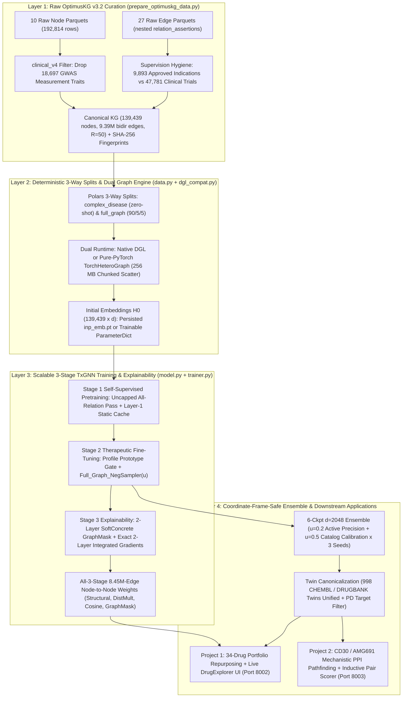
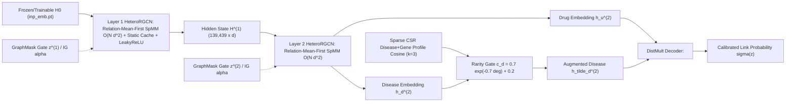

# OptimusKG-TxGNN (`clinical_v4`): System Design, Detailed Implementation & Verified Benchmarks

> [!IMPORTANT]
> **Platform Snapshot**:
> - **Curated Knowledge Graph (`clinical_v4`)**: `139,439` connected clinical nodes (`18,025` clinical diseases with `18,697` non-clinical GWAS measurement traits excluded prior to indexing; `18,640` drugs; `26,660` genes/proteins) and `4,692,768` forward edges (`9,385,536` bidirectional edges) across `R = 50` canonical directed relations, cleanly separating **`9,893` approved `indication` pairs** from **`47,781` `drug_clinical_trial` message-passing pairs**.
> - **Dual HeteroGraph Runtime (`dgl` + `torch`)**: Runs identically on native `DGL` ([`dgl_compat.py`](file:///home/nchen10/antigravity_prjs/kg/optimus_txgnn/dgl_compat.py)) and on a pure-PyTorch `TorchHeteroGraph` engine with adaptive `~256 MB` chunked autograd scatter ([`_ScatterAddFn`](file:///home/nchen10/antigravity_prjs/kg/optimus_txgnn/dgl_compat.py#L137-L245)), scaling from `d = 1024` (`105.0M` weights on `24 GB` RTX 4090) to `d = 2048` (`419.7M` weights) and `d = 3072..5120` (up to `3.34B` parameters on `96 GB` Google Colab G4 Blackwell).
> - **Production Checkpoints & 6-Checkpoint Ensemble**:
>   - `d = 2048` 6-Checkpoint Ensemble (`u = 0.2 + u = 0.5` across seeds `[42, 1, 2]`, `2.52B` total GNN weights): **`0.4055` AUPRC** on `207` held-out diseases across `5,297` shared DrugBank drugs (`+0.1899 [+0.1236, +0.2542]` over official Google Drive TxGNN `0.2156`, `3/3` seeds `> 0`) and **`0.3107` Own-Test Indication AUPRC** (`0.3717` Contraindication AUPRC).
>   - [model_ckpt_d2048](file:///home/nchen10/antigravity_prjs/kg/model_ckpt_d2048) (`419.7M` weights, `u = 0.2`, `s42`): 45-entry full GNN + 2-layer `GraphMask` + 16-pair 2-layer IG + All-3-Stage `8.45M`-edge weight bundle.
>   - [model_ckpt](file:///home/nchen10/antigravity_prjs/kg/model_ckpt) (`105.0M` weights, `d = 1024`, `u = 0.2`, `s42`): 40-entry workstation baseline bundle.

---

## 1. End-to-End System Architecture

### 1.1 Two-Layer Forward Pass, Prototype Augmentation & Attribution Dataflow

---

## 2. Knowledge Graph Curation (`clinical_v4`) & Engineering Fixes

Before `clinical_v4`, exploratory runs (`balanced`, `balanced_v2`, `clinical_v3`) revealed eight foundational data and modeling pitfalls (documented historically in [IMPLEMENTATION_PLAN_v3.md](file:///home/nchen10/antigravity_prjs/kg/docs/archive/IMPLEMENTATION_PLAN_v3.md)). Every pitfall was resolved systematically in [prepare_optimuskg_data.py](file:///home/nchen10/antigravity_prjs/kg/prepare_optimuskg_data.py) and `optimus_txgnn/`:

| Engineering Issue Discovered | Root Cause in Raw Data / Upstream TxGNN | Production Fix in `clinical_v4` & `optimus_txgnn` |
| :--- | :--- | :--- |
| **1. Non-Clinical GWAS Trait Contamination** | `18,697 / 36,753` (`50.9%`) disease rows in raw OptimusKG were `EFO_0001444` / `OBA_` lab or anthropometric measurements (e.g., *BMI*, *platelet count*). | [`load_all_nodes`](file:///home/nchen10/antigravity_prjs/kg/prepare_optimuskg_data.py#L167-L298) excludes all `18,697` measurement nodes **prior to node indexing** (`active_measurement_diseases = 0`). |
| **2. Clinical Trial Label Noise (`80.6%` Unapproved)** | Raw `drug_disease.parquet` nested unapproved Open Targets `Phase I–III` trials inside `INDICATION` (`46,888 / 58,171` edges). | [`load_and_map_edges`](file:///home/nchen10/antigravity_prjs/kg/prepare_optimuskg_data.py#L301-L853) restricts `indication` to **`9,893` approved pairs** (DrugCentral + non-umbrella Phase 4) and routes **`47,781` unapproved trial pairs** to `drug_clinical_trial` (message passing only). |
| **3. Unpersisted Random $H^{(0)}$ Coordinate Drift** | Upstream TxGNN never saved frozen Xavier node features `G.nodes[*].data['inp']`; reloading `model.pt` drew fresh random $H^{(0)}$, scrambling rankings (e.g., Inebilizumab NMO rank `#7` $\to$ `#14,459`). | [`OptimusTxGNN.save_model`](file:///home/nchen10/antigravity_prjs/kg/optimus_txgnn/trainer.py#L2132-L2213) persists `inp_emb.pt` (`inp_emb_bf16.pt`), and [`load_pretrained`](file:///home/nchen10/antigravity_prjs/kg/optimus_txgnn/trainer.py#L2314-L2404) enforces strict reload (`max_diff < 1e-6`) + `node_fingerprint` verification. |
| **4. Stage-1 Pretraining Step Starvation** | Large `200k` batches with a `50`-step cap gave only `100` gradient updates instead of `~8,250` updates per epoch. | [`_epoch_steps`](file:///home/nchen10/antigravity_prjs/kg/optimus_txgnn/trainer.py#L87-L129) partitions all `8,447,182` directed training edges **without replacement** (`8,250` steps/epoch at `batch_size = 1,024`). |
| **5. Prototype Train Self-Leakage** | Including `sim(d, d) = 1.0` during Stage-2 training allowed seen diseases to copy themselves instead of learning neighbor aggregation. | [`DistMultPredictor`](file:///home/nchen10/antigravity_prjs/kg/optimus_txgnn/model.py#L100-L590) masks diagonal self-similarity to $-\infty$ during `train` while preserving self-support during `eval`. |
| **6. Unsampled Zero-Indication Drug Inflation** | Standard `fix_dst` samples negative drugs proportionally to `indication` degree, **never** sampling the `15,287 / 18,640` compounds with zero approved indications. | [`Full_Graph_NegSampler`](file:///home/nchen10/antigravity_prjs/kg/optimus_txgnn/trainer.py#L132-L185) introduces `mixed_dst` with uniform mixing rate $u \in [0, 1]$ (`u = 0.2` active precision; `u = 0.5` full-catalog calibration). |
| **7. Re-initialized Non-DD `w_rels` in Stage 2** | Stage 2 re-initializes `w_rels` and trains only the 6 drug–disease relations, leaving the 44 biological relation weights untrained in `model.pt`. | [`OptimusTxGNN.finetune`](file:///home/nchen10/antigravity_prjs/kg/optimus_txgnn/trainer.py#L811-L1290) snapshots `w_rels_pretrain` before Stage 2 and restores them when computing Stage-2 biological DistMult scores in [`RunRecorder.distmult_edge_scores`](file:///home/nchen10/antigravity_prjs/kg/optimus_txgnn/capture.py#L100-L858). |
| **8. `(CHEMBL*, DRUGBANK:*)` Biologic Twin Split** | `998` drugs (especially mAbs lacking small-molecule InChIKeys) have ChEMBL targets/trials on `CHEMBL*` and DrugCentral labels on `DRUGBANK:*`. | Resolved across [`predict_repurpose.py`](file:///home/nchen10/antigravity_prjs/kg/predict_repurpose.py#L35-L94), [`explain_pair.py`](file:///home/nchen10/antigravity_prjs/kg/explain_pair.py#L40-L70), [`export_colab_deployment_bundle.py`](file:///home/nchen10/antigravity_prjs/kg/export_colab_deployment_bundle.py#L145-L162), and [`CanonicalCatalog`](file:///home/nchen10/cursor_prjs/txgnn/optimuskg_d2048/common/optimus_kg_loader.py#L146-L214). |

### 2.1 Connected Node Census (`139,439` Entities Across 10 Node Types)

Verified against [dataset_summary.json](file:///home/nchen10/antigravity_prjs/kg/data_optimuskg/clinical_v4/dataset_summary.json) (`node_fingerprint = c7a55f328b0df1abe518f8a3bc9afcdfd1984c0513acbe64d48cf52716b83510`):

| OptimusKG Raw Parquet | TxGNN `node_type` | Raw Rows | Connected Nodes in `clinical_v4` | Primary ID Namespace |
| :--- | :--- | ---: | ---: | :--- |
| `gene.parquet` | `gene/protein` | `61,307` | **`26,660`** | `ENSG` ↔ HGNC Symbol |
| `bioprocess.parquet` | `biological_process` | `25,754` | **`25,754`** | `GO` (Biological Process) |
| `phenotype.parquet` | `effect/phenotype` | `19,341` | **`19,341`** | `HP` (Human Phenotype Ontology) |
| `drug.parquet` | `drug` | `18,640` | **`18,640`** | `CHEMBL*` ↔ `DRUGBANK:DB*` (`6,605` mapped; `998` name-twins) |
| `disease.parquet` | `disease` | `36,753` | **`18,025`** | `MONDO`, `EFO`, `Orphanet`, `DOID` (`100%` clinical) |
| `anatomy.parquet` | `anatomy` | `13,120` | **`13,120`** | `UBERON`, `CL` |
| `molfunc.parquet` | `molecular_function` | `10,161` | **`10,161`** | `GO` (Molecular Function) |
| `cellcomp.parquet` | `cellular_component` | `4,052` | **`4,052`** | `GO` (Cellular Component) |
| `pathway.parquet` | `pathway` | `2,805` | **`2,805`** | `R-HSA` (Reactome) |
| `exposure.parquet` | `exposure` | `881` | **`881`** | `ECTO`, `CHEBI`, `MESH` |
| **Total** | **10 Node Types** | **`192,814`** | **`139,439`** | 0-based `node_idx` per `node_type` (sorted `node_id`) |

### 2.2 Canonical Directed Relations (`R = 50`) & Deterministic 3-Way Splits

- **Therapeutic Supervision Relations (`6` directed triplets: forward + `rev_*`)**:
  - `indication`: **`9,893` approved pairs** (`3,353` drugs × `1,267` clinical diseases).
  - `contraindication`: **`11,673` pairs** (`1,300` drugs).
  - `off-label use`: **`1,030` pairs** (`493` drugs).
- **Clinical-Trial Message-Passing Relation (`2` directed triplets: `drug_clinical_trial` / `rev_drug_clinical_trial`)**:
  - **`47,781` pairs** from unapproved Open Targets `Phase < 4` clinical trials, strictly deduplicated against `(indication, contraindication, off-label use)`.
- **Biological Context Relations (`42` directed triplets)**: Including `drug_drug` (`1,345,373`), `anatomy_protein_present` (`948,123`), `phenotype_protein` (`793,279`), `disease_protein` (`451,021`, filtered at `score >= 0.4` + top-15 per disease), `protein_protein` (`327,924`), `bioprocess_protein` (`158,410`), `disease_phenotype_positive` (`157,144`), `cellcomp_protein` (`105,309`), `molfunc_protein` (`90,933`), `pathway_protein` (`46,977`), `drug_protein` (`36,611`), and `disease_disease` (`28,784`).
- **Leakage-Free 3-Way Splits ([`generate_splits_polars`](file:///home/nchen10/antigravity_prjs/kg/prepare_optimuskg_data.py#L912-L1180) & [split_fingerprints_reference.json](file:///home/nchen10/antigravity_prjs/kg/data_optimuskg/clinical_v4/split_fingerprints_reference.json))**:
  - `complex_disease` (`seeds = [42, 1, 2, 3, 4]`): Zero-shot disease-area holdout where test diseases have `0` training drug-disease edges (`7,789,444` train / `1,123,618` valid / `472,474` test directed rows on `s42`, `split_fingerprint = b5fcb49dec0eb4e0...`).
  - `full_graph` (`seeds = [42, 1, 2, 3, 4]`): Symmetric `90% / 5% / 5%` edge split with `0` reverse-edge leakage (`8,447,182` train / `469,188` valid / `469,166` test directed rows on `s42`, `split_fingerprint = e3c61a2450d5991d...`).

---

## 3. Detailed Codebase Implementation (`optimus_txgnn/` & Root Tools)

### 3.1 Core Library Modules (`optimus_txgnn/`)

| Module (`Lines`) | Key Classes & Functions | Implementation Details |
| :--- | :--- | :--- |
| [dgl_compat.py](file:///home/nchen10/antigravity_prjs/kg/optimus_txgnn/dgl_compat.py) (`786`) | [`get_graph_backend`](file:///home/nchen10/antigravity_prjs/kg/optimus_txgnn/dgl_compat.py#L54-L81), [`set_graph_backend`](file:///home/nchen10/antigravity_prjs/kg/optimus_txgnn/dgl_compat.py#L84-L91), [`_ScatterAddFn`](file:///home/nchen10/antigravity_prjs/kg/optimus_txgnn/dgl_compat.py#L137-L245), [`TorchRelationSubgraph`](file:///home/nchen10/antigravity_prjs/kg/optimus_txgnn/dgl_compat.py#L332-L431), `TorchHeteroGraph` | Dual-backend heterograph layer. When `OPTIMUS_GRAPH_BACKEND=torch`, executes relation message passing via `_ScatterAddFn` in adaptive `~256 MB` edge chunks (`_adaptive_edge_chunk`), avoiding multi-GB `(E_r, d)` buffers on PyTorch `2.x` / CUDA `12–13` without DGL wheels. |
| [data.py](file:///home/nchen10/antigravity_prjs/kg/optimus_txgnn/data.py) (`311`) | [`create_dgl_graph_fast`](file:///home/nchen10/antigravity_prjs/kg/optimus_txgnn/data.py#L21-L49), [`compute_node_fingerprint_from_kg`](file:///home/nchen10/antigravity_prjs/kg/optimus_txgnn/data.py#L52-L75), [`OptimusTxData`](file:///home/nchen10/antigravity_prjs/kg/optimus_txgnn/data.py#L78-L311) | Polars-accelerated loader (`~2 s` split regeneration on NVMe), canonical `R = 50` graph builder, clinical disease mask loader, and SHA-256 `node_fingerprint` / `split_fingerprint` verifier. |
| [model.py](file:///home/nchen10/antigravity_prjs/kg/optimus_txgnn/model.py) (`1,476`) | [`build_sparse_node_similarity`](file:///home/nchen10/antigravity_prjs/kg/optimus_txgnn/model.py#L43-L86), [`DistMultPredictor`](file:///home/nchen10/antigravity_prjs/kg/optimus_txgnn/model.py#L100-L590), [`HeteroRGCNLayer`](file:///home/nchen10/antigravity_prjs/kg/optimus_txgnn/model.py#L599-L1016), [`AttHeteroRGCNLayer`](file:///home/nchen10/antigravity_prjs/kg/optimus_txgnn/model.py#L1019-L1108), [`HeteroRGCN`](file:///home/nchen10/antigravity_prjs/kg/optimus_txgnn/model.py#L1111-L1476) | 2-layer heterogeneous R-GCN (`TxGNN`, `GNN`, `TxGAT`) with relation-mean-first SpMM, Layer-1 static neighbor-mean cache, sparse CSR disease+gene profile similarity, `--trainable_node_emb`, `--grad_checkpoint`, differentiable `edge_mask` (for IG), and `graphmask_forward`. |
| [trainer.py](file:///home/nchen10/antigravity_prjs/kg/optimus_txgnn/trainer.py) (`2,430`) | [`_epoch_steps`](file:///home/nchen10/antigravity_prjs/kg/optimus_txgnn/trainer.py#L87-L129), [`Full_Graph_NegSampler`](file:///home/nchen10/antigravity_prjs/kg/optimus_txgnn/trainer.py#L132-L185), [`OptimusTxGNN`](file:///home/nchen10/antigravity_prjs/kg/optimus_txgnn/trainer.py#L292-L2430) | Stage-1 pretraining, Stage-2 fine-tuning (`mixed_dst` with `u`, validation-only `dc_auprc` selection & LR scheduling), `bf16`/`fp16` AMP, Stage-3 `GraphMask` Lagrangian training + faithfulness/stability evaluation, and strict `inp_emb.pt` checkpoint persistence. |
| [evaluator.py](file:///home/nchen10/antigravity_prjs/kg/optimus_txgnn/evaluator.py) (`581`) | [`compute_degree_baseline_scores`](file:///home/nchen10/antigravity_prjs/kg/optimus_txgnn/evaluator.py#L46-L57), [`compute_disease_centric_fast`](file:///home/nchen10/antigravity_prjs/kg/optimus_txgnn/evaluator.py#L60-L401), [`OptimusTxEval`](file:///home/nchen10/antigravity_prjs/kg/optimus_txgnn/evaluator.py#L404-L462), [`compare_disease_centric_runs`](file:///home/nchen10/antigravity_prjs/kg/optimus_txgnn/evaluator.py#L512-L581) | Vectorized GPU `float32` disease-centric ranking (`AUROC`, `AUPRC`, `MRR`, `Recall@{10,20,50,100}`), degree baseline, and cryptographic paired-run digest verification. |
| [graphmask.py](file:///home/nchen10/antigravity_prjs/kg/optimus_txgnn/graphmask.py) (`236`) | [`MultipleInputsLayernormLinear`](file:///home/nchen10/antigravity_prjs/kg/optimus_txgnn/graphmask.py#L26-L85), [`SoftConcrete`](file:///home/nchen10/antigravity_prjs/kg/optimus_txgnn/graphmask.py#L88-L143), [`LagrangianOptimization`](file:///home/nchen10/antigravity_prjs/kg/optimus_txgnn/graphmask.py#L180-L236) | Node-projected relation-specific LayerNorm gate MLPs (`O(N d)` vs `O(E d)` memory), deterministic stretched-sigmoid gate (`loc_bias = 1.5`), and Lagrangian sparsity optimization. |
| [explain.py](file:///home/nchen10/antigravity_prjs/kg/optimus_txgnn/explain.py) (`671`) | [`compute_pair_logit_with_masks`](file:///home/nchen10/antigravity_prjs/kg/optimus_txgnn/explain.py#L20-L36), [`integrated_gradients_pair`](file:///home/nchen10/antigravity_prjs/kg/optimus_txgnn/explain.py#L39-L198), [`enumerate_layer_aware_paths`](file:///home/nchen10/antigravity_prjs/kg/optimus_txgnn/explain.py#L201-L552), [`explain_drug_disease_pair`](file:///home/nchen10/antigravity_prjs/kg/optimus_txgnn/explain.py#L555-L671) | Simultaneous 2-layer Riemann midpoint Integrated Gradients (`0.02%–0.33%` completeness error) and loop-free `2hop_L2_L2`, `3hop_L2_L1_L2`, `3hop_mirror_L2_L1_L2`, and `proto` path ranking. |
| [capture.py](file:///home/nchen10/antigravity_prjs/kg/optimus_txgnn/capture.py) (`858`) | [`compute_layer_edge_terms`](file:///home/nchen10/antigravity_prjs/kg/optimus_txgnn/capture.py#L33-L97), [`RunRecorder`](file:///home/nchen10/antigravity_prjs/kg/optimus_txgnn/capture.py#L100-L858) | Streamed (`< 6 GB` VRAM at `d = 2048..5120`) exporter of normalized `edge_uid` (`0..8,447,181`) node/edge tables and Stage-1/Stage-2/Stage-3 `edge_weights/*.parquet`. |
| [intermediates.py](file:///home/nchen10/antigravity_prjs/kg/optimus_txgnn/intermediates.py) (`625`) | [`build_node_idx_to_id_and_name`](file:///home/nchen10/antigravity_prjs/kg/optimus_txgnn/intermediates.py#L25-L77), [`IntermediateResultsExporter`](file:///home/nchen10/antigravity_prjs/kg/optimus_txgnn/intermediates.py#L80-L625) | TxGNN Explorer schema-compatible exporter (`node_emb.pkl`, `name_mapping.pkl`, `drug_id.pkl`, `graphmask_output_indication.pkl`, `attention_output_indication.pkl`, `sim_diseases.pkl`). |
| [runlog.py](file:///home/nchen10/antigravity_prjs/kg/optimus_txgnn/runlog.py) (`316`) | [`set_seed`](file:///home/nchen10/antigravity_prjs/kg/optimus_txgnn/runlog.py#L22-L37), [`compute_split_hashes`](file:///home/nchen10/antigravity_prjs/kg/optimus_txgnn/runlog.py#L52-L70), [`verify_clean_same_split_pretrain_source`](file:///home/nchen10/antigravity_prjs/kg/optimus_txgnn/runlog.py#L89-L161), [`write_manifest`](file:///home/nchen10/antigravity_prjs/kg/optimus_txgnn/runlog.py#L201-L316) | Deterministic RNG seeding, SHA-256 split fingerprinting, Stage-1 cross-split contamination guard, and `manifest.json` provenance logging. |

### 3.2 Root CLI & Cloud Orchestration Scripts (`12` Active Entrypoints)

| Script (`Lines`) | Role |
| :--- | :--- |
| [prepare_optimuskg_data.py](file:///home/nchen10/antigravity_prjs/kg/prepare_optimuskg_data.py) (`1,619`) | Raw OptimusKG v3.2 Parquet $\to$ `clinical_v4` CSVs, metadata Parquets, and 3-way splits. |
| [train_optimus_txgnn.py](file:///home/nchen10/antigravity_prjs/kg/train_optimus_txgnn.py) (`610`) | Primary training, Stage-1 reuse, validation selection, `GraphMask`, and export CLI. |
| [predict_repurpose.py](file:///home/nchen10/antigravity_prjs/kg/predict_repurpose.py) (`366`) | Single-drug clinical disease ranking CLI with `CHEMBL*` priority & automatic `(CHEMBL*, DRUGBANK:*)` twin unification. |
| [explain_pair.py](file:///home/nchen10/antigravity_prjs/kg/explain_pair.py) (`191`) | Pairwise 2-layer Integrated Gradients + `GraphMask` path explanation CLI. |
| [export_stage1_edge_weights.py](file:///home/nchen10/antigravity_prjs/kg/export_stage1_edge_weights.py) (`225`) | Reconstructs pure Stage-1 (`*_pretrain_end.parquet`) `8.45M`-edge weights from `model_pretrain.pt` + `inp_emb.pt`. |
| [export_intermediates.py](file:///home/nchen10/antigravity_prjs/kg/export_intermediates.py) (`155`) | Standalone `GraphMask` + `IntermediateResultsExporter` CLI for `d = 1024` runs. |
| [run_colab_preset.py](file:///home/nchen10/antigravity_prjs/kg/run_colab_preset.py) (`511`) | Hardware/width preset launcher (`g4_96gb_d1024_stack_control`, `g4_96gb_d2048_width_match`, `g4_96gb_d3072_width_match`, up to `d = 5120`). |
| [run_colab_campaign.py](file:///home/nchen10/antigravity_prjs/kg/run_colab_campaign.py) (`676`) | Unattended local-NVMe multi-run campaign queue with preempt-safe Stage-1 Google Drive backup & quota-aware sync. |
| [evaluate_colab_benchmarks.py](file:///home/nchen10/antigravity_prjs/kg/evaluate_colab_benchmarks.py) (`495`) | Symmetric `207`-disease head-to-head bootstrap evaluator against [drive_txgnn_eval_compact.npz](file:///home/nchen10/antigravity_prjs/kg/data_optimuskg/clinical_v4/drive_txgnn_eval_compact.npz) & leaderboard builder. |
| [export_colab_deployment_bundle.py](file:///home/nchen10/antigravity_prjs/kg/export_colab_deployment_bundle.py) (`797`) | Memory-optimized 45-entry deployment exporter (`GraphMask`, Explorer `.pkl`s, 14 repurposing CSVs, 16 IG explanations) for `d = 2048+`. |
| [package_for_colab.py](file:///home/nchen10/antigravity_prjs/kg/package_for_colab.py) (`646`) | Packages [colab_upload/](file:///home/nchen10/antigravity_prjs/kg/colab_upload) (`~60 MB`) and verifies `pytest` inside an isolated `OPTIMUS_GRAPH_BACKEND=torch` sandbox. |
| [build_colleague_share_bundle.py](file:///home/nchen10/antigravity_prjs/kg/build_colleague_share_bundle.py) (`655`) | Builds the zero-symlink [share_google_drive_optimuskg_d2048/](file:///home/nchen10/antigravity_prjs/kg/share_google_drive_optimuskg_d2048) bundle + `8,447,182 × 28` 3-stage edge weight master Parquet. |

---

## 4. Exact Mathematical Formulation

### 4.1 Relation-Mean-First `HeteroRGCNLayer` & Static Neighbor-Mean Caching

For node type $\tau$ of size $N_\tau$, initial embeddings are drawn via Xavier-uniform $H_\tau^{(0)} \sim \mathcal{U}(-\sqrt{6/(N_\tau + d)}, \sqrt{6/(N_\tau + d)})$ and persisted to `inp_emb.pt`. At layer $l \in \{1, 2\}$, [`HeteroRGCNLayer`](file:///home/nchen10/antigravity_prjs/kg/optimus_txgnn/model.py#L599-L1016) rewrites the R-GCN update by linearity:

$$\bar{h}_{v, r}^{(l-1)} = \frac{1}{|\mathcal{N}_r^{\text{in}}(v)|} \sum_{u \in \mathcal{N}_r^{\text{in}}(v)} h_u^{(l-1)}, \qquad z_v^{(l)} = \sum_{r \in \mathcal{R}_{\text{in}}(v)} \mathbb{I}\!\big[|\mathcal{N}_r^{\text{in}}(v)| > 0\big] \Big(W_r^{(l)} \bar{h}_{v, r}^{(l-1)} + b_r^{(l)}\Big)$$

with $h_v^{(1)} = \text{LeakyReLU}_{0.01}(z_v^{(1)})$ and $h_v^{(2)} = z_v^{(2)}$.
1. **Projection Complexity `O(N d^2)` vs. `O(E d^2)`**: Evaluating $W_r^{(l)}$ after neighbor averaging multiplies $N_{\tau_d} \le 26,660$ rows instead of $E_r \le 1,345,373$ edges.
2. **Layer-1 Static Cache (`cache_static_input = True`)**: When `trainable_node_emb = False`, $\bar{h}_{v, r}^{(0)}$ is invariant across training steps and cached after step 1, eliminating **100% of Layer-1 sparse message passing** while keeping gradients wrt $W_r^{(1)}, b_r^{(1)}$ bit-identical.

### 4.2 Disease Profile Prototype Gate & `DistMultPredictor`

In [`DistMultPredictor`](file:///home/nchen10/antigravity_prjs/kg/optimus_txgnn/model.py#L100-L590), binary 1-hop indicators over `disease_disease`, `rev_disease_disease`, `disease_protein`, and `rev_disease_protein` form $P \in \{0, 1\}^{N_{\text{dis}} \times (N_{\text{dis}} + N_{\text{gene}})}$, row-$L_2$-normalized to $S = \hat{P}\hat{P}^\top$. With self-similarity masked during training (`mode == "train"`), the top-$k$ ($k = 3$) treated neighbor diseases $\mathcal{N}_k^{\text{sim}}(d, r)$ yield:

$$h_{d, r}^{\text{proto}} = \sum_{d' \in \mathcal{N}_k^{\text{sim}}(d, r)} \frac{\text{sim}(d, d')}{\sum_{j \in \mathcal{N}_k^{\text{sim}}(d, r)} \text{sim}(d, j)} \, h_{d'}^{(2)}, \qquad c_{d, r} = 0.7 \exp\!\big(-0.7 \cdot \text{deg}_{\text{train}}(d, r)\big) + 0.2$$

$$\tilde{h}_{d, r}^{(2)} = c_{d, r} \, h_{d, r}^{\text{proto}} + (1 - c_{d, r}) \, h_d^{(2)}, \qquad z(u, r, d) = \langle h_u^{(2)}, w_r, \tilde{h}_{d, r}^{(2)} \rangle, \qquad p(u, r, d) = \sigma\!\big(z(u, r, d)\big)$$

### 4.3 All-3-Stage Node-to-Node Edge Weights (`8,447,182` Directed Edges)

Every directed training edge $e = (u \xrightarrow{r} v)$ (`edge_uid = 0..8,447,181`) has model-faithful weights exported across all three stages:
1. **Structural Additive Contribution Share ([`compute_layer_edge_terms`](file:///home/nchen10/antigravity_prjs/kg/optimus_txgnn/capture.py#L33-L97), Stage 1 & Stage 2)**:
   For individual edge message $m_e^{(l)} = \frac{1}{|\mathcal{N}_r^{\text{in}}(v)|}(W_r^{(l)} h_u^{(l-1)} + b_r^{(l)})$ summing to $z_v^{(l)} = \sum_{e \in \mathcal{N}^{\text{in}}(v)} m_e^{(l)}$:

   $$\text{contrib\_share}_e^{(l)} = \frac{\langle m_e^{(l)}, z_v^{(l)} \rangle}{\|z_v^{(l)}\|_2^2 + 10^{-12}}, \qquad \sum_{e \in \mathcal{N}^{\text{in}}(v)} \text{contrib\_share}_e^{(l)} = 1$$

2. **Learned 2-Layer `GraphMask` Sparsity Gates ([`SoftConcrete`](file:///home/nchen10/antigravity_prjs/kg/optimus_txgnn/graphmask.py#L88-L143), Stage 3)**:
   $$s_e^{(l)} = \sigma\!\big(g_r^{(l)}(h_u^{(l-1)}, m_e^{(l)}, h_v^{(l-1)}) + 1.5\big), \qquad z_e^{(l)} = \text{clamp}\!\big(1.2 \, s_e^{(l)} - 0.1,\; 0,\; 1\big) \in [0, 1]$$
   substituting gated messages $\tilde{m}_e^{(l)} = z_e^{(l)} m_e^{(l)} + (1 - z_e^{(l)}) \beta_r^{(l)}$ under Lagrangian MSE constraint $\le 0.005$.

3. **Query-Specific 2-Layer Integrated Gradients ([`integrated_gradients_pair`](file:///home/nchen10/antigravity_prjs/kg/optimus_txgnn/explain.py#L39-L198))**:
   Scales all Layer-1 and Layer-2 edge messages simultaneously by $\alpha \in (0, 1]$ across $M$ midpoint Riemann steps, satisfying exact completeness $\sum_e (\text{IG}_e^{(1)} + \text{IG}_e^{(2)}) = F(1, 1) - F(0, 0)$ within `0.02%–0.33%` empirical error.

---

## 5. Verified Empirical Benchmarks & Scaling Laws

### 5.1 Zero-Shot `complex_disease` (`5` Seeds `[42, 1, 2, 3, 4]` at `d = 1024`)

From [ablation_v4_stage2_2x2_summary.json](file:///home/nchen10/antigravity_prjs/kg/runs/ablation_v4_stage2_2x2_summary.json) (comparing clean `clinical_v4` against `clinical_v3` on identical held-out test diseases per seed):

| Stage-2 Recipe (`5-Seed Mean ± SD`) | Zero-Shot Indication `AUROC / AUPRC / R@50` | Zero-Shot Contraindication `AUROC / AUPRC / R@50` | Zero-Shot Off-Label `AUROC / AUPRC / R@50` | Primary Use Case |
| :--- | :---: | :---: | :---: | :--- |
| `clinical_v3` Baseline (`trial-mixed`) | `0.867 / 0.078 / 0.264` | `0.741 / 0.115 / 0.230` | `0.799 / 0.110 / 0.539` | Historical noisy-label baseline |
| **`fix_nodeg` (`u = 0.0`, deg OFF)** | **`0.870` / `0.136` (`+0.058`, `5/5`) / `0.321`** | **`0.724` / `0.123` / `0.248`** | **`0.826` / `0.145` (`5/5`) / `0.579`** | **Best overall zero-shot AUROC & Off-label** |
| **`mixed_nodeg` (`u = 0.5`, deg OFF)** | `0.856` / **`0.151` (`+0.073`, `5/5`)** / **`0.347`** | `0.719 / 0.127 / 0.247` | `0.767 / 0.131 / 0.440` | **Highest zero-shot Indication AUPRC & R@50** |

### 5.2 `full_graph` Width Scaling (`d = 1024` $\to$ `d = 2048`), `u`-Calibration & 6-Checkpoint Ensemble (`Seeds [42, 1, 2]`)

Verified in [colab_g4_d2048_3seed_and_stack_control_summary.json](file:///home/nchen10/antigravity_prjs/kg/runs/colab_g4_d2048_3seed_and_stack_control_summary.json), [colab_g4_d2048_u50_vs_u20_3seed_summary.json](file:///home/nchen10/antigravity_prjs/kg/runs/colab_g4_d2048_u50_vs_u20_3seed_summary.json), and [colab_g4_d2048_6ckpt_ensemble_summary.json](file:///home/nchen10/antigravity_prjs/kg/runs/colab_g4_d2048_6ckpt_ensemble_summary.json):

| Model Family (`Seeds [42, 1, 2]`, `0%` Test Leakage) | Trainable GNN Params | Validation `dc_auprc` (`Ind / Macro`) | Own-Test (`3,353` Approved Drugs) `Ind AUROC / AUPRC / R@50` | Own-Test `Contra AUPRC` | Symmetric `207`-Disease Drive `test_agreed` (`5,297` Drugs) `AUPRC` (`Diff vs Drive [95% CI]`) | Doubly Held-Out Top-50 (`of 23`) |
| :--- | ---: | :---: | :---: | :---: | :---: | :---: |
| **Official Google Drive TxGNN (`d = 512`, PrimeKG)** | `26.3M` | — | — | — | `0.2156` *(baseline; `~94.6%` in Drive train!)* | `10 / 23` |
| **Shipped `d = 1024` `mixed20_nodeg` (`u = 0.2`)** | `105.0M` (`4.0×`) | `0.2279 / 0.3013` | `0.9664 / 0.2549 / 0.6701` | `0.3105` | `0.3006` (`+0.0850 [+0.0301, +0.1446]`, `1/3` seeds `>0`) | `15 / 23` |
| **Catalog `d = 1024` `mixed_nodeg` (`u = 0.5`)** | `105.0M` (`4.0×`) | `0.2089 / 0.2822` | `0.9612 / 0.2358 / 0.6577` | `0.2921` | `0.3517` (`+0.1361 [+0.0811, +0.1946]`, `3/3` seeds `>0`) | `17 / 23` |
| **Colab G4 `d = 2048` `wmatch_u20` (`u = 0.2`)** | `419.7M` (`16.0×`) | **`0.2879 / 0.3611`** | `0.9688 / 0.3075 / 0.7328` | `0.3635` | `0.3680` (`+0.1524 [+0.0903, +0.2188]`, `2/3` seeds `>0`) | `15 / 23` |
| **Colab G4 `d = 2048` `wmatch_u50` (`u = 0.5`)** | `419.7M` (`16.0×`) | `0.2752 / 0.3490` | `0.9650 / 0.2911 / 0.7180` | `0.3551` | `0.3935` (`+0.1784 [+0.1118, +0.2435]`, **`3/3` seeds `>0`**) | **`18 / 23`** |
| **6-Ckpt `d = 2048` Ensemble (`u = 0.2 + u = 0.5`)** | **`2,518.4M`** (`6 × 419.7M`) | **`0.2924` (`prob_w30`)** | **`0.9694 / 0.3107 / 0.7390`** (`0.3134` at `w30`) | **`0.3717`** | **`0.4055` (`+0.1899 [+0.1236, +0.2542]`, `3/3` seeds `>0`)** | **`18 / 23`** |

**Three Core Laws Established by Controlled Experiments**:
1. **Stack Invariance (`DGL 0.5.3` vs. `PyTorch 2.11 / torch` at `d = 1024`, `s42`)**: Same-seed stack control yields `+0.0123 [-0.0086, +0.0351]` own-test Indication AUPRC (statistically zero), proving that `d = 1024` $\to$ `d = 2048` gains (`+0.0580` Val Ind `dc_auprc`, `+0.0526` 3-seed Test Ind `AUPRC`) come purely from `4×` relation matrix capacity (`16×` Drive).
2. **`u = 0.2` vs. `u = 0.5` Complementarity & Why Probability Blending Wins Both Regimes**: `u = 0.2` optimizes precision among the `3,353` clinically active approved drugs (`0.3075` vs. `0.2911`), whereas `u = 0.5` suppresses false-positive logits among the `15,287` zero-indication compounds (`0.3935` vs. `0.3680` on the `5,297`-drug catalog). Averaging calibrated probabilities $0.5 \sigma(z_{u20}) + 0.5 \sigma(z_{u50})$ per seed simultaneously beats **both** single arms on Own-Test Indication AUPRC (`0.3107`), Contraindication AUPRC (`0.3717`), and `207`-disease full-catalog AUPRC (`0.4055`).
3. **2-Layer `GraphMask` Faithfulness at `d = 2048` (`u20_s42`)**: Soft-gating improves 1:1 test AUROC/AUPRC from `0.9247 / 0.9040` to **`0.9340 / 0.9165`**; hard-thresholding at $z^{(l)} \ge 0.5$ keeps only **`16.67%`** of Layer-1 and **`30.96%`** of Layer-2 edges while retaining **`0.8856` AUROC / `0.8706` AUPRC** (`96.3%` of unmasked AUPRC); dropping the top `10%` of edges collapses AUROC/AUPRC to **`0.5878 / 0.5757`**; Spearman gate rank stability under `1% / 5% / 10%` random graph perturbations is **`1.0000` (Layer 1)** and **`0.9998 / 0.9983 / 0.9957` (Layer 2)**.
