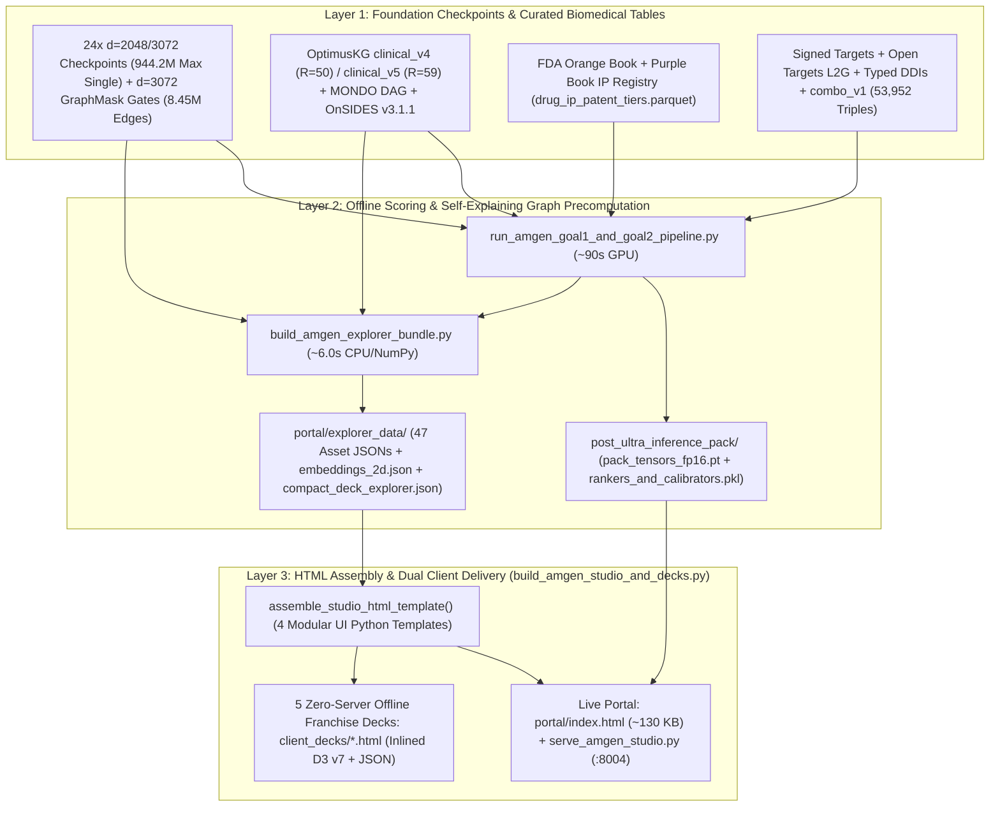
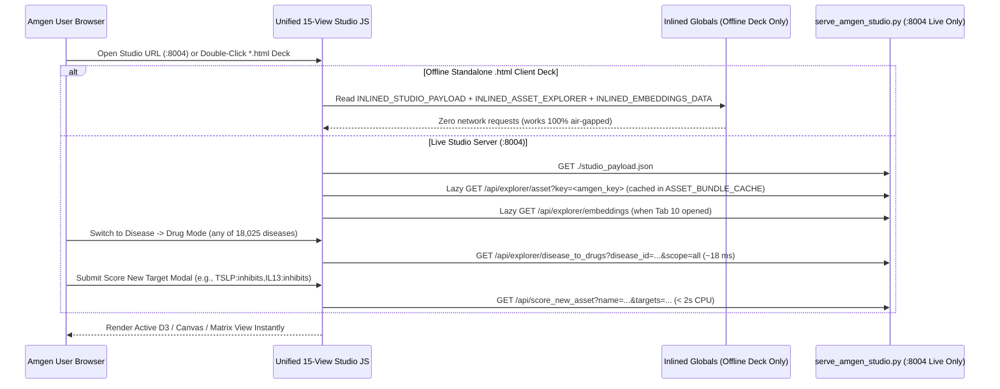
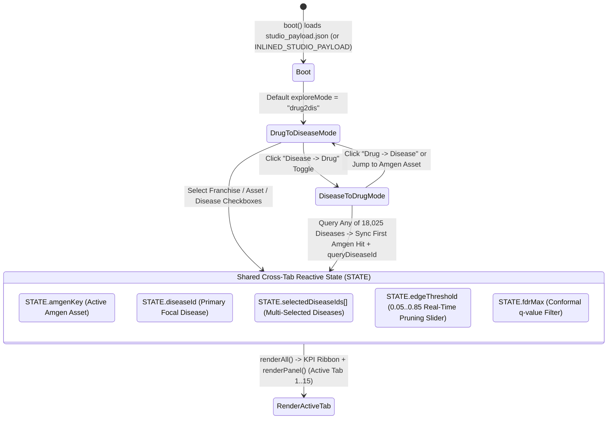

# Amgen Translational Discovery Studio & Self-Explaining KG Explorer: System Design & Complete 15-View Feature Manual

> [!IMPORTANT]
> **Application Snapshot (`v5.2` Pre-Presentation Audit Studio & Self-Explaining Explorer — synced with [`METRICS.md`](file:///home/nchen10/antigravity_prjs/kg/METRICS.md))**:
> - **Unified Coverage**: Covers **`47` Amgen commercial, biosimilar, Phase 1–3, and preclinical pipeline assets** across **`18,025` clinical diseases** (with `1–4` hop MONDO label-subtype + `786`-umbrella + MONDO near-duplicate deduplication + `OnSIDES v3.1.1` label-ADE hygiene), **`139,439` curated `clinical_v4` KG nodes** (`10` biological entity types, `50` canonical `clinical_v4` / `59` signed `clinical_v5` relations distilled from `192,813` raw `OptimusKG v3.2` nodes and `21.83M` raw rows), **`5,688` Tier-1 (`Amgen × Amgen`) + `5,688` Tier-2 (`Amgen × Off-Patent`) combination rows**, and **`0.96s` 4-family CPU inductive scoring** for confidential `AMG-XXXX` targets (**`78.23%` blinded `Hits@20`** overall [`n = 124`, `MedRank = 4.5`]; **`37.93%` `Hits@20`** on strictly novel zero-precedent target–indications [`n = 29`, `322×` random]).
> - **Complete Visual Synthesis**: Unifies every interactive capability from the legacy React/Flask [`DrugExplorer`](file:///home/nchen10/cursor_prjs/txgnn/drugExplorer/application.py), the multi-hop `visualization_dashboard.html` (`v1`–`v4`), and the `CD30` [`mechanism_explorer.html`](file:///home/nchen10/cursor_prjs/txgnn/optimuskg_d2048/cd30_pathfinding/visual_combi_demo/mechanism_explorer.html) into **one zero-build, single-page HTML5 + D3.js v7 + Canvas application** with **15 synchronized analytical views**.
> - **Dual Delivery Surfaces**:
>   1. **Live Interactive Server (`http://127.0.0.1:8004/`)** via [serve_amgen_studio.py](file:///home/nchen10/antigravity_prjs/kg/serve_amgen_studio.py): Serves [index.html](file:///home/nchen10/antigravity_prjs/kg/amgen_discovery_studio/portal/index.html) (`~130 KB`) with lazy per-asset JSON loading, `< 20 ms` live `Disease -> Drug` matrix projection across `9,856+` drugs, and `~1s` live 4-family `AMG-XXXX` target scoring.
>   2. **Zero-Server Standalone Franchise Client Decks** in [client_decks/](file:///home/nchen10/antigravity_prjs/kg/amgen_discovery_studio/client_decks): `5` self-contained `.html` files (`3.4 MB` to `27.9 MB`) with D3.js v7, `20,672` 2D embeddings, and per-asset `2–10` hop subgraphs inlined directly into the file so Amgen colleagues can double-click them from Outlook, Teams, or SharePoint with zero Python or network setup.

---

## Table of Contents

1. [Executive Purpose & Design Philosophy](#1-executive-purpose--design-philosophy)
2. [End-to-End System Architecture & Dual Delivery Modes](#2-end-to-end-system-architecture--dual-delivery-modes)
3. [Backend Data Pipeline & Mathematical Foundations](#3-backend-data-pipeline--mathematical-foundations)
4. [Frontend Reactive State Machine & Modular Code Layout](#4-frontend-reactive-state-machine--modular-code-layout)
5. [Global Application Shell: Header, KPI Ribbon, Modals & Left Sidebar](#5-global-application-shell-header-kpi-ribbon-modals--left-sidebar)
6. [Complete Tab-by-Tab Reference Manual (All 15 Views)](#6-complete-tab-by-tab-reference-manual-all-15-views)
   - [Tab 1 — `1. Goal 1 Waterfall` (Disease Repurposing Opportunity Waterfall)](#61-tab-1--1-goal-1-waterfall-disease-repurposing-opportunity-waterfall)
   - [Tab 2 — `2. Meta-Path` (Expandable Meta-Path Prototype Matrix)](#62-tab-2--2-meta-path-expandable-meta-path-prototype-matrix)
   - [Tab 3 — `3. Node Attention` (Dual Mirrored Hierarchical Attention Trees)](#63-tab-3--3-node-attention-dual-mirrored-hierarchical-attention-trees)
   - [Tab 4 — `4. Sub-Graph (Multi)` (Pinned Multi-Disease Force Network)](#64-tab-4--4-sub-graph-multi-pinned-multi-disease-force-network)
   - [Tab 5 — `5. Top Paths` (Top Ranked Mechanistic Paths)](#65-tab-5--5-top-paths-top-ranked-mechanistic-paths)
   - [Tab 6 — `6. All Paths (2–5 hop)` (Exhaustive Short/Medium Cascade Explorer)](#66-tab-6--6-all-paths-25-hop-exhaustive-shortmedium-cascade-explorer)
   - [Tab 7 — `7. All Paths (10-hop & MoA)` (4-Mode Deep Signaling & MoA Cascade Explorer)](#67-tab-7--7-all-paths-10-hop--moa-4-mode-deep-signaling--moa-cascade-explorer)
   - [Tab 8 — `8. Node_Attention` (2-Layer `GraphMask` Gate Breakdown & Bar Chart)](#68-tab-8--8-node_attention-2-layer-graphmask-gate-breakdown--bar-chart)
   - [Tab 9 — `9. Sub_Graph (Zoom)` (Shortest-Path Focused Sub-Graph with Zoom & Labels)](#69-tab-9--9-sub_graph-zoom-shortest-path-focused-sub-graph-with-zoom--labels)
   - [Tab 10 — `10. Disease Embeddings` (2048-D Latent Manifold Explorer with Lasso Selection)](#610-tab-10--10-disease-embeddings-2048-d-latent-manifold-explorer-with-lasso-selection)
   - [Tab 11 — `11. Signed Genetics Capsules` (Signed Target + Open Targets `L2G` Capsule Chains)](#611-tab-11--11-signed-genetics-capsules-signed-target--open-targets-l2g-capsule-chains)
   - [Tab 12 — `12. Goal 2: IP-Smart Combos` (Commercial Tier 1/2/3 Combination Ranking)](#612-tab-12--12-goal-2-ip-smart-combos-commercial-tier-123-combination-ranking)
   - [Tab 13 — `13. Goal 2: Dual-Drug Network` (Split-Source Mechanistic Rescue Graph)](#613-tab-13--13-goal-2-dual-drug-network-split-source-mechanistic-rescue-graph)
   - [Tab 14 — `14. All-47 Portfolio Matrix` (Executive Cross-Franchise Opportunity Matrix)](#614-tab-14--14-all-47-portfolio-matrix-executive-cross-franchise-opportunity-matrix)
   - [Tab 15 — `15. Validation & Benchmarks` (Raw vs. Calibrated & 207-Disease Holdout Audit)](#615-tab-15--15-validation--benchmarks-raw-vs-calibrated--207-disease-holdout-audit)
7. [REST API Specification & Operational Runbook](#7-rest-api-specification--operational-runbook)

---

## 1. Executive Purpose & Design Philosophy

Translational drug discovery teams evaluating model predictions ask four sequential questions before advancing a hypothesis to wet-lab or clinical review:

1. **Statistical Prioritization (*What* ranks highest, and is it calibrated?)**: Which novel indications (Goal 1) or combination regimens (Goal 2) remain statistically significant after removing hub-disease logit inflation and controlling False Discovery Rate (`FDR`)?
2. **Self-Explaining Graph Causality (*Why* did the GNN predict this pair?)**: Which exact molecular relations, intermediate proteins, pathways, biological processes, and anatomical tissues carry the highest learned `GraphMask` Layer-1/Layer-2 message-passing weights between the drug and the disease?
3. **Human Genetic & Commercial Grounding (*Is the direction right, and is it actionable?*)**: Does the drug's pharmacological action (`inhibits` vs. `activates` vs. `binds`) align with Open Targets Locus-to-Gene (`L2G`) human genetics, and for combinations, is the partner drug an **internal Amgen asset (Tier 1)** or an **off-patent FDA generic/biosimilar (Tier 2)** with low acquisition cost and clean DrugBank DDI safety?
4. **Portfolio Agility (*What about a new target tomorrow?*)**: Can an internal scientist test a confidential `AMG-XXXX` single-target or bispecific signature on demand without spinning up a `96 GB` GPU?

The **Amgen Translational Discovery Studio** was architected so a user never has to switch between separate tools, scripts, or notebooks to answer these four questions. Selecting an asset or disease once in the left sidebar synchronizes all **15 views**, from statistical waterfalls down to `10`-hop signaling cascades, `20,672`-node latent embedding maps, and dual-drug synergy networks.

---

## 2. End-to-End System Architecture & Dual Delivery Modes

### 2.1 Artifact Generation & Runtime Architecture



### 2.2 Live Portal (`:8004`) vs. Zero-Server Offline Client Decks

Both surfaces run the **exact same HTML/CSS/JS codebase** assembled by [`assemble_studio_html_template`](file:///home/nchen10/antigravity_prjs/kg/build_amgen_studio_and_decks.py#L35-L45); only the data-fetching transport differs automatically at runtime:



| Capability | Live Web Portal (`http://127.0.0.1:8004/`) | Standalone `.html` Client Decks (`client_decks/*.html`) |
| :--- | :--- | :--- |
| **Setup Required** | Python daemon (`serve_amgen_studio.py --port 8004`) | **None** — double-click in Chrome/Edge/Safari from email or SharePoint |
| **External CDN Dependency** | Local `/vendor/d3.v7.min.js` fallback | **Zero** — full `d3.v7.min.js` (`~280 KB`) inlined inside `<script>` |
| **All 15 Tabs & Multi-Hop Paths** | Full `2–10` hop bundle per asset via `/api/explorer/asset` | Full `2–10` hop bundle inlined per franchise (`INLINED_ASSET_EXPLORER`) |
| **20,672-Node Embedding Map** | Lazy-loaded via `/api/explorer/embeddings` | Inlined directly (`INLINED_EMBEDDINGS_DATA`) |
| **`Disease -> Drug` Mode** | Live exact projection across **all `18,025` diseases $\times$ `9,856+` drugs** (`~18 ms`) | Offline fallback across precomputed portfolio predictions & FDA known drugs |
| **`⚡ Score New Target` Modal** | Live `< 2s` CPU inductive scoring via `/api/score_new_asset` | Displays the exact CLI command to run locally |

The 5 generated standalone decks in [client_decks/](file:///home/nchen10/antigravity_prjs/kg/amgen_discovery_studio/client_decks) are partitioned by therapeutic franchise so stakeholders receive compact, focused deliverables:
1. [Amgen_Executive_Full_Portfolio_Deck.html](file:///home/nchen10/antigravity_prjs/kg/visualization_studio/Full_Portfolio_47_Assets_Discovery_Portal.html) (`47` assets, `27.86 MB`)
2. `Oncology_Hematology_Client_Deck.html` (`14` assets, `8.56 MB`)
3. `Inflammation_Immunology_Client_Deck.html` (`9` assets, `7.38 MB`)
4. `Cardiometabolic_Obesity_Client_Deck.html` (`6` assets, `3.44 MB`)
5. `Rare_Bone_Neuro_Biosimilars_Client_Deck.html` (`18` assets, `13.75 MB`)

---

## 3. Backend Data Pipeline & Mathematical Foundations

Every number, bar, node border, edge thickness, and path rank rendered in the UI is backed by an explicit mathematical definition computed in Python and stored in deterministic JSON/Parquet schemas.

### 3.1 Self-Explaining Edge Score (`GraphMask` + Latent Cosine Alignment)

Implemented in [`build_explorer_bundle`](file:///home/nchen10/antigravity_prjs/kg/build_amgen_explorer_bundle.py#L228-L328) using `stage3_explanation_edge_weights.parquet` (`8,446,982` forward biological edges):

For each directed biological edge $e = (u \xrightarrow{r} v)$, let $g_1(e), g_2(e) \in [0, 1]$ denote the learned Stage-3 `GraphMask` SoftConcrete Layer-1 and Layer-2 gates, and let $\cos_{01}(u, v) = \operatorname{clip}\!\left(\frac{1 + \cos(h_u^{(2)}, h_v^{(2)})}{2},\, 0,\, 1\right)$ denote the rescaled Layer-2 latent cosine similarity. Because `GraphMask` gates concentrate near `0.50` on sparse peripheral hops while cosine similarity captures endpoint semantic alignment, the **Self-Explaining Edge Score** $s(e) \in [0.05, 0.99]$ combines both signals:

$$s(e) = \operatorname{clip}\!\Big(0.58 \cdot \max\big(g_1(e),\, g_2(e)\big) + 0.42 \cdot \cos_{01}(u, v),\; 0.05,\; 0.99\Big)$$

For **cold-start or recent pipeline assets** (such as `MariTide [AMG 133]`, `Xaluritamig [AMG 509]`, `AMG 193`, or `Tarlatamab`) whose curated targets live in [amgen_portfolio_v5.yaml](file:///home/nchen10/antigravity_prjs/kg/configs/amgen_portfolio_v5.yaml) rather than legacy DrugBank rows, [`build_explorer_bundle`](file:///home/nchen10/antigravity_prjs/kg/build_amgen_explorer_bundle.py#L330-L396) synthesizes a virtual drug node `AMGEN::<key>` and injects:
- Signed target edges (`targets (inhibits)`, `targets (activates)`, `targets (binds)`) with high salience ($g_1 = 0.94, g_2 = 0.96, s = 0.95$).
- Open Targets `L2G` human genetics edges (`genetic association`) weighted smoothly by `l2g_score`: $s = \operatorname{clip}(0.55 + 0.40 \cdot \text{L2G}, 0.50, 0.97)$.

Thus **all `47` commercial and preclinical assets** enjoy complete `2–10` hop mechanistic subgraphs without silent blank states.

### 3.2 Multi-Hop Pathfinding (`2–5` Hops & Meet-in-the-Middle `6–10` Hops) and Combined Path Score

Implemented in [`build_explorer_bundle`](file:///home/nchen10/antigravity_prjs/kg/build_amgen_explorer_bundle.py#L530-L678) and [`_make_path_obj`](file:///home/nchen10/antigravity_prjs/kg/build_amgen_explorer_bundle.py#L534-L570):

- **Loop-Free `2–5` Hop Meet-in-the-Middle Enumeration**: Expands top-salience `1–2` hop forward trees from the focal drug ($u_0$) and `1–3` hop backward neighborhoods from up to `10` focal diseases (known FDA indications + top novel repurposed candidates), stitching all simple (cycle-free) intersections of length $L \in \{2, 3, 4, 5\}$ hops while disallowing generic `drug`/`disease` pass-through shortcuts at intermediate positions.
- **Deep `6–10` Hop Signaling & MoA Cascade Search**: Runs a bounded beam search (`depth 1..7`, top-`70` frontier states per hop) from the drug's `1`-hop molecular targets through `gene/protein`, `pathway`, `biological_process`, `molecular_function`, `cellular_component`, `anatomy`, and `effect/phenotype` nodes, meeting the `1..3`-hop backward disease index to recover biologically coherent `6, 7, 8, 9, 10`-hop cascades in `~0.12s` per asset.
- **Length-Penalized Combined Path Score**: Longer cascades naturally traverse more edges; to compare `2`-hop direct target genetics fairly against `7`-hop signaling cascades, every path $P = (e_1, \dots, e_L)$ is scored by:

$$\operatorname{AvgAtt}(P) = \frac{1}{L}\sum_{k=1}^{L} s(e_k), \qquad \operatorname{MinAtt}(P) = \min_{1 \le k \le L} s(e_k), \qquad \operatorname{CombinedScore}(P) = \frac{\operatorname{AvgAtt}(P)}{\sqrt{L / 2}}$$

Notice that at $L = 2$ hops, $\sqrt{L/2} = 1$, so $\operatorname{CombinedScore}(P) = \operatorname{AvgAtt}(P)$, whereas a `8`-hop cascade faces a $\sqrt{4} = 2\times$ parsimony denominator unless sustained by strong edge salience.

### 3.3 Exact BFS Shortest-Path Subgraph Extraction (`Sub_Graph (Zoom)`)

Implemented in [`build_explorer_bundle`](file:///home/nchen10/antigravity_prjs/kg/build_amgen_explorer_bundle.py#L698-L775):
To keep the single-pair zoomable subgraph (`Tab 9`) crisp and readable rather than a hairball, the backend computes exact breadth-first distances $\operatorname{dist}_{\text{drug}}(w)$ and $\operatorname{dist}_{\text{dis}}(w)$ over the pruned high-salience neighborhood ($L_{\min} = \operatorname{dist}_{\text{drug}}(d)$) and retains nodes lying on shortest or near-shortest bridges ($\operatorname{dist}_{\text{drug}}(w) + \operatorname{dist}_{\text{dis}}(w) \le \min(5, L_{\min} + 1)$), capped at `55` highest-attention bridge nodes plus top `1`-hop context neighbors.

### 3.4 Goal 1 Calibration (`z_std` Hub Removal + `AmgenRepurposeRanker` + Mondrian Conformal `FDR`)

Implemented in [`calibration.py`](file:///home/nchen10/antigravity_prjs/kg/optimus_txgnn/calibration.py):
1. **Per-Disease Z-Standardization (`z_std`)**: Raw DistMult/dot-product logits inflate high-degree hub diseases (e.g., *metastatic colon cancer*). Standardizing every disease $d$ across the `18,640`-drug catalog removes degree bias:
   $$z_{\text{std}}(u, d) = \frac{\ell(u, d) - \mu_d}{\sigma_d}$$
2. **Ensemble Ranker & Mondrian Degree-Bucketed Conformal Calibration**: Combines ensemble mean $\bar{z}_{\text{std}}$, seed uncertainty $-\operatorname{SD}(z_{\text{std}})$, signed Open Targets `L2G` genetics, `anatomy_gene` organ overlap, and contraindication safety penalty $-\hat{p}_{\text{contra}}$, then converts nonconformity scores within disease-degree buckets into finite-sample conformal $p$-values and Benjamini–Hochberg **`fdr_qvalue`** (`q <= 0.05`, `q <= 0.10`, `q <= 0.25`).

### 3.5 Live `< 20 ms` `Disease -> Drug` Reverse Engine & `< 2s` Inductive Target Scorer

- **[`DiseaseToDrugEngine`](file:///home/nchen10/antigravity_prjs/kg/serve_amgen_studio.py#L37-L238)**: Preloads the half-precision `6`-seed `eff_dis_ind` (`18,025 x 2048`), normalized drug embeddings (`9,856 x 2048`), per-disease $(\mu_d, \sigma_d)$, FDA known indications, and FDA Orange/Purple Book IP badges in `0.33s` at server boot. Querying **any of the `18,025` clinical diseases** executes 6 dense matrix-vector products on CPU in **`~18 ms`**, returning the top ranked drugs across `All Clinical Drugs`, `Amgen Portfolio Only`, or `Amgen + Off-Patent Generics`.
- **[`score_inductive_asset_from_pack`](file:///home/nchen10/antigravity_prjs/kg/score_new_amgen_asset.py#L45-L257)**: Given any custom target list $\{(g_i, \text{action}_i)\}$ (e.g., `TSLP:inhibits,IL13:inhibits`), averages the reverse `drug_protein` target-projection vectors $h_{\text{ind}} = \frac{1}{|T|}\sum_{g \in T} \text{proj\_gene}[g]$, rescales to `median_active_drug_norm`, scores all `18,025` diseases with Mondrian conformal `FDR`, and ranks top Tier 1 (`Amgen x Amgen`) and Tier 2 (`Amgen x Off-Patent Generic`) combinations on the `#1` predicted indication in **`< 2s` on CPU**.

### 3.6 Goal 2 Symmetric 3-Head Combination Utility (`OptimusCombo-Net`)

Implemented in [`combo_model.py`](file:///home/nchen10/antigravity_prjs/kg/optimus_txgnn/combo_model.py):
Using exact permutation-invariant pair features $\phi(u, v) = [h_u + h_v \,\|\, |h_u - h_v| \,\|\, h_u \odot h_v]$ conditioned on disease $d$ and `9` mechanistic PPI/pathway/toxicity indices, `OptimusCombo-Net` predicts co-administration efficacy $\hat{p}_{\text{eff}}$, toxicity/adverse DDI risk $\hat{p}_{\text{tox}}$, and target antagonism $\hat{p}_{\text{antag}}$, combined via:

$$\operatorname{ComboUtility}(u, v \mid d) = \hat{p}_{\text{eff}}(u, v \mid d) \cdot \big(1 - \hat{p}_{\text{tox}}(u, v \mid d)\big)^{0.65} \cdot \big(1 - \hat{p}_{\text{antag}}(u, v \mid d)\big)^{0.45}$$

---

## 4. Frontend Reactive State Machine & Modular Code Layout

### 4.1 Modular Template Architecture

To keep the zero-build single-file architecture cleanly maintainable without any Node/Webpack build step, the frontend is authored across four focused Python modules in `optimus_txgnn/` and compiled by [`build_amgen_studio_and_decks.py`](file:///home/nchen10/antigravity_prjs/kg/build_amgen_studio_and_decks.py):

| Module | Lines | Responsibility |
| :--- | :---: | :--- |
| [studio_ui_styles_and_layout.py](file:///home/nchen10/antigravity_prjs/kg/optimus_txgnn/studio_ui_styles_and_layout.py) | `354` | CSS design tokens (10-entity KG palette, cards, pills, badges), top header, `⚡ Score New Target` modal, `ℹ️ About & Research Disclaimer` modal, KPI ribbon, bidirectional left sidebar, and 15-tab navigation bar |
| [studio_ui_explorer_graph_js.py](file:///home/nchen10/antigravity_prjs/kg/optimus_txgnn/studio_ui_explorer_graph_js.py) | `767` | Global `STATE` object, lazy bundle/embedding/D2D loaders, bidirectional sidebar synchronization, `Tab 2: Meta-Path`, `Tab 3: Node Attention` (dual mirrored D3 trees), and `Tab 4: Sub-Graph (Multi)` (pinned multi-disease force network) |
| [studio_ui_explorer_paths_and_tsne_js.py](file:///home/nchen10/antigravity_prjs/kg/optimus_txgnn/studio_ui_explorer_paths_and_tsne_js.py) | `754` | Reusable path-chain card renderer, `Tab 5: Top Paths`, `Tab 6: All Paths (2–5 hop)`, `Tab 7: All Paths (10-hop & MoA)`, `Tab 8: Node_Attention`, `Tab 9: Sub_Graph (Zoom)`, and `Tab 10: Disease Embeddings` (HTML5 Canvas pan/zoom + freehand lasso) |
| [studio_ui_translational_js.py](file:///home/nchen10/antigravity_prjs/kg/optimus_txgnn/studio_ui_translational_js.py) | `731` | Application `boot()` lifecycle, KPI updater, CSV exporters, live `runLiveAssetScorer()`, `Tab 1: Goal 1 Waterfall`, `Tab 11: Signed Genetics Capsules`, `Tab 12: Goal 2 IP-Smart Combos`, `Tab 13: Goal 2 Dual-Drug Network`, `Tab 14: All-47 Portfolio Matrix`, and `Tab 15: Validation & Benchmarks` |

### 4.2 Reactive State Synchronization (`STATE`)



> [!TIP]
> **Cross-Tab Continuity**: Every view reads from the same `STATE` dictionary ([`STATE`](file:///home/nchen10/antigravity_prjs/kg/optimus_txgnn/studio_ui_explorer_graph_js.py#L37-L76)). For example, lasso-selecting a cluster of immune diseases in **Tab 10 (`Disease Embeddings`)** updates `STATE.selectedDiseaseIds`, so clicking **Tab 2 (`Meta-Path`)**, **Tab 3 (`Node Attention`)**, or **Tab 4 (`Sub-Graph (Multi)`)** immediately compares the shared biological pathways across that exact lassoed disease cohort!

---

## 5. Global Application Shell: Header, KPI Ribbon, Modals & Left Sidebar

Defined in [`STUDIO_HTML_HEAD_AND_BODY`](file:///home/nchen10/antigravity_prjs/kg/optimus_txgnn/studio_ui_styles_and_layout.py#L10-L353):

### 5.1 Top Header Bar & Action Buttons
- **Dynamic Deck Title (`deck-title`)**: Displays `"Amgen Translational Discovery Studio & Self-Explaining KG Explorer"` on the live portal or the specific franchise title (e.g., `"Inflammation & Immunology Client Deck"`) in standalone `.html` decks.
- **`ℹ️ About & Disclaimer` Button**: Opens the **Platform Methodology & Research Disclaimer Modal** (`about-modal`), documenting the underlying `139,439`-node `OptimusKG` foundation ensemble, Mondrian conformal `FDR`, `OptimusCombo-Net`, and explicit non-clinical research-use-only governance language (with parity to TxGNN `DrugExplorer`'s institutional disclaimer).
- **`⚡ Score New Target (<2s CPU)` Button**: Opens the **Post-Ultra Instant Inductive Scorer Modal** (`scorer-modal`), pre-populated with an example bispecific query (`AMG-NEXT-DUAL`, `TSLP:inhibits,IL13:inhibits`). Users can enter **any HGNC gene symbol(s)** (`GENE:inhibits`, `GENE:activates`, `GENE:binds`) and click **`Run Live Scorer`** ([`runLiveAssetScorer`](file:///home/nchen10/antigravity_prjs/kg/optimus_txgnn/studio_ui_translational_js.py#L672-L706)) to render side-by-side **Top 12 Goal 1 Repurposed Diseases** and **Top Tier 2 Off-Patent Generic Combos + Tier 1 Amgen Internal Combos** in `< 2s`.
- **`⬇ Goal 1 CSV` & `⬇ Goal 2 CSV` Buttons**: Export the active Amgen asset's complete Goal 1 repurposing table or Goal 2 combination table directly to CSV in the browser ([`downloadCSV`](file:///home/nchen10/antigravity_prjs/kg/optimus_txgnn/studio_ui_translational_js.py#L716-L728)).

### 5.2 Four-Card Executive KPI Ribbon
Automatically updates whenever the active asset or disease changes ([`renderAll`](file:///home/nchen10/antigravity_prjs/kg/optimus_txgnn/studio_ui_translational_js.py#L160-L199)):
1. **Card 1 — Active Amgen Asset**: Displays asset name, clinical stage (`Commercial`, `Biosimilar`, `Phase 3`, `Phase 2`, `Phase 1`, `Preclinical`), franchise, and signed target count.
2. **Card 2 — `#1` Calibrated Repurposed Disease (Goal 1)**: Highlights the top novel indication with calibrated probability (`Cal Prob`) and conformal `FDR q-value`.
3. **Card 3 — `#1` Off-Patent Low-Cost Combo (Goal 2 Tier 2)**: Surfaces the highest-utility FDA generic or biosimilar partner (`ANDA` count / approval year) on the active disease.
4. **Card 4 — `#1` Internal Amgen × Amgen Combo (Goal 2 Tier 1)**: Surfaces the highest-utility wholly internal Amgen portfolio combination (`ComboUtility` % + archetype).

### 5.3 Left Sidebar Controls (`338 px` Persistent Explorer Rail)

| Sidebar Section | Controls & Visual Indicators | Effect Across the 15 Views |
| :--- | :--- | :--- |
| **1. Exploration Direction Toggle** | **`Drug -> Disease (47 Assets)`** vs. **`Disease -> Drug (18,025 Dis.)`** ([`setExploreMode`](file:///home/nchen10/antigravity_prjs/kg/optimus_txgnn/studio_ui_explorer_graph_js.py#L174-L190)) | Switches between drug-centric portfolio exploration and disease-centric reverse drug screening (`< 20 ms` across all `18,025` diseases). |
| **2A. `Drug -> Disease` Asset Selector** | **Therapeutic Franchise Filter** (`Oncology / Hematology`, `Inflammation / Immunology`, `Cardiometabolic / Obesity`, `Bone / Nephrology`, `Rare / Autoimmune`, `Neuroscience / Migraine`), **Quick Search Box** (by drug name, `AMG` code, or target symbol like `TSLP`, `DLL3`, `GLP1R`), **Amgen Asset Dropdown**, and **Signed Target Pill Card** | Sets `STATE.amgenKey`, lazy-loads `explorer_data/assets/<key>.json` into `ASSET_BUNDLE_CACHE`, and refreshes candidate diseases + active view. |
| **2B. `Disease -> Drug` Query Box** *(shown in `Disease -> Drug` mode)* | **Instant Disease Search (`18,025` diseases)**, **Disease Dropdown**, **Drug Scope Filter** (`All Clinical Drugs`, `Amgen Portfolio Only`, `Amgen + Off-Patent Generics`), and **Treatability Status Card** (`✓ Treatable (N Known FDA Drugs)` vs. `? Untreatable / High Unmet Need (0 FDA Drugs)`) | Queries `/api/explorer/disease_to_drugs`, ranks candidate drugs with IP badges, and auto-syncs `STATE.amgenKey`, `STATE.diseaseId`, and `STATE.selectedDiseaseIds` to the top Amgen match so KG path tabs immediately inspect that disease! |
| **3. Multi-Select Candidate List** | Scrollable ranked list with **Multi-Select Checkboxes**, **`✓` Green Badge** (`Known FDA Approved Indication` toggleable via `Show ✓ Known`), **`?` Rose Badge** (`Zero FDA-Approved Drugs / Untreatable`), **`Ph1–Ph4` Amber Pill** (existing clinical trials), **Calibrated Probability**, **Top Percentile (`Top 0.01%`)**, and **`q`-value** | Clicking a row sets the primary focal `STATE.diseaseId`; checking multiple boxes populates `STATE.selectedDiseaseIds` to compare up to `6` diseases side-by-side in `Meta-Path`, `Node Attention`, and `Sub-Graph (Multi)`. |
| **4. Self-Explaining Edge Score Slider & FDR Filter** | **`Minimum Self-Explaining Edge Score` (`0.05` to `0.85`, default `0.30`)** + **`Goal 1 Confidence Filter (FDR)`** (`All`, `q <= 0.25`, `q <= 0.10`, `q <= 0.05`) | Moving the slider ([`syncEdgeThr`](file:///home/nchen10/antigravity_prjs/kg/optimus_txgnn/studio_ui_translational_js.py#L70-L76)) **dynamically prunes low-salience edges and re-counts surviving paths in real time** across `Meta-Path`, `Node Attention`, `Sub-Graph (Multi)`, `Top Paths`, `All Paths`, and `Sub_Graph (Zoom)`. |
| **5. 10-Entity `OptimusKG` Color Legend** | Drug (`#3a7bd5`), Disease (`#dc3545`), Gene/Protein (`#28a745`), Pathway (`#fd7e14`), Bio Process (`#6f42c1`), Mol Function (`#20c997`), Cell Component (`#e83e8c`), Anatomy (`#17a2b8`), Phenotype (`#ffc107`), Exposure (`#795548`) | Enforces 100% consistent node coloring across every D3 graph, tree, path pill, and capsule card in the application. |

---

## 6. Complete Tab-by-Tab Reference Manual (All 15 Views)

The top tab strip organizes the 15 synchronized views into a logical workflow:
- **Tab 1**: Statistical Goal 1 Repurposing Prioritization
- **Tabs 2–10**: Complete Self-Explaining `OptimusKG` Graph, Tree, Multi-Hop Path (`2–10` hops), Attention, Zoom Sub-Graph & `2048-D` Embedding Suite
- **Tab 11**: Human Genetic (`L2G`) & Signed Pharmacology Capsule Verification
- **Tabs 12–13**: Goal 2 IP-Smart Combination Ranking & Dual-Drug Mechanistic Rescue Network
- **Tabs 14–15**: Executive All-47 Portfolio Matrix & Benchmark Validation Audit

---

### 6.1 Tab 1 — `1. Goal 1 Waterfall` (Disease Repurposing Opportunity Waterfall)

- **Code Reference**: [`renderGoal1Waterfall`](file:///home/nchen10/antigravity_prjs/kg/optimus_txgnn/studio_ui_translational_js.py#L226-L287) and [`drawGoal1WaterfallD3`](file:///home/nchen10/antigravity_prjs/kg/optimus_txgnn/studio_ui_translational_js.py#L289-L331)
- **Analytical Purpose**: Answers *"Which novel clinical diseases rank highest for this Amgen drug after removing hub-disease bias, and how strong is the statistical, genetic, and clinical-trial support for each candidate?"*
- **Visual Design & Encodings**:
  - **Top D3 Horizontal Waterfall Chart**: Plots the top `18` candidate diseases passing `STATE.fdrMax` ordered by calibrated probability (`0–100%`).
    - **Bar Fill Color**: Emerald green (`#059669`) for high-confidence **`FDR <= 10%`**, royal blue (`#1d4ed8`) for **`FDR <= 25%`**, and slate blue (`#64748b`) for exploratory **`FDR > 25%`**.
    - **Focal Highlight**: Dark navy border (`stroke-width: 2.2`) around the currently focused `STATE.diseaseId`.
    - **Right-Edge Annotation**: Prints exact calibrated probability `%` and `Ph1–Ph4` clinical trial tag if any prior trial exists.
  - **Bottom Detailed Ranking Table**: Lists up to `35` candidates with `Rank`, `Candidate Disease`, `Calibrated Prob`, `Standardized z ± Seed SD`, `Conformal FDR q`, `Open Targets L2G`, `Organ Match`, `Safety Penalty`, and `Trial Status`.
- **Interactive Controls**:
  - Hover any waterfall bar for a rich tooltip (`Calibrated Prob`, `Conformal q-value`, `Ensemble z_std`, `Open Targets L2G`).
  - Click **any bar or table row** to focus that disease (`onFocusDisease`) across all 15 tabs.
- **How to Present to Clients**: Start here to establish the calibrated top-ranked diseases for an asset (e.g., *Eosinophilic asthma*, *Prurigo nodularis*, or *Chronic eosinophilic pneumonia* for `Tezepelumab`), pointing out `z_std` and `FDR q-value` before clicking a bar to inspect its molecular mechanism in Tabs `2–11`.

---

### 6.2 Tab 2 — `2. Meta-Path` (Expandable Meta-Path Prototype Matrix)

- **Code Reference**: [`renderMetaPathTab`](file:///home/nchen10/antigravity_prjs/kg/optimus_txgnn/studio_ui_explorer_graph_js.py#L393-L533) and [`onClickMetaPathNodeEl`](file:///home/nchen10/antigravity_prjs/kg/optimus_txgnn/studio_ui_explorer_graph_js.py#L364-L388)
- **Analytical Purpose**: Groups hundreds of individual drug-to-disease paths into **high-level ontological Meta-Path templates** (e.g., `drug -> gene/protein -> pathway -> gene/protein -> disease` or `drug -> gene/protein -> biological_process -> disease`) and compares path density side-by-side across **multiple checked diseases** (full parity with `DrugExplorer`'s `PathMatrix.tsx` plus `visualization_dashboard.html`'s relation summary cards).
- **Visual Design & Encodings**:
  - **Top 6 Relation Summary Metric Cards**: Summarizes the dominant KG relation types for the active asset (`edge count`, `Max Self-Explaining Score`, `Mean L1 Gate`, and `Mean L2 Gate`).
  - **Multi-Disease Count Columns (`[1]`, `[2]`, `[3]`, ...)**: One column per checked disease in the left sidebar, displaying blue badge counts of paths surviving `edgeThreshold >= thr`.
  - **Meta-Path Node-Type Prototype Chain**: Renders bordered entity-type capsules (`drug`, `gene/protein`, `pathway`, `anatomy`, `disease`) colored by the 10-entity palette.
  - **Expanded Concrete Path Chains**: Clicking **`▶`** expands up to `8` concrete multi-hop paths per selected disease, showing `Avg Score` pills, colored node badges, relation labels (`targets (inhibits)`, `ppi`, `pathway_member`, `genetic association`), and edge-thickness bars proportional to `score * 4 px`.
- **Interactive Controls**:
  - Click any row **`▶ / ▼`** to expand or collapse concrete biological paths.
  - Click **`👁`** on the right of any row to hide noisy meta-path templates, and **`👁 Show All Templates`** in the header to restore all rows.
  - Click any **node pill** inside an expanded path: clicking a `drug` node jumps to that Amgen asset (if in portfolio) or displays its ChEMBL/DrugBank card; clicking a `disease` node focuses that disease; clicking intermediate genes/pathways shows their exact `OptimusKG` node ID.
  - Drag the sidebar **`Minimum Self-Explaining Edge Score` slider** to watch path counts filter dynamically.

---

### 6.3 Tab 3 — `3. Node Attention` (Dual Mirrored Hierarchical Attention Trees)

- **Code Reference**: [`renderNodeAttentionTreeTab`](file:///home/nchen10/antigravity_prjs/kg/optimus_txgnn/studio_ui_explorer_graph_js.py#L538-L655)
- **Analytical Purpose**: Visualizes **how `OptimusKG-TxGNN`'s 2-hop receptive fields from the Drug and from the Disease(s) meet in the middle** (full parity with `DrugExplorer`'s `AttentionTree.tsx`).
- **Visual Design & Encodings**:
  - **Left Horizontal D3 Tree (`rootL`)**: Rooted at the active Amgen drug on the far left (`x = 95`), branching `1` hop (`targets`) and `2` hops (`PPI`, `pathways`, `biological processes`) rightward.
  - **Right Mirrored Horizontal D3 Tree(s) (`rightTrees`)**: Rooted at up to `3` multi-selected candidate diseases on the far right (`x = W - 95`), branching `1` hop and `2` hops **leftward** toward the center.
  - **Shared Mechanistic Bridge Highlighting (`onPath`)**: Nodes and horizontal Bézier links that participate in shared drug-to-disease connecting paths glow with **warm gold/amber borders (`#fbbf24`) and gold links (`#f59e0b`)**, while non-bridging context branches remain cool slate (`#94a3b8`). Link stroke width scales directly with `1.2 + score * 3.6`.
- **Interactive Controls**:
  - Hover any **node box** on either tree to inspect full `nodeName`, `nodeType`, and `OptimusKG` `nodeId`.
  - Hover any **left or right tree link** to inspect the relation type (`edgeInfo`), `Self-Explaining Score`, `Layer-1 Gate (L1)`, and `Layer-2 Gate (L2)`.
  - Adjust the sidebar **checkboxes** (to stack `1`, `2`, or `3` mirrored disease trees vertically) and **`edgeThreshold` slider** (to prune low-attention branches via [`pruneTree`](file:///home/nchen10/antigravity_prjs/kg/optimus_txgnn/studio_ui_explorer_graph_js.py#L551-L556)).

---

### 6.4 Tab 4 — `4. Sub-Graph (Multi)` (Pinned Multi-Disease Force Network)

- **Code Reference**: [`renderPinnedSubGraphTab`](file:///home/nchen10/antigravity_prjs/kg/optimus_txgnn/studio_ui_explorer_graph_js.py#L660-L766)
- **Analytical Purpose**: Merges the explanatory subgraphs of **multiple checked candidate diseases** into a single interactive D3 force-directed network to reveal **pleiotropic hub genes and shared pathways** linking one Amgen drug to an entire cluster of indications (full parity with `DrugExplorer`'s `Graph.tsx`).
- **Visual Design & Encodings**:
  - **Pinned Left Anchor (`fx = 95, fy = H/2`)**: The active Amgen drug node (`r = 14`, blue `#3a7bd5`).
  - **Pinned Right Anchors (`fx = W - 110`)**: All checked candidate diseases (`r = 13`, crimson `#dc3545`) spaced evenly along the right margin.
  - **Dynamic Intermediate Force Layout**: Up to `110` highest-salience intermediate nodes (`gene/protein`, `pathway`, `biological_process`, `anatomy`, `effect/phenotype`) settle organically between the drug and its target diseases according to edge salience.
- **Interactive Controls**:
  - **Scroll-wheel zoom & pan** (`d3.zoom()`, `0.35x` to `4.5x`).
  - **Click-and-drag any node** (`d3.drag()`) to pin/rearrange hub genes for clean screenshot export.
  - **Hover tooltips** on every node and link (`Self-Explaining Edge Score`, relation type, KG ID).

---

### 6.5 Tab 5 — `5. Top Paths` (Top Ranked Mechanistic Paths)

- **Code Reference**: [`renderTopPathsTab`](file:///home/nchen10/antigravity_prjs/kg/optimus_txgnn/studio_ui_explorer_paths_and_tsne_js.py#L49-L79) and [`renderPathChainCard`](file:///home/nchen10/antigravity_prjs/kg/optimus_txgnn/studio_ui_explorer_paths_and_tsne_js.py#L15-L47)
- **Analytical Purpose**: Provides an executive, slide-ready view of the **Top 25 highest-scoring mechanistic chains** across the drug's focal diseases (matching `visualization_dashboard.html` `v1`–`v4` `Top Paths` tab).
- **Visual Design & Encodings**:
  - **4 Summary KPI Cards**: `Paths Surviving Threshold`, `Max Combined Score`, `Highest Single-Edge Att`, and `Distinct Target Diseases`.
  - **Ranked Path Chain Cards (`#1` to `#25`)**: Each card displays:
    - Rank badge, target `Disease` pill (clickable to focus that disease), `Hops` pill, `Combined Score` pill, `Avg Att`, and `Min Att`.
    - Full horizontal chain of entity-colored node pills interleaved with labeled relation connectors (`targets (inhibits)`, `ppi`, `pathway_member`, `genetic association`) and edge salience scores (`0.00–0.99`).
- **Interactive Controls**:
  - Click the disease pill on any path card to focus that disease across the Studio.
  - Use the left sidebar `edgeThreshold` slider to tighten or relax minimum single-edge quality.

---

### 6.6 Tab 6 — `6. All Paths (2–5 hop)` (Exhaustive Short/Medium Cascade Explorer)

- **Code Reference**: [`renderAllPaths25Tab`](file:///home/nchen10/antigravity_prjs/kg/optimus_txgnn/studio_ui_explorer_paths_and_tsne_js.py#L84-L196)
- **Analytical Purpose**: Enables exhaustive filtering, sorting, and biological auditing of all **`2, 3, 4, 5`-hop paths** connecting the active Amgen asset to its candidate indications (full parity with `visualization_dashboard.html` `v2` `All Paths (2–5 hop)`).
- **Visual Design & Encodings**:
  - **Collapsible `📖 Biological Interpretation Guide` Banner**: Explains how to interpret `2`-hop direct target genetics vs. `3`-hop PPI/pathway bridges vs. `4–5` hop multi-step cascades, plus `Combined Score`, `Avg Att`, and `Min Att` (weakest-link) semantics.
  - **Hop-Distribution Metric Ribbon**: Live badges counting matching paths at `Total`, `2-hop`, `3-hop`, `4-hop`, and `5-hop`.
  - **Rich Filter Toolbar**:
    - **`Min Hops` (`2..5`)** & **`Max Hops` (`2..5`)** selectors.
    - **`Sort By` Dropdown**: `Combined Score (Length-Penalized)`, `Average Edge Attention`, `Weakest-Link (Min) Attention`, `Shortest Hops First`, or `Longest Hops First`.
    - **Instant Keyword Search**: Filters paths in real time by any intermediate gene symbol (`STAT6`, `JAK1`, `IL4R`), pathway (`Cytokine Signaling`), relation, or disease name.

---

### 6.7 Tab 7 — `7. All Paths (10-hop & MoA)` (4-Mode Deep Signaling & MoA Cascade Explorer)

- **Code Reference**: [`renderAllPaths10HopTab`](file:///home/nchen10/antigravity_prjs/kg/optimus_txgnn/studio_ui_explorer_paths_and_tsne_js.py#L201-L333)
- **Analytical Purpose**: Extends mechanistic exploration out to **deep `6–10` hop biological cascades**—essential when a drug's target (`e.g., TSLP`, `FGFR2`, `PRMT5`, `LPA`, or `CD40LG`) modulates downstream transcription factors, cellular components, anatomical tissues, and clinical phenotypes across multiple signaling steps (full parity with `visualization_dashboard.html` `v3` & `v4`).
- **Four Specialized Sub-Modes (`STATE.p10Mode`)**:
  1. **`🌐 Global Combined`**: Ranks all `2–10` hop cascades unified by length-penalized `Combined Score`, accompanied by a live `2h..10h` hop-count distribution strip and custom `Min Hops` / `Max Hops` / `Sort` / `Search` filters.
  2. **`📏 By Hop Depth (2–10)`**: Provides dedicated one-click hop pills (`2-hop (N)`, `3-hop (N)`, ..., `10-hop (N)`) so translational biologists can isolate exact `6`-hop, `8`-hop, or `10`-hop signaling chains without shorter paths crowding the top ranks.
  3. **`🎯 By Target Disease`**: Displays clickable **Per-Disease Cascade Cards** (total paths, hop range `min–max`, max combined score, mean attention) and isolates all `2–10` hop cascades terminating at the selected disease.
  4. **`🧬 MoA Biological Cascades`**: Prioritizes cascades enriched for **curated functional Mechanism-of-Action (MoA) entities** (`pathway`, `biological_process`, `molecular_function`, `cellular_component`, `anatomy`, `effect/phenotype` — `moa_rich_count >= 1`) and appends an explicit **`🧬 MoA Cascade Highlights`** callout box under each path card listing the exact biological processes, pathways, and anatomical tissues traversed!

---

### 6.8 Tab 8 — `8. Node_Attention` (2-Layer `GraphMask` Gate Breakdown & Bar Chart)

- **Code Reference**: [`renderV1AttentionTableTab`](file:///home/nchen10/antigravity_prjs/kg/optimus_txgnn/studio_ui_explorer_paths_and_tsne_js.py#L338-L416)
- **Analytical Purpose**: Provides a quantitative audit of the active asset's **`1`-hop and `2`-hop `GraphMask` gate weights (`Layer-1 Gate` vs. `Layer-2 Gate`)** across individual molecular neighbors (full parity with `visualization_dashboard.html` `Node_Attention`).
- **Visual Design & Encodings**:
  - **Top Horizontal D3 Attention Bar Chart**: Plots the top `22` highest-salience incident edges (`Source -> Target [Relation]`) colored by target entity type, with numeric `Self-Explaining Score` labels.
  - **Bottom Sortable Gate Table**: Lists up to `80` edges above `STATE.edgeThreshold` with `Rank`, `Source Node`, `Relation Type`, `Target Node`, `Entity Type` badge, `Layer-1 Gate`, `Layer-2 Gate`, and `Self-Explaining Score` progress bar.
- **How to Interpret `L1` vs. `L2`**: High `Layer-1 Gate` (`L1`) indicates direct local neighborhood feature extraction into intermediate gene/protein hubs; high `Layer-2 Gate` (`L2`) indicates second-hop propagation directly into the final drug/disease prediction layer.

---

### 6.9 Tab 9 — `9. Sub_Graph (Zoom)` (Shortest-Path Focused Sub-Graph with Zoom & Labels)

- **Code Reference**: [`renderV1ZoomSubGraphTab`](file:///home/nchen10/antigravity_prjs/kg/optimus_txgnn/studio_ui_explorer_paths_and_tsne_js.py#L421-L532)
- **Analytical Purpose**: Renders a **clean, single-pair shortest-path explanatory network** between the active Amgen asset (`STATE.amgenKey`) and the single focused disease (`STATE.diseaseId`), complete with interactive zoom buttons and inline edge-relation text labels (full parity with `visualization_dashboard.html` `Sub_Graph`).
- **Visual Design & Encodings**:
  - **Pinned Endpoints**: Active Amgen drug pinned on the left (`r = 15`) and single focal disease pinned on the right (`r = 15`).
  - **Shortest-Path Gold Halo**: Nodes lying on exact shortest/near-shortest mechanistic bridges (`on_shortest_path === true`) are highlighted with gold borders (`#fbbf24`, `r = 10`) and amber links (`#f59e0b`).
  - **Midpoint Edge Relation Labels**: Renders crisp `8.5 px` relation text labels (`targets (inhibits)`, `ppi`, `genetic association`) at edge midpoints (`toggleable`).
- **Interactive Controls**:
  - **`＋ Zoom In`**, **`－ Zoom Out`**, **`⟲ Reset View`** toolbar buttons (`smooth 220 ms` D3 zoom transitions).
  - **`Edge Labels` Checkbox**: Shows or hides midpoint relation text labels for uncluttered presentation screenshots.
  - Drag any node to customize layout; hover any node or edge for detailed metrics.

---

### 6.10 Tab 10 — `10. Disease Embeddings` (2048-D Latent Manifold Explorer with Lasso Selection)

- **Code Reference**: [`renderEmbeddingsTab`](file:///home/nchen10/antigravity_prjs/kg/optimus_txgnn/studio_ui_explorer_paths_and_tsne_js.py#L548-L753) and [`pointInPolygon`](file:///home/nchen10/antigravity_prjs/kg/optimus_txgnn/studio_ui_explorer_paths_and_tsne_js.py#L537-L546)
- **Analytical Purpose**: Projects the `d = 2048` `OptimusKG-TxGNN` Layer-2 latent manifold into 2D (`18,025` clinical diseases + `2,647` clinical & Amgen drugs = **`20,672` interactive points**) at `60 fps` on HTML5 Canvas, allowing users to inspect global disease clustering and **freehand-lasso clusters of related diseases** (full parity with `DrugExplorer`'s `Embedding.tsx` + `visualization_dashboard.html`'s drug/disease space switcher).
- **Visual Design & Encodings**:
  - **Disease Manifold (`18,025` Points)**: Colored by `9` clinical ontology categories (`Oncology / Neoplasm`, `Immune / Inflammatory`, `Cardiovascular / Metabolic`, `Neurological / CNS`, `Infectious`, `Respiratory / Pulmonary`, `Musculoskeletal / Bone`, `Renal / Hepatic / GI`, `Rare / Genetic / Other`) or neutral gray when `Category Colors` is unchecked.
    - **Gold Rings + Labels**: Highlight the currently multi-selected candidate diseases (`STATE.selectedDiseaseIds`), with crimson ring on the primary focal `STATE.diseaseId`.
  - **Drug Manifold (`2,647` Points)**: Highlights all `47` Amgen portfolio assets in royal blue (`#1d4ed8`) and the active `STATE.amgenKey` with a labeled crimson halo (`#dc2626`) against `2,600+` FDA/clinical reference drugs (`#93c5fd`).
- **Interactive Controls**:
  - **`🔴 Disease Space (18,025)` / `🔵 Drug Space (2,647)`** switcher.
  - **`✋ Pan / Zoom` Mode**: Smooth scroll-wheel zoom (`0.5x` to `18x`), drag-panning, and nearest-neighbor mouseover tooltip (`Disease/Drug Name`, `KG ID`, `Category` or `Amgen Portfolio Status`), plus **click-to-focus** any point on the canvas.
  - **`⭕ Freehand Lasso Select` Mode**: Draw a freehand polygon around any cluster in Disease Space; upon mouse release, ray-casting ([`pointInPolygon`](file:///home/nchen10/antigravity_prjs/kg/optimus_txgnn/studio_ui_explorer_paths_and_tsne_js.py#L537-L546)) matches enclosed diseases against the active drug's candidate list and **updates `STATE.selectedDiseaseIds` + left sidebar checkboxes automatically**!

---

### 6.11 Tab 11 — `11. Signed Genetics Capsules` (Signed Target + Open Targets `L2G` Capsule Chains)

- **Code Reference**: [`renderGoal1Mechanism`](file:///home/nchen10/antigravity_prjs/kg/optimus_txgnn/studio_ui_translational_js.py#L333-L382)
- **Analytical Purpose**: Translates graph paths into **pharmacologically signed, genetics-anchored executive capsules** inspired by the `CD30` mechanism explorer (`Drug --[inhibits/activates/binds]--> Target Gene --[PPI / Pathway + GraphMask Gate]--> Disease Gene [Open Targets L2G]`).
- **Visual Design & Encodings**:
  - **Focused Disease Summary Header**: Displays `Calibrated Prob`, `Conformal FDR q-value`, `Max Open Targets L2G`, and `Organ Tissue Overlap` for `(STATE.amgenKey, STATE.diseaseId)`.
  - **Signed 3-Stage Capsule Cards**:
    1. **Blue Drug Capsule**: Active Amgen asset name.
    2. **Signed Action Connector**: Color-coded pharmacological action (`inhibits` in rose `#e11d48`, `activates` in emerald `#059669`, `binds` in blue `#1d4ed8`).
    3. **Emerald Target Gene Capsule**: Primary HGNC target symbol (`Direct Disease Gene` or `PPI / Pathway Bridge` connector with `GraphMask Gate` score).
    4. **Amber Disease Hub Gene Capsule + Crimson Disease Capsule**: Displays the disease-associated gene, its exact **Open Targets `L2G` genetic causality score**, and the target indication.

---

### 6.12 Tab 12 — `12. Goal 2: IP-Smart Combos` (Commercial Tier 1/2/3 Combination Ranking)

- **Code Reference**: [`renderGoal2Combos`](file:///home/nchen10/antigravity_prjs/kg/optimus_txgnn/studio_ui_translational_js.py#L394-L478)
- **Analytical Purpose**: Answers **User Goal 2**: *"Which second drug should be combined with this Amgen asset for a given disease, prioritizing wholly internal `Amgen × Amgen` combinations and low-cost `Amgen × Off-Patent Generic / Biosimilar` combinations?"*
- **Visual Design & Encodings**:
  - **Goal 2 Disease Context Selector (`g2-dis-select`)**: Lists all diseases with precomputed combination candidates for the active Amgen asset (`getValidComboDiseaseId` automatically syncs to `STATE.diseaseId` when available).
  - **3 Commercial IP Tier Filter Tabs**:
    1. **`Tier 2: Amgen × Off-Patent Generic / Biosimilar (Low-Cost Priority)`** *(default active tab — highlights generics verified via FDA Orange Book `ANDA` counts, Purple Book biosimilars, or pre-2011 small-molecule off-patent status)*.
    2. **`Tier 1: Amgen × Amgen Internal Portfolio`** *(wholly internal cross-franchise/intra-franchise combinations with zero external licensing cost)*.
    3. **`Tier 3: External Branded Benchmark`** *(scientific positive-control comparators)*.
  - **Combination Scorecard Table**: Ranks partners by **`ComboUtility`**, breaking out `Efficacy Prob`, `Safety Clearance (1 - p_tox)` (green `>= 75%`, amber `< 75%`), `Target Antagonism Risk`, `Combination Archetype` (`Orthogonal Pathway Synergy`, `Resistance Bypass`, `Shared Hub Reinforcement`), `Novel vs. Known Trial`, and FDA IP provenance (`ip_badge`).
- **Interactive Controls**:
  - Click any partner row (or **`View Network →`**) to set `STATE.selectedPartnerId` and jump straight into **Tab 13 (`Goal 2: Dual-Drug Network`)**.

---

### 6.13 Tab 13 — `13. Goal 2: Dual-Drug Network` (Split-Source Mechanistic Rescue Graph)

- **Code Reference**: [`renderGoal2Network`](file:///home/nchen10/antigravity_prjs/kg/optimus_txgnn/studio_ui_translational_js.py#L480-L509) and [`drawDualDrugD3`](file:///home/nchen10/antigravity_prjs/kg/optimus_txgnn/studio_ui_translational_js.py#L511-L585)
- **Analytical Purpose**: Visually proves **mechanistic complementarity**—showing which disease driver genes are covered by the Amgen drug alone, which are shared hubs, and **which orthogonal disease genes are newly rescued by adding Partner Drug B** (modeled directly on the `CD30` split-source D3 explorer).
- **Visual Design & Encodings**:
  - **Partner Switcher Dropdown**: Switch among any top Tier 1/2/3 partner drugs on the active disease without leaving the network view.
  - **4-Column Structured Split-Source D3 Graph**:
    - **Left Anchor Split**: **Drug A (Amgen Asset)** at `(x = 115, y = 140)` in royal blue (`#1d4ed8`) and **Drug B (Partner Drug)** at `(x = 115, y = 320)` in emerald (`#059669`) or navy (`#0f766e`).
    - **Column 2 (`x = 340`)**: Direct molecular target genes of Drug A (`#dbeafe`) and Drug B (`#d1fae5`).
    - **Column 3 (`x = 610`) — Rescued & Shared Disease Gene Layer**:
      - **Blue Gene Capsules (`#eff6ff`)**: Covered by Amgen Drug A.
      - **Purple Shared Hub Capsules (`#f5f3ff`)**: Dual-modulated by both Drug A and Drug B (`PPI` convergence).
      - **Green Orthogonal Rescue Capsules (`#ecfdf5`, annotated `★ Rescued by Partner`)**: Uncovered disease driver genes newly reached by Partner Drug B!
    - **Right Anchor (`x = W - 135, y = 230`)**: Target clinical disease capsule (`#dc2626`).

---

### 6.14 Tab 14 — `14. All-47 Portfolio Matrix` (Executive Cross-Franchise Opportunity Matrix)

- **Code Reference**: [`renderPortfolioMatrix`](file:///home/nchen10/antigravity_prjs/kg/optimus_txgnn/studio_ui_translational_js.py#L587-L624)
- **Analytical Purpose**: Gives portfolio governance committees a **single-screen bird's-eye table across all `47` Amgen assets** (or all assets in the selected franchise filter), pairing each drug's `#1` Goal 1 repurposed indication with its `#1` Goal 2 off-patent generic combination and `#1` internal `Amgen × Amgen` combination.
- **Visual Design & Encodings**:
  - Columns: `Amgen Asset`, `Stage`, `Franchise`, `Signed Targets`, `#1 Repurposed Disease (Goal 1)` + calibrated probability + green `q-value` pill, `#1 Off-Patent Combo (Goal 2 Tier 2)` + utility %, and `#1 Amgen × Amgen Combo (Tier 1)`.
- **Interactive Controls**:
  - **One-Click Deep Dive**: Clicking any row invokes [`jumpToAssetDisease(assetKey, diseaseId, 'g1-waterfall')`](file:///home/nchen10/antigravity_prjs/kg/optimus_txgnn/studio_ui_translational_js.py#L134-L144), loading that asset's full explorer bundle and focusing its `#1` repurposed disease across all 15 tabs.

---

### 6.15 Tab 15 — `15. Validation & Benchmarks` (Raw vs. Calibrated & 207-Disease Holdout Audit)

- **Code Reference**: [`renderValidationTab`](file:///home/nchen10/antigravity_prjs/kg/optimus_txgnn/studio_ui_translational_js.py#L626-L670)
- **Analytical Purpose**: Establishes **quantitative scientific trust** for technical reviewers by presenting held-out benchmark metrics side-by-side across Goal 1 calibration, Goal 2 `OptimusCombo-Net` holdout evaluation, and the `207`-disease paired bootstrap comparison against official Google Drive `TxGNN`.
- **Visual Design & Encodings**:
  - **3-Column Benchmark Card Grid** (backed by [`METRICS.md`](file:///home/nchen10/antigravity_prjs/kg/METRICS.md)):
    1. **Goal 1 Calibration & Stratified Blinded Cold-Target Holdout**: Contrasts `Raw Uncalibrated Logits` (`51.82%` `Hits@10`) against **Within-Seed Leak-Free `AmgenRepurposeRanker` (`73.62%` `Hits@10`, `Median Rank = 3.0`)**, plus **Blinded Cold-Target Holdout (`78.23%` `Hits@20` overall [`n = 124`] and `37.93%` `Hits@20` [`322.3×` random] on strictly novel zero-precedent target–indications [`n = 29`])**.
    2. **Goal 2 `OptimusCombo-Net` De-Biased Clinical Validation (`53,952` Triples across `1,059` Diseases)**: Leads with **Strict Rule-Free NCT Dual-Active Clinical Trials OOF (`AUROC = 0.9712`, `AUPRC = 0.9944` across `15,712` NCT multi-agent vs. H2H/antagonistic trials with all `8` rule-overlapping features zeroed and `0` random-partner swaps)** plus **`0.9343` `AUROC` on 5-Fold Amgen-Drug-Cold Holdout**.
    3. **Foundation `24`-Model Ensemble (`944.2M` Max Single GNN, `35.9×` TxGNN)**: Reports complete paired unique-disease cluster bootstrap vs. external Google Drive `TxGNN` (`AUPRC = 0.4380` vs. `0.2156` [`+0.2224`, `2.03×`], `Recall@50 = 0.6468` vs. `0.7745`, `AUROC = 0.9597` vs. `0.9903` across `207` shared diseases where `94.5%` [`398/421`] of test pairs were in Drive's PrimeKG training set; on the **`0%`-overlap doubly-held-out stratum [`n = 22`], ours leads on both `AUPRC` [`0.4542` vs. `0.0509`, `8.93×`] and `Recall@50` [`0.6818` vs. `0.4545`]**), plus reconciled Own-Test `AUPRC = 0.3379` (`3,353` clinical drugs) vs. `0.2460` (`18,640` all drugs).
  - **Post-Nov-14 CPU Continuity Banner**: Documents the exact `< 2s` CLI command (`score_new_amgen_asset.py`) so reviewers know how confidential pipeline assets continue to be scored on standard laptops after the `G4` training window closes.

---

## 7. REST API Specification & Operational Runbook

### 7.1 Live Server REST Endpoints ([`serve_amgen_studio.py`](file:///home/nchen10/antigravity_prjs/kg/serve_amgen_studio.py))

| HTTP Route | Query Parameters | Latency | Response Payload Summary |
| :--- | :--- | :---: | :--- |
| `GET /api/health` | None | `< 1 ms` | `{"status": "ok", "service": "Amgen Translational Discovery Studio & Self-Explaining KG Explorer"}` |
| `GET /api/explorer/embeddings` | None | `~5 ms` | Streams `embeddings_2d.json` (`18,025` diseases `[id, name, x, y, cat_id, treatable]` + `2,647` drugs `[id, name, x, y, is_amgen, amgen_key]`). |
| `GET /api/explorer/asset` | `key=<amgen_key>` (e.g., `tezepelumab`, `maritide_amg133`) | `~8 ms` | Streams `explorer_data/assets/<key>.json`: `candidates`, `focal_disease_ids`, `paths_2_5`, `paths_10hop`, `metapath_groups`, `metapath_relation_summary`, `attention_table`, `attention_trees`, `pair_subgraphs`. |
| `GET /api/explorer/disease_to_drugs` | `disease_id=<id>&scope=all\|amgen\|amgen_or_generic&top_n=60` | `~18 ms` | Live `6`-seed dot-product + z-standardization across `9,856+` drugs: `disease_name`, `treatable`, `known_fda_drug_count`, and ranked `drugs[]` (`rank`, `known`, `ip_badge`, `calibrated_prob`, `percentile`, `z_std`). |
| `GET /api/score_new_asset` | `name=<str>&targets=<SYM:act,...>&modality=<str>` | `~1.2 s` | Invokes [`score_inductive_asset_from_pack`](file:///home/nchen10/antigravity_prjs/kg/score_new_amgen_asset.py#L45-L257): `resolved_targets`, `goal1_top_diseases[]`, `goal2_focal_disease`, `goal2_tier1_amgen_x_amgen[]`, `goal2_tier2_amgen_x_offpatent_generic[]`. |

### 7.2 Step-by-Step Operational Commands

```bash
# 1. Recompute Goal 1 (47 assets x 18,025 diseases) + Goal 2 (OptimusCombo-Net) + Post-Ultra CPU Pack (~90s GPU)
#    (Run this automatically or locally after downloading new Colab G4 v5 checkpoints!)
.venv/bin/python run_amgen_goal1_and_goal2_pipeline.py

# 2. Rebuild Self-Explaining 2-10 Hop Explorer Bundles + 20,672-Node 2D Embeddings (~6.0s)
.venv/bin/python build_amgen_explorer_bundle.py

# 3. Assemble Live Portal (`portal/index.html`) + All 5 Zero-Server Franchise Client Decks (~1.0s)
.venv/bin/python build_amgen_studio_and_decks.py

# 4. Launch (or keep running) the Live Studio & Inductive API Server on Port 8004
.venv/bin/python serve_amgen_studio.py --port 8004
```

### 7.3 Adding a New Internal `AMG-XXXX` Asset Permanently to All 15 Views

1. Append the asset's name, franchise, stage, and signed HGNC target(s) (`GENE: inhibits / activates / binds`) to [configs/amgen_internal_targets.yaml](file:///home/nchen10/antigravity_prjs/kg/configs/amgen_internal_targets.yaml).
2. Re-run steps `1 -> 2 -> 3` above (`~97s` total). The new `AMG-XXXX` asset will automatically receive calibrated Goal 1 rankings, Tier 1/2 Goal 2 combination partners, synthesized signed target + Open Targets `L2G` edges, full `2–10` hop mechanistic cascades, dual attention trees, shortest-path subgraphs, and inclusion in both `:8004` and the standalone `.html` Client Decks.
