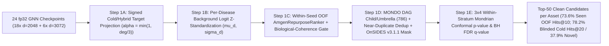

# 09 — Selection, Calibration, Ordering, Combination Recommendation & Interactive Visualization System

> **Monograph Series (Post-Audit Final Reference — Nov 2, 2026)**
> * **Part I**: [07_END_TO_END_ARCHITECTURE_AND_DATA_ENGINEERING.md](file:///home/nchen10/antigravity_prjs/kg/docs/07_END_TO_END_ARCHITECTURE_AND_DATA_ENGINEERING.md) — Strategic Plan, 5-Tier Architecture, `OptimusKG v3.2` -> `clinical_v4` Curation, `OnSIDES v3.1.1` + MONDO DAG Hygiene, and `amgen_v5` Data Engineering.
> * **Part II**: [08_MODEL_TRAINING_CAMPAIGNS_AND_BENCHMARKS.md](file:///home/nchen10/antigravity_prjs/kg/docs/08_MODEL_TRAINING_CAMPAIGNS_AND_BENCHMARKS.md) — Scalable `HeteroRGCN` + `TorchHeteroGraph` Engine, All `30` Trained Models, `24`-Model Ensemble (`944.2M` Largest Single GNN, `35.9×` TxGNN), and Paired 207-Disease Bootstrap Benchmarks.
> * **Part III (This Document)**: [09_RANKING_RECOMMENDATION_AND_VISUALIZATION_SYSTEM.md](file:///home/nchen10/antigravity_prjs/kg/docs/09_RANKING_RECOMMENDATION_AND_VISUALIZATION_SYSTEM.md) — Leak-Free Within-Seed Goal 1 Ordering, MONDO + `OnSIDES v3.1.1` Masking, Goal 2 `OptimusCombo-Net` Co-Administration & IP Tiering, `<1.5s` 4-Family CPU Scorer, and 15-View Discovery Studio.
> * **Part IV**: [10_CRITICAL_AUDIT_AND_AMGEN_NEXT_STEPS_PLAN.md](file:///home/nchen10/antigravity_prjs/kg/docs/10_CRITICAL_AUDIT_AND_AMGEN_NEXT_STEPS_PLAN.md) — Biostatistics Audit, Root-Cause Fixes (`RC-1`..`RC-5`), 2024–2026 Literature Synthesis, and Amgen-Wide Roadmap.

---

## 1. Goal 1 Engine: How `18,025` Diseases Are Projected, Standardized, Masked & Calibrated

Implemented in [`calibration.py`](file:///home/nchen10/antigravity_prjs/kg/optimus_txgnn/calibration.py), [`ontology_and_safety_filters.py`](file:///home/nchen10/antigravity_prjs/kg/optimus_txgnn/ontology_and_safety_filters.py), and [`run_amgen_goal1_and_goal2_pipeline.py`](file:///home/nchen10/antigravity_prjs/kg/run_amgen_goal1_and_goal2_pipeline.py), Goal 1 converts raw outputs from all **`24` `fp32` GNN checkpoints (`c = 1..24`)** into statistically calibrated, hub-debiased, ontology- and safety-masked disease rankings across all `47` Amgen assets (`18,663` unified drugs $\times$ `18,025` clinical diseases).

### Step 1A — Coordinate-Frame-Exact Cold & Hybrid Target Projection
Commercial drugs with $\text{deg}_{\text{ind}}(u) \ge 3$ use their exact transductive Layer-2 embedding $h_u^{(2, c)}$ (`0.0` drift). However, pure inductive pipeline/preclinical assets (`MariTide`, `Xaluritamig`, `AMG 193`, `AMG 691`, or any custom `AMG-XXXX` asset where $\text{deg}_{\text{ind}}(u) = 0$) and narrow-label Phase 3 / newly approved assets ($1 \le \text{deg}_{\text{ind}}(u) \le 2$, e.g., `Sotorasib`, `Tezepelumab`, `Tarlatamab`) require target-driven message passing inside checkpoint $c$'s exact Layer-2 coordinate frame.

Given signed target specifications $\mathcal{T}(u) = \{(g_i, r_i, w_i)\}$ expanded with `0.25×` 1-hop `protein_protein` neighbors (up to `12` PPI neighbors per primary target), [`project_cold_or_hybrid_drug_embedding`](file:///home/nchen10/antigravity_prjs/kg/optimus_txgnn/calibration.py#L224-L299) projects Layer-1 gene embeddings $h_{g_i}^{(1, c)}$ through checkpoint $c$'s own learned reverse relation matrix $W_{\text{rev}(r_i)}^{(2, c)}$, normalizes to the median L2 norm $\bar{\nu}_c$ of active transductive drugs, and smoothly blends by $\alpha_u = \min(1, \text{deg}_{\text{ind}}(u) / 3)$:

$$
h_{u, \text{ind}}^{(2, c)} = \bar{\nu}_c \, \frac{\sum_{(g, r, w) \in \mathcal{T}^+(u)} w \, W_{\text{rev}(r)}^{(2, c)} h_g^{(1, c)}}{\left\|\sum_{(g, r, w) \in \mathcal{T}^+(u)} w \, W_{\text{rev}(r)}^{(2, c)} h_g^{(1, c)}\right\|_2}, \qquad
h_u^{(2, c)} = \alpha_u \, h_{u, \text{trans}}^{(2, c)} + (1 - \alpha_u)\, \tilde{h}_{u, \text{ind}}^{(2, c)}
$$

### Step 1B — Per-Disease Background Logit Standardization (`Hub-Bias Elimination`)
For each checkpoint $c \in \{1, \dots, 24\}$, let $\ell_{u, d}^{(c)}$ be the raw `DistMult` indication logit. High-degree umbrella diseases possess larger embedding norms $\|\hat{h}_d^{(2, c)}\|$, inflating raw logits across *all* drugs. [`standardize_logits_per_disease`](file:///home/nchen10/antigravity_prjs/kg/optimus_txgnn/calibration.py#L38-L62) computes the background mean $\mu_d^{(c)}$ and standard deviation $\sigma_d^{(c)}$ strictly over non-positive drugs ($Y_{u, d}^{\text{train}} = 0$) and standardizes column-wise:

$$
z_{u, d}^{(c)} = \frac{\ell_{u, d}^{(c)} - \mu_d^{(c)}}{\sigma_d^{(c)}}, \qquad
\bar{z}_{u, d} = \frac{1}{24} \sum_{c=1}^{24} z_{u, d}^{(c)}, \qquad
\sigma_z(u, d) = \sqrt{\frac{1}{24} \sum_{c=1}^{24} \left(z_{u, d}^{(c)} - \bar{z}_{u, d}\right)^2}
$$

Notice that $z_{u, d}^{(c)}$ is dimensionless across both `d = 2048` and `d = 3072` architectures, enabling exact variance-weighted fusion across heterogeneous model widths while $\sigma_z(u, d)$ measures cross-seed / cross-architecture epistemic disagreement.

### Step 1C — Leak-Free Within-Seed 8-Feature `AmgenRepurposeRanker` & Biological-Coherence Gate
[`AmgenRepurposeRanker`](file:///home/nchen10/antigravity_prjs/kg/optimus_txgnn/calibration.py#L331-L430) fuses per-seed standardized GNN statistics with orthogonal human genetic causality, organ expression concordance, contraindication clearance, and disease specificity via **exact bound-constrained (`w_j >= 0`) $L_2$-regularized logistic regression (`L-BFGS-B`)** trained strictly **within-seed out-of-fold** (`full_graph_{42,1,2}` validation splits using only that seed's 8 checkpoints—eliminating cross-seed `s1/s2 -> val42` memorization and artificial `0.05` weight floors). Below are the exact learned weights from [`pipeline_benchmark_and_summary.json`](file:///home/nchen10/antigravity_prjs/kg/amgen_discovery_studio/results/pipeline_benchmark_and_summary.json):

| Feature Index & Name | Learned Weight | Biological & Statistical Role |
| :--- | :---: | :--- |
| `0: z_std_mean` ($\bar{z}_{u, d}$) | **`+0.1535`** | Per-disease standardized `24`-model therapeutic signal |
| `1: p_ens_mean` ($\bar{p}_{u, d}^{\text{ind}}$) | **`+0.1785`** | Absolute `24`-model `DistMult` probability consensus |
| `2: neg_std_z` ($-\sigma_z(u, d)$) | **`+0.0347`** | Rewards cross-seed / cross-architecture agreement (penalizes $\sigma_z$) |
| `3: direct_l2g_max` | **`+0.1237`** | Max `Open Targets` `L2G` / `DisGeNET` human genetic score on direct drug targets |
| `4: ppi1hop_l2g_sum` | **`+0.0702`** | $\log(1 + \sum)$ genetic causality across 1-hop `protein_protein` pathway neighborhood *(learned positive without clamping!)* |
| `5: tissue_concordance` | **`+0.0015`** | Organ/Uberon expression cosine between drug targets and causal disease genes |
| `6: neg_p_contra` ($-\bar{p}_{u, d}^{\text{con}}$) | **`+0.0000`** | Contraindication clearance (explicitly enforced via Step 1D `OnSIDES` + contraindication mask) |
| `7: dis_specificity` | **`-0.1074`** | Free-sign degree specificity regularizer |

In addition, for cold/narrow-label target-defined assets ($\text{deg}_{\text{ind}}(u) < 3$), `AmgenRepurposeRanker.score` applies a smooth **Biological-Coherence Gate** whenever `direct_l2g == 0` and `ppi1hop_l2g < 0.05` on high-degree hub diseases—eliminating topological hub spillover (`Tezepelumab -> metastatic colon cancer [L2G=0]` $\to$ `#1 Churg-Strauss / EGPA`, `#2 chronic rhinosinusitis`, `#3 ANCA vasculitis`, `#5 eosinophilic esophagitis`).

### Step 1D — MONDO Ontology DAG & `OnSIDES v3.1.1` / Target-Class Toxicity Masking
Implemented in [`ontology_and_safety_filters.py`](file:///home/nchen10/antigravity_prjs/kg/optimus_txgnn/ontology_and_safety_filters.py), every drug's candidate disease pool is cleaned **before** conformal testing:
1. **MONDO / Open Targets Label-Family Closure (`28,784` raw `PARENT` + `5,934` `mondo.obo` edges)**: Masks exact approved indications, `1..4`-hop descendants of specific non-umbrella labels ($\text{descendants} < 35$), `1..2`-hop ancestors, and lexical subtypes (eliminating label children like *migraine without aura* for `Erenumab`, *stage 5 CKD* for `Darbepoetin`, and `4` *urea-cycle* subtypes for `Buphenyl`, while preserving *osteogenesis imperfecta* under `Romosozumab` by not expanding broad umbrella `EFO_0004260 'bone disease'`).
2. **Non-Actionable Umbrella, Near-Duplicate & Prior-Trial Audit Filter**: Masks **`786` broad ontology umbrella nodes** (e.g., *metastatic malignant neoplasm*, *central nervous system disorder*, *malignant ovarian tumor*, *urinary system neoplasm*, *benign mammary dysplasia*) + `244` procedural/iatrogenic/acute mucosal toxicity nodes globally, deduplicates parent/child or sibling MONDO synonyms per drug via [`deduplicate_ranked_diseases`](file:///home/nchen10/antigravity_prjs/kg/optimus_txgnn/ontology_and_safety_filters.py) (collapsing e.g. *stomach neoplasm / gastric cancer / gastric adenocarcinoma* or *cholangiocarcinoma / intrahepatic CCA* to the highest-ranked clinical entity), and explicitly tags prior unapproved Phase 2/3 trials (`"Tested in Phase X (N NCTs) — Not Approved (Audit Prior Trial Outcome)"`, `45` top-5 rows flagged across the portfolio, such as `Panitumumab` in `RCC`, `breast CA`, and `HCC`).
3. **`OnSIDES v3.1.1` (`6.93M` rows, April 2026) + Target-Class ADE Propagation**: Maps single-ingredient FDA/EMA/EMC/KEGG product-label Adverse Reactions and Boxed Warnings onto `2,249` KG drugs (`44,607` drug–ADE pairs, `228` Boxed-Warning drugs) and propagates recurring target-class toxicities (`>= 2` stems & `>= 30%` of drugs sharing `(gene, action)` with `L2G < 0.15`) to `5,081` drugs—eliminating `FGFR2`-inhibitor *mucositis / oral mucositis / stomatitis* from `Bemarituzumab` and *hyperglycemia / diabetes / deafness* from `Teprotumumab`.

### Step 1E — `3 × 4` Within-Stratum Mondrian Conformal Calibration & Benjamini–Hochberg `FDR`
[`MondrianConformalCalibrator`](file:///home/nchen10/antigravity_prjs/kg/optimus_txgnn/calibration.py#L76-L252) partitions `(drug u, disease d)` pairs into **`12` degree strata** across **all clinical `deg >= 1` drugs + `3,000` `deg == 0` drugs** (preventing selection bias in the empirical null):
* **Drug degree bins**: `ub = 0` (`deg == 0` cold/preclinical), `ub = 1` (`1..4` narrow clinical), `ub = 2` (`>= 5` broad commercial).
* **Disease degree bins**: `db = 0` (`deg == 0` zero-label), `db = 1` (`1..3` rare/orphan), `db = 2` (`4..20` moderate), `db = 3` (`> 20` high-degree).

Using uncertainty-penalized nonconformity $s(u, d) = -\text{RankerScore}(u, d) + 0.20\,\sigma_z(u, d)$ with continuous midpoint rank interpolation inside $S_{\text{null}}^{(ub, db)}$, conformal $p$-values are adjusted by **within-stratum Benjamini–Hochberg (`BH`)** over each drug's targetable candidate diseases $m_{u, db}$ (eliminating cross-stratum `minimum.accumulate` `q`-value plateaus such as `Teprotumumab`'s prior 50-way `q = 0.063` tie!):

$$
p_{\text{conf}}(u, d) = \frac{0.5 + \left|\left\{s' \in S_{\text{null}}^{(ub, db)} : s' < s(u, d)\right\}\right| + 0.5\left|\left\{s' = s(u, d)\right\}\right|}{1 + \left|S_{\text{null}}^{(ub, db)}\right|}, \qquad
q_{\text{FDR}}^{(db)}(u, d_{(k)}) = \min_{j \ge k} \left(\frac{m_{u, db}}{j}\, p_{\text{conf}}(u, d_{(j)})\right)
$$

> **Biostatistics Null Interpretation**: Following **Bates, Candès, Lei, Romano & Sesia (*Ann. Stat.* 2023)** and **Jin & Candès (*Biometrika* 2023, selection by prediction with conformal $p$-values)**, $q_{\text{FDR}}$ tests conditional exchangeability against random non-indicated pairs in the same `(drug_deg_bin, disease_deg_bin)` stratum—it is a statistical discovery filter, **not** clinical probability of regulatory approval (`PoS`).

### Goal 1 Leak-Free Benchmarks & Clean Portfolio Candidates (synced with [`METRICS.md`](file:///home/nchen10/antigravity_prjs/kg/METRICS.md))
1. **Seen-Drug Held-Out Label Recovery (`392` test drugs/seed, strict within-seed OOF 3-seed mean across `18,025` diseases)**:
   * Raw Uncalibrated Ensemble: `MRR = 0.3128` | `NDCG@20 = 0.3579` | `Hits@10 = 51.82%` | `Median Rank = 8.2`
   * Per-Disease Standardized: `MRR = 0.3341` | `NDCG@20 = 0.4125` | `Hits@10 = 62.80%` | `Median Rank = 5.3`
   * **Leak-Free `AmgenRepurposeRanker v5`**: **`MRR = 0.4711` | `NDCG@20 = 0.5393` | `Hits@10 = 73.62%` | `Hits@30 = 85.19%` | `Median Rank = 3.0`** *(superseding the cross-seed-memorized `97.73%`; note that seen-drug recovery tests left-out approved labels on known drugs, whereas prospective new-target utility is measured by #2 below)*.
2. **Stratified Blinded Cold-Target Holdout (`16,992` targetable diseases, drug node blinded to `deg = 0` & scored purely from signed targets)**:
   * **Cohort A1 — Overall Zero-Train-Indication Drugs (`n = 124`)**: **`Hits@10 = 68.55%`, `Hits@20 = 78.23%` (`664.6×` vs. random `0.118%`), `Hits@50 = 87.90%`, `MRR = 0.3188`, `Median Rank = 4.5`** (vs. random `8,496`).
   * **Cohort A2 — Same-Target Class Precedent Stratum (`n = 95`, another training drug shares a target for `d`)**: **`Hits@10 = 83.16%`, `Hits@20 = 90.53%`, `Median Rank = 3.0`** (e.g., *Rimegepant* `CALCRL- -> migraine #1`, *Elagolix* `GNRHR- -> endometriosis #2`).
   * **Cohort A3 — Strictly Novel Target–Indication Stratum (`n = 29`, ZERO training drugs targeting any gene in $T_u$ indicated for `d`)**: **`Hits@10 = 20.69%`, `Hits@20 = 37.93%` (`322.3×` random), `Hits@50 = 51.72%`, `Median Rank = 50.0`** (vs. `8,496` random — genuine zero-precedent target discovery).
   * **Cohort B — All Node-Blinded Test Drugs (`n = 888`)**: **`Hits@20 = 70.27%`, `Median Rank = 7.0`**.
3. **Deduplicated `47`-Asset Portfolio Yield (`2,350` exported rows = `47 × 50` after MONDO near-duplicate deduplication + `786` umbrella + `OnSIDES` masking)**:
   * **`12` deduplicated candidates at `FDR <= 10%` across `5 / 47` assets** (`2` at `FDR <= 5%`; median best `q`-value across all `47` assets = **`0.5083`**, so `42 / 47` assets are exploratory hypothesis-generating; `45` top-5 rows carry explicit `Tested in Phase 2/3 — Not Approved` audit tags):
     * **MariTide (`GLP1R+/GIPR-`, `0` KG approvals)**: *obesity* (`#1`, `P_cal = 0.9319`, **`FDR q = 4.72%`**, `L2G = 1.000`) & *type 2 diabetes mellitus* (`P_cal = 0.7712`, `L2G = 1.000`).
     * **Aflibercept / Pavblu (`VEGFA-`)**: *pathological myopia* (`#1`, `P_cal = 0.9916`, **`FDR q = 3.68%`**, `L2G = 0.937`, Phase 3 class precedent).
     * **Bemarituzumab (`FGFR2b-`, Phase 3)**: *cholangiocarcinoma* (`#1`, `P_cal = 0.9237`, `q = 7.69%`, `L2G = 0.639`), *urothelial carcinoma* (`#2`, `q = 8.89%`, `L2G = 0.575`), and *squamous NSCLC* (`#4`, `q = 8.89%`)—actionable specifically in **`FGFR2b`-overexpressing/amplified** patient subsets.
     * **Blinatumomab / Blincyto (`CD19 × CD3` BiTE)**: *diffuse large B-cell lymphoma* (`#1`, `P_cal = 0.9729`, `q = 7.55%`, `L2G = 1.000`, Phase 2).
     * **Romosozumab / Evenity (`SOST-`) & Tezepelumab / Tezspire (`TSLP-`)**: `Romosozumab #6` *osteogenesis imperfecta type 4* (Phase 3 aligns; Mendelian LoF `SOST` syndromes flagged for signed genetics); `Tezepelumab #1` *Churg-Strauss syndrome / EGPA* (`L2G = 0.313`), `#2` *chronic rhinosinusitis* (`L2G = 0.391`), `#5` *eosinophilic esophagitis* (`L2G = 0.500`).

---

## 2. Goal 2 Engine: `OptimusCombo-Net` Pan-Disease Combination Selection & Ordering

Implemented in [`combo_model.py`](file:///home/nchen10/antigravity_prjs/kg/optimus_txgnn/combo_model.py), Goal 2 solves `(Amgen Drug u, Partner Drug v, Disease d)` ranking across **`1,059` clinical diseases** and **`9,445` candidate partner drugs**.

### 2.1 Exact Permutation Invariance & Multi-Width (`d = 2048 + d = 3072`) Gauge Safety
Independently trained GNN checkpoints possess an $\mathcal{O}(d)$ rotational/permutation gauge freedom in latent space—concatenating or averaging raw vectors across `d = 2048` and `d = 3072` models is mathematically invalid. Instead, we extract **`24` strictly symmetric, gauge-invariant features** $x(u, v, d) \equiv x(v, u, d)$:
1. **`12` Multi-Checkpoint Geometric Features (computed *inside* each checkpoint's own coordinate frame before averaging across all `24` models)**:
   * Anchor & dual-agent therapeutic strength: $\max(\bar{z}_{u,d}, \bar{z}_{v,d})$, $\min(\bar{z}_{u,d}, \bar{z}_{v,d})$, $\bar{z}_{u,d} + \bar{z}_{v,d}$, $|\bar{z}_{u,d} - \bar{z}_{v,d}|$, $\max(\bar{p}_{u,d}, \bar{p}_{v,d})$, $\bar{p}_{u,d}\cdot\bar{p}_{v,d}$.
   * Drug–drug cosine complementarity: $\overline{\cos}(h_u^{(2)}, h_v^{(2)})$ and sweet-spot non-redundancy $1 - |\overline{\cos}(u, v) - 0.35|$.
   * Joint disease-alignment gain: $\frac{1}{24}\sum_{c=1}^{24} \left[\cos\!\left(\frac{\hat{h}_u^{(c)} + \hat{h}_v^{(c)}}{2}, \hat{h}_d^{(c)}\right) - \max\bigl(\cos(\hat{h}_u^{(c)}, \hat{h}_d^{(c)}), \cos(\hat{h}_v^{(c)}, \hat{h}_d^{(c)})\bigr)\right]$.
   * Contraindication & epistemic risk: $\max(\bar{p}^{\text{con}})$, $\sum \bar{p}^{\text{con}}$, $\max(\sigma_z)$.
2. **`12` Sparse-CSR Mechanistic, Genetic, Tissue & DDI Safety Features ([`PanDiseaseMechanisticIndexer`](file:///home/nchen10/antigravity_prjs/kg/optimus_txgnn/combo_model.py#L62-L249))**:
   * **Distributive Sparse-CSR Identity (`>200×` Speedup)**: Defining weighted 1-hop target footprint $W_u = 1.0\,T_u + 0.35\,N_1(T_u)$ and disease-gene vector $G_d \ge 0$, we exploit $\max(W_u, W_v) \odot G_d = \max(W_u \odot G_d, W_v \odot G_d)$ to compute $\log(1 + \text{cov}_{\max})$, $\log(1 + \text{cov}_{\min})$, and **marginal newly covered genetic disease module gain** $\log(1 + \text{cov}_{u \cup v} - \text{cov}_{\max})$ in milliseconds!
   * **Target Orthogonality vs. Shared Signaling Hub**: Direct target Jaccard $J(T_u, T_v)$ (penalizes redundant me-too targets), 1-hop PPI Jaccard $J(N_1(T_u), N_1(T_v))$, and pathway complementarity $(1 - J(T_u, T_v)) \cdot \min(1, 4 J_{\text{PPI}} + 0.2) \cdot \log(1 + \text{cov}_{u \cup v})$.
   * **Pharmacodynamic Conflict, Tissue Cosine & Typed DDIs**: Structural opposite-sign target conflict ($\mathbb{I}[\exists g: u \text{ inhibits } g \land v \text{ activates } g]$), Uberon tissue expression cosine, known DrugBank PD synergy, PD antagonism, severe organ/QTc/bleeding/immunosuppression DDI risk, and dual FDA Black-Box warning indicator.
   * **Verified Empirical Symmetry**: $\max_{(u,v,d)} |f(u,v,d) - f(v,u,d)| = 5.96 \times 10^{-8}$.

### 2.2 3-Head Residual Architecture, `ComboUtility` Ranking & IP Tier Selection
[`OptimusComboNet`](file:///home/nchen10/antigravity_prjs/kg/optimus_txgnn/combo_model.py#L251-L299) (`Linear(24->128) -> LayerNorm -> GELU -> ResidualBlock(128) -> 3 Heads`) simultaneously predicts:
1. **$P_{\text{eff}}(u, v \mid d)$**: OOF Isotonic-calibrated disease-specific combination efficacy,
2. **$P_{\text{tox}}(u, v \mid d)$**: Overlapping adverse DDI / contraindication toxicity probability,
3. **$P_{\text{antag}}(u, v)$**: Pharmacodynamic antagonism probability (floored at `0.90` whenever an explicit opposite-sign target conflict exists!).

Candidate combinations are ordered within each disease and commercial IP tier by **`ComboUtility`**:

$$
\text{ComboUtility}(u, v \mid d) = P_{\text{eff}}(u, v \mid d) \cdot \bigl(1 - P_{\text{tox}}(u, v \mid d)\bigr)^{0.65} \cdot \bigl(1 - P_{\text{antag}}(u, v)\bigr)^{0.85}
$$

Each ranked combination is filtered through `OnSIDES v3.1.1` + Contraindication partner safety exclusions (preventing any partner drug from being paired in a disease listed as an Adverse Reaction or Boxed Warning on its label) + `786` MONDO umbrella masks, tagged with its **Commercial IP Tier** (`Tier 1: Amgen × Amgen Internal Portfolio` [`5,688` rows], `Tier 2: Amgen × Off-Patent FDA Generic [with active ANDA manufacturer count] / Biosimilar` [`5,688` rows], or `Tier 3: External Clinical Benchmark` [`5,688` rows]), and classified into one of **5 Clinical Combination Archetypes**.

* **Label Mix & Scope Transparency (`53,952` clinical triples across `1,059` diseases)**: `17,587` clinical positives (`13,731` ClinicalTrials.gov multi-agent arms + `3,820` co-indicated PD pairs + `36` landmark regimens) vs. `36,365` negatives (`1,714` head-to-head redundant arms + `231` PD-antagonistic pairs + `34,420` disease-matched single-agent controls). Models **clinical co-administration & pathway complementarity + commercial IP tiering** (distinct from cell-line Bliss/Loewe synergy; `p_antagonism > 0` on `164` Tier-1 rows, `p_toxicity >= 0.05` on `2,239` Tier-1 rows).
* **Primary De-Biased Clinical Validation — Strict Rule-Free NCT Dual-Active Clinical Trials OOF (`15,712` NCT multi-agent regimens [`13,767`] vs. NCT H2H/antagonistic arms [`1,945`]; ALL `8` rule-overlapping features `#9,#10,#15,#17,#18,#20,#21,#22` zeroed; `0` DrugBank rule positives; `0` random-partner swaps)**: **`0.9712` AUROC / `0.9944` AUPRC** *(vs. `0.8762` baseline; retires the circular `0.9943` rule-reconstructing hard-negative metric)*.
* **Rule-Free MONDO Ontology-Family-Blocked 5-Fold OOF (`203` disease families across all `53,952` triples)**: **`0.9327` AUROC / `0.8849` AUPRC** *(note: includes `34,420` single-drug swap controls where `gnn_z_min` detects dual single-agent activity; full-feature `0.9500` retired from lead claims)*.
* **5-Fold Amgen-Drug-Cold Holdout (`3,550` triples where entire Amgen drugs are unseen during training)**: **`0.9343` AUROC / `0.8949` AUPRC**, exact order symmetry `5.96e-08`.

---

## 3. Cross-Environment 4-Family Portable Pack & `<1.5s` Confidential `AMG-XXXX` Scorer

To ensure Amgen scientists or traveling team members can score brand-new, confidential preclinical target hypotheses (`AMG-XXXX`) **without** needing a `96 GB` GPU or matching Python/PyTorch versions, [`portable_pack.py`](file:///home/nchen10/antigravity_prjs/kg/optimus_txgnn/portable_pack.py) and [`score_new_amgen_asset.py`](file:///home/nchen10/antigravity_prjs/kg/score_new_amgen_asset.py) distill representative `s42` seeds across **all 4 architectural families** (`v4_wmatch d=2048`, `v5bi d=2048`, `v5bi d=3072`, and `v5fm MedCPT d=2048`) plus Open Targets genetics & target-class ADE masking into [`data_optimuskg/post_ultra_inference_pack/`](file:///home/nchen10/antigravity_prjs/kg/data_optimuskg/post_ultra_inference_pack):
* **`pack_tensors_fp16.pt` (`1.66 GB`)**: Stores pre-projected `fp16` gene matrices $W_{\text{rev}(r)}^{(2, c)} h_g^{(1, c)}$, relation-weighted disease matrices $w_\rho^{(c)} \odot \hat{h}_d^{(2, c)}$, background $(\mu_d^{(c)}, \sigma_d^{(c)})$ vectors across all 4 families (`d = 2048` & `d = 3072`), and sparse mechanistic/genetic CSR tables (`_use_new_zipfile_serialization=False`, `pickle_protocol=4`).
* **`portable_models_v1.pt` (`23 MB`)**: Exports the leak-free `AmgenRepurposeRanker`, `3 × 4` within-stratum `MondrianConformalCalibrator`, `OptimusComboNet`, and recurring target-class ADE masks as pure PyTorch tensors & primitive Python dicts—eliminating `Python 3.8 <-> 3.13`, `NumPy 1.x <-> 2.x`, and `scikit-learn 1.3 <-> 1.6` pickle incompatibilities (`0.0` numerical drift).
* **Measured Latency**: Ranks all `18,025` diseases + Top `Tier 1` & `Tier 2` combinations for any multi-target asset (e.g., `GIPR:inhibits,GLP1R:activates` or `TSLP:inhibits,IL13:inhibits`) in **`0.95–1.25 seconds` on CPU**.

---

## 4. Interactive 15-View Visualization Studio & 5 Zero-Server Client Decks

Implemented across [`build_amgen_explorer_bundle.py`](file:///home/nchen10/antigravity_prjs/kg/build_amgen_explorer_bundle.py), [`build_amgen_studio_and_decks.py`](file:///home/nchen10/antigravity_prjs/kg/build_amgen_studio_and_decks.py), [`serve_amgen_studio.py`](file:///home/nchen10/antigravity_prjs/kg/serve_amgen_studio.py), and 4 modular UI engines ([`studio_ui_styles_and_layout.py`](file:///home/nchen10/antigravity_prjs/kg/optimus_txgnn/studio_ui_styles_and_layout.py), [`studio_ui_explorer_graph_js.py`](file:///home/nchen10/antigravity_prjs/kg/optimus_txgnn/studio_ui_explorer_graph_js.py), [`studio_ui_explorer_paths_and_tsne_js.py`](file:///home/nchen10/antigravity_prjs/kg/optimus_txgnn/studio_ui_explorer_paths_and_tsne_js.py), [`studio_ui_translational_js.py`](file:///home/nchen10/antigravity_prjs/kg/optimus_txgnn/studio_ui_translational_js.py); full tab-by-tab manual in [06_AMGEN_DISCOVERY_STUDIO_DESIGN_AND_FEATURE_GUIDE.md](file:///home/nchen10/antigravity_prjs/kg/docs/06_AMGEN_DISCOVERY_STUDIO_DESIGN_AND_FEATURE_GUIDE.md)):

### 4.1 Unified 15-Tab Architecture (`amgen_discovery_studio/portal/index.html`)
Every Amgen asset or disease selected in the left sidebar synchronizes reactively (`STATE`) across **two integrated workspaces**:

* **Workspace A — Self-Explaining `d = 3072` `GraphMask` KG Explorer (`8` Views)**:
  1. **Meta-Path Matrix & Subgraph Summary**: Groups all causal routes connecting the selected Amgen drug and target disease by canonical meta-path template (e.g., `drug -> gene/protein -> pathway -> gene/protein -> disease`) with clickable node pills and `GraphMask` gate bars.
  2. **Dual Layer-1 / Layer-2 Attention Trees**: Side-by-side hierarchical D3 trees expanding outward from both the **Amgen Drug** (left) and **Target Disease** (right) with symmetric tooltips showing exact `GraphMask` Layer-1 & Layer-2 edge gate weights.
  3. **Pinned Multi-Disease Comparative Subgraph**: Force-directed D3 network comparing shared vs. indication-specific molecular bridges across multiple pinned diseases simultaneously.
  4. **Top Causal Paths Table**: Ranked `2–5` hop mechanistic paths scored by geometric mean of `d = 3072` `GraphMask` gates $\times$ genetic `L2G` weight.
  5. **Deep `2–10` Hop Signaling Cascade**: Layered DAG tracing upstream target modulation through intracellular PPI, Reactome pathways, biological processes, and Uberon anatomy into clinical phenotypes.
  6. **Node Attention & Bottleneck Centrality**: Bar/radar breakdown of the highest-leverage intermediate genes, pathways, and anatomical tissues mediating therapeutic signal.
  7. **Interactive Zoomable Neighborhood Subgraph**: Full pan/zoom local KG inspector with relation-type color legend and edge-threshold slider.
  8. **`20,672`-Node HTML5 Canvas Embedding Atlas (`t-SNE`)**: Hardware-accelerated 60-fps scatter plot of all `18,025` clinical diseases + `2,647` clinical/Amgen drugs in 2D latent space with live search & lasso/hover inspection.
* **Workspace B — Amgen Goal 1 Repurposing, Goal 2 Combinations & Live Scorer (`7` Views)**:
  9. **Goal 1 Repurposing Waterfall & Conformal `FDR` Table**: Top-50 novel indications per Amgen asset with `P_cal`, `z_std`, `FDR q-value` badges, `Open Targets` `L2G` bars, and existing `ClinicalTrials.gov` phase annotations.
  10. **Signed Mechanism & Human Genetics Capsules**: Visual cards illustrating `Drug -> [inhibits/activates] -> Target -> PPI/Pathway -> Disease` alongside tissue concordance and contraindication clearance.
  11. **Goal 2 Tier 1 (`Amgen × Amgen`) Portfolio Combinations**: Ranked internal combination regimens across `5` franchises with `ComboUtility`, `P_eff`, safety clearance, and Combination Archetype badges.
  12. **Goal 2 Tier 2 (`Amgen × Off-Patent Generic / Biosimilar`) Combinations**: Ranked low-acquisition-cost combinations annotated with **`$ Low-Cost Generic`**, active FDA `ANDA` manufacturer counts, and Purple Book biosimilar status.
  13. **Dual-Drug Combination Mechanism Network**: Interactive bipartite/tripartite D3 graph showing how Drug $u$ and Partner $v$ cover orthogonal vs. convergent causal genes of Disease $d$ while highlighting any DDI or safety flags.
  14. **Executive `47`-Asset Portfolio Opportunity Matrix & Benchmarks**: Franchise-level heatmap, `24`-model benchmark scorecards, and CSV export controls.
  15. **Live Confidential `AMG-XXXX` Target Scorer & `<20 ms` `Disease -> Drug` Reverse Screening**: Interactive form (backed by `/api/score_new_asset` and `/api/explorer/disease_to_drugs` on `:8004`, plus `Cell 8` Colab guide in offline mode) to score arbitrary multi-target hypotheses on the fly.

### 4.2 Five Zero-Server Standalone `.html` Client Decks (`amgen_discovery_studio/client_decks/`)
To enable one-file offline sharing with franchise leads on any laptop/browser (`0` Python, `0` cloud server, `0` internet needed), [`build_amgen_studio_and_decks.py`](file:///home/nchen10/antigravity_prjs/kg/build_amgen_studio_and_decks.py) compiles self-contained HTML bundles embedding compressed JSON slices of the `24`-model tables + `d = 3072` `GraphMask` Explorer subgraphs:
1. **[`Amgen_Executive_Full_Portfolio_Deck.html`](file:///home/nchen10/antigravity_prjs/kg/visualization_studio/Full_Portfolio_47_Assets_Discovery_Portal.html)** (`28.0 MB` — all `47` Amgen assets across all `5` franchises)
2. **`Oncology_Hematology_Client_Deck.html`** (`8.6 MB` — BiTEs, targeted small molecules, mAbs, and pipeline assets including `Tarlatamab`, `Blinatumomab`, `Sotorasib`, `Bemarituzumab`, `Xaluritamig`, `AMG 193`, `Carfilzomib`, `Romiplostim`)
3. **`Inflammation_Immunology_Client_Deck.html`** (`7.1 MB` — `Tezepelumab`, `Otezla/Apremilast`, `Enbrel`, `Rocatinlimab`, `Ordesekimab`, `Dazodalibep`, `Daxdilimab`, `Fipaxalparant`, `AMG 691`)
4. **`Cardiometabolic_Obesity_Client_Deck.html`** (`3.2 MB` — `Repatha/Evolocumab`, `MariTide`, `Olpasiran`)
5. **`Rare_Bone_Neuro_Biosimilars_Client_Deck.html`** (`13.6 MB` — `Tepezza`, `Uplizna`, `Tavneos`, `Krystexxa`, `Ravicti`, `Buphenyl`, `Procysbi`, `Prolia/Evenity`, `Aimovig`, `Aranesp/Epogen`, `Sensipar/Parsabiv`, and Amgen Biosimilars `Amjevita`, `Mvasi`, `Pavblu`, `Wezlana`, `Riabni`, `Kanjinti`).
